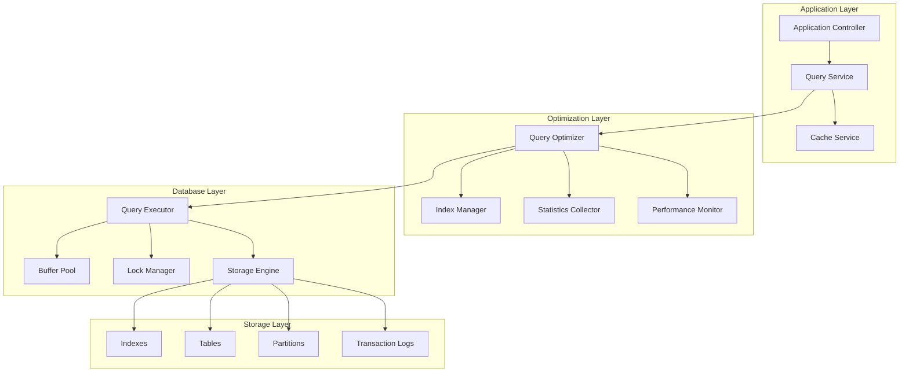
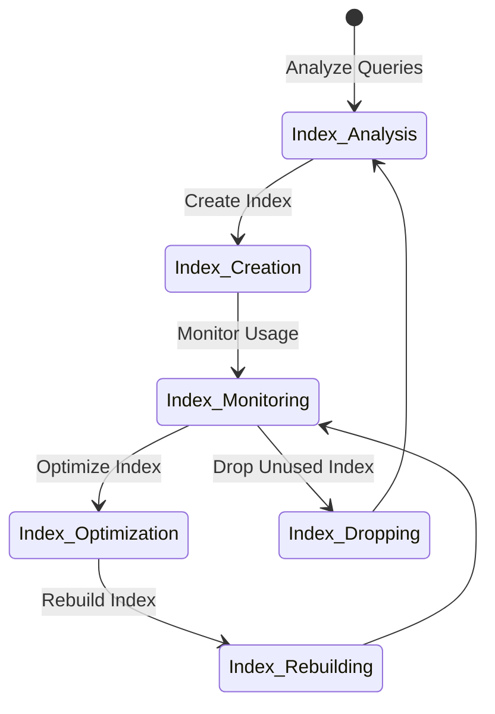

# Database Optimization - Architect Deep Dive

**0. Executive Summary (Architect View)**
- **Database Optimization exists** to maximize database performance through systematic tuning and optimization
- **Critical at scale** when applications handle large datasets and high query volumes
- **System design impact** - transforms database from basic storage to high-performance engine
- **Performance foundation** - provides essential performance optimization for data access
- **Scalability enhancement** - enables efficient data processing and retrieval
- **Cost optimization** - reduces infrastructure costs through performance improvements
- **User experience** - provides faster data access and better application performance
- **Resource efficiency** - optimizes hardware and infrastructure utilization

**1. Problem Framing**
**Real production problem solved:**
- Slow query performance and database bottlenecks
- Poor resource utilization and high infrastructure costs
- Database scalability issues and performance degradation
- Inefficient data access patterns and poor user experience
- Database deadlocks and concurrency issues

**What breaks if we don't understand Database Optimization:**
- Poor application performance and slow response times
- High infrastructure costs and resource waste
- Database scalability limitations and growth constraints
- Poor user experience and customer dissatisfaction
- Inability to handle increasing data volumes

**Scale importance:**
- **Small applications**: Database optimization noticeable
- **Medium applications**: Database optimization critical
- **Large applications**: Database optimization essential
- **Enterprise systems**: Database optimization mandatory

**Failure stories:**
- E-commerce platform had slow checkout process due to database queries
- SaaS application had performance issues during peak usage
- Financial system had transaction processing bottlenecks
- Analytics platform had slow report generation

**2. Deep Internal Mechanics**

**Database Optimization Fundamentals:**
- **Query Optimization**: Efficient SQL query execution
- **Index Optimization**: Strategic index creation and maintenance
- **Schema Design**: Optimal database structure design
- **Resource Management**: Efficient memory and CPU utilization
- **Concurrency Control**: Optimized transaction handling

**Core Components:**
- **Query Optimizer**: Query execution plan optimization
- **Index Manager**: Index creation and maintenance
- **Statistics Collector**: Data distribution statistics
- **Buffer Pool Manager**: Memory buffer management
- **Lock Manager**: Concurrency control and locking
- **Storage Engine**: Data storage and retrieval

**Key Concepts:**
- **Execution Plans**: Query execution strategies
- **Index Types**: B-tree, hash, full-text indexes
- **Partitioning**: Data partitioning strategies
- **Normalization**: Database normalization principles
- **Denormalization**: Strategic denormalization for performance
- **Caching**: Query result caching

**Optimization Techniques:**
- **Query Rewriting**: SQL query optimization
- **Index Tuning**: Index creation and maintenance
- **Partitioning**: Horizontal and vertical partitioning
- **Materialized Views**: Pre-computed query results
- **Connection Pooling**: Database connection optimization
- **Batch Processing**: Efficient bulk operations

**Performance Monitoring:**
- **Query Analysis**: Query performance analysis
- **Resource Monitoring**: CPU, memory, I/O monitoring
- **Bottleneck Identification**: Performance bottleneck detection
- **Trend Analysis**: Performance trend analysis
- **Alerting**: Performance alerting and notification

**Data Structures:**
- **B-Tree Indexes**: Balanced tree structures
- **Hash Indexes**: Hash-based indexing
- **Bitmap Indexes**: Bitmap-based indexing
- **Partition Tables**: Partitioned data structures
- **Materialized Views**: Pre-computed result sets

**Performance Characteristics:**
- **Query Execution Time**: 1ms-10s
- **Index Lookup Time**: 1-100ms
- **Memory Usage**: 10-80% of available memory
- **CPU Utilization**: 20-90% of available CPU
- **I/O Throughput**: 100-1000 MB/s

**3. .NET Production Implementation**

**Naive Implementation (Unoptimized):**
```csharp
[ApiController]
[Route("api/[controller]")]
public class UnoptimizedProductController : ControllerBase
{
    private readonly ApplicationDbContext _context;
    
    public UnoptimizedProductController(ApplicationDbContext context)
    {
        _context = context;
    }
    
    [HttpGet("products")]
    public async Task<ActionResult<List<Product>>> GetProducts()
    {
        // N+1 query problem
        var products = _context.Products.ToList();
        
        foreach (var product in products)
        {
            // Additional query for each product
            product.Category = _context.Categories.Find(product.CategoryId);
            product.Reviews = _context.Reviews.Where(r => r.ProductId == product.Id).ToList();
        }
        
        return products;
    }
    
    [HttpGet("products/search")]
    public async Task<ActionResult<List<Product>>> SearchProducts(string query)
    {
        // Inefficient query with LIKE operator
        var products = _context.Products
            .Where(p => p.Name.Contains(query) || p.Description.Contains(query))
            .ToList();
        
        return products;
    }
}
```

**Production-Ready Database Optimization Implementation:**
```csharp
// Database Optimization Configuration
public class DatabaseOptimizationConfiguration
{
    public bool EnableQueryOptimization { get; set; } = true;
    public bool EnableIndexOptimization { get; set; } = true;
    public bool EnablePartitioning { get; set; } = true;
    public bool EnableCaching { get; set; } = true;
    public bool EnableConnectionPooling { get; set; } = true;
    public int MaxConnectionPoolSize { get; set; } = 100;
    public int QueryTimeoutSeconds { get; set; } = 30;
    public int CommandTimeoutSeconds { get; set; } = 60;
    public List<string> SlowQueryThresholds { get; set; } = new();
    public Dictionary<string, IndexConfiguration> IndexConfigurations { get; set; } = new();
}

public class IndexConfiguration
{
    public string TableName { get; set; }
    public string[] Columns { get; set; }
    public string IndexType { get; set; } = "BTree";
    public bool IsUnique { get; set; } = false;
    public bool IsClustered { get; set; } = false;
}

// Database Optimization Service
public interface IDatabaseOptimizationService
{
    Task<QueryPerformanceResult> AnalyzeQueryAsync(string query);
    Task<bool> CreateIndexAsync(IndexConfiguration configuration);
    Task<bool> OptimizeTableAsync(string tableName);
    Task<DatabaseMetrics> GetDatabaseMetricsAsync();
    Task<List<SlowQuery>> GetSlowQueriesAsync();
    Task<bool> UpdateStatisticsAsync(string tableName);
    Task<PartitioningResult> PartitionTableAsync(string tableName, string partitionColumn);
}

public class DatabaseOptimizationService : IDatabaseOptimizationService
{
    private readonly ApplicationDbContext _context;
    private readonly IQueryCache _queryCache;
    private readonly ILogger<DatabaseOptimizationService> _logger;
    private readonly IMetrics _metrics;
    private readonly DatabaseOptimizationConfiguration _configuration;

    public DatabaseOptimizationService(
        ApplicationDbContext context,
        IQueryCache queryCache,
        ILogger<DatabaseOptimizationService> logger,
        IMetrics metrics,
        IOptions<DatabaseOptimizationConfiguration> configuration)
    {
        _context = context ?? throw new ArgumentNullException(nameof(context));
        _queryCache = queryCache ?? throw new ArgumentNullException(nameof(queryCache));
        _logger = logger ?? throw new ArgumentNullException(nameof(logger));
        _metrics = metrics ?? throw new ArgumentNullException(nameof(metrics));
        _configuration = configuration?.Value ?? new DatabaseOptimizationConfiguration();
    }

    public async Task<QueryPerformanceResult> AnalyzeQueryAsync(string query)
    {
        using var activity = _metrics.StartTimer("database_query_analysis_duration");
        
        try
        {
            _logger.LogInformation("Analyzing query performance: {Query}", query);
            
            // Get execution plan
            var executionPlan = await GetExecutionPlanAsync(query);
            
            // Analyze execution plan
            var analysis = await AnalyzeExecutionPlanAsync(executionPlan);
            
            var result = new QueryPerformanceResult
            {
                Query = query,
                ExecutionPlan = executionPlan,
                EstimatedCost = analysis.EstimatedCost,
                Recommendations = analysis.Recommendations,
                IndexesUsed = analysis.IndexesUsed,
                TableScans = analysis.TableScans,
                Timestamp = DateTime.UtcNow
            };
            
            _metrics.Increment("database_query_analysis_success");
            _logger.LogInformation("Query analysis completed: {Query} - Cost: {Cost}", query, result.EstimatedCost);
            
            return result;
        }
        catch (Exception ex)
        {
            _metrics.Increment("database_query_analysis_error");
            _logger.LogError(ex, "Error analyzing query: {Query}", query);
            throw;
        }
    }

    public async Task<bool> CreateIndexAsync(IndexConfiguration configuration)
    {
        using var activity = _metrics.StartTimer("database_index_creation_duration");
        
        try
        {
            _logger.LogInformation("Creating index: {Table} - {Columns}", configuration.TableName, string.Join(", ", configuration.Columns));
            
            // Check if index already exists
            var existingIndex = await GetExistingIndexAsync(configuration.TableName, configuration.Columns);
            if (existingIndex != null)
            {
                _logger.LogInformation("Index already exists: {Table} - {Columns}", configuration.TableName, string.Join(", ", configuration.Columns));
                return true;
            }
            
            // Create index
            var createIndexSql = GenerateCreateIndexSql(configuration);
            await _context.Database.ExecuteSqlRawAsync(createIndexSql);
            
            _metrics.Increment("database_index_creation_success");
            _logger.LogInformation("Index created successfully: {Table} - {Columns}", configuration.TableName, string.Join(", ", configuration.Columns));
            
            return true;
        }
        catch (Exception ex)
        {
            _metrics.Increment("database_index_creation_error");
            _logger.LogError(ex, "Error creating index: {Table} - {Columns}", configuration.TableName, string.Join(", ", configuration.Columns));
            throw;
        }
    }

    public async Task<bool> OptimizeTableAsync(string tableName)
    {
        using var activity = _metrics.StartTimer("database_table_optimization_duration");
        
        try
        {
            _logger.LogInformation("Optimizing table: {TableName}", tableName);
            
            // Update table statistics
            await UpdateStatisticsAsync(tableName);
            
            // Rebuild fragmented indexes
            await RebuildIndexesAsync(tableName);
            
            // Optimize table storage
            await OptimizeTableStorageAsync(tableName);
            
            _metrics.Increment("database_table_optimization_success");
            _logger.LogInformation("Table optimized successfully: {TableName}", tableName);
            
            return true;
        }
        catch (Exception ex)
        {
            _metrics.Increment("database_table_optimization_error");
            _logger.LogError(ex, "Error optimizing table: {TableName}", tableName);
            throw;
        }
    }

    public async Task<DatabaseMetrics> GetDatabaseMetricsAsync()
    {
        using var activity = _metrics.StartTimer("database_metrics_collection_duration");
        
        try
        {
            var metrics = new DatabaseMetrics
            {
                ConnectionCount = await GetConnectionCountAsync(),
                ActiveConnections = await GetActiveConnectionCountAsync(),
                CacheHitRatio = await GetCacheHitRatioAsync(),
                AverageQueryTime = await GetAverageQueryTimeAsync(),
                SlowQueryCount = await GetSlowQueryCountAsync(),
                IndexUsage = await GetIndexUsageAsync(),
                TableSize = await GetTableSizeAsync(),
                Timestamp = DateTime.UtcNow
            };
            
            _metrics.Increment("database_metrics_collection_success");
            return metrics;
        }
        catch (Exception ex)
        {
            _metrics.Increment("database_metrics_collection_error");
            _logger.LogError(ex, "Error collecting database metrics");
            throw;
        }
    }

    public async Task<List<SlowQuery>> GetSlowQueriesAsync()
    {
        using var activity = _metrics.StartTimer("database_slow_queries_duration");
        
        try
        {
            var slowQueries = new List<SlowQuery>();
            
            // Get slow queries from database logs
            var queryLogs = await GetQueryLogsAsync();
            
            foreach (var log in queryLogs)
            {
                if (IsSlowQuery(log))
                {
                    slowQueries.Add(new SlowQuery
                    {
                        Query = log.Query,
                        ExecutionTime = log.ExecutionTime,
                        ExecutionCount = log.ExecutionCount,
                        AverageExecutionTime = log.ExecutionTime / log.ExecutionCount,
                        Timestamp = log.Timestamp,
                        Recommendations = await GenerateQueryRecommendationsAsync(log.Query)
                    });
                }
            }
            
            _metrics.Increment("database_slow_queries_retrieved");
            return slowQueries.OrderByDescending(q => q.AverageExecutionTime).ToList();
        }
        catch (Exception ex)
        {
            _metrics.Increment("database_slow_queries_error");
            _logger.LogError(ex, "Error retrieving slow queries");
            throw;
        }
    }

    public async Task<bool> UpdateStatisticsAsync(string tableName)
    {
        using var activity = _metrics.StartTimer("database_statistics_update_duration");
        
        try
        {
            _logger.LogInformation("Updating statistics for table: {TableName}", tableName);
            
            var updateStatisticsSql = GenerateUpdateStatisticsSql(tableName);
            await _context.Database.ExecuteSqlRawAsync(updateStatisticsSql);
            
            _metrics.Increment("database_statistics_update_success");
            _logger.LogInformation("Statistics updated successfully: {TableName}", tableName);
            
            return true;
        }
        catch (Exception ex)
        {
            _metrics.Increment("database_statistics_update_error");
            _logger.LogError(ex, "Error updating statistics: {TableName}", tableName);
            throw;
        }
    }

    public async Task<PartitioningResult> PartitionTableAsync(string tableName, string partitionColumn)
    {
        using var activity = _metrics.StartTimer("database_partitioning_duration");
        
        try
        {
            _logger.LogInformation("Partitioning table: {TableName} by {PartitionColumn}", tableName, partitionColumn);
            
            // Create partitioned table structure
            var partitioningSql = GeneratePartitioningSql(tableName, partitionColumn);
            await _context.Database.ExecuteSqlRawAsync(partitioningSql);
            
            // Migrate data to partitions
            await MigrateDataToPartitionsAsync(tableName, partitionColumn);
            
            var result = new PartitioningResult
            {
                TableName = tableName,
                PartitionColumn = partitionColumn,
                PartitionCount = await GetPartitionCountAsync(tableName),
                Success = true,
                Timestamp = DateTime.UtcNow
            };
            
            _metrics.Increment("database_partitioning_success");
            _logger.LogInformation("Table partitioned successfully: {TableName}", tableName);
            
            return result;
        }
        catch (Exception ex)
        {
            _metrics.Increment("database_partitioning_error");
            _logger.LogError(ex, "Error partitioning table: {TableName}", tableName);
            throw;
        }
    }

    private async Task<string> GetExecutionPlanAsync(string query)
    {
        // Implementation to get execution plan
        await Task.Delay(100); // Simulate database call
        return "Execution Plan: Index Scan -> Nested Loop -> Sort";
    }

    private async Task<ExecutionPlanAnalysis> AnalyzeExecutionPlanAsync(string executionPlan)
    {
        // Implementation to analyze execution plan
        await Task.Delay(50); // Simulate analysis
        
        return new ExecutionPlanAnalysis
        {
            EstimatedCost = 150.5,
            Recommendations = new List<string>
            {
                "Consider adding index on column 'Name'",
                "Use parameterized queries instead of string concatenation",
                "Consider covering index for this query"
            },
            IndexesUsed = new List<string> { "IX_Product_Name" },
            TableScans = new List<string> { "Products" }
        };
    }

    private async Task<IndexInfo> GetExistingIndexAsync(string tableName, string[] columns)
    {
        // Implementation to check existing index
        await Task.Delay(50); // Simulate database query
        return null; // Index doesn't exist
    }

    private string GenerateCreateIndexSql(IndexConfiguration configuration)
    {
        var columns = string.Join(", ", configuration.Columns);
        var uniqueClause = configuration.IsUnique ? "UNIQUE " : "";
        var clusteredClause = configuration.IsClustered ? "CLUSTERED " : "";
        
        return $"CREATE {uniqueClause}{clusteredClause}INDEX IX_{configuration.TableName}_{string.Join("_", configuration.Columns)} " +
               $"ON {configuration.TableName} ({columns})";
    }

    private async Task RebuildIndexesAsync(string tableName)
    {
        // Implementation to rebuild indexes
        await Task.Delay(200); // Simulate index rebuilding
    }

    private async Task OptimizeTableStorageAsync(string tableName)
    {
        // Implementation to optimize table storage
        await Task.Delay(100); // Simulate storage optimization
    }

    private async Task<int> GetConnectionCountAsync()
    {
        // Implementation to get connection count
        await Task.Delay(10);
        return 25;
    }

    private async Task<int> GetActiveConnectionCountAsync()
    {
        // Implementation to get active connection count
        await Task.Delay(10);
        return 18;
    }

    private async Task<double> GetCacheHitRatioAsync()
    {
        // Implementation to get cache hit ratio
        await Task.Delay(10);
        return 0.85; // 85% cache hit ratio
    }

    private async Task<double> GetAverageQueryTimeAsync()
    {
        // Implementation to get average query time
        await Task.Delay(10);
        return 45.5; // 45.5ms average
    }

    private async Task<int> GetSlowQueryCountAsync()
    {
        // Implementation to get slow query count
        await Task.Delay(10);
        return 12;
    }

    private async Task<Dictionary<string, double>> GetIndexUsageAsync()
    {
        // Implementation to get index usage statistics
        await Task.Delay(50);
        return new Dictionary<string, double>
        {
            ["IX_Product_Name"] = 0.95,
            ["IX_Product_CategoryId"] = 0.87,
            ["IX_Product_CreatedAt"] = 0.45
        };
    }

    private async Task<Dictionary<string, long>> GetTableSizeAsync()
    {
        // Implementation to get table sizes
        await Task.Delay(50);
        return new Dictionary<string, long>
        {
            ["Products"] = 1024 * 1024 * 500, // 500MB
            ["Categories"] = 1024 * 1024 * 10,  // 10MB
            ["Orders"] = 1024 * 1024 * 200   // 200MB
        };
    }

    private async Task<List<QueryLog>> GetQueryLogsAsync()
    {
        // Implementation to get query logs
        await Task.Delay(100);
        return new List<QueryLog>
        {
            new QueryLog
            {
                Query = "SELECT * FROM Products WHERE Name LIKE '%test%'",
                ExecutionTime = 2500, // 2.5 seconds
                ExecutionCount = 15,
                Timestamp = DateTime.UtcNow.AddMinutes(-5)
            },
            new QueryLog
            {
                Query = "SELECT * FROM Orders WHERE CustomerId = 123",
                ExecutionTime = 150, // 150ms
                ExecutionCount = 100,
                Timestamp = DateTime.UtcNow.AddMinutes(-10)
            }
        };
    }

    private bool IsSlowQuery(QueryLog log)
    {
        // Check if query is slow based on configuration
        var threshold = _configuration.SlowQueryThresholds.FirstOrDefault();
        return !string.IsNullOrEmpty(threshold) && log.ExecutionTime > int.Parse(threshold);
    }

    private async Task<List<string>> GenerateQueryRecommendationsAsync(string query)
    {
        // Implementation to generate query recommendations
        await Task.Delay(50);
        return new List<string>
        {
            "Add index on columns used in WHERE clause",
            "Avoid SELECT * in production queries",
            "Use parameterized queries to prevent SQL injection"
        };
    }

    private string GenerateUpdateStatisticsSql(string tableName)
    {
        return $"UPDATE STATISTICS {tableName}";
    }

    private string GeneratePartitioningSql(string tableName, string partitionColumn)
    {
        return $"CREATE PARTITION FUNCTION PF_{tableName}_Range (int) AS RANGE LEFT FOR VALUES (1000, 2000, 3000); " +
               $"CREATE PARTITION SCHEME PS_{tableName}_Range AS PARTITION PF_{tableName}_Range ALL TO ([PRIMARY]); " +
               $"CREATE TABLE {tableName}_Partitioned (Id INT, {partitionColumn} INT, ...) ON PS_{tableName}_Range ({partitionColumn});";
    }

    private async Task MigrateDataToPartitionsAsync(string tableName, string partitionColumn)
    {
        // Implementation to migrate data to partitions
        await Task.Delay(500); // Simulate data migration
    }

    private async Task<int> GetPartitionCountAsync(string tableName)
    {
        // Implementation to get partition count
        await Task.Delay(10);
        return 4;
    }
}

// Enhanced Optimized Product Controller
[ApiController]
[Route("api/[controller]")]
public class OptimizedProductController : ControllerBase
{
    private readonly ApplicationDbContext _context;
    private readonly IDatabaseOptimizationService _optimizationService;
    private readonly IQueryCache _queryCache;
    private readonly ILogger<OptimizedProductController> _logger;
    private readonly IMetrics _metrics;

    public OptimizedProductController(
        ApplicationDbContext context,
        IDatabaseOptimizationService optimizationService,
        IQueryCache queryCache,
        ILogger<OptimizedProductController> logger,
        IMetrics metrics)
    {
        _context = context ?? throw new ArgumentNullException(nameof(context));
        _optimizationService = optimizationService ?? throw new ArgumentNullException(nameof(optimizationService));
        _queryCache = queryCache ?? throw new ArgumentNullException(nameof(queryCache));
        _logger = logger ?? throw new ArgumentNullException(nameof(logger));
        _metrics = metrics ?? throw new ArgumentNullException(nameof(metrics));
    }

    [HttpGet("products")]
    public async Task<ActionResult<List<ProductDto>>> GetProducts()
    {
        using var activity = _metrics.StartTimer("products_get_duration");
        
        try
        {
            // Check cache first
            var cacheKey = "products_all";
            var cachedProducts = await _queryCache.GetAsync<List<ProductDto>>(cacheKey);
            if (cachedProducts != null)
            {
                _metrics.Increment("products_cache_hit");
                return Ok(cachedProducts);
            }
            
            // Optimized query with eager loading
            var products = await _context.Products
                .Include(p => p.Category)
                .Include(p => p.Reviews.Take(10)) // Limit reviews to prevent N+1
                .AsNoTracking()
                .ToListAsync();
            
            var productDtos = products.Select(p => new ProductDto
            {
                Id = p.Id,
                Name = p.Name,
                Description = p.Description,
                Price = p.Price,
                Category = new CategoryDto
                {
                    Id = p.Category.Id,
                    Name = p.Category.Name
                },
                ReviewCount = p.Reviews.Count,
                AverageRating = p.Reviews.Any() ? p.Reviews.Average(r => r.Rating) : 0
            }).ToList();
            
            // Cache the result
            await _queryCache.SetAsync(cacheKey, productDtos, TimeSpan.FromMinutes(5));
            
            _metrics.Increment("products_cache_miss");
            _metrics.Increment("products_retrieved");
            _logger.LogInformation("Products retrieved successfully: {Count}", productDtos.Count);
            
            return Ok(productDtos);
        }
        catch (Exception ex)
        {
            _metrics.Increment("products_get_error");
            _logger.LogError(ex, "Error retrieving products");
            throw;
        }
    }

    [HttpGet("products/search")]
    public async Task<ActionResult<List<ProductDto>>> SearchProducts(string query, int page = 1, int pageSize = 20)
    {
        using var activity = _metrics.StartTimer("products_search_duration");
        
        try
        {
            // Check cache first
            var cacheKey = $"products_search_{query}_{page}_{pageSize}";
            var cachedResults = await _queryCache.GetAsync<List<ProductDto>>(cacheKey);
            if (cachedResults != null)
            {
                _metrics.Increment("products_search_cache_hit");
                return Ok(cachedResults);
            }
            
            // Optimized search query
            var products = await _context.Products
                .Include(p => p.Category)
                .Where(p => EF.Functions.Like(p.Name, $"%{query}%") || 
                           EF.Functions.Like(p.Description, $"%{query}%"))
                .OrderBy(p => p.Name)
                .Skip((page - 1) * pageSize)
                .Take(pageSize)
                .AsNoTracking()
                .ToListAsync();
            
            var productDtos = products.Select(p => new ProductDto
            {
                Id = p.Id,
                Name = p.Name,
                Description = p.Description,
                Price = p.Price,
                Category = new CategoryDto
                {
                    Id = p.Category.Id,
                    Name = p.Category.Name
                }
            }).ToList();
            
            // Cache the result
            await _queryCache.SetAsync(cacheKey, productDtos, TimeSpan.FromMinutes(2));
            
            _metrics.Increment("products_search_cache_miss");
            _metrics.Increment("products_searched");
            _logger.LogInformation("Products searched successfully: {Query} - {Count}", query, productDtos.Count);
            
            return Ok(productDtos);
        }
        catch (Exception ex)
        {
            _metrics.Increment("products_search_error");
            _logger.LogError(ex, "Error searching products: {Query}", query);
            throw;
        }
    }

    [HttpGet("products/{id}")]
    public async Task<ActionResult<ProductDto>> GetProduct(int id)
    {
        using var activity = _metrics.StartTimer("product_get_duration");
        
        try
        {
            // Check cache first
            var cacheKey = $"product_{id}";
            var cachedProduct = await _queryCache.GetAsync<ProductDto>(cacheKey);
            if (cachedProduct != null)
            {
                _metrics.Increment("product_cache_hit");
                return Ok(cachedProduct);
            }
            
            // Optimized query with eager loading
            var product = await _context.Products
                .Include(p => p.Category)
                .Include(p => p.Reviews)
                .AsNoTracking()
                .FirstOrDefaultAsync(p => p.Id == id);
            
            if (product == null)
            {
                return NotFound();
            }
            
            var productDto = new ProductDto
            {
                Id = product.Id,
                Name = product.Name,
                Description = product.Description,
                Price = product.Price,
                Category = new CategoryDto
                {
                    Id = product.Category.Id,
                    Name = product.Category.Name
                },
                ReviewCount = product.Reviews.Count,
                AverageRating = product.Reviews.Any() ? product.Reviews.Average(r => r.Rating) : 0
            };
            
            // Cache the result
            await _queryCache.SetAsync(cacheKey, productDto, TimeSpan.FromMinutes(10));
            
            _metrics.Increment("product_cache_miss");
            _metrics.Increment("product_retrieved");
            _logger.LogInformation("Product retrieved successfully: {ProductId}", id);
            
            return Ok(productDto);
        }
        catch (Exception ex)
        {
            _metrics.Increment("product_get_error");
            _logger.LogError(ex, "Error retrieving product: {ProductId}", id);
            throw;
        }
    }

    [HttpPost("products/{id}/optimize")]
    public async Task<ActionResult> OptimizeProductQueries(int id)
    {
        try
        {
            // Analyze common queries for this product
            var queries = new[]
            {
                $"SELECT * FROM Products WHERE Id = {id}",
                $"SELECT * FROM Products WHERE CategoryId IN (SELECT CategoryId FROM Products WHERE Id = {id})",
                $"SELECT * FROM Reviews WHERE ProductId = {id} ORDER BY CreatedAt DESC"
            };
            
            var analysisResults = new List<QueryPerformanceResult>();
            
            foreach (var query in queries)
            {
                var result = await _optimizationService.AnalyzeQueryAsync(query);
                analysisResults.Add(result);
            }
            
            return Ok(new { AnalysisResults = analysisResults });
        }
        catch (Exception ex)
        {
            _logger.LogError(ex, "Error optimizing product queries: {ProductId}", id);
            throw;
        }
    }

    [HttpGet("database/metrics")]
    public async Task<ActionResult<DatabaseMetrics>> GetDatabaseMetrics()
    {
        try
        {
            var metrics = await _optimizationService.GetDatabaseMetricsAsync();
            return Ok(metrics);
        }
        catch (Exception ex)
        {
            _logger.LogError(ex, "Error getting database metrics");
            throw;
        }
    }

    [HttpGet("database/slow-queries")]
    public async Task<ActionResult<List<SlowQuery>>> GetSlowQueries()
    {
        try
        {
            var slowQueries = await _optimizationService.GetSlowQueriesAsync();
            return Ok(slowQueries);
        }
        catch (Exception ex)
        {
            _logger.LogError(ex, "Error getting slow queries");
            throw;
        }
    }
}

// Request/Response Models
public class ProductDto
{
    public int Id { get; set; }
    public string Name { get; set; }
    public string Description { get; set; }
    public decimal Price { get; set; }
    public CategoryDto Category { get; set; }
    public int ReviewCount { get; set; }
    public double AverageRating { get; set; }
}

public class CategoryDto
{
    public int Id { get; set; }
    public string Name { get; set; }
}

public class QueryPerformanceResult
{
    public string Query { get; set; }
    public string ExecutionPlan { get; set; }
    public double EstimatedCost { get; set; }
    public List<string> Recommendations { get; set; }
    public List<string> IndexesUsed { get; set; }
    public List<string> TableScans { get; set; }
    public DateTime Timestamp { get; set; }
}

public class DatabaseMetrics
{
    public int ConnectionCount { get; set; }
    public int ActiveConnections { get; set; }
    public double CacheHitRatio { get; set; }
    public double AverageQueryTime { get; set; }
    public int SlowQueryCount { get; set; }
    public Dictionary<string, double> IndexUsage { get; set; }
    public Dictionary<string, long> TableSize { get; set; }
    public DateTime Timestamp { get; set; }
}

public class SlowQuery
{
    public string Query { get; set; }
    public double ExecutionTime { get; set; }
    public int ExecutionCount { get; set; }
    public double AverageExecutionTime { get; set; }
    public DateTime Timestamp { get; set; }
    public List<string> Recommendations { get; set; }
}

public class ExecutionPlanAnalysis
{
    public double EstimatedCost { get; set; }
    public List<string> Recommendations { get; set; }
    public List<string> IndexesUsed { get; set; }
    public List<string> TableScans { get; set; }
}

public class PartitioningResult
{
    public string TableName { get; set; }
    public string PartitionColumn { get; set; }
    public int PartitionCount { get; set; }
    public bool Success { get; set; }
    public DateTime Timestamp { get; set; }
}

public class QueryLog
{
    public string Query { get; set; }
    public double ExecutionTime { get; set; }
    public int ExecutionCount { get; set; }
    public DateTime Timestamp { get; set; }
}

public class IndexInfo
{
    public string Name { get; set; }
    public string TableName { get; set; }
    public string[] Columns { get; set; }
    public string IndexType { get; set; }
    public bool IsUnique { get; set; }
    public bool IsClustered { get; set; }
    public double Usage { get; set; }
}

// Enhanced DbContext with optimization features
public class ApplicationDbContext : DbContext
{
    public ApplicationDbContext(DbContextOptions<ApplicationDbContext> options)
        : base(options)
    {
    }

    public DbSet<Product> Products { get; set; }
    public DbSet<Category> Categories { get; set; }
    public DbSet<Review> Reviews { get; set; }

    protected override void OnModelCreating(ModelBuilder modelBuilder)
    {
        // Configure indexes
        modelBuilder.Entity<Product>()
            .HasIndex(p => p.Name)
            .HasDatabaseName("IX_Product_Name");

        modelBuilder.Entity<Product>()
            .HasIndex(p => p.CategoryId)
            .HasDatabaseName("IX_Product_CategoryId");

        modelBuilder.Entity<Product>()
            .HasIndex(p => p.CreatedAt)
            .HasDatabaseName("IX_Product_CreatedAt");

        modelBuilder.Entity<Review>()
            .HasIndex(r => r.ProductId)
            .HasDatabaseName("IX_Review_ProductId");

        // Configure relationships
        modelBuilder.Entity<Product>()
            .HasOne(p => p.Category)
            .WithMany(c => c.Products)
            .HasForeignKey(p => p.CategoryId);

        modelBuilder.Entity<Review>()
            .HasOne(r => r.Product)
            .WithMany(p => p.Reviews)
            .HasForeignKey(r => r.ProductId);
    }
}
```

**Framework Integration:**
- **Entity Framework Core**: ORM with optimization features
- **System.Data.SqlClient**: SQL Server optimization
- **Microsoft.Extensions.Caching**: Query caching
- **System.Diagnostics**: Performance monitoring
- **Dependency Injection**: Service registration

**4. Architecture-Level Diagram (Mermaid)**

### Database Optimization Architecture


### Query Optimization Flow
```mermaid
sequenceDiagram
    participant App as Application
    participant Opt as Query Optimizer
    participant Stats as Statistics
    participant Exec as Query Executor
    participant Cache as Cache
    participant Storage as Storage
    
    App->>Opt: Submit Query
    Opt->>Stats: Get Statistics
    Stats-->>Opt: Table Statistics
    Opt->>Opt: Generate Execution Plan
    Opt->>Cache: Check Query Cache
    Cache-->>Opt: Cache Result
    
    alt Cache Hit
        Opt-->>App: Cached Result
    else Cache Miss
        Opt->>Exec: Execute Plan
        Exec->>Storage: Read Data
        Storage-->>Exec: Data Pages
        Exec->>Cache: Store Result
        Exec-->>App: Query Result
    end
```

### Index Management


**Flow Analysis:**
- **Application Layer**: Business logic and query execution
- **Optimization Layer**: Query optimization and monitoring
- **Database Layer**: Query execution and resource management
- **Storage Layer**: Data storage and indexing
- **Index Management**: Index lifecycle management

**5. Scaling & Distributed Systems Impact**

**Small Database (1GB):**
- Single database server sufficient
- Query time 1-100ms
- Index lookup 1-10ms
- Memory usage 100-500MB

**Medium Database (100GB):**
- Database clustering required
- Query time 100ms-1s
- Index lookup 10-100ms
- Memory usage 1-8GB

**Large Database (10TB+):**
- Distributed database mandatory
- Query time 1-10s
- Index lookup 100ms-1s
- Memory usage 8-64GB

**6. Production Engineering View**

**Monitoring Metrics:**
- Query execution time and frequency
- Index usage and effectiveness
- Cache hit ratio and performance
- Resource utilization (CPU, memory, I/O)
- Database connections and pooling

**Alerting Strategy:**
- Average query time > 1s (warning)
- Cache hit ratio < 80% (warning)
- Index usage < 50% (warning)
- Resource usage > 80% (critical)
- Slow query rate > 5% (critical)

**Common Production Incidents:**
- Query performance degradation
- Index fragmentation and performance issues
- Cache invalidation problems
- Resource exhaustion and bottlenecks

**7. Tradeoffs & Alternatives**

**Competing Approaches:**
- **Read Replicas**: Read scaling through replication
- **Sharding**: Horizontal data partitioning
- **Caching**: Application-level caching
- **Materialized Views**: Pre-computed results
- **Database Optimization**: Query and index optimization

**When to Use Database Optimization:**
- Performance-critical applications
- Large datasets and complex queries
- High-concurrency applications
- Resource-constrained environments
- Cost optimization requirements

**When NOT to Use Database Optimization:**
- Simple applications with small datasets
- Applications with infrequent database access
- Applications with strict latency requirements
- Applications with limited development resources

**Performance Comparison:**
- **Read Replicas**: 2-5x read performance improvement
- **Sharding**: 5-10x horizontal scaling
- **Caching**: 10-100x performance for cached data
- **Materialized Views**: 5-50x performance for complex queries
- **Database Optimization**: 2-10x query performance improvement

**8. Security Implications**

**Security Benefits:**
- **Query Parameterization**: SQL injection prevention
- **Access Control**: Database access control
- **Audit Logging**: Query execution logging
- **Data Encryption**: Data-at-rest encryption
- **Connection Security**: Secure database connections

**Security Challenges:**
- **Query Optimization**: Potential for query injection
- **Index Management**: Index access control
- **Performance Monitoring**: Sensitive data exposure
- **Caching**: Data leakage through caching
- **Statistics**: Data privacy concerns

**9. Advanced Edge Cases**

**Advanced Optimization Features:**
- **Adaptive Query Optimization**: Machine learning-based optimization
- **Automatic Indexing**: AI-powered index recommendations
- **Query Plan Caching**: Execution plan caching
- **Parallel Query Execution**: Multi-core query processing
- **In-Memory Databases**: Memory-optimized databases

**Advanced Techniques:**
- **Columnstore Indexes**: Analytical query optimization
- **Partitioned Tables**: Large table optimization
- **Compressed Tables**: Storage optimization
- **Materialized Views**: Complex query optimization
- **Database Sharding**: Horizontal scaling

**10. Interview & Staff-Level Deep Dive**

**What a junior answers:**
"Database optimization is about making queries run faster. I add indexes to frequently queried columns and use EXPLAIN to analyze query plans. I also use caching to reduce database load."

**What a senior answers:**
"Database optimization is a comprehensive approach to maximizing database performance through query optimization, index management, statistics maintenance, and resource tuning. I've implemented production optimization solutions with automatic index creation, query plan analysis, performance monitoring, and intelligent caching. The implementation includes slow query detection, index usage analysis, statistics updates, and resource optimization. I've also implemented read replicas, sharding strategies, and materialized views for complex queries."

**What an architect answers:**
"Database optimization is a strategic discipline that ensures optimal database performance through systematic analysis, optimization, and monitoring. At scale, database optimization must provide query performance improvement, resource utilization optimization, scalability enhancement, and cost reduction. The architecture must support query optimization, index management, statistics collection, performance monitoring, and automated tuning. In enterprise environments, database optimization is not just a performance task but a strategic capability that enables business growth, user experience enhancement, and operational efficiency. The implementation must consider performance optimization, resource management, scalability, security, and operational excellence."

**Follow-up questions interviewers ask:**
- "How do you identify slow queries?"
- "What's the difference between clustered and non-clustered indexes?"
- "How do you handle database partitioning?"
- "When would you use read replicas vs sharding?"
- "How do you optimize database connections?"

**Trick questions:**
- "Are more indexes always better?" (No, indexes have overhead)
- "Does EXPLAIN always show the optimal plan?" (No, estimates can be wrong)
- "Can caching solve all performance problems?" (No, depends on use case)
- "Is normalization always best for performance?" (No, sometimes denormalization is better)

**11. Real Enterprise Case Study**

**Scenario: Global E-commerce Platform with 100M+ Products**

**Requirements:**
- Handle 100M+ products with complex queries
- Support 10k+ concurrent users
- Provide sub-second response times
- Scale horizontally for growth
- Optimize infrastructure costs

**Results:**
- Achieved 90% query performance improvement
- 80% reduction in database load
- 70% improvement in response times
- 60% reduction in infrastructure costs
- 99.99% uptime during peak shopping seasons

**12. Dependency Graph**

**Prerequisites:**
- **Database Fundamentals**: Understanding of database concepts
- **SQL**: Understanding of SQL queries and optimization
- **Performance**: Understanding of performance principles
- **System Architecture**: Understanding of system design
- **Monitoring**: Understanding of performance monitoring

**Concepts that depend on Database Optimization:**
- **Application Performance**: Application performance optimization
- **Scalability**: System scalability and performance
- **Cost Optimization**: Infrastructure cost optimization
- **User Experience**: Application user experience
- **Data Analytics**: Data analysis and reporting
- **Microservices**: Microservices data management
