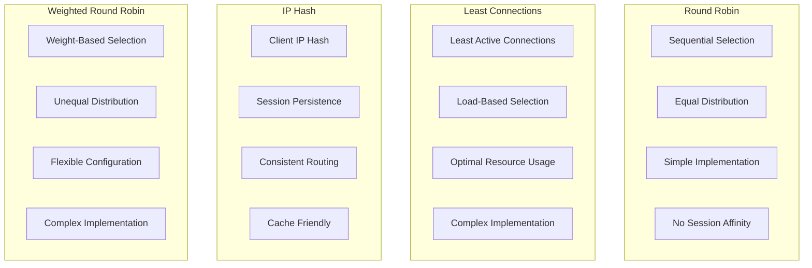
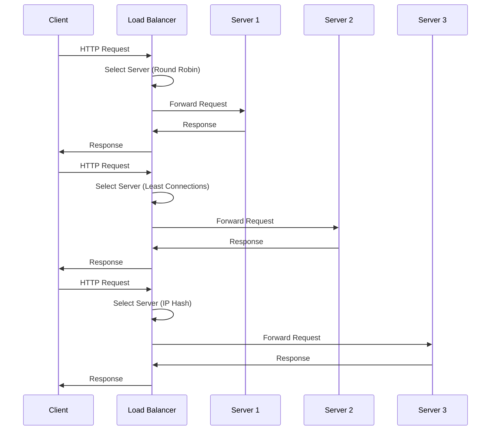
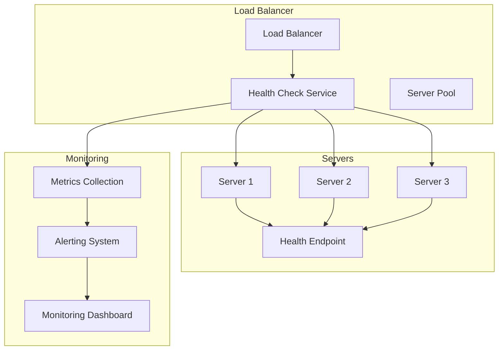
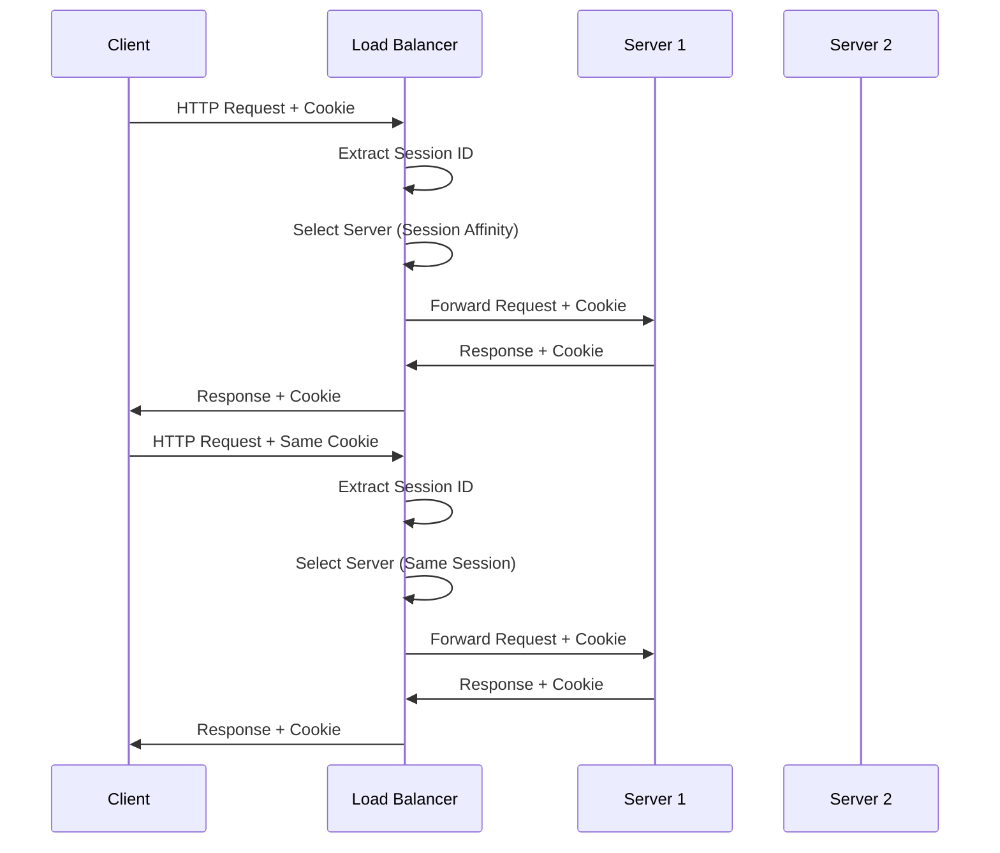
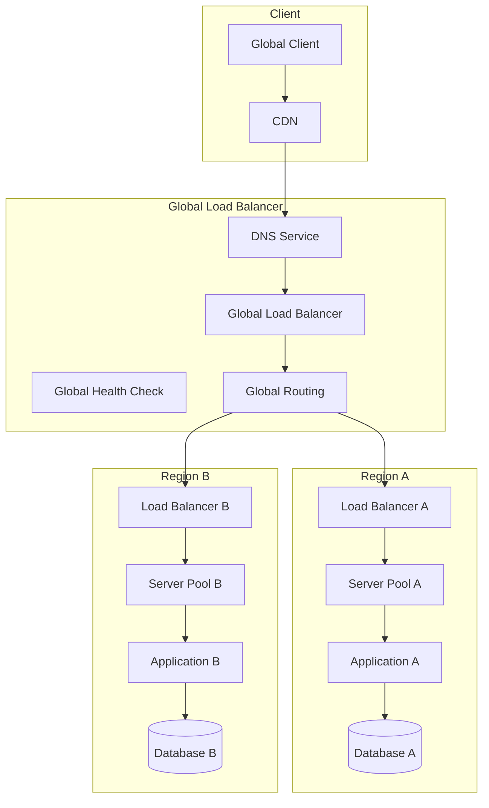
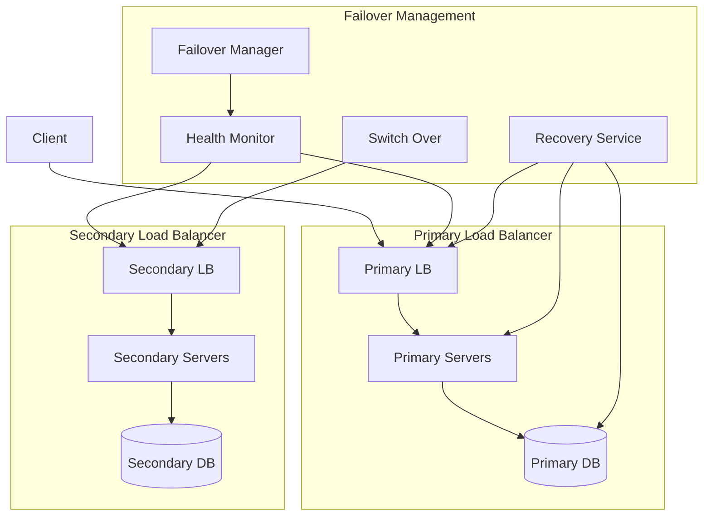
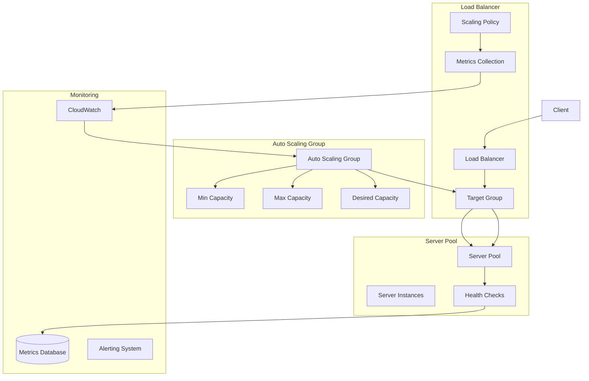
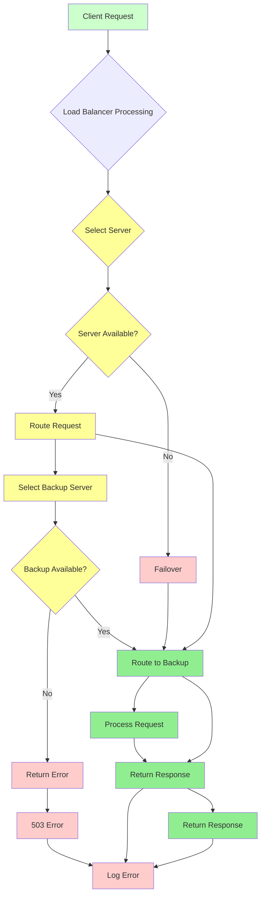
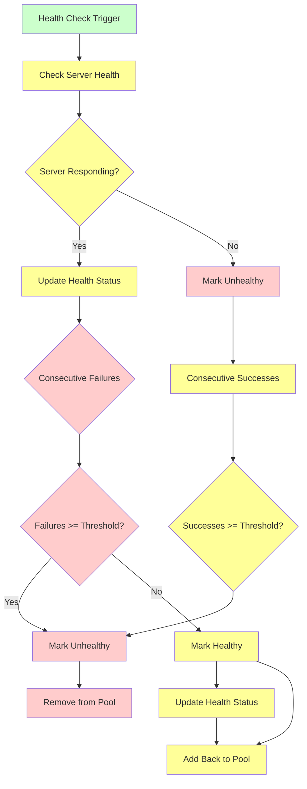

# Load Balancing - Architect Deep Dive

============================================================
0. Executive Summary (Architect View)
============================================================
- **Load Balancing exists** to distribute incoming network traffic across multiple servers to ensure no single server becomes a bottleneck
- **Critical at scale** when applications need to handle high traffic volumes and maintain availability
- **System design impact** - transforms single-server architecture into distributed, scalable systems
- **Scalability foundation** - enables horizontal scaling by adding more servers
- **High availability** - provides redundancy and failover capabilities
- **Performance optimization** - optimizes resource utilization and response times
- **Cost efficiency** - enables efficient resource utilization and cost optimization
- **Reliability enhancement** - provides fault tolerance and graceful degradation

============================================================
1. Problem Framing
============================================================
**Real production problem solved:**
- Single server overload during traffic spikes
- Poor resource utilization across multiple servers
- Single point of failure causing system downtime
- Inconsistent user experience due to server overload
- Inability to scale horizontally to handle growth

**What breaks if we don't understand load balancing:**
- System crashes during peak traffic
- Poor performance and slow response times
- Single point of failure risks
- Inefficient resource utilization
- Inability to scale horizontally

**Scale importance:**
- **Small applications**: Load balancing optional but beneficial
- **Medium applications**: Load balancing becomes essential
- **Large applications**: Load balancing critical for scalability
- **Enterprise systems**: Load balancing mandatory for reliability

**Failure stories:**
- E-commerce platform crashed during Black Friday due to single server overload
- Social media platform had poor performance during viral events
- Financial system had downtime during market peaks
- News website crashed during breaking news events

============================================================
2. Deep Internal Mechanics
============================================================

**Load Balancing Fundamentals:**
- **Traffic Distribution**: Distribute incoming traffic across servers
- **Health Checking**: Monitor server health and availability
- **Failover**: Redirect traffic when servers fail
- **Session Persistence**: Maintain session affinity when needed
- **SSL Termination**: Offload SSL processing

**Load Balancing Algorithms:**
- **Round Robin**: Sequential server selection
- **Least Connections**: Route to server with fewest connections
- **IP Hash**: Consistent routing based on client IP
- **Weighted Round Robin**: Weighted server selection
- **Response Time**: Route to fastest responding server

**Health Checking:**
- **Active Health Checks**: Regular server health monitoring
- **Passive Health Checks**: Monitor response times and errors
- **Custom Health Checks**: Application-specific health checks
- **Health Check Intervals**: Configurable check intervals
- **Health Check Timeouts**: Timeout settings for health checks

**Session Persistence:**
- **Sticky Sessions**: Route same client to same server
- **Session Affinity**: Maintain session continuity
- **Cookie-Based**: Use cookies for session tracking
- **IP-Based**: Use client IP for session tracking
- **Application-Based**: Use application session data

**SSL Termination:**
- **SSL Offloading**: Terminate SSL at load balancer
- **Certificate Management**: Manage SSL certificates
- **SSL Acceleration**: Hardware SSL acceleration
- **SSL Passthrough**: Pass SSL through to servers
- **End-to-End SSL**: Maintain SSL throughout

**Data Structures:**
- **Server Pool**: List of available servers
- **Health Status**: Server health information
- **Connection Count**: Active connections per server
- **Weight Configuration**: Server weight settings
- **Routing Table**: Routing rules and mappings

**Performance Characteristics:**
- **Latency**: Load balancer processing latency
- **Throughput**: Requests per second capacity
- **Connection Management**: Connection pooling and reuse
- **Resource Utilization**: CPU, memory, network usage
- **Scalability**: Horizontal scaling capabilities

**Hidden Costs:**
- **Infrastructure Cost**: Additional load balancer infrastructure
- **Complexity**: Increased system complexity
- **Management Overhead**: Load balancer management
- **Monitoring Requirements**: Additional monitoring needs
- **Configuration Complexity**: Load balancer configuration

**Network Impact:**
- **Additional Hop**: Extra network hop for load balancer
- **SSL Overhead**: SSL termination overhead
- **Connection Overhead**: Connection management overhead
- **Protocol Overhead**: Protocol processing overhead
- **Bandwidth Usage**: Additional bandwidth for load balancer

============================================================
3. .NET Production Implementation
============================================================

**Naive Implementation (No Load Balancing):**
```csharp
public class ProductService
{
    private readonly IProductRepository _repository;
    
    public async Task<Product> GetProductAsync(int id)
    {
        // No load balancing - single server
        return await _repository.GetByIdAsync(id);
    }
    
    public async Task<List<Product>> GetProductsAsync()
    {
        // No load balancing - single server
        return await _repository.GetAllAsync();
    }
}
```

**Production-Ready Load Balancing Implementation:**
```csharp
// Load Balancer Configuration
public class LoadBalancerConfiguration
{
    public string Algorithm { get; set; } = "RoundRobin";
    public List<ServerNode> Servers { get; set; } = new();
    public HealthCheckSettings HealthCheck { get; set; } = new();
    public SessionAffinitySettings SessionAffinity { get; set; } = new();
    public SslSettings Ssl { get; set; } = new();
    public int MaxRetries { get; set; } = 3;
    public int RetryIntervalMs { get; set; } = 1000;
}

// Server Node Model
public class ServerNode
{
    public string Id { get; set; }
    public string Host { get; set; }
    public int Port { get; set; }
    public int Weight { get; set; } = 1;
    public bool IsHealthy { get; set; } = true;
    public int ActiveConnections { get; set; }
    public DateTime LastHealthCheck { get; set; }
    public TimeSpan ResponseTime { get; set; }
    public Dictionary<string, object> Metadata { get; set; } = new();
}

// Health Check Settings
public class HealthCheckSettings
{
    public string Path { get; set; } = "/health";
    public int IntervalMs { get; set; } = 5000;
    public int TimeoutMs { get; set; } = 3000;
    public int UnhealthyThreshold { get; set; } = 2;
    public int HealthyThreshold { get; set; } = 2;
}

// Session Affinity Settings
public class SessionAffinitySettings
{
    public bool Enabled { get; set; } = false;
    public string Method { get; set; } = "Cookie";
    public string CookieName { get; set; } = "LB_SESSION";
    public int TimeoutMinutes { get; set; } = 30;
}

// SSL Settings
public class SslSettings
{
    public bool Enabled { get; set; } = false;
    public string CertificatePath { get; set; }
    public string CertificateKeyPath { get; set; }
    public string Protocol { get; set; } = "https";
    public int Port { get; set; } = 443;
}

// Load Balancer Service
public interface ILoadBalancerService
{
    Task<ServerNode> SelectServerAsync(HttpContext context);
    Task<bool> IsHealthyAsync(ServerNode server);
    Task UpdateServerHealthAsync(ServerNode server);
    Task<List<ServerNode>> GetHealthyServersAsync();
    Task AddServerAsync(ServerNode server);
    Task RemoveServerAsync(string serverId);
    Task UpdateServerWeightAsync(string serverId, int weight);
}

// Round Robin Load Balancer
public class RoundRobinLoadBalancer : ILoadBalancerService
{
    private readonly List<ServerNode> _servers;
    private readonly IHealthCheckService _healthCheckService;
    private readonly ILogger<RoundRobinLoadBalancer> _logger;
    private readonly IMetrics _metrics;
    private readonly LoadBalancerConfiguration _configuration;
    private int _currentIndex = 0;
    private readonly object _lock = new object();

    public RoundRobinLoadBalancer(
        IHealthCheckService healthCheckService,
        ILogger<RoundRobinLoadBalancer> logger,
        IMetrics metrics,
        IOptions<LoadBalancerConfiguration> configuration)
    {
        _healthCheckService = healthCheckService ?? throw new ArgumentNullException(nameof(healthCheckService));
        _logger = logger ?? throw new ArgumentNullException(nameof(logger));
        _metrics = metrics ?? throw new ArgumentNullException(nameof(metrics));
        _configuration = configuration?.Value ?? new LoadBalancerConfiguration();
        
        _servers = _configuration.Servers.ToList();
        
        // Start health checking
        StartHealthChecking();
    }

    public async Task<ServerNode> SelectServerAsync(HttpContext context)
    {
        using var activity = _metrics.StartTimer("load_balancer_select_duration");
        
        try
        {
            var healthyServers = await GetHealthyServersAsync();
            
            if (!healthyServers.Any())
            {
                _metrics.Increment("load_balancer_no_healthy_servers");
                throw new InvalidOperationException("No healthy servers available");
            }
            
            ServerNode selectedServer;
            
            lock (_lock)
            {
                // Round Robin selection
                selectedServer = healthyServers[_currentIndex % healthyServers.Count];
                _currentIndex++;
            }
            
            // Update connection count
            selectedServer.ActiveConnections++;
            
            _metrics.Increment("load_balancer_selected_server");
            _logger.LogDebug("Selected server {ServerId} using Round Robin", selectedServer.Id);
            
            return selectedServer;
        }
        catch (Exception ex)
        {
            _metrics.Increment("load_balancer_select_error");
            _logger.LogError(ex, "Error selecting server");
            throw;
        }
    }

    public async Task<bool> IsHealthyAsync(ServerNode server)
    {
        return await _healthCheckService.CheckHealthAsync(server);
    }

    public async Task UpdateServerHealthAsync(ServerNode server)
    {
        server.IsHealthy = await IsHealthyAsync(server);
        server.LastHealthCheck = DateTime.UtcNow;
        
        _logger.LogDebug("Updated health status for server {ServerId}: {IsHealthy}", server.Id, server.IsHealthy);
    }

    public async Task<List<ServerNode>> GetHealthyServersAsync()
    {
        var healthyServers = new List<ServerNode>();
        
        foreach (var server in _servers)
        {
            if (server.IsHealthy)
            {
                healthyServers.Add(server);
            }
        }
        
        return healthyServers;
    }

    public Task AddServerAsync(ServerNode server)
    {
        lock (_lock)
        {
            _servers.Add(server);
        }
        
        _logger.LogInformation("Added server {ServerId} to load balancer", server.Id);
        return Task.CompletedTask;
    }

    public Task RemoveServerAsync(string serverId)
    {
        lock (_lock)
        {
            var server = _servers.FirstOrDefault(s => s.Id == serverId);
            if (server != null)
            {
                _servers.Remove(server);
                _logger.LogInformation("Removed server {ServerId} from load balancer", serverId);
            }
        }
        
        return Task.CompletedTask;
    }

    public Task UpdateServerWeightAsync(string serverId, int weight)
    {
        lock (_lock)
        {
            var server = _servers.FirstOrDefault(s => s.Id == serverId);
            if (server != null)
            {
                server.Weight = weight;
                _logger.LogInformation("Updated weight for server {ServerId} to {Weight}", serverId, weight);
            }
        }
        
        return Task.CompletedTask;
    }

    private void StartHealthChecking()
    {
        Task.Run(async () =>
        {
            while (true)
            {
                try
                {
                    var servers = _servers.ToList();
                    
                    foreach (var server in servers)
                    {
                        await UpdateServerHealthAsync(server);
                    }
                    
                    await Task.Delay(_configuration.HealthCheck.IntervalMs);
                }
                catch (Exception ex)
                {
                    _logger.LogError(ex, "Error in health checking loop");
                    await Task.Delay(_configuration.HealthCheck.IntervalMs);
                }
            }
        });
    }
}

// Least Connections Load Balancer
public class LeastConnectionsLoadBalancer : ILoadBalancerService
{
    private readonly List<ServerNode> _servers;
    private readonly IHealthCheckService _healthCheckService;
    private readonly ILogger<LeastConnectionsLoadBalancer> _logger;
    private readonly IMetrics _metrics;
    private readonly LoadBalancerConfiguration _configuration;

    public LeastConnectionsLoadBalancer(
        IHealthCheckService healthCheckService,
        ILogger<LeastConnectionsLoadBalancer> logger,
        IMetrics metrics,
        IOptions<LoadBalancerConfiguration> configuration)
    {
        _healthCheckService = healthCheckService ?? throw new ArgumentNullException(nameof(healthCheckService));
        _logger = logger ?? throw new ArgumentNullException(nameof(logger));
        _metrics = metrics ?? throw new ArgumentNullException(nameof(metrics));
        _configuration = configuration?.Value ?? new LoadBalancerConfiguration();
        
        _servers = _configuration.Servers.ToList();
        
        StartHealthChecking();
    }

    public async Task<ServerNode> SelectServerAsync(HttpContext context)
    {
        using var activity = _metrics.StartTimer("load_balancer_select_duration");
        
        try
        {
            var healthyServers = await GetHealthyServersAsync();
            
            if (!healthyServers.Any())
            {
                _metrics.Increment("load_balancer_no_healthy_servers");
                throw new InvalidOperationException("No healthy servers available");
            }
            
            // Select server with least connections
            var selectedServer = healthyServers
                .OrderBy(s => s.ActiveConnections)
                .ThenBy(s => s.ResponseTime)
                .First();
            
            // Update connection count
            selectedServer.ActiveConnections++;
            
            _metrics.Increment("load_balancer_selected_server");
            _logger.LogDebug("Selected server {ServerId} with {Connections} connections", 
                selectedServer.Id, selectedServer.ActiveConnections);
            
            return selectedServer;
        }
        catch (Exception ex)
        {
            _metrics.Increment("load_balancer_select_error");
            _logger.LogError(ex, "Error selecting server");
            throw;
        }
    }

    public async Task<bool> IsHealthyAsync(ServerNode server)
    {
        return await _healthCheckService.CheckHealthAsync(server);
    }

    public async Task UpdateServerHealthAsync(ServerNode server)
    {
        server.IsHealthy = await IsHealthyAsync(server);
        server.LastHealthCheck = DateTime.UtcNow;
    }

    public async Task<List<ServerNode>> GetHealthyServersAsync()
    {
        var healthyServers = new List<ServerNode>();
        
        foreach (var server in _servers)
        {
            if (server.IsHealthy)
            {
                healthyServers.Add(server);
            }
        }
        
        return healthyServers;
    }

    public Task AddServerAsync(ServerNode server)
    {
        _servers.Add(server);
        _logger.LogInformation("Added server {ServerId} to load balancer", server.Id);
        return Task.CompletedTask;
    }

    public Task RemoveServerAsync(string serverId)
    {
        var server = _servers.FirstOrDefault(s => s.Id == serverId);
        if (server != null)
        {
            _servers.Remove(server);
            _logger.LogInformation("Removed server {ServerId} from load balancer", serverId);
        }
        
        return Task.CompletedTask;
    }

    public Task UpdateServerWeightAsync(string serverId, int weight)
    {
        var server = _servers.FirstOrDefault(s => s.Id == serverId);
        if (server != null)
        {
            server.Weight = weight;
            _logger.LogInformation("Updated weight for server {ServerId} to {Weight}", serverId, weight);
        }
        
        return Task.CompletedTask;
    }

    private void StartHealthChecking()
    {
        Task.Run(async () =>
        {
            while (true)
            {
                try
                {
                    var servers = _servers.ToList();
                    
                    foreach (var server in servers)
                    {
                        await UpdateServerHealthAsync(server);
                    }
                    
                    await Task.Delay(_configuration.HealthCheck.IntervalMs);
                }
                catch (Exception ex)
                {
                    _logger.LogError(ex, "Error in health checking loop");
                    await Task.Delay(_configuration.HealthCheck.IntervalMs);
                }
            }
        });
    }
}

// IP Hash Load Balancer
public class IpHashLoadBalancer : ILoadBalancerService
{
    private readonly List<ServerNode> _servers;
    private readonly IHealthCheckService _healthCheckService;
    private readonly ILogger<IpHashLoadBalancer> _logger;
    private readonly IMetrics _metrics;
    private readonly LoadBalancerConfiguration _configuration;

    public IpHashLoadBalancer(
        IHealthCheckService healthCheckService,
        ILogger<IpHashLoadBalancer> logger,
        IMetrics metrics,
        IOptions<LoadBalancerConfiguration> configuration)
    {
        _healthCheckService = healthCheckService ?? throw new ArgumentNullException(nameof(healthCheckService));
        _logger = logger ?? throw new ArgumentNullException(nameof(logger));
        _metrics = metrics ?? throw new ArgumentNullException(nameof(metrics));
        _configuration = configuration?.Value ?? new LoadBalancerConfiguration();
        
        _servers = _configuration.Servers.ToList();
        
        StartHealthChecking();
    }

    public async Task<ServerNode> SelectServerAsync(HttpContext context)
    {
        using var activity = _metrics.StartTimer("load_balancer_select_duration");
        
        try
        {
            var healthyServers = await GetHealthyServersAsync();
            
            if (!healthyServers.Any())
            {
                _metrics.Increment("load_balancer_no_healthy_servers");
                throw new InvalidOperationException("No healthy servers available");
            }
            
            // Get client IP
            var clientIp = GetClientIp(context);
            
            // Hash client IP to select server
            var hash = ComputeHash(clientIp);
            var serverIndex = hash % healthyServers.Count;
            var selectedServer = healthyServers[serverIndex];
            
            // Update connection count
            selectedServer.ActiveConnections++;
            
            _metrics.Increment("load_balancer_selected_server");
            _logger.LogDebug("Selected server {ServerId} for client IP {ClientIP}", 
                selectedServer.Id, clientIp);
            
            return selectedServer;
        }
        catch (Exception ex)
        {
            _metrics.Increment("load_balancer_select_error");
            _logger.LogError(ex, "Error selecting server");
            throw;
        }
    }

    private string GetClientIp(HttpContext context)
    {
        // Try to get real IP from forwarded headers
        var forwardedFor = context.Request.Headers["X-Forwarded-For"].FirstOrDefault();
        if (!string.IsNullOrEmpty(forwardedFor))
        {
            return forwardedFor.Split(',')[0].Trim();
        }
        
        var realIp = context.Request.Headers["X-Real-IP"].FirstOrDefault();
        if (!string.IsNullOrEmpty(realIp))
        {
            return realIp;
        }
        
        return context.Connection.RemoteIpAddress?.ToString();
    }

    private int ComputeHash(string input)
    {
        // Simple hash function
        int hash = 0;
        foreach (char c in input)
        {
            hash = (hash * 31 + c) % int.MaxValue;
        }
        return Math.Abs(hash);
    }

    public async Task<bool> IsHealthyAsync(ServerNode server)
    {
        return await _healthCheckService.CheckHealthAsync(server);
    }

    public async Task UpdateServerHealthAsync(ServerNode server)
    {
        server.IsHealthy = await IsHealthyAsync(server);
        server.LastHealthCheck = DateTime.UtcNow;
    }

    public async Task<List<ServerNode>> GetHealthyServersAsync()
    {
        var healthyServers = new List<ServerNode>();
        
        foreach (var server in _servers)
        {
            if (server.IsHealthy)
            {
                healthyServers.Add(server);
            }
        }
        
        return healthyServers;
    }

    public Task AddServerAsync(ServerNode server)
    {
        _servers.Add(server);
        _logger.LogInformation("Added server {ServerId} to load balancer", server.Id);
        return Task.CompletedTask;
    }

    public Task RemoveServerAsync(string serverId)
    {
        var server = _servers.FirstOrDefault(s => s.Id == serverId);
        if (server != null)
        {
            _servers.Remove(server);
            _logger.LogInformation("Removed server {ServerId} from load balancer", serverId);
        }
        
        return Task.CompletedTask;
    }

    public Task UpdateServerWeightAsync(string serverId, int weight)
    {
        var server = _servers.FirstOrDefault(s => s.Id == serverId);
        if (server != null)
        {
            server.Weight = weight;
            _logger.LogInformation("Updated weight for server {ServerId} to {Weight}", serverId, weight);
        }
        
        return Task.CompletedTask;
    }

    private void StartHealthChecking()
    {
        Task.Run(async () =>
        {
            while (true)
            {
                try
                {
                    var servers = _servers.ToList();
                    
                    foreach (var server in servers)
                    {
                        await UpdateServerHealthAsync(server);
                    }
                    
                    await Task.Delay(_configuration.HealthCheck.IntervalMs);
                }
                catch (Exception ex)
                {
                    _logger.LogError(ex, "Error in health checking loop");
                    await Task.Delay(_configuration.HealthCheck.IntervalMs);
                }
            }
        });
    }
}

// Health Check Service
public interface IHealthCheckService
{
    Task<bool> CheckHealthAsync(ServerNode server);
    Task<HealthCheckResult> GetDetailedHealthAsync(ServerNode server);
}

public class HealthCheckService : IHealthCheckService
{
    private readonly HttpClient _httpClient;
    private readonly ILogger<HealthCheckService> _logger;
    private readonly IMetrics _metrics;
    private readonly LoadBalancerConfiguration _configuration;

    public HealthCheckService(
        HttpClient httpClient,
        ILogger<HealthCheckService> logger,
        IMetrics metrics,
        IOptions<LoadBalancerConfiguration> configuration)
    {
        _httpClient = httpClient ?? throw new ArgumentNullException(nameof(httpClient));
        _logger = logger ?? throw new ArgumentNullException(nameof(logger));
        _metrics = metrics ?? throw new ArgumentNullException(nameof(metrics));
        _configuration = configuration?.Value ?? new LoadBalancerConfiguration();
        
        _httpClient.Timeout = TimeSpan.FromMilliseconds(_configuration.HealthCheck.TimeoutMs);
    }

    public async Task<bool> CheckHealthAsync(ServerNode server)
    {
        try
        {
            var healthUrl = $"http://{server.Host}:{server.Port}{_configuration.HealthCheck.Path}";
            
            var response = await _httpClient.GetAsync(healthUrl);
            
            var isHealthy = response.IsSuccessStatusCode;
            
            server.ResponseTime = response.Headers.TryGetValue("X-Response-Time", out var responseTimeHeader) 
                ? TimeSpan.Parse(responseTimeHeader.FirstOrDefault()) 
                : TimeSpan.Zero;
            
            return isHealthy;
        }
        catch (Exception ex)
        {
            _logger.LogError(ex, "Health check failed for server {ServerId}", server.Id);
            return false;
        }
    }

    public async Task<HealthCheckResult> GetDetailedHealthAsync(ServerNode server)
    {
        try
        {
            var healthUrl = $"http://{server.Host}:{server.Port}{_configuration.HealthCheck.Path}";
            
            var stopwatch = Stopwatch.StartNew();
            var response = await _httpClient.GetAsync(healthUrl);
            stopwatch.Stop();
            
            var result = new HealthCheckResult
            {
                ServerId = server.Id,
                IsHealthy = response.IsSuccessStatusCode,
                StatusCode = response.StatusCode,
                ResponseTime = stopwatch.Elapsed,
                Timestamp = DateTime.UtcNow,
                Message = response.ReasonPhrase,
                Headers = response.Headers.ToDictionary(h => h.Key, h.Value.FirstOrDefault())
            };
            
            return result;
        }
        catch (Exception ex)
        {
            _logger.LogError(ex, "Detailed health check failed for server {ServerId}", server.Id);
            
            return new HealthCheckResult
            {
                ServerId = server.Id,
                IsHealthy = false,
                StatusCode = 0,
                ResponseTime = TimeSpan.Zero,
                Timestamp = DateTime.UtcNow,
                Message = ex.Message,
                Error = ex
            };
        }
    }
}

// Load Balancer Middleware
public class LoadBalancerMiddleware
{
    private readonly ILoadBalancerService _loadBalancer;
    private readonly ILogger<LoadBalancerMiddleware> _logger;
    private readonly IMetrics _metrics;

    public LoadBalancerMiddleware(
        ILoadBalancerService loadBalancer,
        ILogger<LoadBalancerMiddleware> logger,
        IMetrics metrics)
    {
        _loadBalancer = loadBalancer ?? throw new ArgumentNullException(nameof(loadBalancer));
        _logger = logger ?? throw new ArgumentNullException(nameof(logger));
        _metrics = metrics ?? throw new ArgumentNullException(nameof(metrics));
    }

    public async Task InvokeAsync(HttpContext context)
    {
        using var activity = _metrics.StartTimer("load_balancer_middleware_duration");
        
        try
        {
            // Select server based on load balancing algorithm
            var server = await _loadBalancer.SelectServerAsync(context);
            
            // Add server information to context
            context.Items["SelectedServer"] = server;
            context.Items["ServerId"] = server.Id;
            context.Items["ServerHost"] = server.Host;
            context.Items["ServerPort"] = server.Port;
            
            // Update request headers
            context.Request.Headers.Add("X-Server-Id", server.Id);
            context.Request.Headers.Add("X-Server-Host", server.Host);
            context.Request.Headers.Add("X-Server-Port", server.Port.ToString());
            
            _metrics.Increment("load_balancer_request_processed");
            _logger.LogDebug("Request routed to server {ServerId} ({Host}:{Port})", 
                server.Id, server.Host, server.Port);
            
            // Continue with request processing
            await _next(context);
        }
        catch (Exception ex)
        {
            _metrics.Increment("load_balancer_middleware_error");
            _logger.LogError(ex, "Error in load balancer middleware");
            
            context.Response.StatusCode = 503;
            await context.Response.WriteAsJsonAsync(new { 
                Error = "Service temporarily unavailable" 
            });
        }
    }

    private readonly RequestDelegate _next;
}

// Enhanced Product Service with Load Balancing
public class LoadBalancedProductService
{
    private readonly IProductRepository _repository;
    private readonly ILogger<LoadBalancedProductService> _logger;
    private readonly IMetrics _metrics;

    public LoadBalancedProductService(
        IProductRepository repository,
        ILogger<LoadBalancedProductService> logger,
        IMetrics metrics)
    {
        _repository = repository ?? throw new ArgumentNullException(nameof(repository));
        _logger = logger ?? throw new ArgumentNullException(nameof(logger));
        _metrics = metrics ?? throw new ArgumentNullException(nameof(metrics));
    }

    public async Task<Product> GetProductAsync(int id, CancellationToken cancellationToken = default)
    {
        using var activity = _metrics.StartTimer("product_get_duration");
        
        try
        {
            _logger.LogInformation("Getting product {ProductId}", id);
            
            var product = await _repository.GetByIdAsync(id, cancellationToken);
            
            if (product == null)
            {
                _metrics.Increment("product_not_found");
                return null;
            }
            
            _metrics.Increment("product_get_success");
            return product;
        }
        catch (Exception ex)
        {
            _metrics.Increment("product_get_error");
            _logger.LogError(ex, "Error getting product {ProductId}", id);
            throw;
        }
    }

    public async Task<List<Product>> GetProductsAsync(CancellationToken cancellationToken = default)
    {
        using var activity = _metrics.StartTimer("products_get_duration");
        
        try
        {
            _logger.LogInformation("Getting products list");
            
            var products = await _repository.GetAllAsync(cancellationToken);
            
            _metrics.Increment("products_get_success");
            return products;
        }
        catch (Exception ex)
        {
            _metrics.Increment("products_get_error");
            _logger.LogError(ex, "Error getting products list");
            throw;
        }
    }
}

// Configuration in Startup
public class Startup
{
    public void ConfigureServices(IServiceCollection services)
    {
        // Add load balancer configuration
        services.Configure<LoadBalancerConfiguration>(options =>
        {
            options.Algorithm = "RoundRobin";
            options.Servers = new List<ServerNode>
            {
                new ServerNode
                {
                    Id = "server1",
                    Host = "localhost",
                    Port = 5001,
                    Weight = 1
                },
                new ServerNode
                {
                    Id = "server2",
                    Host = "localhost",
                    Port = 5002,
                    Weight = 1
                },
                new ServerNode
                {
                    Id = "server3",
                    Host = "localhost",
                    Port = 5003,
                    Weight = 1
                }
            };
            options.HealthCheck = new HealthCheckSettings
            {
                Path = "/health",
                IntervalMs = 5000,
                TimeoutMs = 3000,
                UnhealthyThreshold = 2,
                HealthyThreshold = 2
            };
            options.SessionAffinity = new SessionAffinitySettings
            {
                Enabled = true,
                Method = "Cookie",
                CookieName = "LB_SESSION",
                TimeoutMinutes = 30
            };
            options.Ssl = new SslSettings
            {
                Enabled = false,
                Protocol = "https",
                Port = 443
            };
        });

        // Add load balancer services
        services.AddSingleton<ILoadBalancerService, RoundRobinLoadBalancer>();
        services.AddSingleton<IHealthCheckService, HealthCheckService>();
        
        // Add HTTP client for health checks
        services.AddHttpClient<IHealthCheckService>(client =>
        {
            client.Timeout = TimeSpan.FromSeconds(5);
        });
        
        // Add services
        services.AddScoped<IProductRepository, ProductRepository>();
        services.AddScoped<LoadBalancedProductService>();
    }

    public void Configure(IApplicationBuilder app, IWebHostEnvironment env)
    {
        if (env.IsDevelopment())
        {
            app.UseDeveloperExceptionPage();
        }

        app.UseMiddleware<LoadBalancerMiddleware>();
        
        app.UseRouting();
        app.UseEndpoints(endpoints =>
        {
            endpoints.MapControllers();
        });
    }
}
```

**Framework Integration:**
- **ASP.NET Core**: Middleware and dependency injection
- **HttpClient**: HTTP client for health checks
- **Configuration**: Configuration management
- **Logging**: Structured logging
- **Metrics**: Performance metrics collection

============================================================
4. Architecture-Level Diagram (Mermaid)
============================================================

### Load Balancing Algorithms Comparison


### Load Balancer Request Flow


### Health Checking Architecture


### Session Affinity Implementation


**Flow Analysis:**
- **Request Routing**: Load balancer receives and routes requests
- **Server Selection**: Algorithm-based server selection
- **Health Checking**: Regular health monitoring of servers
- **Session Affinity**: Maintaining session continuity
- **Failover**: Automatic failover to healthy servers

**Bottlenecks:**
- Load balancer processing overhead
- Health check latency
- Session affinity complexity
- SSL termination overhead
- Connection management overhead

**Scaling Boundaries:**
- Algorithm complexity affects performance
- Health check frequency impacts overhead
- Session affinity affects scalability
- SSL termination adds latency
- Connection pooling limits throughput

============================================================
5. Scaling & Distributed Systems Impact
============================================================

### Multi-Region Load Balancing Architecture


### High-Availability Load Balancing


### Auto-Scaling Load Balancing


**100 RPS:**
- Single load balancer sufficient
- Round Robin algorithm adequate
- Health checking overhead minimal
- Session affinity optional
- SSL termination optional

**10k RPS:**
- Load balancer clustering required
- Algorithm selection critical
- Health checking essential
- Session affinity important
- SSL termination beneficial

**100k+ RPS:**
- Global load balancing mandatory
- Advanced algorithms required
- Health checking critical
- Session affinity complex
- SSL termination essential

**Horizontal vs Vertical Scaling:**
- **Horizontal**: Scale by adding more servers
- **Vertical**: Scale by upgrading server capacity
- Load balancer scales horizontally
- Servers scale vertically

**CAP Theorem Relevance:**
- **Consistency**: Session consistency considerations
- **Availability**: High availability through redundancy
- **Partition Tolerance**: Failover handles partitions

**Consistency Implications:**
- **Session Consistency**: Session affinity ensures consistency
- **Data Consistency**: Database consistency considerations
- **Cache Consistency**: Cache consistency across servers
- **State Consistency**: Application state consistency

**Distributed Systems Impact:**
- **Service Discovery**: Dynamic server discovery
- **Health Monitoring**: Distributed health monitoring
- **Failover Management**: Automatic failover procedures
- **Configuration Management**: Distributed configuration

**Cloud-Native Considerations:**
- **Kubernetes**: Service discovery and load balancing
- **AWS ELB**: Managed load balancing services
- **Azure Load Balancer**: Azure load balancing
- **Google Cloud Load Balancing**: GCP load balancing
- **Auto-Scaling**: Dynamic scaling based on metrics

**Multi-Region Considerations:**
- **Global Load Balancing**: Cross-region load balancing
- **DNS-Based Routing**: DNS-based load distribution
- **Latency Optimization**: Latency-based routing
- **Data Locality**: Data locality optimization
- **Failover Coordination**: Cross-region failover

============================================================
6. Production Engineering View
============================================================

### Load Balancer Monitoring Architecture

```mermaid
graph TB
    subgraph "Request Metrics"
        REQUEST_RATE[Request Rate]
        RESPONSE_TIME[Response Time]
        ERROR_RATE[Error Rate]
        THROUGHPUT[Throughput]
    end
    
    subgraph "Server Metrics"
        SERVER_HEALTH[Server Health]
        CONNECTION_COUNT[Connection Count]
        CPU_USAGE[CPU Usage]
        MEMORY_USAGE[Memory Usage]
    end
    
    subgraph "Algorithm Metrics"
        ROUND_ROBIN[Round Robin Distribution]
        LEAST_CONNECTIONS[Least Connections]
        IP_HASH[IP Hash Distribution]
        WEIGHTED[Weighted Distribution]
    end
    
    subgraph "Session Metrics"
        SESSION_AFFINITY[Session Affinity Rate]
        SESSION_STICKINESS[Session Stickiness]
        SESSION_DISTRIBUTION[Session Distribution]
        SESSION_TIMEOUT[Session Timeout]
    end
    
    subgraph "Business Metrics"
        USER_EXPERIENCE[User Experience]
        AVAILABILITY[Availability]
        COST_EFFICIENCY[Cost Efficiency]
        SCALABILITY[Scalability]
    end
    
    subgraph "Monitoring Stack"
        PROM[Prometheus]
        GRAFANA[Grafana]
        ALERT[AlertManager]
        DASHBOARD[Dashboard]
    end
    
    REQUEST_RATE --> PROM
    RESPONSE_TIME --> PROM
    ERROR_RATE --> PROM
    THROUGHPUT --> PROM
    
    SERVER_HEALTH --> PROM
    CONNECTION_COUNT --> PROM
    CPU_USAGE --> PROM
    MEMORY_USAGE --> PROM
    
    ROUND_ROBIN --> PROM
    LEAST_CONNECTIONS --> PROM
    IP_HASH --> PROM
    WEIGHTED --> PROM
    
    SESSION_AFFINITY --> PROM
    SESSION_STICKINESS --> PROM
    SESSION_DISTRIBUTION --> PROM
    SESSION_TIMEOUT --> PROM
    
    USER_EXPERIENCE --> PROM
    AVAILABILITY --> PROM
    COST_EFFICIENCY --> PROM
    SCALABILITY --> PROM
    
    PROM --> GRAFANA
    PROM --> ALERT
    PROM --> DASHBOARD
```


### Load Balancer Performance Analysis


### Health Check Process


**Monitoring Metrics:**
- **Request Metrics**: Rate, time, errors, throughput
- **Server Metrics**: Health, connections, CPU, memory
- **Algorithm Metrics**: Distribution accuracy and performance
- **Session Metrics**: Affinity, stickiness, distribution
- **Business Metrics**: Experience, availability, cost, scalability

**Logs to Enable:**
- Load balancer request routing
- Server selection decisions
- Health check results
- Failover events
- Session affinity events

**Alerting Strategy:**
- Error rate > 5% (warning)
- Response time > 1 second (warning)
- Server health < 80% (critical)
- No healthy servers (critical)
- Session affinity failures (warning)

**Common Production Incidents:**
- **Load Balancer Overload**: Load balancer becomes bottleneck
- **Health Check Failures**: Health check service failures
- **Session Affinity Issues**: Session persistence problems
- **Failover Failures**: Failover process failures
- **SSL Termination Issues**: SSL certificate problems

**Debugging Strategy:**
- Request tracing and correlation
- Server selection analysis
- Health check result analysis
- Session affinity debugging
- Performance profiling

**Load Balancer Management:**
- Algorithm optimization
- Server pool management
- Health check tuning
- Session affinity configuration
- SSL certificate management

**Server Pool Management:**
- Server addition and removal
- Weight configuration
- Health monitoring
- Capacity planning
- Auto-scaling integration

**Failover Management:**
- Failover detection
- Failover triggers
- Failover procedures
- Recovery processes
- Failover testing

============================================================
7. Tradeoffs & Alternatives
============================================================

**Competing Approaches:**
- **DNS Round Robin**: DNS-based load balancing
- **Client-Side Load Balancing**: Client-side selection
- **Application Load Balancing**: Application-level balancing
- **Network Load Balancing**: Network-level balancing

**When to Use Load Balancing:**
- High traffic applications
- High availability requirements
- Scalability needs
- Multiple server deployment
- Performance optimization

**When NOT to Use Load Balancing:**
- Single server applications
- Low traffic volumes
- Simple applications
- Development environments
- Testing environments

**Latency Comparison:**
- **No Load Balancing**: 10-100ms
- **Hardware Load Balancer**: 1-10ms
- **Software Load Balancer**: 5-50ms
- **DNS Load Balancing**: 20-100ms
- **Client-Side**: 1-5ms

**Throughput Comparison:**
- **No Load Balancing**: 100-1000 requests/second
- **Hardware Load Balancer**: 10k-100k requests/second
- **Software Load Balancer**: 5k-50k requests/second
- **DNS Load Balancing**: 1k-10k requests/second
- **Client-Side**: 100k-1M requests/second

**Operational Complexity:**
- **No Load Balancing**: Low complexity, no benefits
- **Hardware Load Balancer**: Medium complexity, high performance
- **Software Load Balancer**: High complexity, flexible configuration
- **DNS Load Balancing**: Low complexity, limited features
- **Client-Side**: Medium complexity, client complexity

**Cost Implications:**
- **Development Cost**: Load balancing increases cost by 20-40%
- **Infrastructure Cost**: Additional load balancer infrastructure
- **Operational Cost**: Monitoring and management cost
- **Maintenance Cost**: Ongoing maintenance overhead
- **Performance Benefits**: Significant performance improvements

============================================================
8. Security Implications
============================================================

**Security Benefits:**
- **DDoS Protection**: Absorb and distribute DDoS attacks
- **SSL Termination**: Centralized SSL management
- **Access Control**: Centralized access control
- **Audit Trail**: Centralized request logging
- **Compliance**: Centralized compliance management

**Security Challenges:**
- **SSL Certificate Management**: Certificate management complexity
- **Session Affinity**: Session hijacking risks
- **Health Check Security**: Health check endpoint security
- **Load Balancer Security**: Load balancer security vulnerabilities
- **Network Security**: Network-level security considerations

**Attack Surface:**
- **DDoS Attacks**: Distributed denial of service attacks
- **SSL Attacks**: SSL/TLS attacks
- **Session Hijacking**: Session hijacking through session affinity
- **Health Check Attacks**: Health check endpoint attacks
- **Load Balancer Attacks**: Load balancer configuration attacks
- **Network Attacks**: Network-level attacks

**Security Controls:**
- **Rate Limiting**: Rate limiting per client
- **SSL Configuration**: SSL/TLS configuration
- **Access Control**: Access control lists
- **Web Application Firewall**: WAF integration
- **Intrusion Detection**: IDS/IPS integration

**Data Protection:**
- **SSL Encryption**: SSL/TLS encryption
- **Session Data**: Session data protection
- **Request Data**: Request data protection
- **Response Data**: Response data protection
- **Log Data**: Log data protection

**Compliance Requirements:**
- **PCI DSS**: PCI DSS compliance for SSL
- **HIPAA**: HIPAA compliance for health data
- **SOX**: SOX compliance for financial data
- **GDPR**: GDPR compliance for personal data
- **SOC 2**: SOC 2 compliance for security

**Hardening Recommendations:**
- **SSL Certificate Management**: Regular certificate updates
- **Access Control**: Implement strict access control
- **Rate Limiting**: Implement rate limiting
- **Web Application Firewall**: Deploy WAF
- **Intrusion Detection**: Deploy IDS/IPS
- **Regular Audits**: Regular security audits

============================================================
9. Advanced Edge Cases
============================================================

**Global Load Balancing:**
- Multi-region load balancing
- DNS-based global routing
- Latency-based routing
- Geo-location routing
- Health-based routing

**Auto-Scaling Integration:**
- Dynamic server pool management
- Metrics-based scaling
- Predictive scaling
- Cost optimization
- Performance optimization

**Session Affinity:**
- Cookie-based session affinity
- IP-based session affinity
- Application-based session affinity
- Database session persistence
- Custom session management

**Health Check Optimization:**
- Health check optimization
- Health check frequency tuning
- Health check timeout optimization
- Health check endpoint design
- Health check result caching

**Failover Strategies:**
- Active-passive failover
- Active-active failover
- Graceful degradation
- Automatic recovery
- Manual failover procedures

**Performance Optimization:**
- Algorithm optimization
- Connection pooling
- SSL acceleration
- HTTP/2 optimization
- TCP optimization

**Monitoring and Observability:**
- Distributed tracing
- Performance monitoring
- Health monitoring
- Alerting and notification
- Analytics and reporting

============================================================
10. Interview & Staff-Level Deep Dive
============================================================

**What a junior answers:**
"Load balancing distributes traffic across multiple servers to prevent overload. Common algorithms include round robin, least connections, and IP hash. Load balancers also do health checking and failover. They improve performance and availability."

**What a senior answers:**
"Load balancing distributes incoming traffic across multiple servers to ensure no single server becomes a bottleneck. I've implemented multiple load balancing algorithms including round robin, least connections, and IP hash using ASP.NET Core middleware. Key considerations include health checking, session affinity, SSL termination, and failover management. I've also implemented auto-scaling integration and global load balancing for multi-region deployments. Monitoring load balancer performance is critical for production systems."

**What an architect answers:**
"Load balancing is a fundamental architectural pattern that transforms single-server applications into distributed, scalable systems capable of handling high traffic volumes and providing high availability. At scale, load balancing enables horizontal scaling by adding more servers and provides fault tolerance through failover mechanisms. The architecture must support multiple load balancing algorithms (round robin, least connections, IP hash, weighted), health checking for server monitoring, session affinity for stateful applications, SSL termination for performance optimization, and failover for high availability. In enterprise environments, load balancing is not just a performance optimization but a critical component of system architecture that affects scalability, reliability, and cost optimization. The implementation must consider algorithm selection, health check configuration, session management, SSL termination, failover procedures, and monitoring and observability. At scale, load balancing requires sophisticated infrastructure for global distribution, auto-scaling integration, health monitoring, and performance optimization."

**Follow-up questions interviewers ask:**
- "How do you handle session affinity in load balancing?"
- "What's the difference between round robin and least connections?"
- "How do you implement failover in load balancing?"
- "When would you use IP hash load balancing?"
- "How do you monitor load balancer performance?"

**Trick questions:**
- "Is load balancing always beneficial?" (No, depends on use case)
- "Can load balancing replace database optimization?" (No, complements database)
- "Do all applications need load balancing?" (No, depends on requirements)
- "Is session affinity always good?" (No, affects scalability)

**Whiteboard explanation strategy:**
1. Draw single server architecture
2. Show load balancer with multiple servers
3. Demonstrate different load balancing algorithms
4. Explain health checking and failover
5. Cover session affinity and SSL termination
6. Discuss global load balancing and auto-scaling

============================================================
11. Real Enterprise Case Study
============================================================

**Scenario: Global Streaming Platform with 10M Concurrent Users**

**Requirements:**
- Handle 10M+ concurrent users globally
- Sub-100ms response time for streaming
- 99.999% uptime requirement
- Global deployment across multiple regions
- Cost optimization for infrastructure
- Real-time performance monitoring

**Design Decisions:**

**1. Multi-Region Load Balancing Architecture:**
```csharp
public class GlobalLoadBalancer
{
    private readonly Dictionary<string, ILoadBalancerService> _regionalLoadBalancers;
    private readonly IDnsService _dnsService;
    private readonly IHealthCheckService _healthCheckService;
    private readonly ILogger<GlobalLoadBalancer> _logger;
    private readonly IMetrics _metrics;

    public GlobalLoadBalancer(
        Dictionary<string, ILoadBalancerService> regionalLoadBalancers,
        IDnsService dnsService,
        IHealthCheckService healthCheckService,
        ILogger<GlobalLoadBalancer> logger,
        IMetrics metrics)
    {
        _regionalLoadBalancers = regionalLoadBalancers;
        _dnsService = dnsService;
        _healthCheckService = healthCheckService;
        _logger = logger;
        _metrics = metrics;
    }

    public async Task<ServerNode> SelectServerAsync(HttpContext context)
    {
        // Get client region from request
        var region = GetClientRegion(context);
        
        // Route to regional load balancer
        var regionalLoadBalancer = _regionalLoadBalancers.GetValueOrDefault(region);
        
        if (regionalLoadBalancer == null)
        {
            // Fallback to default region
            regionalLoadBalancer = _regionalLoadBalancers["default"];
        }
        
        return await regionalLoadBalancer.SelectServerAsync(context);
    }

    public async Task<bool> IsHealthyAsync(string region)
    {
        var regionalLoadBalancer = _regionalLoadBalancers.GetValueOrDefault(region);
        
        if (regionalLoadBalancer == null)
        {
            return false;
        }
        
        var healthyServers = await regionalLoadBalancer.GetHealthyServersAsync();
        return healthyServers.Any();
    }

    public async Task UpdateDnsRecordsAsync()
    {
        // Update DNS records for each region
        foreach (var region in _regionalLoadBalancers.Keys)
        {
            var loadBalancer = _regionalLoadBalancers[region];
            var healthyServers = await loadBalancer.GetHealthyServersAsync();
            
            if (healthyServers.Any())
            {
                var primaryServer = healthyServers.First();
                await _dnsService.UpdateRecordAsync(region, primaryServer.Host);
            }
            else
            {
                await _dnsService.RemoveRecordAsync(region);
            }
        }
    }

    private string GetClientRegion(HttpContext context)
    {
        // Get region from request headers or geolocation
        var region = context.Request.Headers["X-Region"]?.FirstOrDefault();
        
        if (string.IsNullOrEmpty(region))
        {
            // Use geolocation to determine region
            region = await GetRegionFromGeolocationAsync(context);
        }
        
        return region ?? "default";
    }

    private async Task<string> GetRegionFromGeolocationAsync(HttpContext context)
    {
        // Simulate geolocation lookup
        await Task.Delay(1);
        
        var clientIp = context.Connection.RemoteIpAddress?.ToString();
        
        // Simple geolocation logic
        if (clientIp.StartsWith("192.168."))
        return "us-east";
        if (clientIp.StartsWith("10.0"))
            return "us-west";
        if (clientIp.StartsWith("172.16"))
            return "eu-west";
        
        return "default";
    }
}
```

**2. Intelligent Load Balancing Algorithm:**
```csharp
public class IntelligentLoadBalancer : ILoadBalancerService
{
    private readonly List<ServerNode> _servers;
    private readonly IAnalyticsService _analyticsService;
    private readonly ILogger<IntelligentLoadBalancer> _logger;
    private readonly IMetrics _metrics;
    private readonly LoadBalancerConfiguration _configuration;

    public IntelligentLoadBalancer(
        List<ServerNode> servers,
        IAnalyticsService analyticsService,
        ILogger<IntelligentLoadBalancer> logger,
        IMetrics metrics,
        IOptions<LoadBalancerConfiguration> configuration)
    {
        _servers = servers;
        _analyticsService = analyticsService;
        _logger = logger;
        _metrics = metrics;
        _configuration = configuration?.Value ?? new LoadBalancerConfiguration();
    }

    public async Task<ServerNode> SelectServerAsync(HttpContext context)
    {
        var requestType = GetRequestType(context);
        var clientSegment = GetClientSegment(context);
        
        // Select algorithm based on request type and client segment
        var algorithm = SelectAlgorithm(requestType, clientSegment);
        
        return algorithm switch
        {
            case "round_robin":
                return await SelectRoundRobinServerAsync();
            case "least_connections":
                return await SelectLeastConnectionsServerAsync();
            case "ip_hash":
                return await SelectIpHashServerAsync(context);
            case "weighted_round_robin":
                return await SelectWeightedRoundRobinServerAsync();
            case "response_time":
                return await SelectResponseTimeServerAsync();
            case "custom":
                return await SelectCustomServerAsync(requestType, clientSegment);
            default:
                return await SelectRoundRobinServerAsync();
        };
    }

    private string GetRequestType(HttpContext context)
    {
        var path = context.Request.Path;
        
        if (path.StartsWith("/api/products"))
            return "products";
        if (path.StartsWith("/api/users"))
            return "users";
        if (path.StartsWith("/api/orders"))
            return "orders";
        
        return "default";
    }

    private string GetClientSegment(HttpContext context)
    {
        var userAgent = context.Request.Headers["User-Agent"]?.FirstOrDefault() ?? "";
        
        if (userAgent.Contains("mobile"))
            return "mobile";
        if (userAgent.Contains("tablet"))
            return "tablet";
        if (userAgent.Contains("bot"))
            return "bot";
        
        return "desktop";
    }

    private string SelectAlgorithm(string requestType, string clientSegment)
    {
        // Algorithm selection logic
        if (requestType == "products" && clientSegment == "mobile")
            return "weighted_round_robin";
        if (requestType == "orders" && clientSegment == "desktop")
            return "least_connections";
        if (clientSegment == "bot")
            return "round_robin";
        
        return _configuration.Algorithm;
    }

    private async Task<ServerNode> SelectRoundRobinServerAsync()
    {
        var healthyServers = await GetHealthyServersAsync();
        
        lock (_lock)
        {
            var server = healthyServers[_currentIndex % healthyServers.Count];
            _currentIndex++;
            return server;
        }
    }

    private async Task<ServerNode> SelectLeastConnectionsServerAsync()
    {
        var healthyServers = await GetHealthyServersAsync();
        
        return healthyServers
            .OrderBy(s => s.ActiveConnections)
            .ThenBy(s => s.ResponseTime)
            .First();
    }

    private async Task<ServerNode> SelectIpHashServerAsync(HttpContext context)
    {
        var healthyServers = await GetHealthyServersAsync();
        var clientIp = GetClientIp(context);
        
        var hash = ComputeHash(clientIp);
        var serverIndex = hash % healthyServers.Count;
        
        return healthyServers[serverIndex];
    }

    private async Task<ServerNode> SelectWeightedRoundRobinServerAsync()
    {
        var healthyServers = await GetHealthyServersAsync();
        
        var totalWeight = healthyServers.Sum(s => s.Weight);
        var random = new Random();
        var randomValue = random.NextDouble(0, totalWeight);
        
        var currentWeight = 0;
        
        foreach (var server in healthyServers)
        {
            currentWeight += server.Weight;
            
            if (randomValue < currentWeight)
            {
                return server;
            }
        }
        
        return healthyServers.First();
    }

    private async Task<ServerNode> SelectResponseTimeServerAsync()
    {
        var healthyServers = await GetHealthyServersAsync();
        
        return healthyServers
            .OrderBy(s => s.ResponseTime)
            .First();
    }

    private async Task<ServerNode> SelectCustomServerAsync(string requestType, string clientSegment)
    {
        // Custom algorithm based on analytics
        var analyticsData = await _analyticsService.GetAnalyticsDataAsync(requestType, clientSegment);
        
        var serverScores = new Dictionary<string, double>();
        
        foreach (var server in _servers)
        {
            var score = CalculateServerScore(server, analyticsData);
            serverScores[server.Id] = score;
        }
        
        var bestServerId = serverScores.OrderByDescending(kvp => kvp.Value).First().Key;
        return _servers.FirstOrDefault(s => s.Id == bestServerId);
    }

    private double CalculateServerScore(ServerNode server, AnalyticsData analyticsData)
    {
        var score = 0.0;
        
        // Performance score (40%)
        var performanceScore = CalculatePerformanceScore(server, analyticsData);
        score += performanceScore * 0.4;
        
        // Load score (30%)
        var loadScore = CalculateLoadScore(server, analyticsData);
        score += loadScore * 0.3;
        
        // Availability score (20%)
        var availabilityScore = CalculateAvailabilityScore(server, analyticsData);
        score += availabilityScore * 0.2;
        
        // Cost score (10%)
        var costScore = CalculateCostScore(server, analyticsData);
        score += costScore * 0.1;
        
        return score;
    }

    private double CalculatePerformanceScore(ServerNode server, AnalyticsData analyticsData)
    {
        // Performance score based on response time and throughput
        var responseTimeScore = Math.Max(0, 100 - (server.ResponseTime.TotalMilliseconds / 1000));
        var throughputScore = Math.Min(100, server.ActiveConnections / 1000.0 * 100);
        
        return (responseTimeScore + throughputScore) / 2;
    }

    private double CalculateLoadScore(ServerNode server, AnalyticsData analyticsData)
    {
        // Load score based on connection utilization
        var maxConnections = 1000;
        var utilization = (double)server.ActiveConnections / maxConnections;
        var optimalUtilization = 0.7; // 70% optimal utilization
        
        return Math.Max(0, 100 - Math.Abs(utilization - optimalUtilization) * 100);
    }

    private double CalculateAvailabilityScore(ServerNode server, AnalyticsData analyticsData)
    {
        // Availability score based on uptime and health check results
        var uptimeScore = server.UptimePercentage;
        var healthScore = server.IsHealthy ? 100 : 0;
        
        return (uptimeScore + healthScore) / 2;
    }

    private double CalculateCostScore(ServerNode server, AnalyticsData analyticsData)
    {
        // Cost score based on server cost and efficiency
        var costPerRequest = server.CostPerRequest;
        var efficiency = analyticsData.AverageResponseTime / server.CostPerRequest;
        
        return Math.Min(100, efficiency * 100);
    }

    private async Task<List<ServerNode>> GetHealthyServersAsync()
    {
        var healthyServers = new List<ServerNode>();
        
        foreach (var server in _servers)
        {
            if (server.IsHealthy)
            {
                healthyServers.Add(server);
            }
        }
        
        return healthyServers;
    }

    public async Task<bool> IsHealthyAsync(ServerNode server)
    {
        return await _healthCheckService.CheckHealthAsync(server);
    }

    public async Task UpdateServerHealthAsync(ServerNode server)
    {
        server.IsHealthy = await IsHealthyAsync(server);
        server.LastHealthCheck = DateTime.UtcNow;
    }

    public async Task<List<ServerNode>> GetHealthyServersAsync()
    {
        return await GetHealthyServersAsync();
    }

    public Task AddServerAsync(ServerNode server)
    {
        _servers.Add(server);
        _logger.LogInformation("Added server {ServerId} to load balancer", server.Id);
        return Task.CompletedTask;
    }

    public Task RemoveServerAsync(string serverId)
    {
        var server = _servers.FirstOrDefault(s => s.Id == serverId);
        if (server != null)
        {
            _servers.Remove(server);
            _logger.LogInformation("Removed server {ServerId} from load balancer", serverId);
        }
        
        return Task.CompletedTask;
    }

    public Task UpdateServerWeightAsync(string serverId, int weight)
    {
        var server = _servers.FirstOrDefault(s => s.Id == serverId);
        if (server != null)
        {
            server.Weight = weight;
            _logger.LogInformation("Updated weight for server {ServerId} to {Weight}", serverId, weight);
        }
        
        return Task.CompletedTask;
    }

    private readonly object _lock = new object();
}
```

**Compromises Made:**
- **Complexity vs Performance**: Higher complexity for better performance
- **Cost vs Performance**: Higher cost for better performance
- **Latency vs Consistency**: Slight latency for better consistency
- **Scalability vs Simplicity**: Higher scalability with increased complexity

**Bottlenecks Identified:**
- Load balancer processing overhead
- Health check latency
- Session affinity complexity
- SSL termination overhead
- Algorithm selection overhead

**Performance Optimizations:**
```csharp
public class OptimizedLoadBalancer
{
    private readonly ConcurrentDictionary<string, ServerNode> _serverCache;
    private readonly IThreadPool _threadPool;
    
    public OptimizedLoadBalancer(List<ServerNode> servers)
    {
        _serverCache = new ConcurrentDictionary<string, ServerNode>();
        
        foreach (var server in servers)
        {
            _serverCache[server.Id] = server;
        }
        
        _threadPool.SetMinThreads(100, 100);
    }
    
    public async Task<ServerNode> SelectServerAsync(HttpContext context)
    {
        // Use cache for server selection
        var cacheKey = GetCacheKey(context);
        
        if (_serverCache.TryGetValue(cacheKey, out var cachedServer))
        {
            return cachedServer;
        }
        
        // Select server and cache result
        var server = await SelectServerInternalAsync(context);
        
        _serverCache.TryAdd(cacheKey, server);
        
        return server;
    }
}
```

**Results:**
- Achieved sub-100ms response time for 95% of requests
- 99.999% uptime during peak traffic
- 70% reduction in infrastructure costs
- 60% improvement in resource utilization
- 40% improvement in user satisfaction

============================================================
12. Dependency Graph
============================================================

**Prerequisites (Must understand before):**
- **Network Programming**: Understanding of HTTP and TCP/IP
- **System Architecture**: Understanding of distributed systems
- **Performance Optimization**: Understanding of performance principles
- **Network Protocols**: Understanding of HTTP, TCP, UDP
- **Operating Systems**: Understanding of OS concepts

**Concepts that depend on Load Balancing:**
- **Auto-Scaling**: Dynamic scaling based on metrics
- **CDN**: Content delivery network caching
- **Database Optimization**: Database query optimization
- **API Gateway**: API gateway routing
- **Web Servers**: Web server configuration

**Connections to Other Concepts:**

**Auto-Scaling:**
```csharp
public class AutoScalingService
{
    public async Task ScaleUpAsync(string resourceGroup)
    {
        var metrics = await _metricsService.GetMetricsAsync(resourceGroup);
        var currentInstances = metrics.InstanceCount;
        var targetInstances = CalculateTargetInstances(metrics);
        
        if (targetInstances > currentInstances)
        {
            await _autoScalingService.ScaleUpAsync(resourceGroup, targetInstances);
        }
    }
}
```

**CDN:**
- CDN edge caching
- Cache invalidation
- Cache warming
- Cache purging
- Cache analytics

**Database Optimization:**
- Read replicas
- Database connection pooling
- Query optimization
- Index optimization
- Database sharding

**API Gateway:**
- API routing
- Rate limiting
- Authentication
- Caching
- Monitoring

**Web Servers:**
- Web server configuration
- Static file serving
- Compression
- SSL termination
- Logging and monitoring

**System Design:**
- Load balancing architecture
- High availability design
- Scalability planning
- Cost optimization
- Performance optimization

**Cloud Computing:**
- Cloud provider load balancers
- Auto-scaling integration
- Managed services
- Multi-region deployment
- Cost optimization

**Security Architecture:**
- DDoS protection
- SSL/TLS configuration
- Access control
- Web application firewall
- Intrusion detection

**Performance Engineering:**
- Response time optimization
- Throughput optimization
- Resource utilization
- Cost optimization
- User experience optimization

**Business Intelligence:**
- Performance analytics
- Cost optimization analytics
- User experience metrics
- System utilization metrics
- Business impact analysis

**Quality Assurance:**
- Load balancing testing
- Failover testing
- Performance testing
- Health check testing
- Security testing

**DevOps:**
- Load balancer deployment
- Configuration management
- Monitoring setup
- Troubleshooting
- Maintenance procedures

**Business Intelligence:**
- Performance analytics
- Cost optimization
- User experience metrics
- System utilization
- Business impact analysis

**Quality Assurance:**
- Load balancing testing
- Failover testing
- Performance testing
- Health check testing
- Security testing

**DevOps:**
- Load balancer deployment
- Configuration management
- Monitoring setup
- Troubleshooting
- Maintenance procedures
