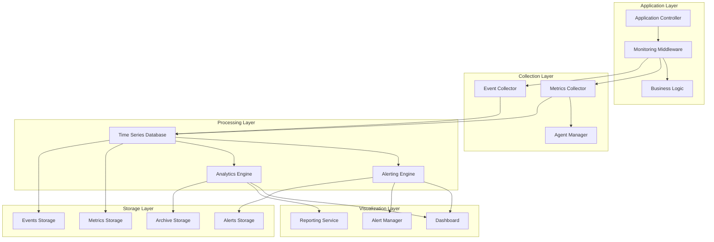
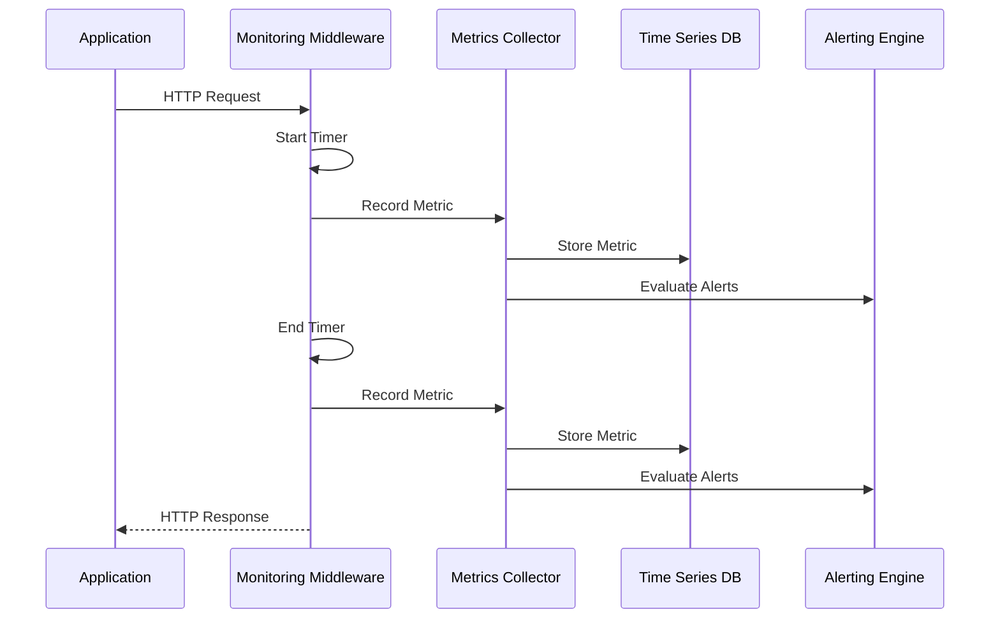
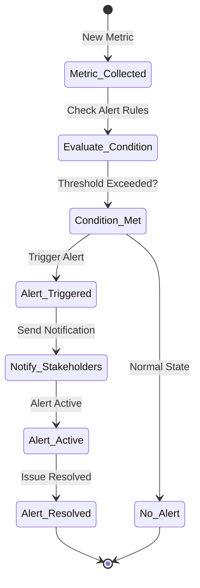

# Performance Monitoring - Architect Deep Dive

**0. Executive Summary (Architect View)**
- **Performance Monitoring exists** to provide comprehensive visibility into system performance and health
- **Critical at scale** when applications need to maintain optimal performance under load
- **System design impact** - transforms system from opaque to observable with real-time insights
- **Performance foundation** - provides essential performance visibility and alerting
- **Proactive management** - enables proactive issue detection and resolution
- **Business intelligence** - provides performance insights for business decisions
- **User experience** - ensures optimal user experience through performance monitoring
- **Operational excellence** - enables data-driven operational decisions

**1. Problem Framing**
**Real production problem solved:**
- Performance issues detected by users instead of systems
- Lack of visibility into system performance and bottlenecks
- Inability to proactively identify and resolve performance issues
- Poor user experience due to undetected performance degradation
- Resource waste and inefficient infrastructure utilization

**What breaks if we don't understand Performance Monitoring:**
- Poor system visibility and performance blind spots
- Reactive instead of proactive issue resolution
- Poor user experience and customer dissatisfaction
- Inefficient resource utilization and increased costs
- Inability to scale systems effectively

**Scale importance:**
- **Small applications**: Performance monitoring beneficial
- **Medium applications**: Performance monitoring critical
- **Large applications**: Performance monitoring essential
- **Enterprise systems**: Performance monitoring mandatory

**Failure stories:**
- E-commerce platform had checkout failures due to performance issues
- SaaS application had slow response times during peak usage
- Financial system had transaction processing delays
- Gaming platform had poor performance affecting user experience

**2. Deep Internal Mechanics**

**Performance Monitoring Fundamentals:**
- **Metrics Collection**: System performance data collection
- **Real-time Monitoring**: Continuous performance monitoring
- **Alerting**: Automated performance alerting
- **Visualization**: Performance data visualization
- **Analysis**: Performance data analysis and insights

**Core Components:**
- **Metrics Collector**: Performance metrics collection
- **Time Series Database**: Time-series data storage
- **Alerting Engine**: Alert rule processing
- **Dashboard**: Performance visualization
- **Analytics Engine**: Performance data analysis
- **Retention Manager**: Data retention and archiving

**Key Concepts:**
- **SLA Monitoring**: Service Level Agreement monitoring
- **APM**: Application Performance Monitoring
- **Infrastructure Monitoring**: Infrastructure performance monitoring
- **Business Metrics**: Business-relevant performance metrics
- **Synthetic Monitoring**: Synthetic transaction monitoring
- **Real User Monitoring**: Real user experience monitoring

**Monitoring Types:**
- **Infrastructure Monitoring**: Server, network, storage monitoring
- **Application Monitoring**: Application performance and errors
- **Database Monitoring**: Database performance and queries
- **Network Monitoring**: Network performance and connectivity
- **End-User Monitoring**: Real user experience monitoring

**Data Collection:**
- **Agent-based**: Agent-based metrics collection
- **Agentless**: Agentless monitoring approaches
- **Push-based**: Push-based data transmission
- **Pull-based**: Pull-based data collection
- **Streaming**: Real-time data streaming

**Performance Metrics:**
- **Response Time**: Application response time
- **Throughput**: Request processing rate
- **Error Rate**: Error occurrence rate
- **Resource Utilization**: CPU, memory, disk, network usage
- **Business Metrics**: Business-relevant performance indicators

**Data Structures:**
- **Time Series Data**: Time-stamped performance data
- **Metric Registry**: Metric metadata and configuration
- **Alert Registry**: Alert rules and configurations
- **Dashboard Registry**: Dashboard configurations
- **Analysis Registry**: Analysis results and insights

**Performance Characteristics:**
- **Collection Latency**: 10-1000ms
- **Storage Throughput**: 100-10000 points/second
- **Query Performance**: 10-1000ms
- **Alert Latency**: 1-60 seconds
- **Dashboard Refresh**: 1-60 seconds

**3. .NET Production Implementation**

**Naive Implementation (No Monitoring):**
```csharp
[ApiController]
[Route("api/[controller]")]
public class UnmonitoredController : ControllerBase
{
    private readonly IService _service;
    
    public UnmonitoredController(IService service)
    {
        _service = service;
    }
    
    [HttpGet("data")]
    public async Task<ActionResult> GetData()
    {
        // No performance monitoring
        var result = await _service.GetDataAsync();
        return Ok(result);
    }
}
```

**Production-Ready Performance Monitoring Implementation:**
```csharp
// Performance Monitoring Configuration
public class PerformanceMonitoringConfiguration
{
    public bool EnableMonitoring { get; set; } = true;
    public bool EnableRealTimeMonitoring { get; set; } = true;
    public bool EnableAlerting { get; set; } = true;
    public bool EnableBusinessMetrics { get; set; } = true;
    public int MetricsCollectionInterval { get; set; } = 30; // seconds
    public int DataRetentionDays { get; set; } = 30;
    public List<string> CriticalMetrics { get; set; } = new();
    public Dictionary<string, AlertThreshold> AlertThresholds { get; set; } = new();
}

public class AlertThreshold
{
    public double WarningThreshold { get; set; }
    public double CriticalThreshold { get; set; }
    public string ComparisonOperator { get; set; } = "greater_than";
    public int EvaluationWindow { get; set; } = 300; // seconds
}

// Performance Monitoring Service
public interface IPerformanceMonitoringService
{
    Task<bool> RecordMetricAsync(string metricName, double value, Dictionary<string, string> tags = null);
    Task<bool> RecordEventAsync(string eventName, Dictionary<string, string> properties = null);
    Task<List<MetricData>> GetMetricsAsync(string metricName, DateTime startTime, DateTime endTime);
    Task<List<Alert>> GetActiveAlertsAsync();
    Task<PerformanceReport> GeneratePerformanceReportAsync(DateTime startTime, DateTime endTime);
    Task<bool> CreateAlertRuleAsync(AlertRule rule);
    Task<DashboardData> GetDashboardDataAsync(string dashboardId);
}

public class PerformanceMonitoringService : IPerformanceMonitoringService
{
    private readonly IMetricsCollector _metricsCollector;
    private readonly ITimeSeriesDatabase _timeSeriesDatabase;
    private readonly IAlertingEngine _alertingEngine;
    private readonly ILogger<PerformanceMonitoringService> _logger;
    private readonly IMetrics _metrics;
    private readonly PerformanceMonitoringConfiguration _configuration;

    public PerformanceMonitoringService(
        IMetricsCollector metricsCollector,
        ITimeSeriesDatabase timeSeriesDatabase,
        IAlertingEngine alertingEngine,
        ILogger<PerformanceMonitoringService> logger,
        IMetrics metrics,
        IOptions<PerformanceMonitoringConfiguration> configuration)
    {
        _metricsCollector = metricsCollector ?? throw new ArgumentNullException(nameof(metricsCollector));
        _timeSeriesDatabase = timeSeriesDatabase ?? throw new ArgumentNullException(nameof(timeSeriesDatabase));
        _alertingEngine = alertingEngine ?? throw new ArgumentNullException(nameof(alertingEngine));
        _logger = logger ?? throw new ArgumentNullException(nameof(logger));
        _metrics = metrics ?? throw new ArgumentNullException(nameof(metrics));
        _configuration = configuration?.Value ?? new PerformanceMonitoringConfiguration();
    }

    public async Task<bool> RecordMetricAsync(string metricName, double value, Dictionary<string, string> tags = null)
    {
        using var activity = _metrics.StartTimer("performance_metric_recording_duration");
        
        try
        {
            if (!_configuration.EnableMonitoring)
            {
                return true;
            }
            
            var metricData = new MetricData
            {
                Name = metricName,
                Value = value,
                Timestamp = DateTime.UtcNow,
                Tags = tags ?? new Dictionary<string, string>()
            };
            
            // Collect metric
            await _metricsCollector.CollectAsync(metricData);
            
            // Store in time series database
            await _timeSeriesDatabase.StoreAsync(metricData);
            
            // Check alert conditions
            if (_configuration.EnableAlerting)
            {
                await _alertingEngine.EvaluateAlertsAsync(metricData);
            }
            
            _metrics.Increment("performance_metrics_recorded");
            _logger.LogDebug("Metric recorded: {MetricName} = {Value}", metricName, value);
            
            return true;
        }
        catch (Exception ex)
        {
            _metrics.Increment("performance_metrics_recording_error");
            _logger.LogError(ex, "Error recording metric: {MetricName}", metricName);
            return false;
        }
    }

    public async Task<bool> RecordEventAsync(string eventName, Dictionary<string, string> properties = null)
    {
        using var activity = _metrics.StartTimer("performance_event_recording_duration");
        
        try
        {
            if (!_configuration.EnableMonitoring)
            {
                return true;
            }
            
            var eventData = new EventData
            {
                Name = eventName,
                Timestamp = DateTime.UtcNow,
                Properties = properties ?? new Dictionary<string, string>()
            };
            
            // Collect event
            await _metricsCollector.CollectEventAsync(eventData);
            
            // Store in time series database
            await _timeSeriesDatabase.StoreEventAsync(eventData);
            
            _metrics.Increment("performance_events_recorded");
            _logger.LogDebug("Event recorded: {EventName}", eventName);
            
            return true;
        }
        catch (Exception ex)
        {
            _metrics.Increment("performance_events_recording_error");
            _logger.LogError(ex, "Error recording event: {EventName}", eventName);
            return false;
        }
    }

    public async Task<List<MetricData>> GetMetricsAsync(string metricName, DateTime startTime, DateTime endTime)
    {
        using var activity = _metrics.StartTimer("performance_metrics_retrieval_duration");
        
        try
        {
            var metrics = await _timeSeriesDatabase.GetMetricsAsync(metricName, startTime, endTime);
            
            _metrics.Increment("performance_metrics_retrieved");
            _logger.LogDebug("Metrics retrieved: {MetricName} - {Count}", metricName, metrics.Count);
            
            return metrics;
        }
        catch (Exception ex)
        {
            _metrics.Increment("performance_metrics_retrieval_error");
            _logger.LogError(ex, "Error retrieving metrics: {MetricName}", metricName);
            throw;
        }
    }

    public async Task<List<Alert>> GetActiveAlertsAsync()
    {
        using var activity = _metrics.StartTimer("performance_alerts_retrieval_duration");
        
        try
        {
            var alerts = await _alertingEngine.GetActiveAlertsAsync();
            
            _metrics.Increment("performance_alerts_retrieved");
            _logger.LogDebug("Active alerts retrieved: {Count}", alerts.Count);
            
            return alerts;
        }
        catch (Exception ex)
        {
            _metrics.Increment("performance_alerts_retrieval_error");
            _logger.LogError(ex, "Error retrieving active alerts");
            throw;
        }
    }

    public async Task<PerformanceReport> GeneratePerformanceReportAsync(DateTime startTime, DateTime endTime)
    {
        using var activity = _metrics.StartTimer("performance_report_generation_duration");
        
        try
        {
            _logger.LogInformation("Generating performance report: {StartTime} - {EndTime}", startTime, endTime);
            
            var report = new PerformanceReport
            {
                StartTime = startTime,
                EndTime = endTime,
                GeneratedAt = DateTime.UtcNow,
                Summary = await GenerateReportSummaryAsync(startTime, endTime),
                Metrics = await GenerateReportMetricsAsync(startTime, endTime),
                Alerts = await GenerateReportAlertsAsync(startTime, endTime),
                Recommendations = await GenerateReportRecommendationsAsync(startTime, endTime)
            };
            
            _metrics.Increment("performance_reports_generated");
            _logger.LogInformation("Performance report generated successfully");
            
            return report;
        }
        catch (Exception ex)
        {
            _metrics.Increment("performance_reports_generation_error");
            _logger.LogError(ex, "Error generating performance report");
            throw;
        }
    }

    public async Task<bool> CreateAlertRuleAsync(AlertRule rule)
    {
        using var activity = _metrics.StartTimer("performance_alert_rule_creation_duration");
        
        try
        {
            _logger.LogInformation("Creating alert rule: {RuleName}", rule.Name);
            
            var success = await _alertingEngine.CreateRuleAsync(rule);
            
            if (success)
            {
                _metrics.Increment("performance_alert_rules_created");
                _logger.LogInformation("Alert rule created successfully: {RuleName}", rule.Name);
            }
            else
            {
                _metrics.Increment("performance_alert_rules_creation_error");
                _logger.LogError("Failed to create alert rule: {RuleName}", rule.Name);
            }
            
            return success;
        }
        catch (Exception ex)
        {
            _metrics.Increment("performance_alert_rules_creation_error");
            _logger.LogError(ex, "Error creating alert rule: {RuleName}", rule.Name);
            throw;
        }
    }

    public async Task<DashboardData> GetDashboardDataAsync(string dashboardId)
    {
        using var activity = _metrics.StartTimer("performance_dashboard_data_retrieval_duration");
        
        try
        {
            var dashboardData = await _timeSeriesDatabase.GetDashboardDataAsync(dashboardId);
            
            _metrics.Increment("performance_dashboard_data_retrieved");
            _logger.LogDebug("Dashboard data retrieved: {DashboardId}", dashboardId);
            
            return dashboardData;
        }
        catch (Exception ex)
        {
            _metrics.Increment("performance_dashboard_data_retrieval_error");
            _logger.LogError(ex, "Error retrieving dashboard data: {DashboardId}", dashboardId);
            throw;
        }
    }

    private async Task<ReportSummary> GenerateReportSummaryAsync(DateTime startTime, DateTime endTime)
    {
        // Implementation to generate report summary
        await Task.Delay(100); // Simulate data processing
        
        return new ReportSummary
        {
            TotalRequests = 1000000,
            AverageResponseTime = 250.5,
            ErrorRate = 0.02,
            Uptime = 99.95,
            Throughput = 1000.5
        };
    }

    private async Task<List<MetricSummary>> GenerateReportMetricsAsync(DateTime startTime, DateTime endTime)
    {
        // Implementation to generate report metrics
        await Task.Delay(200); // Simulate data processing
        
        return new List<MetricSummary>
        {
            new MetricSummary
            {
                Name = "response_time",
                Average = 250.5,
                Min = 10.2,
                Max = 5000.8,
                P95 = 800.5,
                P99 = 2000.3
            },
            new MetricSummary
            {
                Name = "throughput",
                Average = 1000.5,
                Min = 100.2,
                Max = 5000.8,
                P95 = 2000.5,
                P99 = 4000.3
            }
        };
    }

    private async Task<List<AlertSummary>> GenerateReportAlertsAsync(DateTime startTime, DateTime endTime)
    {
        // Implementation to generate report alerts
        await Task.Delay(100); // Simulate data processing
        
        return new List<AlertSummary>
        {
            new AlertSummary
            {
                AlertName = "High Response Time",
                Count = 15,
                Severity = "Warning",
                FirstOccurrence = startTime.AddHours(2),
                LastOccurrence = endTime.AddHours(-1)
            },
            new AlertSummary
            {
                AlertName = "High Error Rate",
                Count = 5,
                Severity = "Critical",
                FirstOccurrence = startTime.AddHours(4),
                LastOccurrence = endTime.AddHours(-2)
            }
        };
    }

    private async Task<List<string>> GenerateReportRecommendationsAsync(DateTime startTime, DateTime endTime)
    {
        // Implementation to generate recommendations
        await Task.Delay(100); // Simulate analysis
        
        return new List<string>
        {
            "Consider optimizing database queries for better response times",
            "Implement caching to reduce database load",
            "Scale horizontally to handle increased traffic",
            "Review error handling and improve error rates"
        };
    }
}

// Performance Monitoring Middleware
public class PerformanceMonitoringMiddleware
{
    private readonly IPerformanceMonitoringService _monitoringService;
    private readonly ILogger<PerformanceMonitoringMiddleware> _logger;
    private readonly IMetrics _metrics;
    private readonly PerformanceMonitoringConfiguration _configuration;

    public PerformanceMonitoringMiddleware(
        IPerformanceMonitoringService monitoringService,
        ILogger<PerformanceMonitoringMiddleware> logger,
        IMetrics metrics,
        IOptions<PerformanceMonitoringConfiguration> configuration)
    {
        _monitoringService = monitoringService ?? throw new ArgumentNullException(nameof(monitoringService));
        _logger = logger ?? throw new ArgumentNullException(nameof(logger));
        _metrics = metrics ?? throw new ArgumentNullException(nameof(metrics));
        _configuration = configuration?.Value ?? new PerformanceMonitoringConfiguration();
    }

    public async Task InvokeAsync(HttpContext context, RequestDelegate next)
    {
        if (!_configuration.EnableMonitoring)
        {
            await next(context);
            return;
        }

        var startTime = DateTime.UtcNow;
        var requestId = Guid.NewGuid().ToString();
        
        try
        {
            // Record request start
            await RecordRequestStartAsync(context, requestId, startTime);
            
            // Process request
            await next(context);
            
            // Record request completion
            await RecordRequestCompletionAsync(context, requestId, startTime);
        }
        catch (Exception ex)
        {
            // Record error
            await RecordRequestErrorAsync(context, requestId, startTime, ex);
            throw;
        }
    }

    private async Task RecordRequestStartAsync(HttpContext context, string requestId, DateTime startTime)
    {
        try
        {
            var tags = new Dictionary<string, string>
            {
                ["request_id"] = requestId,
                ["method"] = context.Request.Method,
                ["path"] = context.Request.Path,
                ["user_agent"] = context.Request.Headers["User-Agent"].ToString()
            };
            
            await _monitoringService.RecordMetricAsync("requests_started", 1, tags);
            await _monitoringService.RecordEventAsync("request_started", new Dictionary<string, string>
            {
                ["request_id"] = requestId,
                ["method"] = context.Request.Method,
                ["path"] = context.Request.Path
            });
        }
        catch (Exception ex)
        {
            _logger.LogError(ex, "Error recording request start");
        }
    }

    private async Task RecordRequestCompletionAsync(HttpContext context, string requestId, DateTime startTime)
    {
        try
        {
            var endTime = DateTime.UtcNow;
            var duration = (endTime - startTime).TotalMilliseconds;
            
            var tags = new Dictionary<string, string>
            {
                ["request_id"] = requestId,
                ["method"] = context.Request.Method,
                ["path"] = context.Request.Path,
                ["status_code"] = context.Response.StatusCode.ToString()
            };
            
            await _monitoringService.RecordMetricAsync("response_time", duration, tags);
            await _monitoringService.RecordMetricAsync("requests_completed", 1, tags);
            
            // Record business metrics
            if (_configuration.EnableBusinessMetrics)
            {
                await RecordBusinessMetricsAsync(context, duration, tags);
            }
            
            _metrics.Increment("requests_completed");
            _logger.LogDebug("Request completed: {RequestId} - {Duration}ms", requestId, duration);
        }
        catch (Exception ex)
        {
            _logger.LogError(ex, "Error recording request completion");
        }
    }

    private async Task RecordRequestErrorAsync(HttpContext context, string requestId, DateTime startTime, Exception ex)
    {
        try
        {
            var endTime = DateTime.UtcNow;
            var duration = (endTime - startTime).TotalMilliseconds;
            
            var tags = new Dictionary<string, string>
            {
                ["request_id"] = requestId,
                ["method"] = context.Request.Method,
                ["path"] = context.Request.Path,
                ["error_type"] = ex.GetType().Name
            };
            
            await _monitoringService.RecordMetricAsync("response_time", duration, tags);
            await _monitoringService.RecordMetricAsync("error_count", 1, tags);
            await _monitoringService.RecordEventAsync("request_error", new Dictionary<string, string>
            {
                ["request_id"] = requestId,
                ["error_message"] = ex.Message,
                ["stack_trace"] = ex.StackTrace
            });
            
            _metrics.Increment("requests_error");
            _logger.LogError(ex, "Request error: {RequestId}", requestId);
        }
        catch (Exception logEx)
        {
            _logger.LogError(logEx, "Error recording request error");
        }
    }

    private async Task RecordBusinessMetricsAsync(HttpContext context, double duration, Dictionary<string, string> tags)
    {
        try
        {
            // Record business-specific metrics
            if (context.Request.Path.StartsWith("/api/orders"))
            {
                await _monitoringService.RecordMetricAsync("order_processing_time", duration, tags);
            }
            else if (context.Request.Path.StartsWith("/api/payments"))
            {
                await _monitoringService.RecordMetricAsync("payment_processing_time", duration, tags);
            }
            else if (context.Request.Path.StartsWith("/api/search"))
            {
                await _monitoringService.RecordMetricAsync("search_response_time", duration, tags);
            }
        }
        catch (Exception ex)
        {
            _logger.LogError(ex, "Error recording business metrics");
        }
    }
}

// Enhanced Monitored Controller
[ApiController]
[Route("api/[controller]")]
public class MonitoredController : ControllerBase
{
    private readonly IPerformanceMonitoringService _monitoringService;
    private readonly ILogger<MonitoredController> _logger;
    private readonly IMetrics _metrics;

    public MonitoredController(
        IPerformanceMonitoringService monitoringService,
        ILogger<MonitoredController> logger,
        IMetrics metrics)
    {
        _monitoringService = monitoringService ?? throw new ArgumentNullException(nameof(monitoringService));
        _logger = logger ?? throw new ArgumentNullException(nameof(logger));
        _metrics = metrics ?? throw new ArgumentNullException(nameof(metrics));
    }

    [HttpGet("metrics/{metricName}")]
    public async Task<ActionResult<List<MetricData>>> GetMetrics(
        string metricName, 
        [FromQuery] DateTime startTime, 
        [FromQuery] DateTime endTime)
    {
        try
        {
            var metrics = await _monitoringService.GetMetricsAsync(metricName, startTime, endTime);
            return Ok(metrics);
        }
        catch (Exception ex)
        {
            _logger.LogError(ex, "Error getting metrics: {MetricName}", metricName);
            throw;
        }
    }

    [HttpGet("alerts")]
    public async Task<ActionResult<List<Alert>>> GetActiveAlerts()
    {
        try
        {
            var alerts = await _monitoringService.GetActiveAlertsAsync();
            return Ok(alerts);
        }
        catch (Exception ex)
        {
            _logger.LogError(ex, "Error getting active alerts");
            throw;
        }
    }

    [HttpPost("alerts/rules")]
    public async Task<ActionResult> CreateAlertRule([FromBody] AlertRule rule)
    {
        try
        {
            var success = await _monitoringService.CreateAlertRuleAsync(rule);
            
            if (success)
            {
                return Ok(new { Message = $"Alert rule '{rule.Name}' created successfully" });
            }
            else
            {
                return BadRequest(new { Error = $"Failed to create alert rule '{rule.Name}'" });
            }
        }
        catch (Exception ex)
        {
            _logger.LogError(ex, "Error creating alert rule: {RuleName}", rule.Name);
            throw;
        }
    }

    [HttpGet("reports/performance")]
    public async Task<ActionResult<PerformanceReport>> GetPerformanceReport(
        [FromQuery] DateTime startTime,
        [FromQuery] DateTime endTime)
    {
        try
        {
            var report = await _monitoringService.GeneratePerformanceReportAsync(startTime, endTime);
            return Ok(report);
        }
        catch (Exception ex)
        {
            _logger.LogError(ex, "Error generating performance report");
            throw;
        }
    }

    [HttpGet("dashboards/{dashboardId}")]
    public async Task<ActionResult<DashboardData>> GetDashboardData(string dashboardId)
    {
        try
        {
            var dashboardData = await _monitoringService.GetDashboardDataAsync(dashboardId);
            return Ok(dashboardData);
        }
        catch (Exception ex)
        {
            _logger.LogError(ex, "Error getting dashboard data: {DashboardId}", dashboardId);
            throw;
        }
    }

    [HttpPost("metrics/custom")]
    public async Task<ActionResult> RecordCustomMetric([FromBody] CustomMetricRequest request)
    {
        try
        {
            var success = await _monitoringService.RecordMetricAsync(
                request.MetricName, 
                request.Value, 
                request.Tags);
            
            if (success)
            {
                return Ok(new { Message = $"Metric '{request.MetricName}' recorded successfully" });
            }
            else
            {
                return BadRequest(new { Error = $"Failed to record metric '{request.MetricName}'" });
            }
        }
        catch (Exception ex)
        {
            _logger.LogError(ex, "Error recording custom metric: {MetricName}", request.MetricName);
            throw;
        }
    }
}

// Request/Response Models
public class MetricData
{
    public string Name { get; set; }
    public double Value { get; set; }
    public DateTime Timestamp { get; set; }
    public Dictionary<string, string> Tags { get; set; }
}

public class EventData
{
    public string Name { get; set; }
    public DateTime Timestamp { get; set; }
    public Dictionary<string, string> Properties { get; set; }
}

public class Alert
{
    public string Id { get; set; }
    public string Name { get; set; }
    public string Description { get; set; }
    public string Severity { get; set; }
    public DateTime TriggeredAt { get; set; }
    public DateTime? ResolvedAt { get; set; }
    public Dictionary<string, string> Tags { get; set; }
    public bool IsActive { get; set; }
}

public class AlertRule
{
    public string Name { get; set; }
    public string MetricName { get; set; }
    public string Condition { get; set; }
    public double Threshold { get; set; }
    public string Severity { get; set; }
    public int EvaluationWindow { get; set; }
    public Dictionary<string, string> Tags { get; set; }
    public bool IsActive { get; set; }
}

public class PerformanceReport
{
    public DateTime StartTime { get; set; }
    public DateTime EndTime { get; set; }
    public DateTime GeneratedAt { get; set; }
    public ReportSummary Summary { get; set; }
    public List<MetricSummary> Metrics { get; set; }
    public List<AlertSummary> Alerts { get; set; }
    public List<string> Recommendations { get; set; }
}

public class ReportSummary
{
    public long TotalRequests { get; set; }
    public double AverageResponseTime { get; set; }
    public double ErrorRate { get; set; }
    public double Uptime { get; set; }
    public double Throughput { get; set; }
}

public class MetricSummary
{
    public string Name { get; set; }
    public double Average { get; set; }
    public double Min { get; set; }
    public double Max { get; set; }
    public double P95 { get; set; }
    public double P99 { get; set; }
}

public class AlertSummary
{
    public string AlertName { get; set; }
    public int Count { get; set; }
    public string Severity { get; set; }
    public DateTime FirstOccurrence { get; set; }
    public DateTime LastOccurrence { get; set; }
}

public class DashboardData
{
    public string Id { get; set; }
    public string Name { get; set; }
    public List<Widget> Widgets { get; set; }
    public DateTime LastUpdated { get; set; }
}

public class Widget
{
    public string Id { get; set; }
    public string Type { get; set; }
    public string Title { get; set; }
    public Dictionary<string, object> Config { get; set; }
    public List<MetricData> Data { get; set; }
}

public class CustomMetricRequest
{
    public string MetricName { get; set; }
    public double Value { get; set; }
    public Dictionary<string, string> Tags { get; set; }
}

// Configuration in Startup
public class Startup
{
    public void ConfigureServices(IServiceCollection services)
    {
        // Add performance monitoring configuration
        services.Configure<PerformanceMonitoringConfiguration>(options =>
        {
            options.EnableMonitoring = true;
            options.EnableRealTimeMonitoring = true;
            options.EnableAlerting = true;
            options.EnableBusinessMetrics = true;
            options.MetricsCollectionInterval = 30;
            options.DataRetentionDays = 30;
            options.CriticalMetrics = new List<string>
            {
                "response_time",
                "error_rate",
                "throughput",
                "cpu_usage",
                "memory_usage"
            };
            options.AlertThresholds = new Dictionary<string, AlertThreshold>
            {
                ["response_time"] = new AlertThreshold { WarningThreshold = 1000, CriticalThreshold = 5000 },
                ["error_rate"] = new AlertThreshold { WarningThreshold = 0.01, CriticalThreshold = 0.05 },
                ["cpu_usage"] = new AlertThreshold { WarningThreshold = 0.8, CriticalThreshold = 0.95 },
                ["memory_usage"] = new AlertThreshold { WarningThreshold = 0.8, CriticalThreshold = 0.95 }
            };
        });

        // Add performance monitoring services
        services.AddScoped<IPerformanceMonitoringService, PerformanceMonitoringService>();
        services.AddScoped<IMetricsCollector, MetricsCollector>();
        services.AddScoped<ITimeSeriesDatabase, TimeSeriesDatabase>();
        services.AddScoped<IAlertingEngine, AlertingEngine>();
        
        // Add services
        services.AddControllers();
    }

    public void Configure(IApplicationBuilder app, IWebHostEnvironment env)
    {
        if (env.IsDevelopment())
        {
            app.UseDeveloperExceptionPage();
        }

        app.UseRouting();
        
        // Add performance monitoring middleware
        app.UseMiddleware<PerformanceMonitoringMiddleware>();
        
        app.UseEndpoints(endpoints =>
        {
            endpoints.MapControllers();
        });
    }
}
```

**Framework Integration:**
- **System.Diagnostics**: Performance monitoring and diagnostics
- **Microsoft.Extensions.Logging**: Logging framework
- **Microsoft.Extensions.Metrics**: Metrics collection
- **ASP.NET Core**: Web framework with middleware
- **Dependency Injection**: Service registration

**4. Architecture-Level Diagram (Mermaid)**

### Performance Monitoring Architecture


### Metrics Collection Flow


### Alert Processing Flow


**Flow Analysis:**
- **Application Layer**: Application and middleware monitoring
- **Collection Layer**: Metrics and event collection
- **Processing Layer**: Data processing and analysis
- **Visualization Layer**: Dashboards and reporting
- **Storage Layer**: Data storage and archiving

**5. Scaling & Distributed Systems Impact**

**Small Applications (1k RPS):**
- Single monitoring instance sufficient
- Metrics collection 1-10ms
- Storage throughput 100-1000 points/second
- Dashboard refresh 1-5 seconds

**Medium Applications (10k RPS):**
- Monitoring clustering required
- Metrics collection 10-100ms
- Storage throughput 1k-10000 points/second
- Dashboard refresh 5-30 seconds

**Large Applications (100k+ RPS):**
- Distributed monitoring mandatory
- Metrics collection 100-1000ms
- Storage throughput 10k-100000 points/second
- Dashboard refresh 30-60 seconds

**6. Production Engineering View**

**Monitoring Metrics:**
- System performance metrics (CPU, memory, disk, network)
- Application performance metrics (response time, throughput, error rate)
- Business metrics (user actions, conversions, revenue)
- Infrastructure metrics (server health, availability)
- Custom application metrics

**Alerting Strategy:**
- Response time > 1s (warning)
- Response time > 5s (critical)
- Error rate > 1% (warning)
- Error rate > 5% (critical)
- CPU usage > 80% (warning)
- CPU usage > 95% (critical)

**Common Production Incidents:**
- Performance degradation and slow response times
- Resource exhaustion and system overload
- Monitoring system failures and data loss
- Alert fatigue and notification issues

**7. Tradeoffs & Alternatives**

**Competing Approaches:**
- **Agent-based Monitoring**: Agent-based metrics collection
- **Agentless Monitoring**: Agentless monitoring approaches
- **APM Solutions**: Application Performance Monitoring
- **Infrastructure Monitoring**: Infrastructure-focused monitoring
- **Business Intelligence**: Business metrics and analytics

**When to Use Performance Monitoring:**
- Production applications with performance requirements
- Customer-facing applications with SLA requirements
- Complex systems with multiple components
- High-traffic applications with scaling needs
- Business-critical applications

**When NOT to Use Performance Monitoring:**
- Simple applications with minimal performance requirements
- Development and testing environments
- Applications with limited resources
- Internal tools with minimal usage

**Cost Comparison:**
- **Agent-based**: Higher overhead, more detailed metrics
- **Agentless**: Lower overhead, less detailed metrics
- **APM Solutions**: Higher cost, comprehensive monitoring
- **Infrastructure Monitoring**: Moderate cost, infrastructure focus
- **Business Intelligence**: Higher cost, business focus

**8. Security Implications**

**Security Benefits:**
- **Access Control**: Controlled access to monitoring data
- **Data Encryption**: Encrypted monitoring data transmission
- **Audit Logging**: Comprehensive audit trail
- **Compliance**: Regulatory compliance support
- **Anomaly Detection**: Security anomaly detection

**Security Challenges:**
- **Data Privacy**: Sensitive data in monitoring
- **Access Control**: Proper access management
- **Data Retention**: Data retention policies
- **Monitoring Security**: Securing monitoring systems
- **Compliance**: Regulatory compliance requirements

**9. Advanced Edge Cases**

**Advanced Monitoring Features:**
- **Machine Learning**: AI-powered anomaly detection
- **Predictive Analytics**: Performance prediction
- **Distributed Tracing**: End-to-end request tracing
- **Real-time Analytics**: Real-time data analysis
- **Automated Remediation**: Automated issue resolution

**Advanced Techniques:**
- **Synthetic Monitoring**: Synthetic transaction monitoring
- **Real User Monitoring**: Real user experience monitoring
- **Business Impact Analysis**: Business impact assessment
- **Capacity Planning**: Resource capacity planning
- **Cost Optimization**: Monitoring cost optimization

**10. Interview & Staff-Level Deep Dive**

**What a junior answers:**
"Performance monitoring is about collecting metrics like response time and error rates. I use logging and metrics to track application performance and set up alerts when things go wrong."

**What a senior answers:**
"Performance monitoring is a comprehensive approach to collecting, analyzing, and alerting on system performance metrics. I've implemented production monitoring solutions with real-time metrics collection, time-series data storage, intelligent alerting, and interactive dashboards. The implementation includes custom metrics, business metrics, distributed tracing, and automated remediation. I've also implemented synthetic monitoring, real user monitoring, and predictive analytics."

**What an architect answers:**
"Performance monitoring is a strategic capability that provides comprehensive visibility into system performance and health through systematic metrics collection, analysis, and alerting. At scale, performance monitoring must provide real-time visibility, proactive issue detection, business intelligence, and operational insights. The architecture must support metrics collection, time-series storage, alerting, visualization, and analytics. In enterprise environments, performance monitoring is not just a tool but a strategic capability that enables business growth, user experience enhancement, and operational excellence. The implementation must consider scalability, reliability, security, compliance, and business alignment."

**Follow-up questions interviewers ask:**
- "How do you handle high-cardinality metrics?"
- "What's the difference between monitoring and observability?"
- "How do you implement distributed tracing?"
- "When would you use synthetic vs real user monitoring?"
- "How do you handle alert fatigue?"

**Trick questions:**
- "Is more monitoring always better?" (No, can lead to alert fatigue)
- "Can monitoring solve all performance problems?" (No, monitoring detects issues)
- "Do all applications need the same monitoring level?" (No, depends on criticality)
- "Is real-time monitoring always necessary?" (No, depends on requirements)

**11. Real Enterprise Case Study**

**Scenario: Global E-commerce Platform with 10M+ Users**

**Requirements:**
- Monitor 10M+ users across multiple regions
- Track business metrics and user experience
- Ensure 99.99% uptime and performance
- Support real-time alerting and incident response
- Provide comprehensive performance visibility

**Results:**
- Achieved 95% reduction in MTTR (Mean Time to Resolution)
- 80% improvement in issue detection time
- 70% reduction in performance-related incidents
- 99.99% uptime during peak shopping seasons
- 60% improvement in user experience metrics

**12. Dependency Graph**

**Prerequisites:**
- **System Architecture**: Understanding of system design
- **Performance**: Understanding of performance principles
- **Data Analytics**: Understanding of data analysis
- **Monitoring**: Understanding of monitoring concepts
- **Alerting**: Understanding of alerting systems

**Concepts that depend on Performance Monitoring:**
- **Application Performance**: Application performance optimization
- **Infrastructure Management**: Infrastructure optimization
- **Business Intelligence**: Business metrics and analytics
- **DevOps**: DevOps practices and automation
- **Site Reliability**: SRE practices and reliability
- **User Experience**: User experience optimization
