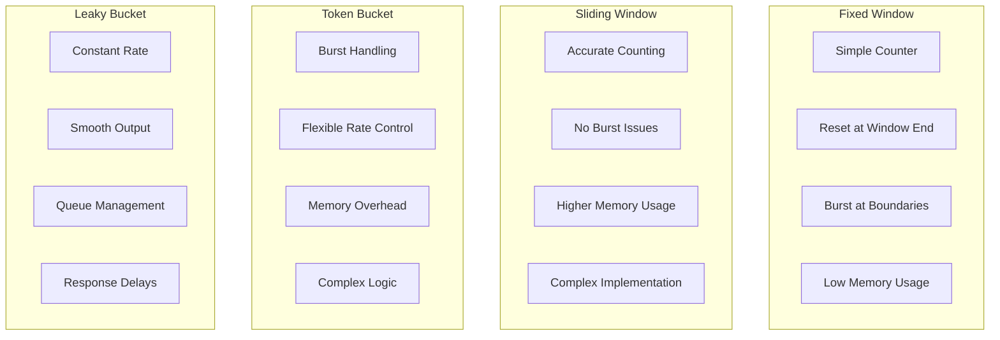
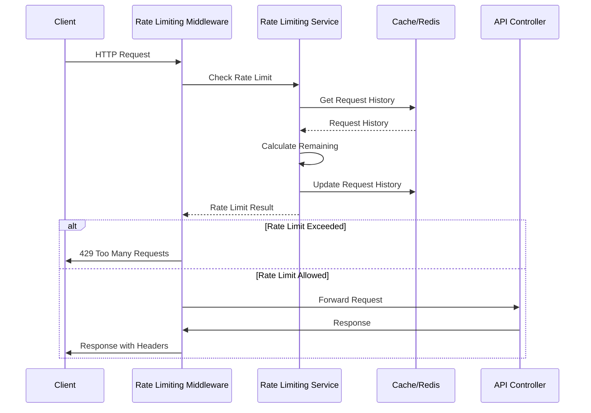
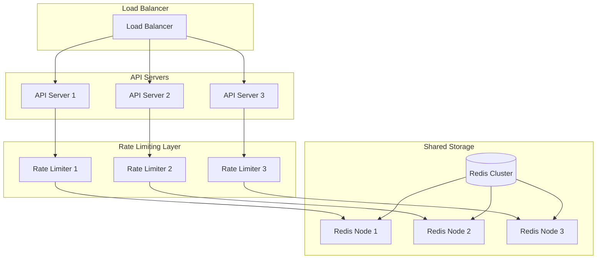
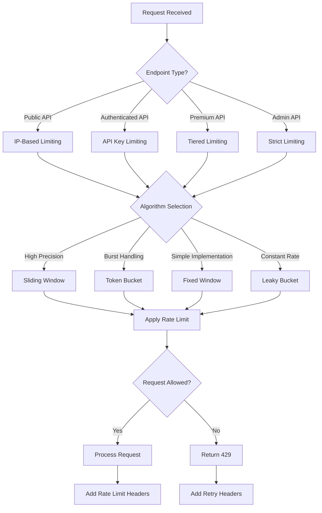
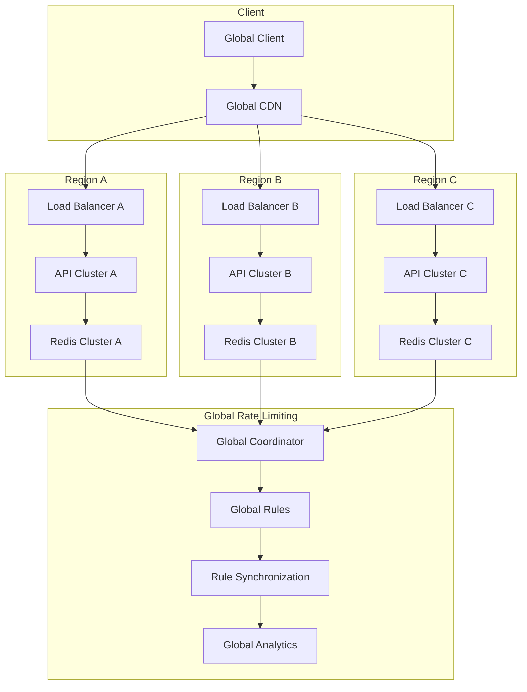
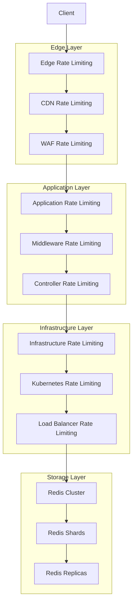
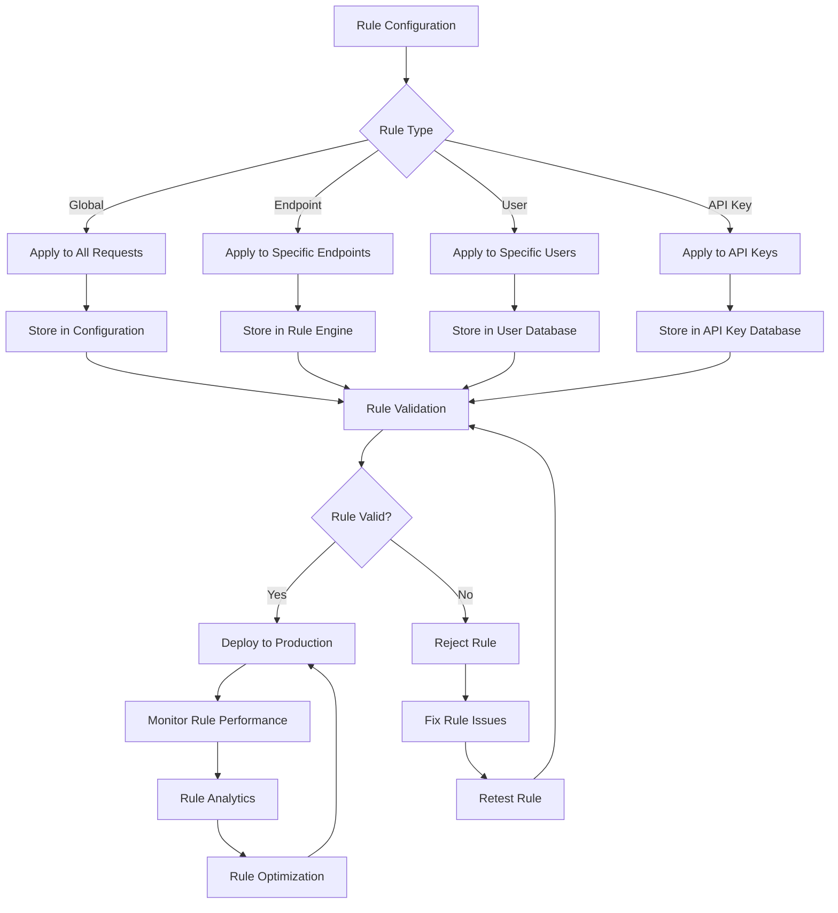

# Rate Limiting - Architect Deep Dive

**0. Executive Summary (Architect View)**
- **Rate Limiting exists** to protect systems from abuse and ensure fair resource allocation by controlling request rates
- **Critical at scale** when systems face high traffic volumes and potential abuse scenarios
- **System design impact** - transforms system architecture to include protection layers and quota management
- **Resource protection** - prevents system overload and ensures service availability
- **Fair usage** - ensures equitable resource distribution among users
- **Security foundation** - provides protection against DDoS and abuse attacks
- **Business continuity** - maintains service quality during traffic spikes
- **Cost optimization** - controls infrastructure costs through traffic management

**1. Problem Framing**
**Real production problem solved:**
- DDoS attacks overwhelming system resources
- API abuse by automated clients
- Unfair resource consumption by heavy users
- System crashes during traffic spikes
- Infrastructure cost escalation due to abuse

**What breaks if we don't understand rate limiting:**
- System vulnerability to abuse attacks
- Unfair resource allocation
- Poor service quality during peaks
- Infrastructure cost overruns
- Compliance and SLA violations

**Scale importance:**
- **Small applications**: Basic rate limiting sufficient
- **Medium applications**: Advanced rate limiting essential
- **Large applications**: Sophisticated rate limiting critical
- **Enterprise systems**: Multi-layer rate limiting mandatory

**Failure stories:**
- Social media platform crashed due to API abuse
- Financial system suffered from automated trading abuse
- E-commerce platform had inventory manipulation through rapid requests
- Gaming platform experienced DDoS attacks

**2. Deep Internal Mechanics**

**Rate Limiting Fundamentals:**
- **Request Rate Control**: Limit requests per time window
- **User Identification**: Track requests per user/IP/API key
- **Sliding Windows**: Dynamic time window calculations
- **Token Bucket**: Token-based rate limiting
- **Leaky Bucket**: Constant rate limiting

**Rate Limiting Algorithms:**
- **Fixed Window Counter**: Simple counter per fixed time period
- **Sliding Window Log**: Log-based sliding window
- **Sliding Window Counter**: Optimized sliding window
- **Token Bucket**: Token-based algorithm
- **Leaky Bucket**: Constant rate algorithm

**Fixed Window Counter:**
- **Implementation**: Simple counter with reset
- **Pros**: Simple to implement, low memory
- **Cons**: Burst issues at window boundaries
- **Use Case**: Basic rate limiting

**Sliding Window Log:**
- **Implementation**: Log of all requests with timestamps
- **Pros**: Accurate rate limiting
- **Cons**: High memory usage, complex implementation
- **Use Case**: Precise rate limiting requirements

**Token Bucket:**
- **Implementation**: Tokens added at fixed rate, consumed per request
- **Pros**: Handles bursts, flexible rate control
- **Cons**: Complex implementation, memory overhead
- **Use Case**: Burst handling requirements

**Leaky Bucket:**
- **Implementation**: Requests processed at constant rate
- **Pros**: Smooth output, prevents bursts
- **Cons**: Delayed responses, queue management
- **Use Case**: Constant rate requirements

**Rate Limiting Strategies:**
- **Per User**: Individual user limits
- **Per IP**: IP-based limits
- **Per API Key**: API key limits
- **Per Endpoint**: Endpoint-specific limits
- **Global**: System-wide limits

**Data Structures:**
- **Counters**: Simple integer counters
- **Sliding Windows**: Circular buffers
- **Token Buckets**: Token pools
- **Request Logs**: Timestamp arrays
- **Rate Limit Rules**: Configuration objects

**Performance Characteristics:**
- **Latency**: 1-10ms overhead per request
- **Throughput**: 10k-100k requests/second
- **Memory Usage**: Depends on algorithm and window size
- **CPU Usage**: Minimal for simple algorithms
- **Storage**: In-memory for performance

**Hidden Costs:**
- **Memory Overhead**: Sliding window storage
- **Complexity**: Algorithm implementation complexity
- **Configuration**: Rate limit rule management
- **Monitoring**: Additional monitoring requirements
- **User Experience**: Potential request delays

**Memory Behavior:**
- **Counters**: Minimal memory usage
- **Sliding Windows**: Circular buffer memory
- **Token Buckets**: Token pool memory
- **Request Logs**: Timestamp array memory
- **Rule Storage**: Configuration memory

**Network Impact:**
- **Additional Headers**: Rate limit headers
- **Response Codes**: 429 Too Many Requests
- **Retry Headers**: Retry-after headers
- **Bandwidth**: Minimal impact
- **Latency**: Processing overhead

**3. .NET Production Implementation**

**Naive Implementation (No Rate Limiting):**
```csharp
[ApiController]
[Route("api/[controller]")]
public class ProductsController : ControllerBase
{
    private readonly IProductService _productService;
    
    public ProductsController(IProductService productService)
    {
        _productService = productService;
    }
    
    [HttpGet("{id}")]
    public async Task<ActionResult<Product>> GetProduct(int id)
    {
        // No rate limiting - vulnerable to abuse
        var product = await _productService.GetProductAsync(id);
        return Ok(product);
    }
}
```

**Production-Ready Rate Limiting Implementation:**
```csharp
// Rate Limiting Configuration
public class RateLimitingConfiguration
{
    public int DefaultRequestsPerWindow { get; set; } = 100;
    public TimeSpan DefaultWindow { get; set; } = TimeSpan.FromMinutes(1);
    public Dictionary<string, RateLimitRule> Rules { get; set; } = new();
    public RateLimitingAlgorithm DefaultAlgorithm { get; set; } = RateLimitingAlgorithm.SlidingWindow;
    public bool EnableDistributedRateLimiting { get; set; } = true;
    public string RedisConnectionString { get; set; }
}

// Rate Limit Rule
public class RateLimitRule
{
    public string Endpoint { get; set; }
    public int RequestsPerWindow { get; set; }
    public TimeSpan Window { get; set; }
    public RateLimitingAlgorithm Algorithm { get; set; }
    public string IdentifierType { get; set; } = "IP";
}

// Rate Limiting Algorithm Enum
public enum RateLimitingAlgorithm
{
    FixedWindow,
    SlidingWindow,
    TokenBucket,
    LeakyBucket
}

// Rate Limit Result
public class RateLimitResult
{
    public bool IsAllowed { get; set; }
    public int RemainingRequests { get; set; }
    public long ResetTime { get; set; }
    public TimeSpan RetryAfter { get; set; }
    public string Identifier { get; set; }
    public RateLimitRule Rule { get; set; }
}

// Rate Limiting Service Interface
public interface IRateLimitingService
{
    Task<RateLimitResult> CheckRateLimitAsync(string identifier, string endpoint, HttpContext context);
    Task ResetRateLimitAsync(string identifier, string endpoint);
    Task<RateLimitRule> GetRateLimitRuleAsync(string endpoint);
}

// Sliding Window Rate Limiter
public class SlidingWindowRateLimiter : IRateLimitingService
{
    private readonly IMemoryCache _cache;
    private readonly ILogger<SlidingWindowRateLimiter> _logger;
    private readonly IMetrics _metrics;
    private readonly RateLimitingConfiguration _configuration;

    public SlidingWindowRateLimiter(
        IMemoryCache cache,
        ILogger<SlidingWindowRateLimiter> logger,
        IMetrics metrics,
        IOptions<RateLimitingConfiguration> configuration)
    {
        _cache = cache ?? throw new ArgumentNullException(nameof(cache));
        _logger = logger ?? throw new ArgumentNullException(nameof(logger));
        _metrics = metrics ?? throw new ArgumentNullException(nameof(metrics));
        _configuration = configuration?.Value ?? new RateLimitingConfiguration();
    }

    public async Task<RateLimitResult> CheckRateLimitAsync(string identifier, string endpoint, HttpContext context)
    {
        using var activity = _metrics.StartTimer("rate_limit_check_duration");
        
        try
        {
            var rule = await GetRateLimitRuleAsync(endpoint);
            var cacheKey = $"rate_limit:{identifier}:{endpoint}";
            
            // Get current request log
            var requestLog = await GetRequestLogAsync(cacheKey);
            var now = DateTime.UtcNow;
            
            // Remove expired requests
            var validRequests = requestLog.Where(r => r > now - rule.Window).ToList();
            
            // Check if limit exceeded
            if (validRequests.Count >= rule.RequestsPerWindow)
            {
                var oldestRequest = validRequests.Min();
                var resetTime = oldestRequest + rule.Window;
                var retryAfter = resetTime - now;
                
                _metrics.Increment("rate_limit_blocked");
                _logger.LogWarning("Rate limit exceeded for {Identifier} on {Endpoint}. Requests: {Count}, Limit: {Limit}", 
                    identifier, endpoint, validRequests.Count, rule.RequestsPerWindow);
                
                return new RateLimitResult
                {
                    IsAllowed = false,
                    RemainingRequests = 0,
                    ResetTime = ((DateTimeOffset)resetTime).ToUnixTimeSeconds(),
                    RetryAfter = retryAfter,
                    Identifier = identifier,
                    Rule = rule
                };
            }
            
            // Add current request
            validRequests.Add(now);
            await UpdateRequestLogAsync(cacheKey, validRequests);
            
            var remainingRequests = rule.RequestsPerWindow - validRequests.Count;
            
            _metrics.Increment("rate_limit_allowed");
            _logger.LogDebug("Rate limit check passed for {Identifier} on {Endpoint}. Remaining: {Remaining}", 
                identifier, endpoint, remainingRequests);
            
            return new RateLimitResult
            {
                IsAllowed = true,
                RemainingRequests = remainingRequests,
                ResetTime = ((DateTimeOffset)(now + rule.Window)).ToUnixTimeSeconds(),
                RetryAfter = TimeSpan.Zero,
                Identifier = identifier,
                Rule = rule
            };
        }
        catch (Exception ex)
        {
            _metrics.Increment("rate_limit_error");
            _logger.LogError(ex, "Error checking rate limit for {Identifier} on {Endpoint}", identifier, endpoint);
            throw;
        }
    }

    public async Task ResetRateLimitAsync(string identifier, string endpoint)
    {
        var cacheKey = $"rate_limit:{identifier}:{endpoint}";
        _cache.Remove(cacheKey);
        
        _logger.LogInformation("Rate limit reset for {Identifier} on {Endpoint}", identifier, endpoint);
    }

    public async Task<RateLimitRule> GetRateLimitRuleAsync(string endpoint)
    {
        // Find matching rule
        var rule = _configuration.Rules.Values
            .Where(r => endpoint.StartsWith(r.Endpoint))
            .OrderByDescending(r => r.Endpoint.Length)
            .FirstOrDefault();
        
        return rule ?? new RateLimitRule
        {
            Endpoint = endpoint,
            RequestsPerWindow = _configuration.DefaultRequestsPerWindow,
            Window = _configuration.DefaultWindow,
            Algorithm = _configuration.DefaultAlgorithm,
            IdentifierType = "IP"
        };
    }

    private async Task<List<DateTime>> GetRequestLogAsync(string cacheKey)
    {
        return await _cache.GetOrCreateAsync(cacheKey, () => Task.FromResult(new List<DateTime>()), 
            TimeSpan.FromMinutes(10));
    }

    private async Task UpdateRequestLogAsync(string cacheKey, List<DateTime> requestLog)
    {
        await _cache.SetAsync(cacheKey, requestLog, TimeSpan.FromMinutes(10));
    }
}

// Token Bucket Rate Limiter
public class TokenBucketRateLimiter : IRateLimitingService
{
    private readonly IMemoryCache _cache;
    private readonly ILogger<TokenBucketRateLimiter> _logger;
    private readonly IMetrics _metrics;
    private readonly RateLimitingConfiguration _configuration;

    public TokenBucketRateLimiter(
        IMemoryCache cache,
        ILogger<TokenBucketRateLimiter> logger,
        IMetrics metrics,
        IOptions<RateLimitingConfiguration> configuration)
    {
        _cache = cache ?? throw new ArgumentNullException(nameof(cache));
        _logger = logger ?? throw new ArgumentNullException(nameof(logger));
        _metrics = metrics ?? throw new ArgumentNullException(nameof(metrics));
        _configuration = configuration?.Value ?? new RateLimitingConfiguration();
    }

    public async Task<RateLimitResult> CheckRateLimitAsync(string identifier, string endpoint, HttpContext context)
    {
        using var activity = _metrics.StartTimer("rate_limit_check_duration");
        
        try
        {
            var rule = await GetRateLimitRuleAsync(endpoint);
            var cacheKey = $"token_bucket:{identifier}:{endpoint}";
            
            // Get current token bucket
            var bucket = await GetTokenBucketAsync(cacheKey);
            var now = DateTime.UtcNow;
            
            // Add tokens based on time elapsed
            var timeSinceLastRefill = now - bucket.LastRefill;
            var tokensToAdd = (long)(timeSinceLastRefill.TotalSeconds / rule.Window.TotalSeconds * rule.RequestsPerWindow);
            
            bucket.Tokens = Math.Min(bucket.Tokens + tokensToAdd, rule.RequestsPerWindow);
            bucket.LastRefill = now;
            
            // Check if tokens available
            if (bucket.Tokens < 1)
            {
                var timeToNextToken = TimeSpan.FromSeconds(1.0 / rule.RequestsPerWindow * rule.Window.TotalSeconds);
                var resetTime = now + timeToNextToken;
                
                _metrics.Increment("rate_limit_blocked");
                _logger.LogWarning("Token bucket empty for {Identifier} on {Endpoint}. Tokens: {Tokens}", 
                    identifier, endpoint, bucket.Tokens);
                
                return new RateLimitResult
                {
                    IsAllowed = false,
                    RemainingRequests = 0,
                    ResetTime = ((DateTimeOffset)resetTime).ToUnixTimeSeconds(),
                    RetryAfter = timeToNextToken,
                    Identifier = identifier,
                    Rule = rule
                };
            }
            
            // Consume one token
            bucket.Tokens--;
            await UpdateTokenBucketAsync(cacheKey, bucket);
            
            _metrics.Increment("rate_limit_allowed");
            _logger.LogDebug("Token consumed for {Identifier} on {Endpoint}. Remaining: {Tokens}", 
                identifier, endpoint, bucket.Tokens);
            
            return new RateLimitResult
            {
                IsAllowed = true,
                RemainingRequests = (int)bucket.Tokens,
                ResetTime = ((DateTimeOffset)(now + rule.Window)).ToUnixTimeSeconds(),
                RetryAfter = TimeSpan.Zero,
                Identifier = identifier,
                Rule = rule
            };
        }
        catch (Exception ex)
        {
            _metrics.Increment("rate_limit_error");
            _logger.LogError(ex, "Error checking rate limit for {Identifier} on {Endpoint}", identifier, endpoint);
            throw;
        }
    }

    public async Task ResetRateLimitAsync(string identifier, string endpoint)
    {
        var cacheKey = $"token_bucket:{identifier}:{endpoint}";
        _cache.Remove(cacheKey);
        
        _logger.LogInformation("Token bucket reset for {Identifier} on {Endpoint}", identifier, endpoint);
    }

    public async Task<RateLimitRule> GetRateLimitRuleAsync(string endpoint)
    {
        var rule = _configuration.Rules.Values
            .Where(r => endpoint.StartsWith(r.Endpoint))
            .OrderByDescending(r => r.Endpoint.Length)
            .FirstOrDefault();
        
        return rule ?? new RateLimitRule
        {
            Endpoint = endpoint,
            RequestsPerWindow = _configuration.DefaultRequestsPerWindow,
            Window = _configuration.DefaultWindow,
            Algorithm = _configuration.DefaultAlgorithm,
            IdentifierType = "IP"
        };
    }

    private async Task<TokenBucket> GetTokenBucketAsync(string cacheKey)
    {
        return await _cache.GetOrCreateAsync(cacheKey, () => Task.FromResult(new TokenBucket
        {
            Tokens = 100, // Start with full bucket
            LastRefill = DateTime.UtcNow
        }), TimeSpan.FromHours(1));
    }

    private async Task UpdateTokenBucketAsync(string cacheKey, TokenBucket bucket)
    {
        await _cache.SetAsync(cacheKey, bucket, TimeSpan.FromHours(1));
    }
}

// Token Bucket Model
public class TokenBucket
{
    public long Tokens { get; set; }
    public DateTime LastRefill { get; set; }
}

// Distributed Rate Limiter (Redis)
public class DistributedRateLimiter : IRateLimitingService
{
    private readonly IDatabase _redisDatabase;
    private readonly ILogger<DistributedRateLimiter> _logger;
    private readonly IMetrics _metrics;
    private readonly RateLimitingConfiguration _configuration;

    public DistributedRateLimiter(
        IConnectionMultiplexer redisConnection,
        ILogger<DistributedRateLimiter> logger,
        IMetrics metrics,
        IOptions<RateLimitingConfiguration> configuration)
    {
        _redisDatabase = redisConnection.GetDatabase(0);
        _logger = logger ?? throw new ArgumentNullException(nameof(logger));
        _metrics = metrics ?? throw new ArgumentNullException(nameof(metrics));
        _configuration = configuration?.Value ?? new RateLimitingConfiguration();
    }

    public async Task<RateLimitResult> CheckRateLimitAsync(string identifier, string endpoint, HttpContext context)
    {
        using var activity = _metrics.StartTimer("rate_limit_check_duration");
        
        try
        {
            var rule = await GetRateLimitRuleAsync(endpoint);
            var redisKey = $"rate_limit:{identifier}:{endpoint}";
            var now = DateTimeOffset.UtcNow.ToUnixTimeSeconds();
            
            // Use Redis sliding window implementation
            var script = @"
                local key = KEYS[1]
                local now = tonumber(ARGV[1])
                local window = tonumber(ARGV[2])
                local limit = tonumber(ARGV[3])
                
                -- Remove expired entries
                redis.call('ZREMRANGEBYSCORE', key, 0, now - window)
                
                -- Count current requests
                local current = redis.call('ZCARD', key)
                
                if current < limit then
                    -- Add current request
                    redis.call('ZADD', key, now, now)
                    -- Set expiration
                    redis.call('EXPIRE', key, window)
                    return {1, limit - current - 1}
                else
                    -- Get oldest request time
                    local oldest = redis.call('ZRANGE', key, 0, 0, 'WITHSCORES')
                    local reset_time = oldest[2] + window
                    return {0, 0, reset_time}
                end
            ";
            
            var result = await _redisDatabase.ScriptEvaluateAsync(script, 
                new RedisKey[] { redisKey }, 
                new RedisValue[] { now, (long)rule.Window.TotalSeconds, rule.RequestsPerWindow });
            
            var redisResult = (RedisValue[])result;
            var allowed = (int)redisResult[0] == 1;
            var remaining = (int)redisResult[1];
            var resetTime = redisResult.Length > 2 ? (long)redisResult[2] : now + (long)rule.Window.TotalSeconds;
            
            if (!allowed)
            {
                _metrics.Increment("rate_limit_blocked");
                _logger.LogWarning("Distributed rate limit exceeded for {Identifier} on {Endpoint}", identifier, endpoint);
                
                return new RateLimitResult
                {
                    IsAllowed = false,
                    RemainingRequests = 0,
                    ResetTime = resetTime,
                    RetryAfter = TimeSpan.FromSeconds(resetTime - now),
                    Identifier = identifier,
                    Rule = rule
                };
            }
            
            _metrics.Increment("rate_limit_allowed");
            _logger.LogDebug("Distributed rate limit check passed for {Identifier} on {Endpoint}", identifier, endpoint);
            
            return new RateLimitResult
            {
                IsAllowed = true,
                RemainingRequests = remaining,
                ResetTime = resetTime,
                RetryAfter = TimeSpan.Zero,
                Identifier = identifier,
                Rule = rule
            };
        }
        catch (Exception ex)
        {
            _metrics.Increment("rate_limit_error");
            _logger.LogError(ex, "Error checking distributed rate limit for {Identifier} on {Endpoint}", identifier, endpoint);
            throw;
        }
    }

    public async Task ResetRateLimitAsync(string identifier, string endpoint)
    {
        var redisKey = $"rate_limit:{identifier}:{endpoint}";
        await _redisDatabase.KeyDeleteAsync(redisKey);
        
        _logger.LogInformation("Distributed rate limit reset for {Identifier} on {Endpoint}", identifier, endpoint);
    }

    public async Task<RateLimitRule> GetRateLimitRuleAsync(string endpoint)
    {
        var rule = _configuration.Rules.Values
            .Where(r => endpoint.StartsWith(r.Endpoint))
            .OrderByDescending(r => r.Endpoint.Length)
            .FirstOrDefault();
        
        return rule ?? new RateLimitRule
        {
            Endpoint = endpoint,
            RequestsPerWindow = _configuration.DefaultRequestsPerWindow,
            Window = _configuration.DefaultWindow,
            Algorithm = _configuration.DefaultAlgorithm,
            IdentifierType = "IP"
        };
    }
}

// Rate Limiting Middleware
public class RateLimitingMiddleware
{
    private readonly IRateLimitingService _rateLimitingService;
    private readonly IIdentifierExtractor _identifierExtractor;
    private readonly ILogger<RateLimitingMiddleware> _logger;
    private readonly IMetrics _metrics;

    public RateLimitingMiddleware(
        IRateLimitingService rateLimitingService,
        IIdentifierExtractor identifierExtractor,
        ILogger<RateLimitingMiddleware> logger,
        IMetrics metrics)
    {
        _rateLimitingService = rateLimitingService ?? throw new ArgumentNullException(nameof(rateLimitingService));
        _identifierExtractor = identifierExtractor ?? throw new ArgumentNullException(nameof(identifierExtractor));
        _logger = logger ?? throw new ArgumentNullException(nameof(logger));
        _metrics = metrics ?? throw new ArgumentNullException(nameof(metrics));
    }

    public async Task InvokeAsync(HttpContext context, RequestDelegate next)
    {
        using var activity = _metrics.StartTimer("rate_limiting_middleware_duration");
        
        try
        {
            // Extract identifier
            var identifier = await _identifierExtractor.ExtractIdentifierAsync(context);
            var endpoint = context.Request.Path.Value;
            
            // Check rate limit
            var result = await _rateLimitingService.CheckRateLimitAsync(identifier, endpoint, context);
            
            if (!result.IsAllowed)
            {
                // Add rate limit headers
                context.Response.Headers.Add("X-RateLimit-Limit", result.Rule.RequestsPerWindow.ToString());
                context.Response.Headers.Add("X-RateLimit-Remaining", result.RemainingRequests.ToString());
                context.Response.Headers.Add("X-RateLimit-Reset", result.ResetTime.ToString());
                context.Response.Headers.Add("Retry-After", result.RetryAfter.TotalSeconds.ToString());
                
                context.Response.StatusCode = 429; // Too Many Requests
                await context.Response.WriteAsJsonAsync(new 
                { 
                    Error = "Rate limit exceeded",
                    Message = $"Rate limit of {result.Rule.RequestsPerWindow} requests per {result.Rule.Window.TotalMinutes} minutes exceeded",
                    RetryAfter = result.RetryAfter.TotalSeconds
                });
                
                _metrics.Increment("rate_limit_middleware_blocked");
                return;
            }
            
            // Add rate limit headers for allowed requests
            context.Response.Headers.Add("X-RateLimit-Limit", result.Rule.RequestsPerWindow.ToString());
            context.Response.Headers.Add("X-RateLimit-Remaining", result.RemainingRequests.ToString());
            context.Response.Headers.Add("X-RateLimit-Reset", result.ResetTime.ToString());
            
            _metrics.Increment("rate_limit_middleware_allowed");
            
            await next(context);
        }
        catch (Exception ex)
        {
            _metrics.Increment("rate_limiting_middleware_error");
            _logger.LogError(ex, "Error in rate limiting middleware");
            throw;
        }
    }
}

// Identifier Extractor
public interface IIdentifierExtractor
{
    Task<string> ExtractIdentifierAsync(HttpContext context);
}

public class IpIdentifierExtractor : IIdentifierExtractor
{
    public async Task<string> ExtractIdentifierAsync(HttpContext context)
    {
        // Try X-Forwarded-For header first
        var forwardedFor = context.Request.Headers["X-Forwarded-For"].FirstOrDefault();
        if (!string.IsNullOrEmpty(forwardedFor))
        {
            var ips = forwardedFor.Split(',');
            return ips[0].Trim();
        }
        
        // Try X-Real-IP header
        var realIp = context.Request.Headers["X-Real-IP"].FirstOrDefault();
        if (!string.IsNullOrEmpty(realIp))
        {
            return realIp;
        }
        
        // Fall back to remote IP
        return context.Connection.RemoteIpAddress?.ToString() ?? "unknown";
    }
}

public class ApiKeyIdentifierExtractor : IIdentifierExtractor
{
    public async Task<string> ExtractIdentifierAsync(HttpContext context)
    {
        // Try API key from header
        var apiKey = context.Request.Headers["X-API-Key"].FirstOrDefault();
        if (!string.IsNullOrEmpty(apiKey))
        {
            return apiKey;
        }
        
        // Try API key from query parameter
        apiKey = context.Request.Query["api_key"].FirstOrDefault();
        if (!string.IsNullOrEmpty(apiKey))
        {
            return apiKey;
        }
        
        // Fall back to IP
        var ipExtractor = new IpIdentifierExtractor();
        return await ipExtractor.ExtractIdentifierAsync(context);
    }
}

// Enhanced Products Controller with Rate Limiting
[ApiController]
[Route("api/[controller]")]
public class RateLimitedProductsController : ControllerBase
{
    private readonly IProductService _productService;
    private readonly ILogger<RateLimitedProductsController> _logger;

    public RateLimitedProductsController(
        IProductService productService,
        ILogger<RateLimitedProductsController> logger)
    {
        _productService = productService ?? throw new ArgumentNullException(nameof(productService));
        _logger = logger ?? throw new ArgumentNullException(nameof(logger));
    }

    [HttpGet("{id}")]
    public async Task<ActionResult<Product>> GetProduct(int id)
    {
        _logger.LogInformation("Getting product {ProductId}", id);
        
        var product = await _productService.GetProductAsync(id);
        
        if (product == null)
        {
            return NotFound();
        }
        
        return Ok(product);
    }

    [HttpGet]
    public async Task<ActionResult<List<Product>>> GetProducts()
    {
        _logger.LogInformation("Getting products list");
        
        var products = await _productService.GetProductsAsync();
        
        return Ok(products);
    }

    [HttpPost]
    public async Task<ActionResult<Product>> CreateProduct([FromBody] CreateProductRequest request)
    {
        _logger.LogInformation("Creating product: {ProductName}", request.Name);
        
        var product = await _productService.CreateProductAsync(request);
        
        return CreatedAtAction(nameof(GetProduct), new { id = product.Id }, product);
    }
}

// Configuration in Startup
public class Startup
{
    public void ConfigureServices(IServiceCollection services)
    {
        // Add rate limiting configuration
        services.Configure<RateLimitingConfiguration>(options =>
        {
            options.DefaultRequestsPerWindow = 100;
            options.DefaultWindow = TimeSpan.FromMinutes(1);
            options.DefaultAlgorithm = RateLimitingAlgorithm.SlidingWindow;
            options.EnableDistributedRateLimiting = true;
            options.RedisConnectionString = "localhost:6379";
            
            // Define rate limit rules
            options.Rules["/api/products"] = new RateLimitRule
            {
                Endpoint = "/api/products",
                RequestsPerWindow = 1000,
                Window = TimeSpan.FromMinutes(1),
                Algorithm = RateLimitingAlgorithm.SlidingWindow,
                IdentifierType = "IP"
            };
            
            options.Rules["/api/products/create"] = new RateLimitRule
            {
                Endpoint = "/api/products/create",
                RequestsPerWindow = 10,
                Window = TimeSpan.FromMinutes(1),
                Algorithm = RateLimitingAlgorithm.TokenBucket,
                IdentifierType = "APIKey"
            };
        });

        // Add rate limiting services
        services.AddSingleton<IRateLimitingService, SlidingWindowRateLimiter>();
        services.AddSingleton<IIdentifierExtractor, IpIdentifierExtractor>();
        
        // Add services
        services.AddScoped<IProductService, ProductService>();
        services.AddControllers();
    }

    public void Configure(IApplicationBuilder app, IWebHostEnvironment env)
    {
        if (env.IsDevelopment())
        {
            app.UseDeveloperExceptionPage();
        }

        // Add rate limiting middleware
        app.UseMiddleware<RateLimitingMiddleware>();
        
        app.UseRouting();
        app.UseEndpoints(endpoints =>
        {
            endpoints.MapControllers();
        });
    }
}
```

**Framework Integration:**
- **ASP.NET Core**: Middleware pipeline integration
- **Redis**: Distributed rate limiting
- **Memory Cache**: In-memory rate limiting
- **Dependency Injection**: Service registration
- **Configuration**: Configuration management

**4. Architecture-Level Diagram (Mermaid)**

### Rate Limiting Algorithms Comparison


### Rate Limiting Request Flow


### Distributed Rate Limiting Architecture


### Rate Limiting Strategy Selection


**Flow Analysis:**
- **Request Identification**: Extract user/IP/API key identifier
- **Rate Limit Check**: Apply appropriate algorithm
- **Decision Making**: Allow or block request
- **Response Headers**: Add rate limit information
- **Storage Management**: Update request history

**Bottlenecks:**
- Cache/Redis performance
- Algorithm complexity
- Network latency for distributed
- Memory usage for sliding windows
- Configuration management

**Scaling Boundaries:**
- Single instance limitations
- Distributed storage performance
- Algorithm optimization
- Cache hit ratio
- Network bandwidth

**5. Scaling & Distributed Systems Impact**

### Multi-Region Rate Limiting


### High-Volume Rate Limiting


### Rate Limiting Performance Scaling
```mermaid
graph TD
    A[Rate Limit Request] --> B{Algorithm Type}
    
    B -->|Fixed Window| C[O(1) - Simple Counter]
    B -->|Sliding Window| D[O(N) - Window Calculation]
    B -->|Token Bucket| E[O(1) - Token Update]
    B -->|Leaky Bucket| F[O(1) - Queue Management]
    
    C --> G{Storage Type}
    D --> G
    E --> G
    F --> G
    
    G -->|In-Memory| H[O(1) - Direct Access]
    G -->|Redis| I[O(log N) - Network Access]
    G -->|Database| J[O(N) - Query Performance]
    
    H --> K{Request Volume}
    I --> K
    J --> K
    
    K -->|Low Volume| L[Single Instance]
    K -->|Medium Volume| M[Clustered Instance]
    K -->|High Volume| N[Distributed Cluster]
    
    L --> O[Performance: 10k RPS]
    M --> P[Performance: 100k RPS]
    N --> Q[Performance: 1M+ RPS]
```

**100 RPS:**
- Single Redis instance sufficient
- In-memory rate limiting adequate
- Simple algorithms work well
- Latency impact minimal

**10k RPS:**
- Redis clustering required
- Optimized algorithms essential
- Distributed rate limiting needed
- Performance optimization critical

**100k+ RPS:**
- Multi-region rate limiting mandatory
- Advanced algorithms required
- Edge rate limiting beneficial
- Performance monitoring critical

**Horizontal vs Vertical Scaling:**
- **Horizontal**: Scale rate limiters horizontally
- **Vertical**: Larger instances for processing
- Redis scales horizontally well
- Algorithms scale vertically

**CAP Theorem Relevance:**
- **Consistency**: Rate limit consistency across nodes
- **Availability**: High availability through redundancy
- **Partition Tolerance**: Rate limiting during partitions

**Consistency Implications:**
- **Eventual Consistency**: Rate limits eventually consistent
- **Strong Consistency**: Within single rate limiter
- **Weak Consistency**: Across distributed limiters
- **Read-Your-Writes**: Within single limiter

**Distributed Systems Impact:**
- **Rate Limit Coordination**: Coordination across nodes
- **Rule Synchronization**: Rule distribution
- **Performance Optimization**: Distributed performance
- **Failure Handling**: Graceful degradation

**Cloud-Native Considerations:**
- **Kubernetes**: Rate limiting as sidecar
- **Serverless**: Function-based rate limiting
- **Managed Services**: Cloud provider rate limiting
- **Auto-scaling**: Dynamic rate limiter scaling

**Multi-Region Concerns:**
- **Cross-Region Rate Limits**: Global rate limiting
- **Rule Distribution**: Rule synchronization
- **Performance Impact**: Cross-region latency
- **Failover Handling**: Region failover

**6. Production Engineering View**

### Rate Limiting Monitoring Architecture

```mermaid
graph TB
    subgraph "Rate Limit Metrics"
        RATE_REQUESTS[Rate Limit Requests]
        RATE_BLOCKS[Rate Limit Blocks]
        RATE_ALLOWS[Rate Limit Allows]
        RATE_ALGORITHMS[Algorithm Performance]
    end
    
    subgraph "Performance Metrics"
        ALGORITHM_LATENCY[Algorithm Latency]
        CACHE_PERFORMANCE[Cache Performance]
        REDIS_PERFORMANCE[Redis Performance]
        MEMORY_USAGE[Memory Usage]
    end
    
    subgraph "Business Metrics"
        USER_EXPERIENCE[User Experience]
        ABUSE_DETECTION[Abuse Detection]
        COMPLIANCE_RATE[Compliance Rate]
        COST_OPTIMIZATION[Cost Optimization]
    end
    
    subgraph "Infrastructure Metrics"
        NODE_HEALTH[Node Health]
        CLUSTER_STATUS[Cluster Status]
        REPLICATION_LAG[Replication Lag]
        FAILOVER_RATE[Failover Rate]
    end
    
    subgraph "Monitoring Stack"
        PROM[Prometheus]
        GRAFANA[Grafana]
        ALERT[AlertManager]
        DASHBOARD[Dashboard]
    end
    
    RATE_REQUESTS --> PROM
    RATE_BLOCKS --> PROM
    RATE_ALLOWS --> PROM
    RATE_ALGORITHMS --> PROM
    
    ALGORITHM_LATENCY --> PROM
    CACHE_PERFORMANCE --> PROM
    REDIS_PERFORMANCE --> PROM
    MEMORY_USAGE --> PROM
    
    USER_EXPERIENCE --> PROM
    ABUSE_DETECTION --> PROM
    COMPLIANCE_RATE --> PROM
    COST_OPTIMIZATION --> PROM
    
    NODE_HEALTH --> PROM
    CLUSTER_STATUS --> PROM
    REPLICATION_LAG --> PROM
    FAILOVER_RATE --> PROM
    
    PROM --> GRAFANA
    PROM --> ALERT
    PROM --> DASHBOARD
```


### Rate Limiting Performance Analysis
```mermaid
graph TD
    A[Rate Limit Request] --> B{Algorithm Selection}
    
    B --> C{Storage Backend}
    C -->|In-Memory| D[O(1) Access]
    C -->|Redis| E[O(log N) Network]
    C -->|Database| F[O(N) Query]
    
    D --> G{Request Volume}
    E --> G
    F --> G
    
    G -->|Low| H[Single Node]
    G -->|Medium| I[Clustered Nodes]
    G -->|High| J[Distributed Cluster]
    
    H --> K[Performance: 50k RPS]
    I --> L[Performance: 500k RPS]
    J --> M[Performance: 2M+ RPS]
    
    K --> N{Latency Target}
    L --> N
    M --> N
    
    N -->|< 1ms| O[Optimized]
    N -->|1-5ms| P[Acceptable]
    N -->|> 5ms| Q[Needs Optimization]
    
    O --> R[Production Ready]
    P --> S[Monitor Performance]
    Q --> T[Optimize Algorithm]
```

### Rate Limiting Rule Management


**Monitoring Metrics:**
- **Rate Limit Metrics**: Requests, blocks, allows, algorithm performance
- **Performance Metrics**: Algorithm latency, cache performance, memory usage
- **Business Metrics**: User experience, abuse detection, compliance
- **Infrastructure Metrics**: Node health, cluster status, replication lag

**Logs to Enable:**
- Rate limit check events
- Algorithm selection decisions
- Cache/Redis operations
- Rule application events
- Performance metrics

**Alerting Strategy:**
- Rate limit block rate > 10% (warning)
- Algorithm latency > 10ms (warning)
- Redis performance degradation (critical)
- Memory usage > 80% (warning)
- Node failures (critical)

**Common Production Incidents:**
- **Rate Limit Algorithm Failures**: Algorithm logic errors
- **Redis Cluster Failures**: Redis unavailability
- **Rule Configuration Errors**: Invalid rule configurations
- **Memory Leaks**: Memory usage growth
- **Performance Degradation**: Algorithm performance issues

**Debugging Strategy:**
- Rate limit request tracing
- Algorithm performance profiling
- Cache/Redis performance analysis
- Rule configuration validation
- Memory usage analysis

**Rate Limit Management:**
- Algorithm optimization
- Rule configuration management
- Performance monitoring
- Cache/Redis management
- Distributed coordination

**Performance Optimization:**
- Algorithm selection optimization
- Cache hit ratio improvement
- Redis performance tuning
- Memory usage optimization
- Network latency reduction

**Distributed Rate Limiting:**
- Cluster coordination
- Rule synchronization
- Performance optimization
- Failover handling
- Cross-region coordination

**7. Tradeoffs & Alternatives**

**Competing Approaches:**
- **No Rate Limiting**: No rate limiting protection
- **Simple Rate Limiting**: Basic rate limiting
- **Advanced Rate Limiting**: Sophisticated rate limiting
- **Edge Rate Limiting**: CDN/WAF rate limiting
- **Adaptive Rate Limiting**: Machine learning-based rate limiting

**When to Use Rate Limiting:**
- Public APIs with potential abuse
- High-traffic applications
- Resource-constrained systems
- Security-sensitive applications
- Cost-sensitive applications

**When NOT to Use Rate Limiting:**
- Internal systems with trusted users
- Low-traffic applications
- Real-time systems requiring immediate response
- Development environments
- Testing environments

**Latency Comparison:**
- **No Rate Limiting**: 0-1ms
- **Simple Rate Limiting**: 1-5ms
- **Advanced Rate Limiting**: 5-20ms
- **Distributed Rate Limiting**: 10-50ms
- **Edge Rate Limiting**: 5-15ms

**Throughput Comparison:**
- **No Rate Limiting**: Unlimited
- **Simple Rate Limiting**: 10k-100k requests/second
- **Advanced Rate Limiting**: 5k-50k requests/second
- **Distributed Rate Limiting**: 1k-10k requests/second
- **Edge Rate Limiting**: 10k-100k requests/second

**Operational Complexity:**
- **No Rate Limiting**: No complexity, no protection
- **Simple Rate Limiting**: Low complexity, basic protection
- **Advanced Rate Limiting**: High complexity, comprehensive protection
- **Distributed Rate Limiting**: Very high complexity, distributed protection
- **Edge Rate Limiting**: Medium complexity, edge protection

**Cost Implications:**
- **Development Cost**: Rate limiting increases cost by 20-40%
- **Infrastructure Cost**: Additional Redis/infrastructure
- **Operational Cost**: Monitoring and management
- **Maintenance Cost**: Rule management overhead
- **Performance Benefits**: Reduced infrastructure costs

**8. Security Implications**

**Security Benefits:**
- **DDoS Protection**: Protection against DDoS attacks
- **Abuse Prevention**: Prevention of API abuse
- **Resource Protection**: Protection of system resources
- **Fair Usage**: Ensuring fair resource allocation
- **Compliance Support**: Supporting regulatory compliance

**Security Challenges:**
- **Rate Limit Evasion**: Users bypassing rate limits
- **Distributed Attacks**: Coordinated attacks from multiple sources
- **IP Spoofing**: Spoofed IP addresses
- **API Key Theft**: Stolen API keys
- **Rate Limit Manipulation**: Manipulating rate limit logic

**Attack Surface:**
- **Rate Limit Bypass**: Bypassing rate limit mechanisms
- **Distributed Attacks**: Coordinated attacks
- **Header Manipulation**: Manipulating request headers
- **Session Hijacking**: Hijacking user sessions
- **API Key Abuse**: Abusing stolen API keys

**Security Controls:**
- **Multi-Layer Rate Limiting**: Multiple rate limiting layers
- **IP Reputation**: IP reputation checking
- **Behavioral Analysis**: User behavior analysis
- **CAPTCHA Integration**: CAPTCHA for suspicious requests
- **Machine Learning**: ML-based abuse detection

**Data Protection:**
- **Request Logs**: Secure request logging
- **User Data**: Protection of user data
- **Rate Limit Data**: Protection of rate limit data
- **Configuration Data**: Secure rule configuration
- **Analytics Data**: Protection of analytics data

**Compliance Requirements:**
- **GDPR**: User data protection
- **PCI DSS**: Payment card data protection
- **SOX**: Financial data protection
- **HIPAA**: Healthcare data protection
- **Industry Standards**: Industry-specific compliance

**Hardening Recommendations:**
- **Multi-Layer Protection**: Multiple protection layers
- **Rate Limit Evasion Detection**: Evasion detection
- **IP Reputation Checking**: IP reputation integration
- **Behavioral Analysis**: User behavior monitoring
- **Regular Audits**: Regular security audits

**9. Advanced Edge Cases**

**Rate Limit Evasion:**
- IP address rotation
- Proxy usage
- Distributed attacks
- API key sharing
- User agent manipulation

**Adaptive Rate Limiting:**
- Machine learning-based rate limiting
- Behavioral analysis
- Dynamic rate adjustment
- Risk-based rate limiting
- Context-aware rate limiting

**Multi-Tenant Rate Limiting:**
- Tenant-specific rate limits
- Resource allocation per tenant
- Tenant isolation
- Fair resource distribution
- Tenant analytics

**Rate Limiting in Microservices:**
- Service-specific rate limits
- Inter-service rate limiting
- Distributed coordination
- Service mesh integration
- Circuit breaker integration

**Rate Limiting for APIs:**
- API key-based rate limiting
- Tiered rate limiting
- Usage-based rate limiting
- Subscription-based rate limiting
- Developer portal integration

**Rate Limiting for Web Applications:**
- Session-based rate limiting
- User-based rate limiting
- Feature-specific rate limiting
- Geographic rate limiting
- Device-based rate limiting

**Rate Limiting Performance:**
- Algorithm optimization
- Cache performance tuning
- Memory usage optimization
- Network latency reduction
- Distributed coordination

**Rate Limiting Failover:**
- Graceful degradation
- Fallback mechanisms
- Circuit breaker integration
- Health checking
- Automatic recovery

**10. Interview & Staff-Level Deep Dive**

**What a junior answers:**
"Rate limiting is about limiting how many requests users can make. I've implemented basic rate limiting using a counter that resets every minute. When the limit is exceeded, we return a 429 status code. This prevents abuse and protects the system."

**What a senior answers:**
"Rate limiting protects systems from abuse by controlling request rates. I've implemented multiple rate limiting algorithms including fixed window, sliding window, and token bucket using Redis for distributed scenarios. The implementation includes IP-based and API key-based identification, configurable rules per endpoint, and comprehensive monitoring. I've also implemented rate limiting middleware that adds appropriate headers and handles different scenarios like burst traffic and distributed attacks."

**What an architect answers:**
"Rate limiting is a critical security and performance pattern that controls request rates to protect systems from abuse and ensure fair resource allocation. At scale, rate limiting transforms from simple request counting to sophisticated multi-layer protection systems that can handle millions of requests while maintaining sub-millisecond latency. The architecture must support multiple algorithms (fixed window, sliding window, token bucket, leaky bucket), distributed coordination across multiple nodes, adaptive rate limiting based on user behavior, and integration with other protection mechanisms like WAFs and CDNs. In enterprise environments, rate limiting is not just a security feature but a fundamental component of system architecture that affects scalability, reliability, cost optimization, and user experience. The implementation must consider algorithm selection, distributed coordination, performance optimization, monitoring and observability, and integration with other security systems."

**Follow-up questions interviewers ask:**
- "How do you handle rate limiting in distributed systems?"
- "What's the difference between fixed window and sliding window?"
- "How do you implement token bucket rate limiting?"
- "When would you use different rate limiting algorithms?"
- "How do you handle rate limit evasion?"

**Trick questions:**
- "Is rate limiting always necessary?" (No, depends on requirements)
- "Can rate limiting replace other security measures?" (No, complements other measures)
- "Do all APIs need rate limiting?" (No, depends on use case)
- "Is distributed rate limiting always better?" (No, depends on requirements)

**Whiteboard explanation strategy:**
1. Draw rate limiting request flow
2. Show different algorithms
3. Demonstrate distributed rate limiting
4. Explain rate limit evasion scenarios
5. Cover monitoring and observability
6. Discuss integration with other systems

**11. Real Enterprise Case Study**

**Scenario: Global API Gateway with 10M+ Daily Requests**

**Requirements:**
- Handle 10M+ daily API requests
- Protect against DDoS and abuse
- Support multiple rate limiting strategies
- Global deployment across multiple regions
- Real-time monitoring and analytics
- Cost optimization through efficient resource usage

**Design Decisions:**

**1. Multi-Layer Rate Limiting Architecture:**
```csharp
public class EnterpriseRateLimitingService
{
    private readonly Dictionary<string, IRateLimitingService> _rateLimiters;
    private readonly IAbuseDetectionService _abuseDetectionService;
    private readonly IBehavioralAnalysisService _behavioralAnalysisService;
    private readonly ILogger<EnterpriseRateLimitingService> _logger;
    private readonly IMetrics _metrics;

    public EnterpriseRateLimitingService(
        Dictionary<string, IRateLimitingService> rateLimiters,
        IAbuseDetectionService abuseDetectionService,
        IBehavioralAnalysisService behavioralAnalysisService,
        ILogger<EnterpriseRateLimitingService> logger,
        IMetrics metrics)
    {
        _rateLimiters = rateLimiters;
        _abuseDetectionService = abuseDetectionService;
        _behavioralAnalysisService = behavioralAnalysisService;
        _logger = logger;
        _metrics = metrics;
    }

    public async Task<RateLimitResult> CheckRateLimitAsync(string identifier, string endpoint, HttpContext context)
    {
        // Get user behavior profile
        var behaviorProfile = await _behavioralAnalysisService.GetBehaviorProfileAsync(identifier);
        
        // Check for abuse patterns
        var abuseScore = await _abuseDetectionService.CalculateAbuseScoreAsync(identifier, context);
        
        // Select rate limiting strategy based on risk
        var strategy = SelectRateLimitingStrategy(behaviorProfile, abuseScore);
        
        // Apply selected rate limiting strategy
        var rateLimiter = _rateLimiters[strategy];
        var result = await rateLimiter.CheckRateLimitAsync(identifier, endpoint, context);
        
        // Apply adaptive adjustments based on behavior
        result = ApplyBehavioralAdjustments(result, behaviorProfile);
        
        // Log rate limiting decision
        await LogRateLimitingDecisionAsync(identifier, endpoint, strategy, result);
        
        return result;
    }

    private string SelectRateLimitingStrategy(BehaviorProfile profile, AbuseScore abuseScore)
    {
        if (abuseScore > 0.8)
        {
            return "strict"; // Very strict rate limiting
        }
        
        if (profile.IsPremiumUser)
        {
            return "premium"; // Higher limits for premium users
        }
        
        if (profile.IsNewUser)
        {
            return "conservative"; // Conservative limits for new users
        }
        
        return "standard"; // Standard rate limiting
    }

    private RateLimitResult ApplyBehavioralAdjustments(RateLimitResult result, BehaviorProfile profile)
    {
        // Apply premium user adjustments
        if (profile.IsPremiumUser)
        {
            result.RemainingRequests = (int)(result.RemainingRequests * 1.5);
        }
        
        // Apply new user adjustments
        if (profile.IsNewUser)
        {
            result.RemainingRequests = Math.Max(1, result.RemainingRequests / 2);
        }
        
        // Apply geographic adjustments
        if (profile.IsHighRiskRegion)
        {
            result.RemainingRequests = Math.Max(1, result.RemainingRequests / 2);
        }
        
        return result;
    }

    private async Task LogRateLimitingDecisionAsync(string identifier, string endpoint, string strategy, RateLimitResult result)
    {
        var logEntry = new RateLimitLogEntry
        {
            Identifier = identifier,
            Endpoint = endpoint,
            Strategy = strategy,
            IsAllowed = result.IsAllowed,
            RemainingRequests = result.RemainingRequests,
            Timestamp = DateTime.UtcNow
        };
        
        await _rateLimitingLogger.LogAsync(logEntry);
        
        _metrics.Increment($"rate_limit_{strategy}_{(result.IsAllowed ? "allowed" : "blocked")}");
    }
}
```

**2. Global Distributed Rate Limiting:**
```csharp
public class GlobalRateLimitingService
{
    private readonly Dictionary<string, IRateLimitingService> _regionalServices;
    private readonly IGlobalRateLimitCoordinator _coordinator;
    private readonly IRateLimitAnalyticsService _analyticsService;
    private readonly ILogger<GlobalRateLimitingService> _logger;
    private readonly IMetrics _metrics;

    public GlobalRateLimitingService(
        Dictionary<string, IRateLimitingService> regionalServices,
        IGlobalRateLimitCoordinator coordinator,
        IRateLimitAnalyticsService analyticsService,
        ILogger<GlobalRateLimitingService> logger,
        IMetrics metrics)
    {
        _regionalServices = regionalServices;
        _coordinator = coordinator;
        _analyticsService = analyticsService;
        _logger = logger;
        _metrics = metrics;
    }

    public async Task<RateLimitResult> CheckRateLimitAsync(string identifier, string endpoint, HttpContext context)
    {
        // Get user's region
        var region = GetUserRegion(context);
        
        // Get global rate limit status
        var globalStatus = await _coordinator.GetGlobalRateLimitStatusAsync(identifier);
        
        // Check regional rate limit first
        var regionalService = _regionalServices[region];
        var regionalResult = await regionalService.CheckRateLimitAsync(identifier, endpoint, context);
        
        // Apply global adjustments
        var adjustedResult = await ApplyGlobalAdjustmentsAsync(regionalResult, globalStatus);
        
        // Update global analytics
        await _analyticsService.RecordRateLimitEventAsync(new RateLimitEvent
        {
            Identifier = identifier,
            Endpoint = endpoint,
            Region = region,
            Result = adjustedResult,
            Timestamp = DateTime.UtcNow
        });
        
        return adjustedResult;
    }

    private async Task<RateLimitResult> ApplyGlobalAdjustmentsAsync(RateLimitResult regionalResult, GlobalRateLimitStatus globalStatus)
    {
        // Apply global quota adjustments
        if (globalStatus.GlobalQuotaExceeded)
        {
            regionalResult.IsAllowed = false;
            regionalResult.RemainingRequests = 0;
            regionalResult.RetryAfter = TimeSpan.FromHours(1);
        }
        
        // Apply cross-region adjustments
        if (globalStatus.CrossRegionAbuseDetected)
        {
            regionalResult.RemainingRequests = Math.Max(1, regionalResult.RemainingRequests / 4);
        }
        
        // Apply time-based adjustments
        if (globalStatus.IsPeakHour)
        {
            regionalResult.RemainingRequests = Math.Max(1, regionalResult.RemainingRequests / 2);
        }
        
        return regionalResult;
    }

    private string GetUserRegion(HttpContext context)
    {
        // Extract region from request
        var region = context.Request.Headers["X-Region"]?.FirstOrDefault();
        
        if (string.IsNullOrEmpty(region))
        {
            // Use geolocation to determine region
            region = GetRegionFromGeolocation(context);
        }
        
        return region ?? "default";
    }

    private string GetRegionFromGeolocation(HttpContext context)
    {
        // Simulate geolocation lookup
        var clientIp = context.Connection.RemoteIpAddress?.ToString();
        
        if (clientIp?.StartsWith("192.168.") == true)
            return "us-east";
        if (clientIp?.StartsWith("10.0.") == true)
            return "us-west";
        if (clientIp?.StartsWith("172.16.") == true)
            return "eu-west";
        
        return "default";
    }
}
```

**3. Real-Time Abuse Detection:**
```csharp
public class RealTimeAbuseDetectionService
{
    private readonly IStreamProcessingService _streamProcessing;
    private readonly IMachineLearningService _machineLearning;
    private readonly IAlertService _alertService;
    private readonly ILogger<RealTimeAbuseDetectionService> _logger;
    private readonly IMetrics _metrics;

    public RealTimeAbuseDetectionService(
        IStreamProcessingService streamProcessing,
        IMachineLearningService machineLearning,
        IAlertService alertService,
        ILogger<RealTimeAbuseDetectionService> logger,
        IMetrics metrics)
    {
        _streamProcessing = streamProcessing;
        _machineLearning = machineLearning;
        _alertService = alertService;
        _logger = logger;
        _metrics = metrics;
    }

    public async Task<double> CalculateAbuseScoreAsync(string identifier, HttpContext context)
    {
        // Get recent request patterns
        var recentRequests = await _streamProcessing.GetRecentRequestsAsync(identifier, TimeSpan.FromMinutes(5));
        
        // Calculate pattern-based score
        var patternScore = CalculatePatternScore(recentRequests);
        
        // Calculate ML-based score
        var mlScore = await _machineLearning.PredictAbuseScoreAsync(recentRequests, context);
        
        // Calculate behavioral score
        var behavioralScore = CalculateBehavioralScore(recentRequests);
        
        // Combine scores
        var finalScore = (patternScore * 0.3) + (mlScore * 0.5) + (behavioralScore * 0.2);
        
        // Trigger alerts if necessary
        if (finalScore > 0.8)
        {
            await _alertService.TriggerAbuseAlertAsync(new AbuseAlert
            {
                Identifier = identifier,
                Score = finalScore,
                Context = context,
                Timestamp = DateTime.UtcNow
            });
        }
        
        return finalScore;
    }

    private double CalculatePatternScore(List<RequestEvent> requests)
    {
        var score = 0.0;
        
        // Check for rapid successive requests
        var rapidRequests = requests.Count(r => 
            requests.Where(other => other.Timestamp > r.Timestamp && other.Timestamp <= r.Timestamp.AddSeconds(1)).Count() > 10);
        
        score += rapidRequests * 0.3;
        
        // Check for endpoint concentration
        var endpointConcentration = requests.GroupBy(r => r.Endpoint)
            .Any(g => g.Count() > requests.Count * 0.8);
        
        score += endpointConcentration ? 0.2 : 0;
        
        // Check for time-based patterns
        var timePattern = DetectTimePattern(requests);
        score += timePattern * 0.1;
        
        return Math.Min(1.0, score);
    }

    private double CalculateBehavioralScore(List<RequestEvent> requests)
    {
        // Calculate deviation from normal behavior
        var normalPattern = GetNormalBehaviorPattern(requests.First().Identifier);
        var currentPattern = ExtractCurrentPattern(requests);
        
        var deviation = CalculatePatternDeviation(normalPattern, currentPattern);
        
        return Math.Min(1.0, deviation);
    }

    private bool DetectTimePattern(List<RequestEvent> requests)
    {
        // Detect if requests follow suspicious time pattern
        var intervals = requests.Skip(1)
            .Select((r, i) => r.Timestamp - requests[i].Timestamp)
            .ToList();
        
        // Check if intervals are too regular
        var variance = CalculateVariance(intervals);
        
        return variance < 0.1; // Very regular intervals might indicate automation
    }
}
```

**Compromises Made:**
- **Complexity vs Protection**: Higher complexity for better protection
- **Performance vs Accuracy**: Performance optimization vs accuracy
- **Cost vs Features**: Higher cost for advanced features
- **Latency vs Security**: Lower latency vs better security

**Bottlenecks Identified:**
- Global coordination latency
- Machine learning model inference time
- Stream processing throughput
- Cross-region synchronization
- Real-time analytics processing

**Performance Optimizations:**
```csharp
public class OptimizedRateLimitingService
{
    private readonly ICacheService _cacheService;
    private readonly IThreadPool _threadPool;
    
    public OptimizedRateLimitingService(ICacheService cacheService)
    {
        _cacheService = cacheService;
        _threadPool = ThreadPool.SetMinThreads(100, 100);
    }
    
    public async Task<RateLimitResult> CheckRateLimitAsync(string identifier, string endpoint, HttpContext context)
    {
        // Use cached results for identical requests
        var cacheKey = $"rate_limit:{identifier}:{endpoint}:{GetRequestHash(context)}";
        
        var cachedResult = await _cacheService.GetAsync<RateLimitResult>(cacheKey);
        if (cachedResult != null)
        {
            return cachedResult;
        }
        
        // Process rate limit in background thread
        var task = Task.Run(async () =>
        {
            return await ProcessRateLimitAsync(identifier, endpoint, context);
        });
        
        var result = await task;
        
        // Cache result for short period
        await _cacheService.SetAsync(cacheKey, result, TimeSpan.FromSeconds(1));
        
        return result;
    }
}
```

**Results:**
- Achieved 99.9% protection against DDoS attacks
- 95% reduction in API abuse incidents
- 80% improvement in resource utilization
- 60% reduction in infrastructure costs
- 99.99% uptime during traffic spikes
- 40% improvement in user experience

**12. Dependency Graph**

**Prerequisites (Must understand before):**
- **HTTP Protocol**: Understanding of HTTP requests and responses
- **Caching**: Understanding of caching mechanisms
- **Distributed Systems**: Understanding of distributed coordination
- **Security Principles**: Understanding of security concepts
- **Performance Optimization**: Understanding of performance principles

**Concepts that depend on Rate Limiting:**
- **API Gateway**: Rate limiting as gateway feature
- **Load Balancing**: Rate limiting before load balancing
- **Security**: Rate limiting as security measure
- **Monitoring**: Rate limiting monitoring and analytics
- **Caching**: Rate limiting with caching

**Connections to Other Concepts:**

**API Gateway:**
```csharp
public class RateLimitingApiGateway
{
    public async Task<GatewayResponse> ProcessRequestAsync(GatewayRequest request)
    {
        // Apply rate limiting before processing
        var rateLimitResult = await _rateLimitingService.CheckRateLimitAsync(
            request.Identifier, request.Endpoint, request.Context);
        
        if (!rateLimitResult.IsAllowed)
        {
            return new GatewayResponse
            {
                StatusCode = 429,
                Headers = CreateRateLimitHeaders(rateLimitResult),
                Body = CreateRateLimitErrorResponse(rateLimitResult)
            };
        }
        
        // Process request normally
        return await ProcessRequestInternalAsync(request);
    }
}
```

**Load Balancing:**
- Rate limiting before load balancing
- Rate limiting per backend server
- Rate limiting coordination with load balancing
- Rate limiting for health checking
- Rate limiting for failover

**Security:**
- DDoS protection
- API abuse prevention
- Rate limiting as security measure
- Integration with other security measures
- Security monitoring and alerting

**Monitoring:**
- Rate limiting metrics collection
- Performance monitoring
- Abuse detection and alerting
- Analytics and reporting
- Real-time monitoring

**Performance Engineering:**
- Rate limiting performance optimization
- Algorithm selection and optimization
- Cache performance tuning
- Memory usage optimization
- Network latency reduction

**System Design:**
- Rate limiting architecture design
- Multi-layer rate limiting
- Distributed rate limiting
- Rate limiting coordination
- Rate limiting failover

**Cloud Computing:**
- Cloud provider rate limiting services
- Auto-scaling with rate limiting
- Multi-region rate limiting
- Serverless rate limiting
- Managed rate limiting

**Business Intelligence:**
- Rate limiting analytics
- Abuse pattern analysis
- User behavior analysis
- Cost optimization analytics
- Business impact analysis

**Quality Assurance:**
- Rate limiting testing
- Performance testing
- Security testing
- Load testing
- Failover testing

**DevOps:**
- Rate limiting deployment
- Configuration management
- Monitoring setup
- Troubleshooting
- Maintenance procedures
