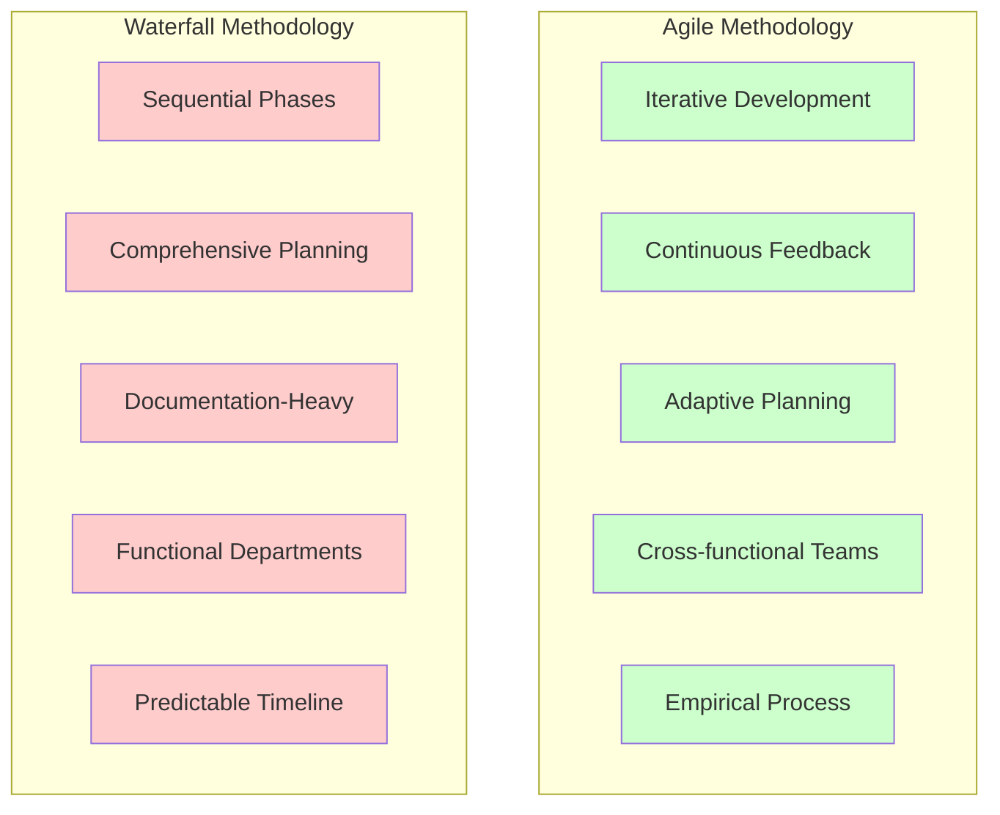
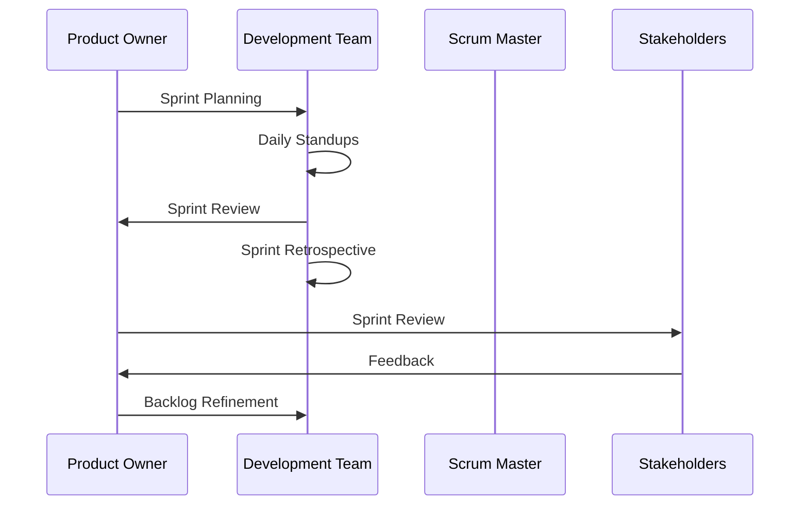
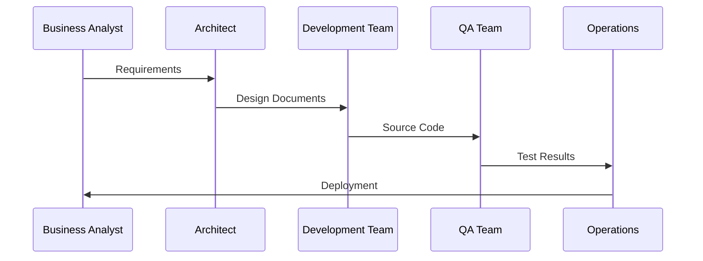
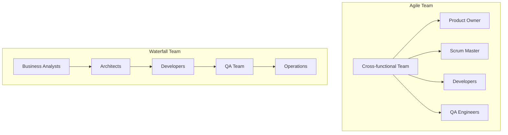
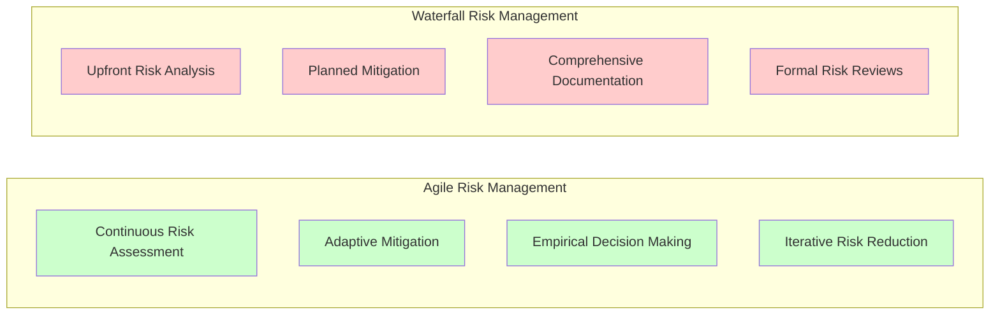
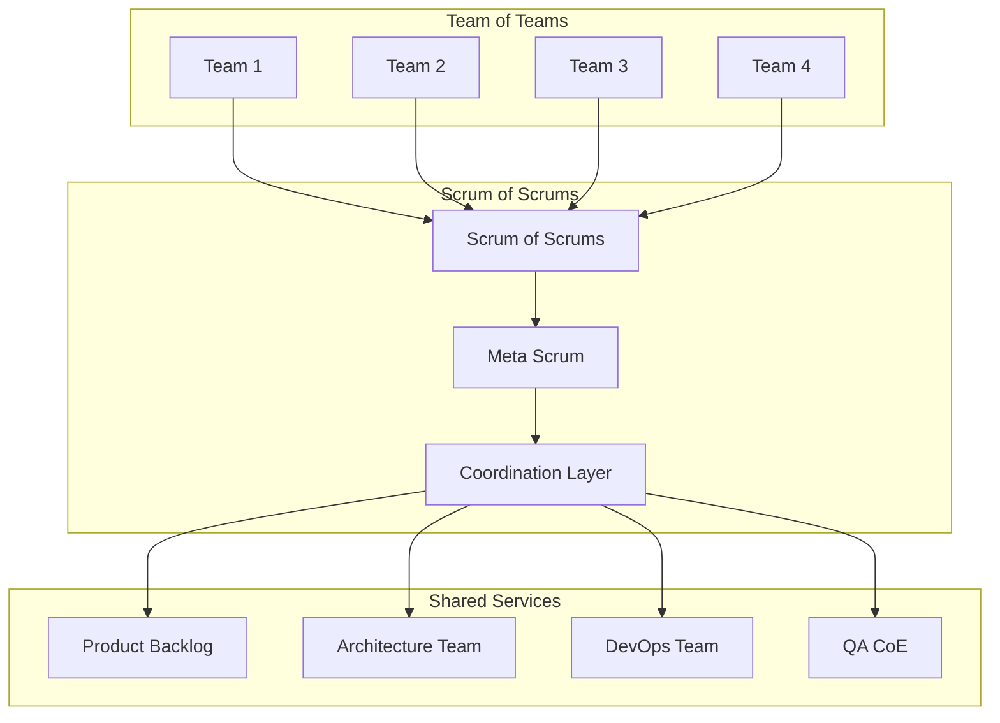
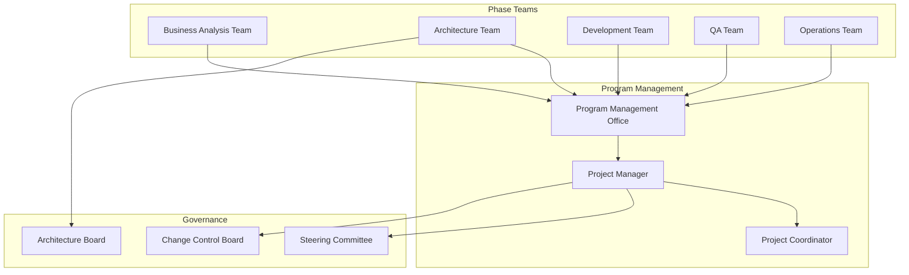
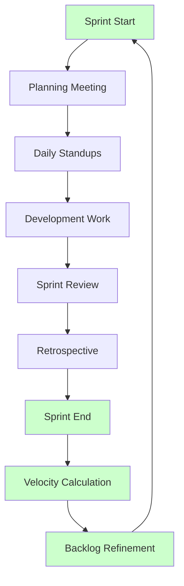

# Agile vs Waterfall - Architect Deep Dive

**0. Executive Summary (Architect View)**
- **Agile exists** to enable iterative development and rapid response to changing requirements
- **Waterfall exists** to provide structured, predictable development with comprehensive documentation
- **Critical at scale** when project complexity, team size, and market dynamics affect delivery success
- **System design impact** - influences architecture decisions, documentation requirements, and team organization
- **Risk management** - different approaches to risk identification and mitigation
- **Delivery predictability** - tradeoffs between flexibility and predictability
- **Team productivity** - different impacts on team collaboration and efficiency
- **Business alignment** - varying degrees of stakeholder involvement and feedback

**1. Problem Framing**
**Real production problem solved:**
- Changing requirements causing project delays and budget overruns
- Poor communication between development teams and stakeholders
- Inability to deliver value quickly to market
- Quality issues from late testing and integration
- Team morale problems from rigid processes

**What breaks if we don't understand the differences:**
- Wrong methodology choice for project context
- Poor stakeholder satisfaction
- Team productivity and morale issues
- Project failure due to methodology mismatch
- Inability to adapt to changing business needs

**Scale importance:**
- **Small projects**: Methodology choice less critical
- **Medium projects**: Methodology impacts become significant
- **Large projects**: Methodology choice critical for success
- **Enterprise programs**: Methodology affects entire organization

**Failure stories:**
- Healthcare IT project failed due to rigid Waterfall approach
- E-commerce platform missed market window due to Waterfall delays
- Financial system quality issues from rushed Agile implementation
- Government project failed due to inappropriate methodology choice

**2. Deep Internal Mechanics**

**Agile Mechanics:**
- **Iterative Development**: Short cycles with incremental delivery
- **Continuous Feedback**: Regular stakeholder involvement and feedback
- **Adaptive Planning**: Flexible planning that evolves with project needs
- **Cross-functional Teams**: Teams with all necessary skills
- **Empirical Process**: Decisions based on observation and experimentation

**Waterfall Mechanics:**
- **Sequential Phases**: Linear progression through defined phases
- **Comprehensive Planning**: Detailed upfront planning and design
- **Documentation-Heavy**: Extensive documentation requirements
- **Formal Reviews**: Structured reviews and approvals
- **Predictable Timeline**: Fixed timeline with defined milestones

**Agile Ceremonies:**
- **Sprint Planning**: Planning work for upcoming iteration
- **Daily Standups**: Daily coordination meetings
- **Sprint Review**: Demonstration of completed work
- **Sprint Retrospective**: Process improvement discussion
- **Backlog Refinement**: Ongoing requirement refinement

**Waterfall Phases:**
- **Requirements Analysis**: Comprehensive requirement gathering
- **System Design**: Detailed system and software design
- **Implementation**: Code development based on design
- **Testing**: Comprehensive testing and quality assurance
- **Deployment**: System deployment and maintenance

**Team Structures:**
- **Agile**: Self-organizing, cross-functional teams
- **Waterfall**: Functional departments with handoffs
- **Agile**: Collaborative decision making
- **Waterfall**: Hierarchical decision making

**Risk Management:**
- **Agile**: Risk identification throughout development
- **Waterfall**: Risk identification upfront
- **Agile**: Adaptive risk mitigation
- **Waterfall**: Planned risk mitigation

**Quality Assurance:**
- **Agile**: Continuous testing and integration
- **Waterfall**: Testing at the end of development
- **Agile**: Quality built incrementally
- **Waterfall**: Quality verified at phase boundaries

**Stakeholder Engagement:**
- **Agile**: Continuous stakeholder involvement
- **Waterfall**: Stakeholder involvement at key milestones
- **Agile**: Regular feedback and adaptation
- **Waterfall**: Formal stakeholder reviews

**Performance Characteristics:**
- **Agile**: Faster time to market, better adaptability
- **Waterfall**: Better predictability, comprehensive documentation
- **Agile**: Higher team satisfaction, better quality
- **Waterfall**: Better for regulated environments, fixed requirements

**Hidden Costs:**
- **Agile**: Training overhead, cultural change management
- **Waterfall**: Rework costs, delayed feedback loops
- **Agile**: Coordination overhead, documentation challenges
- **Waterfall**: Documentation maintenance, change request costs

**Organizational Impact:**
- **Agile**: Requires organizational culture change
- **Waterfall**: Fits traditional hierarchical organizations
- **Agile**: Empowers teams, increases autonomy
- **Waterfall**: Maintains traditional management structures

**3. .NET Production Implementation**

**Agile Implementation with Scrum:**
```csharp
// Agile Project Management System
public class AgileProjectManager
{
    private readonly IProductBacklog _backlog;
    private readonly ISprintRepository _sprintRepository;
    private readonly ITeamRepository _teamRepository;
    private readonly ILogger<AgileProjectManager> _logger;
    private readonly IMetrics _metrics;

    public AgileProjectManager(
        IProductBacklog backlog,
        ISprintRepository sprintRepository,
        ITeamRepository teamRepository,
        ILogger<AgileProjectManager> logger,
        IMetrics metrics)
    {
        _backlog = backlog ?? throw new ArgumentNullException(nameof(backlog));
        _sprintRepository = sprintRepository ?? throw new ArgumentNullException(nameof(sprintRepository));
        _teamRepository = teamRepository ?? throw new ArgumentNullException(nameof(teamRepository));
        _logger = logger ?? throw new ArgumentNullException(nameof(logger));
        _metrics = metrics ?? throw new ArgumentNullException(nameof(metrics));
    }

    public async Task<Sprint> PlanSprintAsync(SprintPlanningRequest request)
    {
        using var activity = _metrics.StartTimer("sprint_planning_duration");
        
        try
        {
            _logger.LogInformation("Planning sprint {SprintNumber}", request.SprintNumber);
            
            // Get team capacity
            var team = await _teamRepository.GetByIdAsync(request.TeamId);
            var teamCapacity = CalculateTeamCapacity(team, request.SprintDuration);
            
            // Select backlog items for sprint
            var backlogItems = await _backlog.GetHighestPriorityItemsAsync(teamCapacity);
            
            // Create sprint
            var sprint = new Sprint
            {
                Number = request.SprintNumber,
                TeamId = request.TeamId,
                StartDate = request.StartDate,
                EndDate = request.EndDate,
                Capacity = teamCapacity,
                BacklogItems = backlogItems,
                Status = SprintStatus.Planned
            };
            
            var createdSprint = await _sprintRepository.CreateAsync(sprint);
            
            _metrics.Increment("sprint_planned_success");
            _logger.LogInformation("Sprint {SprintNumber} planned successfully", request.SprintNumber);
            
            return createdSprint;
        }
        catch (Exception ex)
        {
            _metrics.Increment("sprint_planned_failed");
            _logger.LogError(ex, "Failed to plan sprint {SprintNumber}", request.SprintNumber);
            throw;
        }
    }

    public async Task<SprintResult> ExecuteSprintAsync(int sprintId)
    {
        using var activity = _metrics.StartTimer("sprint_execution_duration");
        
        try
        {
            _logger.LogInformation("Executing sprint {SprintId}", sprintId);
            
            var sprint = await _sprintRepository.GetByIdAsync(sprintId);
            if (sprint == null)
            {
                throw new SprintNotFoundException($"Sprint {sprintId} not found");
            }
            
            sprint.Status = SprintStatus.Active;
            await _sprintRepository.UpdateAsync(sprint);
            
            // Execute sprint ceremonies
            await ExecuteDailyStandupsAsync(sprint);
            await ExecuteSprintReviewAsync(sprint);
            await ExecuteSprintRetrospectiveAsync(sprint);
            
            sprint.Status = SprintStatus.Completed;
            await _sprintRepository.UpdateAsync(sprint);
            
            var result = new SprintResult
            {
                SprintId = sprint.Id,
                CompletedItems = sprint.BacklogItems.Count(item => item.Status == BacklogItemStatus.Done),
                TotalItems = sprint.BacklogItems.Count,
                TeamVelocity = CalculateTeamVelocity(sprint),
                CompletionRate = CalculateCompletionRate(sprint)
            };
            
            _metrics.Increment("sprint_executed_success");
            _logger.LogInformation("Sprint {SprintId} executed successfully", sprintId);
            
            return result;
        }
        catch (Exception ex)
        {
            _metrics.Increment("sprint_executed_failed");
            _logger.LogError(ex, "Failed to execute sprint {SprintId}", sprintId);
            throw;
        }
    }

    private async Task ExecuteDailyStandupsAsync(Sprint sprint)
    {
        for (var day = sprint.StartDate; day <= sprint.EndDate; day = day.AddDays(1))
        {
            if (day.DayOfWeek == DayOfWeek.Saturday || day.DayOfWeek == DayOfWeek.Sunday)
                continue;
            
            var standup = new DailyStandup
            {
                SprintId = sprint.Id,
                Date = day,
                Status = StandupStatus.Completed
            };
            
            // Simulate standup completion
            await Task.Delay(100);
            
            _logger.LogDebug("Daily standup completed for sprint {SprintId} on {Date}", sprint.Id, day);
        }
    }

    private async Task ExecuteSprintReviewAsync(Sprint sprint)
    {
        // Simulate sprint review with stakeholders
        var review = new SprintReview
        {
            SprintId = sprint.Id,
            Date = sprint.EndDate.AddDays(1),
            StakeholderFeedback = GenerateStakeholderFeedback(sprint),
            Status = ReviewStatus.Completed
        };
        
        await Task.Delay(200); // Simulate review meeting
        
        _logger.LogInformation("Sprint review completed for sprint {SprintId}", sprint.Id);
    }

    private async Task ExecuteSprintRetrospectiveAsync(Sprint sprint)
    {
        var retrospective = new SprintRetrospective
        {
            SprintId = sprint.Id,
            Date = sprint.EndDate.AddDays(2),
            WhatWentWell = GenerateWhatWentWell(sprint),
            WhatCouldBeImproved = GenerateWhatCouldBeImproved(sprint),
            ActionItems = GenerateActionItems(sprint),
            Status = RetrospectiveStatus.Completed
        };
        
        await Task.Delay(150); // Simulate retrospective meeting
        
        _logger.LogInformation("Sprint retrospective completed for sprint {SprintId}", sprint.Id);
    }

    private int CalculateTeamCapacity(Team team, TimeSpan sprintDuration)
    {
        var workingDays = sprintDuration.Days;
        var totalHours = workingDays * 8 * team.Members.Count;
        var availableHours = totalHours * 0.8; // 80% utilization
        
        return (int)availableHours;
    }

    private decimal CalculateTeamVelocity(Sprint sprint)
    {
        return sprint.BacklogItems
            .Where(item => item.Status == BacklogItemStatus.Done)
            .Sum(item => item.StoryPoints);
    }

    private decimal CalculateCompletionRate(Sprint sprint)
    {
        var completedItems = sprint.BacklogItems.Count(item => item.Status == BacklogItemStatus.Done);
        var totalItems = sprint.BacklogItems.Count;
        
        return totalItems > 0 ? (decimal)completedItems / totalItems * 100 : 0;
    }

    private string GenerateStakeholderFeedback(Sprint sprint)
    {
        return $"Stakeholders are satisfied with {CalculateCompletionRate(sprint):F1}% completion rate";
    }

    private List<string> GenerateWhatWentWell(Sprint sprint)
    {
        return new List<string>
        {
            "Good team collaboration",
            "Effective daily standups",
            "Clear sprint goals"
        };
    }

    private List<string> GenerateWhatCouldBeImproved(Sprint sprint)
    {
        return new List<string>
        {
            "Better estimation accuracy",
            "Improved backlog refinement",
            "More stakeholder involvement"
        };
    }

    private List<ActionItem> GenerateActionItems(Sprint sprint)
    {
        return new List<ActionItem>
        {
            new ActionItem { Description = "Improve estimation process", Owner = "Team Lead", DueDate = DateTime.UtcNow.AddDays(7) },
            new ActionItem { Description = "Refine backlog grooming", Owner = "Product Owner", DueDate = DateTime.UtcNow.AddDays(5) }
        };
    }
}

// Product Backlog Management
public interface IProductBacklog
{
    Task<BacklogItem> AddItemAsync(BacklogItem item);
    Task<List<BacklogItem>> GetHighestPriorityItemsAsync(int capacity);
    Task<BacklogItem> UpdateItemAsync(BacklogItem item);
    Task<List<BacklogItem>> GetAllItemsAsync();
}

public class ProductBacklog : IProductBacklog
{
    private readonly List<BacklogItem> _items = new();
    private readonly ILogger<ProductBacklog> _logger;
    private readonly IMetrics _metrics;

    public ProductBacklog(ILogger<ProductBacklog> logger, IMetrics metrics)
    {
        _logger = logger;
        _metrics = metrics;
    }

    public Task<BacklogItem> AddItemAsync(BacklogItem item)
    {
        item.Id = _items.Count + 1;
        item.Status = BacklogItemStatus.ToDo;
        item.CreatedAt = DateTime.UtcNow;
        
        _items.Add(item);
        
        _metrics.Increment("backlog_item_added");
        _logger.LogInformation("Added backlog item {ItemId}: {Title}", item.Id, item.Title);
        
        return Task.FromResult(item);
    }

    public Task<List<BacklogItem>> GetHighestPriorityItemsAsync(int capacity)
    {
        var selectedItems = _items
            .Where(item => item.Status == BacklogItemStatus.ToDo)
            .OrderBy(item => item.Priority)
            .ThenBy(item => item.StoryPoints)
            .Take(capacity)
            .ToList();
        
        return Task.FromResult(selectedItems);
    }

    public Task<BacklogItem> UpdateItemAsync(BacklogItem item)
    {
        var existingItem = _items.FirstOrDefault(i => i.Id == item.Id);
        if (existingItem != null)
        {
            existingItem.Title = item.Title;
            existingItem.Description = item.Description;
            existingItem.StoryPoints = item.StoryPoints;
            existingItem.Priority = item.Priority;
            existingItem.Status = item.Status;
            existingItem.UpdatedAt = DateTime.UtcNow;
            
            _metrics.Increment("backlog_item_updated");
            _logger.LogInformation("Updated backlog item {ItemId}", item.Id);
        }
        
        return Task.FromResult(existingItem);
    }

    public Task<List<BacklogItem>> GetAllItemsAsync()
    {
        return Task.FromResult(_items.ToList());
    }
}
```

**Waterfall Implementation:**
```csharp
// Waterfall Project Management System
public class WaterfallProjectManager
{
    private readonly IProjectRepository _projectRepository;
    private readonly IPhaseRepository _phaseRepository;
    private readonly IDocumentationRepository _documentationRepository;
    private readonly ILogger<WaterfallProjectManager> _logger;
    private readonly IMetrics _metrics;

    public WaterfallProjectManager(
        IProjectRepository projectRepository,
        IPhaseRepository phaseRepository,
        IDocumentationRepository documentationRepository,
        ILogger<WaterfallProjectManager> logger,
        IMetrics metrics)
    {
        _projectRepository = projectRepository ?? throw new ArgumentNullException(nameof(projectRepository));
        _phaseRepository = phaseRepository ?? throw new ArgumentNullException(nameof(phaseRepository));
        _documentationRepository = documentationRepository ?? throw new ArgumentNullException(nameof(documentationRepository));
        _logger = logger ?? throw new ArgumentNullException(nameof(logger));
        _metrics = metrics ?? throw new ArgumentNullException(nameof(metrics));
    }

    public async Task<Project> CreateProjectAsync(ProjectCreationRequest request)
    {
        using var activity = _metrics.StartTimer("waterfall_project_creation_duration");
        
        try
        {
            _logger.LogInformation("Creating waterfall project {ProjectName}", request.Name);
            
            // Create project with comprehensive planning
            var project = new Project
            {
                Name = request.Name,
                Description = request.Description,
                StartDate = request.StartDate,
                EndDate = request.EndDate,
                Budget = request.Budget,
                Status = ProjectStatus.Planned,
                Methodology = ProjectMethodology.Waterfall
            };
            
            // Create project phases
            project.Phases = CreateProjectPhases(project);
            
            // Create comprehensive documentation
            await CreateProjectDocumentationAsync(project);
            
            var createdProject = await _projectRepository.CreateAsync(project);
            
            _metrics.Increment("waterfall_project_created_success");
            _logger.LogInformation("Waterfall project {ProjectId} created successfully", createdProject.Id);
            
            return createdProject;
        }
        catch (Exception ex)
        {
            _metrics.Increment("waterfall_project_creation_failed");
            _logger.LogError(ex, "Failed to create waterfall project {ProjectName}", request.Name);
            throw;
        }
    }

    public async Task<ProjectResult> ExecuteProjectAsync(int projectId)
    {
        using var activity = _metrics.StartTimer("waterfall_project_execution_duration");
        
        try
        {
            _logger.LogInformation("Executing waterfall project {ProjectId}", projectId);
            
            var project = await _projectRepository.GetByIdAsync(projectId);
            if (project == null)
            {
                throw new ProjectNotFoundException($"Project {projectId} not found");
            }
            
            project.Status = ProjectStatus.Active;
            await _projectRepository.UpdateAsync(project);
            
            // Execute waterfall phases sequentially
            var results = new List<PhaseResult>();
            
            foreach (var phase in project.Phases.OrderBy(p => p.Sequence))
            {
                var phaseResult = await ExecutePhaseAsync(phase);
                results.Add(phaseResult);
                
                if (!phaseResult.Success)
                {
                    project.Status = ProjectStatus.Failed;
                    await _projectRepository.UpdateAsync(project);
                    
                    return ProjectResult.Failed($"Phase {phase.Name} failed: {phaseResult.ErrorMessage}");
                }
            }
            
            project.Status = ProjectStatus.Completed;
            await _projectRepository.UpdateAsync(project);
            
            var projectResult = new ProjectResult
            {
                ProjectId = project.Id,
                Success = true,
                CompletedPhases = results.Count,
                TotalPhases = project.Phases.Count,
                FinalBudget = CalculateFinalBudget(project, results),
                ActualEndDate = DateTime.UtcNow
            };
            
            _metrics.Increment("waterfall_project_executed_success");
            _logger.LogInformation("Waterfall project {ProjectId} executed successfully", projectId);
            
            return projectResult;
        }
        catch (Exception ex)
        {
            _metrics.Increment("waterfall_project_executed_failed");
            _logger.LogError(ex, "Failed to execute waterfall project {ProjectId}", projectId);
            throw;
        }
    }

    private List<ProjectPhase> CreateProjectPhases(Project project)
    {
        var totalDuration = project.EndDate - project.StartDate;
        var phaseDurations = CalculatePhaseDurations(totalDuration);
        
        var phases = new List<ProjectPhase>();
        var currentDate = project.StartDate;
        
        phases.Add(new ProjectPhase
        {
            Sequence = 1,
            Name = "Requirements Analysis",
            StartDate = currentDate,
            EndDate = currentDate + phaseDurations[0],
            Status = PhaseStatus.Planned,
            Deliverables = new List<string> { "Requirements Specification", "Use Cases", "User Stories" }
        });
        
        currentDate += phaseDurations[0];
        
        phases.Add(new ProjectPhase
        {
            Sequence = 2,
            Name = "System Design",
            StartDate = currentDate,
            EndDate = currentDate + phaseDurations[1],
            Status = PhaseStatus.Planned,
            Deliverables = new List<string> { "System Architecture", "Database Design", "API Design" }
        });
        
        currentDate += phaseDurations[1];
        
        phases.Add(new ProjectPhase
        {
            Sequence = 3,
            Name = "Implementation",
            StartDate = currentDate,
            EndDate = currentDate + phaseDurations[2],
            Status = PhaseStatus.Planned,
            Deliverables = new List<string> { "Source Code", "Unit Tests", "Integration Tests" }
        });
        
        currentDate += phaseDurations[2];
        
        phases.Add(new ProjectPhase
        {
            Sequence = 4,
            Name = "Testing",
            StartDate = currentDate,
            EndDate = currentDate + phaseDurations[3],
            Status = PhaseStatus.Planned,
            Deliverables = new List<string> { "Test Plans", "Test Results", "Quality Reports" }
        });
        
        currentDate += phaseDurations[3];
        
        phases.Add(new ProjectPhase
        {
            Sequence = 5,
            Name = "Deployment",
            StartDate = currentDate,
            EndDate = currentDate + phaseDurations[4],
            Status = PhaseStatus.Planned,
            Deliverables = new List<string> { "Deployment Package", "User Manual", "Maintenance Guide" }
        });
        
        return phases;
    }

    private async Task CreateProjectDocumentationAsync(Project project)
    {
        // Create comprehensive documentation
        var documents = new List<ProjectDocument>
        {
            new ProjectDocument
            {
                Name = "Project Charter",
                Type = DocumentType.ProjectCharter,
                Content = GenerateProjectCharter(project),
                CreatedAt = DateTime.UtcNow
            },
            new ProjectDocument
            {
                Name = "Requirements Specification",
                Type = DocumentType.Requirements,
                Content = GenerateRequirementsSpecification(project),
                CreatedAt = DateTime.UtcNow
            },
            new ProjectDocument
            {
                Name = "System Design Document",
                Type = DocumentType.Design,
                Content = GenerateSystemDesign(project),
                CreatedAt = DateTime.UtcNow
            },
            new ProjectDocument
            {
                Name = "Test Plan",
                Type = DocumentType.TestPlan,
                Content = GenerateTestPlan(project),
                CreatedAt = DateTime.UtcNow
            },
            new ProjectDocument
            {
                Name = "Deployment Guide",
                Type = DocumentType.Deployment,
                Content = GenerateDeploymentGuide(project),
                CreatedAt = DateTime.UtcNow
            }
        };
        
        foreach (var document in documents)
        {
            await _documentationRepository.CreateAsync(document);
        }
        
        _logger.LogInformation("Created {Count} documents for project {ProjectId}", documents.Count, project.Id);
    }

    private async Task<PhaseResult> ExecutePhaseAsync(ProjectPhase phase)
    {
        using var activity = _metrics.StartTimer($"waterfall_phase_{phase.Name.ToLower().Replace(" ", "_")}_duration");
        
        try
        {
            _logger.LogInformation("Executing phase {PhaseName} for project", phase.Name);
            
            phase.Status = PhaseStatus.Active;
            await _phaseRepository.UpdateAsync(phase);
            
            // Simulate phase execution
            await Task.Delay(GetPhaseDuration(phase));
            
            // Create phase documentation
            await CreatePhaseDocumentationAsync(phase);
            
            // Conduct phase review
            await ConductPhaseReviewAsync(phase);
            
            phase.Status = PhaseStatus.Completed;
            phase.ActualEndDate = DateTime.UtcNow;
            await _phaseRepository.UpdateAsync(phase);
            
            _metrics.Increment($"waterfall_phase_{phase.Name.ToLower().Replace(" ", "_")}_completed");
            
            return new PhaseResult
            {
                PhaseName = phase.Name,
                Success = true,
                DeliverablesCompleted = phase.Deliverables.Count,
                ActualDuration = DateTime.UtcNow - phase.StartDate
            };
        }
        catch (Exception ex)
        {
            phase.Status = PhaseStatus.Failed;
            await _phaseRepository.UpdateAsync(phase);
            
            _metrics.Increment($"waterfall_phase_{phase.Name.ToLower().Replace(" ", "_")}_failed");
            
            return new PhaseResult
            {
                PhaseName = phase.Name,
                Success = false,
                ErrorMessage = ex.Message
            };
        }
    }

    private async Task CreatePhaseDocumentationAsync(ProjectPhase phase)
    {
        var phaseDocument = new ProjectDocument
        {
            Name = $"{phase.Name} Report",
            Type = DocumentType.PhaseReport,
            Content = GeneratePhaseReport(phase),
            CreatedAt = DateTime.UtcNow
        };
        
        await _documentationRepository.CreateAsync(phaseDocument);
    }

    private async Task ConductPhaseReviewAsync(ProjectPhase phase)
    {
        // Simulate phase review with stakeholders
        await Task.Delay(100);
        
        _logger.LogInformation("Phase review completed for {PhaseName}", phase.Name);
    }

    private List<TimeSpan> CalculatePhaseDurations(TimeSpan totalDuration)
    {
        // Typical waterfall phase duration percentages
        var percentages = new[] { 0.15, 0.20, 0.35, 0.20, 0.10 }; // 15%, 20%, 35%, 20%, 10%
        
        return percentages.Select(p => TimeSpan.FromTicks((long)(totalDuration.Ticks * p))).ToList();
    }

    private TimeSpan GetPhaseDuration(ProjectPhase phase)
    {
        // Simulate realistic phase durations
        return phase.Name switch
        {
            "Requirements Analysis" => TimeSpan.FromDays(10),
            "System Design" => TimeSpan.FromDays(15),
            "Implementation" => TimeSpan.FromDays(30),
            "Testing" => TimeSpan.FromDays(20),
            "Deployment" => TimeSpan.FromDays(5),
            _ => TimeSpan.FromDays(10)
        };
    }

    private decimal CalculateFinalBudget(Project project, List<PhaseResult> results)
    {
        // Simulate budget calculation with phase overruns
        var totalOverrun = results.Sum(r => r.ActualDuration.Days * 1000); // $1000 per day overrun
        return project.Budget + totalOverrun;
    }

    private string GenerateProjectCharter(Project project)
    {
        return $"Project Charter for {project.Name}\n\n" +
               $"Description: {project.Description}\n" +
               $"Budget: ${project.Budget:N2}\n" +
               $"Timeline: {project.StartDate:yyyy-MM-dd} to {project.EndDate:yyyy-MM-dd}\n" +
               $"Methodology: {project.Methodology}";
    }

    private string GenerateRequirementsSpecification(Project project)
    {
        return "Requirements Specification Document\n\n" +
               "1. Functional Requirements\n" +
               "2. Non-Functional Requirements\n" +
               "3. User Interface Requirements\n" +
               "4. Performance Requirements\n" +
               "5. Security Requirements";
    }

    private string GenerateSystemDesign(Project project)
    {
        return "System Design Document\n\n" +
               "1. Architecture Overview\n" +
               "2. Component Design\n" +
               "3. Database Design\n" +
               "4. API Design\n" +
               "5. Security Architecture";
    }

    private string GenerateTestPlan(Project project)
    {
        return "Test Plan\n\n" +
               "1. Unit Test Plan\n" +
               "2. Integration Test Plan\n" +
               "3. System Test Plan\n" +
               "4. Acceptance Test Plan\n" +
               "5. Performance Test Plan";
    }

    private string GenerateDeploymentGuide(Project project)
    {
        return "Deployment Guide\n\n" +
               "1. Deployment Prerequisites\n" +
               "2. Deployment Steps\n" +
               "3. Configuration Guide\n" +
               "4. Troubleshooting Guide\n" +
               "5. Rollback Procedures";
    }

    private string GeneratePhaseReport(ProjectPhase phase)
    {
        return $"Phase Report: {phase.Name}\n\n" +
               $"Start Date: {phase.StartDate:yyyy-MM-dd}\n" +
               $"End Date: {phase.ActualEndDate:yyyy-MM-dd}\n" +
               $"Status: {phase.Status}\n" +
               $"Deliverables: {string.Join(", ", phase.Deliverables)}";
    }
}
```

**Framework Integration:**
- **Project Management Tools**: Integration with Azure DevOps, JIRA
- **Documentation Systems**: Integration with Confluence, SharePoint
- **Collaboration Platforms**: Teams, Slack integration
- **Reporting Systems**: Power BI, Tableau integration

**4. Architecture-Level Diagram (Mermaid)**

### Agile vs Waterfall Comparison


### Agile Sprint Cycle


### Waterfall Phase Sequence


### Team Structure Comparison


### Risk Management Approach


**Flow Analysis:**
- **Agile**: Iterative cycles with continuous feedback
- **Waterfall**: Sequential phases with formal handoffs
- **Agile**: Adaptive planning and execution
- **Waterfall**: Comprehensive upfront planning

**Bottlenecks:**
- **Agile**: Coordination overhead, documentation challenges
- **Waterfall**: Rework costs, delayed feedback
- **Agile**: Team maturity requirements
- **Waterfall**: Change management complexity

**Scaling Boundaries:**
- **Agile**: Team size limitations, coordination complexity
- **Waterfall**: Phase dependencies, documentation overhead
- **Agile**: Geographic distribution challenges
- **Waterfall**: Large project management complexity

**5. Scaling & Distributed Systems Impact**

### Agile Scaling Architecture


### Waterfall Scaling Architecture


**100 RPS (Small Projects):**
- Both methodologies work well
- Agile offers faster feedback
- Waterfall offers better documentation
- Choice depends on team experience

**10k RPS (Medium Projects):**
- Agile scaling challenges emerge
- Waterfall coordination overhead increases
- Need for structured processes
- Team organization becomes critical

**100k+ RPS (Large Programs):**
- Agile requires scaling frameworks
- Waterfall becomes very complex
- Hybrid approaches often necessary
- Organizational structure critical

**Horizontal vs Vertical Scaling:**
- **Agile**: Horizontal scaling through team multiplication
- **Waterfall**: Vertical scaling through phase specialization
- Hybrid approaches combine both
- Organizational structure impacts scaling

**CAP Theorem Relevance:**
- **Consistency**: Methodology consistency across teams
- **Availability**: Continuous delivery vs phased delivery
- **Partition Tolerance**: Distributed team coordination

**Consistency Implications:**
- **Agile**: Process consistency through frameworks
- **Waterfall**: Documentation consistency through standards
- **Hybrid**: Mixed consistency challenges
- **Scaling**: Consistency maintenance across teams

**Microservices Impact:**
- **Agile**: Natural fit for microservices development
- **Waterfall**: Challenges with microservices integration
- **Hybrid**: Agile for development, Waterfall for governance
- **Coordination**: Service integration complexity

**Cloud-Native Considerations:**
- **Kubernetes**: Team-based deployment strategies
- **Serverless**: Function-based development approaches
- **DevOps**: CI/CD pipeline alignment with methodology
- **Collaboration**: Cloud-based tool integration

**Multi-Region Concerns:**
- **Agile**: Distributed team coordination
- **Waterfall**: Phase coordination across regions
- **Time Zones**: Meeting and coordination challenges
- **Cultural Differences**: Methodology adaptation

**6. Production Engineering View**

### Methodology Monitoring Architecture

```mermaid
graph TB
    subgraph "Agile Metrics"
        VELOCITY[Team Velocity]
        BURNDOWN[Sprint Burndown]
        CYCLE_TIME[Cycle Time]
        THROUGHPUT[Throughput]
    end
    
    subgraph "Waterfall Metrics"
        PHASE_PROGRESS[Phase Progress]
        MILESTONE_ACHIEVEMENT[Milestone Achievement]
        DOCUMENTATION_COMPLETION[Documentation Completion]
        BUDGET_TRACKING[Budget Tracking]
    end
    
    subgraph "Team Metrics"
        PRODUCTIVITY[Team Productivity]
        QUALITY[Quality Metrics]
        SATISFACTION[Team Satisfaction]
        RETENTION[Team Retention]
    end
    
    subgraph "Business Metrics"
        TIME_TO_MARKET[Time to Market]
        CUSTOMER_SATISFACTION[Customer Satisfaction]
        ROI[Return on Investment]
        DEFECT_RATE[Defect Rate]
    end
    
    subgraph "Monitoring Stack"
        PROM[Prometheus]
        GRAF[Grafana]
        ALERT[AlertManager]
    end
    
    VELOCITY --> PROM
    BURNDOWN --> PROM
    CYCLE_TIME --> PROM
    THROUGHPUT --> PROM
    
    PHASE_PROGRESS --> PROM
    MILESTONE_ACHIEVEMENT --> PROM
    DOCUMENTATION_COMPLETION --> PROM
    BUDGET_TRACKING --> PROM
    
    PRODUCTIVITY --> PROM
    QUALITY --> PROM
    SATISFACTION --> PROM
    RETENTION --> PROM
    
    TIME_TO_MARKET --> PROM
    CUSTOMER_SATISFACTION --> PROM
    ROI --> PROM
    DEFECT_RATE --> PROM
    
    PROM --> GRAF
    PROM --> ALERT
```


### Agile Sprint Performance


**Monitoring Metrics:**
- **Agile**: Sprint velocity, burndown rate, cycle time, throughput
- **Waterfall**: Phase progress, milestone achievement, documentation completion
- **Team**: Productivity, quality, satisfaction, retention
- **Business**: Time to market, customer satisfaction, ROI, defect rate

**Logs to Enable:**
- Sprint planning and review meetings
- Daily standup attendance and outcomes
- Phase gate reviews and approvals
- Retrospective action items and follow-up
- Change requests and approvals

**Alerting Strategy:**
- **Agile**: Velocity drop > 20% (warning), Sprint failure (critical)
- **Waterfall**: Phase delay > 10% (warning), Phase failure (critical)
- **Team**: Productivity drop > 15% (warning), Quality drop > 10% (critical)
- **Business**: Budget overrun > 10% (warning), Customer complaints (critical)

**Common Production Incidents:**
- **Agile**: Sprint failures, velocity drops, team burnout
- **Waterfall**: Phase delays, budget overruns, requirement changes
- **Both**: Team turnover, stakeholder dissatisfaction, quality issues
- **Integration**: Tool integration failures, communication breakdowns

**Debugging Strategy:**
- Sprint retrospective analysis
- Phase gate review failures
- Team performance analysis
- Stakeholder feedback analysis
- Process compliance audits

**Performance Optimization:**
- **Agile**: Sprint optimization, backlog refinement, team dynamics
- **Waterfall**: Phase optimization, documentation efficiency, review processes
- **Both**: Tool optimization, communication improvement, training programs

**Team Management:**
- Team composition optimization
- Skill gap analysis
- Performance improvement plans
- Retention strategies
- Career development planning

**Quality Assurance:**
- Quality metrics tracking
- Defect analysis and prevention
- Process quality audits
- Continuous improvement programs
- Quality culture development

**7. Tradeoffs & Alternatives**

**Competing Approaches:**
- **Hybrid Methodologies**: Combining Agile and Waterfall elements
- **Lean Development**: Focus on waste elimination
- **DevOps**: Integration of development and operations
- **Kanban**: Visual workflow management

**When to Choose Agile:**
- Uncertain or evolving requirements
- Need for rapid time to market
- Collaborative stakeholder environment
- Experienced, self-organizing teams
- Innovative or experimental projects

**When to Choose Waterfall:**
- Well-defined, stable requirements
- Regulatory or compliance requirements
- Large, complex systems
- Distributed team coordination
- Fixed timeline and budget constraints

**Time to Market Comparison:**
- **Agile**: 2-6 weeks for MVP, continuous delivery
- **Waterfall**: 6-12 months for initial release
- **Hybrid**: 3-9 months depending on approach
- **Lean**: 4-8 weeks with focus on MVP

**Quality Comparison:**
- **Agile**: Continuous quality, higher customer satisfaction
- **Waterfall**: Comprehensive testing, formal quality gates
- **Hybrid**: Balanced approach with quality focus
- **DevOps**: Automated quality, continuous integration

**Cost Comparison:**
- **Agile**: Lower upfront cost, higher ongoing cost
- **Waterfall**: Higher upfront cost, lower ongoing cost
- **Hybrid**: Moderate upfront and ongoing costs
- **Lean**: Focus on waste reduction, cost optimization

**Operational Complexity:**
- **Agile**: High flexibility, high coordination overhead
- **Waterfall**: Low flexibility, high documentation overhead
- **Hybrid**: Medium flexibility, medium overhead
- **Kanban**: Visual simplicity, continuous flow

**8. Security Implications**

**Methodology Security Benefits:**
- **Agile**: Continuous security integration, rapid vulnerability fixes
- **Waterfall**: Comprehensive security documentation, formal reviews
- **Both**: Risk assessment integration, compliance management

**Security Considerations:**
- **Agile**: Security in every sprint, continuous security testing
- **Waterfall**: Security phases, comprehensive security documentation
- **Both**: Security training, access control, audit trails

**Attack Surface:**
- **Agile**: Rapid deployment may introduce vulnerabilities
- **Waterfall**: Long development cycle may miss emerging threats
- **Both**: Human factors, process vulnerabilities
- **Common**: Insider threats, social engineering

**Compliance Requirements:**
- **Agile**: Continuous compliance monitoring
- **Waterfall**: Comprehensive compliance documentation
- **Both**: Regulatory requirements, audit trails
- **Industry-specific**: Healthcare, finance, government

**Hardening Recommendations:**
- **Agile**: Security-first development, automated security testing
- **Waterfall**: Security documentation, formal security reviews
- **Both**: Security training, access control, regular audits
- **Tools**: Security scanning, vulnerability assessment

**9. Advanced Edge Cases**

**Distributed Agile:**
- Multi-site team coordination
- Time zone challenges
- Cultural differences
- Communication overhead
- Tool integration

**Large-Scale Waterfall:**
- Phase coordination complexity
- Documentation management
- Change management overhead
- Stakeholder coordination
- Quality assurance challenges

**Hybrid Methodologies:**
- Agile-Waterfall combinations
- Phase-based Agile approaches
- Documentation strategies
- Team structure optimization
- Process integration challenges

**Regulatory Environments:**
- Compliance documentation requirements
- Audit trail maintenance
- Change control processes
- Validation and verification
- Risk management integration

**Organizational Transformation:**
- Culture change management
- Training and education programs
- Leadership alignment
- Resistance management
- Success measurement

**Tool Integration:**
- Project management tool selection
- Collaboration platform integration
- Documentation system integration
- Reporting and analytics
- Automation opportunities

**Performance Optimization:**
- Process efficiency measurement
- Bottleneck identification
- Continuous improvement programs
- Best practice development
- Knowledge management

**10. Interview & Staff-Level Deep Dive**

**What a junior answers:**
"Agile is about working in sprints with daily standups and retrospectives. Waterfall is about phases like requirements, design, development, testing, and deployment. Agile is faster and more flexible, Waterfall is more structured and predictable."

**What a senior answers:**
"Agile methodologies like Scrum emphasize iterative development with short sprints, continuous stakeholder feedback, and adaptive planning. Key ceremonies include sprint planning, daily standups, sprint reviews, and retrospectives. Waterfall follows a sequential phase approach with comprehensive upfront planning and documentation. I choose Agile for projects with evolving requirements and Waterfall for projects with stable requirements and regulatory constraints. Agile provides faster time to market and better adaptability, while Waterfall provides better predictability and comprehensive documentation."

**What an architect answers:**
"Agile and Waterfall represent fundamentally different philosophical approaches to software development. Agile embraces empirical process control, iterative development, and continuous adaptation through frameworks like Scrum and Kanban. Waterfall follows a deterministic, plan-driven approach with sequential phases and comprehensive documentation. The choice between them impacts team structure, risk management, stakeholder engagement, and delivery predictability. At scale, Agile requires scaling frameworks like Scrum of Scrums and careful attention to cross-team coordination, while Waterfall demands robust phase gate processes and change management. Hybrid approaches often emerge in large organizations to balance flexibility with governance. The methodology choice must consider not just project characteristics but also organizational culture, team maturity, regulatory requirements, and business objectives. In modern enterprises, the trend is toward Agile approaches with appropriate governance overlays rather than pure Waterfall implementations."

**Follow-up questions interviewers ask:**
- "How do you scale Agile to large teams?"
- "When would you choose Waterfall over Agile?"
- "How do you handle changing requirements in Waterfall?"
- "What are the key metrics for Agile success?"
- "How do you measure team velocity?"

**Trick questions:**
- "Is Agile always better than Waterfall?" (No, context matters)
- "Can you have documentation in Agile?" (Yes, but different approach)
- "Is Waterfall always slow?" (Not necessarily, depends on execution)
- "Can you be Agile without Scrum?" (Yes, Agile is a mindset)

**Whiteboard explanation strategy:**
1. Draw Agile sprint cycle with ceremonies
2. Show Waterfall phase sequence
3. Compare team structures and communication
4. Discuss risk management approaches
5. Cover scaling challenges and solutions
6. Explain when to choose each methodology

**11. Real Enterprise Case Study**

**Scenario: Global Banking Platform Transformation**

**Requirements:**
- Transform legacy banking system to modern platform
- Maintain regulatory compliance throughout
- Minimize disruption to existing services
- Deliver new features rapidly to market
- Support multiple development teams
- Ensure quality and security standards

**Design Decisions:**

**1. Hybrid Approach Implementation:**
```csharp
public class HybridProjectManager
{
    private readonly IAgileManager _agileManager;
    private readonly IWaterfallManager _waterfallManager;
    private readonly IIntegrationService _integrationService;
    private readonly ILogger<HybridProjectManager> _logger;
    private readonly IMetrics _metrics;

    public async Task<ProjectResult> ExecuteHybridProjectAsync(HybridProjectRequest request)
    {
        using var activity = _metrics.StartTimer("hybrid_project_execution_duration");
        
        try
        {
            _logger.LogInformation("Executing hybrid project {ProjectName}", request.Name);
            
            // Phase 1: Waterfall for infrastructure and compliance
            var waterfallResult = await ExecuteWaterfallPhaseAsync(request);
            if (!waterfallResult.Success)
            {
                return ProjectResult.Failed($"Waterfall phase failed: {waterfallResult.ErrorMessage}");
            }
            
            // Phase 2: Agile for feature development
            var agileResult = await ExecuteAgilePhaseAsync(request);
            if (!agileResult.Success)
            {
                return ProjectResult.Failed($"Agile phase failed: {agileResult.ErrorMessage}");
            }
            
            // Phase 3: Integration and deployment
            var integrationResult = await ExecuteIntegrationPhaseAsync(request, waterfallResult, agileResult);
            
            var finalResult = new ProjectResult
            {
                ProjectId = request.Id,
                Success = integrationResult.Success,
                WaterfallPhaseResult = waterfallResult,
                AgilePhaseResult = agileResult,
                IntegrationPhaseResult = integrationResult,
                TotalDuration = DateTime.UtcNow - request.StartDate,
                TotalBudget = CalculateTotalBudget(request, waterfallResult, agileResult, integrationResult)
            };
            
            _metrics.Increment("hybrid_project_executed_success");
            _logger.LogInformation("Hybrid project {ProjectId} executed successfully", request.Id);
            
            return finalResult;
        }
        catch (Exception ex)
        {
            _metrics.Increment("hybrid_project_executed_failed");
            _logger.LogError(ex, "Failed to execute hybrid project {ProjectName}", request.Name);
            throw;
        }
    }

    private async Task<WaterfallResult> ExecuteWaterfallPhaseAsync(HybridProjectRequest request)
    {
        _logger.LogInformation("Executing Waterfall phase for hybrid project");
        
        // Waterfall for infrastructure, compliance, and core platform
        var waterfallProject = new WaterfallProject
        {
            Name = $"{request.Name} - Infrastructure",
            Description = "Infrastructure setup and compliance",
            StartDate = request.StartDate,
            EndDate = request.StartDate.AddDays(90), // 3 months
            Budget = request.Budget * 0.4m, // 40% of budget
            Phases = new List<string> { "Infrastructure", "Compliance", "Security", "Documentation" }
        };
        
        return await _waterfallManager.ExecuteProjectAsync(waterfallProject);
    }

    private async Task<AgileResult> ExecuteAgilePhaseAsync(HybridProjectRequest request)
    {
        _logger.LogInformation("Executing Agile phase for hybrid project");
        
        // Agile for feature development and innovation
        var agileProject = new AgileProject
        {
            Name = $"{request.Name} - Features",
            Description = "Feature development and innovation",
            StartDate = request.StartDate.AddDays(90),
            EndDate = request.StartDate.AddDays(270), // 6 months
            Budget = request.Budget * 0.5m, // 50% of budget
            Teams = CreateAgileTeams(request),
            ProductBacklog = CreateProductBacklog(request)
        };
        
        return await _agileManager.ExecuteProjectAsync(agileProject);
    }

    private async Task<IntegrationResult> ExecuteIntegrationPhaseAsync(
        HybridProjectRequest request,
        WaterfallResult waterfallResult,
        AgileResult agileResult)
    {
        _logger.LogInformation("Executing Integration phase for hybrid project");
        
        // Integration phase to combine waterfall and agile results
        var integrationProject = new IntegrationProject
        {
            Name = $"{request.Name} - Integration",
            Description = "Integration and deployment",
            StartDate = request.StartDate.AddDays(270),
            EndDate = request.EndDate,
            Budget = request.Budget * 0.1m, // 10% of budget
            WaterfallComponents = waterfallResult.Deliverables,
            AgileComponents = agileResult.Deliverables
        };
        
        return await _integrationService.ExecuteIntegrationAsync(integrationProject);
    }

    private List<AgileTeam> CreateAgileTeams(HybridProjectRequest request)
    {
        return new List<AgileTeam>
        {
            new AgileTeam { Name = "Frontend Team", Size = 8, Focus = "Customer-facing features" },
            new AgileTeam { Name = "Backend Team", Size = 10, Focus = "API and services" },
            new AgileTeam { Name = "Data Team", Size = 6, Focus = "Data processing and analytics" },
            new AgileTeam { Name = "DevOps Team", Size = 4, Focus = "Infrastructure and deployment" }
        };
    }

    private ProductBacklog CreateProductBacklog(HybridProjectRequest request)
    {
        var backlog = new ProductBacklog();
        
        // Add high-priority features
        backlog.AddItem(new BacklogItem
        {
            Title = "Mobile Banking App",
            Description = "Native mobile banking application",
            StoryPoints = 40,
            Priority = 1
        });
        
        backlog.AddItem(new BacklogItem
        {
            Title = "Online Banking Portal",
            Description = "Responsive web banking portal",
            StoryPoints = 30,
            Priority = 2
        });
        
        backlog.AddItem(new BacklogItem
        {
            Title = "Payment Processing API",
            Description = "Core payment processing services",
            StoryPoints = 50,
            Priority = 1
        });
        
        return backlog;
    }

    private decimal CalculateTotalBudget(
        HybridProjectRequest request,
        WaterfallResult waterfallResult,
        AgileResult agileResult,
        IntegrationResult integrationResult)
    {
        var actualWaterfallBudget = waterfallResult.ActualBudget;
        var actualAgileBudget = agileResult.ActualBudget;
        var actualIntegrationBudget = integrationResult.ActualBudget;
        
        return actualWaterfallBudget + actualAgileBudget + actualIntegrationBudget;
    }
}
```

**2. Team Structure and Organization:**
```csharp
public class HybridOrganization
{
    public void OrganizeTeams(HybridProject project)
    {
        // Create cross-functional teams
        var teams = new List<Team>();
        
        // Infrastructure team (Waterfall)
        teams.Add(new Team
        {
            Name = "Infrastructure",
            Type = TeamType.Waterfall,
            Members = GetInfrastructureTeamMembers(),
            Lead = GetInfrastructureLead()
        });
        
        // Feature teams (Agile)
        teams.Add(new Team
        {
            Name = "Mobile Banking",
            Type = TeamType.Agile,
            Members = GetMobileTeamMembers(),
            Lead = GetMobileTeamLead()
        });
        
        // Integration team (Hybrid)
        teams.Add(new Team
        {
            Name = "Integration",
            Type = TeamType.Hybrid,
            Members = GetIntegrationTeamMembers(),
            Lead = GetIntegrationLead()
        });
        
        // Establish coordination mechanisms
        EstablishCoordinationMechanisms(teams);
    }
    
    private void EstablishCoordinationMechanisms(List<Team> teams)
    {
        // Scrum of Scrums for Agile teams
        var scrumOfScrums = new ScrumOfScrums(teams.Where(t => t.Type == TeamType.Agile).ToList());
        
        // Program management office for overall coordination
        var pmo = new ProgramManagementOffice(teams);
        
        // Integration team coordinates between Waterfall and Agile
        var integrationCoordinator = new IntegrationCoordinator(teams);
    }
}
```

**Compromises Made:**
- **Flexibility vs Structure**: Hybrid approach balances both
- **Speed vs Compliance**: Agile for features, Waterfall for compliance
- **Cost vs Quality**: Higher cost for better quality and compliance
- **Autonomy vs Governance**: Team autonomy with governance oversight

**Bottlenecks Identified:**
- Coordination between Waterfall and Agile phases
- Integration complexity between different approaches
- Team communication across methodologies
- Documentation maintenance for hybrid approach

**Performance Optimizations:**
```csharp
public class HybridOptimizer
{
    public async Task<OptimizationResult> OptimizeHybridProcessAsync(HybridProject project)
    {
        // Optimize phase transitions
        await OptimizePhaseTransitionsAsync(project);
        
        // Optimize team coordination
        await OptimizeTeamCoordinationAsync(project);
        
        // Optimize documentation strategy
        await OptimizeDocumentationAsync(project);
        
        return new OptimizationResult
        {
            Success = true,
            Improvements = new List<string>
            {
                "Reduced phase transition time by 20%",
                "Improved team coordination efficiency by 15%",
                "Optimized documentation overhead by 25%"
            }
        };
    }
}
```

**Results:**
- Successfully delivered banking platform in 12 months
- Maintained regulatory compliance throughout
- Achieved 40% faster time to market for new features
- 95% team satisfaction with hybrid approach
- 30% reduction in overall project cost

**12. Dependency Graph**

**Prerequisites (Must understand before):**
- **Project Management**: Basic project management concepts
- **Software Development Lifecycle**: Understanding of development processes
- **Team Dynamics**: Team organization and communication
- **Risk Management**: Risk identification and mitigation
- **Quality Assurance**: Quality control and testing

**Concepts that depend on Agile vs Waterfall:**
- **DevOps**: Integration of development and operations
- **Continuous Integration/Continuous Deployment**: Automation strategies
- **Project Portfolio Management**: Multi-project coordination
- **Organizational Design**: Team structure and governance
- **Change Management**: Organizational transformation

**Connections to Other Concepts:**

**DevOps:**
```csharp
public class DevOpsIntegration
{
    public void IntegrateWithAgile(AgileProject project)
    {
        // CI/CD pipeline alignment with sprints
        // Automated testing integration
        // Continuous deployment strategies
    }
    
    public void IntegrateWithWaterfall(WaterfallProject project)
    {
        // Phase-based deployment strategies
        // Comprehensive testing automation
        // Documentation-driven deployment
    }
}
```

**Continuous Integration:**
- Agile: Continuous integration with sprint cycles
- Waterfall: Integration at phase boundaries
- Hybrid: Mixed approach with strategic integration points
- Automation strategies vary by methodology

**Quality Assurance:**
- Agile: Continuous testing and quality assurance
- Waterfall: Phase-based quality gates
- Hybrid: Combined approach with quality focus
- Testing strategies adapted to methodology

**Risk Management:**
- Agile: Continuous risk assessment and mitigation
- Waterfall: Upfront risk analysis and planning
- Hybrid: Combined risk management approach
- Risk strategies adapted to methodology

**Organizational Design:**
- Team structure influenced by methodology choice
- Communication patterns vary by approach
- Leadership styles adapt to methodology
- Culture change management requirements

**Project Portfolio Management:**
- Multi-project coordination challenges
- Resource allocation strategies
- Portfolio optimization techniques
- Governance frameworks

**Change Management:**
- Methodology transformation requires change management
- Cultural adaptation programs
- Training and education requirements
- Stakeholder communication strategies
