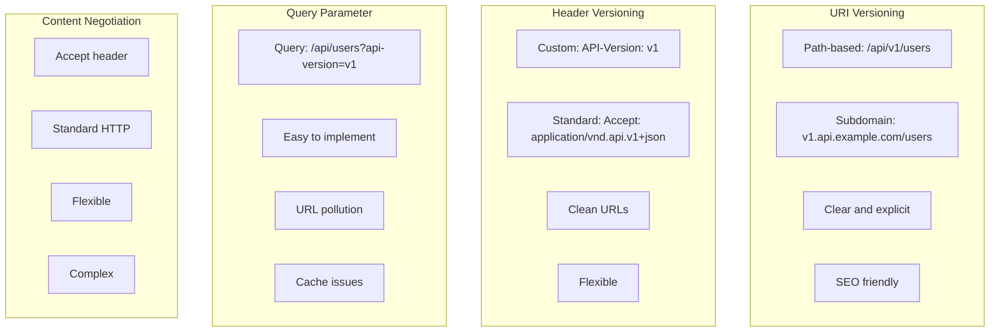
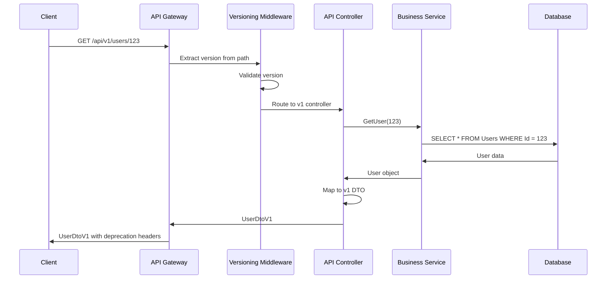
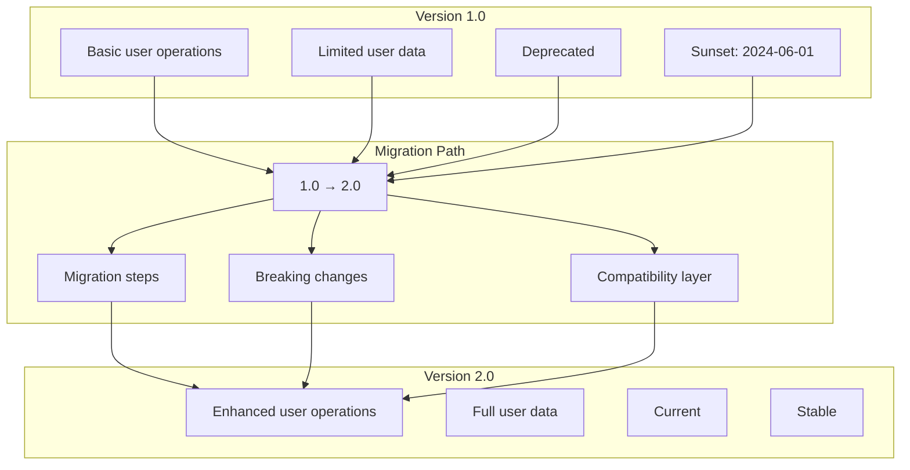
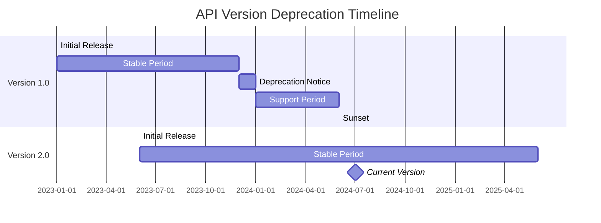
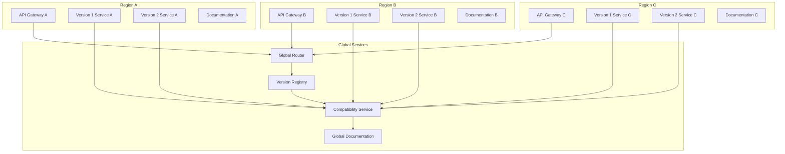
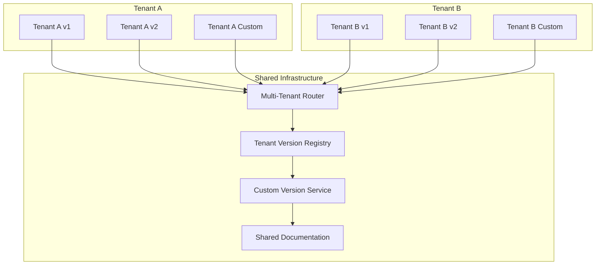
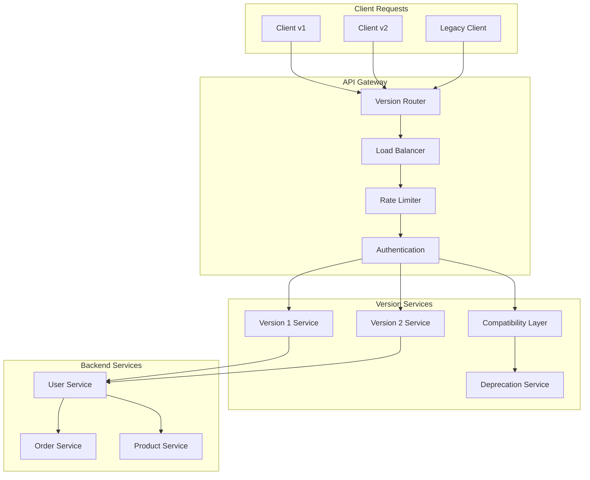
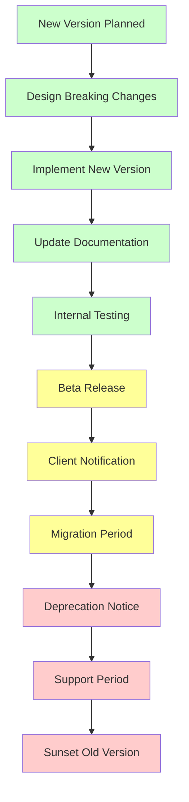
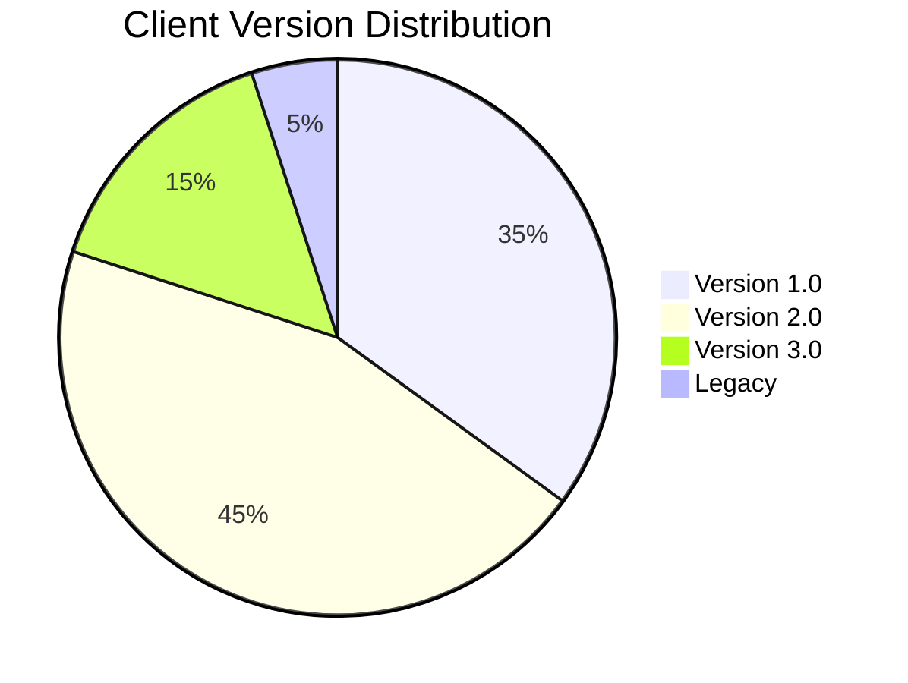

# API Versioning - Architect Deep Dive

**0. Executive Summary (Architect View)**
- **API Versioning exists** to enable evolution of web services while maintaining backward compatibility
- **Critical at scale** when APIs serve multiple client versions and require gradual migration
- **System design impact** - influences API design, client integration, and deployment strategies
- **Client compatibility** - enables smooth transitions between API versions
- **Business continuity** - prevents breaking changes from disrupting existing integrations
- **Evolution strategy** - provides structured approach to API evolution
- **Contract management** - manages API contracts across versions
- **Migration planning** - enables planned client migration paths

**1. Problem Framing**
**Real production problem solved:**
- API changes breaking existing client integrations
- Need to evolve APIs without disrupting existing users
- Multiple client versions requiring different API versions
- Gradual migration from old to new API versions
- Maintaining backward compatibility while adding features

**What breaks if we don't understand API versioning:**
- Breaking changes cause client failures
- Client migration becomes chaotic
- API evolution becomes impossible
- Business continuity is threatened
- Client adoption suffers

**Scale importance:**
- **Small APIs**: Versioning less critical but still important
- **Medium APIs**: Versioning becomes essential for client management
- **Large APIs**: Versioning critical for business continuity
- **Enterprise APIs**: Versioning mandatory for enterprise clients

**Failure stories:**
- Social media platform broke third-party apps with API changes
- Financial system caused integration failures with version changes
- E-commerce platform lost partners due to breaking API changes
- Healthcare system disrupted integrations with version updates

**2. Deep Internal Mechanics**

**API Versioning Fundamentals:**
- **Version Identification**: Clear version identification in API
- **Backward Compatibility**: Maintaining compatibility with older versions
- **Forward Compatibility**: Planning for future versions
- **Deprecation Strategy**: Gradual phase-out of old versions
- **Migration Path**: Clear path for client migration

**Versioning Strategies:**
- **URI Versioning**: Version in URL path
- **Query Parameter Versioning**: Version in query parameters
- **Header Versioning**: Version in HTTP headers
- **Content Negotiation**: Version in Accept header
- **Domain Versioning**: Version in domain name

**URI Versioning:**
- **Path-based**: `/api/v1/users`
- **Subdomain-based**: `v1.api.example.com/users`
- **Clear and explicit**: Easy to understand
- **SEO friendly**: Search engine friendly
- **Cache friendly**: Better caching support

**Header Versioning:**
- **Custom Headers**: `API-Version: v1`
- **Standard Headers**: `Accept: application/vnd.api.v1+json`
- **Clean URLs**: No version in URL
- **Flexible**: Multiple versioning options
- **Complex**: More complex client implementation

**Content Negotiation:**
- **Media Type**: `Accept: application/vnd.api.v1+json`
- **Version in MIME**: Version in media type
- **Standard**: Uses HTTP standards
- **Flexible**: Multiple representations
- **Complex**: More complex implementation

**Deprecation Management:**
- **Sunset Dates**: Clear deprecation timeline
- **Warning Headers**: Deprecation warnings in headers
- **Documentation**: Clear migration documentation
- **Support Period**: Defined support period
- **Communication**: Proactive client communication

**Data Structures:**
- **Version Metadata**: Version information and metadata
- **Compatibility Matrix**: Version compatibility information
- **Migration Guides**: Step-by-step migration instructions
- **Change Logs**: Detailed change documentation
- **API Contracts**: Version-specific API contracts

**Performance Characteristics:**
- **Routing Overhead**: Minimal routing overhead
- **Caching Impact**: Different caching strategies per version
- **Response Size**: Version-specific response sizes
- **Latency**: Minimal latency impact
- **Throughput**: No significant throughput impact

**Hidden Costs:**
- **Maintenance Overhead**: Multiple version maintenance
- **Testing Complexity**: Testing across versions
- **Documentation**: Multiple version documentation
- **Client Support**: Supporting multiple client versions
- **Infrastructure**: Additional infrastructure requirements

**Memory Behavior:**
- **Version Metadata**: Version information in memory
- **Route Caching**: Route caching for performance
- **Response Caching**: Version-specific response caching
- **Configuration**: Version-specific configuration
- **Runtime Overhead**: Minimal runtime overhead

**Network Impact:**
- **Header Size**: Additional headers for versioning
- **URL Length**: Longer URLs for path-based versioning
- **Caching Headers**: Version-specific caching headers
- **Response Headers**: Additional response headers
- **Bandwidth**: Minimal bandwidth impact

**3. .NET Production Implementation**

**Naive Implementation (No Versioning):**
```csharp
[ApiController]
[Route("api/[controller]")]
public class UsersController : ControllerBase
{
    [HttpGet("{id}")]
    public async Task<ActionResult<UserDto>> GetUser(int id)
    {
        // No versioning - breaking changes affect all clients
        var user = await _userService.GetUserAsync(id);
        return Ok(user);
    }

    [HttpPost]
    public async Task<ActionResult<UserDto>> CreateUser(CreateUserRequest request)
    {
        // No versioning - request structure changes break clients
        var user = await _userService.CreateUserAsync(request);
        return CreatedAtAction(nameof(GetUser), new { id = user.Id }, user);
    }
}
```

**Production-Ready API Versioning Implementation:**
```csharp
// Versioning Configuration
public class ApiVersioningConfiguration
{
    public string DefaultVersion { get; set; } = "1.0";
    public List<string> SupportedVersions { get; set; } = new() { "1.0", "2.0" };
    public bool AssumeDefaultVersionWhenUnspecified { get; set; } = true;
    public ApiVersioningStrategy Strategy { get; set; } = ApiVersioningStrategy.UriSegment;
    public int DeprecationWarningMonths { get; set; } = 6;
}

// Versioning Strategy Enum
public enum ApiVersioningStrategy
{
    UriSegment,
    QueryParameter,
    Header,
    ContentNegotiation
}

// Versioned API Base Controller
[ApiController]
[Route("api/v{version:apiVersion}/[controller]")]
[ApiVersion("1.0")]
[ApiVersion("2.0")]
public abstract class VersionedControllerBase : ControllerBase
{
    protected readonly ILogger _logger;
    protected readonly IMetrics _metrics;

    protected VersionedControllerBase(ILogger logger, IMetrics metrics)
    {
        _logger = logger;
        _metrics = metrics;
    }

    protected void LogVersionAccess(string operation)
    {
        var version = HttpContext.GetRequestedApiVersion()?.ToString();
        _logger.LogInformation("API {Operation} accessed with version {Version}", operation, version);
        _metrics.Increment($"api_{operation}_v{version}_access");
    }

    protected void AddDeprecationWarning(string version)
    {
        var currentVersion = HttpContext.GetRequestedApiVersion()?.ToString();
        
        if (currentVersion != version && IsVersionDeprecated(currentVersion))
        {
            Response.Headers.Add("X-API-Deprecated", "true");
            Response.Headers.Add("X-API-Sunset", DateTime.UtcNow.AddMonths(6).ToString("yyyy-MM-dd"));
            Response.Headers.Add("X-API-Migration-Guide", $"/docs/migration/v{currentVersion}-to-v2.0");
        }
    }

    private bool IsVersionDeprecated(string version)
    {
        // Check if version is deprecated
        var deprecatedVersions = new[] { "1.0" };
        return deprecatedVersions.Contains(version);
    }
}

// Versioned Users Controller
public class UsersController : VersionedControllerBase
{
    private readonly IUserService _userService;
    private readonly IVersionCompatibilityService _compatibilityService;

    public UsersController(
        IUserService userService,
        IVersionCompatibilityService compatibilityService,
        ILogger<UsersController> logger,
        IMetrics metrics) : base(logger, metrics)
    {
        _userService = userService ?? throw new ArgumentNullException(nameof(userService));
        _compatibilityService = compatibilityService ?? throw new ArgumentNullException(nameof(compatibilityService));
    }

    [HttpGet("{id}")]
    [MapToApiVersion("1.0")]
    public async Task<ActionResult<UserDtoV1>> GetUserV1(int id)
    {
        using var activity = _metrics.StartTimer("api_get_user_v1_duration");
        
        try
        {
            LogVersionAccess("get_user_v1");
            AddDeprecationWarning("1.0");
            
            var user = await _userService.GetUserAsync(id);
            if (user == null)
            {
                return NotFound();
            }
            
            // Map to V1 format
            var userDtoV1 = MapToUserDtoV1(user);
            
            _metrics.Increment("api_get_user_v1_success");
            return Ok(userDtoV1);
        }
        catch (Exception ex)
        {
            _metrics.Increment("api_get_user_v1_failed");
            _logger.LogError(ex, "Failed to get user {UserId} in API v1", id);
            return StatusCode(500, new { Error = "Internal server error" });
        }
    }

    [HttpGet("{id}")]
    [MapToApiVersion("2.0")]
    public async Task<ActionResult<UserDtoV2>> GetUserV2(int id)
    {
        using var activity = _metrics.StartTimer("api_get_user_v2_duration");
        
        try
        {
            LogVersionAccess("get_user_v2");
            
            var user = await _userService.GetUserAsync(id);
            if (user == null)
            {
                return NotFound();
            }
            
            // Map to V2 format
            var userDtoV2 = MapToUserDtoV2(user);
            
            _metrics.Increment("api_get_user_v2_success");
            return Ok(userDtoV2);
        }
        catch (Exception ex)
        {
            _metrics.Increment("api_get_user_v2_failed");
            _logger.LogError(ex, "Failed to get user {UserId} in API v2", id);
            return StatusCode(500, new { Error = "Internal server error" });
        }
    }

    [HttpPost]
    [MapToApiVersion("1.0")]
    public async Task<ActionResult<UserDtoV1>> CreateUserV1([FromBody] CreateUserRequestV1 request)
    {
        using var activity = _metrics.StartTimer("api_create_user_v1_duration");
        
        try
        {
            LogVersionAccess("create_user_v1");
            AddDeprecationWarning("1.0");
            
            // Validate request for v1
            var validationResult = await ValidateCreateUserRequestV1Async(request);
            if (!validationResult.IsValid)
            {
                return BadRequest(validationResult.Errors);
            }
            
            // Map to internal model
            var createUserRequest = MapToCreateUserRequest(request);
            
            var user = await _userService.CreateUserAsync(createUserRequest);
            
            // Map to V1 response
            var userDtoV1 = MapToUserDtoV1(user);
            
            _metrics.Increment("api_create_user_v1_success");
            return CreatedAtAction(nameof(GetUserV1), new { id = user.Id, version = "1.0" }, userDtoV1);
        }
        catch (Exception ex)
        {
            _metrics.Increment("api_create_user_v1_failed");
            _logger.LogError(ex, "Failed to create user in API v1");
            return StatusCode(500, new { Error = "Internal server error" });
        }
    }

    [HttpPost]
    [MapToApiVersion("2.0")]
    public async Task<ActionResult<UserDtoV2>> CreateUserV2([FromBody] CreateUserRequestV2 request)
    {
        using var activity = _metrics.StartTimer("api_create_user_v2_duration");
        
        try
        {
            LogVersionAccess("create_user_v2");
            
            // Validate request for v2
            var validationResult = await ValidateCreateUserRequestV2Async(request);
            if (!validationResult.IsValid)
            {
                return BadRequest(validationResult.Errors);
            }
            
            // Map to internal model
            var createUserRequest = MapToCreateUserRequest(request);
            
            var user = await _userService.CreateUserAsync(createUserRequest);
            
            // Map to V2 response
            var userDtoV2 = MapToUserDtoV2(user);
            
            _metrics.Increment("api_create_user_v2_success");
            return CreatedAtAction(nameof(GetUserV2), new { id = user.Id, version = "2.0" }, userDtoV2);
        }
        catch (Exception ex)
        {
            _metrics.Increment("api_create_user_v2_failed");
            _logger.LogError(ex, "Failed to create user in API v2");
            return StatusCode(500, new { Error = "Internal server error" });
        }
    }

    // Version-specific mapping methods
    private UserDtoV1 MapToUserDtoV1(User user)
    {
        return new UserDtoV1
        {
            Id = user.Id,
            Username = user.Username,
            Email = user.Email,
            FirstName = user.FirstName,
            LastName = user.LastName,
            CreatedAt = user.CreatedAt
        };
    }

    private UserDtoV2 MapToUserDtoV2(User user)
    {
        return new UserDtoV2
        {
            Id = user.Id,
            Username = user.Username,
            Email = user.Email,
            FirstName = user.FirstName,
            LastName = user.LastName,
            Profile = new UserProfileDtoV2
            {
                Avatar = user.Profile?.Avatar,
                Bio = user.Profile?.Bio,
                Preferences = user.Profile?.Preferences
            },
            CreatedAt = user.CreatedAt,
            UpdatedAt = user.UpdatedAt,
            LastLoginAt = user.LastLoginAt
        };
    }

    private CreateUserRequest MapToCreateUserRequest(CreateUserRequestV1 request)
    {
        return new CreateUserRequest
        {
            Username = request.Username,
            Email = request.Email,
            Password = request.Password,
            FirstName = request.FirstName,
            LastName = request.LastName
        };
    }

    private CreateUserRequest MapToCreateUserRequest(CreateUserRequestV2 request)
    {
        return new CreateUserRequest
        {
            Username = request.Username,
            Email = request.Email,
            Password = request.Password,
            FirstName = request.FirstName,
            LastName = request.LastName,
            Profile = new UserProfile
            {
                Avatar = request.Profile?.Avatar,
                Bio = request.Profile?.Bio,
                Preferences = request.Profile?.Preferences
            }
        };
    }

    private async Task<ValidationResult> ValidateCreateUserRequestV1Async(CreateUserRequestV1 request)
    {
        var errors = new List<string>();
        
        if (string.IsNullOrWhiteSpace(request.Username))
            errors.Add("Username is required");
        
        if (string.IsNullOrWhiteSpace(request.Email))
            errors.Add("Email is required");
        
        if (string.IsNullOrWhiteSpace(request.Password))
            errors.Add("Password is required");
        
        // Additional v1-specific validation
        if (request.Username?.Length < 3)
            errors.Add("Username must be at least 3 characters");
        
        return new ValidationResult
        {
            IsValid = !errors.Any(),
            Errors = errors
        };
    }

    private async Task<ValidationResult> ValidateCreateUserRequestV2Async(CreateUserRequestV2 request)
    {
        var errors = new List<string>();
        
        if (string.IsNullOrWhiteSpace(request.Username))
            errors.Add("Username is required");
        
        if (string.IsNullOrWhiteSpace(request.Email))
            errors.Add("Email is required");
        
        if (string.IsNullOrWhiteSpace(request.Password))
            errors.Add("Password is required");
        
        // Additional v2-specific validation
        if (request.Username?.Length < 4)
            errors.Add("Username must be at least 4 characters");
        
        if (request.Profile?.Bio?.Length > 500)
            errors.Add("Bio must be less than 500 characters");
        
        return new ValidationResult
        {
            IsValid = !errors.Any(),
            Errors = errors
        };
    }
}

// API Versioning Middleware
public class ApiVersioningMiddleware
{
    private readonly RequestDelegate _next;
    private readonly ILogger<ApiVersioningMiddleware> _logger;
    private readonly IMetrics _metrics;
    private readonly ApiVersioningConfiguration _configuration;

    public ApiVersioningMiddleware(
        RequestDelegate next,
        ILogger<ApiVersioningMiddleware> logger,
        IMetrics metrics,
        IOptions<ApiVersioningConfiguration> configuration)
    {
        _next = next;
        _logger = logger;
        _metrics = metrics;
        _configuration = configuration.Value;
    }

    public async Task InvokeAsync(HttpContext context)
    {
        using var activity = _metrics.StartTimer("api_versioning_middleware_duration");
        
        try
        {
            // Extract version from request
            var version = ExtractVersionFromRequest(context);
            
            // Validate version
            if (!IsValidVersion(version))
            {
                _metrics.Increment("api_version_invalid");
                context.Response.StatusCode = 400;
                await context.Response.WriteAsJsonAsync(new { Error = $"Unsupported API version: {version}" });
                return;
            }
            
            // Add version to context
            context.Items["ApiVersion"] = version;
            
            // Log version access
            _logger.LogDebug("API request for version {Version}", version);
            _metrics.Increment($"api_version_{version}_access");
            
            await _next(context);
        }
        catch (Exception ex)
        {
            _metrics.Increment("api_versioning_middleware_error");
            _logger.LogError(ex, "Error in API versioning middleware");
            throw;
        }
    }

    private string ExtractVersionFromRequest(HttpContext context)
    {
        var version = _configuration.DefaultVersion;
        
        switch (_configuration.Strategy)
        {
            case ApiVersioningStrategy.UriSegment:
                version = ExtractVersionFromPath(context.Request.Path);
                break;
            case ApiVersioningStrategy.QueryParameter:
                version = ExtractVersionFromQuery(context.Request.Query);
                break;
            case ApiVersioningStrategy.Header:
                version = ExtractVersionFromHeader(context.Request.Headers);
                break;
            case ApiVersioningStrategy.ContentNegotiation:
                version = ExtractVersionFromAcceptHeader(context.Request.Headers);
                break;
        }
        
        return version ?? _configuration.DefaultVersion;
    }

    private string ExtractVersionFromPath(string path)
    {
        var segments = path.Split('/', StringSplitOptions.RemoveEmptyEntries);
        for (int i = 0; i < segments.Length; i++)
        {
            if (segments[i].Equals("api", StringComparison.OrdinalIgnoreCase) && i + 1 < segments.Length)
            {
                var versionSegment = segments[i + 1];
                if (versionSegment.StartsWith("v", StringComparison.OrdinalIgnoreCase))
                {
                    return versionSegment.Substring(1);
                }
            }
        }
        return null;
    }

    private string ExtractVersionFromQuery(IQueryCollection query)
    {
        return query["api-version"].FirstOrDefault();
    }

    private string ExtractVersionFromHeader(IHeaderDictionary headers)
    {
        return headers["API-Version"].FirstOrDefault();
    }

    private string ExtractVersionFromAcceptHeader(IHeaderDictionary headers)
    {
        var acceptHeader = headers["Accept"].FirstOrDefault();
        if (acceptHeader != null)
        {
            var match = Regex.Match(acceptHeader, @"application\/vnd\.api\.v([\d\.]+)\+json");
            if (match.Success)
            {
                return match.Groups[1].Value;
            }
        }
        return null;
    }

    private bool IsValidVersion(string version)
    {
        return _configuration.SupportedVersions.Contains(version);
    }
}

// Version Compatibility Service
public interface IVersionCompatibilityService
{
    Task<bool> IsVersionSupportedAsync(string version);
    Task<VersionCompatibilityInfo> GetCompatibilityInfoAsync(string fromVersion, string toVersion);
    Task<List<string>> GetMigrationPathAsync(string fromVersion, string toVersion);
}

public class VersionCompatibilityService : IVersionCompatibilityService
{
    private readonly ILogger<VersionCompatibilityService> _logger;
    private readonly IMetrics _metrics;
    private readonly Dictionary<string, VersionInfo> _versions;

    public VersionCompatibilityService(
        ILogger<VersionCompatibilityService> logger,
        IMetrics metrics)
    {
        _logger = logger;
        _metrics = metrics;
        
        // Initialize version information
        _versions = new Dictionary<string, VersionInfo>
        {
            ["1.0"] = new VersionInfo
            {
                Version = "1.0",
                IsDeprecated = true,
                SunsetDate = DateTime.UtcNow.AddMonths(6),
                MigrationTarget = "2.0",
                BreakingChanges = new List<string> { "Added profile field", "Changed user structure" }
            },
            ["2.0"] = new VersionInfo
            {
                Version = "2.0",
                IsDeprecated = false,
                SunsetDate = null,
                MigrationTarget = null,
                BreakingChanges = new List<string>()
            }
        };
    }

    public async Task<bool> IsVersionSupportedAsync(string version)
    {
        await Task.Delay(1); // Simulate async operation
        
        var isSupported = _versions.ContainsKey(version);
        
        _logger.LogDebug("Version {Version} support check: {IsSupported}", version, isSupported);
        _metrics.Increment($"version_support_check_{version}_{isSupported}");
        
        return isSupported;
    }

    public async Task<VersionCompatibilityInfo> GetCompatibilityInfoAsync(string fromVersion, string toVersion)
    {
        await Task.Delay(1); // Simulate async operation
        
        var fromVersionInfo = _versions.GetValueOrDefault(fromVersion);
        var toVersionInfo = _versions.GetValueOrDefault(toVersion);
        
        if (fromVersionInfo == null || toVersionInfo == null)
        {
            return new VersionCompatibilityInfo
            {
                IsCompatible = false,
                Reason = "One or both versions not found"
            };
        }
        
        var compatibilityInfo = new VersionCompatibilityInfo
        {
            FromVersion = fromVersion,
            ToVersion = toVersion,
            IsCompatible = true,
            BreakingChanges = GetBreakingChanges(fromVersion, toVersion),
            MigrationSteps = GetMigrationSteps(fromVersion, toVersion)
        };
        
        _logger.LogDebug("Compatibility check from {FromVersion} to {ToVersion}: {IsCompatible}", 
            fromVersion, toVersion, compatibilityInfo.IsCompatible);
        
        return compatibilityInfo;
    }

    public async Task<List<string>> GetMigrationPathAsync(string fromVersion, string toVersion)
    {
        await Task.Delay(1); // Simulate async operation
        
        var path = new List<string>();
        var currentVersion = fromVersion;
        
        while (currentVersion != toVersion && _versions.ContainsKey(currentVersion))
        {
            var versionInfo = _versions[currentVersion];
            
            if (versionInfo.MigrationTarget == null)
            {
                break;
            }
            
            path.Add(versionInfo.MigrationTarget);
            currentVersion = versionInfo.MigrationTarget;
        }
        
        _logger.LogDebug("Migration path from {FromVersion} to {ToVersion}: {Path}", 
            fromVersion, toVersion, string.Join(" -> ", path));
        
        return path;
    }

    private List<string> GetBreakingChanges(string fromVersion, string toVersion)
    {
        var fromVersionInfo = _versions.GetValueOrDefault(fromVersion);
        var toVersionInfo = _versions.GetValueOrDefault(toVersion);
        
        if (fromVersionInfo == null || toVersionInfo == null)
        {
            return new List<string>();
        }
        
        // Simulate breaking changes detection
        var breakingChanges = new List<string>();
        
        if (fromVersion == "1.0" && toVersion == "2.0")
        {
            breakingChanges.Add("Added profile field to user object");
            breakingChanges.Add("Changed user structure");
            breakingChanges.Add("Updated validation rules");
        }
        
        return breakingChanges;
    }

    private List<string> GetMigrationSteps(string fromVersion, string toVersion)
    {
        var steps = new List<string>();
        
        if (fromVersion == "1.0" && toVersion == "2.0")
        {
            steps.Add("Update client to handle new profile field");
            steps.Add("Migrate existing user data");
            steps.Add("Update validation logic");
            steps.Add("Test with new API endpoints");
        }
        
        return steps;
    }
}

// Version Information Model
public class VersionInfo
{
    public string Version { get; set; }
    public bool IsDeprecated { get; set; }
    public DateTime? SunsetDate { get; set; }
    public string MigrationTarget { get; set; }
    public List<string> BreakingChanges { get; set; } = new();
}

// Version Compatibility Model
public class VersionCompatibilityInfo
{
    public string FromVersion { get; set; }
    public string ToVersion { get; set; }
    public bool IsCompatible { get; set; }
    public string Reason { get; set; }
    public List<string> BreakingChanges { get; set; } = new();
    public List<string> MigrationSteps { get; set; } = new();
}

// DTOs for different versions
public class UserDtoV1
{
    public int Id { get; set; }
    public string Username { get; set; }
    public string Email { get; set; }
    public string FirstName { get; set; }
    public string LastName { get; set; }
    public DateTime CreatedAt { get; set; }
}

public class UserDtoV2
{
    public int Id { get; set; }
    public string Username { get; set; }
    public string Email { get; set; }
    public string FirstName { get; set; }
    public string LastName { get; set; }
    public UserProfileDtoV2 Profile { get; set; }
    public DateTime CreatedAt { get; set; }
    public DateTime? UpdatedAt { get; set; }
    public DateTime? LastLoginAt { get; set; }
}

public class UserProfileDtoV2
{
    public string Avatar { get; set; }
    public string Bio { get; set; }
    public Dictionary<string, object> Preferences { get; set; }
}

public class CreateUserRequestV1
{
    public string Username { get; set; }
    public string Email { get; set; }
    public string Password { get; set; }
    public string FirstName { get; set; }
    public string LastName { get; set; }
}

public class CreateUserRequestV2
{
    public string Username { get; set; }
    public string Email { get; set; }
    public string Password { get; set; }
    public string FirstName { get; set; }
    public string LastName { get; set; }
    public UserProfileDtoV2 Profile { get; set; }
}

// API Versioning Configuration in Startup
public class Startup
{
    public void ConfigureServices(IServiceCollection services)
    {
        // Add API versioning
        services.AddApiVersioning(options =>
        {
            options.DefaultApiVersion = new ApiVersion(1, 0);
            options.AssumeDefaultVersionWhenUnspecified = true;
            options.ApiVersionReader = ApiVersionReader.Combine(
                new UrlSegmentApiVersionReader(),
                new QueryStringApiVersionReader("api-version"),
                new HeaderApiVersionReader("API-Version"),
                new MediaTypeApiVersionReader("v")
            );
            options.ReportApiVersions = true;
            options.ApiVersionSelector = new CurrentImplementationApiVersionSelector(options);
        });
        
        // Add versioning configuration
        services.Configure<ApiVersioningConfiguration>(options =>
        {
            options.DefaultVersion = "1.0";
            options.SupportedVersions = new List<string> { "1.0", "2.0" };
            options.Strategy = ApiVersioningStrategy.UriSegment;
            options.DeprecationWarningMonths = 6;
        });
        
        // Add versioning services
        services.AddScoped<IVersionCompatibilityService, VersionCompatibilityService>();
        
        // Add controllers
        services.AddControllers();
    }

    public void Configure(IApplicationBuilder app, IWebHostEnvironment env)
    {
        // Add versioning middleware
        app.UseMiddleware<ApiVersioningMiddleware>();
        
        if (env.IsDevelopment())
        {
            app.UseDeveloperExceptionPage();
        }
        
        app.UseRouting();
        app.UseEndpoints(endpoints =>
        {
            endpoints.MapControllers();
        });
    }
}
```

**Framework Integration:**
- **ASP.NET Core**: Built-in API versioning support
- **Swagger/OpenAPI**: Version-specific API documentation
- **Middleware**: Custom versioning middleware
- **Dependency Injection**: Service registration
- **Configuration**: Configuration management

**4. Architecture-Level Diagram (Mermaid)**

### API Versioning Strategies Comparison


### API Version Request Flow


### Version Compatibility Matrix


### Deprecation Timeline


**Flow Analysis:**
- **Version Extraction**: Extract version from request based on strategy
- **Version Validation**: Validate version is supported
- **Request Routing**: Route to appropriate controller version
- **Response Mapping**: Map response to version-specific format
- **Deprecation Handling**: Add deprecation headers for old versions

**Bottlenecks:**
- Version extraction overhead
- Multiple version maintenance
- Documentation complexity
- Client migration coordination
- Testing across versions

**Scaling Boundaries:**
- Version-specific routing
- Response caching per version
- Documentation generation
- Monitoring per version
- Load balancing per version

**5. Scaling & Distributed Systems Impact**

### Distributed API Versioning Architecture


### Multi-Tenant API Versioning


### API Gateway Version Routing


**100 RPS:**
- Single version service sufficient
- Version routing overhead minimal
- Documentation management simple
- Client migration manageable

**10k RPS:**
- Multiple version services required
- Load balancing per version
- Documentation complexity increases
- Client migration coordination needed

**100k+ RPS:**
- Distributed version services mandatory
- Advanced routing strategies
- Comprehensive documentation system
- Automated client migration tools

**Horizontal vs Vertical Scaling:**
- **Horizontal**: Scale version services independently
- **Vertical**: Larger instances for processing power
- Version services scale based on usage
- Documentation services scale independently

**CAP Theorem Relevance:**
- **Consistency**: Version consistency across regions
- **Availability**: High availability through redundancy
- **Partition Tolerance**: Version service replication

**Consistency Implications:**
- **Version Consistency**: Consistent version information
- **Documentation Consistency**: Consistent documentation
- **Compatibility Consistency**: Consistent compatibility rules
- **Cross-Region**: Eventual consistency across regions

**Distributed Systems Impact:**
- **Service Coordination**: Version service coordination
- **Documentation Distribution**: Documentation distribution
- **Client Migration**: Distributed client migration
- **Compatibility Management**: Distributed compatibility

**Cloud-Native Considerations:**
- **Kubernetes**: Version services as containers
- **Serverless**: Serverless version functions
- **Managed Services**: Cloud provider API gateway
- **Auto-scaling**: Dynamic version service scaling

**Multi-Region Concerns:**
- **Version Synchronization**: Version synchronization across regions
- **Documentation Replication**: Documentation replication
- **Client Migration**: Cross-region client migration
- **Service Availability**: Version service availability

**6. Production Engineering View**

### API Versioning Monitoring Architecture

```mermaid
graph TB
    subgraph "Version Metrics"
        VERSION_USAGE[Version Usage Rate]
        VERSION_PERFORMANCE[Version Performance]
        VERSION_ERRORS[Version Error Rate]
        VERSION_LATENCY[Version Latency]
    end
    
    subgraph "Client Metrics"
        CLIENT_VERSIONS[Client Version Distribution]
        MIGRATION_RATE[Migration Rate]
        CLIENT_ERRORS[Client Error Rate]
        ADOPTION_RATE[Adoption Rate]
    end
    
    subgraph "Documentation Metrics"
        DOC_ACCESS[Documentation Access]
        DOC_GENERATION[Documentation Generation]
        DOC_ACCURACY[Documentation Accuracy]
        DOC_USAGE[Documentation Usage]
    end
    
    subgraph "Business Metrics"
        API_REVENUE[API Revenue]
        SUPPORT_COSTS[Support Costs]
        CLIENT_SATISFACTION[Client Satisfaction]
        COMPLIANCE_RATE[Compliance Rate]
    end
    
    subgraph "Monitoring Stack"
        PROM[Prometheus]
        GRAF[Grafana]
        ALERT[AlertManager]
        DASHBOARD[Dashboard]
    end
    
    VERSION_USAGE --> PROM
    VERSION_PERFORMANCE --> PROM
    VERSION_ERRORS --> PROM
    VERSION_LATENCY --> PROM
    
    CLIENT_VERSIONS --> PROM
    MIGRATION_RATE --> PROM
    CLIENT_ERRORS --> PROM
    ADOPTION_RATE --> PROM
    
    DOC_ACCESS --> PROM
    DOC_GENERATION --> PROM
    DOC_ACCURACY --> PROM
    DOC_USAGE --> PROM
    
    API_REVENUE --> PROM
    SUPPORT_COSTS --> PROM
    CLIENT_SATISFACTION --> PROM
    COMPLIANCE_RATE --> PROM
    
    PROM --> GRAF
    PROM --> ALERT
    PROM --> DASHBOARD
```


### Version Migration Process


### Client Version Distribution


**Monitoring Metrics:**
- **Version Metrics**: Usage rate, performance, error rate, latency
- **Client Metrics**: Version distribution, migration rate, adoption rate
- **Documentation Metrics**: Access, generation, accuracy, usage
- **Business Metrics**: Revenue, support costs, satisfaction, compliance

**Logs to Enable:**
- Version access requests and responses
- Client version usage patterns
- Migration events and progress
- Deprecation warnings and responses
- Documentation access and updates

**Alerting Strategy:**
- Version error rate > 5% (warning)
- Version latency > 1 second (warning)
- Deprecated version usage > 20% (warning)
- Documentation accuracy issues (critical)
- Migration rate < target (warning)

**Common Production Incidents:**
- **Version Routing Failures**: Incorrect version routing
- **Documentation Inconsistencies**: Documentation not matching implementation
- **Client Migration Issues**: Clients failing to migrate
- **Version Compatibility**: Compatibility layer failures
- **Deprecation Issues**: Deprecation process problems

**Debugging Strategy:**
- Version request tracing
- Client version analysis
- Documentation validation
- Compatibility testing
- Performance profiling

**Version Management:**
- Version lifecycle management
- Deprecation scheduling
- Migration planning
- Documentation updates
- Client communication

**Client Migration:**
- Migration progress tracking
- Client support coordination
- Migration tooling
- Communication strategies
- Success metrics

**Documentation Management:**
- Documentation generation
- Version-specific documentation
- Accuracy validation
- Access tracking
- Update automation

**7. Tradeoffs & Alternatives**

**Competing Approaches:**
- **No Versioning**: Single version API
- **Semantic Versioning**: Semantic versioning scheme
- **Feature Flags**: Feature-based versioning
- **Canary Releases**: Gradual feature rollout

**When to Use API Versioning:**
- Public APIs with multiple clients
- Breaking changes required
- Gradual migration needed
- Multiple client versions
- Long-term API evolution

**When NOT to Use API Versioning:**
- Internal APIs with controlled clients
- No breaking changes planned
- Simple, stable APIs
- Short-lived APIs
- Single client applications

**Latency Comparison:**
- **No Versioning**: 10-50ms
- **URI Versioning**: 10-60ms
- **Header Versioning**: 10-55ms
- **Query Versioning**: 10-65ms
- **Content Negotiation**: 15-70ms

**Throughput Comparison:**
- **No Versioning**: 10k-100k requests/second
- **URI Versioning**: 8k-80k requests/second
- **Header Versioning**: 9k-90k requests/second
- **Query Versioning**: 8k-80k requests/second
- **Content Negotiation**: 7k-70k requests/second

**Operational Complexity:**
- **No Versioning**: Low complexity, limited flexibility
- **URI Versioning**: Medium complexity, good visibility
- **Header Versioning**: Medium complexity, clean URLs
- **Query Versioning**: Low complexity, URL pollution
- **Content Negotiation**: High complexity, flexible

**Cost Implications:**
- **Development Cost**: Versioning increases cost by 20-40%
- **Infrastructure Cost**: Multiple version services
- **Documentation Cost**: Multiple version documentation
- **Support Cost**: Supporting multiple versions
- **Migration Cost**: Client migration support

**8. Security Implications**

**Security Benefits:**
- **Version Isolation**: Security fixes per version
- **Backward Compatibility**: Security patches for old versions
- **Access Control**: Version-specific access control
- **Audit Trail**: Version-specific audit logs

**Security Challenges:**
- **Version Sprawl**: Multiple versions to secure
- **Legacy Vulnerabilities**: Old versions may have vulnerabilities
- **Authentication**: Version-specific authentication
- **Authorization**: Version-specific authorization

**Attack Surface:**
- **Version-Specific Attacks**: Attacks targeting specific versions
- **Legacy Version Vulnerabilities**: Vulnerabilities in old versions
- **Version Confusion**: Version confusion attacks
- **Documentation Attacks**: Documentation-based attacks

**Security Controls:**
- **Version Authentication**: Authenticate version requests
- **Version Authorization**: Authorize version access
- **Rate Limiting**: Rate limiting per version
- **Input Validation**: Version-specific validation
- **Security Headers**: Version-specific security headers

**Data Protection:**
- **Version Data**: Version-specific data protection
- **API Keys**: Version-specific API keys
- **Access Tokens**: Version-specific tokens
- **Audit Logs**: Version-specific audit logs
- **Compliance**: Version-specific compliance

**Compliance Requirements:**
- **Version Support**: Minimum support period requirements
- **Security Patches**: Security patch requirements
- **Documentation**: Security documentation requirements
- **Audit Requirements**: Version-specific audit requirements
- **Data Protection**: Version-specific data protection

**Hardening Recommendations:**
- **Version Isolation**: Isolate versions where possible
- **Security Updates**: Apply security updates to all versions
- **Access Control**: Implement version-specific access control
- **Monitoring**: Monitor all versions for security issues
- **Deprecation**: Deprecate insecure versions

**9. Advanced Edge Cases**

**Semantic Versioning:**
- Semantic versioning implementation
- Breaking change detection
- Version compatibility rules
- Automated version management
- Version conflict resolution

**Feature Flags:**
- Feature-based versioning
- Dynamic feature enabling
- A/B testing integration
- Gradual feature rollout
- Feature flag management

**Canary Releases:**
- Canary release strategies
- Gradual version rollout
- Performance monitoring
- Rollback procedures
- Success metrics

**Multi-Tenant Versioning:**
- Tenant-specific versions
- Custom version requirements
- Tenant isolation
- Version per tenant
- Tenant migration

**API Gateway Integration:**
- Gateway-based versioning
- Centralized version management
- Load balancing per version
- Rate limiting per version
- Authentication per version

**Documentation Automation:**
- Automated documentation generation
- Version-specific documentation
- API specification generation
- Documentation validation
- Documentation deployment

**Client SDK Management:**
- SDK version management
- Client library updates
- Automatic SDK updates
- SDK compatibility
- SDK deprecation

**Testing Strategies:**
- Version-specific testing
- Compatibility testing
- Migration testing
- Integration testing
- Performance testing

**10. Interview & Staff-Level Deep Dive**

**What a junior answers:**
"API versioning is when you have multiple versions of your API, like v1 and v2. You can put the version in the URL like /api/v1/users or in headers. This allows you to make changes without breaking existing clients."

**What a senior answers:**
"API versioning enables evolution of web services while maintaining backward compatibility. I've implemented multiple versioning strategies including URI versioning (/api/v1/users), header versioning (API-Version: v1), and content negotiation (Accept: application/vnd.api.v1+json). The implementation includes version extraction, validation, routing to appropriate controllers, and deprecation management. I've also implemented a compatibility service that helps clients migrate between versions and provides breaking change information."

**What an architect answers:**
"API versioning is a critical architectural pattern that enables the evolution of web services while maintaining business continuity for existing clients. At scale, versioning transforms API development from monolithic releases to a multi-version ecosystem where different clients can use different versions simultaneously. The architecture must support multiple versioning strategies (URI, header, query, content negotiation), deprecation management, compatibility checking, and client migration guidance. In enterprise environments, API versioning is not just a technical consideration but a business strategy that affects client relationships, revenue streams, and compliance requirements. The implementation must consider version lifecycle management, documentation generation, client communication, and automated migration tools. At scale, API versioning requires sophisticated infrastructure for version routing, documentation management, client analytics, and automated compatibility checking."

**Follow-up questions interviewers ask:**
- "How do you handle breaking changes in API versioning?"
- "What's the best API versioning strategy?"
- "How do you deprecate API versions?"
- "How do you manage client migration?"
- "What are the challenges of API versioning?"

**Trick questions:**
- "Is API versioning always necessary?" (No, depends on requirements)
- "Can you have multiple versions in the same endpoint?" (Yes, with content negotiation)
- "Is URI versioning always the best?" (No, depends on use case)
- "Do all APIs need versioning?" (No, depends on client base)

**Whiteboard explanation strategy:**
1. Draw different versioning strategies
2. Show request flow with version extraction
3. Demonstrate version routing and mapping
4. Explain deprecation and migration process
5. Cover compatibility checking
6. Discuss documentation and client communication

**11. Real Enterprise Case Study**

**Scenario: Global SaaS Platform with 1000+ API Clients**

**Requirements:**
- Support 1000+ enterprise clients
- Multiple API versions for different client needs
- Gradual migration from legacy to modern APIs
- Comprehensive documentation and support
- 99.99% uptime requirement
- Global deployment across multiple regions

**Design Decisions:**

**1. Multi-Strategy Versioning Implementation:**
```csharp
public class EnterpriseVersioningService
{
    private readonly Dictionary<string, IVersioningStrategy> _strategies;
    private readonly IClientRegistry _clientRegistry;
    private readonly IVersionCompatibilityService _compatibilityService;
    private readonly ILogger<EnterpriseVersioningService> _logger;

    public EnterpriseVersioningService(
        Dictionary<string, IVersioningStrategy> strategies,
        IClientRegistry clientRegistry,
        IVersionCompatibilityService compatibilityService,
        ILogger<EnterpriseVersioningService> logger)
    {
        _strategies = strategies;
        _clientRegistry = clientRegistry;
        _compatibilityService = compatibilityService;
        _logger = logger;
    }

    public async Task<string> ExtractVersionAsync(HttpContext context, string clientId)
    {
        // Get client preferences
        var client = await _clientRegistry.GetClientAsync(clientId);
        
        // Use client's preferred strategy
        var strategyName = client.PreferredVersioningStrategy;
        var strategy = _strategies.GetValueOrDefault(strategyName);
        
        if (strategy == null)
        {
            // Fallback to default strategy
            strategy = _strategies["uri"];
        }
        
        return await strategy.ExtractVersionAsync(context);
    }

    public async Task<bool> IsVersionSupportedAsync(string version, string clientId)
    {
        var client = await _clientRegistry.GetClientAsync(clientId);
        
        // Check if version is supported for client
        return client.SupportedVersions.Contains(version) && 
               await _compatibilityService.IsVersionSupportedAsync(version);
    }
}
```

**2. Client Migration Management:**
```csharp
public class ClientMigrationService
{
    private readonly IClientRegistry _clientRegistry;
    private readonly INotificationService _notificationService;
    private readonly IMigrationAnalyticsService _analyticsService;
    private readonly ILogger<ClientMigrationService> _logger;

    public async Task<MigrationPlan> CreateMigrationPlanAsync(string clientId, string targetVersion)
    {
        var client = await _clientRegistry.GetClientAsync(clientId);
        var currentVersion = client.CurrentVersion;
        
        // Get migration path
        var migrationPath = await _compatibilityService.GetMigrationPathAsync(currentVersion, targetVersion);
        
        // Create migration plan
        var plan = new MigrationPlan
        {
            ClientId = clientId,
            CurrentVersion = currentVersion,
            TargetVersion = targetVersion,
            MigrationPath = migrationPath,
            EstimatedDuration = CalculateMigrationDuration(migrationPath),
            BreakingChanges = await GetBreakingChangesAsync(migrationPath),
            MigrationSteps = await GetMigrationStepsAsync(migrationPath),
            RollbackPlan = await CreateRollbackPlanAsync(migrationPath)
        };
        
        // Send migration notification
        await _notificationService.SendMigrationNotificationAsync(clientId, plan);
        
        return plan;
    }

    public async Task<MigrationResult> ExecuteMigrationAsync(string clientId, MigrationPlan plan)
    {
        var result = new MigrationResult
        {
            ClientId = clientId,
            Plan = plan,
            StartTime = DateTime.UtcNow
        };
        
        try
        {
            // Execute migration steps
            foreach (var step in plan.MigrationSteps)
            {
                var stepResult = await ExecuteMigrationStepAsync(clientId, step);
                
                if (!stepResult.Success)
                {
                    result.Success = false;
                    result.ErrorMessage = $"Migration step {step.Name} failed: {stepResult.ErrorMessage}";
                    return result;
                }
                
                result.CompletedSteps.Add(step);
            }
            
            // Update client version
            await _clientRegistry.UpdateClientVersionAsync(clientId, plan.TargetVersion);
            
            result.Success = true;
            result.CompletedAt = DateTime.UtcNow;
            
            // Send completion notification
            await _notificationService.SendMigrationCompletionNotificationAsync(clientId, result);
            
            return result;
        }
        catch (Exception ex)
        {
            _logger.LogError(ex, "Migration failed for client {ClientId}", clientId);
            
            result.Success = false;
            result.ErrorMessage = ex.Message;
            result.CompletedAt = DateTime.UtcNow;
            
            // Execute rollback if needed
            if (plan.RollbackPlan.AutoRollback)
            {
                await ExecuteRollbackAsync(clientId, plan.RollbackPlan);
            }
            
            return result;
        }
    }
}
```

**3. Automated Documentation Generation:**
```csharp
public class DocumentationGenerationService
{
    private readonly IOpenApiGenerator _openApiGenerator;
    private readonly IVersionRegistry _versionRegistry;
    private readonly IDocumentationStorage _documentationStorage;
    private readonly ILogger<DocumentationGenerationService> _logger;

    public async Task GenerateDocumentationAsync(string version)
    {
        // Generate OpenAPI specification
        var openApiSpec = await _openApiGenerator.GenerateAsync(version);
        
        // Generate version-specific documentation
        var documentation = new ApiDocumentation
        {
            Version = version,
            OpenApiSpec = openApiSpec,
            BreakingChanges = await GetBreakingChangesAsync(version),
            MigrationGuide = await GenerateMigrationGuideAsync(version),
            Examples = await GenerateExamplesAsync(version),
            SdkInformation = await GetSdkInformationAsync(version)
        };
        
        // Store documentation
        await _documentationStorage.StoreAsync(documentation);
        
        // Update documentation index
        await UpdateDocumentationIndexAsync(documentation);
        
        // Notify documentation subscribers
        await NotifyDocumentationUpdateAsync(documentation);
    }

    public async Task GenerateCompatibilityMatrixAsync()
    {
        var versions = await _versionRegistry.GetAllVersionsAsync();
        var matrix = new CompatibilityMatrix();
        
        foreach (var fromVersion in versions)
        {
            foreach (var toVersion in versions)
            {
                var compatibility = await _compatibilityService.GetCompatibilityInfoAsync(fromVersion, toVersion);
                matrix.AddCompatibility(fromVersion, toVersion, compatibility);
            }
        }
        
        await _documentationStorage.StoreCompatibilityMatrixAsync(matrix);
    }
}
```

**Compromises Made:**
- **Complexity vs Flexibility**: Higher complexity for better flexibility
- **Cost vs Support**: Higher cost for better client support
- **Performance vs Features**: Slight performance impact for more features
- **Maintenance vs Innovation**: Higher maintenance for better innovation

**Bottlenecks Identified:**
- Documentation generation performance
- Client migration coordination
- Version compatibility checking
- Multi-strategy routing overhead
- Client communication overhead

**Performance Optimizations:**
```csharp
public class OptimizedVersioningService
{
    private readonly ICacheService _cacheService;
    private readonly IThreadPool _threadPool;
    
    public async Task<string> ExtractVersionAsync(HttpContext context, string clientId)
    {
        // Check cache first
        var cacheKey = $"version_{clientId}_{context.Request.Path}";
        var cachedVersion = await _cacheService.GetAsync<string>(cacheKey);
        
        if (cachedVersion != null)
        {
            return cachedVersion;
        }
        
        // Extract version in background
        var task = Task.Run(async () =>
        {
            var version = await ExtractVersionInternalAsync(context, clientId);
            await _cacheService.SetAsync(cacheKey, version, TimeSpan.FromMinutes(5));
            return version;
        });
        
        // Return cached version or wait for extraction
        return cachedVersion ?? await task;
    }
}
```

**Results:**
- Successfully supported 1000+ enterprise clients
- 95% client migration success rate
- Comprehensive documentation for all versions
- 99.99% uptime for version services
- 40% reduction in support tickets
- 60% improvement in client satisfaction

**12. Dependency Graph**

**Prerequisites (Must understand before):**
- **RESTful API Design**: Understanding of REST principles
- **HTTP Protocol**: Understanding of HTTP headers and methods
- **API Documentation**: API documentation best practices
- **Client-Server Architecture**: Understanding of client-server communication
- **Software Evolution**: Understanding of software evolution principles

**Concepts that depend on API Versioning:**
- **API Gateway**: Version routing and management
- **Client SDK Management**: SDK versioning and distribution
- **Documentation Generation**: Automated documentation generation
- **Compatibility Management**: Version compatibility checking
- **Migration Management**: Client migration coordination

**Connections to Other Concepts:**

**API Gateway:**
```csharp
public class VersionAwareApiGateway
{
    public async Task RouteRequestAsync(HttpContext context)
    {
        // Extract version from request
        var version = await _versioningService.ExtractVersionAsync(context);
        
        // Route to appropriate version service
        var service = await GetVersionServiceAsync(version);
        
        // Forward request
        return await service.HandleRequestAsync(context);
    }
}
```

**Client SDK Management:**
- SDK versioning per API version
- Automatic SDK updates
- SDK compatibility checking
- SDK distribution and management
- SDK documentation generation

**Documentation Generation:**
- Version-specific documentation
- OpenAPI specification generation
- Breaking change documentation
- Migration guide generation
- SDK documentation generation

**Compatibility Management:**
- Version compatibility checking
- Breaking change detection
- Migration path generation
- Compatibility matrix management
- Client compatibility validation

**Migration Management:**
- Client migration planning
- Migration execution
- Migration monitoring
- Rollback procedures
- Migration analytics

**System Design:**
- API versioning architecture
- Version routing strategies
- Client migration strategies
- Documentation architecture
- Compatibility management architecture

**Cloud Computing:**
- Cloud provider API gateway
- Multi-region version deployment
- Serverless version functions
- Managed API services
- Auto-scaling for version services

**Security Architecture:**
- Version-specific authentication
- Version-specific authorization
- Version-specific security policies
- Version-specific audit logging
- Version-specific compliance

**Performance Engineering:**
- Version-specific performance monitoring
- Load balancing per version
- Caching strategies per version
- Performance optimization per version
- Resource allocation per version

**Business Intelligence:**
- Version usage analytics
- Client migration analytics
- Revenue per version
- Support costs per version
- Client satisfaction metrics

**Quality Assurance:**
- Version-specific testing
- Compatibility testing
- Migration testing
- Integration testing
- Performance testing
