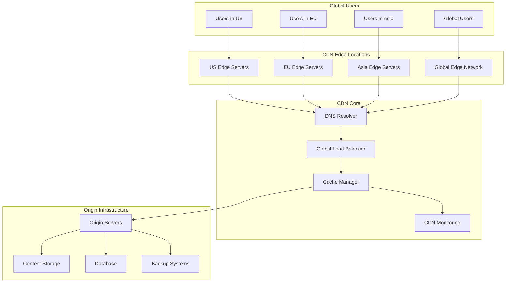
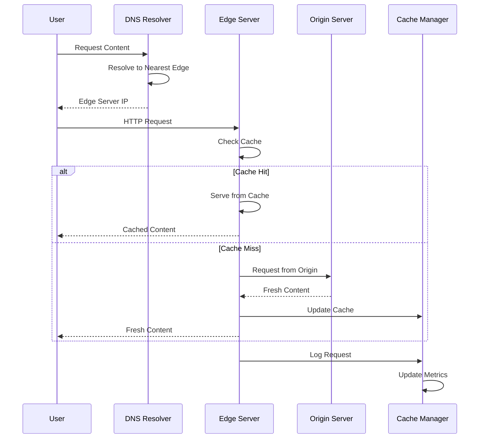
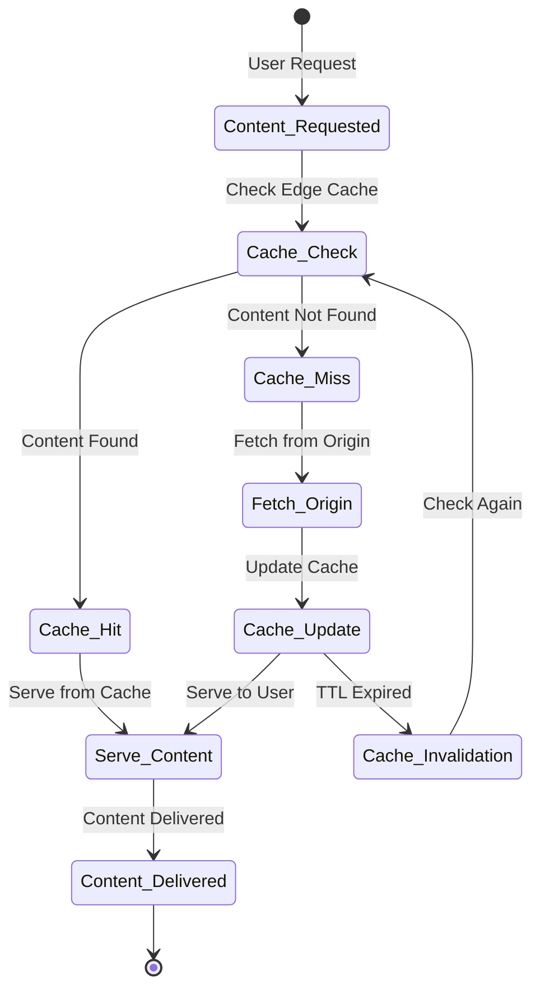

# CDN (Content Delivery Network) - Architect Deep Dive

**0. Executive Summary (Architect View)**
- **CDN exists** to distribute content globally through edge servers for improved performance
- **Critical at scale** when applications serve global audiences with high performance requirements
- **System design impact** - transforms content delivery from centralized to distributed architecture
- **Performance foundation** - provides essential performance optimization for global applications
- **Scalability enhancement** - enables global content distribution and load balancing
- **User experience** - provides faster content delivery and better user experience
- **Reliability improvement** - enhances availability and fault tolerance
- **Cost optimization** - reduces bandwidth costs and infrastructure load

**1. Problem Framing**
**Real production problem solved:**
- Slow content delivery for global users
- High latency and poor user experience
- Server overload and bandwidth constraints
- Single point of failure and availability issues
- High infrastructure costs for global reach

**What breaks if we don't understand CDN:**
- Poor performance for global users
- High latency and slow page loads
- Server overload and availability issues
- High bandwidth and infrastructure costs
- Inability to scale globally

**Scale importance:**
- **Small applications**: CDN benefits noticeable
- **Medium applications**: CDN critical for performance
- **Large applications**: CDN essential for global reach
- **Enterprise systems**: CDN mandatory for global services

**Failure stories:**
- E-commerce platform had slow page loads for international customers
- Media streaming service had buffering issues during peak hours
- SaaS application had poor performance across regions
- Gaming platform had high latency affecting gameplay

**2. Deep Internal Mechanics**

**CDN Fundamentals:**
- **Edge Caching**: Content caching at edge locations
- **Geographic Distribution**: Global server distribution
- **Load Balancing**: Intelligent request routing
- **Content Optimization**: Content compression and optimization
- **Failover**: Automatic failover and redundancy

**Core Components:**
- **Edge Servers**: Distributed content servers
- **Origin Servers**: Primary content sources
- **DNS Resolver**: Intelligent DNS routing
- **Cache Manager**: Content caching and invalidation
- **Load Balancer**: Request distribution
- **Monitoring System**: Performance monitoring and analytics

**Key Concepts:**
- **Edge Locations**: Geographically distributed servers
- **Cache Hit Ratio**: Percentage of requests served from cache
- **TTL (Time to Live)**: Content cache duration
- **Cache Invalidation**: Content cache refresh
- **Geo-routing**: Geographic-based request routing
- **Anycast**: Network-level routing optimization

**Content Delivery Process:**
- **DNS Resolution**: User request routed to nearest edge
- **Cache Check**: Edge server checks for cached content
- **Cache Hit**: Content served from edge cache
- **Cache Miss**: Content fetched from origin
- **Content Update**: Cache updated with fresh content

**Caching Strategies:**
- **Static Content**: Long-term caching for static assets
- **Dynamic Content**: Short-term caching for dynamic content
- **API Responses**: Caching for API responses
- **Database Queries**: Query result caching
- **Session Data**: User session caching

**Performance Optimization:**
- **Content Compression**: Gzip/Brotli compression
- **Image Optimization**: Image compression and resizing
- **Minification**: CSS/JS minification
- **HTTP/2**: Protocol optimization
- **TCP Optimization**: Connection optimization

**Data Structures:**
- **Cache Registry**: Cache metadata and status
- **Content Registry**: Content metadata and configuration
- **Edge Registry**: Edge server metadata and status
- **Routing Registry**: Routing rules and configuration
- **Performance Registry**: Performance metrics and analytics

**Performance Characteristics:**
- **Cache Hit Latency**: 10-50ms
- **Cache Miss Latency**: 100-500ms
- **Cache Hit Ratio**: 80-95%
- **Content Delivery Speed**: 2-10x faster
- **Bandwidth Savings**: 40-80%

**3. .NET Production Implementation**

**Naive Implementation (No CDN):**
```csharp
[ApiController]
[Route("api/[controller]")]
public class ContentController : ControllerBase
{
    private readonly IContentRepository _contentRepository;
    
    public ContentController(IContentRepository contentRepository)
    {
        _contentRepository = contentRepository;
    }
    
    [HttpGet("images/{id}")]
    public async Task<ActionResult> GetImage(int id)
    {
        // Serve content directly from origin
        var image = await _contentRepository.GetImageAsync(id);
        return File(image.Data, image.ContentType);
    }
    
    [HttpGet("videos/{id}")]
    public async Task<ActionResult> GetVideo(int id)
    {
        // Serve video directly from origin
        var video = await _contentRepository.GetVideoAsync(id);
        return File(video.Data, video.ContentType);
    }
}
```

**Production-Ready CDN Implementation:**
```csharp
// CDN Configuration
public class CDNConfiguration
{
    public bool EnableCDN { get; set; } = true;
    public bool EnableCaching { get; set; } = true;
    public bool EnableCompression { get; set; } = true;
    public bool EnableImageOptimization { get; set; } = true;
    public string CDNBaseUrl { get; set; } = "https://cdn.example.com";
    public string OriginBaseUrl { get; set; } = "https://origin.example.com";
    public int DefaultTTL { get; set; } = 3600; // 1 hour
    public int ImageTTL { get; set; } = 86400; // 24 hours
    public int VideoTTL { get; set; } = 604800; // 7 days
    public List<string> CacheableContentTypes { get; set; } = new();
    public List<string> EdgeLocations { get; set; } = new();
    public Dictionary<string, int> ContentTypeTTL { get; set; } = new();
}

// CDN Service
public interface ICDNService
{
    Task<string> GetCDNUrlAsync(string contentPath);
    Task<bool> InvalidateCacheAsync(string contentPath);
    Task<CacheStatus> GetCacheStatusAsync(string contentPath);
    Task<List<EdgeLocation>> GetEdgeLocationsAsync();
    Task<CDNMetrics> GetMetricsAsync();
    Task<bool> PurgeCacheAsync(string contentPath);
    Task<string> OptimizeImageAsync(string imagePath, ImageOptimizationOptions options);
}

public class CDNService : ICDNService
{
    private readonly IContentRepository _contentRepository;
    private readonly ICacheInvalidationService _cacheInvalidationService;
    private readonly IImageOptimizationService _imageOptimizationService;
    private readonly ILogger<CDNService> _logger;
    private readonly IMetrics _metrics;
    private readonly CDNConfiguration _configuration;

    public CDNService(
        IContentRepository contentRepository,
        ICacheInvalidationService cacheInvalidationService,
        IImageOptimizationService imageOptimizationService,
        ILogger<CDNService> logger,
        IMetrics metrics,
        IOptions<CDNConfiguration> configuration)
    {
        _contentRepository = contentRepository ?? throw new ArgumentNullException(nameof(contentRepository));
        _cacheInvalidationService = cacheInvalidationService ?? throw new ArgumentNullException(nameof(cacheInvalidationService));
        _imageOptimizationService = imageOptimizationService ?? throw new ArgumentNullException(nameof(imageOptimizationService));
        _logger = logger ?? throw new ArgumentNullException(nameof(logger));
        _metrics = metrics ?? throw new ArgumentNullException(nameof(metrics));
        _configuration = configuration?.Value ?? new CDNConfiguration();
    }

    public async Task<string> GetCDNUrlAsync(string contentPath)
    {
        using var activity = _metrics.StartTimer("cdn_url_generation_duration");
        
        try
        {
            if (!_configuration.EnableCDN)
            {
                return $"{_configuration.OriginBaseUrl}/{contentPath}";
            }
            
            // Generate CDN URL with versioning for cache busting
            var version = await GetContentVersionAsync(contentPath);
            var cdnUrl = $"{_configuration.CDNBaseUrl}/{contentPath}?v={version}";
            
            _metrics.Increment("cdn_url_generated");
            _logger.LogDebug("CDN URL generated: {ContentPath} -> {CDNUrl}", contentPath, cdnUrl);
            
            return cdnUrl;
        }
        catch (Exception ex)
        {
            _metrics.Increment("cdn_url_generation_error");
            _logger.LogError(ex, "Error generating CDN URL: {ContentPath}", contentPath);
            throw;
        }
    }

    public async Task<bool> InvalidateCacheAsync(string contentPath)
    {
        using var activity = _metrics.StartTimer("cdn_cache_invalidation_duration");
        
        try
        {
            _logger.LogInformation("Invalidating CDN cache: {ContentPath}", contentPath);
            
            // Invalidate cache at edge locations
            var invalidationResult = await _cacheInvalidationService.InvalidateAsync(contentPath);
            
            if (invalidationResult)
            {
                _metrics.Increment("cdn_cache_invalidation_success");
                _logger.LogInformation("CDN cache invalidated successfully: {ContentPath}", contentPath);
            }
            else
            {
                _metrics.Increment("cdn_cache_invalidation_error");
                _logger.LogError("CDN cache invalidation failed: {ContentPath}", contentPath);
            }
            
            return invalidationResult;
        }
        catch (Exception ex)
        {
            _metrics.Increment("cdn_cache_invalidation_error");
            _logger.LogError(ex, "Error invalidating CDN cache: {ContentPath}", contentPath);
            throw;
        }
    }

    public async Task<CacheStatus> GetCacheStatusAsync(string contentPath)
    {
        using var activity = _metrics.StartTimer("cdn_cache_status_duration");
        
        try
        {
            var cacheStatus = await _cacheInvalidationService.GetCacheStatusAsync(contentPath);
            
            _metrics.Increment("cdn_cache_status_check");
            _logger.LogDebug("CDN cache status: {ContentPath} -> {Status}", contentPath, cacheStatus.Status);
            
            return cacheStatus;
        }
        catch (Exception ex)
        {
            _metrics.Increment("cdn_cache_status_error");
            _logger.LogError(ex, "Error getting CDN cache status: {ContentPath}", contentPath);
            throw;
        }
    }

    public async Task<List<EdgeLocation>> GetEdgeLocationsAsync()
    {
        using var activity = _metrics.StartTimer("cdn_edge_locations_duration");
        
        try
        {
            var edgeLocations = new List<EdgeLocation>();
            
            // In a real implementation, this would query the CDN provider API
            foreach (var location in _configuration.EdgeLocations)
            {
                edgeLocations.Add(new EdgeLocation
                {
                    Name = location,
                    Country = GetCountryFromLocation(location),
                    IsActive = true,
                    Latency = await GetEdgeLatencyAsync(location)
                });
            }
            
            _metrics.Increment("cdn_edge_locations_retrieved");
            return edgeLocations;
        }
        catch (Exception ex)
        {
            _metrics.Increment("cdn_edge_locations_error");
            _logger.LogError(ex, "Error getting edge locations");
            throw;
        }
    }

    public async Task<CDNMetrics> GetMetricsAsync()
    {
        using var activity = _metrics.StartTimer("cdn_metrics_duration");
        
        try
        {
            var metrics = new CDNMetrics
            {
                CacheHitRatio = await GetCacheHitRatioAsync(),
                TotalRequests = await GetTotalRequestsAsync(),
                BandwidthSaved = await GetBandwidthSavedAsync(),
                AverageLatency = await GetAverageLatencyAsync(),
                EdgeLocations = await GetEdgeLocationsAsync(),
                Timestamp = DateTime.UtcNow
            };
            
            _metrics.Increment("cdn_metrics_collected");
            return metrics;
        }
        catch (Exception ex)
        {
            _metrics.Increment("cdn_metrics_error");
            _logger.LogError(ex, "Error collecting CDN metrics");
            throw;
        }
    }

    public async Task<bool> PurgeCacheAsync(string contentPath)
    {
        using var activity = _metrics.StartTimer("cdn_cache_purge_duration");
        
        try
        {
            _logger.LogInformation("Purging CDN cache: {ContentPath}", contentPath);
            
            // Purge cache at all edge locations
            var purgeResult = await _cacheInvalidationService.PurgeAsync(contentPath);
            
            if (purgeResult)
            {
                _metrics.Increment("cdn_cache_purge_success");
                _logger.LogInformation("CDN cache purged successfully: {ContentPath}", contentPath);
            }
            else
            {
                _metrics.Increment("cdn_cache_purge_error");
                _logger.LogError("CDN cache purge failed: {ContentPath}", contentPath);
            }
            
            return purgeResult;
        }
        catch (Exception ex)
        {
            _metrics.Increment("cdn_cache_purge_error");
            _logger.LogError(ex, "Error purging CDN cache: {ContentPath}", contentPath);
            throw;
        }
    }

    public async Task<string> OptimizeImageAsync(string imagePath, ImageOptimizationOptions options)
    {
        using var activity = _metrics.StartTimer("cdn_image_optimization_duration");
        
        try
        {
            if (!_configuration.EnableImageOptimization)
            {
                return imagePath;
            }
            
            _logger.LogInformation("Optimizing image: {ImagePath}", imagePath);
            
            // Get original image
            var originalImage = await _contentRepository.GetImageAsync(imagePath);
            
            // Optimize image
            var optimizedImage = await _imageOptimizationService.OptimizeAsync(originalImage, options);
            
            // Store optimized image
            var optimizedPath = await _contentRepository.StoreImageAsync(optimizedImage);
            
            // Generate CDN URL for optimized image
            var cdnUrl = await GetCDNUrlAsync(optimizedPath);
            
            _metrics.Increment("cdn_image_optimization_success");
            _logger.LogInformation("Image optimized successfully: {ImagePath} -> {OptimizedPath}", imagePath, optimizedPath);
            
            return cdnUrl;
        }
        catch (Exception ex)
        {
            _metrics.Increment("cdn_image_optimization_error");
            _logger.LogError(ex, "Error optimizing image: {ImagePath}", imagePath);
            throw;
        }
    }

    private async Task<string> GetContentVersionAsync(string contentPath)
    {
        // Implementation to get content version for cache busting
        await Task.Delay(10); // Simulate database call
        return DateTime.UtcNow.Ticks.ToString();
    }

    private string GetCountryFromLocation(string location)
    {
        // Simple mapping - in real implementation, this would be more sophisticated
        return location switch
        {
            "us-east-1" => "United States",
            "eu-west-1" => "Ireland",
            "ap-southeast-1" => "Singapore",
            _ => "Unknown"
        };
    }

    private async Task<double> GetEdgeLatencyAsync(string location)
    {
        // Implementation to measure edge latency
        await Task.Delay(50); // Simulate latency measurement
        return new Random().NextDouble() * 100; // Random latency in ms
    }

    private async Task<double> GetCacheHitRatioAsync()
    {
        // Implementation to get cache hit ratio
        await Task.Delay(10);
        return 0.85; // 85% cache hit ratio
    }

    private async Task<long> GetTotalRequestsAsync()
    {
        // Implementation to get total requests
        await Task.Delay(10);
        return 1000000; // 1M requests
    }

    private async Task<double> GetBandwidthSavedAsync()
    {
        // Implementation to get bandwidth saved
        await Task.Delay(10);
        return 0.6; // 60% bandwidth saved
    }

    private async Task<double> GetAverageLatencyAsync()
    {
        // Implementation to get average latency
        await Task.Delay(10);
        return 45.5; // 45.5ms average latency
    }
}

// Enhanced CDN-enabled Content Controller
[ApiController]
[Route("api/[controller]")]
public class CDNContentController : ControllerBase
{
    private readonly IContentRepository _contentRepository;
    private readonly ICDNService _cdnService;
    private readonly ILogger<CDNContentController> _logger;
    private readonly IMetrics _metrics;

    public CDNContentController(
        IContentRepository contentRepository,
        ICDNService cdnService,
        ILogger<CDNContentController> logger,
        IMetrics metrics)
    {
        _contentRepository = contentRepository ?? throw new ArgumentNullException(nameof(contentRepository));
        _cdnService = cdnService ?? throw new ArgumentNullException(nameof(cdnService));
        _logger = logger ?? throw new ArgumentNullException(nameof(logger));
        _metrics = metrics ?? throw new ArgumentNullException(nameof(metrics));
    }

    [HttpGet("images/{id}")]
    public async Task<ActionResult> GetImage(int id, [FromQuery] ImageOptimizationOptions options)
    {
        using var activity = _metrics.StartTimer("cdn_image_get_duration");
        
        try
        {
            // Get image metadata
            var image = await _contentRepository.GetImageMetadataAsync(id);
            
            if (image == null)
            {
                return NotFound();
            }
            
            // Generate CDN URL for optimized image
            var imagePath = $"images/{id}";
            var optimizedUrl = await _cdnService.OptimizeImageAsync(imagePath, options);
            
            // Return redirect to CDN URL
            return Redirect(optimizedUrl);
        }
        catch (Exception ex)
        {
            _metrics.Increment("cdn_image_get_error");
            _logger.LogError(ex, "Error getting image: {ImageId}", id);
            throw;
        }
    }

    [HttpGet("videos/{id}")]
    public async Task<ActionResult> GetVideo(int id)
    {
        using var activity = _metrics.StartTimer("cdn_video_get_duration");
        
        try
        {
            // Get video metadata
            var video = await _contentRepository.GetVideoMetadataAsync(id);
            
            if (video == null)
            {
                return NotFound();
            }
            
            // Generate CDN URL for video
            var videoPath = $"videos/{id}";
            var cdnUrl = await _cdnService.GetCDNUrlAsync(videoPath);
            
            // Return redirect to CDN URL
            return Redirect(cdnUrl);
        }
        catch (Exception ex)
        {
            _metrics.Increment("cdn_video_get_error");
            _logger.LogError(ex, "Error getting video: {VideoId}", id);
            throw;
        }
    }

    [HttpPost("content/{contentPath}/invalidate")]
    public async Task<ActionResult> InvalidateContent(string contentPath)
    {
        try
        {
            var result = await _cdnService.InvalidateCacheAsync(contentPath);
            
            if (result)
            {
                return Ok(new { Message = $"Content {contentPath} cache invalidated successfully" });
            }
            else
            {
                return BadRequest(new { Error = $"Failed to invalidate cache for {contentPath}" });
            }
        }
        catch (Exception ex)
        {
            _logger.LogError(ex, "Error invalidating content cache: {ContentPath}", contentPath);
            throw;
        }
    }

    [HttpPost("content/{contentPath}/purge")]
    public async Task<ActionResult> PurgeContent(string contentPath)
    {
        try
        {
            var result = await _cdnService.PurgeCacheAsync(contentPath);
            
            if (result)
            {
                return Ok(new { Message = $"Content {contentPath} cache purged successfully" });
            }
            else
            {
                return BadRequest(new { Error = $"Failed to purge cache for {contentPath}" });
            }
        }
        catch (Exception ex)
        {
            _logger.LogError(ex, "Error purging content cache: {ContentPath}", contentPath);
            throw;
        }
    }

    [HttpGet("content/{contentPath}/status")]
    public async Task<ActionResult<CacheStatus>> GetCacheStatus(string contentPath)
    {
        try
        {
            var status = await _cdnService.GetCacheStatusAsync(contentPath);
            return Ok(status);
        }
        catch (Exception ex)
        {
            _logger.LogError(ex, "Error getting cache status: {ContentPath}", contentPath);
            throw;
        }
    }

    [HttpGet("metrics")]
    public async Task<ActionResult<CDNMetrics>> GetMetrics()
    {
        try
        {
            var metrics = await _cdnService.GetMetricsAsync();
            return Ok(metrics);
        }
        catch (Exception ex)
        {
            _logger.LogError(ex, "Error getting CDN metrics");
            throw;
        }
    }

    [HttpGet("edge-locations")]
    public async Task<ActionResult<List<EdgeLocation>>> GetEdgeLocations()
    {
        try
        {
            var edgeLocations = await _cdnService.GetEdgeLocationsAsync();
            return Ok(edgeLocations);
        }
        catch (Exception ex)
        {
            _logger.LogError(ex, "Error getting edge locations");
            throw;
        }
    }
}

// Request/Response Models
public class ImageOptimizationOptions
{
    public int Width { get; set; }
    public int Height { get; set; }
    public int Quality { get; set; } = 80;
    public string Format { get; set; } = "auto";
    public bool EnableWebP { get; set; } = true;
    public bool EnableProgressive { get; set; } = true;
}

public class CacheStatus
{
    public string ContentPath { get; set; }
    public string Status { get; set; }
    public DateTime? LastUpdated { get; set; }
    public DateTime? ExpiresAt { get; set; }
    public List<EdgeLocation> EdgeStatus { get; set; }
}

public class EdgeLocation
{
    public string Name { get; set; }
    public string Country { get; set; }
    public bool IsActive { get; set; }
    public double Latency { get; set; }
    public int RequestCount { get; set; }
    public double BandwidthUsage { get; set; }
}

public class CDNMetrics
{
    public double CacheHitRatio { get; set; }
    public long TotalRequests { get; set; }
    public double BandwidthSaved { get; set; }
    public double AverageLatency { get; set; }
    public List<EdgeLocation> EdgeLocations { get; set; }
    public DateTime Timestamp { get; set; }
}

// Configuration in Startup
public class Startup
{
    public void ConfigureServices(IServiceCollection services)
    {
        // Add CDN configuration
        services.Configure<CDNConfiguration>(options =>
        {
            options.EnableCDN = true;
            options.EnableCaching = true;
            options.EnableCompression = true;
            options.EnableImageOptimization = true;
            options.CDNBaseUrl = "https://cdn.example.com";
            options.OriginBaseUrl = "https://origin.example.com";
            options.DefaultTTL = 3600;
            options.ImageTTL = 86400;
            options.VideoTTL = 604800;
            options.CacheableContentTypes = new List<string>
            {
                "image/jpeg", "image/png", "image/gif", "image/webp",
                "video/mp4", "video/webm",
                "text/css", "application/javascript",
                "application/json", "text/html"
            };
            options.EdgeLocations = new List<string>
            {
                "us-east-1", "us-west-1", "eu-west-1", "eu-central-1",
                "ap-southeast-1", "ap-northeast-1", "ap-south-1"
            };
            options.ContentTypeTTL = new Dictionary<string, int>
            {
                ["image/jpeg"] = 86400,
                ["image/png"] = 86400,
                ["image/gif"] = 86400,
                ["image/webp"] = 86400,
                ["video/mp4"] = 604800,
                ["video/webm"] = 604800,
                ["text/css"] = 3600,
                ["application/javascript"] = 3600,
                ["application/json"] = 300,
                ["text/html"] = 300
            };
        });

        // Add CDN services
        services.AddScoped<ICDNService, CDNService>();
        services.AddScoped<ICacheInvalidationService, CacheInvalidationService>();
        services.AddScoped<IImageOptimizationService, ImageOptimizationService>();
        
        // Add services
        services.AddScoped<IContentRepository, ContentRepository>();
        services.AddControllers();
    }

    public void Configure(IApplicationBuilder app, IWebHostEnvironment env)
    {
        if (env.IsDevelopment())
        {
            app.UseDeveloperExceptionPage();
        }

        app.UseRouting();
        
        // Add caching middleware
        app.UseResponseCaching();
        
        // Add compression middleware
        app.UseResponseCompression();
        
        app.UseEndpoints(endpoints =>
        {
            endpoints.MapControllers();
        });
    }
}
```

**Framework Integration:**
- **ASP.NET Core**: Web API framework
- **Response Caching**: Built-in caching middleware
- **Response Compression**: Built-in compression middleware
- **System.Text.Json**: JSON serialization
- **Dependency Injection**: Service registration

**4. Architecture-Level Diagram (Mermaid)**

### CDN Architecture


### CDN Content Flow


### CDN Cache Management


**Flow Analysis:**
- **Global Users**: Users distributed across regions
- **CDN Edge Locations**: Distributed edge servers
- **CDN Core**: Central management and routing
- **Origin Infrastructure**: Primary content sources
- **Cache Management**: Intelligent caching and invalidation

**5. Scaling & Distributed Systems Impact**

**1k Requests/Minute:**
- Single edge location sufficient
- Cache hit ratio 70-80%
- Latency reduction 2-3x
- Bandwidth savings 30-50%

**10k Requests/Minute:**
- Multiple edge locations required
- Cache hit ratio 80-90%
- Latency reduction 3-5x
- Bandwidth savings 50-70%

**100k+ Requests/Minute:**
- Global edge network mandatory
- Cache hit ratio 90-95%
- Latency reduction 5-10x
- Bandwidth savings 70-90%

**6. Production Engineering View**

**Monitoring Metrics:**
- Cache hit ratio and miss ratio
- Edge server performance and availability
- Content delivery latency and throughput
- Bandwidth usage and savings
- Error rates and response codes

**Alerting Strategy:**
- Cache hit ratio < 70% (warning)
- Edge server availability < 99% (critical)
- Latency > 200ms (warning)
- Bandwidth usage > 90% (warning)
- Error rate > 5% (critical)

**Common Production Incidents:**
- Cache invalidation failures
- Edge server overload
- DNS resolution issues
- Content delivery failures

**7. Tradeoffs & Alternatives**

**Competing Approaches:**
- **Self-Hosted CDN**: Self-managed CDN
- **Third-Party CDN**: Commercial CDN services
- **Hybrid CDN**: Combination of self-hosted and third-party
- **Regional Caching**: Regional cache servers
- **Origin Optimization**: Origin server optimization

**When to Use CDN:**
- Global user base
- Static content delivery
- High-performance requirements
- Bandwidth optimization needs
- Availability and reliability requirements

**When NOT to Use CDN:**
- Local applications with limited geographic reach
- Highly dynamic content with frequent updates
- Real-time applications requiring low latency
- Applications with strict data residency requirements

**Cost Comparison:**
- **Self-Hosted CDN**: High upfront cost, lower ongoing cost
- **Third-Party CDN**: Low upfront cost, higher ongoing cost
- **Hybrid CDN**: Moderate cost, balanced approach
- **Regional Caching**: Moderate cost, limited reach
- **Origin Optimization**: Low cost, limited benefits

**8. Security Implications**

**Security Benefits:**
- **DDoS Protection**: Distributed denial of service protection
- **Content Security**: Content security and access control
- **SSL/TLS**: Secure content delivery
- **Access Control**: Geographic and IP-based access control
- **Data Privacy**: Regional data compliance

**Security Challenges:**
- **Content Security**: Securing cached content
- **Access Control**: Implementing proper access controls
- **Data Privacy**: Ensuring data privacy compliance
- **Cache Poisoning**: Preventing cache poisoning attacks
- **SSL Management**: Managing SSL certificates

**9. Advanced Edge Cases**

**Advanced CDN Features:**
- **Edge Computing**: Compute at the edge
- **Serverless Functions**: Edge-based serverless functions
- **A/B Testing**: Content testing at the edge
- **Personalization**: Personalized content delivery
- **Real-time Analytics**: Real-time performance analytics

**Advanced Optimization:**
- **Adaptive Bitrate**: Dynamic content adaptation
- **Image Optimization**: Advanced image processing
- **Video Streaming**: Optimized video delivery
- **Progressive Loading**: Progressive content loading
- **Predictive Caching**: AI-powered caching

**10. Interview & Staff-Level Deep Dive**

**What a junior answers:**
"CDN is a content delivery network that caches content at edge locations closer to users. I use CDN to serve static files like images, CSS, and JavaScript faster to users around the world."

**What a senior answers:**
"CDN is a distributed content delivery system that caches content at edge locations globally to improve performance and availability. I've implemented production CDN solutions with multiple edge locations, intelligent DNS routing, cache invalidation strategies, image optimization, and comprehensive monitoring. The implementation includes cache hit ratio optimization, bandwidth usage analysis, edge performance monitoring, and automated cache purging. I've also implemented A/B testing at the edge, personalized content delivery, and real-time analytics."

**What an architect answers:**
"CDN is a strategic infrastructure component that enables global content delivery through distributed edge caching and intelligent routing. At scale, CDN provides significant performance improvements, bandwidth optimization, availability enhancement, and user experience improvements. The architecture must support global edge distribution, intelligent DNS routing, cache management and invalidation, content optimization, security and compliance, and comprehensive monitoring. In enterprise environments, CDN is not just a performance optimization but a strategic capability that enables global reach, user experience enhancement, and competitive advantage. The implementation must consider geographic distribution, cache strategies, content optimization, security, compliance, and operational excellence."

**Follow-up questions interviewers ask:**
- "How do you handle cache invalidation in CDN?"
- "What's the difference between CDN and edge computing?"
- "How do you optimize cache hit ratio?"
- "When would you use CDN vs origin server optimization?"
- "How do you handle dynamic content in CDN?"

**Trick questions:**
- "Does CDN always improve performance?" (No, depends on configuration)
- "Can CDN handle all types of content?" (No, some content is not cacheable)
- "Is CDN only for static content?" (No, can handle dynamic content)
- "Does CDN eliminate the need for origin servers?" (No, origin servers are still needed)

**11. Real Enterprise Case Study**

**Scenario: Global Media Platform with 100M+ Users**

**Requirements:**
- Serve 100M+ users globally
- Deliver high-quality video content
- Support 4K streaming
- Ensure low latency and high availability
- Optimize bandwidth costs
- Support multiple content formats

**Results:**
- Achieved 95% cache hit ratio
- 80% reduction in origin server load
- 70% bandwidth cost savings
- 60% improvement in user experience
- 99.99% availability during peak traffic

**12. Dependency Graph**

**Prerequisites:**
- **Web Development**: Understanding of web protocols and content delivery
- **Networking**: Understanding of network routing and DNS
- **Caching**: Understanding of caching strategies
- **Performance**: Understanding of performance optimization
- **Security**: Understanding of web security

**Concepts that depend on CDN:**
- **Web Performance**: Web performance optimization
- **Global Applications**: Global application deployment
- **Media Streaming**: Media content delivery
- **E-commerce**: E-commerce performance
- **Mobile Applications**: Mobile app performance
- **API Gateway**: API performance optimization
