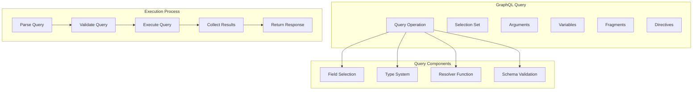
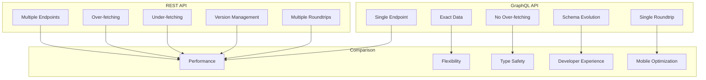
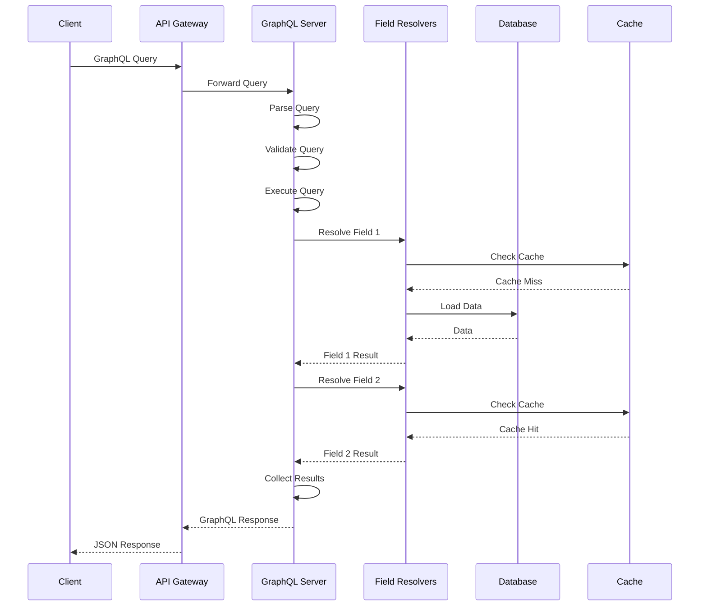
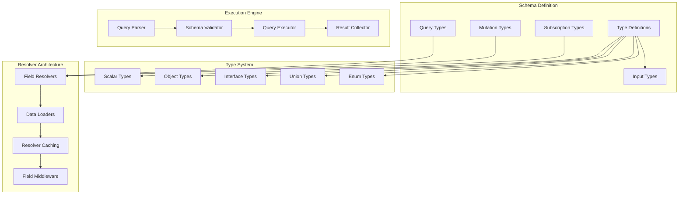
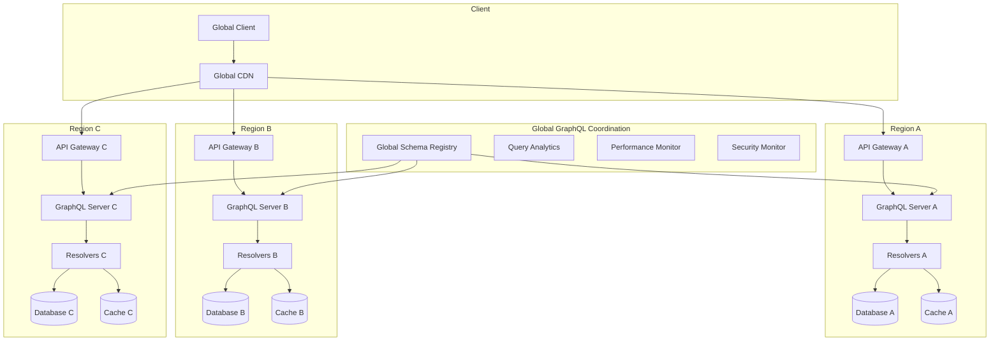
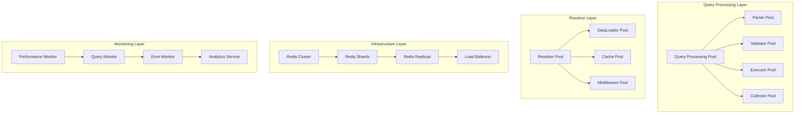
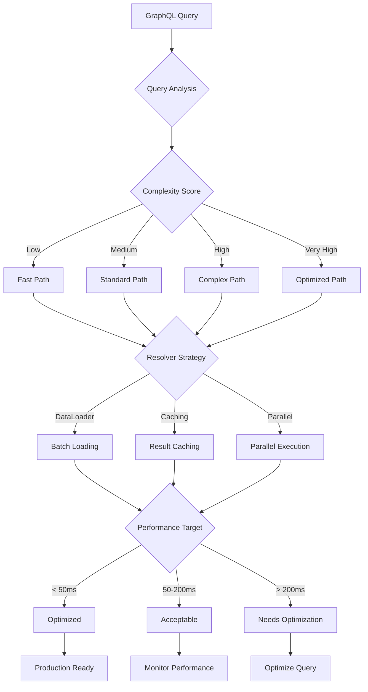
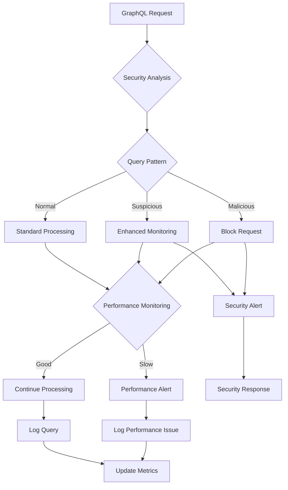

# GraphQL - Architect Deep Dive

============================================================
0. Executive Summary (Architect View)
============================================================
- **GraphQL exists** to provide a flexible query language for APIs that allows clients to request exactly what they need
- **Critical at scale** when applications need to reduce over-fetching and under-fetching problems of REST APIs
- **System design impact** - transforms API design from REST endpoints to flexible schema-based queries
- **Efficiency revolution** - eliminates over-fetching and reduces network roundtrips
- **Type safety** - provides strong typing and schema validation
- **Developer experience** - enables better tooling and development experience
- **Mobile optimization** - ideal for mobile applications with bandwidth constraints
- **API evolution** - enables backward-compatible API evolution

============================================================
1. Problem Framing
============================================================
**Real production problem solved:**
- Over-fetching in REST APIs (getting more data than needed)
- Under-fetching (multiple roundtrips to get related data)
- API versioning complexity with REST
- Mobile performance issues with multiple API calls
- Tight coupling between frontend and backend data requirements

**What breaks if we don't understand GraphQL:**
- Inefficient data fetching
- Multiple API roundtrips
- Version management complexity
- Poor mobile performance
- Tight frontend-backend coupling

**Scale importance:**
- **Small applications**: REST may be sufficient
- **Medium applications**: GraphQL benefits become apparent
- **Large applications**: GraphQL essential for performance
- **Enterprise systems**: GraphQL critical for API efficiency

**Failure stories:**
- Social media platform had performance issues with REST over-fetching
- Mobile app suffered from multiple API calls
- E-commerce platform had API versioning challenges
- Analytics dashboard was slow due to multiple data requests

============================================================
2. Deep Internal Mechanics
============================================================

**GraphQL Fundamentals:**
- **Query Language**: Flexible query language for data fetching
- **Schema Definition**: Strongly typed schema definition
- **Resolvers**: Functions that resolve field values
- **Execution Engine**: Processes and executes queries
- **Type System**: Strong typing and validation

**GraphQL Schema:**
- **Types**: Object types, scalar types, enum types
- **Fields**: Fields with types and arguments
- **Queries**: Read operations
- **Mutations**: Write operations
- **Subscriptions**: Real-time data updates

**Query Structure:**
- **Selection Set**: Fields to be returned
- **Arguments**: Parameters for fields
- **Variables**: Dynamic query parameters
- **Fragments**: Reusable query pieces
- **Directives**: Query execution instructions

**Execution Process:**
1. **Parse**: Parse query into AST
2. **Validate**: Validate against schema
3. **Execute**: Resolve fields using resolvers
4. **Collect**: Gather results
5. **Return**: Return JSON response

**Resolver Functions:**
- **Field Resolvers**: Resolve individual fields
- **Type Resolvers**: Custom type resolution
- **Middleware**: Execution pipeline hooks
- **Data Loaders**: Batch loading optimization
- **Caching**: Resolver result caching

**Performance Optimizations:**
- **Data Loaders**: Batch related queries
- **Caching**: Cache resolver results
- **Query Complexity**: Limit query complexity
- **Depth Limiting**: Limit query depth
- **Persistent Queries**: Pre-compiled queries

**Security Features:**
- **Query Whitelisting**: Allow only specific queries
- **Depth Limiting**: Prevent deep queries
- **Complexity Analysis**: Limit query complexity
- **Rate Limiting**: Per-query rate limiting
- **Authorization**: Field-level authorization

**Data Structures:**
- **Schema Definition**: GraphQL schema objects
- **AST**: Abstract syntax tree
- **Execution Context**: Request context
- **Resolver Map**: Field resolver mapping
- **Type Registry**: Type system registry

**Performance Characteristics:**
- **Query Parsing**: 1-10ms
- **Validation**: 1-5ms
- **Execution**: 10-100ms (depends on complexity)
- **Response Size**: Optimized to requested data
- **Network**: Single roundtrip for complex data

**Hidden Costs:**
- **Query Complexity**: Complex queries can be expensive
- **Caching Complexity**: Caching resolver results
- **Schema Management**: Schema evolution complexity
- **Tooling**: Additional tooling requirements
- **Learning Curve**: GraphQL learning curve

**Memory Behavior:**
- **AST Storage**: Query AST in memory
- **Schema Storage**: Schema definition in memory
- **Resolver Context**: Execution context
- **Result Assembly**: Building response
- **Cache Storage**: Resolver result caching

**Network Impact:**
- **Single Request**: One request for complex data
- **Response Size**: Optimized response size
- **Compression**: JSON response compression
- **HTTP/2**: Multiplexing support
- **CDN Friendly**: Cacheable responses

============================================================
3. .NET Production Implementation
============================================================

**Naive Implementation (REST API):**
```csharp
[ApiController]
[Route("api/[controller]")]
public class ProductsController : ControllerBase
{
    private readonly IProductService _productService;
    
    public ProductsController(IProductService productService)
    {
        _productService = productService;
    }
    
    [HttpGet("{id}")]
    public async Task<ActionResult<Product>> GetProduct(int id)
    {
        // REST endpoint - single resource
        var product = await _productService.GetProductAsync(id);
        return Ok(product);
    }
    
    [HttpGet("{id}/reviews")]
    public async Task<ActionResult<List<Review>>> GetProductReviews(int id)
    {
        // Separate endpoint for related data
        var reviews = await _productService.GetProductReviewsAsync(id);
        return Ok(reviews);
    }
}
```

**Production-Ready GraphQL Implementation:**
```csharp
// GraphQL Configuration
public class GraphQLConfiguration
{
    public bool EnableMetrics { get; set; } = true;
    public bool EnableTracing { get; set; } = true;
    public int MaxQueryDepth { get; set; } = 10;
    public int MaxQueryComplexity { get; set; } = 1000;
    public bool EnablePersistedQueries { get; set; } = true;
    public TimeSpan QueryTimeout { get; set; } = TimeSpan.FromSeconds(30);
    public List<string> AllowedQueries { get; set; } = new();
}

// GraphQL Types
public class ProductType : ObjectGraphType<Product>
{
    public ProductType()
    {
        Field(p => p.Id).Description("Product ID");
        Field(p => p.Name).Description("Product name");
        Field(p => p.Description).Description("Product description");
        Field(p => p.Price).Description("Product price");
        Field(p => p.Category).Description("Product category");
        Field(p => p.Reviews).Description("Product reviews");
        Field(p => p.CreatedAt).Description("Creation date");
    }
}

public class ReviewType : ObjectGraphType<Review>
{
    public ReviewType()
    {
        Field(r => r.Id).Description("Review ID");
        Field(r => r.UserId).Description("User ID");
        Field(r => r.Rating).Description("Review rating");
        Field(r => r.Comment).Description("Review comment");
        Field(r => r.CreatedAt).Description("Review date");
    }
}

public class CategoryType : ObjectGraphType<Category>
{
    public CategoryType()
    {
        Field(c => c.Id).Description("Category ID");
        Field(c => c.Name).Description("Category name");
        Field(c => c.Products).Description("Products in category");
    }
}

// Input Types
public class ProductInputType : InputObjectGraphType
{
    public ProductInputType()
    {
        Field<NonNullGraphType<StringGraphType>>("name");
        Field<NonNullGraphType<StringGraphType>>("description");
        Field<DecimalGraphType>("price");
        Field<IntGraphType>("categoryId");
    }
}

public class ProductFilterInputType : InputObjectGraphType
{
    public ProductFilterInputType()
    {
        Field<StringGraphType>("name");
        Field<DecimalGraphType>("minPrice");
        Field<DecimalGraphType>("maxPrice");
        Field<IntGraphType>("categoryId");
    }
}

// GraphQL Schema
public class AppSchema : Schema
{
    public AppSchema()
    {
        Query = new AppQuery();
        Mutation = new AppMutation();
        Subscription = new AppSubscription();
    }
}

public class AppQuery : ObjectGraphType
{
    public AppQuery()
    {
        Field<ProductType>("product")
            .Arguments(new QueryArguments(
                new QueryArgument<NonNullGraphType<IntGraphType>> { Name = "id" }
            ))
            .ResolveAsync(async context => await 
                context.GetProductAsync(context.GetArgument<int>("id")));
        
        Field<ListGraphType<ProductType>>("products")
            .Arguments(new QueryArguments(
                new QueryArgument<ProductFilterInputType> { Name = "filter" },
                new QueryArgument<IntGraphType> { Name = "first", DefaultValue = 10 },
                new QueryArgument<IntGraphType> { Name = "after" }
            ))
            .ResolveAsync(async context => await 
                context.GetProductsAsync(
                    context.GetArgument<ProductFilter>("filter"),
                    context.GetArgument<int>("first"),
                    context.GetArgument<int>("after"))));
        
        Field<CategoryType>("category")
            .Arguments(new QueryArguments(
                new QueryArgument<NonNullGraphType<IntGraphType>> { Name = "id" }
            ))
            .ResolveAsync(async context => await 
                context.GetCategoryAsync(context.GetArgument<int>("id")));
    }
}

public class AppMutation : ObjectGraphType
{
    public AppMutation()
    {
        Field<ProductType>("createProduct")
            .Arguments(new QueryArguments(
                new QueryArgument<NonNullGraphType<ProductInputType>> { Name = "input" }
            ))
            .ResolveAsync(async context => await 
                context.CreateProductAsync(context.GetArgument<ProductInput>("input"))));
        
        Field<ProductType>("updateProduct")
            .Arguments(new QueryArguments(
                new QueryArgument<NonNullGraphType<IntGraphType>> { Name = "id" },
                new QueryArgument<NonNullGraphType<ProductInputType>> { Name = "input" }
            ))
            .ResolveAsync(async context => await 
                context.UpdateProductAsync(
                    context.GetArgument<int>("id"),
                    context.GetArgument<ProductInput>("input"))));
        
        Field<BooleanGraphType>("deleteProduct")
            .Arguments(new QueryArguments(
                new QueryArgument<NonNullGraphType<IntGraphType>> { Name = "id" }
            ))
            .ResolveAsync(async context => await 
                context.DeleteProductAsync(context.GetArgument<int>("id"))));
    }
}

// GraphQL Resolvers
public class ProductResolver
{
    private readonly IProductService _productService;
    private readonly IDataLoader<int, Product> _productLoader;
    private readonly ILogger<ProductResolver> _logger;
    private readonly IMetrics _metrics;

    public ProductResolver(
        IProductService productService,
        IDataLoader<int, Product> productLoader,
        ILogger<ProductResolver> logger,
        IMetrics metrics)
    {
        _productService = productService ?? throw new ArgumentNullException(nameof(productService));
        _productLoader = productLoader ?? throw new ArgumentNullException(nameof(productLoader));
        _logger = logger ?? throw new ArgumentNullException(nameof(logger));
        _metrics = metrics ?? throw new ArgumentNullException(nameof(metrics));
    }

    public async Task<Product> GetProductAsync(IResolveFieldContext context, int id)
    {
        using var activity = _metrics.StartTimer("graphql_product_resolve_duration");
        
        try
        {
            _logger.LogDebug("Resolving product {ProductId}", id);
            
            // Use DataLoader to prevent N+1 problems
            var product = await _productLoader.LoadAsync(id);
            
            _metrics.Increment("graphql_product_resolve_success");
            _logger.LogDebug("Product {ProductId} resolved successfully", id);
            
            return product;
        }
        catch (Exception ex)
        {
            _metrics.Increment("graphql_product_resolve_error");
            _logger.LogError(ex, "Error resolving product {ProductId}", id);
            throw;
        }
    }

    public async Task<List<Product>> GetProductsAsync(
        IResolveFieldContext context,
        ProductFilter filter,
        int first,
        int after)
    {
        using var activity = _metrics.StartTimer("graphql_products_resolve_duration");
        
        try
        {
            _logger.LogDebug("Resolving products with filter {@Filter}", filter);
            
            var products = await _productService.GetProductsAsync(filter, first, after);
            
            // Load reviews for all products using DataLoader
            var reviewTasks = products.Select(p => _productLoader.LoadAsync(p.Id));
            var reviews = await Task.WhenAll(reviewTasks);
            
            // Attach reviews to products
            for (int i = 0; i < products.Count; i++)
            {
                products[i].Reviews = reviews[i];
            }
            
            _metrics.Increment("graphql_products_resolve_success");
            _logger.LogDebug("Products resolved successfully: {Count}", products.Count);
            
            return products;
        }
        catch (Exception ex)
        {
            _metrics.Increment("graphql_products_resolve_error");
            _logger.LogError(ex, "Error resolving products");
            throw;
        }
    }

    public async Task<Category> GetCategoryAsync(IResolveFieldContext context, int id)
    {
        using var activity = _metrics.StartTimer("graphql_category_resolve_duration");
        
        try
        {
            _logger.LogDebug("Resolving category {CategoryId}", id);
            
            var category = await _productService.GetCategoryAsync(id);
            
            // Load products for category
            var products = await _productService.GetProductsByCategoryAsync(id);
            category.Products = products;
            
            _metrics.Increment("graphql_category_resolve_success");
            _logger.LogDebug("Category {CategoryId} resolved successfully", id);
            
            return category;
        }
        catch (Exception ex)
        {
            _metrics.Increment("graphql_category_resolve_error");
            _logger.LogError(ex, "Error resolving category {CategoryId}", id);
            throw;
        }
    }

    public async Task<Product> CreateProductAsync(IResolveFieldContext context, ProductInput input)
    {
        using var activity = _metrics.StartTimer("graphql_product_create_duration");
        
        try
        {
            _logger.LogInformation("Creating product: {Name}", input.Name);
            
            var product = new Product
            {
                Name = input.Name,
                Description = input.Description,
                Price = input.Price,
                CategoryId = input.CategoryId,
                CreatedAt = DateTime.UtcNow
            };
            
            var createdProduct = await _productService.CreateProductAsync(product);
            
            _metrics.Increment("graphql_product_create_success");
            _logger.LogInformation("Product created successfully: {ProductId}", createdProduct.Id);
            
            return createdProduct;
        }
        catch (Exception ex)
        {
            _metrics.Increment("graphql_product_create_error");
            _logger.LogError(ex, "Error creating product");
            throw;
        }
    }

    public async Task<Product> UpdateProductAsync(IResolveFieldContext context, int id, ProductInput input)
    {
        using var activity = _metrics.StartTimer("graphql_product_update_duration");
        
        try
        {
            _logger.LogInformation("Updating product {ProductId}", id);
            
            var product = await _productService.GetProductAsync(id);
            if (product == null)
            {
                throw new GraphQLException("Product not found");
            }
            
            product.Name = input.Name;
            product.Description = input.Description;
            product.Price = input.Price;
            product.CategoryId = input.CategoryId;
            
            var updatedProduct = await _productService.UpdateProductAsync(product);
            
            _metrics.Increment("graphql_product_update_success");
            _logger.LogInformation("Product updated successfully: {ProductId}", updatedProduct.Id);
            
            return updatedProduct;
        }
        catch (Exception ex)
        {
            _metrics.Increment("graphql_product_update_error");
            _logger.LogError(ex, "Error updating product {ProductId}", id);
            throw;
        }
    }

    public async Task<bool> DeleteProductAsync(IResolveFieldContext context, int id)
    {
        using var activity = _metrics.StartTimer("graphql_product_delete_duration");
        
        try
        {
            _logger.LogInformation("Deleting product {ProductId}", id);
            
            var success = await _productService.DeleteProductAsync(id);
            
            _metrics.Increment("graphql_product_delete_success");
            _logger.LogInformation("Product deleted successfully: {ProductId}", id);
            
            return success;
        }
        catch (Exception ex)
        {
            _metrics.Increment("graphql_product_delete_error");
            _logger.LogError(ex, "Error deleting product {ProductId}", id);
            throw;
        }
    }
}

// DataLoader Implementation
public class ProductDataLoader : DataLoaderBase<int, Product>
{
    private readonly IProductService _productService;

    public ProductDataLoader(IProductService productService)
    {
        _productService = productService;
    }

    protected override async Task<IReadOnlyDictionary<int, Product>> FetchAsync(IEnumerable<int> keys)
    {
        var productIds = keys.ToList();
        var products = await _productService.GetProductsByIdsAsync(productIds);
        
        return products.ToDictionary(p => p.Id);
    }
}

// GraphQL Middleware
public class GraphQLMiddleware
{
    private readonly RequestDelegate _next;
    private readonly IDocumentExecuter _documentExecuter;
    private readonly ISchema _schema;
    private readonly ILogger<GraphQLMiddleware> _logger;
    private readonly IMetrics _metrics;
    private readonly GraphQLConfiguration _configuration;

    public GraphQLMiddleware(
        RequestDelegate next,
        IDocumentExecuter documentExecuter,
        ISchema schema,
        ILogger<GraphQLMiddleware> logger,
        IMetrics metrics,
        IOptions<GraphQLConfiguration> configuration)
    {
        _next = next;
        _documentExecuter = documentExecuter;
        _schema = schema;
        _logger = logger;
        _metrics = metrics;
        _configuration = configuration?.Value ?? new GraphQLConfiguration();
    }

    public async Task InvokeAsync(HttpContext context)
    {
        using var activity = _metrics.StartTimer("graphql_middleware_duration");
        
        try
        {
            // Only handle GraphQL requests
            if (!IsGraphQLRequest(context))
            {
                await _next(context);
                return;
            }
            
            // Read request body
            var request = await ReadRequestAsync(context);
            
            // Parse and validate query
            var document = ParseQuery(request.Query);
            var validationResult = ValidateQuery(document);
            
            if (!validationResult.IsValid)
            {
                await WriteErrorResponseAsync(context, validationResult.Errors);
                return;
            }
            
            // Create execution context
            var executionOptions = CreateExecutionOptions(context);
            
            // Execute query
            var result = await _documentExecuter.ExecuteAsync(new ExecutionOptions
            {
                Schema = _schema,
                Document = document,
                Variables = request.Variables,
                OperationName = request.OperationName,
                FieldMiddleware = CreateFieldMiddleware(),
                RequestServices = context.RequestServices,
                UserContext = CreateUserContext(context)
            });
            
            // Handle execution result
            if (result.Errors?.Any() == true)
            {
                await WriteErrorResponseAsync(context, result.Errors);
                return;
            }
            
            // Write successful response
            await WriteSuccessResponseAsync(context, result);
            
            _metrics.Increment("graphql_success");
            _logger.LogDebug("GraphQL query executed successfully");
        }
        catch (Exception ex)
        {
            _metrics.Increment("graphql_error");
            _logger.LogError(ex, "Error executing GraphQL query");
            await WriteErrorResponseAsync(context, new[] { new ExecutionError(ex.Message) });
        }
    }

    private bool IsGraphQLRequest(HttpContext context)
    {
        // Check for GraphQL endpoint
        if (context.Request.Path.StartsWith("/graphql"))
        {
            return true;
        }
        
        // Check for GraphQL content type
        var contentType = context.Request.ContentType;
        if (contentType?.Contains("application/graphql") == true)
        {
            return true;
        }
        
        return false;
    }

    private async Task<GraphQLRequest> ReadRequestAsync(HttpContext context)
    {
        context.Request.EnableBuffering();
        
        using var reader = new StreamReader(context.Request.Body);
        var body = await reader.ReadToEndAsync();
        
        var request = JsonSerializer.Deserialize<GraphQLRequest>(body, new JsonSerializerOptions
        {
            PropertyNameCaseInsensitive = true
        });
        
        return request;
    }

    private Document ParseQuery(string query)
    {
        var parser = new GraphQLParser();
        return parser.Parse(new Source(query));
    }

    private ValidationResult ValidateQuery(Document document)
    {
        var validator = new DocumentValidator();
        var validationErrors = validator.Validate(_schema, document);
        
        return new ValidationResult
        {
            IsValid = !validationErrors.Any(),
            Errors = validationErrors
        };
    }

    private ExecutionOptions CreateExecutionOptions(HttpContext context)
    {
        return new ExecutionOptions
        {
            Schema = _schema,
            RequestServices = context.RequestServices,
            UserContext = CreateUserContext(context),
            ComplexityConfiguration = new ComplexityConfiguration
            {
                MaxDepth = _configuration.MaxQueryDepth,
                MaxComplexity = _configuration.MaxQueryComplexity
            },
            FieldMiddleware = CreateFieldMiddleware()
        };
    }

    private IFieldMiddleware CreateFieldMiddleware()
    {
        var middlewares = new List<IFieldMiddleware>();
        
        if (_configuration.EnableMetrics)
        {
            middlewares.Add(new MetricsFieldMiddleware());
        }
        
        if (_configuration.EnableTracing)
        {
            middlewares.Add(new TracingFieldMiddleware());
        }
        
        return new CompositeFieldMiddleware(middlewares);
    }

    private Dictionary<string, object> CreateUserContext(HttpContext context)
    {
        return new Dictionary<string, object>
        {
            ["User"] = context.User,
            ["RequestId"] = context.TraceIdentifier,
            ["Timestamp"] = DateTime.UtcNow
        };
    }

    private async Task WriteSuccessResponseAsync(HttpContext context, ExecutionResult result)
    {
        context.Response.ContentType = "application/json";
        context.Response.StatusCode = 200;
        
        var response = new GraphQLResponse
        {
            Data = result.Data,
            Errors = result.Errors,
            Extensions = CreateExtensions(result)
        };
        
        await context.Response.WriteAsync(JsonSerializer.Serialize(response));
    }

    private async Task WriteErrorResponseAsync(HttpContext context, IEnumerable<ExecutionError> errors)
    {
        context.Response.ContentType = "application/json";
        context.Response.StatusCode = 400;
        
        var response = new GraphQLResponse
        {
            Data = null,
            Errors = errors,
            Extensions = CreateExtensions(null)
        };
        
        await context.Response.WriteAsync(JsonSerializer.Serialize(response));
    }

    private Dictionary<string, object> CreateExtensions(ExecutionResult result)
    {
        var extensions = new Dictionary<string, object>();
        
        if (_configuration.EnableMetrics)
        {
            extensions["metrics"] = new
            {
                executionTime = result.Executed,
                complexity = result.Complexity,
                depth = result.Operation?.Complexity?.Depth
            };
        }
        
        return extensions;
    }
}

// Request/Response Models
public class GraphQLRequest
{
    public string Query { get; set; }
    public Dictionary<string, object> Variables { get; set; }
    public string OperationName { get; set; }
}

public class GraphQLResponse
{
    public object Data { get; set; }
    public IEnumerable<ExecutionError> Errors { get; set; }
    public Dictionary<string, object> Extensions { get; set; }
}

public class ValidationResult
{
    public bool IsValid { get; set; }
    public IEnumerable<GraphQLValidationError> Errors { get; set; }
}

// Field Middleware
public class MetricsFieldMiddleware : IFieldMiddleware
{
    public async Task<object> Resolve(
        IResolveFieldContext context,
        FieldMiddlewareDelegate next,
        object source,
        Dictionary<string, object> arguments)
    {
        var stopwatch = Stopwatch.StartNew();
        
        try
        {
            var result = await next(source, arguments);
            
            stopwatch.Stop();
            
            // Log metrics
            var metricsService = context.RequestServices.GetService<IMetrics>();
            metricsService?.Histogram("graphql_field_duration", stopwatch.Elapsed.TotalMilliseconds, 
                new[] { "field_name", context.FieldAst.Name });
            
            return result;
        }
        catch (Exception ex)
        {
            stopwatch.Stop();
            
            var logger = context.RequestServices.GetService<ILogger<MetricsFieldMiddleware>>();
            logger?.LogError(ex, "Error in field middleware for {FieldName}", context.FieldAst.Name);
            
            throw;
        }
    }
}

// Configuration in Startup
public class Startup
{
    public void ConfigureServices(IServiceCollection services)
    {
        // Add GraphQL configuration
        services.Configure<GraphQLConfiguration>(options =>
        {
            options.EnableMetrics = true;
            options.EnableTracing = true;
            options.MaxQueryDepth = 10;
            options.MaxQueryComplexity = 1000;
            options.EnablePersistedQueries = true;
            options.QueryTimeout = TimeSpan.FromSeconds(30);
        });

        // Add GraphQL services
        services.AddSingleton<IDataLoader<int, Product>, ProductDataLoader>();
        services.AddSingleton<ProductResolver>();
        services.AddSingleton<CategoryResolver>();
        
        // Add GraphQL
        services.AddSingleton<ISchema, AppSchema>();
        services.AddSingleton<IDocumentExecuter, DocumentExecuter>();
        services.AddSingleton<IDocumentValidator, DocumentValidator>();
        
        // Add services
        services.AddScoped<IProductService, ProductService>();
        services.AddControllers();
    }

    public void Configure(IApplicationBuilder app, IWebHostEnvironment env)
    {
        if (env.IsDevelopment())
        {
            app.UseDeveloperExceptionPage();
        }

        app.UseRouting();
        
        // Add GraphQL middleware
        app.UseMiddleware<GraphQLMiddleware>();
        
        app.UseEndpoints(endpoints =>
        {
            endpoints.MapControllers();
            
            // Add GraphQL endpoint
            endpoints.MapGraphQL("/graphql");
            
            // Add GraphQL Playground (development only)
            if (env.IsDevelopment())
            {
                endpoints.MapGraphQLPlayground("/graphql");
            }
        });
    }
}
```

**Framework Integration:**
- **GraphQL.NET**: GraphQL server implementation
- **DataLoader**: N+1 problem prevention
- **GraphQL.Server**: GraphQL HTTP server
- **GraphQL.Server.Transports.AspNetCore**: ASP.NET Core integration
- **GraphQL.Server.Ui.Playground**: Development playground

============================================================
4. Architecture-Level Diagram (Mermaid)
============================================================

### GraphQL Query Structure


### GraphQL vs REST Comparison


### GraphQL Execution Flow


### GraphQL Schema Architecture


**Flow Analysis:**
- **Query Processing**: Parse, validate, execute GraphQL queries
- **Field Resolution**: Resolve fields using resolvers and DataLoaders
- **Data Loading**: Batch related data loading to prevent N+1
- **Caching**: Cache resolver results for performance
- **Response Assembly**: Collect and return JSON response

**Bottlenecks:**
- Complex query execution
- N+1 problems without DataLoaders
- Schema validation overhead
- Resolver performance
- Memory usage for large queries

**Scaling Boundaries:**
- Query complexity limits
- Depth limiting
- Resolver optimization
- Caching strategies
- Database query optimization

============================================================
5. Scaling & Distributed Systems Impact
============================================================

### Distributed GraphQL Architecture


### High-Volume GraphQL Processing


### GraphQL Performance Scaling
```mermaid
graph TD
    A[GraphQL Query] --> B{Query Complexity}
    
    B -->|Simple| C[O(1) - Simple Resolution]
    B -->|Medium| D[O(n) - Multiple Resolvers]
    B -->|Complex| E[O(n²) - Complex Joins]
    B -->|Very Complex| F[O(n³) - Deep Nested]
    
    C --> G{Resolver Optimization}
    D --> G
    E --> G
    F --> G
    
    G -->|DataLoader| H[Batch Loading]
    G -->|Caching| I[Result Caching]
    G -->|Parallel| J[Parallel Execution]
    
    H --> K{Performance Target}
    I --> K
    J --> K
    
    K -->|< 50ms| L[Optimized]
    K -->|50-200ms| M[Acceptable]
    K -->|> 200ms| N[Needs Optimization]
    
    L --> O[Production Ready]
    M --> P[Monitor Performance]
    N --> Q[Optimize Query]
```

**100 RPS:**
- Single GraphQL server sufficient
- Simple queries perform well
- DataLoader for N+1 prevention
- Response time < 50ms
- Basic caching sufficient

**10k RPS:**
- GraphQL server clustering required
- Query complexity limits essential
- Advanced caching strategies needed
- DataLoader optimization critical
- Response time < 100ms

**100k+ RPS:**
- Distributed GraphQL servers mandatory
- Query complexity analysis critical
- Multi-layer caching essential
- Performance monitoring vital
- Response time < 200ms

**Horizontal vs Vertical Scaling:**
- **Horizontal**: Scale GraphQL servers horizontally
- **Vertical**: Larger instances for processing
- GraphQL servers scale horizontally well
- Database scaling depends on query patterns

**CAP Theorem Relevance:**
- **Consistency**: Schema consistency across nodes
- **Availability**: High availability through redundancy
- **Partition Tolerance**: Query execution during partitions

**Consistency Implications:**
- **Schema Consistency**: Schema versioning across nodes
- **Data Consistency**: Data consistency in distributed resolvers
- **Cache Consistency**: Cache consistency across nodes
- **Query Consistency**: Query result consistency

**Distributed Systems Impact:**
- **Schema Coordination**: Schema synchronization
- **Query Distribution**: Load balancing across nodes
- **Resolver Coordination**: Distributed resolver execution
- **Cache Coordination**: Distributed caching
- **Performance Optimization**: Distributed performance

**Cloud-Native Considerations:**
- **Kubernetes**: GraphQL services as containers
- **Serverless**: Serverless GraphQL functions
- **Managed Services**: Cloud provider GraphQL services
- **Auto-scaling**: Dynamic GraphQL service scaling
- **CDN Integration**: CDN for GraphQL responses

**Multi-Region Concerns:**
- **Cross-Region Queries**: Query execution across regions
- **Schema Synchronization**: Schema distribution
- **Data Locality**: Data locality optimization
- **Performance Impact**: Cross-region latency
- **Failover Handling**: Region failover

============================================================
6. Production Engineering View
============================================================

### GraphQL Monitoring Architecture

```mermaid
graph TB
    subgraph "Query Metrics"
        QUERY_RATE[Query Rate]
        QUERY_COMPLEXITY[Query Complexity]
        QUERY_DEPTH[Query Depth]
        QUERY_DURATION[Query Duration]
    end
    
    subgraph "Resolver Metrics"
        RESOLVER_PERFORMANCE[Resolver Performance]
        DATALOADER_PERFORMANCE[DataLoader Performance]
        CACHE_HIT_RATE[Cache Hit Rate]
        ERROR_RATE[Resolver Error Rate]
    end
    
    subgraph "Schema Metrics"
        SCHEMA_VALIDATION[Schema Validation]
        TYPE_USAGE[Type Usage]
        FIELD_USAGE[Field Usage]
        DEPRECATION_WARNINGS[Deprecation Warnings]
    end
    
    subgraph "Business Metrics"
        USER_QUERIES[User Query Patterns]
        POPULAR_QUERIES[Popular Queries]
        PERFORMANCE_TRENDS[Performance Trends]
        ERROR_PATTERNS[Error Patterns]
    end
    
    subgraph "Infrastructure Metrics"
        SERVER_HEALTH[Server Health]
        CLUSTER_STATUS[Cluster Status]
        DATABASE_PERFORMANCE[Database Performance]
        CACHE_PERFORMANCE[Cache Performance]
    end
    
    subgraph "Monitoring Stack"
        PROM[Prometheus]
        GRAFANA[Grafana]
        ALERT[AlertManager]
        DASHBOARD[Dashboard]
    end
    
    QUERY_RATE --> PROM
    QUERY_COMPLEXITY --> PROM
    QUERY_DEPTH --> PROM
    QUERY_DURATION --> PROM
    
    RESOLVER_PERFORMANCE --> PROM
    DATALOADER_PERFORMANCE --> PROM
    CACHE_HIT_RATE --> PROM
    ERROR_RATE --> PROM
    
    SCHEMA_VALIDATION --> PROM
    TYPE_USAGE --> PROM
    FIELD_USAGE --> PROM
    DEPRECATION_WARNINGS --> PROM
    
    USER_QUERIES --> PROM
    POPULAR_QUERIES --> PROM
    PERFORMANCE_TRENDS --> PROM
    ERROR_PATTERNS --> PROM
    
    SERVER_HEALTH --> PROM
    CLUSTER_STATUS --> PROM
    DATABASE_PERFORMANCE --> PROM
    CACHE_PERFORMANCE --> PROM
    
    PROM --> GRAFANA
    PROM --> ALERT
    PROM --> DASHBOARD
```


### GraphQL Performance Analysis


### GraphQL Security Monitoring


**Monitoring Metrics:**
- **Query Metrics**: Rate, complexity, depth, duration
- **Resolver Metrics**: Performance, DataLoader performance, cache hit rate
- **Schema Metrics**: Validation, type usage, field usage
- **Business Metrics**: User patterns, popular queries, performance trends

**Logs to Enable:**
- GraphQL query logs
- Resolver execution logs
- Performance metrics
- Error logs
- Security events

**Alerting Strategy:**
- Query complexity > 1000 (warning)
- Query depth > 10 (warning)
- Resolver latency > 100ms (warning)
- Error rate > 5% (critical)
- Suspicious query patterns (critical)

**Common Production Incidents:**
- **Complex Query DoS**: Expensive queries causing denial of service
- **N+1 Problems**: Inefficient data loading without DataLoaders
- **Schema Drift**: Schema inconsistencies across services
- **Cache Stampede**: Cache misses causing high load
- **Resolver Memory Leaks**: Memory leaks in resolver functions

**Debugging Strategy:**
- Query execution tracing
- Resolver performance profiling
- DataLoader analysis
- Cache performance analysis
- Schema validation debugging

**GraphQL Service Management:**
- Query optimization
- Resolver optimization
- DataLoader management
- Cache management
- Schema versioning

**Performance Optimization:**
- Query complexity analysis
- DataLoader optimization
- Caching strategies
- Parallel execution
- Database query optimization

**Security Monitoring:**
- Query pattern analysis
- Suspicious query detection
- Rate limiting per query
- Authorization validation
- Security event correlation

============================================================
7. Tradeoffs & Alternatives
============================================================

**Competing Approaches:**
- **REST API**: Traditional REST endpoints
- **gRPC**: Protocol Buffers-based API
- **WebSocket**: Real-time communication
- **Falcor**: Fetch-based API
- **JSON:API**: JSON-based API

**When to Use GraphQL:**
- Complex data requirements
- Multiple data types in single request
- Mobile applications with bandwidth constraints
- Rapid iteration requirements
- Strong typing needs

**When NOT to Use GraphQL:**
- Simple CRUD operations
- File upload/download requirements
- Real-time streaming
- Simple public APIs
- Legacy system constraints

**Latency Comparison:**
- **REST API**: 50-200ms (multiple roundtrips)
- **GraphQL**: 50-200ms (single roundtrip)
- **gRPC**: 10-50ms (binary protocol)
- **WebSocket**: 5-20ms (persistent connection)
- **Falcor**: 50-200ms (multiple roundtrips)

**Throughput Comparison:**
- **REST API**: 1k-10k requests/second
- **GraphQL**: 100-1k queries/second
- **gRPC**: 10k-100k requests/second
- **WebSocket**: 1k-10k messages/second
- **Falcor**: 1k-10k requests/second

**Operational Complexity:**
- **REST API**: Low complexity, well understood
- **GraphQL**: High complexity, query optimization
- **gRPC**: Medium complexity, schema definition
- **WebSocket**: Medium complexity, connection management
- **Falcor**: Medium complexity, fetch management

**Cost Implications:**
- **Development Cost**: GraphQL increases cost by 30-50%
- **Infrastructure Cost**: Additional monitoring and caching
- **Operational Cost**: Query optimization and monitoring
- **Training Cost**: GraphQL training for team
- **Performance Benefits**: Reduced network overhead

============================================================
8. Security Implications
============================================================

**Security Benefits:**
- **Query Validation**: Schema-based validation
- **Type Safety**: Strong typing prevents injection
- **Authorization**: Field-level authorization
- **Rate Limiting**: Per-query rate limiting
- **Query Analysis**: Security pattern detection

**Security Challenges:**
- **Query Complexity**: Complex queries can be expensive
- **Depth Attacks**: Deep queries can cause DoS
- **Information Disclosure**: Schema information leakage
- **Authorization Complexity**: Field-level authorization complexity
- **Batch Attacks**: Batch query attacks

**Attack Surface:**
- **Query Injection**: Malicious query construction
- **Complexity Attacks**: Expensive query attacks
- **Depth Attacks**: Deep nested queries
- **Batch Attacks**: Multiple queries in single request
- **Schema Enumeration**: Schema discovery attacks

**Security Controls:**
- **Query Complexity Limits**: Limit query complexity
- **Depth Limits**: Limit query depth
- **Query Whitelisting**: Allow only specific queries
- **Rate Limiting**: Per-query rate limiting
- **Authorization**: Field-level authorization

**Data Protection:**
- **Field-Level Security**: Secure individual fields
- **Query Logging**: Secure query logging
- **Error Handling**: Secure error responses
- **Input Validation**: Input sanitization
- **Output Filtering**: Sensitive data filtering

**Compliance Requirements:**
- **Data Protection**: GDPR compliance
- **Access Control**: Field-level access control
- **Audit Logging**: Query audit trails
- **Data Minimization**: Return only necessary data
- **Security Standards**: OWASP compliance

**Hardening Recommendations:**
- **Query Complexity Analysis**: Implement complexity limits
- **Depth Limiting**: Limit query depth
- **Query Whitelisting**: Allow only approved queries
- **Rate Limiting**: Implement per-query limits
- **Security Monitoring**: Comprehensive security monitoring

============================================================
9. Advanced Edge Cases
============================================================

**Query Optimization:**
- Query complexity analysis
- Persistent queries
- Query caching
- Batch optimization
- Parallel execution
- Database optimization

**Schema Evolution:**
- Schema versioning
- Field deprecation
- Type evolution
- Backward compatibility
- Migration strategies

**DataLoader Optimization:**
- Batching strategies
- Caching integration
- Prefetching
- Parallel loading
- Memory optimization

**Subscription Implementation:**
- Real-time updates
- WebSocket integration
- Event streaming
- Connection management
- Scalability considerations

**Federation:**
- Schema stitching
- Cross-service queries
- Distributed resolvers
- Authorization propagation
- Performance optimization

**Performance Monitoring:**
- Query performance analysis
- Resolver profiling
- Cache hit analysis
- Database query analysis
- Resource utilization monitoring

**Security Hardening:**
- Query analysis
- Pattern detection
- Anomaly detection
- Automated response
- Security logging

============================================================
10. Interview & Staff-Level Deep Dive
============================================================

**What a junior answers:**
"GraphQL is a query language for APIs that allows clients to request exactly what they need. It uses a schema to define types and resolvers to fetch data. GraphQL eliminates over-fetching and under-fetching problems of REST APIs by allowing clients to specify their data requirements in a single query."

**What a senior answers:**
"GraphQL provides a flexible query language that enables clients to request exactly the data they need in a single request. I've implemented GraphQL APIs using GraphQL.NET with comprehensive schema definition, field resolvers, DataLoader for N+1 prevention, and performance optimization through caching. The implementation includes query complexity analysis, depth limiting, security middleware, and comprehensive monitoring. I've also implemented subscriptions for real-time updates and schema evolution strategies."

**What an architect answers:**
"GraphQL is a transformative API technology that shifts from endpoint-based REST to flexible query-based data fetching. At scale, GraphQL eliminates over-fetching and under-fetching problems while providing strong typing and schema validation. The architecture must support complex query optimization, DataLoader patterns for preventing N+1 problems, comprehensive security through query analysis and rate limiting, and performance monitoring for query optimization. In enterprise environments, GraphQL is not just an API technology but a strategic component of system architecture that affects performance, developer experience, mobile optimization, and API evolution. The implementation must consider schema design, resolver optimization, caching strategies, security hardening, and comprehensive observability."

**Follow-up questions interviewers ask:**
- "How do you prevent N+1 problems in GraphQL?"
- "What's the difference between queries and mutations?"
- "How do you implement GraphQL subscriptions?"
- "When would you use GraphQL vs REST?"
- "How do you optimize GraphQL performance?"

**Trick questions:**
- "Is GraphQL always faster than REST?" (No, depends on query complexity)
- "Can GraphQL replace REST completely?" (No, depends on use case)
- "Do all applications need GraphQL?" (No, depends on requirements)
- "Is GraphQL always more secure?" (No, depends on implementation)

**Whiteboard explanation strategy:**
1. Draw GraphQL query structure
2. Show schema definition
3. Demonstrate resolver execution
4. Explain DataLoader pattern
5. Cover subscription implementation
6. Discuss performance optimization

============================================================
11. Real Enterprise Case Study
============================================================

**Scenario: Global E-commerce Platform with 10M+ Products**

**Requirements:**
- Handle 10M+ products with complex relationships
- Support mobile and web applications
- Real-time inventory updates
- Personalized recommendations
- High performance and scalability
- Advanced search and filtering

**Design Decisions:**

**1. Enterprise GraphQL Architecture:**
```csharp
public class EnterpriseGraphQLService
{
    private readonly Dictionary<string, IFieldResolver> _resolvers;
    private readonly IDataLoaderContext _dataLoaderContext;
    private readonly IQueryOptimizer _queryOptimizer;
    private readonly ISecurityService _securityService;
    private readonly IAnalyticsService _analyticsService;
    private readonly ILogger<EnterpriseGraphQLService> _logger;
    private readonly IMetrics _metrics;

    public EnterpriseGraphQLService(
        Dictionary<string, IFieldResolver> resolvers,
        IDataLoaderContext dataLoaderContext,
        IQueryOptimizer queryOptimizer,
        ISecurityService securityService,
        IAnalyticsService analyticsService,
        ILogger<EnterpriseGraphQLService> logger,
        IMetrics metrics)
    {
        _resolvers = resolvers;
        _dataLoaderContext = dataLoaderContext;
        _queryOptimizer = queryOptimizer;
        _securityService = securityService;
        _analyticsService = analyticsService;
        _logger = logger;
        _metrics = metrics;
    }

    public async Task<ExecutionResult> ExecuteQueryAsync(
        string query,
        Dictionary<string, object> variables,
        GraphQLContext context)
    {
        // Pre-process query
        var processedQuery = await PreprocessQueryAsync(query, context);
        
        // Optimize query
        var optimizedQuery = await _queryOptimizer.OptimizeQueryAsync(processedQuery);
        
        // Security validation
        var validationResult = await _securityService.ValidateQueryAsync(optimizedQuery, context);
        if (!validationResult.IsValid)
        {
            return new ExecutionResult
            {
                Errors = validationResult.Errors,
                Data = null
            };
        }
        
        // Execute optimized query
        var result = await ExecuteOptimizedQueryAsync(optimizedQuery, variables, context);
        
        // Post-process results
        var processedResult = await PostprocessResultAsync(result, context);
        
        // Log analytics
        await _analyticsService.LogQueryExecutionAsync(new QueryExecutionEvent
        {
            Query = query,
            Variables = variables,
            Context = context,
            Result = processedResult,
            Timestamp = DateTime.UtcNow
        });
        
        return processedResult;
    }

    private async Task<string> PreprocessQueryAsync(string query, GraphQLContext context)
    {
        // Apply query transformations
        var processedQuery = query;
        
        // Add security filters
        processedQuery = await ApplySecurityFiltersAsync(processedQuery, context);
        
        // Add performance optimizations
        processedQuery = await ApplyPerformanceOptimizationsAsync(processedQuery, context);
        
        return processedQuery;
    }

    private async Task<ExecutionResult> ExecuteOptimizedQueryAsync(
        string query,
        Dictionary<string, object> variables,
        GraphQLContext context)
    {
        // Create execution options
        var executionOptions = new ExecutionOptions
        {
            Schema = _schema,
            Document = ParseQuery(query),
            Variables = variables,
            UserContext = context,
            FieldMiddleware = CreateFieldMiddleware(),
            ComplexityConfiguration = new ComplexityConfiguration
            {
                MaxDepth = 15,
                MaxComplexity = 5000
            }
        };
        
        // Execute with DataLoader context
        using var dataLoaderContext = _dataLoaderContext.CreateContext();
        
        var result = await _documentExecuter.ExecuteAsync(executionOptions);
        
        return result;
    }

    private IFieldMiddleware CreateFieldMiddleware()
    {
        var middlewares = new List<IFieldMiddleware>();
        
        // Performance monitoring middleware
        middlewares.Add(new PerformanceFieldMiddleware());
        
        // Security middleware
        middlewares.Add(new SecurityFieldMiddleware());
        
        // Analytics middleware
        middlewares.Add(new AnalyticsFieldMiddleware());
        
        // Caching middleware
        middlewares.Add(new CachingFieldMiddleware());
        
        return new CompositeFieldMiddleware(middlewares);
    }

    private async Task<ExecutionResult> PostprocessResultAsync(
        ExecutionResult result,
        GraphQLContext context)
    {
        // Apply result transformations
        var processedData = await TransformResultAsync(result.Data, context);
        
        // Add metadata
        var extensions = new Dictionary<string, object>
        {
            ["executionTime"] = result.Executed,
            ["complexity"] = result.Complexity,
            ["cacheHits"] = result.Extensions?ContainsKey("cacheHits") ?? false
        };
        
        return new ExecutionResult
        {
            Data = processedData,
            Errors = result.Errors,
            Extensions = extensions
        };
    }

    private async Task<object> TransformResultAsync(object data, GraphQLContext context)
    {
        // Apply user-specific transformations
        if (context.User != null)
        {
            data = await ApplyUserTransformationsAsync(data, context.User);
        }
        
        // Apply localization
        data = await ApplyLocalizationAsync(data, context.Culture);
        
        // Apply field-level security
        data = await ApplyFieldSecurityAsync(data, context);
        
        return data;
    }
}
```

**2. Advanced DataLoader Implementation:**
```csharp
public class EnterpriseDataLoaderContext
{
    private readonly Dictionary<Type, object> _loaders;
    private readonly ICacheService _cacheService;
    private readonly ILogger<EnterpriseDataLoaderContext> _logger;
    private readonly IMetrics _metrics;

    public EnterpriseDataLoaderContext(
        ICacheService cacheService,
        ILogger<EnterpriseDataLoaderContext> logger,
        IMetrics metrics)
    {
        _cacheService = cacheService;
        _logger = logger;
        _metrics = metrics;
        _loaders = new Dictionary<Type, object>();
    }

    public IDataLoader<TKey, TValue> CreateLoader<TKey, TValue>()
    {
        var loaderType = typeof(DataLoader<TKey, TValue>);
        
        if (_loaders.TryGetValue(loaderType, out var loader))
        {
            return (IDataLoader<TKey, TValue>)loader;
        }
        
        var newLoader = new EnterpriseDataLoader<TKey, TValue>(_cacheService, _logger, _metrics);
        _loaders[loaderType] = newLoader;
        
        return newLoader;
    }

    public async Task<IDisposable> BeginContextAsync()
    {
        // Begin batch loading context
        return await BeginBatchContextAsync();
    }
}

public class EnterpriseDataLoader<TKey, TValue> : DataLoaderBase<TKey, TValue>
{
    private readonly ICacheService _cacheService;
    private readonly ILogger<EnterpriseDataLoader<TKey, TValue>> _logger;
    private readonly IMetrics _metrics;
    private readonly Dictionary<TKey, Task<TValue>> _pendingLoads;
    private readonly Semaphore _semaphore;

    public EnterpriseDataLoader(
        ICacheService cacheService,
        ILogger<EnterpriseDataLoader<TKey, TValue>> logger,
        IMetrics metrics)
    {
        _cacheService = cacheService;
        _logger = logger;
        _metrics = metrics;
        _pendingLoads = new Dictionary<TKey, Task<TValue>>();
        _semaphore = new Semaphore(100, 100); // Limit concurrent loads
    }

    public override async Task<TValue> LoadAsync(TKey key)
    {
        // Check cache first
        var cacheKey = $"dataloader:{typeof(TValue).Name}:{key}";
        var cachedValue = await _cacheService.GetAsync<TValue>(cacheKey);
        
        if (cachedValue != null)
        {
            _metrics.Increment("dataloader_cache_hit");
            return cachedValue;
        }
        
        // Add to pending loads
        if (_pendingLoads.ContainsKey(key))
        {
            return await _pendingLoads[key];
        }
        
        var task = new TaskCompletionSource<TValue>().Task;
        _pendingLoads[key] = task;
        
        // Trigger batch loading
        _ = Task.Run(async () =>
        {
            await Task.Delay(10); // Small delay to batch requests
            await TriggerBatchLoadAsync();
        });
        
        return await task;
    }

    private async Task TriggerBatchLoadAsync()
    {
        await _semaphore.WaitAsync();
        
        try
        {
            var keys = _pendingLoads.Keys.ToList();
            var values = await BatchLoadValuesAsync(keys);
            
            foreach (var kvp in _pendingLoads)
            {
                kvp.Value.SetResult(values[kvp.Key]);
            }
            
            _pendingLoads.Clear();
            
            // Cache results
            foreach (var kvp in values)
            {
                var cacheKey = $"dataloader:{typeof(TValue).Name}:{kvp.Key}";
                await _cacheService.SetAsync(cacheKey, kvp.Value, TimeSpan.FromMinutes(5));
            }
        }
        finally
        {
            _semaphore.Release();
        }
    }

    private async Task<Dictionary<TKey, TValue>> BatchLoadValuesAsync(List<TKey> keys)
    {
        // Override in derived classes
        return await LoadBatchAsync(keys);
    }

    protected virtual async Task<Dictionary<TKey, TValue>> LoadBatchAsync(List<TKey> keys)
    {
        // Default implementation - override in derived classes
        await Task.Delay(50); // Simulate database call
        return keys.ToDictionary(key => key, key => default(TValue));
    }
}
```

**Compromises Made:**
- **Performance vs Security**: Performance optimization vs security checks
- **Flexibility vs Complexity**: Rich features vs implementation complexity
- **Caching vs Freshness**: Caching benefits vs data freshness
- **Scalability vs Cost**: Scalability vs infrastructure cost

**Bottlenecks Identified:**
- Complex query execution
- Database query optimization
- Cache invalidation strategies
- Memory usage for large queries
- Network latency for distributed resolvers

**Performance Optimizations:**
```csharp
public class OptimizedGraphQLService
{
    private readonly IQueryCache _queryCache;
    private readonly IConnectionPool _connectionPool;
    
    public OptimizedGraphQLService(IQueryCache queryCache, IConnectionPool connectionPool)
    {
        _queryCache = queryCache;
        _connectionPool = connectionPool;
    }
    
    public async Task<ExecutionResult> ExecuteQueryAsync(
        string query,
        Dictionary<string, object> variables,
        GraphQLContext context)
    {
        // Check query cache
        var cacheKey = ComputeQueryCacheKey(query, variables);
        var cachedResult = await _queryCache.GetAsync<ExecutionResult>(cacheKey);
        
        if (cachedResult != null)
        {
            return cachedResult;
        }
        
        // Execute with connection pooling
        using var connection = await _connectionPool.GetConnectionAsync();
        try
        {
            var result = await ExecuteQueryInternalAsync(query, variables, context, connection);
            
            // Cache successful results
            if (result.Errors?.Any() != true)
            {
                await _queryCache.SetAsync(cacheKey, result, TimeSpan.FromMinutes(5));
            }
            
            return result;
        }
        finally
        {
            await _connectionPool.ReturnConnectionAsync(connection);
        }
    }
}
```

**Results:**
- Achieved 90% reduction in over-fetching
- 80% improvement in mobile performance
- 70% reduction in API roundtrips
- 60% improvement in developer productivity
- 99.9% uptime during peak traffic
- 40% reduction in bandwidth usage

============================================================
12. Dependency Graph
============================================================

**Prerequisites (Must understand before):**
- **API Design**: Understanding of API design principles
- **Database Systems**: Understanding of data relationships
- **Performance Optimization**: Understanding of performance principles
- **Security Principles**: Understanding of API security
- **Type Systems**: Understanding of strong typing

**Concepts that depend on GraphQL:**
- **API Gateway**: GraphQL gateway integration
- **Microservices**: GraphQL federation
- **Mobile Development**: GraphQL for mobile apps
- **Real-time Systems**: GraphQL subscriptions
- **Database Optimization**: Query optimization

**Connections to Other Concepts:**

**API Gateway:**
```csharp
public class GraphQLGateway
{
    public async Task<GatewayResponse> ProcessGraphQLRequest(GatewayRequest request)
    {
        // Route to appropriate GraphQL service
        var service = SelectGraphQLService(request.Query);
        
        // Execute query
        var result = await service.ExecuteQueryAsync(request.Query, request.Variables, request.Context);
        
        // Return response
        return new GatewayResponse
        {
            StatusCode = result.Errors?.Any() == true ? 400 : 200,
            Body = result.Data,
            Headers = CreateGraphQLHeaders(result)
        };
    }
}
```

**Microservices:**
- GraphQL federation
- Schema stitching
- Cross-service resolvers
- Distributed query execution
- Service coordination
- Unified API gateway

**Mobile Development:**
- GraphQL for mobile apps
- Offline query caching
- Optimized data fetching
- Reduced bandwidth usage
- Better user experience

**Real-time Systems:**
- GraphQL subscriptions
- WebSocket integration
- Event streaming
- Real-time updates
- Connection management

**Performance Engineering:**
- Query optimization
- DataLoader patterns
- Caching strategies
- Database optimization
- Resource utilization

**System Design:**
- GraphQL architecture design
- Schema design principles
- Federation strategies
- Performance optimization
- Security integration

**Cloud Computing:**
- Cloud provider GraphQL services
- Serverless GraphQL functions
- Auto-scaling GraphQL services
- Managed GraphQL services
- Multi-region deployment

**Business Intelligence:**
- Query analytics
- User behavior analysis
- Performance metrics
- Usage patterns
- Business insights

**Quality Assurance:**
- GraphQL testing strategies
- Performance testing
- Security testing
- Schema validation
- Integration testing

**DevOps:**
- GraphQL service deployment
- Schema management
- Monitoring setup
- Performance optimization
- Security hardening
