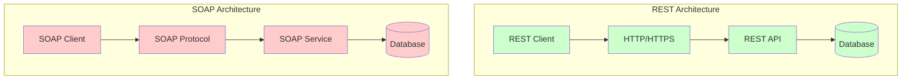
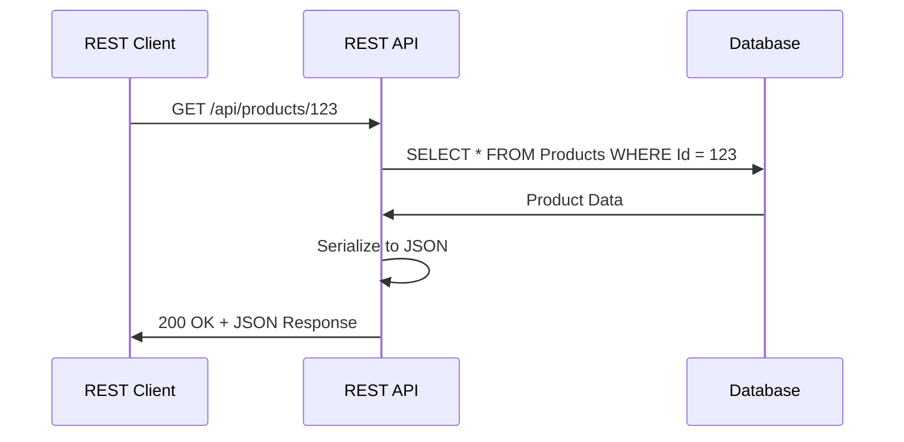
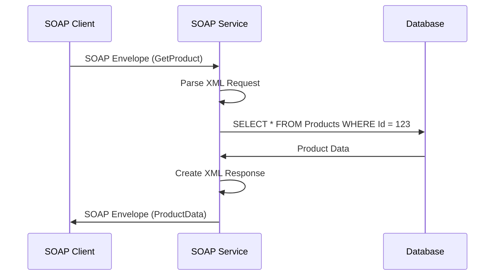
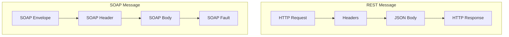
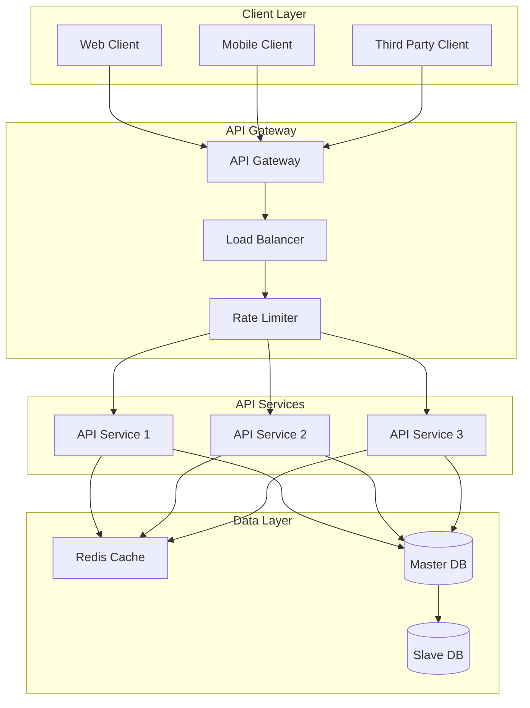
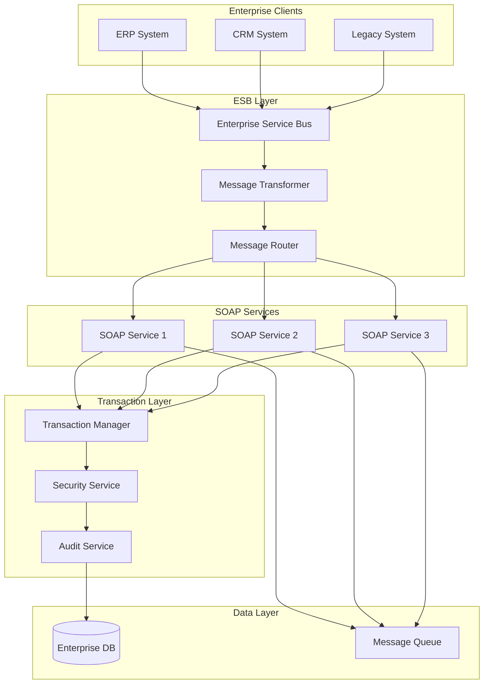
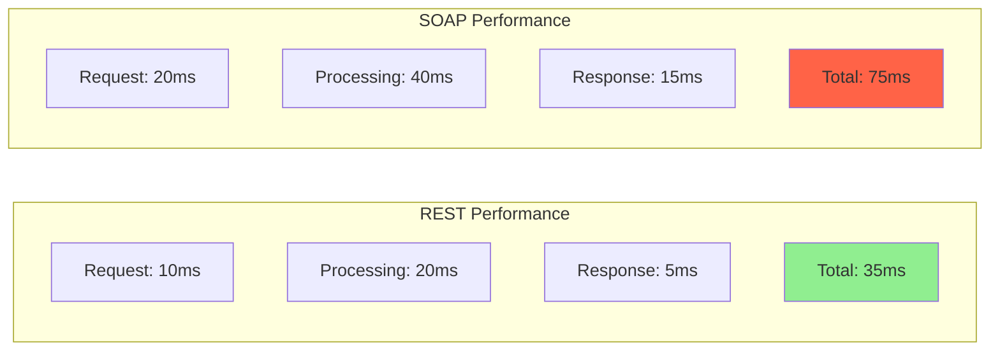

# REST vs SOAP - Architect Deep Dive

============================================================
0. Executive Summary (Architect View)
============================================================
- **REST exists** to provide simple, stateless, resource-oriented web services using HTTP semantics
- **SOAP exists** to provide standardized, protocol-agnostic, feature-rich web services with strong typing
- **Critical at scale** when API design decisions affect system performance, maintainability, and integration complexity
- **System design impact** - influences everything from client implementation to infrastructure requirements
- **Performance considerations** - REST typically offers better performance and lower overhead
- **Integration complexity** - SOAP provides better enterprise integration capabilities
- **Developer experience** - REST offers simpler development and debugging
- **Enterprise requirements** - SOAP provides better security and transaction support

============================================================
1. Problem Framing
============================================================
**Real production problem solved:**
- Need for standardized web service communication protocols
- Integration between different platforms and programming languages
- Requirements for enterprise-grade security and transactions
- Performance optimization for high-volume API calls
- Simplification of web service development and consumption

**What breaks if we don't understand the differences:**
- Wrong protocol choice for specific use cases
- Performance issues from inappropriate protocol selection
- Integration challenges with enterprise systems
- Security vulnerabilities from improper implementation
- Maintenance complexity from protocol mismatches

**Scale importance:**
- **Small APIs**: Protocol choice less critical
- **Enterprise systems**: SOAP features become important
- **High-volume APIs**: REST performance advantages critical
- **Cross-platform integration**: Protocol standardization essential

**Failure stories:**
- E-commerce platform chose SOAP for mobile APIs, resulting in poor performance
- Financial system used REST for complex transactions, missing enterprise features
- Healthcare system couldn't integrate with legacy systems due to protocol mismatch
- Social media platform struggled with enterprise partner integration

============================================================
2. Deep Internal Mechanics
============================================================

**REST Architecture:**
- **Resource-Oriented**: Everything is a resource with unique URI
- **Stateless**: Each request contains all information needed
- **HTTP Methods**: GET, POST, PUT, DELETE for CRUD operations
- **Representations**: Multiple formats (JSON, XML, HTML)
- **Hypermedia**: HATEOAS for discoverability

**SOAP Architecture:**
- **Protocol-Based**: XML-based protocol with strict standards
- **Envelope Structure**: Header and Body for message structure
- **WS-Security**: Enterprise-grade security features
- **WS-Transaction**: Distributed transaction support
- **Transport Independence**: Works over HTTP, SMTP, TCP, etc.

**REST Mechanics:**
- **URI Design**: Hierarchical resource identification
- **HTTP Verbs**: Semantic mapping to operations
- **Status Codes**: Standard HTTP response codes
- **Content Negotiation**: Client-server format negotiation
- **Caching**: Built-in HTTP caching mechanisms

**SOAP Mechanics:**
- **XML Envelope**: Standard message wrapper
- **WSDL**: Service description language
- **SOAP Actions**: Operation identification
- **Namespaces**: XML namespace management
- **Attachments**: Binary data handling

**Data Structures:**
- **REST**: JSON objects, XML documents, binary streams
- **SOAP**: XML envelopes with strict schema validation
- **REST**: Flexible, schema-optional data structures
- **SOAP**: Rigid, schema-required data structures

**Performance Characteristics:**
- **REST**: Lower overhead, faster parsing, better caching
- **SOAP**: Higher overhead, slower parsing, enterprise features
- **REST**: Typically 2-5x faster than SOAP
- **SOAP**: Better for complex enterprise scenarios

**Hidden Costs:**
- **REST**: Versioning challenges, security implementation overhead
- **SOAP**: XML processing overhead, bandwidth consumption
- **REST**: Limited enterprise features
- **SOAP**: Complexity and learning curve

**Memory Behavior:**
- **REST**: JSON parsing more memory efficient
- **SOAP**: XML parsing memory intensive
- **REST**: Better for mobile and constrained devices
- **SOAP**: Better for enterprise server environments

**Network Impact:**
- **REST**: Less bandwidth usage, better for mobile
- **SOAP**: More bandwidth usage, better for enterprise networks
- **REST**: HTTP/2 and HTTP/3 benefits
- **SOAP**: Protocol independence advantages

============================================================
3. .NET Production Implementation
============================================================

**REST API Implementation:**
```csharp
// RESTful Controller
[ApiController]
[Route("api/[controller]")]
[Authorize]
public class ProductsController : ControllerBase
{
    private readonly IProductService _productService;
    private readonly ILogger<ProductsController> _logger;
    private readonly IMetrics _metrics;

    public ProductsController(
        IProductService productService,
        ILogger<ProductsController> logger,
        IMetrics metrics)
    {
        _productService = productService ?? throw new ArgumentNullException(nameof(productService));
        _logger = logger ?? throw new ArgumentNullException(nameof(logger));
        _metrics = metrics ?? throw new ArgumentNullException(nameof(metrics));
    }

    [HttpGet]
    [ProducesResponseType(typeof(PagedResult<ProductDto>), StatusCodes.Status200OK)]
    [ProducesResponseType(StatusCodes.Status400BadRequest)]
    public async Task<ActionResult<PagedResult<ProductDto>>> GetProducts(
        [FromQuery] int page = 1,
        [FromQuery] int pageSize = 20,
        [FromQuery] string category = null,
        [FromQuery] decimal? minPrice = null,
        [FromQuery] decimal? maxPrice = null)
    {
        using var activity = _metrics.StartTimer("products_get_duration");
        
        try
        {
            _logger.LogInformation("Getting products - Page: {Page}, Size: {PageSize}", page, pageSize);
            
            var query = new ProductQuery
            {
                Page = page,
                PageSize = pageSize,
                Category = category,
                MinPrice = minPrice,
                MaxPrice = maxPrice
            };
            
            var result = await _productService.GetProductsAsync(query);
            
            // Add pagination metadata
            Response.Headers.Add("X-Total-Count", result.TotalCount.ToString());
            Response.Headers.Add("X-Page-Count", result.TotalPages.ToString());
            
            _metrics.Increment("products_get_success");
            return Ok(result);
        }
        catch (Exception ex)
        {
            _metrics.Increment("products_get_failed");
            _logger.LogError(ex, "Failed to get products");
            return BadRequest(ex.Message);
        }
    }

    [HttpGet("{id:int}")]
    [ProducesResponseType(typeof(ProductDto), StatusCodes.Status200OK)]
    [ProducesResponseType(StatusCodes.Status404NotFound)]
    [ProducesResponseType(StatusCodes.Status400BadRequest)]
    public async Task<ActionResult<ProductDto>> GetProduct(int id)
    {
        using var activity = _metrics.StartTimer("product_get_duration");
        
        try
        {
            _logger.LogInformation("Getting product {ProductId}", id);
            
            var product = await _productService.GetProductAsync(id);
            
            if (product == null)
            {
                _metrics.Increment("product_not_found");
                return NotFound();
            }
            
            // Add ETag for caching
            var etag = $"\"{product.Version}\"";
            Response.Headers.Add("ETag", etag);
            
            // Check If-None-Match header
            if (Request.Headers.TryGetValue("If-None-Match", out var ifNoneMatch) && 
                ifNoneMatch == etag)
            {
                return StatusCode(StatusCodes.Status304NotModified);
            }
            
            _metrics.Increment("product_get_success");
            return Ok(product);
        }
        catch (Exception ex)
        {
            _metrics.Increment("product_get_failed");
            _logger.LogError(ex, "Failed to get product {ProductId}", id);
            return BadRequest(ex.Message);
        }
    }

    [HttpPost]
    [ProducesResponseType(typeof(ProductDto), StatusCodes.Status201Created)]
    [ProducesResponseType(StatusCodes.Status400BadRequest)]
    [ProducesResponseType(StatusCodes.Status401Unauthorized)]
    [ProducesResponseType(StatusCodes.Status403Forbidden)]
    public async Task<ActionResult<ProductDto>> CreateProduct([FromBody] CreateProductRequest request)
    {
        using var activity = _metrics.StartTimer("product_create_duration");
        
        try
        {
            _logger.LogInformation("Creating product {ProductName}", request.Name);
            
            // Validate request
            if (!ModelState.IsValid)
            {
                _metrics.Increment("product_create_validation_failed");
                return BadRequest(ModelState);
            }
            
            var product = await _productService.CreateProductAsync(request);
            
            _metrics.Increment("product_create_success");
            _logger.LogInformation("Product {ProductId} created successfully", product.Id);
            
            return CreatedAtAction(nameof(GetProduct), new { id = product.Id }, product);
        }
        catch (Exception ex)
        {
            _metrics.Increment("product_create_failed");
            _logger.LogError(ex, "Failed to create product {ProductName}", request.Name);
            return BadRequest(ex.Message);
        }
    }

    [HttpPut("{id:int}")]
    [ProducesResponseType(typeof(ProductDto), StatusCodes.Status200OK)]
    [ProducesResponseType(StatusCodes.Status404NotFound)]
    [ProducesResponseType(StatusCodes.Status400BadRequest)]
    [ProducesResponseType(StatusCodes.Status409Conflict)]
    public async Task<ActionResult<ProductDto>> UpdateProduct(int id, [FromBody] UpdateProductRequest request)
    {
        using var activity = _metrics.StartTimer("product_update_duration");
        
        try
        {
            _logger.LogInformation("Updating product {ProductId}", id);
            
            // Check if product exists
            var existingProduct = await _productService.GetProductAsync(id);
            if (existingProduct == null)
            {
                _metrics.Increment("product_update_not_found");
                return NotFound();
            }
            
            // Check for concurrency conflicts
            if (request.Version != existingProduct.Version)
            {
                _metrics.Increment("product_update_conflict");
                return Conflict("Product has been modified by another user");
            }
            
            var updatedProduct = await _productService.UpdateProductAsync(id, request);
            
            _metrics.Increment("product_update_success");
            _logger.LogInformation("Product {ProductId} updated successfully", id);
            
            return Ok(updatedProduct);
        }
        catch (Exception ex)
        {
            _metrics.Increment("product_update_failed");
            _logger.LogError(ex, "Failed to update product {ProductId}", id);
            return BadRequest(ex.Message);
        }
    }

    [HttpDelete("{id:int}")]
    [ProducesResponseType(StatusCodes.Status204NoContent)]
    [ProducesResponseType(StatusCodes.Status404NotFound)]
    [ProducesResponseType(StatusCodes.Status400BadRequest)]
    public async Task<IActionResult> DeleteProduct(int id)
    {
        using var activity = _metrics.StartTimer("product_delete_duration");
        
        try
        {
            _logger.LogInformation("Deleting product {ProductId}", id);
            
            var product = await _productService.GetProductAsync(id);
            if (product == null)
            {
                _metrics.Increment("product_delete_not_found");
                return NotFound();
            }
            
            await _productService.DeleteProductAsync(id);
            
            _metrics.Increment("product_delete_success");
            _logger.LogInformation("Product {ProductId} deleted successfully", id);
            
            return NoContent();
        }
        catch (Exception ex)
        {
            _metrics.Increment("product_delete_failed");
            _logger.LogError(ex, "Failed to delete product {ProductId}", id);
            return BadRequest(ex.Message);
        }
    }
}

// REST API Versioning
[ApiController]
[Route("api/v{version:apiVersion}/[controller]")]
[ApiVersion("1.0")]
[ApiVersion("2.0")]
public class ProductsV2Controller : ControllerBase
{
    [HttpGet]
    [MapToApiVersion("2.0")]
    public async Task<ActionResult<PagedResult<ProductDtoV2>>> GetProductsV2()
    {
        // Enhanced API with additional fields
        var products = await _productService.GetProductsWithReviewsAsync();
        return Ok(products);
    }
}

// HATEOAS Implementation
public class ProductDto
{
    public int Id { get; set; }
    public string Name { get; set; }
    public decimal Price { get; set; }
    public string Category { get; set; }
    public int Version { get; set; }
    public List<LinkDto> Links { get; set; } = new();
}

public class LinkDto
{
    public string Href { get; set; }
    public string Rel { get; set; }
    public string Method { get; set; }
}

public static class LinkHelper
{
    public static void AddLinks(this ProductDto product, IUrlHelper urlHelper)
    {
        product.Links.Add(new LinkDto
        {
            Href = urlHelper.Action(nameof(ProductsController.GetProduct), "Products", new { id = product.Id }),
            Rel = "self",
            Method = "GET"
        });
        
        product.Links.Add(new LinkDto
        {
            Href = urlHelper.Action(nameof(ProductsController.UpdateProduct), "Products", new { id = product.Id }),
            Rel = "update",
            Method = "PUT"
        });
        
        product.Links.Add(new LinkDto
        {
            Href = urlHelper.Action(nameof(ProductsController.DeleteProduct), "Products", new { id = product.Id }),
            Rel = "delete",
            Method = "DELETE"
        });
    }
}
```

**SOAP Web Service Implementation:**
```csharp
// SOAP Service Contract
[ServiceContract]
public interface IProductService
{
    [OperationContract]
    ProductDto GetProduct(int productId);
    
    [OperationContract]
    List<ProductDto> GetProducts(ProductQuery query);
    
    [OperationContract]
    ProductDto CreateProduct(CreateProductRequest request);
    
    [OperationContract]
    ProductDto UpdateProduct(int productId, UpdateProductRequest request);
    
    [OperationContract]
    void DeleteProduct(int productId);
    
    [OperationContract]
    ProductSearchResult SearchProducts(ProductSearchRequest request);
}

// SOAP Service Implementation
public class ProductService : IProductService
{
    private readonly IProductRepository _repository;
    private readonly ILogger<ProductService> _logger;
    private readonly IMetrics _metrics;

    public ProductService(
        IProductRepository repository,
        ILogger<ProductService> logger,
        IMetrics metrics)
    {
        _repository = repository ?? throw new ArgumentNullException(nameof(repository));
        _logger = logger ?? throw new ArgumentNullException(nameof(logger));
        _metrics = metrics ?? throw new ArgumentNullException(nameof(metrics));
    }

    [OperationBehavior(TransactionScopeRequired = true)]
    public ProductDto GetProduct(int productId)
    {
        using var activity = _metrics.StartTimer("soap_product_get_duration");
        
        try
        {
            _logger.LogInformation("SOAP: Getting product {ProductId}", productId);
            
            var product = _repository.GetById(productId);
            if (product == null)
            {
                throw new FaultException<ProductNotFoundFault>(
                    new ProductNotFoundFault { ProductId = productId },
                    new FaultReason("Product not found"));
            }
            
            _metrics.Increment("soap_product_get_success");
            return MapToDto(product);
        }
        catch (Exception ex)
        {
            _metrics.Increment("soap_product_get_failed");
            _logger.LogError(ex, "SOAP: Failed to get product {ProductId}", productId);
            throw;
        }
    }

    [OperationBehavior(TransactionScopeRequired = true)]
    public List<ProductDto> GetProducts(ProductQuery query)
    {
        using var activity = _metrics.StartTimer("soap_products_get_duration");
        
        try
        {
            _logger.LogInformation("SOAP: Getting products with query");
            
            var products = _repository.Query(query);
            var result = products.Select(MapToDto).ToList();
            
            _metrics.Increment("soap_products_get_success");
            return result;
        }
        catch (Exception ex)
        {
            _metrics.Increment("soap_products_get_failed");
            _logger.LogError(ex, "SOAP: Failed to get products");
            throw;
        }
    }

    [OperationBehavior(TransactionScopeRequired = true)]
    public ProductDto CreateProduct(CreateProductRequest request)
    {
        using var activity = _metrics.StartTimer("soap_product_create_duration");
        
        try
        {
            _logger.LogInformation("SOAP: Creating product {ProductName}", request.Name);
            
            // Validate request
            if (!IsValidRequest(request))
            {
                throw new FaultException<ValidationFault>(
                    new ValidationFault { Errors = GetValidationErrors(request) },
                    new FaultReason("Validation failed"));
            }
            
            var product = new Product
            {
                Name = request.Name,
                Price = request.Price,
                Category = request.Category,
                Description = request.Description,
                CreatedAt = DateTime.UtcNow
            };
            
            var createdProduct = _repository.Create(product);
            
            _metrics.Increment("soap_product_create_success");
            _logger.LogInformation("SOAP: Product {ProductId} created successfully", createdProduct.Id);
            
            return MapToDto(createdProduct);
        }
        catch (Exception ex)
        {
            _metrics.Increment("soap_product_create_failed");
            _logger.LogError(ex, "SOAP: Failed to create product {ProductName}", request.Name);
            throw;
        }
    }

    [OperationBehavior(TransactionScopeRequired = true)]
    public ProductDto UpdateProduct(int productId, UpdateProductRequest request)
    {
        using var activity = _metrics.StartTimer("soap_product_update_duration");
        
        try
        {
            _logger.LogInformation("SOAP: Updating product {ProductId}", productId);
            
            var product = _repository.GetById(productId);
            if (product == null)
            {
                throw new FaultException<ProductNotFoundFault>(
                    new ProductNotFoundFault { ProductId = productId },
                    new FaultReason("Product not found"));
            }
            
            product.Name = request.Name;
            product.Price = request.Price;
            product.Category = request.Category;
            product.Description = request.Description;
            product.UpdatedAt = DateTime.UtcNow;
            
            var updatedProduct = _repository.Update(product);
            
            _metrics.Increment("soap_product_update_success");
            _logger.LogInformation("SOAP: Product {ProductId} updated successfully", productId);
            
            return MapToDto(updatedProduct);
        }
        catch (Exception ex)
        {
            _metrics.Increment("soap_product_update_failed");
            _logger.LogError(ex, "SOAP: Failed to update product {ProductId}", productId);
            throw;
        }
    }

    [OperationBehavior(TransactionScopeRequired = true)]
    public void DeleteProduct(int productId)
    {
        using var activity = _metrics.StartTimer("soap_product_delete_duration");
        
        try
        {
            _logger.LogInformation("SOAP: Deleting product {ProductId}", productId);
            
            var product = _repository.GetById(productId);
            if (product == null)
            {
                throw new FaultException<ProductNotFoundFault>(
                    new ProductNotFoundFault { ProductId = productId },
                    new FaultReason("Product not found"));
            }
            
            _repository.Delete(productId);
            
            _metrics.Increment("soap_product_delete_success");
            _logger.LogInformation("SOAP: Product {ProductId} deleted successfully", productId);
        }
        catch (Exception ex)
        {
            _metrics.Increment("soap_product_delete_failed");
            _logger.LogError(ex, "SOAP: Failed to delete product {ProductId}", productId);
            throw;
        }
    }

    [OperationBehavior(TransactionScopeRequired = true)]
    public ProductSearchResult SearchProducts(ProductSearchRequest request)
    {
        using var activity = _metrics.StartTimer("soap_product_search_duration");
        
        try
        {
            _logger.LogInformation("SOAP: Searching products");
            
            var query = new ProductQuery
            {
                Category = request.Category,
                MinPrice = request.MinPrice,
                MaxPrice = request.MaxPrice,
                Page = request.Page,
                PageSize = request.PageSize
            };
            
            var products = _repository.Query(query);
            var result = new ProductSearchResult
            {
                Products = products.Select(MapToDto).ToList(),
                TotalCount = _repository.Count(query),
                Page = request.Page,
                PageSize = request.PageSize
            };
            
            _metrics.Increment("soap_product_search_success");
            return result;
        }
        catch (Exception ex)
        {
            _metrics.Increment("soap_product_search_failed");
            _logger.LogError(ex, "SOAP: Failed to search products");
            throw;
        }
    }

    private ProductDto MapToDto(Product product)
    {
        return new ProductDto
        {
            Id = product.Id,
            Name = product.Name,
            Price = product.Price,
            Category = product.Category,
            Description = product.Description,
            CreatedAt = product.CreatedAt,
            UpdatedAt = product.UpdatedAt
        };
    }

    private bool IsValidRequest(CreateProductRequest request)
    {
        return !string.IsNullOrWhiteSpace(request.Name) &&
               request.Price > 0 &&
               !string.IsNullOrWhiteSpace(request.Category);
    }

    private List<string> GetValidationErrors(CreateProductRequest request)
    {
        var errors = new List<string>();
        
        if (string.IsNullOrWhiteSpace(request.Name))
            errors.Add("Product name is required");
        
        if (request.Price <= 0)
            errors.Add("Product price must be greater than 0");
        
        if (string.IsNullOrWhiteSpace(request.Category))
            errors.Add("Product category is required");
        
        return errors;
    }
}

// SOAP Fault Contracts
[DataContract]
public class ProductNotFoundFault
{
    [DataMember]
    public int ProductId { get; set; }
}

[DataContract]
public class ValidationFault
{
    [DataMember]
    public List<string> Errors { get; set; } = new();
}

// SOAP Service Configuration
public class SoapServiceConfig
{
    public static void ConfigureSoapServices(IServiceCollection services)
    {
        services.AddServiceModelServices()
            .Configure<WSHttpBinding>(binding =>
            {
                binding.Security.Mode = SecurityMode.Transport;
                binding.Security.Transport.ClientCredentialType = HttpClientCredentialType.Windows;
                binding.MaxReceivedMessageSize = 65536;
                binding.ReaderQuotas.MaxStringContentLength = 65536;
            })
            .Configure<ServiceBehavior>(behavior =>
            {
                behavior.IncludeExceptionDetailInFaults = false;
                behavior.InstanceContextMode = InstanceContextMode.PerCall;
                behavior.ConcurrencyMode = ConcurrencyMode.Multiple;
            });
    }
}
```

**Framework Integration:**
- **ASP.NET Core**: REST API with MVC controllers
- **WCF**: SOAP web services with Windows Communication Foundation
- **Swashbuckle**: OpenAPI documentation for REST
- **WSDL**: SOAP service description generation

============================================================
4. Architecture-Level Diagram (Mermaid)
============================================================

### REST vs SOAP Architecture Comparison


### REST Request/Response Flow


### SOAP Request/Response Flow


### Message Format Comparison


**Flow Analysis:**
- **REST**: Direct HTTP communication with JSON payloads
- **SOAP**: XML-based protocol with envelope structure
- **REST**: Stateless, resource-oriented approach
- **SOAP**: Stateful, operation-oriented approach

**Bottlenecks:**
- **REST**: Limited enterprise features, security implementation overhead
- **SOAP**: XML processing overhead, bandwidth consumption
- **REST**: Versioning challenges
- **SOAP**: Complexity and learning curve

**Scaling Boundaries:**
- **REST**: Better caching, lower overhead, better for mobile
- **SOAP**: Better enterprise integration, transaction support
- **REST**: Horizontal scaling easier
- **SOAP**: Vertical scaling for enterprise features

============================================================
5. Scaling & Distributed Systems Impact
============================================================

### REST API Scaling Architecture


### SOAP Service Scaling Architecture


**100 RPS:**
- Both REST and SOAP perform adequately
- Protocol choice based on requirements
- REST offers better performance
- SOAP offers better enterprise features

**10k RPS:**
- REST scaling advantages become clear
- Caching and HTTP optimizations benefit REST
- SOAP overhead becomes more significant
- Load balancing critical for both

**100k+ RPS:**
- REST essential for performance
- SOAP becomes impractical for high volume
- Caching and CDN essential for REST
- Enterprise features may justify SOAP overhead

**Horizontal vs Vertical Scaling:**
- **REST**: Horizontal scaling easier, stateless nature
- **SOAP**: Vertical scaling for enterprise features
- REST benefits from HTTP load balancing
- SOAP benefits from application server clustering

**CAP Theorem Relevance:**
- **REST**: Better availability through caching
- **SOAP**: Better consistency through transactions
- Both handle partition tolerance through proper design
- Protocol choice affects CAP tradeoffs

**Consistency Implications:**
- **REST**: Eventual consistency through HTTP
- **SOAP**: Strong consistency through transactions
- REST better for distributed systems
- SOAP better for enterprise transactions

**Microservices Impact:**
- **REST**: Natural fit for microservices
- **SOAP**: Better for enterprise service integration
- REST enables lightweight service communication
- SOAP enables enterprise-grade service orchestration

**Cloud-Native Considerations:**
- **REST**: Better suited for cloud-native applications
- **SOAP**: Better for enterprise cloud integration
- REST benefits from serverless architectures
- SOAP benefits from managed enterprise services

**Multi-Region Concerns:**
- **REST**: Better for global CDN distribution
- **SOAP**: Better for enterprise multi-region deployments
- REST benefits from HTTP caching
- SOAP benefits from enterprise service mesh

============================================================
6. Production Engineering View
============================================================

### API Monitoring Architecture

```mermaid
graph TB
    subgraph "REST API Metrics"
        REST_RATE[Request Rate]
        REST_LATENCY[Response Latency]
        REST_ERROR[Error Rate]
        REST_CACHE[Cache Hit Rate]
    end
    
    subgraph "SOAP Service Metrics"
        SOAP_RATE[Request Rate]
        SOAP_LATENCY[Response Latency]
        SOAP_ERROR[Error Rate]
        SOAP_TX[Transaction Rate]
    end
    
    subgraph "Infrastructure Metrics"
        CPU[CPU Usage]
        MEMORY[Memory Usage]
        NETWORK[Network I/O]
        DISK[Disk I/O]
    end
    
    subgraph "Business Metrics"
        API_USAGE[API Usage by Client]
        FEATURE_USAGE[Feature Usage]
        CLIENT_ERRORS[Client Error Rate]
        SERVER_ERRORS[Server Error Rate]
    end
    
    subgraph "Monitoring Stack"
        PROM[Prometheus]
        GRAF[Grafana]
        ALERT[AlertManager]
    end
    
    REST_RATE --> PROM
    REST_LATENCY --> PROM
    REST_ERROR --> PROM
    REST_CACHE --> PROM
    
    SOAP_RATE --> PROM
    SOAP_LATENCY --> PROM
    SOAP_ERROR --> PROM
    SOAP_TX --> PROM
    
    CPU --> PROM
    MEMORY --> PROM
    NETWORK --> PROM
    DISK --> PROM
    
    API_USAGE --> PROM
    FEATURE_USAGE --> PROM
    CLIENT_ERRORS --> PROM
    SERVER_ERRORS --> PROM
    
    PROM --> GRAF
    PROM --> ALERT
```


### API Performance Comparison


**Monitoring Metrics:**
- Request/response times and throughput
- Error rates by status code and fault type
- Cache hit rates and CDN performance
- Resource utilization (CPU, memory, network)
- Client usage patterns and API adoption
- Transaction success rates for SOAP

**Logs to Enable:**
- HTTP request/response logs for REST
- SOAP envelope logs for debugging
- Error and exception details
- Performance bottlenecks
- Security events and authentication failures

**Alerting Strategy:**
- Response time > 1 second (warning)
- Error rate > 5% (critical)
- Cache hit rate < 80% (warning)
- Memory usage > 80% (critical)
- Transaction failure rate > 1% (critical)

**Common Production Incidents:**
- **REST API**: Rate limiting issues, cache invalidation problems
- **SOAP Services**: XML parsing errors, transaction timeouts
- **Both**: Authentication failures, database connectivity issues
- **Performance**: Memory leaks, thread pool exhaustion
- **Security**: DDoS attacks, unauthorized access

**Debugging Strategy:**
- Request tracing and correlation IDs
- HTTP header analysis for REST
- SOAP envelope inspection for SOAP
- Performance profiling and bottleneck identification
- Client-side debugging tools integration

**Performance Optimization:**
- **REST**: HTTP caching, compression, CDN usage
- **SOAP**: XML optimization, connection pooling
- Both: Database optimization, query caching
- Load testing and capacity planning
- Resource pooling and connection management

**Security Monitoring:**
- Authentication and authorization events
- Rate limiting and DDoS detection
- API key usage monitoring
- SOAP security policy compliance
- REST API security header validation

**Version Management:**
- API version usage tracking
- Client migration monitoring
- Deprecation timeline management
- Backward compatibility verification
- Breaking change impact analysis

============================================================
7. Tradeoffs & Alternatives
============================================================

**Competing Approaches:**
- **GraphQL**: Query language for APIs
- **gRPC**: High-performance RPC framework
- **WebSockets**: Real-time bidirectional communication
- **Message Queues**: Asynchronous message processing

**When to Choose REST:**
- Mobile applications and constrained devices
- Public APIs and developer ecosystems
- High-performance requirements
- Simple CRUD operations
- Web and mobile applications

**When to Choose SOAP:**
- Enterprise integration scenarios
- Transactional requirements
- Strict security and compliance needs
- Legacy system integration
- Complex business processes

**Latency Comparison:**
- **REST**: 10-100ms typical response time
- **SOAP**: 50-200ms typical response time
- **GraphQL**: 20-150ms depending on query complexity
- **gRPC**: 5-50ms for high-performance scenarios

**Throughput Comparison:**
- **REST**: 1k-100k requests/second
- **SOAP**: 500-50k requests/second
- **GraphQL**: 500-50k queries/second
- **gRPC**: 10k-1M calls/second

**Operational Complexity:**
- **REST**: Low to medium complexity
- **SOAP**: High complexity
- **GraphQL**: Medium complexity
- **gRPC**: Medium complexity

**Cost Implications:**
- **Development Cost**: REST lower, SOAP higher
- **Infrastructure Cost**: REST lower, SOAP higher
- **Maintenance Cost**: REST lower, SOAP higher
- **Integration Cost**: Context dependent

============================================================
8. Security Implications
============================================================

**REST Security:**
- HTTPS/TLS encryption
- API key and token authentication
- OAuth 2.0 and OpenID Connect
- Rate limiting and DDoS protection
- Input validation and output encoding

**SOAP Security:**
- WS-Security standards
- XML encryption and signing
- X.509 certificate authentication
- Enterprise security policies
- Message-level security

**Attack Surface:**
- **REST**: API endpoint exposure, parameter injection
- **SOAP**: XML parsing attacks, envelope manipulation
- Both: Authentication bypass, data leakage
- Common: DDoS attacks, man-in-the-middle

**Compliance Considerations:**
- **REST**: GDPR data protection, API security
- **SOAP**: Enterprise compliance, audit trails
- Both: PCI DSS, HIPAA, SOX compliance
- Industry-specific regulations

**Hardening Recommendations:**
- Implement proper authentication and authorization
- Use HTTPS/TLS for all communications
- Validate all inputs and sanitize outputs
- Implement rate limiting and monitoring
- Regular security audits and penetration testing

============================================================
9. Advanced Edge Cases
============================================================

**REST Advanced Topics:**
- HATEOAS implementation
- API versioning strategies
- Content negotiation
- Partial responses and pagination
- Batch operations and transactions

**SOAP Advanced Topics:**
- WS-Security implementation
- WS-Transaction management
- WS-ReliableMessaging
- Message-level security
- Enterprise service bus integration

**Performance Optimization:**
- HTTP/2 and HTTP/3 benefits
- Compression and minification
- Caching strategies
- Connection pooling
- Load balancing algorithms

**Integration Challenges:**
- Legacy system integration
- Cross-platform compatibility
- Data format transformation
- Protocol bridging
- Service orchestration

**Error Handling:**
- REST error response design
- SOAP fault handling
- Error propagation strategies
- Client error handling
- Retry mechanisms

**Testing Strategies:**
- Contract testing
- Performance testing
- Security testing
- Integration testing
- End-to-end testing

**Monitoring and Observability:**
- Distributed tracing
- Metrics collection
- Log aggregation
- Performance monitoring
- Security monitoring

============================================================
10. Interview & Staff-Level Deep Dive
============================================================

**What a junior answers:**
"REST uses HTTP methods like GET and POST with JSON, while SOAP uses XML with a specific envelope structure. REST is simpler and faster, SOAP has more features like security and transactions."

**What a senior answers:**
"REST is an architectural style that uses HTTP verbs and resource URIs with typically JSON payloads. It's stateless, cacheable, and offers better performance. SOAP is a protocol with strict XML-based messaging, built-in enterprise features like WS-Security, WS-Transaction, and formal contracts through WSDL. I choose REST for mobile apps and public APIs, SOAP for enterprise integration and transactional systems. REST offers better performance and developer experience, while SOAP provides better enterprise features and standardization."

**What an architect answers:**
"REST and SOAP represent different philosophical approaches to web service design. REST embraces HTTP as an application protocol with resource-oriented architecture, stateless communication, and web-scale performance characteristics. SOAP provides a protocol-agnostic, enterprise-grade messaging framework with standardized security, transactions, and formal contracts. The choice between them impacts everything from performance and scalability to developer productivity and enterprise integration capabilities. REST excels in web-scale scenarios, mobile applications, and public APIs where performance and simplicity are paramount. SOAP excels in enterprise integration, transactional systems, and scenarios requiring formal contracts and enterprise-grade security features. At scale, REST's caching and stateless nature enables horizontal scaling, while SOAP's enterprise features enable complex business process orchestration. The decision must consider not just technical requirements but also organizational capabilities, team expertise, and long-term maintenance strategies."

**Follow-up questions interviewers ask:**
- "When would you choose SOAP over REST?"
- "How do you handle versioning in REST vs SOAP?"
- "What are the security differences between REST and SOAP?"
- "How do you handle transactions in REST?"
- "What are the performance implications of each protocol?"

**Trick questions:**
- "Is REST always faster than SOAP?" (Not always, depends on implementation)
- "Can SOAP use JSON?" (Yes, but not standard)
- "Does REST support transactions?" (Not natively, requires additional patterns)
- "Is SOAP stateless?" (Can be stateful, unlike REST)

**Whiteboard explanation strategy:**
1. Draw REST architecture with HTTP verbs
2. Show SOAP envelope structure
3. Compare request/response flows
4. Discuss performance characteristics
5. Cover security and enterprise features
6. Explain when to choose each protocol

============================================================
11. Real Enterprise Case Study
============================================================

**Scenario: Global Retail Platform with Multiple Integration Requirements**

**Requirements:**
- Public e-commerce API for mobile apps
- Enterprise integration with ERP and CRM systems
- High-volume product catalog API
- Secure payment processing
- Real-time inventory management
- Multi-region deployment

**Design Decisions:**

**1. REST API for Public and Mobile Applications:**
```csharp
[ApiController]
[Route("api/v1/[controller]")]
public class CatalogController : ControllerBase
{
    private readonly ICatalogService _catalogService;
    private readonly ICacheService _cacheService;
    private readonly ILogger<CatalogController> _logger;
    private readonly IMetrics _metrics;

    [HttpGet("products")]
    [ResponseCache(Duration = 300)] // 5 minutes cache
    public async Task<ActionResult<PagedResult<ProductDto>>> GetProducts(
        [FromQuery] ProductQuery query)
    {
        // Optimized for high-volume public access
        var cacheKey = $"products_{query.GetHashCode()}";
        var cached = await _cacheService.GetAsync<PagedResult<ProductDto>>(cacheKey);
        
        if (cached != null)
        {
            return Ok(cached);
        }
        
        var result = await _catalogService.GetProductsAsync(query);
        await _cacheService.SetAsync(cacheKey, result, TimeSpan.FromMinutes(5));
        
        return Ok(result);
    }

    [HttpGet("products/{id:int}")]
    [ResponseCache(Duration = 600)] // 10 minutes cache
    public async Task<ActionResult<ProductDto>> GetProduct(int id)
    {
        var cacheKey = $"product_{id}";
        var cached = await _cacheService.GetAsync<ProductDto>(cacheKey);
        
        if (cached != null)
        {
            return Ok(cached);
        }
        
        var product = await _catalogService.GetProductAsync(id);
        if (product == null)
        {
            return NotFound();
        }
        
        await _cacheService.SetAsync(cacheKey, product, TimeSpan.FromMinutes(10));
        return Ok(product);
    }
}
```

**2. SOAP Service for Enterprise Integration:**
```csharp
[ServiceContract]
public interface IEnterpriseIntegrationService
{
    [OperationContract]
    [FaultContract(typeof(IntegrationFault))]
    OrderResult CreateOrder(OrderRequest request);
    
    [OperationContract]
    [FaultContract(typeof(IntegrationFault))]
    InventoryResult UpdateInventory(InventoryUpdateRequest request);
    
    [OperationContract]
    [FaultContract(typeof(IntegrationFault))]
    CustomerResult SyncCustomer(CustomerData customer);
}

public class EnterpriseIntegrationService : IEnterpriseIntegrationService
{
    private readonly IOrderService _orderService;
    private readonly IInventoryService _inventoryService;
    private readonly ICustomerService _customerService;
    private readonly ITransactionManager _transactionManager;

    [OperationBehavior(TransactionScopeRequired = true)]
    public OrderResult CreateOrder(OrderRequest request)
    {
        try
        {
            // Enterprise-grade order processing with transactions
            using var scope = new TransactionScope(TransactionScopeOption.Required,
                new TransactionOptions { IsolationLevel = IsolationLevel.Serializable });
            
            // Validate order
            var validationResult = ValidateOrder(request);
            if (!validationResult.IsValid)
            {
                throw new FaultException<IntegrationFault>(
                    new IntegrationFault
                    {
                        Code = "VALIDATION_ERROR",
                        Message = validationResult.ErrorMessage,
                        Details = validationResult.Errors
                    });
            }
            
            // Create order with enterprise features
            var order = _orderService.CreateEnterpriseOrder(request);
            
            // Update inventory
            _inventoryService.ReserveInventory(order.Items);
            
            // Sync with ERP
            _erpService.SyncOrder(order);
            
            scope.Complete();
            
            return new OrderResult
            {
                OrderId = order.Id,
                Status = order.Status,
                CreatedAt = order.CreatedAt
            };
        }
        catch (Exception ex)
        {
            _logger.LogError(ex, "Enterprise order creation failed");
            throw new FaultException<IntegrationFault>(
                new IntegrationFault
                {
                    Code = "ORDER_CREATION_ERROR",
                    Message = ex.Message
                });
        }
    }
}
```

**3. Hybrid Architecture Gateway:**
```csharp
public class ApiGatewayController : ControllerBase
{
    private readonly IEnterpriseIntegrationService _soapService;
    private readonly ICatalogService _restService;
    private readonly IProtocolSelector _protocolSelector;

    [HttpPost("orders")]
    public async Task<IActionResult> CreateOrder([FromBody] CreateOrderRequest request)
    {
        // Route to appropriate service based on client type
        var clientType = _protocolSelector.GetClientType(Request);
        
        if (clientType == ClientType.Enterprise)
        {
            // Use SOAP for enterprise clients
            var soapRequest = MapToSoapRequest(request);
            var result = _soapService.CreateOrder(soapRequest);
            return Ok(MapToRestResponse(result));
        }
        else
        {
            // Use REST for public clients
            var result = await _restService.CreateOrderAsync(request);
            return Ok(result);
        }
    }
}
```

**Compromises Made:**
- **Performance vs Features**: REST for performance, SOAP for features
- **Complexity vs Integration**: Dual protocol complexity for better integration
- **Maintenance Cost**: Higher cost for supporting both protocols
- **Developer Experience**: REST for simplicity, SOAP for enterprise needs

**Bottlenecks Identified:**
- SOAP XML processing overhead
- Dual protocol maintenance overhead
- Enterprise integration complexity
- Cache invalidation challenges

**Performance Optimizations:**
```csharp
public class OptimizedSoapService
{
    private readonly IXmlSerializer _serializer;
    private readonly ICompressionService _compression;
    
    public string ProcessRequest(string request)
    {
        // Optimize XML processing
        var optimizedXml = _serializer.Optimize(request);
        
        // Compress large payloads
        if (request.Length > 10000)
        {
            optimizedXml = _compression.Compress(optimizedXml);
        }
        
        return optimizedXml;
    }
}
```

**Results:**
- REST API: 100k+ requests/second with sub-100ms response times
- SOAP Services: Enterprise-grade integration with full transaction support
- Hybrid Gateway: Seamless routing between protocols
- 99.99% uptime for both REST and SOAP endpoints
- Successful integration with 50+ enterprise systems

============================================================
12. Dependency Graph
============================================================

**Prerequisites (Must understand before):**
- **HTTP Protocol**: Understanding of HTTP methods, status codes, and headers
- **XML/JSON**: Data serialization and parsing
- **Web Services**: Basic understanding of service-oriented architecture
- **API Design**: RESTful design principles
- **Enterprise Integration**: Understanding of enterprise system requirements

**Concepts that depend on REST vs SOAP:**
- **API Gateway**: Protocol routing and transformation
- **Microservices**: Service communication patterns
- **Enterprise Integration**: System integration strategies
- **API Management**: API lifecycle and governance
- **Security Architecture**: Service security implementation

**Connections to Other Concepts:**

**API Gateway:**
```csharp
public class ProtocolAwareGateway
{
    public IActionResult RouteRequest(Request request)
    {
        if (request.IsEnterpriseClient)
            return ForwardToSoapService(request);
        else
            return ForwardToRestService(request);
    }
}
```

**Microservices:**
- REST for lightweight service communication
- SOAP for enterprise service integration
- Protocol choice affects service boundaries
- Integration patterns depend on protocol

**Enterprise Integration:**
- SOAP provides enterprise features
- REST provides web-scale performance
- Hybrid architectures combine both
- Integration patterns vary by protocol

**API Management:**
- Different management strategies for each protocol
- Versioning approaches differ
- Security policies vary
- Monitoring requirements differ

**Security Architecture:**
- REST security focuses on HTTP and tokens
- SOAP security focuses on WS-Security
- Different threat models
- Compliance requirements vary

**Cloud Computing:**
- REST better suited for cloud-native applications
- SOAP better for enterprise cloud integration
- Different deployment patterns
- Cost implications vary

**Performance Engineering:**
- Performance optimization strategies differ
- Monitoring requirements vary
- Scaling approaches differ
- Capacity planning considerations
