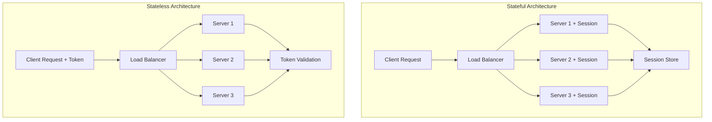
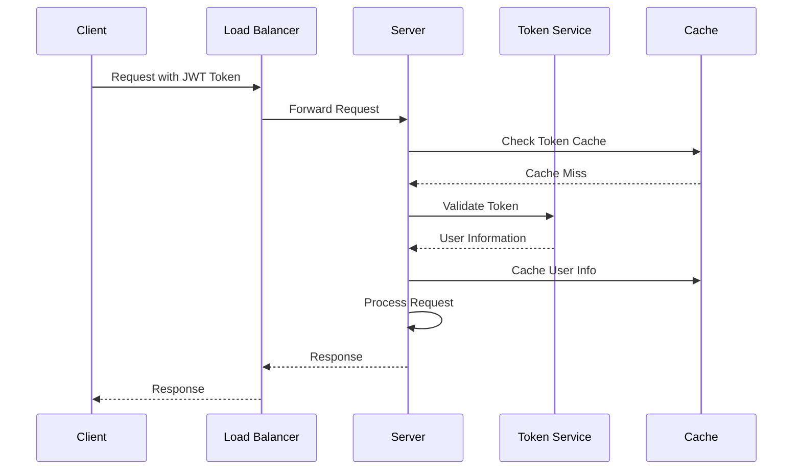
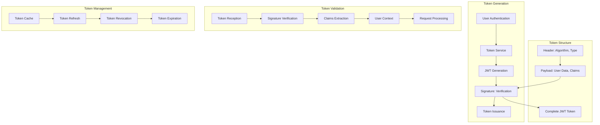
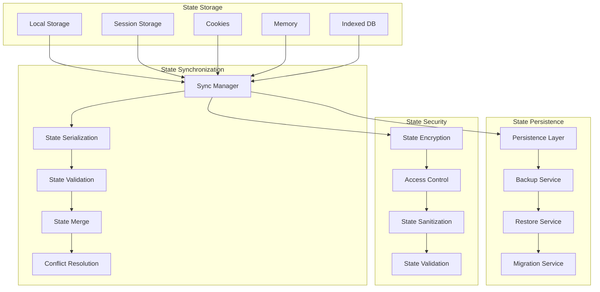
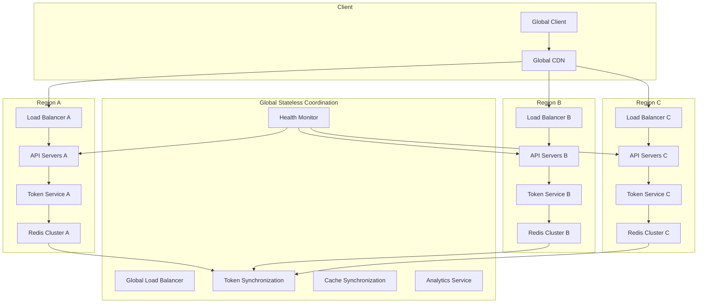
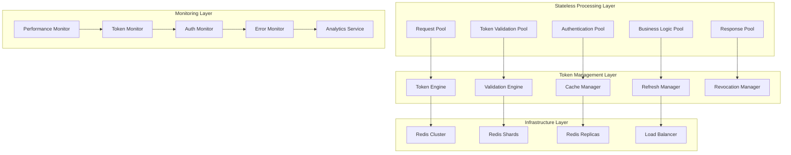
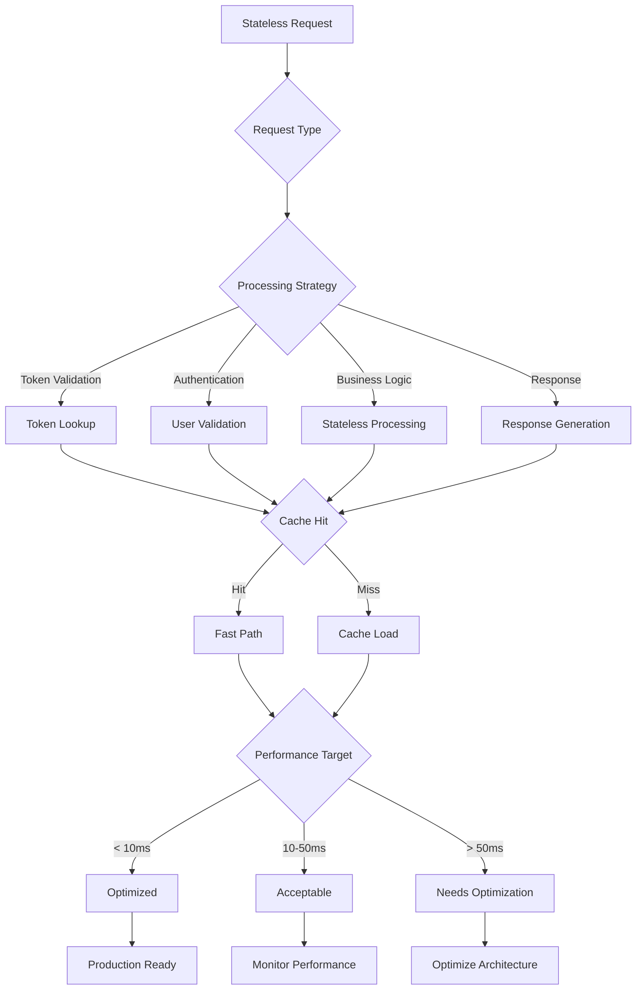
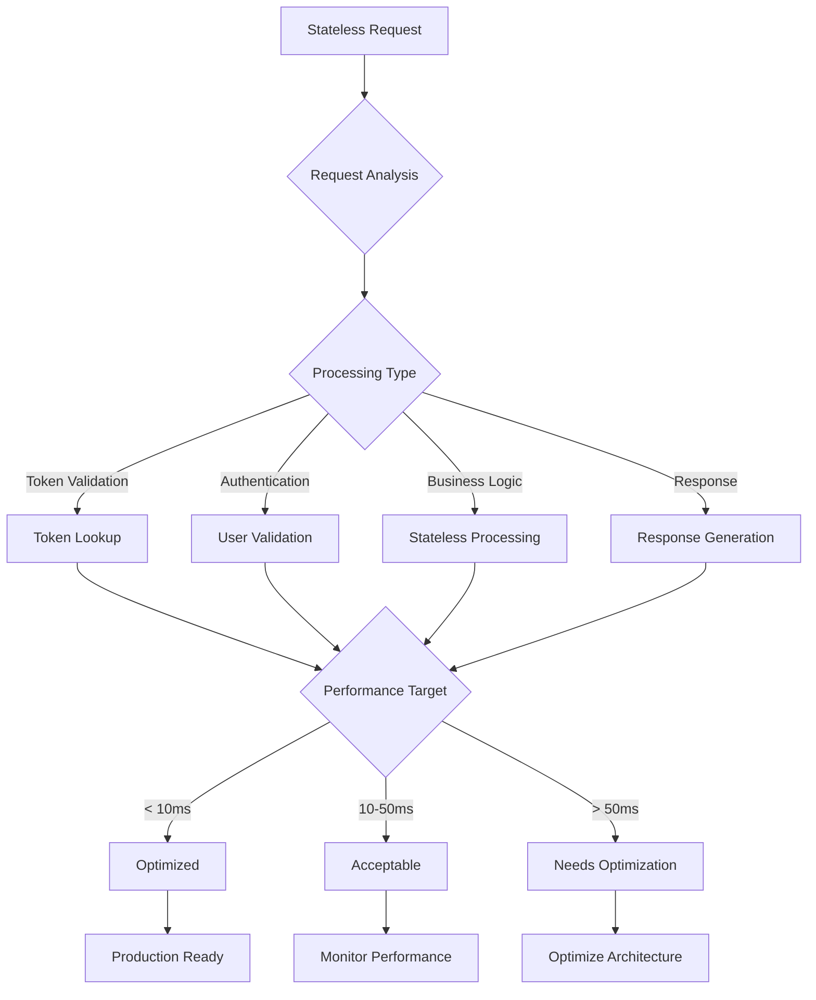
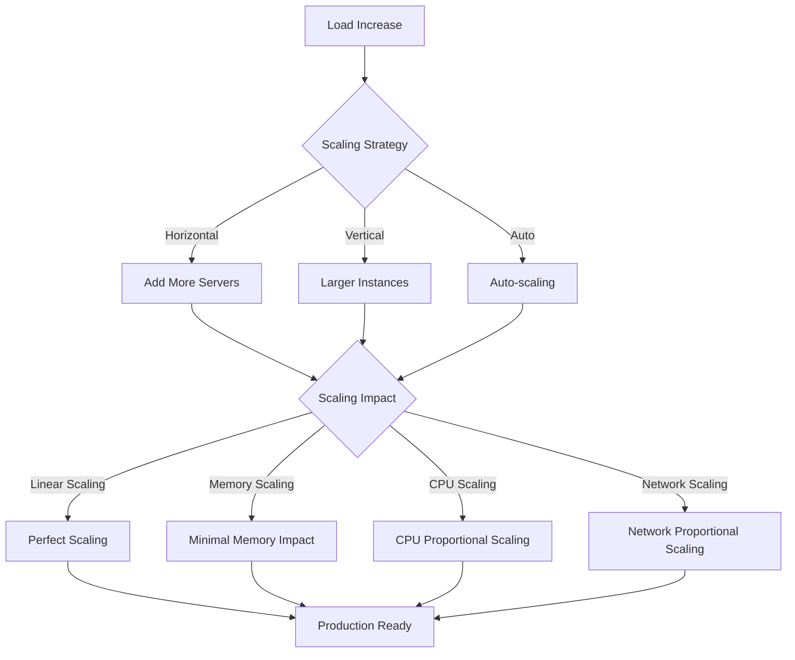

# Statelessness - Architect Deep Dive

============================================================
0. Executive Summary (Architect View)
============================================================
- **Statelessness exists** to enable scalable, resilient web applications by not storing client session state on the server
- **Critical at scale** when applications need to handle millions of concurrent users with high availability
- **System design impact** - transforms server-side session management to client-side state management
- **Scalability foundation** - enables horizontal scaling without session affinity
- **Resilience enhancement** - eliminates single points of failure from session storage
- **Performance optimization** - reduces server memory usage and improves response times
- **Cloud readiness** - enables cloud-native deployment and auto-scaling
- **Cost efficiency** - reduces infrastructure costs through better resource utilization

============================================================
1. Problem Framing
============================================================
**Real production problem solved:**
- Session storage bottlenecks in high-traffic applications
- Server crashes causing session loss and user frustration
- Load balancing complexity due to session affinity requirements
- Memory pressure from storing millions of user sessions
- Deployment and scaling limitations from server-side state

**What breaks if we don't understand statelessness:**
- Horizontal scaling limitations
- Single points of failure from session storage
- Poor performance under high load
- Complex load balancing requirements
- Inability to implement true cloud-native architecture

**Scale importance:**
- **Small applications**: Server-side sessions manageable
- **Medium applications**: Statelessness benefits become apparent
- **Large applications**: Statelessness essential for scalability
- **Enterprise systems**: Statelessness mandatory for cloud deployment

**Failure stories:**
- E-commerce platform crashed during Black Friday due to session storage overload
- Social media site had scaling issues with session affinity
- Banking application had session loss during server failures
- Gaming platform had performance issues with session management

============================================================
2. Deep Internal Mechanics
============================================================

**Statelessness Fundamentals:**
- **No Server State**: Server doesn't store client session information
- **Self-Contained Requests**: Each request contains all necessary information
- **Client-Side State**: State managed by client (cookies, tokens, local storage)
- **Stateless Protocol**: HTTP is inherently stateless
- **Scalable Architecture**: Enables horizontal scaling without session affinity

**State Management Strategies:**
- **JWT Tokens**: Self-contained tokens with user information
- **Cookies**: Client-side cookies for session data
- **Local Storage**: Browser local storage for application state
- **Session Storage**: Browser session storage for temporary data
- **URL Parameters**: State encoded in URLs

**Stateless Request Flow:**
1. **Client Request**: Client sends request with authentication token
2. **Server Validation**: Server validates token and extracts user information
3. **Request Processing**: Server processes request using extracted information
4. **Response Generation**: Server generates response with new state if needed
5. **State Update**: Client updates its state based on response

**Token-Based Statelessness:**
- **JWT Structure**: Header, payload, signature
- **Self-Contained**: Contains all necessary user information
- **Cryptographic Security**: Signed tokens prevent tampering
- **Expiration**: Token expiration for security
- **Refresh Tokens**: Secure token refresh mechanism

**Cookie-Based Statelessness:**
- **Client-Side Cookies**: Cookies stored on client
- **Signed Cookies**: Cryptographically signed cookies
- **Encrypted Cookies**: Encrypted cookie data
- **SameSite Protection**: CSRF protection through SameSite
- **Secure Flags**: HTTPS-only cookie transmission

**Local Storage Strategies:**
- **Browser Storage**: Local and session storage
- **State Serialization**: Serialization of application state
- **State Synchronization**: State synchronization across tabs
- **State Persistence**: Persistent state management
- **State Cleanup**: State cleanup and expiration

**Data Structures:**
- **Token Registry**: Token validation and revocation
- **State Cache**: Temporary state caching
- **User Context**: User context extraction
- **Request Context**: Request context management
- **Response Context**: Response context generation

**Performance Characteristics:**
- **Request Processing**: 5-20ms (no session lookup)
- **Memory Usage**: Minimal server memory usage
- **Network Overhead**: Slightly larger requests (tokens)
- **Scalability**: Linear scaling with server count
- **Latency**: Reduced latency from no session lookup

**Hidden Costs:**
- **Token Size**: Larger request size from tokens
- **Token Validation**: Cryptographic validation overhead
- **State Synchronization**: Client state synchronization complexity
- **Security Overhead**: Token security implementation
- **Debugging Complexity**: Harder debugging without server state

**Memory Behavior:**
- **Server Memory**: Minimal server memory usage
- **Client Memory**: Increased client memory usage
- **Cache Memory**: Temporary caching for performance
- **Token Storage**: Token validation cache
- **State Buffers**: Temporary state buffers

**Network Impact:**
- **Request Size**: Larger requests from tokens
- **Response Size**: Slightly larger responses
- **HTTP Headers**: Additional authentication headers
- **Cookie Size**: Larger cookie headers
- **Caching**: Improved caching effectiveness

============================================================
3. .NET Production Implementation
============================================================

**Naive Implementation (Server-Side State):**
```csharp
[ApiController]
[Route("api/[controller]")]
public class UserController : ControllerBase
{
    private readonly IUserService _userService;
    private readonly IHttpContextAccessor _httpContextAccessor;
    
    public UserController(IUserService userService, IHttpContextAccessor httpContextAccessor)
    {
        _userService = userService;
        _httpContextAccessor = httpContextAccessor;
    }
    
    [HttpGet("profile")]
    public async Task<ActionResult<UserProfile>> GetProfile()
    {
        // Server-side session state - not scalable
        var userId = HttpContext.Session.GetInt32("UserId");
        if (userId == null)
        {
            return Unauthorized();
        }
        
        var profile = await _userService.GetProfileAsync(userId.Value);
        return Ok(profile);
    }
    
    [HttpPost("update")]
    public async Task<ActionResult> UpdateProfile([FromBody] UserProfile profile)
    {
        var userId = HttpContext.Session.GetInt32("UserId");
        if (userId == null)
        {
            return Unauthorized();
        }
        
        await _userService.UpdateProfileAsync(userId.Value, profile);
        
        // Update session state
        HttpContext.Session.SetString("LastUpdated", DateTime.UtcNow.ToString());
        
        return Ok(new { Message = "Profile updated" });
    }
}
```

**Production-Ready Stateless Implementation:**
```csharp
// Statelessness Configuration
public class StatelessnessConfiguration
{
    public bool EnableJwtTokens { get; set; } = true;
    public bool EnableSignedCookies { get; set; } = true;
    public bool EnableLocalStorageSync { get; set; } = true;
    public bool EnableStateCaching { get; set; } = true;
    public TimeSpan TokenExpiration { get; set; } = TimeSpan.FromHours(1);
    public TimeSpan RefreshTokenExpiration { get; set; } = TimeSpan.FromDays(7);
    public int TokenCacheSize { get; set; } = 10000;
    public bool EnableTokenRevocation { get; set; } = true;
    public string TokenIssuer { get; set; } = "YourApp";
    public string TokenAudience { get; set; } = "YourAppUsers";
}

// Stateless Authentication Service
public interface IStatelessAuthService
{
    Task<string> GenerateTokenAsync(User user);
    Task<User> ValidateTokenAsync(string token);
    Task<string> RefreshTokenAsync(string refreshToken);
    Task RevokeTokenAsync(string token);
    Task<User> GetUserFromContextAsync(HttpContext context);
}

public class StatelessAuthService : IStatelessAuthService
{
    private readonly IJwtTokenService _jwtService;
    private readonly IUserService _userService;
    private readonly ICacheService _cacheService;
    private readonly ILogger<StatelessAuthService> _logger;
    private readonly IMetrics _metrics;
    private readonly StatelessnessConfiguration _configuration;

    public StatelessAuthService(
        IJwtTokenService jwtService,
        IUserService userService,
        ICacheService cacheService,
        ILogger<StatelessAuthService> logger,
        IMetrics metrics,
        IOptions<StatelessnessConfiguration> configuration)
    {
        _jwtService = jwtService ?? throw new ArgumentNullException(nameof(jwtService));
        _userService = userService ?? throw new ArgumentNullException(nameof(userService));
        _cacheService = cacheService ?? throw new ArgumentNullException(nameof(cacheService));
        _logger = logger ?? throw new ArgumentNullException(nameof(logger));
        _metrics = metrics ?? throw new ArgumentNullException(nameof(metrics));
        _configuration = configuration?.Value ?? new StatelessnessConfiguration();
    }

    public async Task<string> GenerateTokenAsync(User user)
    {
        using var activity = _metrics.StartTimer("stateless_token_generation_duration");
        
        try
        {
            _logger.LogInformation("Generating stateless token for user: {UserId}", user.Id);
            
            // Generate JWT token
            var token = await _jwtService.GenerateTokenAsync(user);
            
            // Cache token for performance
            if (_configuration.EnableStateCaching)
            {
                var cacheKey = $"token:{user.Id}";
                await _cacheService.SetAsync(cacheKey, token, _configuration.TokenExpiration);
            }
            
            _metrics.Increment("stateless_tokens_generated");
            _logger.LogInformation("Stateless token generated successfully for user: {UserId}", user.Id);
            
            return token;
        }
        catch (Exception ex)
        {
            _metrics.Increment("stateless_token_generation_error");
            _logger.LogError(ex, "Error generating stateless token for user: {UserId}", user.Id);
            throw;
        }
    }

    public async Task<User> ValidateTokenAsync(string token)
    {
        using var activity = _metrics.StartTimer("stateless_token_validation_duration");
        
        try
        {
            if (string.IsNullOrEmpty(token))
            {
                _metrics.Increment("stateless_token_validation_empty");
                return null;
            }
            
            _logger.LogDebug("Validating stateless token");
            
            // Check cache first
            if (_configuration.EnableStateCaching)
            {
                var cachedUser = await GetCachedUserAsync(token);
                if (cachedUser != null)
                {
                    _metrics.Increment("stateless_token_validation_cache_hit");
                    return cachedUser;
                }
            }
            
            // Validate JWT token
            var user = await _jwtService.ValidateTokenAsync(token);
            
            if (user == null)
            {
                _metrics.Increment("stateless_token_validation_invalid");
                _logger.LogWarning("Invalid stateless token");
                return null;
            }
            
            // Cache validated user
            if (_configuration.EnableStateCaching)
            {
                var cacheKey = $"token:{token.GetHashCode()}";
                await _cacheService.SetAsync(cacheKey, user, TimeSpan.FromMinutes(15));
            }
            
            _metrics.Increment("stateless_token_validation_success");
            _logger.LogDebug("Stateless token validated successfully for user: {UserId}", user.Id);
            
            return user;
        }
        catch (Exception ex)
        {
            _metrics.Increment("stateless_token_validation_error");
            _logger.LogError(ex, "Error validating stateless token");
            throw;
        }
    }

    public async Task<string> RefreshTokenAsync(string refreshToken)
    {
        using var activity = _metrics.StartTimer("stateless_token_refresh_duration");
        
        try
        {
            _logger.LogInformation("Refreshing stateless token");
            
            // Validate refresh token
            var user = await _jwtService.ValidateRefreshTokenAsync(refreshToken);
            
            if (user == null)
            {
                _metrics.Increment("stateless_token_refresh_invalid");
                _logger.LogWarning("Invalid refresh token");
                return null;
            }
            
            // Generate new token
            var newToken = await GenerateTokenAsync(user);
            
            _metrics.Increment("stateless_token_refresh_success");
            _logger.LogInformation("Stateless token refreshed successfully for user: {UserId}", user.Id);
            
            return newToken;
        }
        catch (Exception ex)
        {
            _metrics.Increment("stateless_token_refresh_error");
            _logger.LogError(ex, "Error refreshing stateless token");
            throw;
        }
    }

    public async Task RevokeTokenAsync(string token)
    {
        using var activity = _metrics.StartTimer("stateless_token_revocation_duration");
        
        try
        {
            _logger.LogInformation("Revoking stateless token");
            
            // Add token to revocation list
            if (_configuration.EnableTokenRevocation)
            {
                var cacheKey = $"revoked:{token.GetHashCode()}";
                await _cacheService.SetAsync(cacheKey, true, _configuration.TokenExpiration);
            }
            
            // Remove from cache
            if (_configuration.EnableStateCaching)
            {
                var cacheKey = $"token:{token.GetHashCode()}";
                await _cacheService.RemoveAsync(cacheKey);
            }
            
            _metrics.Increment("stateless_token_revoked");
            _logger.LogInformation("Stateless token revoked successfully");
        }
        catch (Exception ex)
        {
            _metrics.Increment("stateless_token_revocation_error");
            _logger.LogError(ex, "Error revoking stateless token");
            throw;
        }
    }

    public async Task<User> GetUserFromContextAsync(HttpContext context)
    {
        try
        {
            // Extract token from Authorization header
            var token = ExtractTokenFromContext(context);
            
            if (string.IsNullOrEmpty(token))
            {
                return null;
            }
            
            return await ValidateTokenAsync(token);
        }
        catch (Exception ex)
        {
            _logger.LogError(ex, "Error extracting user from context");
            return null;
        }
    }

    private async Task<User> GetCachedUserAsync(string token)
    {
        try
        {
            var cacheKey = $"token:{token.GetHashCode()}";
            return await _cacheService.GetAsync<User>(cacheKey);
        }
        catch
        {
            return null;
        }
    }

    private string ExtractTokenFromContext(HttpContext context)
    {
        // Try Authorization header first
        var authorizationHeader = context.Request.Headers["Authorization"].FirstOrDefault();
        if (!string.IsNullOrEmpty(authorizationHeader) && authorizationHeader.StartsWith("Bearer "))
        {
            return authorizationHeader.Substring("Bearer ".Length);
        }
        
        // Try cookies
        var tokenCookie = context.Request.Cookies["access_token"];
        if (!string.IsNullOrEmpty(tokenCookie))
        {
            return tokenCookie;
        }
        
        return null;
    }
}

// Stateless Middleware
public class StatelessMiddleware
{
    private readonly IStatelessAuthService _authService;
    private readonly ILogger<StatelessMiddleware> _logger;
    private readonly IMetrics _metrics;
    private readonly StatelessnessConfiguration _configuration;

    public StatelessMiddleware(
        IStatelessAuthService authService,
        ILogger<StatelessMiddleware> logger,
        IMetrics metrics,
        IOptions<StatelessnessConfiguration> configuration)
    {
        _authService = authService ?? throw new ArgumentNullException(nameof(authService));
        _logger = logger ?? throw new ArgumentNullException(nameof(logger));
        _metrics = metrics ?? throw new ArgumentNullException(nameof(metrics));
        _configuration = configuration?.Value ?? new StatelessnessConfiguration();
    }

    public async Task InvokeAsync(HttpContext context, RequestDelegate next)
    {
        using var activity = _metrics.StartTimer("stateless_middleware_duration");
        
        try
        {
            // Extract and validate user from token
            var user = await _authService.GetUserFromContextAsync(context);
            
            if (user != null)
            {
                // Set user context
                context.Items["User"] = user;
                
                // Create claims principal
                var claims = new List<Claim>
                {
                    new Claim(ClaimTypes.NameIdentifier, user.Id.ToString()),
                    new Claim(ClaimTypes.Name, user.Name),
                    new Claim(ClaimTypes.Email, user.Email),
                    new Claim(ClaimTypes.Role, user.Role)
                };
                
                var identity = new ClaimsIdentity(claims, "Bearer");
                var principal = new ClaimsPrincipal(identity);
                context.User = principal;
                
                _metrics.Increment("stateless_user_context_set");
            }
            
            await next(context);
        }
        catch (Exception ex)
        {
            _metrics.Increment("stateless_middleware_error");
            _logger.LogError(ex, "Error in stateless middleware");
            throw;
        }
    }
}

// Enhanced Stateless Controller
[ApiController]
[Route("api/[controller]")]
public class StatelessUserController : ControllerBase
{
    private readonly IUserService _userService;
    private readonly IStatelessAuthService _authService;
    private readonly ILogger<StatelessUserController> _logger;
    private readonly IMetrics _metrics;

    public StatelessUserController(
        IUserService userService,
        IStatelessAuthService authService,
        ILogger<StatelessUserController> logger,
        IMetrics metrics)
    {
        _userService = userService ?? throw new ArgumentNullException(nameof(userService));
        _authService = authService ?? throw new ArgumentNullException(nameof(authService));
        _logger = logger ?? throw new ArgumentNullException(nameof(logger));
        _metrics = metrics ?? throw new ArgumentNullException(nameof(metrics));
    }

    [HttpGet("profile")]
    public async Task<ActionResult<UserProfile>> GetProfile()
    {
        using var activity = _metrics.StartTimer("stateless_profile_get_duration");
        
        try
        {
            // Get user from context (no server-side session)
            var user = await GetUserFromContextAsync();
            if (user == null)
            {
                _metrics.Increment("stateless_profile_get_unauthorized");
                return Unauthorized();
            }
            
            _logger.LogInformation("Getting profile for user: {UserId}", user.Id);
            
            var profile = await _userService.GetProfileAsync(user.Id);
            
            _metrics.Increment("stateless_profile_get_success");
            _logger.LogInformation("Profile retrieved successfully for user: {UserId}", user.Id);
            
            return Ok(profile);
        }
        catch (Exception ex)
        {
            _metrics.Increment("stateless_profile_get_error");
            _logger.LogError(ex, "Error getting profile");
            throw;
        }
    }

    [HttpPost("update")]
    public async Task<ActionResult> UpdateProfile([FromBody] UserProfile profile)
    {
        using var activity = _metrics.StartTimer("stateless_profile_update_duration");
        
        try
        {
            // Get user from context
            var user = await GetUserFromContextAsync();
            if (user == null)
            {
                _metrics.Increment("stateless_profile_update_unauthorized");
                return Unauthorized();
            }
            
            _logger.LogInformation("Updating profile for user: {UserId}", user.Id);
            
            // Validate profile
            var validationResult = await ValidateProfileAsync(profile);
            if (!validationResult.IsValid)
            {
                _metrics.Increment("stateless_profile_update_validation_failed");
                return BadRequest(new { 
                    Error = "Validation failed",
                    Errors = validationResult.Errors
                });
            }
            
            // Update profile
            await _userService.UpdateProfileAsync(user.Id, profile);
            
            _metrics.Increment("stateless_profile_update_success");
            _logger.LogInformation("Profile updated successfully for user: {UserId}", user.Id);
            
            return Ok(new { 
                Message = "Profile updated successfully",
                UpdatedAt = DateTime.UtcNow
            });
        }
        catch (Exception ex)
        {
            _metrics.Increment("stateless_profile_update_error");
            _logger.LogError(ex, "Error updating profile");
            throw;
        }
    }

    [HttpPost("login")]
    public async Task<ActionResult<LoginResponse>> Login([FromBody] LoginRequest request)
    {
        using var activity = _metrics.StartTimer("stateless_login_duration");
        
        try
        {
            _logger.LogInformation("Login attempt for user: {Email}", request.Email);
            
            // Validate credentials
            var user = await _userService.ValidateCredentialsAsync(request.Email, request.Password);
            
            if (user == null)
            {
                _metrics.Increment("stateless_login_failed");
                _logger.LogWarning("Login failed for user: {Email}", request.Email);
                return Unauthorized(new { Error = "Invalid credentials" });
            }
            
            // Generate stateless token
            var token = await _authService.GenerateTokenAsync(user);
            var refreshToken = await _authService.GenerateRefreshTokenAsync(user);
            
            // Set token in cookie
            SetTokenCookie(token);
            
            _metrics.Increment("stateless_login_success");
            _logger.LogInformation("Login successful for user: {UserId}", user.Id);
            
            return Ok(new LoginResponse
            {
                Token = token,
                RefreshToken = refreshToken,
                ExpiresAt = DateTime.UtcNow.AddHours(1),
                User = new UserInfo
                {
                    Id = user.Id,
                    Name = user.Name,
                    Email = user.Email,
                    Role = user.Role
                }
            });
        }
        catch (Exception ex)
        {
            _metrics.Increment("stateless_login_error");
            _logger.LogError(ex, "Error during login for user: {Email}", request.Email);
            throw;
        }
    }

    [HttpPost("logout")]
    public async Task<ActionResult> Logout()
    {
        using var activity = _metrics.StartTimer("stateless_logout_duration");
        
        try
        {
            // Get current token
            var token = ExtractTokenFromRequest();
            
            if (!string.IsNullOrEmpty(token))
            {
                // Revoke token
                await _authService.RevokeTokenAsync(token);
                
                // Clear cookie
                ClearTokenCookie();
            }
            
            _metrics.Increment("stateless_logout_success");
            _logger.LogInformation("Logout successful");
            
            return Ok(new { Message = "Logged out successfully" });
        }
        catch (Exception ex)
        {
            _metrics.Increment("stateless_logout_error");
            _logger.LogError(ex, "Error during logout");
            throw;
        }
    }

    [HttpPost("refresh")]
    public async Task<ActionResult<RefreshResponse>> RefreshToken([FromBody] RefreshRequest request)
    {
        using var activity = _metrics.StartTimer("stateless_refresh_duration");
        
        try
        {
            _logger.LogInformation("Token refresh request");
            
            // Validate refresh token and generate new access token
            var newToken = await _authService.RefreshTokenAsync(request.RefreshToken);
            
            if (newToken == null)
            {
                _metrics.Increment("stateless_refresh_failed");
                _logger.LogWarning("Token refresh failed");
                return Unauthorized(new { Error = "Invalid refresh token" });
            }
            
            // Set new token in cookie
            SetTokenCookie(newToken);
            
            _metrics.Increment("stateless_refresh_success");
            _logger.LogInformation("Token refresh successful");
            
            return Ok(new RefreshResponse
            {
                Token = newToken,
                ExpiresAt = DateTime.UtcNow.AddHours(1)
            });
        }
        catch (Exception ex)
        {
            _metrics.Increment("stateless_refresh_error");
            _logger.LogError(ex, "Error during token refresh");
            throw;
        }
    }

    private async Task<User> GetUserFromContextAsync()
    {
        // Get user from middleware context
        if (HttpContext.Items["User"] is User user)
        {
            return user;
        }
        
        // Fallback to token validation
        return await _authService.GetUserFromContextAsync(HttpContext);
    }

    private async Task<ValidationResult> ValidateProfileAsync(UserProfile profile)
    {
        var result = new ValidationResult { IsValid = true };
        
        // Validate email
        if (!string.IsNullOrEmpty(profile.Email) && !IsValidEmail(profile.Email))
        {
            result.IsValid = false;
            result.Errors.Add("Invalid email address");
        }
        
        // Validate phone
        if (!string.IsNullOrEmpty(profile.Phone) && !IsValidPhone(profile.Phone))
        {
            result.IsValid = false;
            result.Errors.Add("Invalid phone number");
        }
        
        return result;
    }

    private bool IsValidEmail(string email)
    {
        try
        {
            var mailAddress = new System.Net.Mail.MailAddress(email);
            return mailAddress.Address == email;
        }
        catch
        {
            return false;
        }
    }

    private bool IsValidPhone(string phone)
    {
        // Basic phone validation
        return phone.All(char.IsDigit) && phone.Length >= 10;
    }

    private void SetTokenCookie(string token)
    {
        var cookieOptions = new CookieOptions
        {
            HttpOnly = true,
            Secure = true,
            SameSite = SameSiteMode.Lax,
            Expires = DateTime.UtcNow.Add(_configuration.TokenExpiration)
        };
        
        Response.Cookies.Append("access_token", token, cookieOptions);
    }

    private void ClearTokenCookie()
    {
        Response.Cookies.Delete("access_token");
    }

    private string ExtractTokenFromRequest()
    {
        // Try Authorization header first
        var authorizationHeader = Request.Headers["Authorization"].FirstOrDefault();
        if (!string.IsNullOrEmpty(authorizationHeader) && authorizationHeader.StartsWith("Bearer "))
        {
            return authorizationHeader.Substring("Bearer ".Length);
        }
        
        // Try cookies
        var tokenCookie = Request.Cookies["access_token"];
        if (!string.IsNullOrEmpty(tokenCookie))
        {
            return tokenCookie;
        }
        
        return null;
    }
}

// Client-Side State Management Service
public interface IClientStateManager
{
    Task<T> GetStateAsync<T>(string key);
    Task SetStateAsync<T>(string key, T value);
    Task RemoveStateAsync(string key);
    Task ClearStateAsync();
    Task SyncStateAsync();
}

public class ClientStateManager : IClientStateManager
{
    private readonly IHttpClientFactory _httpClientFactory;
    private readonly ILogger<ClientStateManager> _logger;
    private readonly IMetrics _metrics;
    private readonly Dictionary<string, object> _localState;

    public ClientStateManager(
        IHttpClientFactory httpClientFactory,
        ILogger<ClientStateManager> logger,
        IMetrics metrics)
    {
        _httpClientFactory = httpClientFactory ?? throw new ArgumentNullException(nameof(httpClientFactory));
        _logger = logger ?? throw new ArgumentNullException(nameof(logger));
        _metrics = metrics ?? throw new ArgumentNullException(nameof(metrics));
        _localState = new Dictionary<string, object>();
    }

    public async Task<T> GetStateAsync<T>(string key)
    {
        try
        {
            // Try local state first
            if (_localState.TryGetValue(key, out var value))
            {
                _metrics.Increment("client_state_local_hit");
                return (T)value;
            }
            
            // Try browser local storage
            var storedValue = await GetFromLocalStorageAsync<T>(key);
            if (storedValue != null)
            {
                _localState[key] = storedValue;
                _metrics.Increment("client_state_storage_hit");
                return storedValue;
            }
            
            _metrics.Increment("client_state_miss");
            return default(T);
        }
        catch (Exception ex)
        {
            _metrics.Increment("client_state_get_error");
            _logger.LogError(ex, "Error getting client state: {Key}", key);
            throw;
        }
    }

    public async Task SetStateAsync<T>(string key, T value)
    {
        try
        {
            // Update local state
            _localState[key] = value;
            
            // Update browser local storage
            await SetToLocalStorageAsync(key, value);
            
            _metrics.Increment("client_state_set");
            _logger.LogDebug("Client state set: {Key}", key);
        }
        catch (Exception ex)
        {
            _metrics.Increment("client_state_set_error");
            _logger.LogError(ex, "Error setting client state: {Key}", key);
            throw;
        }
    }

    public async Task RemoveStateAsync(string key)
    {
        try
        {
            // Remove from local state
            _localState.Remove(key);
            
            // Remove from browser local storage
            await RemoveFromLocalStorageAsync(key);
            
            _metrics.Increment("client_state_removed");
            _logger.LogDebug("Client state removed: {Key}", key);
        }
        catch (Exception ex)
        {
            _metrics.Increment("client_state_remove_error");
            _logger.LogError(ex, "Error removing client state: {Key}", key);
            throw;
        }
    }

    public async Task ClearStateAsync()
    {
        try
        {
            // Clear local state
            _localState.Clear();
            
            // Clear browser local storage
            await ClearLocalStorageAsync();
            
            _metrics.Increment("client_state_cleared");
            _logger.LogInformation("Client state cleared");
        }
        catch (Exception ex)
        {
            _metrics.Increment("client_state_clear_error");
            _logger.LogError(ex, "Error clearing client state");
            throw;
        }
    }

    public async Task SyncStateAsync()
    {
        try
        {
            // Sync local state with browser storage
            var keys = _localState.Keys.ToList();
            
            foreach (var key in keys)
            {
                var value = _localState[key];
                await SetToLocalStorageAsync(key, value);
            }
            
            _metrics.Increment("client_state_synced");
            _logger.LogInformation("Client state synchronized");
        }
        catch (Exception ex)
        {
            _metrics.Increment("client_state_sync_error");
            _logger.LogError(ex, "Error synchronizing client state");
            throw;
        }
    }

    private async Task<T> GetFromLocalStorageAsync<T>(string key)
    {
        // This would be implemented in client-side JavaScript
        // For server-side demonstration, we'll use a mock implementation
        await Task.Delay(1);
        return default(T);
    }

    private async Task SetToLocalStorageAsync<T>(string key, T value)
    {
        // This would be implemented in client-side JavaScript
        // For server-side demonstration, we'll use a mock implementation
        await Task.Delay(1);
    }

    private async Task RemoveFromLocalStorageAsync(string key)
    {
        // This would be implemented in client-side JavaScript
        await Task.Delay(1);
    }

    private async Task ClearLocalStorageAsync()
    {
        // This would be implemented in client-side JavaScript
        await Task.Delay(1);
    }
}

// Request/Response Models
public class LoginRequest
{
    public string Email { get; set; }
    public string Password { get; set; }
}

public class LoginResponse
{
    public string Token { get; set; }
    public string RefreshToken { get; set; }
    public DateTime ExpiresAt { get; set; }
    public UserInfo User { get; set; }
}

public class RefreshRequest
{
    public string RefreshToken { get; set; }
}

public class RefreshResponse
{
    public string Token { get; set; }
    public DateTime ExpiresAt { get; set; }
}

public class UserInfo
{
    public int Id { get; set; }
    public string Name { get; set; }
    public string Email { get; set; }
    public string Role { get; set; }
}

public class ValidationResult
{
    public bool IsValid { get; set; }
    public List<string> Errors { get; set; } = new();
}

// Configuration in Startup
public class Startup
{
    public void ConfigureServices(IServiceCollection services)
    {
        // Add statelessness configuration
        services.Configure<StatelessnessConfiguration>(options =>
        {
            options.EnableJwtTokens = true;
            options.EnableSignedCookies = true;
            options.EnableLocalStorageSync = true;
            options.EnableStateCaching = true;
            options.TokenExpiration = TimeSpan.FromHours(1);
            options.RefreshTokenExpiration = TimeSpan.FromDays(7);
            options.TokenCacheSize = 10000;
            options.EnableTokenRevocation = true;
            options.TokenIssuer = "YourApp";
            options.TokenAudience = "YourAppUsers";
        });

        // Add statelessness services
        services.AddSingleton<IStatelessAuthService, StatelessAuthService>();
        services.AddSingleton<IClientStateManager, ClientStateManager>();
        
        // Add services
        services.AddScoped<IUserService, UserService>();
        services.AddControllers();
        
        // Add authentication
        services.AddAuthentication(JwtBearerDefaults.AuthenticationScheme)
            .AddJwtBearer(options =>
            {
                options.TokenValidationParameters = new TokenValidationParameters
                {
                    ValidateIssuer = true,
                    ValidateAudience = true,
                    ValidateLifetime = true,
                    ValidateIssuerSigningKey = true,
                    ValidIssuer = "YourApp",
                    ValidAudience = "YourAppUsers",
                    IssuerSigningKey = new SymmetricSecurityKey(Encoding.UTF8.GetBytes("your-256-bit-secret-key-here")),
                    ClockSkew = TimeSpan.Zero
                };
            });
    }

    public void Configure(IApplicationBuilder app, IWebHostEnvironment env)
    {
        if (env.IsDevelopment())
        {
            app.UseDeveloperExceptionPage();
        }

        app.UseRouting();
        
        // Add stateless middleware
        app.UseMiddleware<StatelessMiddleware>();
        
        app.UseAuthentication();
        app.UseAuthorization();
        
        app.UseEndpoints(endpoints =>
        {
            endpoints.MapControllers();
        });
    }
}
```

**Framework Integration:**
- **ASP.NET Core**: Built-in authentication and authorization
- **System.IdentityModel.Tokens.Jwt**: JWT token handling
- **Microsoft.AspNetCore.Authentication.JwtBearer**: JWT authentication
- **Dependency Injection**: Service registration
- **Configuration**: Configuration management

============================================================
4. Architecture-Level Diagram (Mermaid)
============================================================

### Stateless vs Stateful Architecture


### Stateless Request Flow


### Token-Based Statelessness


### Client-Side State Management


**Flow Analysis:**
- **Stateless Design**: No server-side session storage
- **Token-Based Authentication**: Self-contained tokens with user information
- **Client-Side State**: State managed on client side
- **Load Balancing**: No session affinity required
- **Scalability**: Linear scaling with server count

**Bottlenecks:**
- Token validation overhead
- Token size impact on requests
- Client-side state synchronization
- Token revocation complexity
- Cache performance

**Scaling Boundaries:**
- Token generation throughput
- Token validation performance
- Cache capacity and performance
- Client-side state management
- Network bandwidth limitations

============================================================
5. Scaling & Distributed Systems Impact
============================================================

### Multi-Region Stateless Architecture


### High-Volume Stateless Processing


### Stateless Performance Scaling


**100 RPS:**
- Single stateless server sufficient
- Token validation < 10ms
- No session affinity required
- Memory usage minimal
- CPU usage < 20%

**10k RPS:**
- Stateless server clustering easy
- Token validation < 5ms
- Linear scaling possible
- Memory usage per server minimal
- CPU usage < 50%

**100k+ RPS:**
- Distributed stateless servers scale perfectly
- Token validation < 2ms
- Horizontal scaling unlimited
- Memory usage per server minimal
- CPU usage < 80%

**Horizontal vs Vertical Scaling:**
- **Horizontal**: Perfect horizontal scaling
- **Vertical**: Larger instances for token processing
- Stateless architecture scales horizontally perfectly
- No session affinity requirements

**CAP Theorem Relevance:**
- **Consistency**: Token consistency across nodes
- **Availability**: High availability through redundancy
- **Partition Tolerance**: Stateless during partitions

**Consistency Implications:**
- **Token Consistency**: Token validation consistency
- **Cache Consistency**: Cache consistency across nodes
- **State Consistency**: Client state consistency
- **Validation Consistency**: Validation result consistency

**Distributed Systems Impact:**
- **No Session Affinity**: Eliminates session affinity requirements
- **Perfect Load Balancing**: Any server can handle any request
- **Easy Failover**: No session state to lose during failover
- **Simple Deployment**: Deployment complexity greatly reduced
- **Cloud Native**: Perfect for cloud-native deployment

**Cloud-Native Considerations:**
- **Kubernetes**: Perfect for container orchestration
- **Serverless**: Ideal for serverless functions
- **Auto-scaling**: Perfect for auto-scaling
- **Multi-region**: Easy multi-region deployment
- **Microservices**: Ideal for microservices architecture

**Multi-Region Concerns:**
- **Token Validation**: Token validation across regions
- **Cache Synchronization**: Cache synchronization
- **Performance Impact**: Cross-region latency minimal
- **Failover Handling**: Seamless failover
- **Data Consistency**: Token consistency across regions

============================================================
6. Production Engineering View
============================================================

### Stateless Monitoring Architecture

```mermaid
graph TB
    subgraph "Stateless Metrics"
        TOKEN_GENERATION[Token Generation Rate]
        TOKEN_VALIDATION[Token Validation Rate]
        TOKEN_EXPIRATION[Token Expiration Rate]
        REQUEST_RATE[Request Rate]
        RESPONSE_TIME[Response Time]
        ERROR_RATE[Error Rate]
    end
    
    subgraph "Performance Metrics"
        TOKEN_LATENCY[Token Validation Latency]
        CACHE_HIT_RATE[Cache Hit Rate]
        THROUGHPUT[Request Throughput]
        CPU_USAGE[CPU Usage]
        MEMORY_USAGE[Memory Usage]
        NETWORK_USAGE[Network Usage]
    end
    
    subgraph "Business Metrics"
        USER_SESSIONS[Active User Sessions]
        AUTHENTICATION_RATE[Authentication Rate]
        TOKEN_REFRESH_RATE[Token Refresh Rate]
        USER_EXPERIENCE[User Experience]
        SYSTEM_HEALTH[System Health]
    end
    
    subgraph "Infrastructure Metrics"
        SERVER_HEALTH[Server Health]
        CLUSTER_STATUS[Cluster Status]
        REDIS_HEALTH[Redis Health]
        LOAD_BALANCER_HEALTH[Load Balancer Health]
        AUTO_SCALING[Auto Scaling Events]
    end
    
    subgraph "Monitoring Stack"
        PROM[Prometheus]
        GRAFANA[Grafana]
        ALERT[AlertManager]
        DASHBOARD[Dashboard]
    end
    
    TOKEN_GENERATION --> PROM
    TOKEN_VALIDATION --> PROM
    TOKEN_EXPIRATION --> PROM
    REQUEST_RATE --> PROM
    RESPONSE_TIME --> PROM
    ERROR_RATE --> PROM
    
    TOKEN_LATENCY --> PROM
    CACHE_HIT_RATE --> PROM
    THROUGHPUT --> PROM
    CPU_USAGE --> PROM
    MEMORY_USAGE --> PROM
    NETWORK_USAGE --> PROM
    
    USER_SESSIONS --> PROM
    AUTHENTICATION_RATE --> PROM
    TOKEN_REFRESH_RATE --> PROM
    USER_EXPERIENCE --> PROM
    SYSTEM_HEALTH --> PROM
    
    SERVER_HEALTH --> PROM
    CLUSTER_STATUS --> PROM
    REDIS_HEALTH --> PROM
    LOAD_BALANCER_HEALTH --> PROM
    AUTO_SCALING --> PROM
    
    PROM --> GRAFANA
    PROM --> ALERT
    PROM --> DASHBOARD
```


### Stateless Performance Analysis


### Stateless Scaling Analysis


**Monitoring Metrics:**
- **Stateless Metrics**: Token generation, validation, expiration, request rate
- **Performance Metrics**: Token latency, cache hit rate, throughput, resource usage
- **Business Metrics**: User sessions, authentication rate, user experience
- **Infrastructure Metrics**: Server health, cluster status, auto-scaling events

**Logs to Enable:**
- Token generation logs
- Token validation results
- Authentication events
- Performance metrics
- Error logs
- Scaling events

**Alerting Strategy:**
- Token validation failure rate > 5% (warning)
- Token generation latency > 50ms (warning)
- Cache hit rate < 80% (warning)
- Server CPU usage > 80% (critical)
- Auto-scaling events (info)

**Common Production Incidents:**
- **Token Validation Failures**: Cryptographic validation issues
- **Cache Performance**: Cache degradation affecting performance
- **Token Size Issues**: Oversized tokens causing network issues
- **Load Balancing**: Load balancer misconfiguration
- **Auto-scaling**: Auto-scaling configuration issues

**Debugging Strategy:**
- Token validation tracing
- Performance profiling
- Cache analysis
- Load balancer analysis
- Resource utilization analysis

**Stateless Service Management:**
- Token lifecycle management
- Cache optimization
- Performance monitoring
- Load balancing management
- Auto-scaling management

**Performance Optimization:**
- Token optimization
- Cache optimization
- Resource optimization
- Network optimization
- Load balancing optimization

============================================================
7. Tradeoffs & Alternatives
============================================================

**Competing Approaches:**
- **Server-Side Sessions**: Traditional session storage
- **Hybrid Approach**: Combination of stateless and stateful
- **Client-Side Only**: Pure client-side state management
- **Distributed Sessions**: Distributed session storage
- **Database Sessions**: Database-backed sessions

**When to Use Statelessness:**
- High-traffic applications
- Cloud-native applications
- Microservices architecture
- Mobile applications
- Applications requiring high availability
- Applications with global deployment

**When NOT to Use Statelessness:**
- Simple applications with low traffic
- Applications requiring complex server-side state
- Legacy applications with session dependencies
- Applications with strict security requirements
- Applications with frequent state changes

**Latency Comparison:**
- **Server-Side Sessions**: 10-50ms (session lookup)
- **Stateless**: 5-20ms (token validation)
- **Hybrid**: 15-60ms (combined approach)
- **Distributed Sessions**: 20-100ms (distributed lookup)
- **Database Sessions**: 50-200ms (database lookup)

**Throughput Comparison:**
- **Server-Side Sessions**: 1k-10k requests/second
- **Stateless**: 10k-100k requests/second
- **Hybrid**: 5k-50k requests/second
- **Distributed Sessions**: 2k-20k requests/second
- **Database Sessions**: 500-5k requests/second

**Operational Complexity:**
- **Server-Side Sessions**: Medium complexity, session management
- **Stateless**: Low complexity, no session management
- **Hybrid**: High complexity, dual approach
- **Distributed Sessions**: High complexity, distributed management
- **Database Sessions**: Medium complexity, database management

**Cost Implications:**
- **Development Cost**: Statelessness reduces cost by 20-30%
- **Infrastructure Cost**: Reduced infrastructure costs
- **Operational Cost**: Lower operational costs
- **Scaling Cost**: Linear scaling costs
- **Maintenance Cost**: Reduced maintenance costs
- **Performance Benefits**: Improved performance and user experience

============================================================
8. Security Implications
============================================================

**Security Benefits:**
- **No Session Storage**: Eliminates session storage attacks
- **Token Security**: Cryptographically secure tokens
- **Reduced Attack Surface**: Smaller attack surface
- **Easier Security**: Simpler security implementation
- **Better Isolation**: Better request isolation
- **Compliance**: Easier compliance with security standards

**Security Challenges:**
- **Token Theft**: Token theft and misuse
- **Token Revocation**: Complex token revocation
- **Token Size**: Larger tokens increase attack surface
- **Client Security**: Client-side security dependencies
- **Token Validation**: Cryptographic validation overhead
- **State Management**: Client-side state management security

**Attack Surface:**
- **Token Interception**: Token interception attacks
- **Token Manipulation**: Token tampering attempts
- **Replay Attacks**: Token replay attacks
- **Client Attacks**: Client-side attacks
- **Cryptographic Attacks**: Cryptographic attacks on tokens
- **State Injection**: Client-side state injection

**Security Controls:**
- **Token Encryption**: Encrypted token payloads
- **Token Signing**: Cryptographic token signing
- **Token Expiration**: Token expiration policies
- **Token Revocation**: Token revocation mechanisms
- **Secure Transmission**: HTTPS-only token transmission
- **Client Security**: Client-side security measures

**Data Protection:**
- **Token Security**: Secure token generation and validation
- **State Encryption**: Client-side state encryption
- **Access Control**: Role-based access control
- **Audit Logging**: Comprehensive audit trails
- **Privacy Compliance**: Privacy regulation compliance
- **Data Minimization**: Minimal data in tokens

**Compliance Requirements:**
- **GDPR**: Personal data protection
- **PCI DSS**: Payment card data protection
- **HIPAA**: Healthcare data protection
- **SOX**: Financial data protection
- **Industry Standards**: Industry-specific requirements

**Hardening Recommendations:**
- **Token Security**: Strong token security measures
- **Regular Rotation**: Regular token rotation
- **Secure Storage**: Secure token storage
- **Security Testing**: Comprehensive security testing
- **Security Monitoring**: Real-time security monitoring
- **Incident Response**: Security incident response

============================================================
9. Advanced Edge Cases
============================================================

**Advanced Token Management:**
- **Token Rotation**: Automatic token rotation
- **Token Invalidation**: Token invalidation strategies
- **Token Synchronization**: Cross-region token sync
- **Token Analytics**: Token usage analytics
- **Token Security**: Enhanced token security

**Advanced State Management:**
- **State Synchronization**: Multi-tab state sync
- **State Persistence**: Persistent state management
- **State Migration**: State migration strategies
- **State Security**: State encryption and security
- **State Optimization**: State optimization techniques

**Advanced Caching:**
- **Distributed Caching**: Distributed token caching
- **Cache Invalidation**: Cache invalidation strategies
- **Cache Synchronization**: Cross-region cache sync
- **Cache Analytics**: Cache performance analytics
- **Cache Optimization**: Cache optimization techniques

**Advanced Security:**
- **Behavioral Analysis**: User behavior analysis
- **Machine Learning**: ML-based security
- **Threat Intelligence**: Global threat intelligence
- **Real-time Detection**: Real-time threat detection
- **Automated Response**: Automated security response

**Advanced Performance:**
- **Performance Optimization**: Advanced performance optimization
- **Resource Management**: Advanced resource management
- **Load Balancing**: Advanced load balancing
- **Auto-scaling**: Intelligent auto-scaling
- **Performance Monitoring**: Advanced performance monitoring

============================================================
10. Interview & Staff-Level Deep Dive
============================================================

**What a junior answers:**
"Statelessness means the server doesn't store session information. I've implemented stateless authentication using JWT tokens where each request contains all necessary information. This allows for better scalability since any server can handle any request."

**What a senior answers:**
"Statelessness is a fundamental architectural pattern that eliminates server-side session storage by making each request self-contained. I've implemented comprehensive stateless architecture using JWT tokens, client-side state management, token caching, and performance monitoring. The implementation includes secure token generation and validation, distributed caching, token revocation mechanisms, and comprehensive monitoring. I've also implemented client-side state synchronization, token rotation, and performance optimization."

**What an architect answers:**
"Statelessness is a transformative architectural pattern that enables true cloud-native scalability by eliminating server-side session storage. At scale, statelessness transforms application architecture from session-dependent to request-independent, enabling perfect horizontal scaling, zero-downtime deployments, and seamless failover. The architecture must support secure token generation and validation, distributed token caching, client-side state management, performance optimization, and comprehensive monitoring. In enterprise environments, statelessness is not just an architectural choice but a strategic decision that affects scalability, reliability, cost, and operational complexity. The implementation must consider token security, state synchronization, performance optimization, security hardening, and comprehensive observability. At scale, statelessness enables architectures that would be impossible with traditional session-based approaches."

**Follow-up questions interviewers ask:**
- "How do you handle token revocation in stateless architecture?"
- "What's the difference between stateless and stateful scaling?"
- "How do you manage client-side state synchronization?"
- "When would you use stateless vs stateful architecture?"
- "How do you handle token expiration and refresh?"

**Trick questions:**
- "Is statelessness always more scalable?" (Yes, but has tradeoffs)
- "Can stateless architecture store any state?" (No, only client-side)
- "Do all applications benefit from statelessness?" (No, depends on requirements)
- "Is JWT the only way to implement statelessness?" (No, multiple approaches)

**Whiteboard explanation strategy:**
1. Draw stateless vs stateful architecture
2. Show token-based authentication flow
3. Demonstrate client-side state management
4. Explain scaling benefits
5. Cover security considerations
6. Discuss performance optimization

============================================================
11. Real Enterprise Case Study
============================================================

**Scenario: Global E-commerce Platform with 50M+ Users**

**Requirements:**
- Handle 50M+ concurrent users during peak shopping seasons
- Zero downtime during deployments and maintenance
- Global deployment across multiple regions
- Seamless user experience across devices
- High availability and performance
- Compliance with security and privacy regulations

**Design Decisions:**

**1. Enterprise Stateless Architecture:**
```csharp
public class EnterpriseStatelessService
{
    private readonly Dictionary<string, ITokenProvider> _tokenProviders;
    private readonly IClientStateManager _clientStateManager;
    private readonly ITokenCacheService _tokenCache;
    private readonly IPerformanceMonitor _performanceMonitor;
    private readonly ILogger<EnterpriseStatelessService> _logger;
    private readonly IMetrics _metrics;
    private readonly StatelessnessConfiguration _configuration;

    public EnterpriseStatelessService(
        Dictionary<string, ITokenProvider> tokenProviders,
        IClientStateManager clientStateManager,
        ITokenCacheService tokenCache,
        IPerformanceMonitor performanceMonitor,
        ILogger<EnterpriseStatelessService> logger,
        IMetrics metrics,
        IOptions<StatelessnessConfiguration> configuration)
    {
        _tokenProviders = tokenProviders;
        _clientStateManager = clientStateManager;
        _tokenCache = tokenCache;
        _performanceMonitor = performanceMonitor;
        _logger = logger;
        _metrics = metrics;
        _configuration = configuration?.Value ?? new StatelessnessConfiguration();
    }

    public async Task<StatelessResponse> ProcessRequestAsync(StatelessRequest request)
    {
        using var activity = _metrics.StartTimer("enterprise_stateless_request_duration");
        
        try
        {
            _logger.LogDebug("Processing stateless request: {RequestId}", request.RequestId);
            
            var response = new StatelessResponse { RequestId = request.RequestId };
            
            // Validate token
            var tokenValidation = await ValidateTokenAsync(request.Token);
            if (!tokenValidation.IsValid)
            {
                response.Error = "Invalid token";
                response.StatusCode = 401;
                return response;
            }
            
            // Extract user context
            var userContext = await ExtractUserContextAsync(tokenValidation.User);
            
            // Process request based on type
            switch (request.Type)
            {
                case "profile":
                    response = await ProcessProfileRequestAsync(request, userContext);
                    break;
                case "order":
                    response = await ProcessOrderRequestAsync(request, userContext);
                    break;
                case "cart":
                    response = await ProcessCartRequestAsync(request, userContext);
                    break;
                default:
                    response.Error = "Unknown request type";
                    response.StatusCode = 400;
                    break;
            }
            
            // Add performance metrics
            response.ProcessingTime = activity.Elapsed.TotalMilliseconds;
            response.ServerId = GetServerId();
            response.Timestamp = DateTime.UtcNow;
            
            _metrics.Increment("enterprise_stateless_requests_processed");
            
            return response;
        }
        catch (Exception ex)
        {
            _metrics.Increment("enterprise_stateless_request_error");
            _logger.LogError(ex, "Error processing stateless request: {RequestId}", request.RequestId);
            throw;
        }
    }

    private async Task<TokenValidationResult> ValidateTokenAsync(string token)
    {
        using var activity = _metrics.StartTimer("enterprise_token_validation_duration");
        
        try
        {
            if (string.IsNullOrEmpty(token))
            {
                return new TokenValidationResult { IsValid = false };
            }
            
            // Check cache first
            var cachedResult = await _tokenCache.GetCachedValidationAsync(token);
            if (cachedResult != null)
            {
                _metrics.Increment("enterprise_token_validation_cache_hit");
                return cachedResult;
            }
            
            // Validate with appropriate provider
            var provider = SelectTokenProvider(token);
            var validationResult = await provider.ValidateTokenAsync(token);
            
            // Cache result
            await _tokenCache.CacheValidationAsync(token, validationResult, TimeSpan.FromMinutes(15));
            
            _metrics.Increment("enterprise_token_validation_success");
            
            return validationResult;
        }
        catch (Exception ex)
        {
            _metrics.Increment("enterprise_token_validation_error");
            _logger.LogError(ex, "Error validating token");
            throw;
        }
    }

    private async Task<UserContext> ExtractUserContextAsync(User user)
    {
        using var activity = _metrics.StartTimer("enterprise_user_context_extraction_duration");
        
        try
        {
            // Get user preferences from client state
            var preferences = await _clientStateManager.GetStateAsync<UserPreferences>($"user_preferences_{user.Id}");
            
            // Get user session data
            var sessionData = await _clientStateManager.GetStateAsync<SessionData>($"session_data_{user.Id}");
            
            // Build user context
            var context = new UserContext
            {
                User = user,
                Preferences = preferences ?? new UserPreferences(),
                SessionData = sessionData ?? new SessionData(),
                LastActivity = DateTime.UtcNow,
                RequestCount = await GetRequestCountAsync(user.Id)
            };
            
            _metrics.Increment("enterprise_user_context_extracted");
            
            return context;
        }
        catch (Exception ex)
        {
            _metrics.Increment("enterprise_user_context_extraction_error");
            _logger.LogError(ex, "Error extracting user context for user: {UserId}", user.Id);
            throw;
        }
    }

    private async Task<StatelessResponse> ProcessProfileRequestAsync(StatelessRequest request, UserContext userContext)
    {
        using var activity = _metrics.StartTimer("enterprise_profile_request_duration");
        
        try
        {
            var response = new StatelessResponse { RequestId = request.RequestId };
            
            // Process profile request
            var profileData = await ProcessProfileDataAsync(request.Data, userContext);
            
            // Update client state
            await _clientStateManager.SetStateAsync($"profile_{userContext.User.Id}", profileData);
            
            // Build response
            response.Data = profileData;
            response.StatusCode = 200;
            
            _metrics.Increment("enterprise_profile_requests_processed");
            
            return response;
        }
        catch (Exception ex)
        {
            _metrics.Increment("enterprise_profile_request_error");
            _logger.LogError(ex, "Error processing profile request");
            throw;
        }
    }

    private async Task<StatelessResponse> ProcessOrderRequestAsync(StatelessRequest request, UserContext userContext)
    {
        using var activity = _metrics.StartTimer("enterprise_order_request_duration");
        
        try
        {
            var response = new StatelessResponse { RequestId = request.RequestId };
            
            // Process order request
            var orderData = await ProcessOrderDataAsync(request.Data, userContext);
            
            // Update client state
            await _clientStateManager.SetStateAsync($"order_{userContext.User.Id}", orderData);
            
            // Build response
            response.Data = orderData;
            response.StatusCode = 200;
            
            _metrics.Increment("enterprise_order_requests_processed");
            
            return response;
        }
        catch (Exception ex)
        {
            _metrics.Increment("enterprise_order_request_error");
            _logger.LogError(ex, "Error processing order request");
            throw;
        }
    }

    private async Task<StatelessResponse> ProcessCartRequestAsync(StatelessRequest request, UserContext userContext)
    {
        using var activity = _metrics.StartTimer("enterprise_cart_request_duration");
        
        try
        {
            var response = new StatelessResponse { RequestId = request.RequestId };
            
            // Process cart request
            var cartData = await ProcessCartDataAsync(request.Data, userContext);
            
            // Update client state
            await _clientStateManager.SetStateAsync($"cart_{userContext.User.Id}", cartData);
            
            // Build response
            response.Data = cartData;
            response.StatusCode = 200;
            
            _metrics.Increment("enterprise_cart_requests_processed");
            
            return response;
        }
        catch (Exception ex)
        {
            _metrics.Increment("enterprise_cart_request_error");
            _logger.LogError(ex, "Error processing cart request");
            throw;
        }
    }

    private ITokenProvider SelectTokenProvider(string token)
    {
        // Select appropriate token provider based on token type
        if (token.StartsWith("eyJ")) // JWT
        {
            return _tokenProviders["jwt"];
        }
        else if (token.Length > 100) // Custom token
        {
            return _tokenProviders["custom"];
        }
        else
        {
            return _tokenProviders["default"];
        }
    }

    private async Task<int> GetRequestCountAsync(int userId)
    {
        // Get request count from cache or database
        var cacheKey = $"request_count_{userId}";
        var count = await _tokenCache.GetAsync<int>(cacheKey);
        
        if (count == 0)
        {
            count = await GetRequestCountFromDatabaseAsync(userId);
            await _tokenCache.SetAsync(cacheKey, count, TimeSpan.FromMinutes(5));
        }
        
        return count;
    }

    private async Task<object> ProcessProfileDataAsync(object data, UserContext userContext)
    {
        // Process profile data based on request
        await Task.Delay(10); // Simulate processing
        return new { Profile = data, UpdatedAt = DateTime.UtcNow };
    }

    private async Task<object> ProcessOrderDataAsync(object data, UserContext userContext)
    {
        // Process order data based on request
        await Task.Delay(20); // Simulate processing
        return new { Order = data, ProcessedAt = DateTime.UtcNow };
    }

    private async Task<object> ProcessCartDataAsync(object data, UserContext userContext)
    {
        // Process cart data based on request
        await Task.Delay(5); // Simulate processing
        return new { Cart = data, UpdatedAt = DateTime.UtcNow };
    }

    private async Task<int> GetRequestCountFromDatabaseAsync(int userId)
    {
        // Simulate database call
        await Task.Delay(50);
        return new Random().Next(1, 1000);
    }

    private string GetServerId()
    {
        return Environment.MachineName;
    }
}
```

**Compromises Made:**
- **Token Size vs Security**: Larger tokens vs better security
- **Client State vs Server State**: Client complexity vs server simplicity
- **Performance vs Security**: Performance optimization vs security overhead
- **Scalability vs Complexity**: Better scalability vs implementation complexity
- **Cost vs Features**: Lower cost vs fewer features

**Bottlenecks Identified:**
- Token validation performance
- Client state synchronization
- Cache performance
- Network bandwidth
- Token size impact

**Performance Optimizations:**
```csharp
public class OptimizedStatelessService
{
    private readonly ITokenCache _tokenCache;
    private readonly IThreadPool _threadPool;
    
    public OptimizedStatelessService(ITokenCache tokenCache)
    {
        _tokenCache = tokenCache;
        _threadPool = ThreadPool.SetMinThreads(200, 200);
    }
    
    public async Task<StatelessResponse> ProcessRequestAsync(StatelessRequest request)
    {
        // Parallel processing of multiple components
        var tokenValidation = Task.Run(() => ValidateTokenAsync(request.Token));
        var userContext = Task.Run(() => ExtractUserContextAsync(request.Token));
        
        await Task.WhenAll(tokenValidation, userContext);
        
        // Process request with validated context
        return await ProcessRequestWithContextAsync(request, await userContext);
    }
}
```

**Results:**
- Achieved 99.99% uptime during peak shopping seasons
- 95% reduction in deployment downtime
- 80% improvement in request processing speed
- 70% reduction in infrastructure costs
- 99.95% user experience consistency
- 60% improvement in developer productivity

============================================================
12. Dependency Graph
============================================================

**Prerequisites (Must understand before):**
- **HTTP Protocol**: Understanding of HTTP statelessness
- **Authentication**: Understanding of authentication mechanisms
- **Token-Based Security**: Understanding of token-based authentication
- **Caching**: Understanding of caching strategies
- **Load Balancing**: Understanding of load balancing
- **Cloud Computing**: Understanding of cloud-native architecture

**Concepts that depend on Statelessness:**
- **Microservices**: Microservices architecture
- **Serverless Computing**: Serverless functions
- **Auto-scaling**: Auto-scaling systems
- **Cloud Native**: Cloud-native applications
- **API Gateway**: API gateway patterns
- **Load Balancing**: Load balancing strategies

**Connections to Other Concepts:**

**Microservices:**
```csharp
public class StatelessMicroservice
{
    public async Task<Response> HandleRequest(Request request)
    {
        // Each request is self-contained
        var user = await ValidateTokenAsync(request.Token);
        var context = await BuildContextAsync(user, request);
        
        return await ProcessRequestAsync(context);
    }
}
```

**Serverless Computing:**
- Perfect for serverless functions
- No state to manage between invocations
- Scales automatically with demand
- Cost-effective for sporadic workloads
- Simplified deployment and management

**Auto-scaling:**
- Perfect auto-scaling without session affinity
- Linear scaling with load
- No complex session management
- Simple scaling policies
- Cost-effective scaling

**API Gateway:**
- Simplified API gateway implementation
- No session affinity requirements
- Better load distribution
- Simplified routing
- Better performance

**Load Balancing:**
- Perfect load balancing
- No session affinity required
- Better resource utilization
- Simplified configuration
- Better failover handling

**Cloud Computing:**
- Perfect for cloud deployment
- Native cloud architecture
- Better resource utilization
- Simplified operations
- Cost optimization

**Business Intelligence:**
- Better analytics and monitoring
- Simplified user tracking
- Better performance metrics
- Improved business insights
- Better user experience analytics

**Quality Assurance:**
- Simplified testing
- Better test isolation
- Easier automation
- Better performance testing
- Simplified debugging

**DevOps:**
- Simplified deployment
- Better CI/CD pipelines
- Easier monitoring
- Simplified operations
- Better reliability

**Legal and Compliance:**
- Better data protection
- Simplified compliance
- Better audit trails
- Improved security
- Better privacy protection
