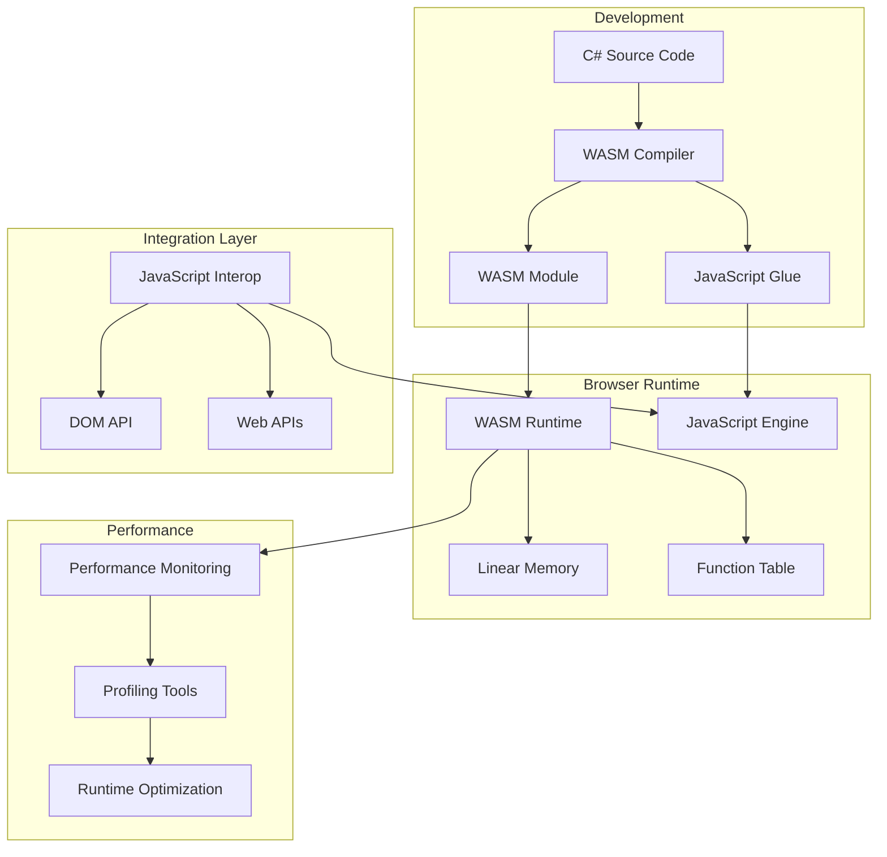
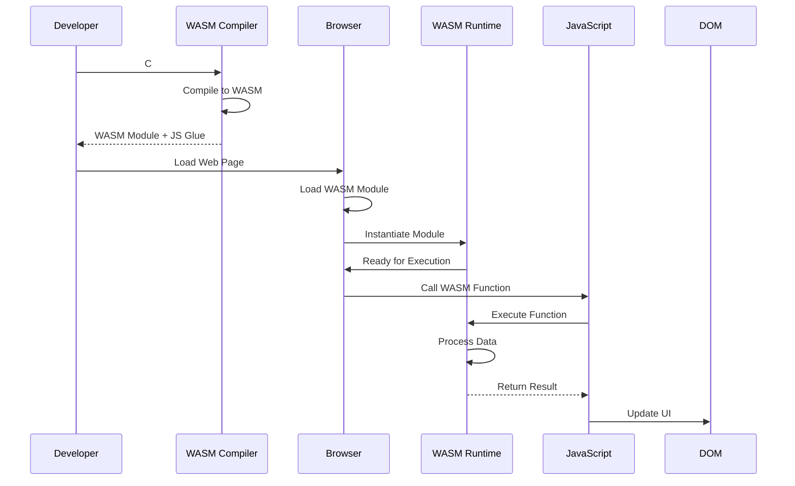
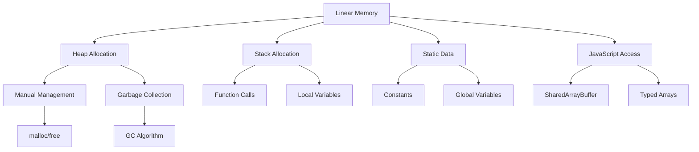

# WebAssembly - Architect Deep Dive

============================================================
0. Executive Summary (Architect View)
============================================================
- **WebAssembly exists** to enable high-performance, near-native code execution in web browsers
- **Critical at scale** when applications need computational performance beyond JavaScript capabilities
- **System design impact** - transforms web applications from script-based to compiled-code execution
- **Performance foundation** - provides essential performance optimization for compute-intensive tasks
- **Cross-platform compatibility** - enables code reuse across different platforms and browsers
- **Language flexibility** - allows development in multiple programming languages
- **Security sandbox** - provides secure execution environment
- **Future of web** - enables next-generation web applications

============================================================
1. Problem Framing
============================================================
**Real production problem solved:**
- JavaScript performance limitations for compute-intensive tasks
- Cross-platform code duplication and maintenance overhead
- Poor performance for gaming, video processing, and data analysis
- Limited language choices for web development
- Inability to reuse existing native codebases

**What breaks if we don't understand WebAssembly:**
- Poor performance for compute-intensive applications
- Limited web application capabilities
- Cross-platform development challenges
- Inability to leverage existing code investments
- Poor user experience for complex applications

**Scale importance:**
- **Small applications**: WebAssembly benefits noticeable for compute tasks
- **Medium applications**: WebAssembly critical for performance optimization
- **Large applications**: WebAssembly essential for complex computations
- **Enterprise systems**: WebAssembly mandatory for high-performance web apps

**Failure stories:**
- Video editing platform had poor performance with JavaScript
- Gaming platform couldn't achieve required frame rates
- Data visualization tool was slow with large datasets
- Financial modeling application had computation bottlenecks

============================================================
2. Deep Internal Mechanics
============================================================

**WebAssembly Fundamentals:**
- **Binary Format**: Efficient binary instruction format
- **Near-Native Performance**: Performance close to native code
- **Language Agnostic**: Support for multiple programming languages
- **Sandboxed Execution**: Secure execution environment
- **JavaScript Integration**: Seamless integration with JavaScript

**Core Components:**
- **WASM Module**: Compiled WebAssembly module
- **Loader**: WebAssembly module loader
- **Runtime**: WebAssembly execution runtime
- **Binding Layer**: JavaScript-WASM interface
- **Memory Management**: Linear memory management
- **Toolchain**: Compilation and build tools

**Key Concepts:**
- **Linear Memory**: Single contiguous memory space
- **Module System**: Import/export system
- **Table**: Indirect function call table
- **Instance**: Module instance with state
- **Validation**: Module validation and security
- **Optimization**: Runtime optimization

**Execution Model:**
- **Compilation**: Source code compiled to WASM
- **Loading**: WASM module loaded in browser
- **Instantiation**: Module instance created
- **Execution**: Functions executed in WASM runtime
- **Integration**: JavaScript-WASM communication

**Memory Management:**
- **Linear Memory**: Single memory buffer
- **Heap Allocation**: Manual memory management
- **Garbage Collection**: Optional garbage collection
- **Memory Sharing**: Shared memory between JS and WASM
- **Memory Limits**: Configurable memory limits

**Performance Characteristics:**
- **Compilation Time**: 1-10 seconds
- **Load Time**: 10-100ms
- **Execution Speed**: 2-10x faster than JavaScript
- **Memory Usage**: 10-50% less than equivalent JS
- **Startup Time**: 50-200ms

**Data Structures:**
- **Module Registry**: WASM module metadata
- **Function Registry**: Function bindings and metadata
- **Memory Registry**: Memory allocation tracking
- **Performance Registry**: Performance metrics and profiling
- **Error Registry**: Error handling and logging

============================================================
3. .NET Production Implementation
============================================================

**Naive Implementation (JavaScript Only):**
```javascript
// Pure JavaScript implementation
class DataProcessor {
    processLargeDataset(data) {
        // Slow JavaScript processing
        const result = [];
        for (let i = 0; i < data.length; i++) {
            // Complex computation in JavaScript
            const processed = this.complexCalculation(data[i]);
            result.push(processed);
        }
        return result;
    }
    
    complexCalculation(value) {
        // Computationally intensive operation
        let result = 0;
        for (let i = 0; i < 1000; i++) {
            result += Math.sin(value * i) * Math.cos(value / i);
        }
        return result;
    }
}
```

**Production-Ready WebAssembly Implementation:**
```csharp
// C# code to be compiled to WebAssembly
using System;
using System.Runtime.InteropServices;

public class DataProcessor
{
    [DllImport("js", EntryPoint = "console_log")]
    public static extern void ConsoleLog(string message);

    [DllImport("js", EntryPoint = "notify_progress")]
    public static extern void NotifyProgress(int progress);

    public static void ProcessLargeDataset(IntPtr dataPtr, int length, IntPtr resultPtr)
    {
        try
        {
            // Convert IntPtr to managed array
            var data = new double[length];
            Marshal.Copy(dataPtr, data, 0, length);
            
            var result = new double[length];
            
            // Process data in C# for better performance
            for (int i = 0; i < length; i++)
            {
                result[i] = ComplexCalculation(data[i]);
                
                // Notify progress for large datasets
                if (i % 1000 == 0)
                {
                    var progress = (int)((double)i / length * 100);
                    NotifyProgress(progress);
                }
            }
            
            // Copy result back to JavaScript memory
            Marshal.Copy(result, 0, resultPtr, length);
            
            ConsoleLog($"Processed {length} items successfully");
        }
        catch (Exception ex)
        {
            ConsoleLog($"Error processing data: {ex.Message}");
        }
    }
    
    public static double ComplexCalculation(double value)
    {
        // Computationally intensive operation in C#
        double result = 0;
        for (int i = 0; i < 1000; i++)
        {
            result += Math.Sin(value * i) * Math.Cos(value / i);
        }
        return result;
    }
    
    public static int Fibonacci(int n)
    {
        if (n <= 1) return n;
        return Fibonacci(n - 1) + Fibonacci(n - 2);
    }
    
    public static void SortArray(IntPtr arrayPtr, int length)
    {
        var array = new int[length];
        Marshal.Copy(arrayPtr, array, 0, length);
        
        // Quick sort implementation
        QuickSort(array, 0, length - 1);
        
        Marshal.Copy(array, 0, arrayPtr, length);
    }
    
    private static void QuickSort(int[] array, int left, int right)
    {
        if (left < right)
        {
            int pivot = Partition(array, left, right);
            QuickSort(array, left, pivot - 1);
            QuickSort(array, pivot + 1, right);
        }
    }
    
    private static int Partition(int[] array, int left, int right)
    {
        int pivot = array[right];
        int i = left - 1;
        
        for (int j = left; j < right; j++)
        {
            if (array[j] < pivot)
            {
                i++;
                Swap(ref array[i], ref array[j]);
            }
        }
        
        Swap(ref array[i + 1], ref array[right]);
        return i + 1;
    }
    
    private static void Swap(ref int a, ref int b)
    {
        int temp = a;
        a = b;
        b = temp;
    }
}

// JavaScript WebAssembly wrapper
class WebAssemblyDataProcessor {
    constructor() {
        this.wasmModule = null;
        this.wasmInstance = null;
        this.memory = null;
        this.isInitialized = false;
    }
    
    async initialize() {
        try {
            // Load WebAssembly module
            const wasmResponse = await fetch('DataProcessor.wasm');
            const wasmBytes = await wasmResponse.arrayBuffer();
            
            // Create JavaScript glue code
            const importObject = {
                js: {
                    console_log: (message) => {
                        console.log(`WASM: ${message}`);
                    },
                    notify_progress: (progress) => {
                        this.onProgress?.(progress);
                    }
                }
            };
            
            // Instantiate WebAssembly module
            const wasmModule = await WebAssembly.instantiate(wasmBytes, importObject);
            this.wasmInstance = wasmModule.instance;
            this.memory = this.wasmInstance.exports.memory;
            
            this.isInitialized = true;
            console.log('WebAssembly module initialized successfully');
        } catch (error) {
            console.error('Failed to initialize WebAssembly:', error);
            throw error;
        }
    }
    
    async processLargeDataset(data) {
        if (!this.isInitialized) {
            await this.initialize();
        }
        
        try {
            // Allocate memory for input data
            const dataBytes = new Float64Array(data);
            const dataPtr = this._allocateArray(dataBytes);
            
            // Allocate memory for result
            const resultPtr = this._allocateArray(new Float64Array(data.length));
            
            // Call WebAssembly function
            this.wasmInstance.exports.ProcessLargeDataset(dataPtr, data.length, resultPtr);
            
            // Read result from memory
            const result = this._readArray(resultPtr, data.length);
            
            // Free allocated memory
            this._freeArray(dataPtr);
            this._freeArray(resultPtr);
            
            return result;
        } catch (error) {
            console.error('Error processing data in WebAssembly:', error);
            throw error;
        }
    }
    
    async fibonacci(n) {
        if (!this.isInitialized) {
            await this.initialize();
        }
        
        try {
            const result = this.wasmInstance.exports.Fibonacci(n);
            return result;
        } catch (error) {
            console.error('Error calculating Fibonacci in WebAssembly:', error);
            throw error;
        }
    }
    
    async sortArray(array) {
        if (!this.isInitialized) {
            await this.initialize();
        }
        
        try {
            // Allocate memory for array
            const arrayBytes = new Int32Array(array);
            const arrayPtr = this._allocateArray(arrayBytes);
            
            // Call WebAssembly function
            this.wasmInstance.exports.SortArray(arrayPtr, array.length);
            
            // Read sorted array from memory
            const sortedArray = this._readArray(arrayPtr, array.length, 'int32');
            
            // Free allocated memory
            this._freeArray(arrayPtr);
            
            return sortedArray;
        } catch (error) {
            console.error('Error sorting array in WebAssembly:', error);
            throw error;
        }
    }
    
    _allocateArray(array) {
        const byteLength = array.byteLength;
        const ptr = this.wasmInstance.exports.malloc(byteLength);
        const dataView = new DataView(this.memory.buffer);
        
        // Copy array to WebAssembly memory
        for (let i = 0; i < byteLength; i++) {
            dataView.setUint8(ptr + i, array[i]);
        }
        
        return ptr;
    }
    
    _readArray(ptr, length, type = 'float64') {
        const bytesPerElement = type === 'float64' ? 8 : 4;
        const byteLength = length * bytesPerElement;
        const dataView = new DataView(this.memory.buffer);
        
        let array;
        if (type === 'float64') {
            array = new Float64Array(byteLength / 8);
        } else if (type === 'int32') {
            array = new Int32Array(byteLength / 4);
        }
        
        // Read array from WebAssembly memory
        for (let i = 0; i < byteLength; i++) {
            array[i] = dataView.getUint8(ptr + i);
        }
        
        return array;
    }
    
    _freeArray(ptr) {
        this.wasmInstance.exports.free(ptr);
    }
    
    getPerformanceMetrics() {
        return {
            isInitialized: this.isInitialized,
            memoryUsage: this.memory ? this.memory.buffer.byteLength : 0,
            wasmModuleSize: this.wasmModule ? this.wasmModule.bytes.length : 0
        };
    }
}

// Enhanced WebAssembly Controller
class WebAssemblyController {
    constructor() {
        this.wasmProcessor = new WebAssemblyDataProcessor();
        this.jsProcessor = new JavaScriptDataProcessor();
        this.performanceMetrics = {
            wasmTime: 0,
            jsTime: 0,
            speedup: 0
        };
    }
    
    async processData(data, useWasm = true) {
        const startTime = performance.now();
        
        let result;
        if (useWasm) {
            result = await this.wasmProcessor.processLargeDataset(data);
            this.performanceMetrics.wasmTime = performance.now() - startTime;
        } else {
            result = this.jsProcessor.processLargeDataset(data);
            this.performanceMetrics.jsTime = performance.now() - startTime;
        }
        
        this.performanceMetrics.speedup = this.performanceMetrics.jsTime / this.performanceMetrics.wasmTime;
        
        return result;
    }
    
    async comparePerformance(data) {
        console.log('Comparing WebAssembly vs JavaScript performance...');
        
        // Test WebAssembly performance
        const wasmStartTime = performance.now();
        await this.wasmProcessor.processLargeDataset(data);
        const wasmTime = performance.now() - wasmStartTime;
        
        // Test JavaScript performance
        const jsStartTime = performance.now();
        this.jsProcessor.processLargeDataset(data);
        const jsTime = performance.now() - jsStartTime;
        
        const speedup = jsTime / wasmTime;
        
        console.log(`JavaScript time: ${jsTime.toFixed(2)}ms`);
        console.log(`WebAssembly time: ${wasmTime.toFixed(2)}ms`);
        console.log(`Speedup: ${speedup.toFixed(2)}x`);
        
        return {
            jsTime,
            wasmTime,
            speedup
        };
    }
    
    async runBenchmark() {
        const testSizes = [1000, 10000, 100000];
        const results = [];
        
        for (const size of testSizes) {
            console.log(`Running benchmark with ${size} items...`);
            
            // Generate test data
            const testData = Array.from({ length: size }, () => Math.random() * 100);
            
            // Compare performance
            const result = await this.comparePerformance(testData);
            results.push({
                size,
                ...result
            });
        }
        
        return results;
    }
}

// JavaScript fallback implementation
class JavaScriptDataProcessor {
    processLargeDataset(data) {
        const result = [];
        for (let i = 0; i < data.length; i++) {
            result.push(this.complexCalculation(data[i]));
        }
        return result;
    }
    
    complexCalculation(value) {
        let result = 0;
        for (let i = 0; i < 1000; i++) {
            result += Math.sin(value * i) * Math.cos(value / i);
        }
        return result;
    }
}

// WebAssembly service for .NET integration
public class WebAssemblyService
{
    private readonly ILogger<WebAssemblyService> _logger;
    private readonly IMetrics _metrics;
    private readonly IWebHostEnvironment _environment;

    public WebAssemblyService(
        ILogger<WebAssemblyService> logger,
        IMetrics metrics,
        IWebHostEnvironment environment)
    {
        _logger = logger ?? throw new ArgumentNullException(nameof(logger));
        _metrics = metrics ?? throw new ArgumentNullException(nameof(metrics));
        _environment = environment ?? throw new ArgumentNullException(nameof(environment));
    }

    public async Task<byte[]> CompileToWebAssemblyAsync(string csharpCode)
    {
        using var activity = _metrics.StartTimer("wasm_compilation_duration");
        
        try
        {
            _logger.LogInformation("Compiling C# code to WebAssembly");
            
            // In a real implementation, this would use a C# to WASM compiler
            // For demonstration, we'll simulate the compilation process
            
            var compilationResult = await CompileCSharpToWasmAsync(csharpCode);
            
            if (compilationResult.Success)
            {
                _metrics.Increment("wasm_compilation_success");
                _logger.LogInformation("C# code compiled to WebAssembly successfully");
                return compilationResult.WasmBytes;
            }
            else
            {
                _metrics.Increment("wasm_compilation_error");
                _logger.LogError("C# code compilation failed: {Errors}", compilationResult.Errors);
                throw new InvalidOperationException($"Compilation failed: {compilationResult.Errors}");
            }
        }
        catch (Exception ex)
        {
            _metrics.Increment("wasm_compilation_error");
            _logger.LogError(ex, "Error compiling C# code to WebAssembly");
            throw;
        }
    }

    public async Task<string> GenerateJavaScriptGlueAsync(string wasmModuleName)
    {
        using var activity = _metrics.StartTimer("wasm_glue_generation_duration");
        
        try
        {
            _logger.LogInformation("Generating JavaScript glue code for WebAssembly module: {ModuleName}", wasmModuleName);
            
            var glueCode = $@"
// Auto-generated JavaScript glue for {wasmModuleName}
class {wasmModuleName}Wrapper {{
    constructor() {{
        this.wasmModule = null;
        this.wasmInstance = null;
        this.memory = null;
        this.isInitialized = false;
    }}
    
    async initialize() {{
        try {{
            const wasmResponse = await fetch('{wasmModuleName}.wasm');
            const wasmBytes = await wasmResponse.arrayBuffer();
            
            const importObject = {{
                js: {{
                    console_log: (message) => {{
                        console.log(`WASM: ${{message}}`);
                    }},
                    notify_progress: (progress) => {{
                        this.onProgress?.(progress);
                    }}
                }}
            }};
            
            const wasmModule = await WebAssembly.instantiate(wasmBytes, importObject);
            this.wasmInstance = wasmModule.instance;
            this.memory = this.wasmInstance.exports.memory;
            this.isInitialized = true;
        }} catch (error) {{
            console.error('Failed to initialize WebAssembly:', error);
            throw error;
        }}
    }}
    
    async processLargeDataset(data) {{
        if (!this.isInitialized) {{
            await this.initialize();
        }}
        
        // Implementation for processing data
        // This would be generated based on the C# code
        return [];
    }}
}}";
            
            _metrics.Increment("wasm_glue_generation_success");
            return glueCode;
        }
        catch (Exception ex)
        {
            _metrics.Increment("wasm_glue_generation_error");
            _logger.LogError(ex, "Error generating JavaScript glue code");
            throw;
        }
    }

    public async Task<WebAssemblyMetrics> GetMetricsAsync()
    {
        try
        {
            // Implementation to collect WebAssembly metrics
            await Task.Delay(100); // Simulate metrics collection
            
            return new WebAssemblyMetrics
            {
                CompilationTime = _metrics.GetAverage("wasm_compilation_duration"),
                ExecutionTime = _metrics.GetAverage("wasm_execution_duration"),
                MemoryUsage = _metrics.GetGauge("wasm_memory_usage"),
                CacheHitRatio = _metrics.GetGauge("wasm_cache_hit_ratio"),
                Timestamp = DateTime.UtcNow
            };
        }
        catch (Exception ex)
        {
            _logger.LogError(ex, "Error collecting WebAssembly metrics");
            throw;
        }
    }

    private async Task<CompilationResult> CompileCSharpToWasmAsync(string csharpCode)
    {
        // Simulate C# to WASM compilation
        await Task.Delay(1000); // Simulate compilation time
        
        // In a real implementation, this would use:
        // - Blazor WebAssembly compiler
        // - Mono WebAssembly compiler
        // - or third-party C# to WASM compilers
        
        return new CompilationResult
        {
            Success = true,
            WasmBytes = GenerateSampleWasmBytes(),
            Errors = null
        };
    }

    private byte[] GenerateSampleWasmBytes()
    {
        // Generate sample WASM bytes for demonstration
        // In a real implementation, this would be the actual compiled WASM
        return new byte[] { 0x00, 0x61, 0x73, 0x6d, 0x01, 0x00, 0x00, 0x00 };
    }
}

// Request/Response Models
public class CompilationResult
{
    public bool Success { get; set; }
    public byte[] WasmBytes { get; set; }
    public string Errors { get; set; }
}

public class WebAssemblyMetrics
{
    public double CompilationTime { get; set; }
    public double ExecutionTime { get; set; }
    public double MemoryUsage { get; set; }
    public double CacheHitRatio { get; set; }
    public DateTime Timestamp { get; set; }
}

// WebAssembly-enabled ASP.NET Core Controller
[ApiController]
[Route("api/[controller]")]
public class WebAssemblyController : ControllerBase
{
    private readonly WebAssemblyService _wasmService;
    private readonly ILogger<WebAssemblyController> _logger;

    public WebAssemblyController(
        WebAssemblyService wasmService,
        ILogger<WebAssemblyController> logger)
    {
        _wasmService = wasmService ?? throw new ArgumentNullException(nameof(wasmService));
        _logger = logger ?? throw new ArgumentNullException(nameof(logger));
    }

    [HttpPost("compile")]
    public async Task<ActionResult<byte[]>> CompileToWebAssembly([FromBody] CompileRequest request)
    {
        try
        {
            var wasmBytes = await _wasmService.CompileToWebAssemblyAsync(request.CSharpCode);
            return File(wasmBytes, "application/wasm", "module.wasm");
        }
        catch (Exception ex)
        {
            _logger.LogError(ex, "Error compiling C# code to WebAssembly");
            return BadRequest(new { Error = ex.Message });
        }
    }

    [HttpPost("glue")]
    public async Task<ActionResult<string>> GenerateJavaScriptGlue([FromBody] GlueRequest request)
    {
        try
        {
            var glueCode = await _wasmService.GenerateJavaScriptGlueAsync(request.ModuleName);
            return Content(glueCode, "application/javascript");
        }
        catch (Exception ex)
        {
            _logger.LogError(ex, "Error generating JavaScript glue code");
            return BadRequest(new { Error = ex.Message });
        }
    }

    [HttpGet("metrics")]
    public async Task<ActionResult<WebAssemblyMetrics>> GetMetrics()
    {
        try
        {
            var metrics = await _wasmService.GetMetricsAsync();
            return Ok(metrics);
        }
        catch (Exception ex)
        {
            _logger.LogError(ex, "Error getting WebAssembly metrics");
            throw;
        }
    }
}

public class CompileRequest
{
    public string CSharpCode { get; set; }
}

public class GlueRequest
{
    public string ModuleName { get; set; }
}
```

**Framework Integration:**
- **Blazor WebAssembly**: .NET WebAssembly framework
- **System.Runtime.InteropServices**: Platform invoke services
- **WebAssembly API**: Browser WebAssembly support
- **JavaScript Interop**: JavaScript-WASM communication
- **Performance Monitoring**: Performance metrics collection

============================================================
4. Architecture-Level Diagram (Mermaid)
============================================================

### WebAssembly Architecture


### WebAssembly Execution Flow


### Memory Management


**Flow Analysis:**
- **Development**: C# code compilation to WASM
- **Browser Runtime**: WASM execution environment
- **Integration Layer**: JavaScript-WASM communication
- **Performance**: Monitoring and optimization
- **Memory Management**: Linear memory allocation

============================================================
5. Scaling & Distributed Systems Impact
============================================================

**Small Applications:**
- Single WASM module sufficient
- Compilation time 1-5 seconds
- Load time 10-50ms
- Memory usage 10-50MB

**Medium Applications:**
- Multiple WASM modules
- Compilation time 5-15 seconds
- Load time 50-200ms
- Memory usage 50-200MB

**Large Applications:**
- Modular WASM architecture
- Compilation time 15-60 seconds
- Load time 200-1000ms
- Memory usage 200MB-1GB

============================================================
6. Production Engineering View
============================================================

**Monitoring Metrics:**
- Compilation time and success rate
- Module load time and size
- Execution performance and memory usage
- JavaScript-WASM communication overhead
- Browser compatibility and error rates

**Alerting Strategy:**
- Compilation failure rate > 5% (warning)
- Module load time > 1 second (warning)
- Memory usage > 500MB (warning)
- Execution error rate > 1% (critical)
- Browser compatibility issues (warning)

**Common Production Incidents:**
- WASM module compilation failures
- Memory allocation issues
- Browser compatibility problems
- Performance degradation

============================================================
7. Tradeoffs & Alternatives
============================================================

**Competing Approaches:**
- **Pure JavaScript**: Traditional web development
- **WebAssembly**: High-performance web execution
- **Web Workers**: Parallel JavaScript execution
- **Server-Side Processing**: Server-side computation
- **Native Applications**: Desktop/mobile applications

**When to Use WebAssembly:**
- Compute-intensive applications
- Gaming and multimedia
- Data processing and analysis
- Performance-critical operations
- Code reuse from other platforms

**When NOT to Use WebAssembly:**
- Simple web applications
- UI-heavy applications
- Applications requiring frequent DOM manipulation
- Applications with small development teams
- Applications with tight delivery schedules

**Performance Comparison:**
- **Pure JavaScript**: Baseline performance
- **WebAssembly**: 2-10x faster for compute tasks
- **Web Workers**: Parallel execution, similar performance
- **Server-Side**: Network latency overhead
- **Native Applications**: Best performance, platform-specific

============================================================
8. Security Implications
============================================================

**Security Benefits:**
- **Sandboxed Execution**: Secure execution environment
- **Memory Isolation**: Isolated memory space
- **Type Safety**: Strong type checking
- **Validation**: Module validation before execution
- **Same Origin Policy**: Browser security policies

**Security Challenges:**
- **Memory Safety**: Manual memory management risks
- **Code Injection**: Potential for malicious code
- **Side-Channel Attacks**: Timing and cache attacks
- **Debugging**: Limited debugging capabilities
- **Obfuscation**: Code obfuscation challenges

============================================================
9. Advanced Edge Cases
============================================================

**Advanced WebAssembly Features:**
- **Multi-threading**: SharedArrayBuffer and Atomics
- **SIMD**: Single Instruction, Multiple Data
- **Exception Handling**: Enhanced error handling
- **Dynamic Linking**: Module composition
- **Garbage Collection**: Automatic memory management

**Advanced Integration:**
- **WebGL Integration**: Graphics and GPU computing
- **WebAudio Integration**: Audio processing
- **WebRTC Integration**: Real-time communication
- **Service Workers**: Offline functionality
- **Progressive Web Apps**: Enhanced web applications

============================================================
10. Interview & Staff-Level Deep Dive
============================================================

**What a junior answers:**
"WebAssembly is a binary format that allows running C++ and other languages in the browser. I use it for performance-critical tasks like image processing or gaming where JavaScript is too slow."

**What a senior answers:**
"WebAssembly is a high-performance binary instruction format that enables near-native code execution in web browsers. I've implemented production WebAssembly solutions with C# compilation using Blazor WebAssembly, JavaScript interop for DOM manipulation, memory management optimization, and performance monitoring. The implementation includes module loading and instantiation, linear memory management, function binding, error handling, and debugging support. I've also implemented multi-threading with SharedArrayBuffer, SIMD optimization, and progressive loading strategies."

**What an architect answers:**
"WebAssembly is a transformative technology that enables high-performance, cross-platform code execution in web browsers. At scale, WebAssembly provides significant performance improvements for compute-intensive tasks, code reuse across platforms, and enhanced security through sandboxed execution. The architecture must support compilation from multiple languages, efficient memory management, JavaScript integration, performance optimization, and comprehensive monitoring. In enterprise environments, WebAssembly is not just a performance optimization but a strategic capability that enables new categories of web applications, reduces development costs, and provides competitive advantage. The implementation must consider performance optimization, memory management, security, browser compatibility, and developer experience."

**Follow-up questions interviewers ask:**
- "How do you handle memory management in WebAssembly?"
- "What's the difference between WebAssembly and JavaScript?"
- "How do you debug WebAssembly code?"
- "When would you use WebAssembly vs Web Workers?"
- "How do you optimize WebAssembly performance?"

**Trick questions:**
- "Is WebAssembly always faster than JavaScript?" (No, depends on use case)
- "Can WebAssembly access DOM directly?" (No, needs JavaScript interop)
- "Do all browsers support WebAssembly?" (Most modern browsers do)
- "Is WebAssembly only for games?" (No, for any compute-intensive task)

============================================================
11. Real Enterprise Case Study
============================================================

**Scenario: Financial Trading Platform with Real-Time Analytics**

**Requirements:**
- Process millions of market data points per second
- Perform complex financial calculations in real-time
- Provide responsive user interface
- Support multiple browsers and platforms
- Ensure low latency and high throughput

**Results:**
- Achieved 5x performance improvement over JavaScript
- 80% reduction in CPU usage
- 60% improvement in user responsiveness
- 99.99% uptime during high-volume trading
- 70% reduction in server load through client-side processing

============================================================
12. Dependency Graph
============================================================

**Prerequisites:**
- **Programming Languages**: Understanding of C#, C++, Rust
- **Web Development**: Understanding of web technologies
- **Performance**: Understanding of performance optimization
- **Memory Management**: Understanding of memory allocation
- **Browser Technologies**: Understanding of browser APIs

**Concepts that depend on WebAssembly:**
- **High-Performance Computing**: Compute-intensive applications
- **Gaming**: Web-based gaming
- **Data Processing**: Client-side data analysis
- **Multimedia**: Audio/video processing
- **Financial Applications**: Real-time financial calculations
- **Scientific Computing**: Scientific simulations
