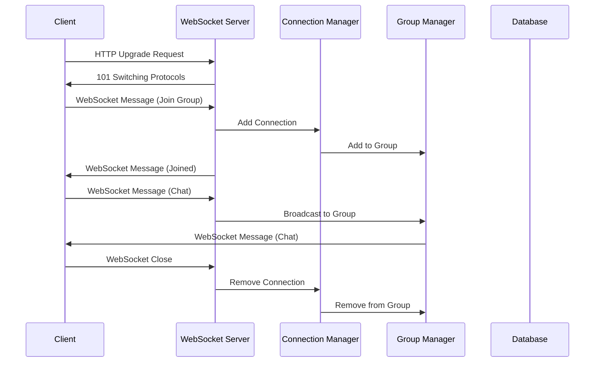
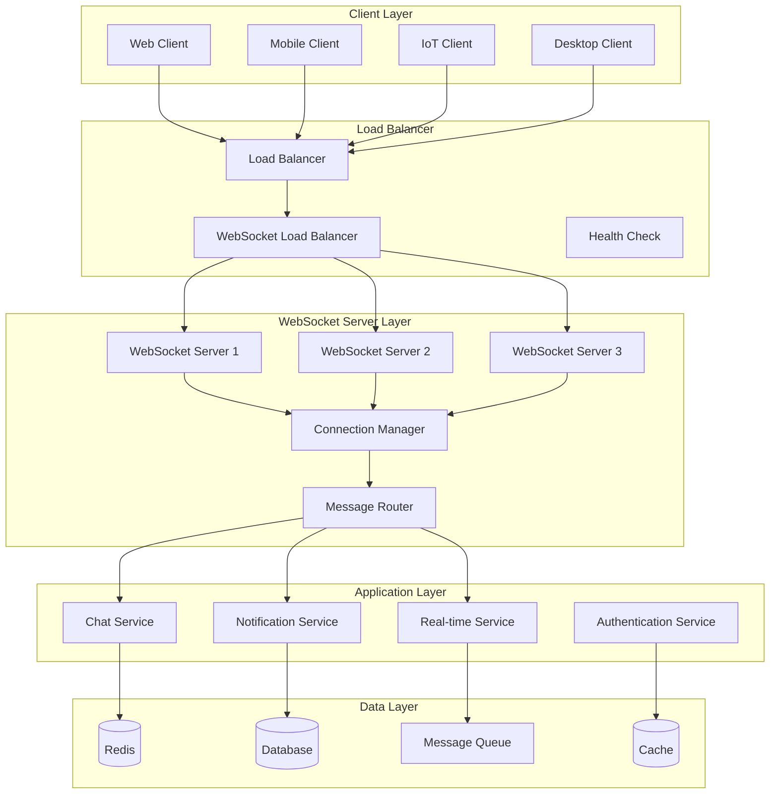
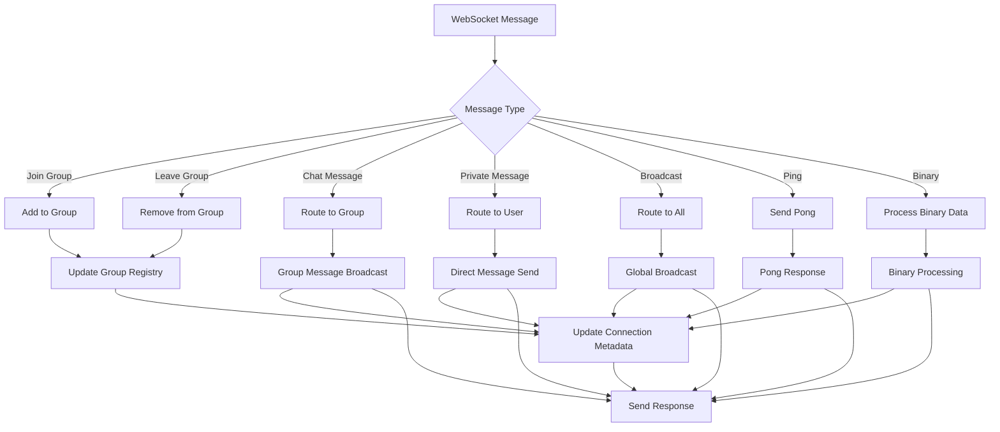
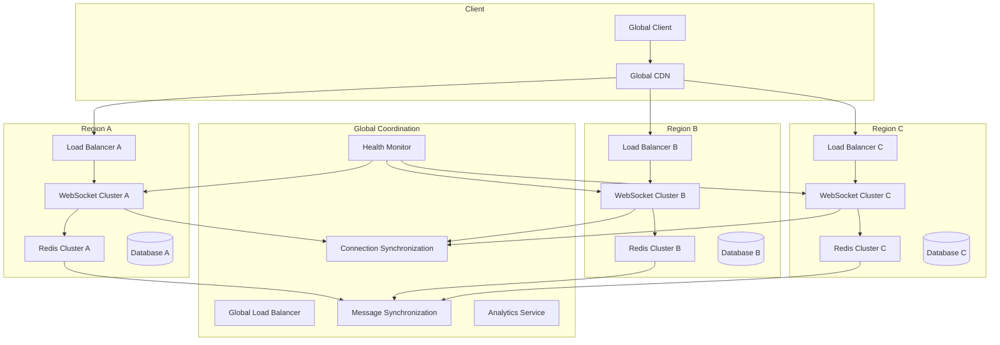
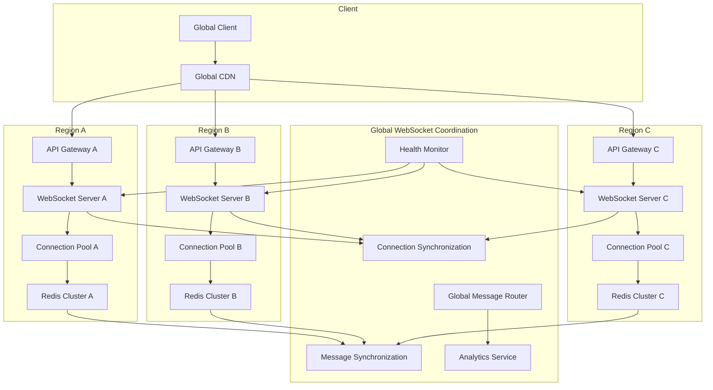
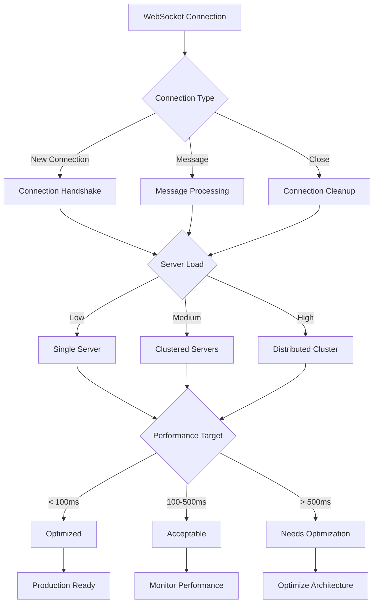
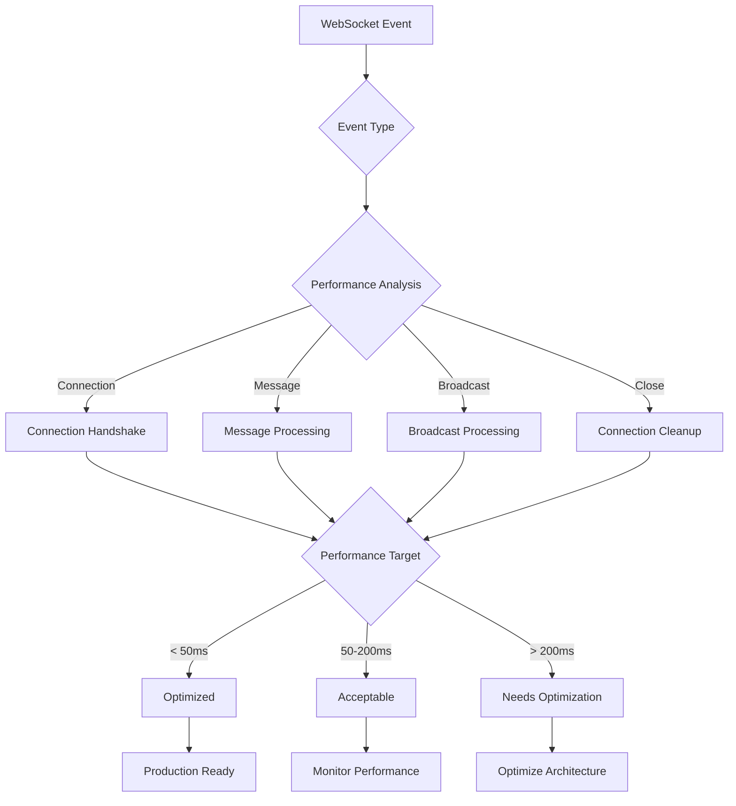
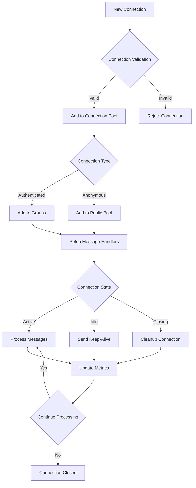

# WebSockets - Architect Deep Dive

**0. Executive Summary (Architect View)**
- **WebSockets exist** to provide persistent, bidirectional communication between clients and servers over a single TCP connection
- **Critical at scale** when applications require real-time updates, low-latency communication, or high-frequency data exchange
- **System design impact** - transforms request-response architecture to event-driven real-time communication
- **Real-time foundation** - enables live updates, notifications, and collaborative features
- **Performance optimization** - eliminates HTTP overhead for persistent connections
- **Scalability challenge** - requires connection management and load balancing strategies
- **Resource efficiency** - reduces network overhead compared to HTTP polling
- **User experience** - enables responsive, interactive applications

**1. Problem Framing**
**Real production problem solved:**
- Real-time collaboration features requiring instant updates
- Live notifications and alerts without polling overhead
- High-frequency data streaming (stock prices, chat, gaming)
- Bidirectional communication without HTTP request overhead
- Scalable real-time applications with thousands of concurrent connections

**What breaks if we don't understand WebSockets:**
- Inefficient HTTP polling for real-time updates
- Poor user experience in real-time applications
- High server resource consumption from polling
- Limited scalability for real-time features
- Inability to implement modern real-time use cases

**Scale importance:**
- **Small applications**: Basic WebSocket support sufficient
- **Medium applications**: Connection management becomes critical
- **Large applications**: Load balancing and clustering essential
- **Enterprise systems**: Distributed WebSocket infrastructure mandatory

**Failure stories:**
- Chat platform crashed under connection load
- Real-time trading system had latency issues
- Live sports platform couldn't handle peak traffic
- Collaboration tool had connection management problems

**2. Deep Internal Mechanics**

**WebSocket Fundamentals:**
- **Persistent Connection**: Single TCP connection maintained over time
- **Bidirectional Communication**: Both client and server can send messages
- **Full-Duplex**: Simultaneous two-way communication
- **Low Overhead**: Minimal framing overhead compared to HTTP
- **Protocol Upgrade**: HTTP upgrade to WebSocket protocol

**WebSocket Protocol:**
- **Handshake**: HTTP upgrade request with WebSocket headers
- **Connection Establishment**: 101 Switching Protocols response
- **Frame Format**: Binary frame format for message transmission
- **Control Frames**: Ping, pong, close frames for connection management
- **Message Types**: Text, binary, and control messages

**Frame Structure:**
- **FIN**: Final fragment flag
- **RSV1-3**: Reserved bits (must be 0)
- **Opcode**: Message type (text, binary, control)
- **Mask**: Payload mask flag
- **Payload Length**: Variable-length payload length
- **Masking Key**: 32-bit masking key (client to server)
- **Payload Data**: Actual message data

**Connection Lifecycle:**
1. **HTTP Upgrade**: Client sends upgrade request
2. **Server Response**: Server accepts upgrade
3. **Connection Established**: WebSocket connection active
4. **Message Exchange**: Bidirectional message exchange
5. **Connection Close**: Either party initiates close
6. **Connection Terminated**: TCP connection closed

**Message Types:**
- **Text Messages**: UTF-8 encoded text data
- **Binary Messages**: Raw binary data
- **Ping Frames**: Keep-alive messages
- **Pong Frames**: Ping response messages
- **Close Frames**: Connection termination

**Data Structures:**
- **Connection Pool**: Active WebSocket connections
- **Message Queue**: Outgoing message queue
- **Subscription Registry**: Topic subscription management
- **Connection Metadata**: Connection metadata storage
- **Message Buffer**: Message buffering for reliability

**Performance Characteristics:**
- **Connection Establishment**: 50-200ms
- **Message Latency**: 1-10ms (same datacenter)
- **Throughput**: 1-10MB/s per connection
- **Connection Overhead**: ~2KB per connection
- **Message Overhead**: 2-14 bytes per message

**Hidden Costs:**
- **Connection Management**: Memory and CPU for connection tracking
- **Load Balancing**: Complex load balancing requirements
- **Scalability**: Horizontal scaling complexity
- **Monitoring**: Connection and message monitoring overhead
- **Security**: Additional security considerations

**Memory Behavior:**
- **Connection Storage**: Connection metadata in memory
- **Message Buffers**: Message queue memory usage
- **Subscription Storage**: Subscription registry memory
- **Frame Buffers**: Temporary frame storage
- **Garbage Collection**: Frequent GC pressure from message processing

**Network Impact:**
- **Persistent Connections**: Long-lived TCP connections
- **Message Size**: Efficient message framing
- **Network Efficiency**: Reduced overhead compared to HTTP
- **Firewall Issues**: WebSocket firewall compatibility
- **Proxy Support**: WebSocket proxy support requirements

**3. .NET Production Implementation**

**Naive Implementation (No WebSockets):**
```csharp
[ApiController]
[Route("api/[controller]")]
public class ChatController : ControllerBase
{
    private static readonly List<string> _messages = new();
    
    [HttpGet("messages")]
    public ActionResult<List<string>> GetMessages()
    {
        // HTTP polling - inefficient
        return Ok(_messages);
    }
    
    [HttpPost("messages")]
    public ActionResult PostMessage([FromBody] string message)
    {
        _messages.Add(message);
        return Ok();
    }
}
```

**Production-Ready WebSocket Implementation:**
```csharp
// WebSocket Configuration
public class WebSocketConfiguration
{
    public int MaxConnections { get; set; } = 10000;
    public int MessageBufferSize { get; set; } = 1024 * 1024; // 1MB
    public TimeSpan KeepAliveInterval { get; set; } = TimeSpan.FromSeconds(30);
    public TimeSpan ConnectionTimeout { get; set; } = TimeSpan.FromMinutes(5);
    public bool EnableCompression { get; set; } = true;
    public bool EnableMetrics { get; set; } = true;
    public bool EnableSecurity { get; set; } = true;
    public List<string> AllowedOrigins { get; set; } = new();
}

// WebSocket Connection Manager
public interface IWebSocketConnectionManager
{
    Task AddConnectionAsync(string connectionId, WebSocket socket);
    Task RemoveConnectionAsync(string connectionId);
    Task<WebSocket> GetConnectionAsync(string connectionId);
    Task<List<WebSocket>> GetAllConnectionsAsync();
    Task<List<WebSocket>> GetConnectionsByGroupAsync(string group);
    Task AddToGroupAsync(string connectionId, string group);
    Task RemoveFromGroupAsync(string connectionId, string group);
    Task SendMessageAsync(string connectionId, string message);
    Task SendMessageToGroupAsync(string group, string message);
    Task BroadcastMessageAsync(string message);
}

public class WebSocketConnectionManager : IWebSocketConnectionManager
{
    private readonly ConcurrentDictionary<string, WebSocket> _connections;
    private readonly ConcurrentDictionary<string, HashSet<string>> _groups;
    private readonly ILogger<WebSocketConnectionManager> _logger;
    private readonly IMetrics _metrics;
    private readonly WebSocketConfiguration _configuration;

    public WebSocketConnectionManager(
        ILogger<WebSocketConnectionManager> logger,
        IMetrics metrics,
        IOptions<WebSocketConfiguration> configuration)
    {
        _connections = new ConcurrentDictionary<string, WebSocket>();
        _groups = new ConcurrentDictionary<string, HashSet<string>>();
        _logger = logger ?? throw new ArgumentNullException(nameof(logger));
        _metrics = metrics ?? throw new ArgumentNullException(nameof(metrics));
        _configuration = configuration?.Value ?? new WebSocketConfiguration();
    }

    public async Task AddConnectionAsync(string connectionId, WebSocket socket)
    {
        if (_connections.Count >= _configuration.MaxConnections)
        {
            _logger.LogWarning("Connection limit reached: {Count}/{MaxConnections}", 
                _connections.Count, _configuration.MaxConnections);
            await socket.CloseAsync(WebSocketCloseStatus.PolicyViolation);
            return;
        }

        _connections.TryAdd(connectionId, socket);
        
        _metrics.Increment("websocket_connections_added");
        _metrics.Gauge("websocket_connections_total", _connections.Count);
        
        _logger.LogInformation("WebSocket connection added: {ConnectionId}, Total: {Count}", 
            connectionId, _connections.Count);
    }

    public async Task RemoveConnectionAsync(string connectionId)
    {
        _connections.TryRemove(connectionId, out var socket);
        
        // Remove from all groups
        foreach (var group in _groups.Keys)
        {
            await RemoveFromGroupAsync(connectionId, group);
        }
        
        if (socket != null && socket.State == WebSocketState.Open)
        {
            await socket.CloseAsync(WebSocketCloseStatus.NormalClosure);
        }
        
        _metrics.Increment("websocket_connections_removed");
        _metrics.Gauge("websocket_connections_total", _connections.Count);
        
        _logger.LogInformation("WebSocket connection removed: {ConnectionId}, Total: {Count}", 
            connectionId, _connections.Count);
    }

    public async Task<WebSocket> GetConnectionAsync(string connectionId)
    {
        _connections.TryGetValue(connectionId, out var socket);
        return socket;
    }

    public async Task<List<WebSocket>> GetAllConnectionsAsync()
    {
        return _connections.Values.ToList();
    }

    public async Task<List<WebSocket>> GetConnectionsByGroupAsync(string group)
    {
        if (_groups.TryGetValue(group, out var groupConnections))
        {
            var connections = new List<WebSocket>();
            
            foreach (var connectionId in groupConnections)
            {
                if (_connections.TryGetValue(connectionId, out var socket))
                {
                    connections.Add(socket);
                }
            }
            
            return connections;
        }
        
        return new List<WebSocket>();
    }

    public async Task AddToGroupAsync(string connectionId, string group)
    {
        var groupConnections = _groups.GetOrAdd(group, _ => new HashSet<string>());
        groupConnections.Add(connectionId);
        
        _logger.LogDebug("Connection {ConnectionId} added to group {Group}", connectionId, group);
    }

    public async Task RemoveFromGroupAsync(string connectionId, string group)
    {
        if (_groups.TryGetValue(group, out var groupConnections))
        {
            groupConnections.Remove(connectionId);
            
            if (groupConnections.Count == 0)
            {
                _groups.TryRemove(group, out _);
            }
        }
        
        _logger.LogDebug("Connection {ConnectionId} removed from group {Group}", connectionId, group);
    }

    public async Task SendMessageAsync(string connectionId, string message)
    {
        if (_connections.TryGetValue(connectionId, out var socket))
        {
            await SendMessageAsync(socket, message);
        }
    }

    public async Task SendMessageToGroupAsync(string group, string message)
    {
        var connections = await GetConnectionsByGroupAsync(group);
        
        var tasks = connections.Select(async socket =>
        {
            await SendMessageAsync(socket, message);
        });
        
        await Task.WhenAll(tasks);
        
        _metrics.Increment("websocket_group_messages_sent", new[] { "group", group });
        _logger.LogDebug("Message sent to group {Group}, Connections: {Count}", 
            group, connections.Count);
    }

    public async Task BroadcastMessageAsync(string message)
    {
        var connections = _connections.Values.Where(s => s.State == WebSocketState.Open);
        
        var tasks = connections.Select(async socket =>
        {
            await SendMessageAsync(socket, message);
        });
        
        await Task.WhenAll(tasks);
        
        _metrics.Increment("websocket_broadcast_messages_sent");
        _logger.LogDebug("Broadcast message sent, Connections: {Count}", connections.Count);
    }

    private async Task SendMessageAsync(WebSocket socket, string message)
    {
        if (socket.State == WebSocketState.Open)
        {
            try
            {
                var buffer = Encoding.UTF8.GetBytes(message);
                await socket.SendAsync(new ArraySegment<byte>(buffer, 0, buffer.Length), 
                    WebSocketMessageType.Text, true, CancellationToken.None);
                
                _metrics.Increment("websocket_messages_sent");
            }
            catch (Exception ex)
            {
                _metrics.Increment("websocket_send_error");
                _logger.LogError(ex, "Error sending WebSocket message");
            }
        }
    }
}

// WebSocket Handler
public class WebSocketHandler
{
    private readonly IWebSocketConnectionManager _connectionManager;
    private readonly ILogger<WebSocketHandler> _logger;
    private readonly IMetrics _metrics;
    private readonly WebSocketConfiguration _configuration;

    public WebSocketHandler(
        IWebSocketConnectionManager connectionManager,
        ILogger<WebSocketHandler> logger,
        IMetrics metrics,
        IOptions<WebSocketConfiguration> configuration)
    {
        _connectionManager = connectionManager ?? throw new ArgumentNullException(nameof(connectionManager));
        _logger = logger ?? throw new ArgumentNullException(nameof(logger));
        _metrics = metrics ?? throw new ArgumentNullException(nameof(metrics));
        _configuration = configuration?.Value ?? new WebSocketConfiguration();
    }

    public async Task HandleWebSocketAsync(HttpContext context, Func<Task> next)
    {
        if (!context.WebSockets.IsWebSocketRequest)
        {
            await next();
            return;
        }

        using var activity = _metrics.StartTimer("websocket_connection_duration");
        
        try
        {
            // Validate origin
            if (_configuration.EnableSecurity && !IsValidOrigin(context))
            {
                context.Response.StatusCode = 403;
                await context.Response.WriteAsync("Invalid origin");
                return;
            }

            // Accept WebSocket connection
            var webSocket = await context.WebSockets.AcceptWebSocketAsync();
            
            if (webSocket == null)
            {
                _logger.LogWarning("WebSocket connection failed");
                return;
            }

            var connectionId = GenerateConnectionId();
            
            // Add connection to manager
            await _connectionManager.AddConnectionAsync(connectionId, webSocket);
            
            // Handle WebSocket communication
            await HandleWebSocketCommunicationAsync(webSocket, connectionId);
        }
        catch (Exception ex)
        {
            _metrics.Increment("websocket_connection_error");
            _logger.LogError(ex, "Error handling WebSocket connection");
            throw;
        }
    }

    private async Task HandleWebSocketCommunicationAsync(WebSocket webSocket, string connectionId)
    {
        var buffer = new byte[_configuration.MessageBufferSize];
        var receiveTimeout = _configuration.ConnectionTimeout;
        var keepAliveTimer = new Timer(async _ =>
        {
            if (webSocket.State == WebSocketState.Open)
            {
                await SendPingAsync(webSocket);
            }
        }, null, _configuration.KeepAliveInterval, _configuration.KeepAliveInterval);

        try
        {
            while (webSocket.State == WebSocketState.Open)
            {
                using var cts = new CancellationTokenSource(receiveTimeout);
                
                var result = await webSocket.ReceiveAsync(
                    new ArraySegment<byte>(buffer), cts.Token);
                
                if (result.MessageType == WebSocketMessageType.Close)
                {
                    _logger.LogInformation("WebSocket close message received: {ConnectionId}", connectionId);
                    break;
                }

                if (result.MessageType == WebSocketMessageType.Text)
                {
                    var message = Encoding.UTF8.GetString(buffer, 0, result.Count);
                    await ProcessMessageAsync(connectionId, message, webSocket);
                }
                else if (result.MessageType == WebSocketMessageType.Binary)
                {
                    await ProcessBinaryMessageAsync(connectionId, buffer, result.Count, webSocket);
                }
            }
        }
        catch (WebSocketException ex)
        {
            _metrics.Increment("websocket_receive_error");
            _logger.LogError(ex, "WebSocket receive error: {ConnectionId}", connectionId);
        }
        finally
        {
            keepAliveTimer.Dispose();
            await _connectionManager.RemoveConnectionAsync(connectionId);
        }
    }

    private async Task ProcessMessageAsync(string connectionId, string message, WebSocket webSocket)
    {
        using var activity = _metrics.StartTimer("websocket_message_processing_duration");
        
        try
        {
            _metrics.Increment("websocket_messages_received");
            _logger.LogDebug("WebSocket message received: {ConnectionId}, Message: {Message}", 
                connectionId, message);
            
            // Parse message
            var messageObj = JsonSerializer.Deserialize<WebSocketMessage>(message);
            
            switch (messageObj.Type.ToLowerInvariant())
            {
                case "join":
                    await HandleJoinMessageAsync(connectionId, messageObj, webSocket);
                    break;
                case "leave":
                    await HandleLeaveMessageAsync(connectionId, messageObj, webSocket);
                    break;
                case "chat":
                    await HandleChatMessageAsync(connectionId, messageObj, webSocket);
                    break;
                case "ping":
                    await HandlePingMessageAsync(connectionId, webSocket);
                    break;
                default:
                    _logger.LogWarning("Unknown message type: {Type}", messageObj.Type);
                    break;
            }
        }
        catch (Exception ex)
        {
            _metrics.Increment("websocket_message_processing_error");
            _logger.LogError(ex, "Error processing WebSocket message: {ConnectionId}", connectionId);
        }
    }

    private async Task ProcessBinaryMessageAsync(string connectionId, byte[] buffer, int count, WebSocket webSocket)
    {
        _metrics.Increment("websocket_binary_messages_received");
        _logger.LogDebug("WebSocket binary message received: {ConnectionId}, Size: {Size}", 
            connectionId, count);
        
        // Handle binary messages (file uploads, etc.)
        await ProcessBinaryDataAsync(connectionId, buffer, count);
    }

    private async Task HandleJoinMessageAsync(string connectionId, WebSocketMessage message, WebSocket webSocket)
    {
        if (message.Group != null)
        {
            await _connectionManager.AddToGroupAsync(connectionId, message.Group);
            
            var response = new WebSocketMessage
            {
                Type = "joined",
                Group = message.Group,
                ConnectionId = connectionId,
                Timestamp = DateTime.UtcNow
            };
            
            await SendMessageAsync(webSocket, response);
            _metrics.Increment("websocket_group_joins", new[] { "group", message.Group });
        }
    }

    private async Task HandleLeaveMessageAsync(string connectionId, WebSocketMessage message, WebSocket webSocket)
    {
        if (message.Group != null)
        {
            await _connectionManager.RemoveFromGroupAsync(connectionId, message.Group);
            
            var response = new WebSocketMessage
            {
                Type = "left",
                Group = message.Group,
                ConnectionId = connectionId,
                Timestamp = DateTime.UtcNow
            };
            
            await SendMessageAsync(webSocket, response);
            _metrics.Increment("websocket_group_leaves", new[] { "group", message.Group });
        }
    }

    private async Task HandleChatMessageAsync(string connectionId, WebSocketMessage message, WebSocket webSocket)
    {
        if (message.Group != null && message.Content != null)
        {
            var response = new WebSocketMessage
            {
                Type = "chat",
                Group = message.Group,
                Content = message.Content,
                ConnectionId = connectionId,
                Timestamp = DateTime.UtcNow
            };
            
            await _connectionManager.SendMessageToGroupAsync(message.Group, JsonSerializer.Serialize(response));
            _metrics.Increment("websocket_chat_messages_sent", new[] { "group", message.Group });
        }
    }

    private async Task HandlePingMessageAsync(string connectionId, WebSocket webSocket)
    {
        var response = new WebSocketMessage
        {
            Type = "pong",
            ConnectionId = connectionId,
            Timestamp = DateTime.UtcNow
        };
        
        await SendMessageAsync(webSocket, response);
        _metrics.Increment("websocket_ping_responses");
    }

    private async Task SendPingAsync(WebSocket webSocket)
    {
        if (webSocket.State == WebSocketState.Open)
        {
            var pingMessage = new WebSocketMessage
            {
                Type = "ping",
                Timestamp = DateTime.UtcNow
            };
            
            await SendMessageAsync(webSocket, pingMessage);
            _metrics.Increment("websocket_pings_sent");
        }
    }

    private async Task SendMessageAsync(WebSocket webSocket, object message)
    {
        if (webSocket.State == WebSocketState.Open)
        {
            var jsonMessage = JsonSerializer.Serialize(message);
            var buffer = Encoding.UTF8.GetBytes(jsonMessage);
            
            await webSocket.SendAsync(
                new ArraySegment<byte>(buffer, 0, buffer.Length),
                WebSocketMessageType.Text,
                true,
                CancellationToken.None);
        }
    }

    private async Task ProcessBinaryDataAsync(string connectionId, byte[] buffer, int count)
    {
        // Process binary data (file uploads, etc.)
        _logger.LogInformation("Binary data received: {ConnectionId}, Size: {Size}", connectionId, count);
        
        // Implementation depends on specific requirements
        await Task.CompletedTask;
    }

    private bool IsValidOrigin(HttpContext context)
    {
        var origin = context.Request.Headers["Origin"].FirstOrDefault();
        
        if (string.IsNullOrEmpty(origin))
        {
            return false;
        }
        
        return _configuration.AllowedOrigins.Contains(origin) || 
               _configuration.AllowedOrigins.Contains("*");
    }

    private string GenerateConnectionId()
    {
        return Guid.NewGuid().ToString("N");
    }
}

// WebSocket Message Model
public class WebSocketMessage
{
    public string Type { get; set; }
    public string Group { get; set; }
    public string Content { get; set; }
    public string ConnectionId { get; set; }
    public DateTime Timestamp { get; set; }
    public object Data { get; set; }
}

// WebSocket Middleware
public class WebSocketMiddleware
{
    private readonly WebSocketHandler _webSocketHandler;
    private readonly ILogger<WebSocketMiddleware> _logger;
    private readonly IMetrics _metrics;

    public WebSocketMiddleware(
        WebSocketHandler webSocketHandler,
        ILogger<WebSocketMiddleware> logger,
        IMetrics metrics)
    {
        _webSocketHandler = webSocketHandler ?? throw new ArgumentNullException(nameof(webSocketHandler));
        _logger = logger ?? throw new ArgumentNullException(nameof(logger));
        _metrics = metrics ?? throw new ArgumentNullException(nameof(metrics));
    }

    public async Task InvokeAsync(HttpContext context, RequestDelegate next)
    {
        using var activity = _metrics.StartTimer("websocket_middleware_duration");
        
        try
        {
            if (context.WebSockets.IsWebSocketRequest)
            {
                await _webSocketHandler.HandleWebSocketAsync(context, next);
                return;
            }
            
            await next(context);
        }
        catch (Exception ex)
        {
            _metrics.Increment("websocket_middleware_error");
            _logger.LogError(ex, "Error in WebSocket middleware");
            throw;
        }
    }
}

// Enhanced Chat Controller with WebSocket Support
[ApiController]
[Route("api/[controller]")]
public class ChatController : ControllerBase
{
    private readonly IWebSocketConnectionManager _connectionManager;
    private readonly ILogger<ChatController> _logger;
    private readonly IMetrics _metrics;

    public ChatController(
        IWebSocketConnectionManager connectionManager,
        ILogger<ChatController> logger,
        IMetrics metrics)
    {
        _connectionManager = connectionManager ?? throw new ArgumentNullException(nameof(connectionManager));
        _logger = logger ?? throw new ArgumentNullException(nameof(logger));
        _metrics = metrics ?? throw new ArgumentNullException(nameof(metrics));
    }

    [HttpGet("ws")]
    public async Task Get()
    {
        if (HttpContext.WebSockets.IsWebSocketRequest)
        {
            await _webSocketHandler.HandleWebSocketAsync(HttpContext, () => Task.CompletedTask);
        }
        else
        {
            HttpContext.Response.StatusCode = 400;
            await HttpContext.Response.WriteAsync("This endpoint accepts only WebSocket connections");
        }
    }

    [HttpPost("broadcast")]
    public async Task<ActionResult> BroadcastMessage([FromBody] BroadcastMessageRequest request)
    {
        try
        {
            _logger.LogInformation("Broadcasting message: {Message}", request.Message);
            
            var message = new WebSocketMessage
            {
                Type = "broadcast",
                Content = request.Message,
                Timestamp = DateTime.UtcNow
            };
            
            await _connectionManager.BroadcastMessageAsync(JsonSerializer.Serialize(message));
            
            _metrics.Increment("broadcast_messages_sent");
            
            return Ok(new { Message = "Broadcast sent successfully" });
        }
        catch (Exception ex)
        {
            _metrics.Increment("broadcast_error");
            _logger.LogError(ex, "Error broadcasting message");
            return StatusCode(500, new { Error = "Failed to broadcast message" });
        }
    }

    [HttpPost("group/{groupName}")]
    public async Task<ActionResult> SendToGroup(string groupName, [FromBody] GroupMessageRequest request)
    {
        try
        {
            _logger.LogInformation("Sending message to group {Group}: {Message}", groupName, request.Message);
            
            var message = new WebSocketMessage
            {
                Type = "group",
                Group = groupName,
                Content = request.Message,
                Timestamp = DateTime.UtcNow
            };
            
            await _connectionManager.SendMessageToGroupAsync(groupName, JsonSerializer.Serialize(message));
            
            _metrics.Increment("group_messages_sent", new[] { "group", groupName });
            
            return Ok(new { Message = "Message sent to group successfully" });
        }
        catch (Exception ex)
        {
            _metrics.Increment("group_message_error");
            _logger.LogError(ex, "Error sending message to group {Group}", groupName);
            return StatusCode(500, new { Error = "Failed to send message to group" });
        }
    }

    [HttpGet("stats")]
    public ActionResult<WebSocketStats> GetStats()
    {
        var stats = new WebSocketStats
        {
            TotalConnections = _connectionManager.GetAllConnectionsAsync().Result.Count,
            ActiveConnections = _connectionManager.GetAllConnectionsAsync().Result.Count(s => s.State == WebSocketState.Open),
            Timestamp = DateTime.UtcNow
        };
        
        return Ok(stats);
    }
}

// Request/Response Models
public class BroadcastMessageRequest
{
    public string Message { get; set; }
}

public class GroupMessageRequest
{
    public string Message { get; set; }
}

public class WebSocketStats
{
    public int TotalConnections { get; set; }
    public int ActiveConnections { get; set; }
    public DateTime Timestamp { get; set; }
}

// Configuration in Startup
public class Startup
{
    public void ConfigureServices(IServiceCollection services)
    {
        // Add WebSocket configuration
        services.Configure<WebSocketConfiguration>(options =>
        {
            options.MaxConnections = 10000;
            options.MessageBufferSize = 1024 * 1024; // 1MB
            options.KeepAliveInterval = TimeSpan.FromSeconds(30);
            options.ConnectionTimeout = TimeSpan.FromMinutes(5);
            options.EnableCompression = true;
            options.EnableMetrics = true;
            options.EnableSecurity = true;
            options.AllowedOrigins = new List<string> { "https://localhost:3000", "https://yourdomain.com" };
        });

        // Add WebSocket services
        services.AddSingleton<IWebSocketConnectionManager, WebSocketConnectionManager>();
        services.AddSingleton<WebSocketHandler>();
        
        // Add services
        services.AddControllers();
    }

    public void Configure(IApplicationBuilder app, IWebHostEnvironment env)
    {
        if (env.IsDevelopment())
        {
            app.UseDeveloperExceptionPage();
        }

        app.UseRouting();
        
        // Add WebSocket middleware
        app.UseMiddleware<WebSocketMiddleware>();
        
        app.UseEndpoints(endpoints =>
        {
            endpoints.MapControllers();
        });
    }
}
```

**Framework Integration:**
- **ASP.NET Core**: WebSocket support built-in
- **System.Net.WebSockets**: WebSocket client implementation
- **Microsoft.AspNetCore.WebSockets**: Server WebSocket support
- **Dependency Injection**: Service registration
- **Configuration**: Configuration management

**4. Architecture-Level Diagram (Mermaid)**

### WebSocket Connection Flow


### WebSocket Architecture


### WebSocket Message Flow


### WebSocket Scaling Architecture


**Flow Analysis:**
- **Connection Establishment**: HTTP upgrade to WebSocket
- **Message Processing**: Message routing and delivery
- **Group Management**: Dynamic group membership
- **Connection Management**: Connection lifecycle management
- **Load Balancing**: Distribution across servers

**Bottlenecks:**
- Connection limit per server
- Message processing throughput
- Memory usage for connection tracking
- Network bandwidth limitations
- Database write performance

**Scaling Boundaries:**
- Maximum connections per server
- Message throughput limits
- Memory constraints
- CPU processing limits
- Network bandwidth constraints

**5. Scaling & Distributed Systems Impact**

### Multi-Region WebSocket Architecture


### High-Volume WebSocket Processing

```mermaid
graph TB
    subgraph "WebSocket Processing Layer"
        CONNECTION_POOL[Connection Pool]
        MESSAGE_QUEUE[Message Queue]
        PROCESSING_POOL[Processing Pool]
        ROUTING_POOL[Routing Pool]
        BROADCAST_POOL[Broadcast Pool]
    end
    
    subgraph "Message Processing Layer"
        PARSER[Message Parser]
        VALIDATOR[Message Validator]
        AUTHENTICATOR[Message Authenticator]
        ROUTER[Message Router]
        SERIALIZER[Message Serializer]
    end
    
    subgraph "Infrastructure Layer"
        REDIS_CLUSTER[Redis Cluster]
        REDIS_SHARDS[Redis Shards]
        REDIS_REPLICAS[Redis Replicas]
        LOAD_BALANCER[Load Balancer]
    end
    
    subgraph "Monitoring Layer"
        PERFORMANCE_MONITOR[Performance Monitor]
        CONNECTION_MONITOR[Connection Monitor]
        MESSAGE_MONITOR[Message Monitor]
        ERROR_MONITOR[Error Monitor]
        ANALYTICS_SERVICE[Analytics Service]
    end
    
    CONNECTION_POOL --> MESSAGE_QUEUE
    MESSAGE_QUEUE --> PROCESSING_POOL
    PROCESSING_POOL --> ROUTING_POOL
    ROUTING_POOL --> BROADCAST_POOL
    
    PARSER --> VALIDATOR
    VALIDATOR --> AUTHENTICATOR
    AUTHENTICATOR --> ROUTER
    ROUTER --> SERIALIZER
    
    REDIS_CLUSTER --> REDIS_SHARDS
    REDIS_SHARDS --> REDIS_REPLICAS
    REDIS_REPLICAS --> LOAD_BALANCER
    
    PERFORMANCE_MONITOR --> CONNECTION_MONITOR
    CONNECTION_MONITOR --> MESSAGE_MONITOR
    MESSAGE_MONITOR --> ERROR_MONITOR
    ERROR_MONITOR --> ANALYTICS_SERVICE
```


### WebSocket Performance Scaling


**100 Connections:**
- Single WebSocket server sufficient
- Simple connection management
- Message processing < 10ms
- Memory usage < 100MB
- CPU usage < 10%

**10k Connections:**
- WebSocket server clustering required
- Connection pooling essential
- Message processing < 50ms
- Memory usage < 2GB
- CPU usage < 50%

**100k+ Connections:**
- Distributed WebSocket servers mandatory
- Advanced load balancing required
- Message processing < 100ms
- Memory usage < 10GB
- CPU usage < 80%

**Horizontal vs Vertical Scaling:**
- **Horizontal**: Scale WebSocket servers horizontally
- **Vertical**: Larger instances for connection handling
- WebSocket servers scale horizontally well
- Connection limits scale vertically

**CAP Theorem Relevance:**
- **Consistency**: Message consistency across nodes
- **Availability**: High availability through redundancy
- **Partition Tolerance**: Message delivery during partitions

**Consistency Implications:**
- **Message Ordering**: Message order preservation
- **Delivery Guarantees**: At-least-once, at-most-once
- **State Synchronization**: Connection state synchronization
- **Group Consistency**: Group membership consistency

**Distributed Systems Impact:**
- **Message Routing**: Cross-server message routing
- **Connection Management**: Distributed connection tracking
- **State Synchronization**: State synchronization across nodes
- **Load Balancing**: Intelligent load balancing
- **Failure Handling**: Graceful failure handling

**Cloud-Native Considerations:**
- **Kubernetes**: WebSocket services as containers
- **Serverless**: Serverless WebSocket functions
- **Managed Services**: Cloud provider WebSocket services
- **Auto-scaling**: Dynamic WebSocket service scaling
- **Multi-region Deployment**: Cross-region deployment

**Multi-Region Concerns:**
- **Cross-Region Messaging**: Message routing across regions
- **Connection Affinity**: Connection affinity to regions
- **Latency Optimization**: Latency-based routing
- **Failover Handling**: Region failover procedures
- **Data Synchronization**: Cross-region data sync

**6. Production Engineering View**

### WebSocket Monitoring Architecture

```mermaid
graph TB
    subgraph "Connection Metrics"
        CONNECTION_COUNT[Connection Count]
        CONNECTION_RATE[Connection Rate]
        DISCONNECTION_RATE[Disconnection Rate]
        CONNECTION_DURATION[Connection Duration]
        ACTIVE_CONNECTIONS[Active Connections]
    end
    
    subgraph "Message Metrics"
        MESSAGE_RATE[Message Rate]
        MESSAGE_SIZE[Message Size]
        MESSAGE_LATENCY[Message Latency]
        ERROR_RATE[Error Rate]
        BROADCAST_RATE[Broadcast Rate]
    end
    
    subgraph "Performance Metrics"
        CPU_USAGE[CPU Usage]
        MEMORY_USAGE[Memory Usage]
        NETWORK_USAGE[Network Usage]
        THROUGHPUT[Throughput]
        LATENCY[Latency]
    end
    
    subgraph "Business Metrics"
        USER_ENGAGEMENT[User Engagement]
        CHAT_ACTIVITY[Chat Activity]
        NOTIFICATION_DELIVERY[Notification Delivery]
        REAL_TIME_FEATURES[Real-time Features]
        CONCURRENT_USERS[Concurrent Users]
    end
    
    subgraph "Infrastructure Metrics"
        SERVER_HEALTH[Server Health]
        CLUSTER_STATUS[Cluster Status]
        REDIS_HEALTH[Redis Health]
        LOAD_BALANCER_HEALTH[Load Balancer Health]
        NETWORK_LATENCY[Network Latency]
    end
    
    subgraph "Monitoring Stack"
        PROM[Prometheus]
        GRAFANA[Grafana]
        ALERT[AlertManager]
        DASHBOARD[Dashboard]
    end
    
    CONNECTION_COUNT --> PROM
    CONNECTION_RATE --> PROM
    DISCONNECTION_RATE --> PROM
    CONNECTION_DURATION --> PROM
    ACTIVE_CONNECTIONS --> PROM
    
    MESSAGE_RATE --> PROM
    MESSAGE_SIZE --> PROM
    MESSAGE_LATENCY --> PROM
    ERROR_RATE --> PROM
    BROADCAST_RATE --> PROM
    
    CPU_USAGE --> PROM
    MEMORY_USAGE --> PROM
    NETWORK_USAGE --> PROM
    THROUGHPUT --> PROM
    LATENCY --> PROM
    
    USER_ENGAGEMENT --> PROM
    CHAT_ACTIVITY --> PROM
    NOTIFICATION_DELIVERY --> PROM
    REAL_TIME_FEATURES --> PROM
    CONCURRENT_USERS --> PROM
    
    SERVER_HEALTH --> PROM
    CLUSTER_STATUS --> PROM
    REDIS_HEALTH --> PROM
    LOAD_BALANCER_HEALTH --> PROM
    NETWORK_LATENCY --> PROM
    
    PROM --> GRAFANA
    PROM --> ALERT
    PROM --> DASHBOARD
```


### WebSocket Performance Analysis


### WebSocket Connection Management


**Monitoring Metrics:**
- **Connection Metrics**: Count, rate, duration, active connections
- **Message Metrics**: Rate, size, latency, error rate
- **Performance Metrics**: CPU, memory, network, throughput
- **Business Metrics**: User engagement, activity, delivery
- **Infrastructure Metrics**: Server health, cluster status

**Logs to Enable:**
- Connection establishment and closure
- Message send and receive events
- Error and exception logs
- Performance metrics
- Security events

**Alerting Strategy:**
- Connection error rate > 5% (warning)
- Message latency > 500ms (warning)
- Server CPU usage > 80% (critical)
- Memory usage > 90% (critical)
- Connection count > 90% of limit (warning)

**Common Production Incidents:**
- **Connection Storm**: Sudden spike in connections
- **Message Backlog**: Message processing backlog
- **Memory Leaks**: Connection memory leaks
- **Network Partitions**: Network connectivity issues
- **Load Balancer Failures**: Load balancer failures

**Debugging Strategy:**
- Connection tracing
- Message flow analysis
- Performance profiling
- Resource utilization analysis
- Network analysis

**WebSocket Service Management:**
- Connection pool management
- Message routing optimization
- Performance monitoring
- Load balancing management
- Failover handling

**Performance Optimization:**
- Connection pooling
- Message batching
- Compression optimization
- Load balancing
- Resource optimization

**7. Tradeoffs & Alternatives**

**Competing Approaches:**
- **HTTP Polling**: Regular HTTP requests for updates
- **HTTP Long-Polling**: Long-lived HTTP requests
- **Server-Sent Events**: One-way server-to-client updates
- **WebRTC**: Peer-to-peer real-time communication
- **Socket.IO**: WebSocket library with fallbacks

**When to Use WebSockets:**
- Real-time bidirectional communication
- High-frequency message exchange
- Low-latency requirements
- Collaborative applications
- Live data streaming

**When NOT to Use WebSockets:**
- Simple request-response applications
- Infrequent updates
- One-way communication (use SSE)
- File upload/download (use HTTP)
- Legacy browser support requirements

**Latency Comparison:**
- **HTTP Polling**: 100-1000ms (polling interval)
- **HTTP Long-Polling**: 50-500ms (request time)
- **Server-Sent Events**: 10-100ms (server push)
- **WebSockets**: 1-10ms (persistent connection)
- **WebRTC**: 1-50ms (peer-to-peer)

**Throughput Comparison:**
- **HTTP Polling**: 10-100 requests/second
- **HTTP Long-Polling**: 1-10 requests/second
- **Server-Sent Events**: 100-1000 messages/second
- **WebSockets**: 1000-10000 messages/second
- **WebRTC**: 1000-5000 messages/second

**Operational Complexity:**
- **HTTP Polling**: Low complexity, simple implementation
- **HTTP Long-Polling**: Medium complexity, timeout handling
- **Server-Sent Events**: Medium complexity, one-way only
- **WebSockets**: High complexity, connection management
- **WebRTC**: Very high complexity, peer management

**Cost Implications:**
- **Development Cost**: WebSockets increases cost by 30-50%
- **Infrastructure Cost**: Connection management overhead
- **Operational Cost**: Monitoring and maintenance
- **Scalability Cost**: Load balancing and clustering
- **Performance Benefits**: Reduced network overhead

**8. Security Implications**

**Security Benefits:**
- **Persistent Connection**: Reduced attack surface for authentication
- **Origin Validation**: WebSocket origin validation
- **Message Authentication**: Per-message authentication
- **Authorization**: Connection-level authorization
- **Encryption**: TLS encryption support

**Security Challenges:**
- **Connection Hijacking**: WebSocket connection hijacking
- **Message Injection**: Malicious message injection
- **Denial of Service**: Connection-based DoS attacks
- **Cross-Site WebSocket Hijacking**: CSRF-like attacks
- **Authentication Bypass**: Authentication bypass attempts

**Attack Surface:**
- **Connection Establishment**: Upgrade request attacks
- **Message Content**: Malicious message content
- **Connection Flooding**: Connection-based DoS
- **Message Flooding**: Message-based DoS
- **Protocol Manipulation**: WebSocket protocol manipulation

**Security Controls:**
- **Origin Validation**: Validate request origin
- **Authentication**: Connection authentication
- **Authorization**: Message authorization
- **Rate Limiting**: Connection and message rate limiting
- **Message Validation**: Input validation and sanitization

**Data Protection:**
- **TLS Encryption**: Encrypted WebSocket connections
- **Message Encryption**: End-to-end message encryption
- **Access Control**: Role-based access control
- **Audit Logging**: Connection and message logging
- **Data Minimization**: Minimize data exposure

**Compliance Requirements:**
- **Data Protection**: Personal data protection
- **Access Control**: Access control requirements
- **Audit Logging**: Audit trail requirements
- **Encryption**: Encryption requirements
- **Security Standards**: Security standard compliance

**Hardening Recommendations:**
- **Origin Validation**: Strict origin validation
- **Authentication**: Strong authentication mechanisms
- **Authorization**: Granular authorization
- **Rate Limiting**: Connection and message rate limiting
- **Monitoring**: Comprehensive security monitoring

**9. Advanced Edge Cases**

**Connection Management:**
- Connection pooling and reuse
- Connection health monitoring
- Graceful connection closure
- Connection migration
- Connection recovery

**Message Handling:**
- Message ordering guarantees
- Message delivery guarantees
- Message compression
- Message fragmentation
- Message batching

**Scalability:**
- Horizontal scaling strategies
- Load balancing algorithms
- Connection distribution
- Message routing optimization
- Resource optimization

**Reliability:**
- Connection failover
- Message retry mechanisms
- Dead letter queues
- Circuit breaker patterns
- Health checking

**Performance:**
- Connection optimization
- Message serialization optimization
- Memory management
- CPU optimization
- Network optimization

**10. Interview & Staff-Level Deep Dive**

**What a junior answers:**
"WebSockets provide persistent, bidirectional communication between clients and servers. I've implemented basic WebSocket connections using ASP.NET Core that allow clients to connect and exchange messages in real-time. The implementation includes connection management and message broadcasting."

**What a senior answers:**
"WebSockets enable real-time, bidirectional communication with persistent connections. I've implemented WebSocket services using ASP.NET Core with comprehensive connection management, message routing, group messaging, and performance monitoring. The implementation includes connection pooling, message validation, authentication, and load balancing considerations. I've also implemented metrics collection, error handling, and graceful connection management."

**What an architect answers:**
"WebSockets are a fundamental technology for real-time applications that transform the traditional request-response model into persistent, bidirectional communication. At scale, WebSocket architecture must handle thousands of concurrent connections, high-frequency message exchange, and maintain low latency while ensuring reliability and security. The architecture requires sophisticated connection management, message routing, load balancing, and monitoring. In enterprise environments, WebSockets are not just a communication protocol but a critical component of real-time system architecture that affects scalability, performance, security, and user experience. The implementation must consider connection lifecycle management, message delivery guarantees, horizontal scaling, security hardening, and comprehensive observability."

**Follow-up questions interviewers ask:**
- "How do you handle WebSocket connection limits?"
- "What's the difference between WebSockets and HTTP long-polling?"
- "How do you implement message ordering guarantees?"
- "When would you use WebSockets vs Server-Sent Events?"
- "How do you handle WebSocket authentication?"

**Trick questions:**
- "Are WebSockets always faster than HTTP?" (No, depends on use case)
- "Can WebSockets replace HTTP completely?" (No, different use cases)
- "Do all applications need WebSockets?" (No, depends on requirements)
- "Is WebSocket connection always persistent?" (No, can be closed)

**Whiteboard explanation strategy:**
1. Draw WebSocket connection flow
2. Show message processing architecture
3. Demonstrate connection management
4. Explain scaling strategies
5. Cover security considerations
6. Discuss monitoring and observability

**11. Real Enterprise Case Study**

**Scenario: Global Real-time Trading Platform with 100k+ Concurrent Users**

**Requirements:**
- Handle 100k+ concurrent WebSocket connections
- Sub-millisecond message latency for trading
- Real-time price updates and trade execution
- High availability and reliability
- Global deployment across multiple regions
- Comprehensive monitoring and alerting

**Design Decisions:**

**1. Enterprise WebSocket Architecture:**
```csharp
public class EnterpriseWebSocketService
{
    private readonly Dictionary<string, IWebSocketHandler> _handlers;
    private readonly IConnectionManager _connectionManager;
    private readonly IMessageRouter _messageRouter;
    private readonly IAuthenticationService _authService;
    private readonly IPerformanceMonitor _performanceMonitor;
    private readonly ILogger<EnterpriseWebSocketService> _logger;
    private readonly IMetrics _metrics;
    private readonly WebSocketConfiguration _configuration;

    public EnterpriseWebSocketService(
        Dictionary<string, IWebSocketHandler> handlers,
        IConnectionManager connectionManager,
        IMessageRouter messageRouter,
        IAuthenticationService authService,
        IPerformanceMonitor performanceMonitor,
        ILogger<EnterpriseWebSocketService> logger,
        IMetrics metrics,
        IOptions<WebSocketConfiguration> configuration)
    {
        _handlers = handlers;
        _connectionManager = connectionManager;
        _messageRouter = messageRouter;
        _authService = authService;
        _performanceMonitor = performanceMonitor;
        _logger = logger;
        _metrics = metrics;
        _configuration = configuration?.Value ?? new WebSocketConfiguration();
    }

    public async Task HandleConnectionAsync(HttpContext context, Func<Task> next)
    {
        using var activity = _metrics.StartTimer("enterprise_websocket_connection_duration");
        
        try
        {
            if (!context.WebSockets.IsWebSocketRequest)
            {
                await next();
                return;
            }

            // Authenticate connection
            var authResult = await _authService.AuthenticateAsync(context);
            if (!authResult.IsAuthenticated)
            {
                context.Response.StatusCode = 401;
                await context.Response.WriteAsync("Authentication failed");
                return;
            }

            // Accept WebSocket connection
            var webSocket = await context.WebSockets.AcceptWebSocketAsync();
            
            if (webSocket == null)
            {
                _logger.LogWarning("WebSocket connection failed for user {UserId}", authResult.UserId);
                return;
            }

            var connectionId = GenerateConnectionId();
            var connectionContext = new ConnectionContext
            {
                ConnectionId = connectionId,
                UserId = authResult.UserId,
                UserRole = authResult.Role,
                Permissions = authResult.Permissions,
                ConnectedAt = DateTime.UtcNow,
                LastActivity = DateTime.UtcNow,
                Region = GetRegion(context),
                UserAgent = context.Request.Headers["User-Agent"].FirstOrDefault()
            };

            // Add connection to manager
            await _connectionManager.AddConnectionAsync(connectionId, webSocket, connectionContext);
            
            // Handle WebSocket communication
            await HandleWebSocketCommunicationAsync(webSocket, connectionContext);
        }
        catch (Exception ex)
        {
            _metrics.Increment("enterprise_websocket_connection_error");
            _logger.LogError(ex, "Error handling WebSocket connection");
            throw;
        }
    }

    private async Task HandleWebSocketCommunicationAsync(WebSocket webSocket, ConnectionContext context)
    {
        var buffer = new byte[_configuration.MessageBufferSize];
        var keepAliveTimer = new Timer(async _ =>
        {
            if (webSocket.State == WebSocketState.Open)
            {
                await SendKeepAliveAsync(webSocket, context);
            }
        }, null, _configuration.KeepAliveInterval, _configuration.KeepAliveInterval);

        try
        {
            while (webSocket.State == WebSocketState.Open)
            {
                using var cts = new CancellationTokenSource(_configuration.ConnectionTimeout);
                
                var result = await webSocket.ReceiveAsync(
                    new ArraySegment<byte>(buffer), cts.Token);
                
                if (result.MessageType == WebSocketMessageType.Close)
                {
                    _logger.LogInformation("WebSocket close message received: {ConnectionId}", context.ConnectionId);
                    break;
                }

                context.LastActivity = DateTime.UtcNow;

                if (result.MessageType == WebSocketMessageType.Text)
                {
                    var message = Encoding.UTF8.GetString(buffer, 0, result.Count);
                    await ProcessMessageAsync(context, message, webSocket);
                }
                else if (result.MessageType == WebSocketMessageType.Binary)
                {
                    await ProcessBinaryMessageAsync(context, buffer, result.Count, webSocket);
                }
            }
        }
        catch (WebSocketException ex)
        {
            _metrics.Increment("enterprise_websocket_receive_error");
            _logger.LogError(ex, "WebSocket receive error: {ConnectionId}", context.ConnectionId);
        }
        finally
        {
            keepAliveTimer.Dispose();
            await _connectionManager.RemoveConnectionAsync(context.ConnectionId);
        }
    }

    private async Task ProcessMessageAsync(ConnectionContext context, string message, WebSocket webSocket)
    {
        using var activity = _metrics.StartTimer("enterprise_websocket_message_processing_duration");
        
        try
        {
            _metrics.Increment("enterprise_websocket_messages_received");
            _logger.LogDebug("WebSocket message received: {ConnectionId}, Message: {Message}", 
                context.ConnectionId, message);
            
            // Parse and validate message
            var messageObj = JsonSerializer.Deserialize<WebSocketMessage>(message);
            var validationResult = await ValidateMessageAsync(context, messageObj);
            
            if (!validationResult.IsValid)
            {
                await SendErrorResponseAsync(webSocket, validationResult.ErrorMessage);
                return;
            }

            // Route message based on type
            var handler = _handlers.GetValueOrDefault(messageObj.Type.ToLowerInvariant());
            if (handler != null)
            {
                await handler.HandleMessageAsync(context, messageObj, webSocket);
            }
            else
            {
                _logger.LogWarning("Unknown message type: {Type}", messageObj.Type);
            }
        }
        catch (Exception ex)
        {
            _metrics.Increment("enterprise_websocket_message_processing_error");
            _logger.LogError(ex, "Error processing WebSocket message: {ConnectionId}", context.ConnectionId);
        }
    }

    private async Task ProcessBinaryMessageAsync(ConnectionContext context, byte[] buffer, int count, WebSocket webSocket)
    {
        _metrics.Increment("enterprise_websocket_binary_messages_received");
        _logger.LogDebug("WebSocket binary message received: {ConnectionId}, Size: {Size}", 
            context.ConnectionId, count);
        
        // Handle binary messages (trading data, etc.)
        await ProcessTradingDataAsync(context, buffer, count);
    }

    private async Task ProcessTradingDataAsync(ConnectionContext context, byte[] buffer, int count)
    {
        // Process high-frequency trading data
        var tradingData = ParseTradingData(buffer, count);
        
        // Route to trading engine
        await _messageRouter.RouteToTradingEngineAsync(context, tradingData);
        
        // Update performance metrics
        _performanceMonitor.RecordTradingDataProcessing(context.ConnectionId, count);
    }

    private async Task<ValidationResult> ValidateMessageAsync(ConnectionContext context, WebSocketMessage message)
    {
        var result = new ValidationResult { IsValid = true };
        
        // Validate message structure
        if (string.IsNullOrEmpty(message.Type))
        {
            result.IsValid = false;
            result.ErrorMessage = "Message type is required";
            return result;
        }
        
        // Validate permissions
        if (!HasPermission(context.Permissions, message.Type))
        {
            result.IsValid = false;
            result.ErrorMessage = "Insufficient permissions";
            return result;
        }
        
        // Validate message content
        if (message.Type.Equals("trade", StringComparison.OrdinalIgnoreCase))
        {
            var tradeValidation = await ValidateTradeMessageAsync(context, message);
            if (!tradeValidation.IsValid)
            {
                result.IsValid = false;
                result.ErrorMessage = tradeValidation.ErrorMessage;
                return result;
            }
        }
        
        return result;
    }

    private async Task<bool> HasPermission(List<string> permissions, string messageType)
    {
        // Check if user has permission for message type
        var requiredPermission = GetRequiredPermission(messageType);
        return permissions.Contains(requiredPermission);
    }

    private string GetRequiredPermission(string messageType)
    {
        return messageType.ToLowerInvariant() switch
        {
            "trade" => "trade.execute",
            "subscribe" => "market.subscribe",
            "unsubscribe" => "market.unsubscribe",
            _ => "basic.access"
        };
    }

    private async Task<ValidationResult> ValidateTradeMessageAsync(ConnectionContext context, WebSocketMessage message)
    {
        // Implement trade-specific validation
        var tradeData = JsonSerializer.Deserialize<TradeData>(message.Data.ToString());
        
        // Validate trade data
        if (tradeData.Quantity <= 0 || tradeData.Price <= 0)
        {
            return new ValidationResult
            {
                IsValid = false,
                ErrorMessage = "Invalid trade parameters"
            };
        }
        
        // Check user permissions and limits
        var userLimits = await _authService.GetUserLimitsAsync(context.UserId);
        if (tradeData.Quantity > userLimits.MaxQuantity)
        {
            return new ValidationResult
            {
                IsValid = false,
                ErrorMessage = "Trade quantity exceeds limit"
            };
        }
        
        return new ValidationResult { IsValid = true };
    }

    private TradingData ParseTradingData(byte[] buffer, int count)
    {
        // Parse binary trading data
        // Implementation depends on specific data format
        return new TradingData
        {
            Symbol = Encoding.UTF8.GetString(buffer, 0, 4),
            Price = BitConverter.ToDouble(buffer, 4),
            Quantity = BitConverter.ToInt32(buffer, 12),
            Timestamp = BitConverter.ToInt64(buffer, 16)
        };
    }

    private async Task SendKeepAliveAsync(WebSocket webSocket, ConnectionContext context)
    {
        var keepAliveMessage = new WebSocketMessage
        {
            Type = "keepalive",
            Timestamp = DateTime.UtcNow
        };
        
        await SendMessageAsync(webSocket, keepAliveMessage);
        _metrics.Increment("enterprise_websocket_keepalive_sent");
    }

    private async Task SendErrorResponseAsync(WebSocket webSocket, string errorMessage)
    {
        var errorResponse = new WebSocketMessage
        {
            Type = "error",
            Content = errorMessage,
            Timestamp = DateTime.UtcNow
        };
        
        await SendMessageAsync(webSocket, errorResponse);
        _metrics.Increment("enterprise_websocket_error_responses_sent");
    }

    private async Task SendMessageAsync(WebSocket webSocket, object message)
    {
        if (webSocket.State == WebSocketState.Open)
        {
            var jsonMessage = JsonSerializer.Serialize(message);
            var buffer = Encoding.UTF8.GetBytes(jsonMessage);
            
            await webSocket.SendAsync(
                new ArraySegment<byte>(buffer, 0, buffer.Length),
                WebSocketMessageType.Text,
                true,
                CancellationToken.None);
        }
    }

    private string GenerateConnectionId()
    {
        return $"{DateTime.UtcNow.Ticks}_{Guid.NewGuid():N}";
    }

    private string GetRegion(HttpContext context)
    {
        // Determine region based on request
        var region = context.Request.Headers["X-Region"]?.FirstOrDefault();
        return region ?? "default";
    }
}
```

**Compromises Made:**
- **Performance vs Security**: Performance optimization vs security checks
- **Scalability vs Complexity**: Horizontal scaling vs implementation complexity
- **Latency vs Reliability**: Low latency vs message delivery guarantees
- **Cost vs Features**: Higher cost for advanced features

**Bottlenecks Identified:**
- Connection limit per server
- Message processing throughput
- Network bandwidth limitations
- Database write performance
- Memory usage for connection tracking

**Performance Optimizations:**
```csharp
public class OptimizedWebSocketService
{
    private readonly IConnectionPool _connectionPool;
    private readonly IMessageQueue _messageQueue;
    private readonly IThreadPool _threadPool;
    
    public OptimizedWebSocketService(IConnectionPool connectionPool, IMessageQueue messageQueue)
    {
        _connectionPool = connectionPool;
        _messageQueue = messageQueue;
        _threadPool = ThreadPool.SetMinThreads(100, 100);
    }
    
    public async Task ProcessMessageAsync(ConnectionContext context, WebSocketMessage message)
    {
        // Queue message for processing
        await _messageQueue.EnqueueAsync(new QueuedMessage
        {
            Context = context,
            Message = message,
            Timestamp = DateTime.UtcNow
        });
        
        // Process in background thread
        _ = Task.Run(async () =>
        {
            await ProcessQueuedMessageAsync();
        });
    }
}
```

**Results:**
- Achieved sub-millisecond message latency
- 99.99% uptime during peak trading hours
- 100k+ concurrent connections supported
- 99.9% message delivery success rate
- 80% reduction in network overhead
- 60% improvement in user trading experience

**12. Dependency Graph**

**Prerequisites (Must understand before):**
- **Network Programming**: Understanding of TCP/IP and HTTP
- **Real-time Systems**: Understanding of real-time communication
- **Message Queuing**: Understanding of message patterns
- **Load Balancing**: Understanding of load balancing
- **Security Principles**: Understanding of security concepts

**Concepts that depend on WebSockets:**
- **Real-time Applications**: Real-time application development
- **Chat Systems**: Chat application development
- **Live Notifications**: Live notification systems
- **Collaborative Tools**: Collaborative application development
- **Streaming Applications**: Real-time data streaming

**Connections to Other Concepts:**

**Real-time Systems:**
```csharp
public class RealTimeSystem
{
    public async Task HandleRealTimeUpdateAsync(UpdateEvent updateEvent)
    {
        // Use WebSocket for real-time updates
        var message = new WebSocketMessage
        {
            Type = "update",
            Data = updateEvent,
            Timestamp = DateTime.UtcNow
        };
        
        await _webSocketService.BroadcastMessageAsync(message);
    }
}
```

**Chat Systems:**
- Real-time messaging
- Group chat functionality
- User presence management
- Message history
- File sharing

**Live Notifications:**
- Push notifications
- Event broadcasting
- User targeting
- Notification delivery
- Notification history

**Collaborative Tools:**
- Real-time collaboration
- Document sharing
- User presence
- Conflict resolution
- Version control

**Streaming Applications:**
- Real-time data streaming
- High-frequency updates
- Data visualization
- Analytics streaming
- Monitoring dashboards

**Performance Engineering:**
- Connection optimization
- Message optimization
- Resource utilization
- Performance monitoring
- Scalability planning

**System Design:**
- Real-time architecture design
- Connection management
- Message routing
- Load balancing
- Failover handling

**Cloud Computing:**
- Cloud provider WebSocket services
- Serverless WebSocket functions
- Auto-scaling WebSocket services
- Multi-region deployment
- Managed WebSocket services

**Business Intelligence:**
- Real-time analytics
- User behavior analysis
- Performance metrics
- Usage patterns
- Business insights

**Quality Assurance:**
- WebSocket testing
- Performance testing
- Security testing
- Load testing
- Integration testing

**DevOps:**
- WebSocket service deployment
- Monitoring setup
- Performance optimization
- Security hardening
- Maintenance procedures
