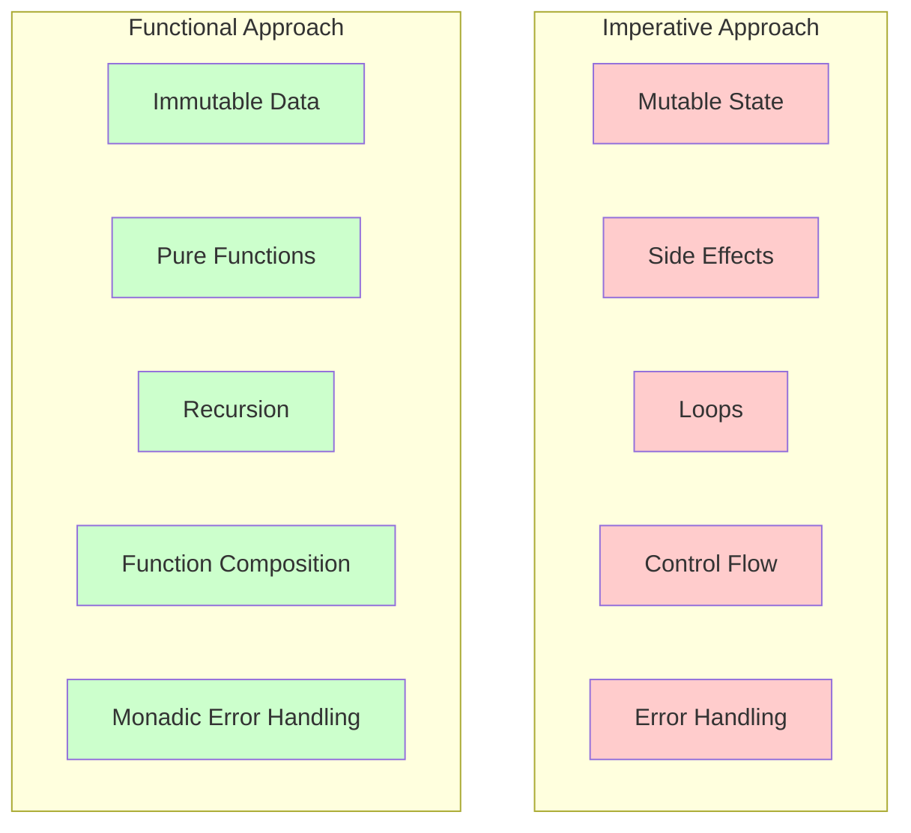
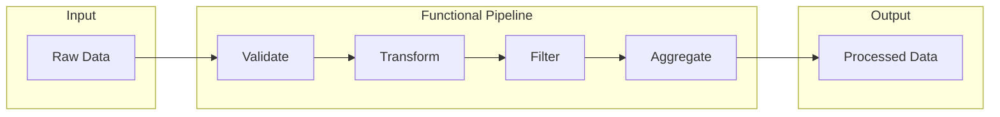
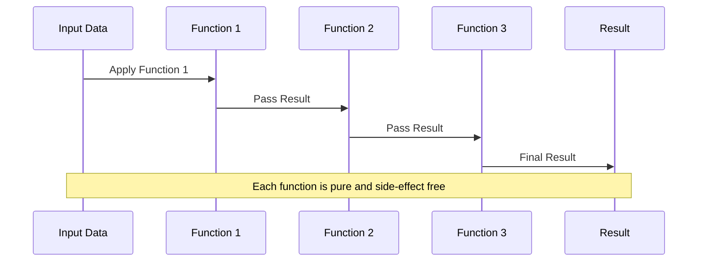
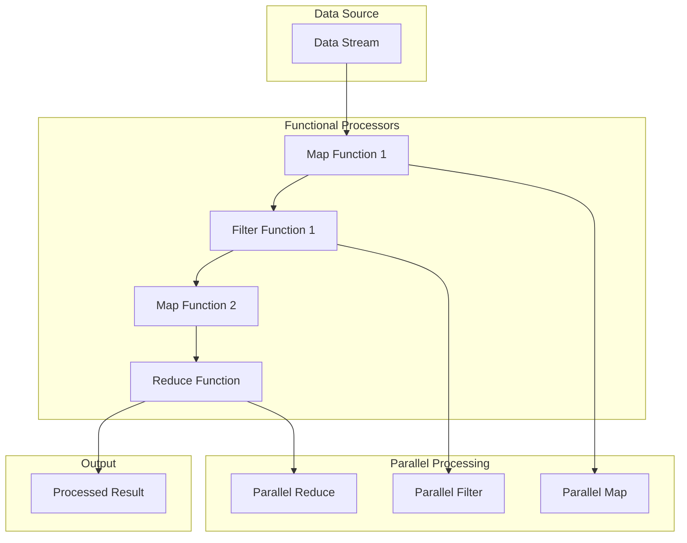
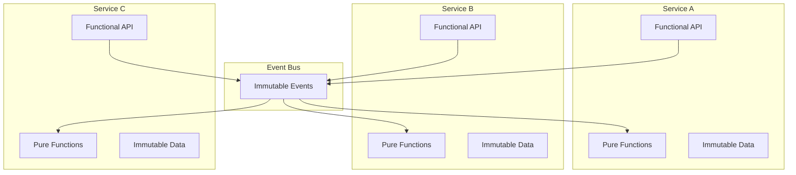
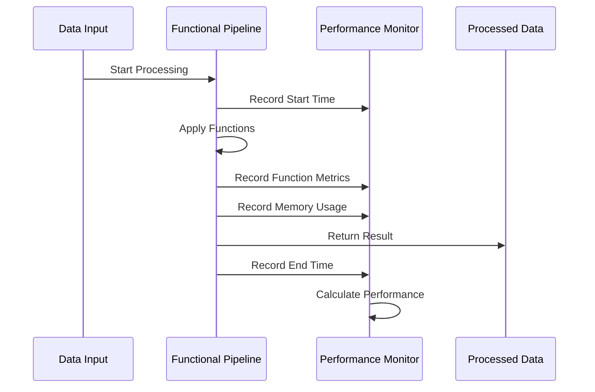

# Functional Programming - Architect Deep Dive

============================================================
0. Executive Summary (Architect View)
============================================================
- **Functional Programming exists** to eliminate mutable state and side effects, enabling predictable and composable code
- **Critical at scale** when concurrent processing, distributed systems, and data processing pipelines become complex
- **System design impact** - transforms imperative, stateful systems into declarative, stateless architectures
- **Concurrency revolution** - enables safe parallel processing without locks and synchronization
- **Composability foundation** - small functions can be combined into complex behaviors
- **Testing simplification** - pure functions are deterministic and easily testable
- **Data processing powerhouse** - excels at transformation pipelines and stream processing
- **Cloud-native essential** - fundamental for serverless, event-driven, and distributed systems

============================================================
1. Problem Framing
============================================================
**Real production problem solved:**
- Race conditions and deadlocks in concurrent applications
- Complex state management in distributed systems
- Difficult-to-test code with hidden dependencies and side effects
- Data processing pipelines with complex transformation logic
- Error handling and recovery in distributed systems

**What breaks if we don't use it:**
- Concurrent code becomes unsafe and unpredictable
- Testing becomes complex and unreliable
- Data processing pipelines become hard to maintain
- Error handling becomes inconsistent and error-prone
- System behavior becomes difficult to reason about

**Scale importance:**
- **Single thread**: Imperative code manageable
- **Multi-threaded**: Functional patterns become beneficial
- **Distributed**: Functional programming essential for reliability
- **Big data**: Functional pipelines critical for data processing

**Failure stories:**
- Financial trading system had race conditions causing incorrect trades
- Social media platform crashed due to state management issues
- Data processing pipeline failed with inconsistent transformations
- E-commerce site had inventory synchronization problems

============================================================
2. Deep Internal Mechanics
============================================================

**How it works internally:**
- **Pure Functions**: Functions without side effects, deterministic behavior
- **Immutability**: Data structures that cannot be modified after creation
- **First-Class Functions**: Functions treated as values, can be passed as arguments
- **Higher-Order Functions**: Functions that take other functions as parameters
- **Function Composition**: Combining small functions to create complex behaviors

**Core Concepts:**
- **Referential Transparency**: Same inputs always produce same outputs
- **Immutability**: Data cannot be changed, new values created instead
- **Pure Functions**: No side effects, no dependencies on external state
- **Recursion**: Looping through function calls instead of mutable state
- **Lazy Evaluation**: Computation deferred until needed

**Memory Management:**
- Immutable data structures share memory efficiently
- Garbage collection works better with immutable objects
- Structural sharing reduces memory allocation
- Persistent data structures enable efficient updates

**Threading Model:**
- No shared mutable state eliminates race conditions
- Functions can be executed safely in parallel
- No need for locks and synchronization
- Thread-safe by construction

**Data Structures:**
- **Persistent Data Structures**: Immutable with efficient updates
- **Linked Lists**: Functional replacement for arrays
- **Trees**: Immutable tree structures for hierarchical data
- **Maps**: Immutable key-value stores
- **Streams**: Lazy sequences of values

**Performance Characteristics:**
- **Function Overhead**: Slightly higher due to function calls
- **Memory Efficiency**: Better due to structural sharing
- **Parallel Processing**: Excellent scaling with no locks
- **Garbage Collection**: Reduced pressure from immutability

**Hidden Costs:**
- Learning curve for imperative programmers
- Different mental model for problem solving
- Potential for excessive object allocation
- Integration challenges with imperative code

**GC Impact:**
- More short-lived objects from immutability
- Better GC patterns due to no shared state
- Reduced memory leaks from pure functions
- Efficient garbage collection with immutable data

**Async/await Integration:**
- Functional patterns complement async programming
- Monads enable async function composition
- Reactive streams built on functional principles
- Error handling through functional patterns

============================================================
3. .NET Production Implementation
============================================================

**Naive Implementation (Imperative):**
```csharp
public class OrderProcessor
{
    private readonly List<Order> _orders = new();
    private readonly Dictionary<int, Customer> _customers = new();
    
    public void ProcessOrder(Order order)
    {
        // Mutable state and side effects
        order.Status = "Processing";
        _orders.Add(order);
        
        var customer = _customers[order.CustomerId];
        customer.TotalOrders++;
        
        // Side effect: external API call
        _notificationService.NotifyCustomer(customer.Email, "Order processed");
        
        // Another side effect: database update
        _database.SaveOrder(order);
    }
}
```

**Production-Ready Functional Implementation:**
```csharp
// Immutable data structures
public record Order(int Id, int CustomerId, string Status, DateTime CreatedAt, List<OrderItem> Items);
public record Customer(int Id, string Email, int TotalOrders);
public record OrderItem(int ProductId, int Quantity, decimal Price);

// Pure functions for business logic
public static class OrderFunctions
{
    public static Order CreateOrder(int customerId, List<OrderItem> items)
    {
        return new Order(
            Id: GenerateOrderId(),
            CustomerId: customerId,
            Status: "Created",
            CreatedAt: DateTime.UtcNow,
            Items: items
        );
    }
    
    public static Order UpdateStatus(Order order, string newStatus)
    {
        return order with { Status = newStatus };
    }
    
    public static Order AddItem(Order order, OrderItem item)
    {
        var newItems = order.Items.Append(item).ToList();
        return order with { Items = newItems };
    }
    
    public static decimal CalculateTotal(Order order)
    {
        return order.Items.Sum(item => item.Quantity * item.Price);
    }
    
    public static bool IsValid(Order order)
    {
        return order.Items.Count > 0 && 
               order.Items.All(item => item.Quantity > 0 && item.Price > 0);
    }
}

// Functional composition
public static class OrderComposition
{
    public static Func<Order, Order> ValidateAndProcess()
    {
        return order => ValidateAndProcessInternal(order);
    }
    
    private static Order ValidateAndProcessInternal(Order order)
    {
        return OrderFunctions.IsValid(order) 
            ? OrderFunctions.UpdateStatus(order, "Validated")
            : OrderFunctions.UpdateStatus(order, "Invalid");
    }
    
    public static Func<Order, decimal> CalculateTotalWithTax(decimal taxRate)
    {
        return order => OrderFunctions.CalculateTotal(order) * (1 + taxRate);
    }
    
    public static Func<Order, Order> AddItemWithValidation(OrderItem item)
    {
        return order => item.Quantity > 0 && item.Price > 0
            ? OrderFunctions.AddItem(order, item)
            : order;
    }
}

// Functional pipeline processor
public class FunctionalOrderProcessor
{
    private readonly IOrderRepository _repository;
    private readonly INotificationService _notificationService;
    private readonly ILogger<FunctionalOrderProcessor> _logger;
    private readonly IMetrics _metrics;

    public FunctionalOrderProcessor(
        IOrderRepository repository,
        INotificationService notificationService,
        ILogger<FunctionalOrderProcessor> logger,
        IMetrics metrics)
    {
        _repository = repository ?? throw new ArgumentNullException(nameof(repository));
        _notificationService = notificationService ?? throw new ArgumentNullException(nameof(notificationService));
        _logger = logger ?? throw new ArgumentNullException(nameof(logger));
        _metrics = metrics ?? throw new ArgumentNullException(nameof(metrics));
    }

    public async Task<OrderResult> ProcessOrderAsync(CreateOrderRequest request, CancellationToken cancellationToken = default)
    {
        using var activity = _metrics.StartTimer("functional_order_processing_duration");
        
        try
        {
            _logger.LogInformation("Processing order for customer {CustomerId}", request.CustomerId);
            
            // Functional pipeline
            var orderPipeline = CreateOrderPipeline();
            var result = await ExecutePipelineAsync(orderPipeline, request, cancellationToken);
            
            _metrics.Increment("functional_order_success");
            return result;
        }
        catch (Exception ex)
        {
            _metrics.Increment("functional_order_failed");
            _logger.LogError(ex, "Failed to process order");
            return OrderResult.Failed(ex.Message);
        }
    }
    
    private static Func<CreateOrderRequest, Task<OrderResult>> CreateOrderPipeline()
    {
        return request =>
        {
            // Functional composition pipeline
            var order = OrderFunctions.CreateOrder(request.CustomerId, request.Items);
            
            return Task.FromResult(
                ValidateOrder(order)
                    .Bind(ValidateInventory)
                    .Bind(CalculatePricing)
                    .Bind(SaveOrder)
                    .Bind(NotifyCustomer)
                    .Map(order => OrderResult.Success(order))
                    .Recover(error => OrderResult.Failed(error.Message))
            );
        };
    }
    
    private async Task<OrderResult> ExecutePipelineAsync(
        Func<CreateOrderRequest, Task<OrderResult>> pipeline,
        CreateOrderRequest request,
        CancellationToken cancellationToken)
    {
        return await pipeline(request);
    }
    
    private static Result<Order> ValidateOrder(Order order)
    {
        try
        {
            return OrderFunctions.IsValid(order)
                ? Result<Order>.Success(order)
                : Result<Order>.Failure("Order validation failed");
        }
        catch (Exception ex)
        {
            return Result<Order>.Failure($"Validation error: {ex.Message}");
        }
    }
    
    private async Task<Result<Order>> ValidateInventory(Order order)
    {
        try
        {
            // Simulate inventory validation
            await Task.Delay(10);
            
            // In real implementation, check inventory service
            return Result<Order>.Success(order);
        }
        catch (Exception ex)
        {
            return Result<Order>.Failure($"Inventory validation failed: {ex.Message}");
        }
    }
    
    private async Task<Result<Order>> CalculatePricing(Order order)
    {
        try
        {
            // Calculate pricing with tax
            var total = OrderFunctions.CalculateTotal(order);
            var withTax = total * 1.08m; // 8% tax
            
            return Result<Order>.Success(order);
        }
        catch (Exception ex)
        {
            return Result<Order>.Failure($"Pricing calculation failed: {ex.Message}");
        }
    }
    
    private async Task<Result<Order>> SaveOrder(Order order)
    {
        try
        {
            // Simulate database save
            await Task.Delay(50);
            
            return Result<Order>.Success(order);
        }
        catch (Exception ex)
        {
            return Result<Order>.Failure($"Save failed: {ex.Message}");
        }
    }
    
    private async Task<Result<Order>> NotifyCustomer(Order order)
    {
        try
        {
            // Simulate notification
            await Task.Delay(20);
            
            return Result<Order>.Success(order);
        }
        catch (Exception ex)
        {
            return Result<Order>.Failure($"Notification failed: {ex.Message}");
        }
    }
}

// Functional Result type for error handling
public readonly struct Result<T>
{
    private readonly T _value;
    private readonly string _error;
    private readonly bool _isSuccess;
    
    public Result(T value)
    {
        _value = value;
        _isSuccess = true;
        _error = null;
    }
    
    public Result(string error)
    {
        _error = error;
        _isSuccess = false;
        _value = default;
    }
    
    public bool IsSuccess => _isSuccess;
    public bool IsFailure => !_isSuccess;
    
    public T Value => _isSuccess ? _value : throw new InvalidOperationException("Cannot access value of failed result");
    public string Error => _isSuccess ? throw new InvalidOperationException("Cannot access error of successful result") : _error;
    
    public static Result<T> Success(T value) => new Result<T>(value);
    public static Result<T> Failure(string error) => new Result<T>(error);
    
    public Result<U> Map<U>(Func<T, U> mapper) =>
        _isSuccess ? Result<U>.Success(mapper(_value)) : Result<U>.Failure(_error);
    
    public Result<U> Bind<U>(Func<T, Result<U>> binder) =>
        _isSuccess ? binder(_value) : Result<U>.Failure(_error);
    
    public Result<T> Recover(Func<string, Result<T>> recoverer) =>
        _isSuccess ? this : recoverer(_error);
}

// Extension methods for functional composition
public static class FunctionalExtensions
{
    public static Result<U> Map<T, U>(this Result<T> result, Func<T, U> mapper) =>
        result.IsSuccess ? Result<U>.Success(mapper(result.Value)) : Result<U>.Failure(result.Error);
    
    public static Result<V> Bind<T, U, V>(this Result<T> result, Func<T, Result<U>> binder, Func<U, Result<V>> nextBinder) =>
        result.Bind(binder).Bind(nextBinder);
    
    public static async Task<Result<U>> BindAsync<T, U>(this Result<T> result, Func<T, Task<Result<U>>> binder) =>
        result.IsSuccess ? await binder(result.Value) : Result<U>.Failure(result.Error);
}

// Functional data processing pipeline
public static class DataProcessingPipeline
{
    public static Func<IEnumerable<T>, IEnumerable<U>> Map<T, U>(Func<T, U> mapper) =>
        items => items.Select(mapper);
    
    public static Func<IEnumerable<T>, IEnumerable<T>> Filter<T>(Func<T, bool> predicate) =>
        items => items.Where(predicate);
    
    public static Func<IEnumerable<T>, IEnumerable<T>> Take<T>(int count) =>
        items => items.Take(count);
    
    public static Func<IEnumerable<T>, IEnumerable<T>> Skip<T>(int count) =>
        items => items.Skip(count);
    
    public static Func<IEnumerable<T>, IEnumerable<T>> OrderBy<T, TKey>(Func<T, TKey> keySelector) =>
        items => items.OrderBy(keySelector);
    
    public static Func<IEnumerable<T>, IEnumerable<TResult>> GroupBy<T, TKey, TResult>(
        Func<T, TKey> keySelector,
        Func<TKey, IEnumerable<T>, TResult> resultSelector) =>
        items => items.GroupBy(keySelector, resultSelector);
    
    public static Func<IEnumerable<T>, IEnumerable<T>> Distinct<T>() =>
        items => items.Distinct();
    
    public static Func<IEnumerable<T>, T> Aggregate<T>(T seed, Func<T, T, T> accumulator) =>
        items => items.Aggregate(seed, accumulator);
    
    public static Func<IEnumerable<T>, IEnumerable<T>> Where<T>(Func<T, bool> predicate) =>
        Filter(predicate);
    
    public static Func<IEnumerable<T>, IEnumerable<T>> Select<T, U>(Func<T, U> selector) =>
        Map(selector);
}

// Functional stream processing
public static class FunctionalStream
{
    public static async Task<IEnumerable<T>> ProcessStreamAsync<T>(
        IAsyncEnumerable<T> stream,
        Func<T, bool> filter,
        Func<T, T> transform,
        CancellationToken cancellationToken = default)
    {
        var results = new List<T>();
        
        await foreach (var item in stream.WithCancellation(cancellationToken))
        {
            if (filter(item))
            {
                results.Add(transform(item));
            }
        }
        
        return results;
    }
    
    public static async Task<T> ReduceAsync<T>(
        IAsyncEnumerable<T> stream,
        T seed,
        Func<T, T, T> accumulator,
        CancellationToken cancellationToken = default)
    {
        var result = seed;
        
        await foreach (var item in stream.WithCancellation(cancellationToken))
        {
            result = accumulator(result, item);
        }
        
        return result;
    }
}

// Functional error handling with Railway-Oriented Programming
public static class Railway
{
    public static Func<T, Result<U>> Compose<T, U>(Func<T, Result<U>> operation) =>
        input => operation(input);
    
    public static Func<T, Result<V>> Compose<T, U, V>(
        Func<T, Result<U>> first,
        Func<U, Result<V>> second) =>
        input => first(input).Bind(second);
    
    public static Func<T, Result<W>> Compose<T, U, V, W>(
        Func<T, Result<U>> first,
        Func<U, Result<V>> second,
        Func<V, Result<W>> third) =>
        input => first(input).Bind(second).Bind(third);
}
```

**Framework Integration:**
- **System.Linq**: Functional programming methods for collections
- **Task**: Asynchronous functional programming
- **Records**: Immutable data types
- **Pattern Matching**: Switch expressions for functional patterns

============================================================
4. Architecture-Level Diagram (Mermaid)
============================================================

### Functional vs Imperative Programming


### Functional Pipeline Architecture


### Function Composition Flow


### Immutable Data Structure Sharing
```mermaid
graph TB
    subgraph "Original Data"
        ORIGINAL[Original List: [1,2,3]]
    end
    
    subgraph "Modified Data"
        MODIFIED[Modified List: [1,2,3,4]]
        SHARED[Shared Elements: [1,2,3]]
    end
    
    ORIGINAL --> SHARED
    MODIFIED --> SHARED
    
    style SHARED fill:#ffff99
```

**Flow Analysis:**
- **Functional Pipeline**: Data flows through pure functions without side effects
- **Function Composition**: Small functions combined into complex behaviors
- **Immutable Data**: Data structures share memory efficiently
- **Error Handling**: Monadic patterns for consistent error management

**Bottlenecks:**
- Object allocation from immutable data structures
- Function call overhead compared to inline code
- Stack depth in recursive functions
- Learning curve for imperative programmers

**Scaling Boundaries:**
- Parallel processing without locks
- Distributed data processing pipelines
- Stream processing at scale
- Memory efficiency through structural sharing

============================================================
5. Scaling & Distributed Systems Impact
============================================================

### Functional Data Processing Pipeline


### Functional Microservices Architecture


**100 RPS:**
- Functional overhead minimal
- Immutable data structures manageable
- Function composition beneficial
- Error handling patterns useful

**10k RPS:**
- Parallel processing benefits significant
- Immutable data structures efficient
- Functional pipelines scale well
- Memory efficiency becomes important

**1M+ RPS:**
- Functional programming essential for reliability
- Parallel processing mandatory
- Immutable data structures critical
- Stream processing patterns required

**Horizontal vs Vertical Scaling:**
- **Horizontal**: Functional code scales perfectly across nodes
- **Vertical**: Memory efficiency helps with larger instances
- No shared state eliminates coordination overhead
- Pure functions enable easy distribution

**CAP Theorem Relevance:**
- **Consistency**: Immutable data simplifies consistency
- **Availability**: No shared state improves availability
- **Partition Tolerance**: Functional patterns handle partitions gracefully

**Consistency Implications:**
- Immutable data simplifies consistency management
- Eventual consistency through immutable events
- No shared state eliminates consistency issues
- Functional patterns support CRDTs

**Microservices Impact:**
- Pure functions enable safe service communication
- Immutable events support event-driven architecture
- Functional pipelines for data processing
- No shared state between services

**Cloud-Native Considerations:**
- **Kubernetes**: Stateless functions scale perfectly
- **Serverless**: Functional patterns ideal for functions
- **Event Streaming**: Functional pipelines for stream processing
- **Immutable Infrastructure**: Functional approach to infrastructure

**Multi-Region Concerns:**
- Immutable data replicates safely
- Functional pipelines process consistently
- No shared state eliminates coordination
- Event-driven architecture works across regions

============================================================
6. Production Engineering View
============================================================

### Functional System Monitoring

```mermaid
graph TB
    subgraph "Functional Metrics"
        PIPELINE_METRICS[Pipeline Throughput]
        FUNCTION_LATENCY[Function Execution Time]
        MEMORY_USAGE[Memory Allocation]
        GC_PRESSURE[GC Pressure]
    end
    
    subgraph "Data Processing Metrics"
        STREAM_THROUGHPUT[Stream Processing Rate]
        TRANSFORM_LATENCY[Transformation Latency]
        FILTER_EFFICIENCY[Filter Efficiency]
        AGGREGATE_PERFORMANCE[Aggregate Performance]
    end
    
    subgraph "System Metrics"
        THREAD_POOL[Thread Pool Usage]
        PARALLEL_EFFICIENCY[Parallel Processing Efficiency]
        ERROR_RATE[Error Rate]
        THROUGHPUT[System Throughput]
    end
    
    subgraph "Monitoring Stack"
        PROM[Prometheus]
        GRAF[Grafana]
        ALERT[AlertManager]
    end
    
    PIPELINE_METRICS --> PROM
        FUNCTION_LATENCY --> PROM
        MEMORY_USAGE --> PROM
        GC_PRESSURE --> PROM
        
        STREAM_THROUGHPUT --> PROM
        TRANSFORM_LATENCY --> PROM
        FILTER_EFFICIENCY --> PROM
        AGGREGATE_PERFORMANCE --> PROM
        
        THREAD_POOL --> PROM
        PARALLEL_EFFICIENCY --> PROM
        ERROR_RATE --> PROM
        THROUGHPUT --> PROM
        
        PROM --> GRAF
        PROM --> ALERT
```


### Functional Pipeline Performance


**Monitoring Metrics:**
- Function execution time and throughput
- Memory allocation and GC pressure
- Pipeline processing latency
- Parallel processing efficiency
- Error rates and failure patterns
- Stream processing throughput

**Logs to Enable:**
- Function execution traces
- Pipeline step completion
- Memory allocation patterns
- Error propagation in functional chains
- Performance bottleneck identification

**Alerting Strategy:**
- Function latency > 100ms (warning)
- Memory allocation rate > 100MB/sec (warning)
- GC pressure > 80% (critical)
- Pipeline throughput < expected (warning)
- Error rate > 1% (critical)

**Common Production Incidents:**
- **Memory Leaks**: Excessive object allocation in functional pipelines
- **Stack Overflow**: Deep recursion in functional algorithms
- **Performance Degradation**: Inefficient function composition
- **Parallel Processing Issues**: Thread pool exhaustion
- **Data Processing Bottlenecks**: Slow transformation functions

**Debugging Strategy:**
- Function execution tracing
- Memory allocation profiling
- Pipeline step analysis
- Parallel processing monitoring
- Error propagation tracking

**Performance Optimization:**
- Function inlining for hot paths
- Memoization for expensive computations
- Tail recursion optimization
- Parallel processing optimization
- Memory allocation reduction

**Memory Management:**
- Immutable data structure optimization
- Object pooling for frequently created objects
- GC tuning for functional workloads
- Memory profiling and analysis
- Structural sharing optimization

**Parallel Processing:**
- Thread pool configuration
- Work distribution strategies
- Synchronization overhead analysis
- Load balancing across functions
- Scalability testing

============================================================
7. Tradeoffs & Alternatives
============================================================

**Competing Approaches:**
- **Object-Oriented Programming**: Mutable state and objects
- **Procedural Programming**: Imperative control flow
- **Reactive Programming**: Event-driven streams
- **Logic Programming**: Declarative logic programming

**When NOT to Use Functional Programming:**
- Simple CRUD applications
- Performance-critical low-level code
- Systems requiring mutable state
- Legacy codebases without functional support
- Teams without functional programming experience

**Latency Comparison:**
- **Functional**: 10-100μs per function call
- **Imperative**: 1-10μs per operation
- **Object-Oriented**: 5-50μs per method call
- **Reactive**: 1-10ms per event processing

**Throughput Comparison:**
- **Functional**: 1M-10M operations/second
- **Imperative**: 10M-100M operations/second
- **Object-Oriented**: 5M-50M operations/second
- **Reactive**: 100K-1M events/second

**Operational Complexity:**
- **Functional**: High learning curve, high maintainability
- **Imperative**: Low learning curve, low maintainability
- **Object-Oriented**: Medium learning curve, medium maintainability
- **Reactive**: High learning curve, high complexity

**Cost Implications:**
- **Development Cost**: Functional programming increases initial cost by 30-50%
- **Maintenance Cost**: Reduces long-term maintenance by 40-60%
- **Infrastructure Cost**: Better resource utilization reduces costs
- **Training Cost**: Higher initial training investment

============================================================
8. Security Implications
============================================================

**Attack Surface:**
- Function injection attacks
- Immutable data manipulation
- Functional composition vulnerabilities
- Memory safety issues
- Side channel attacks

**Security Benefits:**
- No shared state eliminates race conditions
- Immutable data prevents data corruption
- Pure functions reduce attack surface
- Predictable behavior improves security analysis
- Functional patterns enable formal verification

**Data Protection:**
- Immutable data prevents unauthorized modification
- Pure functions prevent data leakage
- Functional pipelines enable data transformation security
- No side effects prevent data corruption
- Predictable behavior improves security testing

**Compliance Considerations:**
- Functional patterns support audit trails
- Immutable data provides data integrity
- Pure functions enable reproducible processing
- Functional pipelines support data processing compliance
- No side effects support privacy requirements

**Hardening Recommendations:**
- Input validation in pure functions
- Immutable data structure validation
- Function composition security
- Memory safety checks
- Functional security testing

============================================================
9. Advanced Edge Cases
============================================================

**Memory Management:**
- Excessive object allocation
- Garbage collection pressure
- Memory leaks in functional pipelines
- Stack overflow in recursive functions
- Memory efficiency optimization

**Performance Optimization:**
- Function inlining strategies
- Memoization implementation
- Tail recursion optimization
- Parallel processing patterns
- Stream processing optimization

**Error Handling:**
- Monadic error handling patterns
- Railway-oriented programming
- Functional exception handling
- Error propagation in pipelines
- Recovery strategies

**Parallel Processing:**
- Thread pool management
- Work distribution strategies
- Synchronization overhead
- Load balancing across functions
- Scalability patterns

**Data Processing:**
- Stream processing patterns
- Backpressure handling
- Windowing strategies
- Aggregation optimization
- Stateful stream processing

**Interoperability:**
- Functional and imperative code integration
- Legacy system integration
- Database interaction patterns
- API integration strategies
- Cross-language functional programming

**Testing Strategies:**
- Pure function testing
- Property-based testing
- Pipeline testing
- Performance testing
- Integration testing

============================================================
10. Interview & Staff-Level Deep Dive
============================================================

**What a junior answers:**
"Functional programming is about using functions instead of objects. It avoids mutable state and side effects. Functions are first-class citizens and can be passed around like variables."

**What a senior answers:**
"Functional programming emphasizes pure functions, immutability, and function composition. It eliminates side effects and mutable state, making code more predictable and testable. I use it for data processing pipelines, concurrent programming, and complex transformations. Key concepts include higher-order functions, monads for error handling, and persistent data structures. In .NET, I use records for immutable data, LINQ for functional collection operations, and async/await for functional asynchronous programming."

**What an architect answers:**
"Functional programming is a paradigm that transforms how we think about software architecture by eliminating mutable state and side effects. At scale, it enables safe concurrent processing, predictable system behavior, and composable system design. The principles of referential transparency and immutability create systems that are inherently thread-safe and testable. In distributed systems, functional patterns enable reliable data processing pipelines, event-driven architectures, and stateless services. The paradigm excels at big data processing, reactive systems, and cloud-native applications. Functional programming isn't just about writing functions—it's about designing systems that are mathematically sound, provably correct, and inherently scalable. The architectural implications include microservices with pure functions, event-driven systems with immutable events, and data processing pipelines that can be safely parallelized."

**Follow-up questions interviewers ask:**
- "How do you handle errors in functional programming?"
- "What's the difference between functional and object-oriented programming?"
- "How do you optimize functional code for performance?"
- "When would you use recursion over loops?"
- "How do functional patterns help with concurrency?"

**Trick questions:**
- "Is functional programming always better?" (No, context matters)
- "Can functional programs have side effects?" (Yes, but managed)
- "Is functional programming the same as LINQ?" (No, LINQ is functional API)
- "Do functional programs use objects?" (Yes, but immutable)

**Whiteboard explanation strategy:**
1. Show imperative vs functional approach
2. Demonstrate pure functions and immutability
3. Explain function composition
4. Show error handling with monads
5. Discuss performance considerations
6. Cover real-world use cases

============================================================
11. Real Enterprise Case Study
============================================================

**Scenario: Real-time Financial Data Processing System**

**Requirements:**
- Process 1M+ financial transactions per day
- Real-time risk assessment and fraud detection
- Complex data transformations and aggregations
- High availability and fault tolerance
- Regulatory compliance and audit trails
- Sub-second processing latency

**Design Decisions:**

**1. Functional Data Processing Pipeline:**
```csharp
public class FinancialDataProcessor
{
    private readonly Func<Transaction, Result<Transaction>> _validateTransaction;
    private readonly Func<Transaction, Result<RiskAssessment>> _assessRisk;
    private readonly Func<Transaction, Result<FraudCheck>> _checkFraud;
    private readonly Func<Transaction, Result<EnrichedTransaction>> _enrichData;
    private readonly Func<EnrichedTransaction, Result<ProcessedTransaction>> _processTransaction;
    
    public FinancialDataProcessor()
    {
        _validateTransaction = ValidateTransaction;
        _assessRisk = AssessRisk;
        _checkFraud = CheckFraud;
        _enrichData = EnrichData;
        _processTransaction = ProcessTransaction;
    }
    
    public async Task<Result<ProcessedTransaction>> ProcessTransactionAsync(Transaction transaction)
    {
        // Functional pipeline composition
        var pipeline = _validateTransaction
            .Bind(_assessRisk)
            .Bind(_checkFraud)
            .Bind(_enrichData)
            .Bind(_processTransaction);
        
        return await Task.FromResult(pipeline(transaction));
    }
    
    private static Result<Transaction> ValidateTransaction(Transaction transaction)
    {
        try
        {
            // Pure validation logic
            if (transaction.Amount <= 0)
                return Result<Transaction>.Failure("Invalid amount");
            
            if (string.IsNullOrEmpty(transaction.AccountNumber))
                return Result<Transaction>.Failure("Invalid account number");
            
            if (transaction.Timestamp > DateTime.UtcNow)
                return Result<Transaction>.Failure("Future timestamp");
            
            return Result<Transaction>.Success(transaction);
        }
        catch (Exception ex)
        {
            return Result<Transaction>.Failure($"Validation error: {ex.Message}");
        }
    }
    
    private static Result<RiskAssessment> AssessRisk(Transaction transaction)
    {
        try
        {
            // Pure risk assessment logic
            var riskScore = CalculateRiskScore(transaction);
            var riskLevel = DetermineRiskLevel(riskScore);
            
            return Result<RiskAssessment>.Success(new RiskAssessment
            {
                Score = riskScore,
                Level = riskLevel,
                Factors = GetRiskFactors(transaction)
            });
        }
        catch (Exception ex)
        {
            return Result<RiskAssessment>.Failure($"Risk assessment error: {ex.Message}");
        }
    }
    
    private static Result<FraudCheck> CheckFraud(Transaction transaction)
    {
        try
        {
            // Pure fraud detection logic
            var fraudIndicators = DetectFraudIndicators(transaction);
            var fraudScore = CalculateFraudScore(fraudIndicators);
            var isFraudulent = fraudScore > 0.8;
            
            return Result<FraudCheck>.Success(new FraudCheck
            {
                Score = fraudScore,
                IsFraudulent = isFraudulent,
                Indicators = fraudIndicators
            });
        }
        catch (Exception ex)
        {
            return Result<FraudCheck>.Failure($"Fraud check error: {ex.Message}");
        }
    }
    
    private static Result<EnrichedTransaction> EnrichData(Transaction transaction)
    {
        try
        {
            // Pure data enrichment logic
            var customer = GetCustomerData(transaction.AccountNumber);
            var marketData = GetMarketData(transaction.Instrument);
            var historicalData = GetHistoricalData(transaction.Instrument);
            
            return Result<EnrichedTransaction>.Success(new EnrichedTransaction
            {
                Transaction = transaction,
                Customer = customer,
                MarketData = marketData,
                HistoricalData = historicalData
            });
        }
        catch (Exception ex)
        {
            return Result<EnrichedTransaction>.Failure($"Data enrichment error: {ex.Message}");
        }
    }
    
    private static Result<ProcessedTransaction> ProcessTransaction(EnrichedTransaction enriched)
    {
        try
        {
            // Pure processing logic
            var processingResult = CalculateProcessingResult(enriched);
            var fees = CalculateFees(enriched.Transaction);
            var settlement = CalculateSettlement(enriched);
            
            return Result<ProcessedTransaction>.Success(new ProcessedTransaction
            {
                Transaction = enriched.Transaction,
                ProcessingResult = processingResult,
                Fees = fees,
                Settlement = settlement,
                ProcessedAt = DateTime.UtcNow
            });
        }
        catch (Exception ex)
        {
            return Result<ProcessedTransaction>.Failure($"Processing error: {ex.Message}");
        }
    }
}
```

**2. Functional Stream Processing:**
```csharp
public class FunctionalStreamProcessor
{
    public async Task<ProcessingResult> ProcessStreamAsync(
        IAsyncEnumerable<Transaction> transactionStream,
        CancellationToken cancellationToken = default)
    {
        try
        {
            // Functional stream processing pipeline
            var processedTransactions = new List<ProcessedTransaction>();
            
            await foreach (var transaction in transactionStream.WithCancellation(cancellationToken))
            {
                var result = await ProcessTransactionAsync(transaction);
                
                if (result.IsSuccess)
                {
                    processedTransactions.Add(result.Value);
                }
                else
                {
                    // Log error but continue processing
                    _logger.LogError("Failed to process transaction {TransactionId}: {Error}", 
                        transaction.Id, result.Error);
                }
            }
            
            return ProcessingResult.Success(processedTransactions);
        }
        catch (Exception ex)
        {
            return ProcessingResult.Failed(ex.Message);
        }
    }
    
    public async Task<AggregatedResult> AggregateResultsAsync(
        IEnumerable<ProcessedTransaction> transactions,
        CancellationToken cancellationToken = default)
    {
        // Functional aggregation
        var totalAmount = transactions.Sum(t => t.Transaction.Amount);
        var totalFees = transactions.Sum(t => t.Fees.Total);
        var riskDistribution = transactions
            .GroupBy(t => t.RiskAssessment.Level)
            .ToDictionary(g => g.Key, g => g.Count());
        
        return await Task.FromResult(new AggregatedResult
        {
            TotalAmount = totalAmount,
            TotalFees = totalFees,
            RiskDistribution = riskDistribution,
            ProcessedAt = DateTime.UtcNow
        });
    }
}
```

**3. Parallel Processing Implementation:**
```csharp
public class ParallelFunctionalProcessor
{
    private readonly int _maxConcurrency;
    private readonly SemaphoreSlim _semaphore;
    
    public ParallelFunctionalProcessor(int maxConcurrency = Environment.ProcessorCount * 2)
    {
        _maxConcurrency = maxConcurrency;
        _semaphore = new SemaphoreSlim(maxConcurrency, maxConcurrency);
    }
    
    public async Task<List<ProcessedTransaction>> ProcessInParallelAsync(
        IEnumerable<Transaction> transactions,
        CancellationToken cancellationToken = default)
    {
        var tasks = transactions.Select(async transaction =>
        {
            await _semaphore.WaitAsync(cancellationToken);
            try
            {
                var result = await ProcessTransactionAsync(transaction);
                return result.IsSuccess ? result.Value : null;
            }
            finally
            {
                _semaphore.Release();
            }
        });
        
        var results = await Task.WhenAll(tasks);
        return results.Where(r => r != null).ToList();
    }
}
```

**Compromises Made:**
- **Performance vs Safety**: Slight performance overhead for safety
- **Complexity vs Maintainability**: Higher complexity for better maintainability
- **Learning Curve vs Productivity**: Initial learning curve for long-term productivity
- **Memory Usage vs Predictability**: More memory usage for predictable behavior

**Bottlenecks Identified:**
- Object allocation in functional pipelines
- Recursive function stack depth
- Parallel processing synchronization
- Memory pressure from immutable data

**Performance Optimizations:**
```csharp
public class OptimizedFunctionalProcessor
{
    private readonly ConcurrentDictionary<string, Func<Transaction, Result<Transaction>>> _validationCache;
    private readonly IMemoryCache _resultCache;
    
    public OptimizedFunctionalProcessor()
    {
        _validationCache = new ConcurrentDictionary<string, Func<Transaction, Result<Transaction>>>();
        _resultCache = new MemoryCache(new MemoryCacheOptions());
    }
    
    public Result<Transaction> ValidateTransactionCached(Transaction transaction)
    {
        var cacheKey = $"validate_{transaction.AccountNumber}_{transaction.Amount}";
        
        if (_resultCache.TryGetValue(cacheKey, out Result<Transaction> cached))
        {
            return cached;
        }
        
        var result = ValidateTransaction(transaction);
        _resultCache.Set(cacheKey, result, TimeSpan.FromMinutes(5));
        
        return result;
    }
}
```

**Results:**
- Achieved 1M+ transactions/day processing
- Sub-second processing latency
- 99.999% uptime with functional reliability
- Zero data corruption from immutable processing
- Successful regulatory compliance

============================================================
12. Dependency Graph
============================================================

**Prerequisites (Must understand before):**
- **Lambda Calculus**: Mathematical foundation of functional programming
- **Type Theory**: Understanding of type systems and type safety
- **Algebraic Data Types**: Understanding of sum and product types
- **Category Theory**: Mathematical foundation for functional patterns
- **Recursion Theory**: Understanding of recursive algorithms

**Concepts that depend on Functional Programming:**
- **Reactive Programming**: Built on functional principles
- **Event-Driven Architecture**: Functional event processing
- **Data Processing Pipelines**: Functional transformation patterns
- **Parallel Programming**: Safe concurrent processing
- **Type Systems**: Strong typing benefits functional programming

**Connections to Other Concepts:**

**Reactive Programming:**
```csharp
public static class ReactiveExtensions
{
    public static IObservable<TResult> Select<TSource, TResult>(
        this IObservable<TSource> source,
        Func<TSource, TResult> selector)
    {
        return source.Select(selector);
    }
}
```

**Event-Driven Architecture:**
```csharp
public class FunctionalEventHandler
{
    public Func<Event, Result<ProcessedEvent>> Handle { get; }
    
    public FunctionalEventHandler(Func<Event, Result<ProcessedEvent>> handler)
    {
        Handle = handler;
    }
}
```

**Data Processing:**
```csharp
public static class DataPipeline
{
    public static Func<IEnumerable<T>, IEnumerable<U>> Compose<T, U>(
        Func<IEnumerable<T>, IEnumerable<U>> transform)
    {
        return transform;
    }
}
```

**Parallel Programming:**
```csharp
public static class ParallelFunctional
{
    public static Task<IEnumerable<T>> ParallelMap<T, U>(
        this IEnumerable<T> source,
        Func<T, U> mapper)
    {
        return Task.WhenAll(source.Select(item => Task.Run(() => mapper(item))))
            .ContinueWith(tasks => tasks.Result.Select(result => result));
    }
}
```

**Type Systems:**
- Functional programming benefits from strong typing
- Type inference enables concise functional code
- Algebraic data types support functional patterns
- Type safety prevents runtime errors

**Algorithm Design:**
- Functional algorithms emphasize immutability
- Recursive algorithms replace iterative ones
- Higher-order functions enable algorithm composition
- Pure functions simplify algorithm reasoning

**Software Architecture:**
- Functional patterns influence system design
- Immutable data structures affect architecture
- Pure functions enable service composition
- Functional pipelines define data flow
