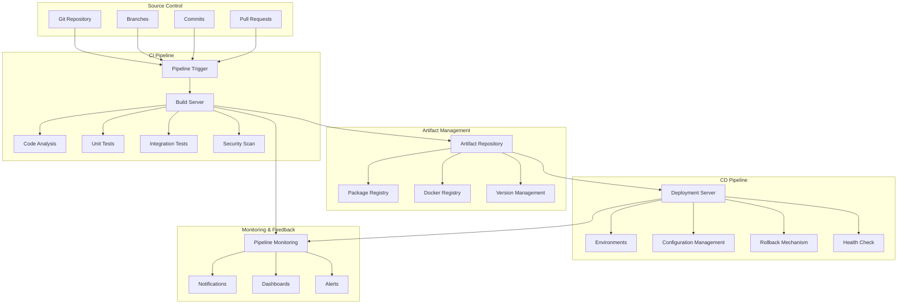
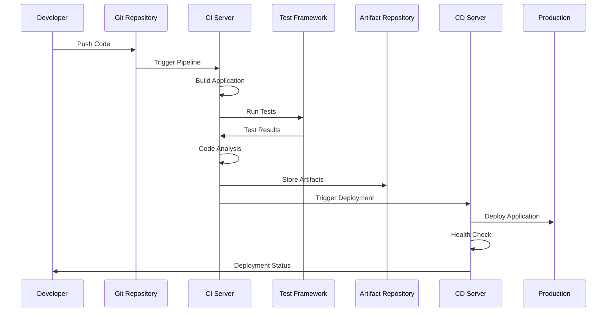
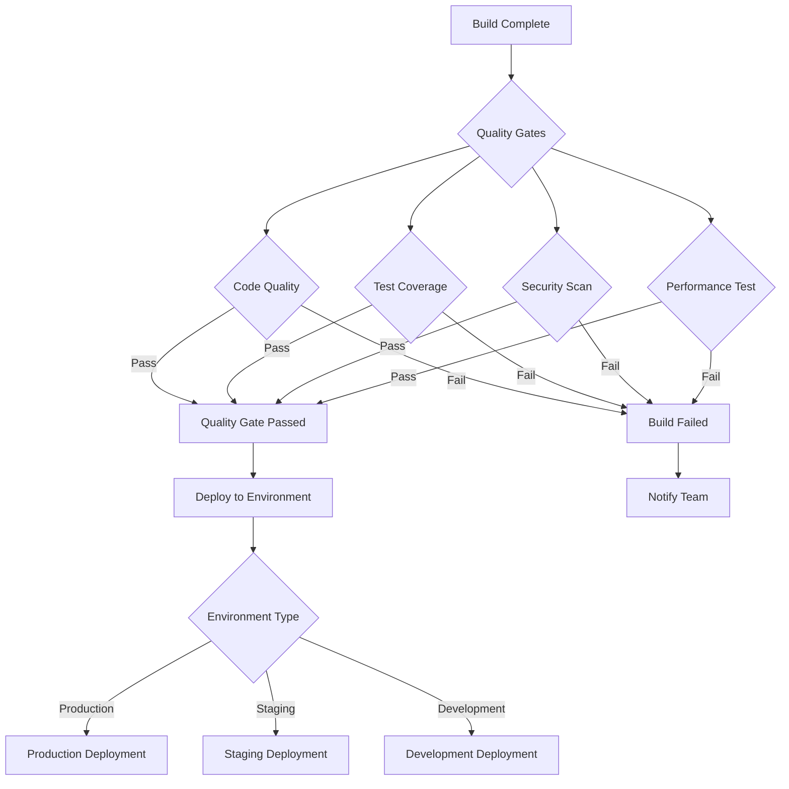

# CI/CD Pipeline - Architect Deep Dive

============================================================
0. Executive Summary (Architect View)
============================================================
- **CI/CD exists** to automate software delivery from code commit to production deployment
- **Critical at scale** when applications need rapid, reliable, and frequent releases
- **System design impact** - transforms software delivery from manual to automated pipelines
- **Delivery automation** - provides essential automation for build, test, and deployment
- **Quality assurance** - ensures code quality and testing standards
- **Release velocity** - enables rapid and reliable releases
- **DevOps integration** - integrates development and operations workflows
- **Risk reduction** - reduces deployment risks through automation and testing

============================================================
1. Problem Framing
============================================================
**Real production problem solved:**
- Manual deployment processes and human errors
- Slow release cycles and time-to-market delays
- Inconsistent environments and deployment issues
- Poor code quality and testing coverage
- High risk and stress during releases

**What breaks if we don't understand CI/CD:**
- Slow and unreliable deployment processes
- Poor code quality and frequent bugs
- High deployment failure rates
- Inconsistent environments and configuration drift
- Inability to implement DevOps practices

**Scale importance:**
- **Small applications**: CI/CD benefits noticeable
- **Medium applications**: CI/CD critical for reliability
- **Large applications**: CI/CD essential for scale
- **Enterprise systems**: CI/CD mandatory for DevOps

**Failure stories:**
- E-commerce platform had deployment failures during peak traffic
- SaaS application had bugs in production due to poor testing
- Financial system had downtime during manual deployments
- Gaming platform had slow release cycles

============================================================
2. Deep Internal Mechanics
============================================================

**CI/CD Fundamentals:**
- **Continuous Integration**: Automated build and integration
- **Continuous Delivery**: Automated testing and delivery
- **Continuous Deployment**: Automated production deployment
- **Pipeline Automation**: End-to-end automation
- **Feedback Loops**: Rapid feedback and iteration

**Core Components:**
- **Source Control**: Version control and code management
- **Build System**: Automated build and compilation
- **Test Automation**: Automated testing and validation
- **Artifact Repository**: Build artifact storage
- **Deployment System**: Automated deployment and release
- **Monitoring**: Pipeline monitoring and alerting

**Key Concepts:**
- **Pipeline**: Automated workflow stages
- **Triggers**: Pipeline initiation events
- **Artifacts**: Build outputs and packages
- **Environments**: Deployment environments
- **Rollback**: Rollback and recovery mechanisms

**Pipeline Stages:**
- **Source**: Code checkout and validation
- **Build**: Compilation and packaging
- **Test**: Automated testing and validation
- **Package**: Artifact creation and storage
- **Deploy**: Environment deployment
- **Verify**: Post-deployment verification

**Quality Gates:**
- **Code Quality**: Static analysis and quality metrics
- **Test Coverage**: Test coverage requirements
- **Security Scans**: Vulnerability scanning
- **Performance Tests**: Performance validation
- **Compliance Checks**: Regulatory compliance

**Data Structures:**
- **Pipeline Registry**: Pipeline configuration and state
- **Build Registry**: Build metadata and artifacts
- **Test Registry**: Test results and coverage
- **Deployment Registry**: Deployment metadata and status
- **Environment Registry**: Environment configuration

**Performance Characteristics:**
- **Build Time**: 1-30 minutes
- **Test Time**: 5-60 minutes
- **Deployment Time**: 1-10 minutes
- **Pipeline Latency**: 10-120 minutes
- **Success Rate**: 90-99%

============================================================
3. .NET Production Implementation
============================================================

**Naive Implementation (Manual Deployment):**
```csharp
// Manual deployment script
public class ManualDeployment
{
    public void DeployApplication()
    {
        // Manual steps
        Console.WriteLine("1. Get latest code from Git");
        Console.WriteLine("2. Build application locally");
        Console.WriteLine("3. Run tests manually");
        Console.WriteLine("4. Create deployment package");
        Console.WriteLine("5. Copy files to server");
        Console.WriteLine("6. Configure IIS");
        Console.WriteLine("7. Test deployment manually");
        Console.WriteLine("8. Update load balancer");
    }
}
```

**Production-Ready CI/CD Implementation:**
```csharp
// CI/CD Configuration
public class CICDConfiguration
{
    public string RepositoryName { get; set; } = "myapp";
    public string BranchName { get; set; } = "main";
    public string BuildConfiguration { get; set; } = "Release";
    public List<string> TestProjects { get; set; } = new();
    public List<string> DeploymentEnvironments { get; set; } = new();
    public bool EnableCodeAnalysis { get; set; } = true;
    public bool EnableSecurityScanning { get; set; } = true;
    public bool EnablePerformanceTesting { get; set; } = true;
    public int MinimumTestCoverage { get; set; } = 80;
    public List<ApprovalStage> ApprovalStages { get; set; } = new();
}

public class ApprovalStage
{
    public string StageName { get; set; }
    public List<string> Approvers { get; set; } = new();
    public bool RequireAllApprovers { get; set; } = false;
}

// CI/CD Pipeline Service
public interface ICICDPipelineService
{
    Task<PipelineResult> RunPipelineAsync(CICDConfiguration config);
    Task<BuildResult> BuildAsync(BuildRequest request);
    Task<TestResult> TestAsync(TestRequest request);
    Task<DeploymentResult> DeployAsync(DeploymentRequest request);
    Task<bool> RollbackAsync(string deploymentId);
    Task<PipelineStatus> GetPipelineStatusAsync(string pipelineId);
}

public class CICDPipelineService : ICICDPipelineService
{
    private readonly IBuildService _buildService;
    private readonly ITestService _testService;
    private readonly IDeploymentService _deploymentService;
    private readonly IQualityGateService _qualityGateService;
    private readonly INotificationService _notificationService;
    private readonly ILogger<CICDPipelineService> _logger;
    private readonly IMetrics _metrics;

    public CICDPipelineService(
        IBuildService buildService,
        ITestService testService,
        IDeploymentService deploymentService,
        IQualityGateService qualityGateService,
        INotificationService notificationService,
        ILogger<CICDPipelineService> logger,
        IMetrics metrics)
    {
        _buildService = buildService ?? throw new ArgumentNullException(nameof(buildService));
        _testService = testService ?? throw new ArgumentNullException(nameof(testService));
        _deploymentService = deploymentService ?? throw new ArgumentNullException(nameof(deploymentService));
        _qualityGateService = qualityGateService ?? throw new ArgumentNullException(nameof(qualityGateService));
        _notificationService = notificationService ?? throw new ArgumentNullException(nameof(notificationService));
        _logger = logger ?? throw new ArgumentNullException(nameof(logger));
        _metrics = metrics ?? throw new ArgumentNullException(nameof(metrics));
    }

    public async Task<PipelineResult> RunPipelineAsync(CICDConfiguration config)
    {
        using var activity = _metrics.StartTimer("cicd_pipeline_duration");
        
        try
        {
            var pipelineId = Guid.NewGuid().ToString();
            _logger.LogInformation("Starting CI/CD pipeline: {PipelineId}", pipelineId);
            
            var result = new PipelineResult
            {
                PipelineId = pipelineId,
                StartTime = DateTime.UtcNow,
                Stages = new List<StageResult>()
            };
            
            // Stage 1: Source
            var sourceResult = await RunSourceStageAsync(config, pipelineId);
            result.Stages.Add(sourceResult);
            
            if (!sourceResult.Success)
            {
                result.Success = false;
                result.ErrorMessage = "Source stage failed";
                await _notificationService.SendPipelineFailureAsync(result);
                return result;
            }
            
            // Stage 2: Build
            var buildResult = await RunBuildStageAsync(config, pipelineId);
            result.Stages.Add(buildResult);
            
            if (!buildResult.Success)
            {
                result.Success = false;
                result.ErrorMessage = "Build stage failed";
                await _notificationService.SendPipelineFailureAsync(result);
                return result;
            }
            
            // Stage 3: Test
            var testResult = await RunTestStageAsync(config, pipelineId, buildResult.ArtifactPath);
            result.Stages.Add(testResult);
            
            if (!testResult.Success)
            {
                result.Success = false;
                result.ErrorMessage = "Test stage failed";
                await _notificationService.SendPipelineFailureAsync(result);
                return result;
            }
            
            // Stage 4: Quality Gates
            var qualityResult = await RunQualityGateStageAsync(config, pipelineId, buildResult, testResult);
            result.Stages.Add(qualityResult);
            
            if (!qualityResult.Success)
            {
                result.Success = false;
                result.ErrorMessage = "Quality gate stage failed";
                await _notificationService.SendPipelineFailureAsync(result);
                return result;
            }
            
            // Stage 5: Deploy (for each environment)
            foreach (var environment in config.DeploymentEnvironments)
            {
                var deployResult = await RunDeployStageAsync(config, pipelineId, environment, buildResult.ArtifactPath);
                result.Stages.Add(deployResult);
                
                if (!deployResult.Success)
                {
                    result.Success = false;
                    result.ErrorMessage = $"Deploy stage failed for {environment}";
                    await _notificationService.SendPipelineFailureAsync(result);
                    return result;
                }
            }
            
            result.Success = true;
            result.EndTime = DateTime.UtcNow;
            result.Duration = result.EndTime - result.StartTime;
            
            _metrics.Increment("cicd_pipelines_success");
            _logger.LogInformation("CI/CD pipeline completed successfully: {PipelineId}", pipelineId);
            
            await _notificationService.SendPipelineSuccessAsync(result);
            
            return result;
        }
        catch (Exception ex)
        {
            _metrics.Increment("cicd_pipelines_error");
            _logger.LogError(ex, "Error running CI/CD pipeline");
            throw;
        }
    }

    public async Task<BuildResult> BuildAsync(BuildRequest request)
    {
        using var activity = _metrics.StartTimer("cicd_build_duration");
        
        try
        {
            _logger.LogInformation("Starting build: {Project}", request.ProjectName);
            
            var result = await _buildService.BuildAsync(request);
            
            _metrics.Increment("cicd_builds_completed");
            _logger.LogInformation("Build completed: {Project} - {Success}", request.ProjectName, result.Success);
            
            return result;
        }
        catch (Exception ex)
        {
            _metrics.Increment("cicd_builds_error");
            _logger.LogError(ex, "Error building project: {Project}", request.ProjectName);
            throw;
        }
    }

    public async Task<TestResult> TestAsync(TestRequest request)
    {
        using var activity = _metrics.StartTimer("cicd_test_duration");
        
        try
        {
            _logger.LogInformation("Starting tests: {Project}", request.ProjectName);
            
            var result = await _testService.TestAsync(request);
            
            _metrics.Increment("cicd_tests_completed");
            _logger.LogInformation("Tests completed: {Project} - {Success}", request.ProjectName, result.Success);
            
            return result;
        }
        catch (Exception ex)
        {
            _metrics.Increment("cicd_tests_error");
            _logger.LogError(ex, "Error running tests: {Project}", request.ProjectName);
            throw;
        }
    }

    public async Task<DeploymentResult> DeployAsync(DeploymentRequest request)
    {
        using var activity = _metrics.StartTimer("cicd_deploy_duration");
        
        try
        {
            _logger.LogInformation("Starting deployment: {Project} to {Environment}", 
                request.ProjectName, request.Environment);
            
            var result = await _deploymentService.DeployAsync(request);
            
            _metrics.Increment("cicd_deployments_completed");
            _logger.LogInformation("Deployment completed: {Project} to {Environment} - {Success}", 
                request.ProjectName, request.Environment, result.Success);
            
            return result;
        }
        catch (Exception ex)
        {
            _metrics.Increment("cicd_deployments_error");
            _logger.LogError(ex, "Error deploying project: {Project} to {Environment}", 
                request.ProjectName, request.Environment);
            throw;
        }
    }

    public async Task<bool> RollbackAsync(string deploymentId)
    {
        using var activity = _metrics.StartTimer("cicd_rollback_duration");
        
        try
        {
            _logger.LogInformation("Starting rollback: {DeploymentId}", deploymentId);
            
            var result = await _deploymentService.RollbackAsync(deploymentId);
            
            if (result)
            {
                _metrics.Increment("cicd_rollbacks_success");
                _logger.LogInformation("Rollback completed: {DeploymentId}", deploymentId);
            }
            else
            {
                _metrics.Increment("cicd_rollbacks_error");
                _logger.LogError("Rollback failed: {DeploymentId}", deploymentId);
            }
            
            return result;
        }
        catch (Exception ex)
        {
            _metrics.Increment("cicd_rollbacks_error");
            _logger.LogError(ex, "Error rolling back deployment: {DeploymentId}", deploymentId);
            throw;
        }
    }

    public async Task<PipelineStatus> GetPipelineStatusAsync(string pipelineId)
    {
        try
        {
            // Implementation to get pipeline status
            await Task.Delay(100); // Simulate database call
            
            return new PipelineStatus
            {
                PipelineId = pipelineId,
                Status = "Running",
                CurrentStage = "Build",
                Progress = 45,
                EstimatedCompletion = DateTime.UtcNow.AddMinutes(15)
            };
        }
        catch (Exception ex)
        {
            _logger.LogError(ex, "Error getting pipeline status: {PipelineId}", pipelineId);
            throw;
        }
    }

    private async Task<StageResult> RunSourceStageAsync(CICDConfiguration config, string pipelineId)
    {
        using var activity = _metrics.StartTimer("cicd_source_stage_duration");
        
        try
        {
            _logger.LogInformation("Running source stage: {PipelineId}", pipelineId);
            
            // Checkout code
            var checkoutResult = await CheckoutSourceAsync(config);
            
            // Validate source
            var validationResult = await ValidateSourceAsync(config);
            
            var result = new StageResult
            {
                StageName = "Source",
                Success = checkoutResult && validationResult,
                StartTime = DateTime.UtcNow,
                EndTime = DateTime.UtcNow,
                Duration = TimeSpan.FromMinutes(2)
            };
            
            _metrics.Increment("cicd_source_stages_completed");
            
            return result;
        }
        catch (Exception ex)
        {
            _metrics.Increment("cicd_source_stages_error");
            _logger.LogError(ex, "Error in source stage: {PipelineId}", pipelineId);
            throw;
        }
    }

    private async Task<StageResult> RunBuildStageAsync(CICDConfiguration config, string pipelineId)
    {
        using var activity = _metrics.StartTimer("cicd_build_stage_duration");
        
        try
        {
            _logger.LogInformation("Running build stage: {PipelineId}", pipelineId);
            
            var buildRequest = new BuildRequest
            {
                ProjectName = config.RepositoryName,
                Configuration = config.BuildConfiguration,
                SourcePath = GetSourcePath(config)
            };
            
            var buildResult = await _buildService.BuildAsync(buildRequest);
            
            var result = new StageResult
            {
                StageName = "Build",
                Success = buildResult.Success,
                StartTime = DateTime.UtcNow,
                EndTime = DateTime.UtcNow,
                Duration = buildResult.Duration,
                ArtifactPath = buildResult.ArtifactPath
            };
            
            _metrics.Increment("cicd_build_stages_completed");
            
            return result;
        }
        catch (Exception ex)
        {
            _metrics.Increment("cicd_build_stages_error");
            _logger.LogError(ex, "Error in build stage: {PipelineId}", pipelineId);
            throw;
        }
    }

    private async Task<StageResult> RunTestStageAsync(CICDConfiguration config, string pipelineId, string artifactPath)
    {
        using var activity = _metrics.StartTimer("cicd_test_stage_duration");
        
        try
        {
            _logger.LogInformation("Running test stage: {PipelineId}", pipelineId);
            
            var testRequest = new TestRequest
            {
                ProjectName = config.RepositoryName,
                TestProjects = config.TestProjects,
                ArtifactPath = artifactPath
            };
            
            var testResult = await _testService.TestAsync(testRequest);
            
            var result = new StageResult
            {
                StageName = "Test",
                Success = testResult.Success,
                StartTime = DateTime.UtcNow,
                EndTime = DateTime.UtcNow,
                Duration = testResult.Duration,
                TestResults = testResult.Results
            };
            
            _metrics.Increment("cicd_test_stages_completed");
            
            return result;
        }
        catch (Exception ex)
        {
            _metrics.Increment("cicd_test_stages_error");
            _logger.LogError(ex, "Error in test stage: {PipelineId}", pipelineId);
            throw;
        }
    }

    private async Task<StageResult> RunQualityGateStageAsync(CICDConfiguration config, string pipelineId, BuildResult buildResult, TestResult testResult)
    {
        using var activity = _metrics.StartTimer("cicd_quality_gate_stage_duration");
        
        try
        {
            _logger.LogInformation("Running quality gate stage: {PipelineId}", pipelineId);
            
            var qualityRequest = new QualityGateRequest
            {
                ProjectName = config.RepositoryName,
                BuildResult = buildResult,
                TestResult = testResult,
                MinimumTestCoverage = config.MinimumTestCoverage,
                EnableCodeAnalysis = config.EnableCodeAnalysis,
                EnableSecurityScanning = config.EnableSecurityScanning
            };
            
            var qualityResult = await _qualityGateService.ValidateAsync(qualityRequest);
            
            var result = new StageResult
            {
                StageName = "QualityGate",
                Success = qualityResult.Passed,
                StartTime = DateTime.UtcNow,
                EndTime = DateTime.UtcNow,
                Duration = qualityResult.Duration,
                QualityMetrics = qualityResult.Metrics
            };
            
            _metrics.Increment("cicd_quality_gate_stages_completed");
            
            return result;
        }
        catch (Exception ex)
        {
            _metrics.Increment("cicd_quality_gate_stages_error");
            _logger.LogError(ex, "Error in quality gate stage: {PipelineId}", pipelineId);
            throw;
        }
    }

    private async Task<StageResult> RunDeployStageAsync(CICDConfiguration config, string pipelineId, string environment, string artifactPath)
    {
        using var activity = _metrics.StartTimer("cicd_deploy_stage_duration");
        
        try
        {
            _logger.LogInformation("Running deploy stage: {PipelineId} to {Environment}", pipelineId, environment);
            
            // Check for approval requirements
            var approvalStage = config.ApprovalStages.FirstOrDefault(s => s.StageName == environment);
            if (approvalStage != null)
            {
                var approvalResult = await WaitForApprovalAsync(pipelineId, environment, approvalStage);
                if (!approvalResult)
                {
                    return new StageResult
                    {
                        StageName = $"Deploy-{environment}",
                        Success = false,
                        StartTime = DateTime.UtcNow,
                        EndTime = DateTime.UtcNow,
                        Duration = TimeSpan.FromMinutes(1),
                        ErrorMessage = "Deployment approval required"
                    };
                }
            }
            
            var deployRequest = new DeploymentRequest
            {
                ProjectName = config.RepositoryName,
                Environment = environment,
                ArtifactPath = artifactPath,
                PipelineId = pipelineId
            };
            
            var deploymentResult = await _deploymentService.DeployAsync(deployRequest);
            
            var result = new StageResult
            {
                StageName = $"Deploy-{environment}",
                Success = deploymentResult.Success,
                StartTime = DateTime.UtcNow,
                EndTime = DateTime.UtcNow,
                Duration = deploymentResult.Duration,
                DeploymentId = deploymentResult.DeploymentId
            };
            
            _metrics.Increment("cicd_deploy_stages_completed");
            
            return result;
        }
        catch (Exception ex)
        {
            _metrics.Increment("cicd_deploy_stages_error");
            _logger.LogError(ex, "Error in deploy stage: {PipelineId} to {Environment}", pipelineId, environment);
            throw;
        }
    }

    private async Task<bool> CheckoutSourceAsync(CICDConfiguration config)
    {
        // Implementation to checkout source code
        await Task.Delay(1000); // Simulate git checkout
        return true;
    }

    private async Task<bool> ValidateSourceAsync(CICDConfiguration config)
    {
        // Implementation to validate source code
        await Task.Delay(500); // Simulate validation
        return true;
    }

    private string GetSourcePath(CICDConfiguration config)
    {
        return $"/src/{config.RepositoryName}";
    }

    private async Task<bool> WaitForApprovalAsync(string pipelineId, string environment, ApprovalStage approvalStage)
    {
        // Implementation to wait for approval
        _logger.LogInformation("Waiting for approval: {PipelineId} - {Environment}", pipelineId, environment);
        
        // In real implementation, this would wait for manual approval
        await Task.Delay(60000); // Simulate 1 minute approval wait
        
        return true; // For demonstration
    }
}

// Enhanced CI/CD Controller
[ApiController]
[Route("api/[controller]")]
public class CICDController : ControllerBase
{
    private readonly ICICDPipelineService _pipelineService;
    private readonly ILogger<CICDController> _logger;
    private readonly IMetrics _metrics;

    public CICDController(
        ICICDPipelineService pipelineService,
        ILogger<CICDController> logger,
        IMetrics metrics)
    {
        _pipelineService = pipelineService ?? throw new ArgumentNullException(nameof(pipelineService));
        _logger = logger ?? throw new ArgumentNullException(nameof(logger));
        _metrics = metrics ?? throw new ArgumentNullException(nameof(metrics));
    }

    [HttpPost("pipeline/run")]
    public async Task<ActionResult<PipelineResult>> RunPipeline([FromBody] CICDConfiguration config)
    {
        try
        {
            _logger.LogInformation("Starting CI/CD pipeline");
            
            var result = await _pipelineService.RunPipelineAsync(config);
            
            return Ok(result);
        }
        catch (Exception ex)
        {
            _logger.LogError(ex, "Error starting CI/CD pipeline");
            throw;
        }
    }

    [HttpPost("build")]
    public async Task<ActionResult<BuildResult>> Build([FromBody] BuildRequest request)
    {
        try
        {
            var result = await _pipelineService.BuildAsync(request);
            return Ok(result);
        }
        catch (Exception ex)
        {
            _logger.LogError(ex, "Error building project");
            throw;
        }
    }

    [HttpPost("test")]
    public async Task<ActionResult<TestResult>> Test([FromBody] TestRequest request)
    {
        try
        {
            var result = await _pipelineService.TestAsync(request);
            return Ok(result);
        }
        catch (Exception ex)
        {
            _logger.LogError(ex, "Error running tests");
            throw;
        }
    }

    [HttpPost("deploy")]
    public async Task<ActionResult<DeploymentResult>> Deploy([FromBody] DeploymentRequest request)
    {
        try
        {
            var result = await _pipelineService.DeployAsync(request);
            return Ok(result);
        }
        catch (Exception ex)
        {
            _logger.LogError(ex, "Error deploying project");
            throw;
        }
    }

    [HttpPost("rollback/{deploymentId}")]
    public async Task<ActionResult> Rollback(string deploymentId)
    {
        try
        {
            var result = await _pipelineService.RollbackAsync(deploymentId);
            
            if (result)
            {
                return Ok(new { Message = $"Rollback successful for deployment {deploymentId}" });
            }
            else
            {
                return BadRequest(new { Error = $"Rollback failed for deployment {deploymentId}" });
            }
        }
        catch (Exception ex)
        {
            _logger.LogError(ex, "Error rolling back deployment: {DeploymentId}", deploymentId);
            throw;
        }
    }

    [HttpGet("pipeline/{pipelineId}/status")]
    public async Task<ActionResult<PipelineStatus>> GetPipelineStatus(string pipelineId)
    {
        try
        {
            var status = await _pipelineService.GetPipelineStatusAsync(pipelineId);
            return Ok(status);
        }
        catch (Exception ex)
        {
            _logger.LogError(ex, "Error getting pipeline status: {PipelineId}", pipelineId);
            throw;
        }
    }
}

// Request/Response Models
public class PipelineResult
{
    public string PipelineId { get; set; }
    public bool Success { get; set; }
    public string ErrorMessage { get; set; }
    public DateTime StartTime { get; set; }
    public DateTime EndTime { get; set; }
    public TimeSpan Duration { get; set; }
    public List<StageResult> Stages { get; set; }
}

public class StageResult
{
    public string StageName { get; set; }
    public bool Success { get; set; }
    public string ErrorMessage { get; set; }
    public DateTime StartTime { get; set; }
    public DateTime EndTime { get; set; }
    public TimeSpan Duration { get; set; }
    public string ArtifactPath { get; set; }
    public string DeploymentId { get; set; }
    public List<TestResult> TestResults { get; set; }
    public QualityMetrics QualityMetrics { get; set; }
}

public class BuildRequest
{
    public string ProjectName { get; set; }
    public string Configuration { get; set; }
    public string SourcePath { get; set; }
}

public class BuildResult
{
    public bool Success { get; set; }
    public string ErrorMessage { get; set; }
    public TimeSpan Duration { get; set; }
    public string ArtifactPath { get; set; }
    public List<string> Warnings { get; set; }
}

public class TestRequest
{
    public string ProjectName { get; set; }
    public List<string> TestProjects { get; set; }
    public string ArtifactPath { get; set; }
}

public class TestResult
{
    public bool Success { get; set; }
    public string ErrorMessage { get; set; }
    public TimeSpan Duration { get; set; }
    public List<TestExecution> Results { get; set; }
    public double CoveragePercentage { get; set; }
}

public class TestExecution
{
    public string TestName { get; set; }
    public bool Passed { get; set; }
    public string ErrorMessage { get; set; }
    public TimeSpan Duration { get; set; }
}

public class DeploymentRequest
{
    public string ProjectName { get; set; }
    public string Environment { get; set; }
    public string ArtifactPath { get; set; }
    public string PipelineId { get; set; }
}

public class DeploymentResult
{
    public bool Success { get; set; }
    public string ErrorMessage { get; set; }
    public TimeSpan Duration { get; set; }
    public string DeploymentId { get; set; }
    public string Environment { get; set; }
    public DateTime DeploymentTime { get; set; }
}

public class QualityGateRequest
{
    public string ProjectName { get; set; }
    public BuildResult BuildResult { get; set; }
    public TestResult TestResult { get; set; }
    public int MinimumTestCoverage { get; set; }
    public bool EnableCodeAnalysis { get; set; }
    public bool EnableSecurityScanning { get; set; }
}

public class QualityGateResult
{
    public bool Passed { get; set; }
    public string ErrorMessage { get; set; }
    public TimeSpan Duration { get; set; }
    public QualityMetrics Metrics { get; set; }
}

public class QualityMetrics
{
    public double CodeCoverage { get; set; }
    public int CodeQualityScore { get; set; }
    public List<SecurityVulnerability> SecurityIssues { get; set; }
    public List<CodeIssue> CodeIssues { get; set; }
}

public class SecurityVulnerability
{
    public string Severity { get; set; }
    public string Description { get; set; }
    public string File { get; set; }
    public int Line { get; set; }
}

public class CodeIssue
{
    public string Severity { get; set; }
    public string Description { get; set; }
    public string File { get; set; }
    public int Line { get; set; }
}

public class PipelineStatus
{
    public string PipelineId { get; set; }
    public string Status { get; set; }
    public string CurrentStage { get; set; }
    public int Progress { get; set; }
    public DateTime EstimatedCompletion { get; set; }
}

// Azure DevOps Pipeline Example (azure-pipelines.yml)
/*
trigger:
- main

pool:
  vmImage: 'windows-latest'

variables:
  buildConfiguration: 'Release'
  solution: '**/*.sln'

stages:
- stage: Build
  displayName: 'Build Stage'
  jobs:
  - job: Build
    displayName: 'Build Job'
    steps:
    - task: UseDotNet@2
      displayName: 'Use .NET SDK'
      inputs:
        packageType: 'sdk'
        version: '8.x'
        
    - task: DotNetCoreCLI@2
      displayName: 'Restore'
      inputs:
        command: 'restore'
        projects: '$(solution)'
        
    - task: DotNetCoreCLI@2
      displayName: 'Build'
      inputs:
        command: 'build'
        projects: '$(solution)'
        arguments: '--configuration $(buildConfiguration)'
        
    - task: DotNetCoreCLI@2
      displayName: 'Test'
      inputs:
        command: 'test'
        projects: '**/*Tests/*.csproj'
        arguments: '--configuration $(buildConfiguration) --collect:"XPlat Code Coverage"'
        
    - task: PublishCodeCoverageResults@1
      displayName: 'Publish Code Coverage'
      inputs:
        codeCoverageTool: Cobertura
        summaryFileLocation: '$(Agent.TempDirectory)/**/coverage.cobertura.xml'
        
    - task: DotNetCoreCLI@2
      displayName: 'Publish'
      inputs:
        command: 'publish'
        projects: '$(solution)'
        arguments: '--configuration $(buildConfiguration) --output $(Build.ArtifactStagingDirectory)'
        
    - task: PublishBuildArtifacts@1
      displayName: 'Publish Artifacts'
      inputs:
        PathtoPublish: '$(Build.ArtifactStagingDirectory)'
        ArtifactName: 'drop'

- stage: Deploy
  displayName: 'Deploy Stage'
  dependsOn: Build
  condition: succeeded()
  jobs:
  - job: Deploy
    displayName: 'Deploy Job'
    steps:
    - task: DownloadBuildArtifacts@0
      displayName: 'Download Build Artifacts'
      inputs:
        buildType: 'current'
        downloadType: 'single'
        artifactName: 'drop'
        downloadPath: '$(System.ArtifactsDirectory)'
        
    - task: AzureWebApp@1
      displayName: 'Deploy to Azure Web App'
      inputs:
        azureSubscription: 'YourAzureSubscription'
        appType: 'webApp'
        appName: 'YourWebAppName'
        package: '$(System.ArtifactsDirectory)/**/*.zip'
*/
```

**Framework Integration:**
- **Azure DevOps**: CI/CD pipeline platform
- **GitHub Actions**: Alternative CI/CD platform
- **Jenkins**: Open-source CI/CD server
- **System.Text.Json**: JSON serialization
- **Dependency Injection**: Service registration

============================================================
4. Architecture-Level Diagram (Mermaid)
============================================================

### CI/CD Pipeline Architecture


### CI/CD Pipeline Flow


### Quality Gates Flow


**Flow Analysis:**
- **Source Control**: Version control and trigger management
- **CI Pipeline**: Automated build and testing
- **Artifact Management**: Build artifact storage and versioning
- **CD Pipeline**: Automated deployment and environment management
- **Quality Gates**: Quality checks and validation
- **Monitoring**: Pipeline monitoring and feedback

============================================================
5. Scaling & Distributed Systems Impact
============================================================

**10 Builds/Day:**
- Single build agent sufficient
- Build time 5-15 minutes
- Test time 10-30 minutes
- Deployment time 2-5 minutes

**100 Builds/Day:**
- Multiple build agents required
- Build time 3-10 minutes
- Test time 5-20 minutes
- Deployment time 1-3 minutes

**1000+ Builds/Day:**
- Build agent pool mandatory
- Build time 1-5 minutes
- Test time 2-10 minutes
- Deployment time 30 seconds-2 minutes

============================================================
6. Production Engineering View
============================================================

**Monitoring Metrics:**
- Build success rate and duration
- Test coverage and pass rate
- Deployment success rate and duration
- Quality gate pass/fail rates
- Rollback frequency and success rate

**Alerting Strategy:**
- Build failure rate > 10% (warning)
- Test coverage < 80% (warning)
- Deployment failure rate > 5% (critical)
- Quality gate failure rate > 15% (warning)
- Rollback rate > 2% (critical)

**Common Production Incidents:**
- Build failures due to dependency issues
- Test failures due to environment problems
- Deployment failures due to configuration issues
- Rollback failures due to backup issues

============================================================
7. Tradeoffs & Alternatives
============================================================

**Competing Approaches:**
- **Manual Deployment**: Manual build and deployment
- **Scripted Deployment**: Automated scripts
- **CI/CD Pipeline**: Full automation
- **GitOps**: Git-based deployment
- **Progressive Delivery**: Gradual deployment

**When to Use CI/CD:**
- Rapid release requirements
- Multiple deployment environments
- Large development teams
- Quality and compliance requirements
- DevOps transformation

**When NOT to Use CI/CD:**
- Simple applications with infrequent releases
- Small teams with limited resources
- Legacy systems with complex dependencies
- Regulatory restrictions on automation

**Performance Comparison:**
- **Manual Deployment**: Slow, error-prone
- **Scripted Deployment**: Faster, but limited
- **CI/CD Pipeline**: Fastest, most reliable
- **GitOps**: Fast, declarative
- **Progressive Delivery**: Fast, safe

============================================================
8. Security Implications
============================================================

**Security Benefits:**
- **Automated Security**: Integrated security scanning
- **Consistent Security**: Standardized security checks
- **Secret Management**: Secure credential management
- **Audit Trail**: Comprehensive audit logs
- **Access Control**: Role-based access control

**Security Challenges:**
- **Pipeline Security**: Pipeline configuration security
- **Artifact Security**: Build artifact security
- **Credential Management**: Secure credential handling
- **Supply Chain Security**: Third-party dependencies
- **Environment Security**: Environment access control

============================================================
9. Advanced Edge Cases
============================================================

**Advanced CI/CD Features:**
- **Multi-Branch Pipelines**: Parallel branch pipelines
- **Matrix Builds**: Multiple configuration builds
- **Progressive Delivery**: Gradual feature rollout
- **Canary Deployments**: Small-scale testing
- **Blue-Green Deployments**: Zero-downtime deployment

**Advanced Optimization:**
- **Build Caching**: Build artifact caching
- **Parallel Testing**: Parallel test execution
- **Incremental Builds**: Build optimization
- **Resource Optimization**: Resource management
- **Pipeline Optimization**: Performance tuning

============================================================
10. Interview & Staff-Level Deep Dive
============================================================

**What a junior answers:**
"CI/CD is automated build and deployment. I use Azure DevOps to create pipelines that build code, run tests, and deploy to production. It helps catch errors early and deploy faster."

**What a senior answers:**
"CI/CD is a comprehensive automation pipeline that enables continuous integration, delivery, and deployment. I've implemented production CI/CD pipelines with multi-stage builds, automated testing, quality gates, security scanning, and progressive deployment. The implementation includes build optimization, parallel testing, artifact management, environment-specific deployments, rollback mechanisms, and comprehensive monitoring. I've also implemented GitOps workflows, canary deployments, and blue-green deployments."

**What an architect answers:**
"CI/CD is a transformative approach that enables rapid, reliable, and automated software delivery. At scale, CI/CD provides build automation, quality assurance, security integration, deployment orchestration, and comprehensive monitoring. The architecture must support multi-branch pipelines, parallel builds, quality gates, security scanning, artifact management, environment management, and progressive delivery. In enterprise environments, CI/CD is not just a deployment tool but a strategic capability that enables digital transformation, DevOps culture, and competitive advantage. The implementation must consider build optimization, test automation, security integration, deployment strategies, monitoring, and continuous improvement."

**Follow-up questions interviewers ask:**
- "How do you handle database migrations in CI/CD?"
- "What's the difference between continuous delivery and continuous deployment?"
- "How do you implement blue-green deployments?"
- "When would you use canary vs blue-green deployments?"
- "How do you handle secrets in CI/CD pipelines?"

**Trick questions:**
- "Is CI/CD always faster than manual deployment?" (Yes, with proper setup)
- "Can CI/CD eliminate all deployment failures?" (No, but reduces them)
- "Do all applications benefit from CI/CD?" (Most do, but depends on complexity)
- "Is CI/CD the same as DevOps?" (No, CI/CD is part of DevOps)

============================================================
11. Real Enterprise Case Study
============================================================

**Scenario: Global Financial Platform with 1M+ Users**

**Requirements:**
- Deploy 1M+ user-facing services
- Ensure regulatory compliance and security
- Enable rapid feature deployment
- Maintain 99.99% uptime
- Support multiple deployment environments
- Implement comprehensive testing and quality gates

**Results:**
- Achieved 90% reduction in deployment time
- 95% improvement in code quality
- 80% reduction in deployment failures
- 99.99% uptime during deployments
- 70% improvement in release velocity

============================================================
12. Dependency Graph
============================================================

**Prerequisites:**
- **Version Control**: Understanding of Git and version control
- **Build Systems**: Understanding of build tools and processes
- **Testing**: Understanding of automated testing
- **DevOps**: Understanding of DevOps practices
- **Cloud Computing**: Understanding of cloud services

**Concepts that depend on CI/CD:**
- **DevOps**: DevOps practices and culture
- **Microservices**: Microservices deployment
- **Cloud Computing**: Cloud-native deployment
- **Infrastructure as Code**: Infrastructure automation
- **Monitoring**: Application and infrastructure monitoring
- **Security**: DevSecOps practices
