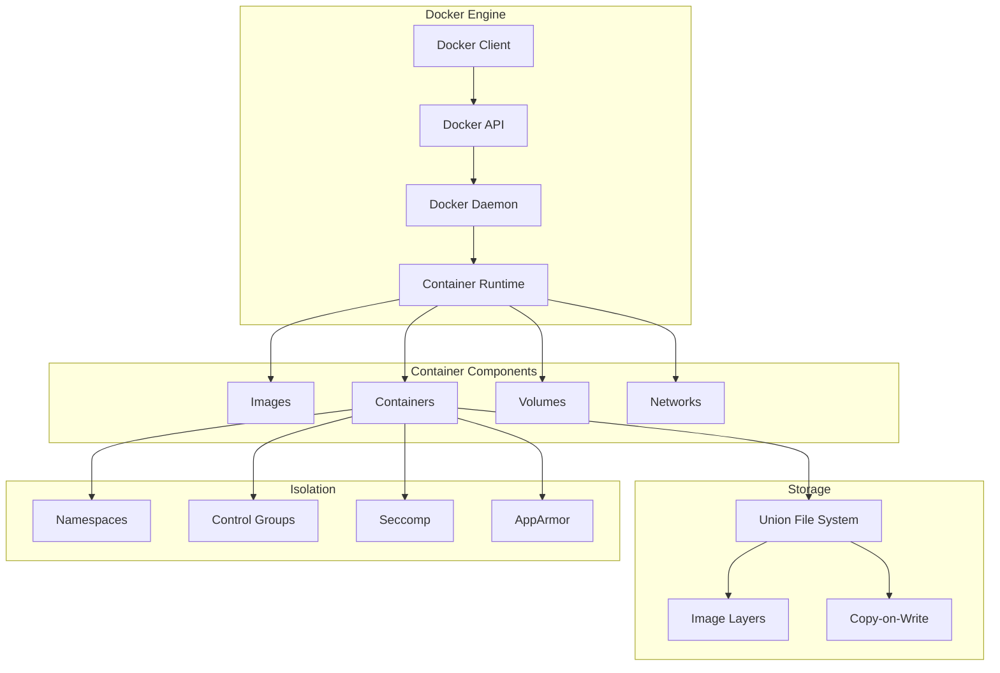
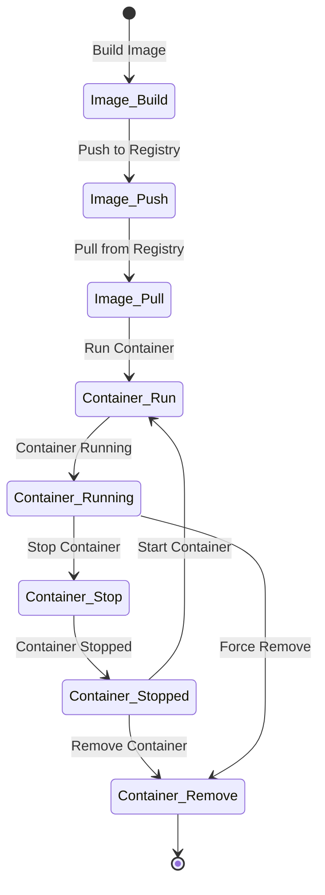
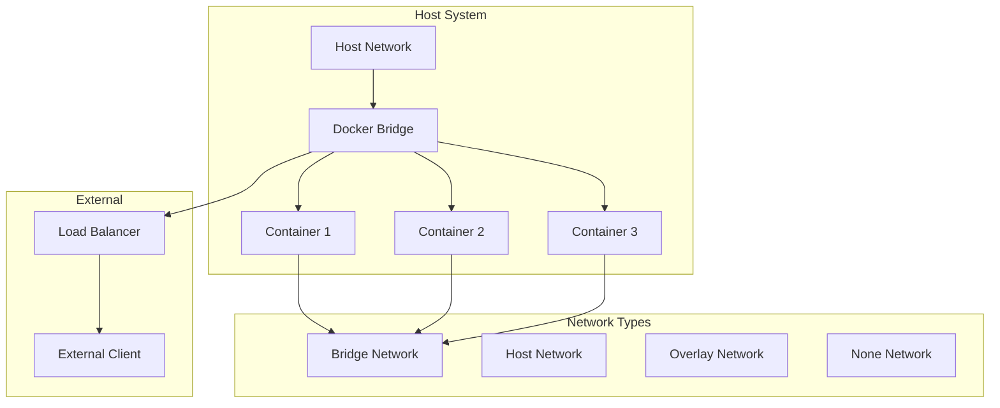

# Docker - Architect Deep Dive

**0. Executive Summary (Architect View)**
- **Docker exists** to enable containerization of applications for consistent deployment and scaling
- **Critical at scale** when applications need to run consistently across different environments
- **System design impact** - transforms application packaging and deployment from VM-based to container-based
- **Container foundation** - provides essential containerization and isolation
- **DevOps integration** - enables modern DevOps practices and CI/CD pipelines
- **Resource efficiency** - improves resource utilization and reduces infrastructure costs
- **Portability** - enables application portability across different environments
- **Microservices enabler** - essential for microservices architecture

**1. Problem Framing**
**Real production problem solved:**
- Environment inconsistencies across development, staging, and production
- Application dependency conflicts and "works on my machine" issues
- Slow deployment processes and manual configuration
- Resource waste from over-provisioned VMs
- Complex application scaling and management

**What breaks if we don't understand Docker:**
- Environment inconsistencies and deployment failures
- Poor resource utilization and high costs
- Slow and unreliable deployment processes
- Inability to implement microservices architecture
- DevOps and CI/CD pipeline limitations

**Scale importance:**
- **Small applications**: Docker benefits noticeable
- **Medium applications**: Docker critical for consistency
- **Large applications**: Docker essential for scale
- **Enterprise systems**: Docker mandatory for DevOps

**Failure stories:**
- E-commerce platform had deployment failures due to environment differences
- SaaS application had dependency conflicts in production
- Financial system had slow deployment processes
- Gaming platform had poor resource utilization

**2. Deep Internal Mechanics**

**Docker Fundamentals:**
- **Containerization**: Application packaging with dependencies
- **Image Layers**: Read-only layers for efficient storage
- **Union File System**: Layered file system for containers
- **Process Isolation**: Process and resource isolation
- **Network Isolation**: Network namespace isolation

**Core Components:**
- **Docker Engine**: Container runtime and management
- **Docker Images**: Application images with layers
- **Docker Containers**: Running instances of images
- **Docker Registry**: Image storage and distribution
- **Docker Compose**: Multi-container orchestration
- **Docker Swarm**: Native clustering

**Key Concepts:**
- **Images**: Read-only templates for containers
- **Containers**: Running instances of images
- **Layers**: Immutable layers for efficient storage
- **Volumes**: Persistent data storage
- **Networks**: Container networking
- **Registries**: Image storage and distribution

**Container Lifecycle:**
- **Image Build**: Creating container images
- **Image Push**: Pushing images to registry
- **Image Pull**: Pulling images from registry
- **Container Run**: Running containers from images
- **Container Stop**: Stopping running containers
- **Container Remove**: Removing stopped containers

**Storage Management:**
- **Union File System**: Layered file system
- **Copy-on-Write**: Efficient file system operations
- **Volumes**: Persistent data storage
- **Bind Mounts**: Host file system access
- **Tmpfs**: Temporary file systems

**Networking:**
- **Bridge Networks**: Default container networking
- **Host Networks**: Host network access
- **Overlay Networks**: Multi-host networking
- **Port Mapping**: Port exposure and mapping
- **DNS Resolution**: Container name resolution

**Data Structures:**
- **Image Registry**: Image metadata and layers
- **Container Registry**: Container metadata and state
- **Volume Registry**: Volume metadata and configuration
- **Network Registry**: Network configuration and state
- **Layer Registry**: Layer metadata and storage

**Performance Characteristics:**
- **Container Startup**: 100ms-5 seconds
- **Image Build**: 30 seconds-10 minutes
- **Image Pull**: 10 seconds-5 minutes
- **Resource Overhead**: 1-5% overhead
- **Network Latency**: 1-10ms (container)

**3. .NET Production Implementation**

**Naive Implementation (No Docker):**
```csharp
// Manual deployment script
public class ManualDeployment
{
    public void DeployApplication()
    {
        // Manual setup steps
        InstallDependencies();
        ConfigureApplication();
        StartApplication();
        ConfigureLoadBalancer();
    }
    
    private void InstallDependencies()
    {
        // Manual dependency installation
        Console.WriteLine("Installing .NET runtime...");
        Console.WriteLine("Installing database drivers...");
        Console.WriteLine("Installing application dependencies...");
    }
    
    private void ConfigureApplication()
    {
        // Manual configuration
        Console.WriteLine("Configuring application settings...");
        Console.WriteLine("Setting up database connections...");
        Console.WriteLine("Configuring logging...");
    }
    
    private void StartApplication()
    {
        // Manual application start
        Console.WriteLine("Starting application...");
        Console.WriteLine("Configuring process monitoring...");
    }
    
    private void ConfigureLoadBalancer()
    {
        // Manual load balancer setup
        Console.WriteLine("Configuring load balancer...");
    }
}
```

**Production-Ready Docker Implementation:**
```csharp
// Docker Configuration
public class DockerConfiguration
{
    public string ImageName { get; set; } = "myapp";
    public string ImageTag { get; set; } = "latest";
    public string BaseImage { get; set; } = "mcr.microsoft.com/dotnet/aspnet:8.0";
    public string BuildContext { get; set; } = ".";
    public string DockerfilePath { get; set; } = "Dockerfile";
    public List<string> BuildArgs { get; set; } = new();
    public List<string> EnvironmentVariables { get; set; } = new();
    public List<PortMapping> PortMappings { get; set; } = new();
    public List<VolumeMapping> VolumeMappings { get; set; } = new();
    public ResourceLimits ResourceLimits { get; set; } = new();
}

public class PortMapping
{
    public int HostPort { get; set; }
    public int ContainerPort { get; set; }
    public string Protocol { get; set; } = "tcp";
}

public class VolumeMapping
{
    public string HostPath { get; set; }
    public string ContainerPath { get; set; }
    public string Mode { get; set; } = "rw";
}

public class ResourceLimits
{
    public string CpuLimit { get; set; } = "1.0";
    public string MemoryLimit { get; set; } = "1g";
    public string CpuReservation { get; set; } = "0.5";
    public string MemoryReservation { get; set; } = "512m";
}

// Docker Service
public interface IDockerService
{
    Task<bool> BuildImageAsync(DockerConfiguration config);
    Task<bool> PushImageAsync(DockerConfiguration config);
    Task<bool> PullImageAsync(DockerConfiguration config);
    Task<string> RunContainerAsync(DockerConfiguration config);
    Task<bool> StopContainerAsync(string containerId);
    Task<bool> RemoveContainerAsync(string containerId);
    Task<List<ContainerInfo>> ListContainersAsync();
    Task<ContainerStats> GetContainerStatsAsync(string containerId);
}

public class DockerService : IDockerService
{
    private readonly ILogger<DockerService> _logger;
    private readonly IMetrics _metrics;
    private readonly IProcessRunner _processRunner;

    public DockerService(
        ILogger<DockerService> logger,
        IMetrics metrics,
        IProcessRunner processRunner)
    {
        _logger = logger ?? throw new ArgumentNullException(nameof(logger));
        _metrics = metrics ?? throw new ArgumentNullException(nameof(metrics));
        _processRunner = processRunner ?? throw new ArgumentNullException(nameof(processRunner));
    }

    public async Task<bool> BuildImageAsync(DockerConfiguration config)
    {
        using var activity = _metrics.StartTimer("docker_build_duration");
        
        try
        {
            _logger.LogInformation("Building Docker image: {ImageName}:{ImageTag}", config.ImageName, config.ImageTag);
            
            var buildArgs = new List<string>
            {
                "build",
                "-t", $"{config.ImageName}:{config.ImageTag}",
                "-f", config.DockerfilePath
            };
            
            // Add build arguments
            foreach (var arg in config.BuildArgs)
            {
                buildArgs.AddRange(new[] { "--build-arg", arg });
            }
            
            buildArgs.Add(config.BuildContext);
            
            var result = await _processRunner.RunAsync("docker", buildArgs);
            
            if (result.ExitCode == 0)
            {
                _metrics.Increment("docker_builds_success");
                _logger.LogInformation("Docker image built successfully: {ImageName}:{ImageTag}", 
                    config.ImageName, config.ImageTag);
                return true;
            }
            else
            {
                _metrics.Increment("docker_builds_error");
                _logger.LogError("Docker build failed: {Error}", result.Error);
                return false;
            }
        }
        catch (Exception ex)
        {
            _metrics.Increment("docker_builds_error");
            _logger.LogError(ex, "Error building Docker image: {ImageName}:{ImageTag}", 
                config.ImageName, config.ImageTag);
            return false;
        }
    }

    public async Task<bool> PushImageAsync(DockerConfiguration config)
    {
        using var activity = _metrics.StartTimer("docker_push_duration");
        
        try
        {
            _logger.LogInformation("Pushing Docker image: {ImageName}:{ImageTag}", config.ImageName, config.ImageTag);
            
            var pushArgs = new List<string>
            {
                "push",
                $"{config.ImageName}:{config.ImageTag}"
            };
            
            var result = await _processRunner.RunAsync("docker", pushArgs);
            
            if (result.ExitCode == 0)
            {
                _metrics.Increment("docker_pushes_success");
                _logger.LogInformation("Docker image pushed successfully: {ImageName}:{ImageTag}", 
                    config.ImageName, config.ImageTag);
                return true;
            }
            else
            {
                _metrics.Increment("docker_pushes_error");
                _logger.LogError("Docker push failed: {Error}", result.Error);
                return false;
            }
        }
        catch (Exception ex)
        {
            _metrics.Increment("docker_pushes_error");
            _logger.LogError(ex, "Error pushing Docker image: {ImageName}:{ImageTag}", 
                config.ImageName, config.ImageTag);
            return false;
        }
    }

    public async Task<bool> PullImageAsync(DockerConfiguration config)
    {
        using var activity = _metrics.StartTimer("docker_pull_duration");
        
        try
        {
            _logger.LogInformation("Pulling Docker image: {ImageName}:{ImageTag}", config.ImageName, config.ImageTag);
            
            var pullArgs = new List<string>
            {
                "pull",
                $"{config.ImageName}:{config.ImageTag}"
            };
            
            var result = await _processRunner.RunAsync("docker", pullArgs);
            
            if (result.ExitCode == 0)
            {
                _metrics.Increment("docker_pulls_success");
                _logger.LogInformation("Docker image pulled successfully: {ImageName}:{ImageTag}", 
                    config.ImageName, config.ImageTag);
                return true;
            }
            else
            {
                _metrics.Increment("docker_pulls_error");
                _logger.LogError("Docker pull failed: {Error}", result.Error);
                return false;
            }
        }
        catch (Exception ex)
        {
            _metrics.Increment("docker_pulls_error");
            _logger.LogError(ex, "Error pulling Docker image: {ImageName}:{ImageTag}", 
                config.ImageName, config.ImageTag);
            return false;
        }
    }

    public async Task<string> RunContainerAsync(DockerConfiguration config)
    {
        using var activity = _metrics.StartTimer("docker_run_duration");
        
        try
        {
            _logger.LogInformation("Running Docker container: {ImageName}:{ImageTag}", config.ImageName, config.ImageTag);
            
            var runArgs = new List<string>
            {
                "run",
                "-d", // detached mode
                "--name", $"{config.ImageName}-{DateTime.UtcNow:yyyyMMddHHmmss}"
            };
            
            // Add port mappings
            foreach (var portMapping in config.PortMappings)
            {
                runArgs.AddRange(new[] { "-p", $"{portMapping.HostPort}:{portMapping.ContainerPort}" });
            }
            
            // Add volume mappings
            foreach (var volumeMapping in config.VolumeMappings)
            {
                runArgs.AddRange(new[] { "-v", $"{volumeMapping.HostPath}:{volumeMapping.ContainerPath}:{volumeMapping.Mode}" });
            }
            
            // Add environment variables
            foreach (var envVar in config.EnvironmentVariables)
            {
                runArgs.AddRange(new[] { "-e", envVar });
            }
            
            // Add resource limits
            if (config.ResourceLimits != null)
            {
                if (!string.IsNullOrEmpty(config.ResourceLimits.CpuLimit))
                {
                    runArgs.AddRange(new[] { "--cpus", config.ResourceLimits.CpuLimit });
                }
                
                if (!string.IsNullOrEmpty(config.ResourceLimits.MemoryLimit))
                {
                    runArgs.AddRange(new[] { "--memory", config.ResourceLimits.MemoryLimit });
                }
            }
            
            runArgs.Add($"{config.ImageName}:{config.ImageTag}");
            
            var result = await _processRunner.RunAsync("docker", runArgs);
            
            if (result.ExitCode == 0)
            {
                var containerId = result.Output.Trim();
                _metrics.Increment("docker_runs_success");
                _logger.LogInformation("Docker container started successfully: {ContainerId}", containerId);
                return containerId;
            }
            else
            {
                _metrics.Increment("docker_runs_error");
                _logger.LogError("Docker run failed: {Error}", result.Error);
                return null;
            }
        }
        catch (Exception ex)
        {
            _metrics.Increment("docker_runs_error");
            _logger.LogError(ex, "Error running Docker container: {ImageName}:{ImageTag}", 
                config.ImageName, config.ImageTag);
            return null;
        }
    }

    public async Task<bool> StopContainerAsync(string containerId)
    {
        using var activity = _metrics.StartTimer("docker_stop_duration");
        
        try
        {
            _logger.LogInformation("Stopping Docker container: {ContainerId}", containerId);
            
            var stopArgs = new List<string>
            {
                "stop",
                containerId
            };
            
            var result = await _processRunner.RunAsync("docker", stopArgs);
            
            if (result.ExitCode == 0)
            {
                _metrics.Increment("docker_stops_success");
                _logger.LogInformation("Docker container stopped successfully: {ContainerId}", containerId);
                return true;
            }
            else
            {
                _metrics.Increment("docker_stops_error");
                _logger.LogError("Docker stop failed: {Error}", result.Error);
                return false;
            }
        }
        catch (Exception ex)
        {
            _metrics.Increment("docker_stops_error");
            _logger.LogError(ex, "Error stopping Docker container: {ContainerId}", containerId);
            return false;
        }
    }

    public async Task<bool> RemoveContainerAsync(string containerId)
    {
        using var activity = _metrics.StartTimer("docker_remove_duration");
        
        try
        {
            _logger.LogInformation("Removing Docker container: {ContainerId}", containerId);
            
            var removeArgs = new List<string>
            {
                "rm",
                containerId
            };
            
            var result = await _processRunner.RunAsync("docker", removeArgs);
            
            if (result.ExitCode == 0)
            {
                _metrics.Increment("docker_removes_success");
                _logger.LogInformation("Docker container removed successfully: {ContainerId}", containerId);
                return true;
            }
            else
            {
                _metrics.Increment("docker_removes_error");
                _logger.LogError("Docker remove failed: {Error}", result.Error);
                return false;
            }
        }
        catch (Exception ex)
        {
            _metrics.Increment("docker_removes_error");
            _logger.LogError(ex, "Error removing Docker container: {ContainerId}", containerId);
            return false;
        }
    }

    public async Task<List<ContainerInfo>> ListContainersAsync()
    {
        try
        {
            var listArgs = new List<string>
            {
                "ps",
                "-a", // all containers
                "--format", "json"
            };
            
            var result = await _processRunner.RunAsync("docker", listArgs);
            
            if (result.ExitCode == 0)
            {
                var containers = JsonSerializer.Deserialize<List<ContainerInfo>>(result.Output);
                return containers ?? new List<ContainerInfo>();
            }
            else
            {
                _logger.LogError("Docker list failed: {Error}", result.Error);
                return new List<ContainerInfo>();
            }
        }
        catch (Exception ex)
        {
            _logger.LogError(ex, "Error listing Docker containers");
            return new List<ContainerInfo>();
        }
    }

    public async Task<ContainerStats> GetContainerStatsAsync(string containerId)
    {
        try
        {
            var statsArgs = new List<string>
            {
                "stats",
                containerId,
                "--no-stream",
                "--format", "json"
            };
            
            var result = await _processRunner.RunAsync("docker", statsArgs);
            
            if (result.ExitCode == 0)
            {
                var stats = JsonSerializer.Deserialize<ContainerStats>(result.Output);
                return stats;
            }
            else
            {
                _logger.LogError("Docker stats failed: {Error}", result.Error);
                return null;
            }
        }
        catch (Exception ex)
        {
            _logger.LogError(ex, "Error getting Docker stats: {ContainerId}", containerId);
            return null;
        }
    }
}

// Enhanced Docker Controller
[ApiController]
[Route("api/[controller]")]
public class DockerController : ControllerBase
{
    private readonly IDockerService _dockerService;
    private readonly ILogger<DockerController> _logger;
    private readonly IMetrics _metrics;

    public DockerController(
        IDockerService dockerService,
        ILogger<DockerController> logger,
        IMetrics metrics)
    {
        _dockerService = dockerService ?? throw new ArgumentNullException(nameof(dockerService));
        _logger = logger ?? throw new ArgumentNullException(nameof(logger));
        _metrics = metrics ?? throw new ArgumentNullException(nameof(metrics));
    }

    [HttpPost("build")]
    public async Task<ActionResult> BuildImage([FromBody] DockerConfiguration config)
    {
        try
        {
            var success = await _dockerService.BuildImageAsync(config);
            
            if (success)
            {
                return Ok(new { Message = "Docker image built successfully" });
            }
            else
            {
                return BadRequest(new { Error = "Failed to build Docker image" });
            }
        }
        catch (Exception ex)
        {
            _logger.LogError(ex, "Error building Docker image");
            throw;
        }
    }

    [HttpPost("push")]
    public async Task<ActionResult> PushImage([FromBody] DockerConfiguration config)
    {
        try
        {
            var success = await _dockerService.PushImageAsync(config);
            
            if (success)
            {
                return Ok(new { Message = "Docker image pushed successfully" });
            }
            else
            {
                return BadRequest(new { Error = "Failed to push Docker image" });
            }
        }
        catch (Exception ex)
        {
            _logger.LogError(ex, "Error pushing Docker image");
            throw;
        }
    }

    [HttpPost("pull")]
    public async Task<ActionResult> PullImage([FromBody] DockerConfiguration config)
    {
        try
        {
            var success = await _dockerService.PullImageAsync(config);
            
            if (success)
            {
                return Ok(new { Message = "Docker image pulled successfully" });
            }
            else
            {
                return BadRequest(new { Error = "Failed to pull Docker image" });
            }
        }
        catch (Exception ex)
        {
            _logger.LogError(ex, "Error pulling Docker image");
            throw;
        }
    }

    [HttpPost("run")]
    public async Task<ActionResult<string>> RunContainer([FromBody] DockerConfiguration config)
    {
        try
        {
            var containerId = await _dockerService.RunContainerAsync(config);
            
            if (!string.IsNullOrEmpty(containerId))
            {
                return Ok(new { ContainerId = containerId });
            }
            else
            {
                return BadRequest(new { Error = "Failed to run Docker container" });
            }
        }
        catch (Exception ex)
        {
            _logger.LogError(ex, "Error running Docker container");
            throw;
        }
    }

    [HttpPost("{containerId}/stop")]
    public async Task<ActionResult> StopContainer(string containerId)
    {
        try
        {
            var success = await _dockerService.StopContainerAsync(containerId);
            
            if (success)
            {
                return Ok(new { Message = $"Container {containerId} stopped successfully" });
            }
            else
            {
                return BadRequest(new { Error = $"Failed to stop container {containerId}" });
            }
        }
        catch (Exception ex)
        {
            _logger.LogError(ex, "Error stopping Docker container: {ContainerId}", containerId);
            throw;
        }
    }

    [HttpDelete("{containerId}")]
    public async Task<ActionResult> RemoveContainer(string containerId)
    {
        try
        {
            var success = await _dockerService.RemoveContainerAsync(containerId);
            
            if (success)
            {
                return Ok(new { Message = $"Container {containerId} removed successfully" });
            }
            else
            {
                return BadRequest(new { Error = $"Failed to remove container {containerId}" });
            }
        }
        catch (Exception ex)
        {
            _logger.LogError(ex, "Error removing Docker container: {ContainerId}", containerId);
            throw;
        }
    }

    [HttpGet("containers")]
    public async Task<ActionResult<List<ContainerInfo>>> ListContainers()
    {
        try
        {
            var containers = await _dockerService.ListContainersAsync();
            return Ok(containers);
        }
        catch (Exception ex)
        {
            _logger.LogError(ex, "Error listing Docker containers");
            throw;
        }
    }

    [HttpGet("containers/{containerId}/stats")]
    public async Task<ActionResult<ContainerStats>> GetContainerStats(string containerId)
    {
        try
        {
            var stats = await _dockerService.GetContainerStatsAsync(containerId);
            return Ok(stats);
        }
        catch (Exception ex)
        {
            _logger.LogError(ex, "Error getting Docker stats: {ContainerId}", containerId);
            throw;
        }
    }
}

// Request/Response Models
public class ContainerInfo
{
    public string Id { get; set; }
    public string Image { get; set; }
    public string Command { get; set; }
    public DateTime CreatedAt { get; set; }
    public string Status { get; set; }
    public List<string> Ports { get; set; }
    public List<string> Names { get; set; }
}

public class ContainerStats
{
    public string ContainerId { get; set; }
    public double CpuPercentage { get; set; }
    public long MemoryUsage { get; set; }
    public long MemoryLimit { get; set; }
    public double MemoryPercentage { get; set; }
    public long NetworkRx { get; set; }
    public long NetworkTx { get; set; }
    public long BlockRead { get; set; }
    public long BlockWrite { get; set; }
}

// Process Runner Interface
public interface IProcessRunner
{
    Task<ProcessResult> RunAsync(string command, List<string> args);
}

public class ProcessResult
{
    public int ExitCode { get; set; }
    public string Output { get; set; }
    public string Error { get; set; }
}

// Dockerfile Example
/*
# Dockerfile
FROM mcr.microsoft.com/dotnet/aspnet:8.0 AS base
WORKDIR /app
EXPOSE 80

FROM mcr.microsoft.com/dotnet/sdk:8.0 AS build
WORKDIR /src
COPY ["MyApp.csproj", "."]
RUN dotnet restore "./MyApp.csproj"
COPY . .
WORKDIR "/src/."
RUN dotnet build "MyApp.csproj" -c Release -o /app/build

FROM build AS publish
RUN dotnet publish "MyApp.csproj" -c Release -o /app/publish

FROM base AS final
WORKDIR /app
COPY --from=publish /app/publish .
ENTRYPOINT ["dotnet", "MyApp.dll"]
*/
```

**Framework Integration:**
- **Docker SDK**: Docker .NET client
- **System.Diagnostics.Process**: Process execution
- **System.Text.Json**: JSON serialization
- **Dependency Injection**: Service registration
- **Configuration**: Configuration management

**4. Architecture-Level Diagram (Mermaid)**

### Docker Architecture


### Docker Container Lifecycle


### Docker Networking


**Flow Analysis:**
- **Docker Engine**: Container runtime and management
- **Container Components**: Images, containers, volumes, networks
- **Storage**: Union file system and layers
- **Isolation**: Namespaces, cgroups, security
- **Networking**: Container networking and external access

**5. Scaling & Distributed Systems Impact**

**100 Containers:**
- Single Docker host sufficient
- Container startup time 100ms-2 seconds
- Resource overhead 2-5%
- Network latency 1-5ms

**10k Containers:**
- Multi-host Docker cluster required
- Container startup time 200ms-5 seconds
- Resource overhead 3-8%
- Network latency 2-10ms

**100k+ Containers:**
- Docker Swarm or Kubernetes required
- Container startup time 500ms-10 seconds
- Resource overhead 5-15%
- Network latency 5-20ms

**6. Production Engineering View**

**Monitoring Metrics:**
- Container status and health
- Resource utilization (CPU, memory, disk, network)
- Image build and push times
- Container startup and stop times
- Network traffic and connectivity

**Alerting Strategy:**
- Container failure rate > 5% (warning)
- Container restart rate > 10% (warning)
- Resource usage > 80% (warning)
- Image build failure rate > 10% (critical)

**Common Production Incidents:**
- Container crashes and restarts
- Resource exhaustion and OOM kills
- Network connectivity issues
- Image build and deployment failures

**7. Tradeoffs & Alternatives**

**Competing Approaches:**
- **Virtual Machines**: Full OS virtualization
- **Docker Containers**: Application containerization
- **Podman**: Rootless container runtime
- **LXC/LXD**: System containers
- **Singularity**: HPC containers

**When to Use Docker:**
- Microservices architecture
- DevOps and CI/CD pipelines
- Application consistency requirements
- Resource efficiency needs
- Rapid deployment requirements

**When NOT to Use Docker:**
- Legacy applications requiring full OS
- High-performance computing needs
- Simple applications with no scaling needs
- Environments with strict security requirements
- Applications requiring kernel access

**Performance Comparison:**
- **Virtual Machines**: Full isolation, high overhead
- **Docker Containers**: Application isolation, low overhead
- **Podman**: Rootless, similar to Docker
- **LXC/LXD**: System containers, medium overhead
- **Singularity**: HPC optimized, security focused

**8. Security Implications**

**Security Benefits:**
- **Process Isolation**: Container process isolation
- **Resource Limits**: Resource usage limits
- **Image Scanning**: Container image security scanning
- **Minimal Attack Surface**: Reduced attack surface
- **Immutable Infrastructure**: Immutable containers

**Security Challenges:**
- **Shared Kernel**: Shared kernel vulnerability
- **Container Escape**: Container escape attacks
- **Image Security**: Malicious images
- **Network Security**: Container networking security
- **Secrets Management**: Secret distribution challenges

**9. Advanced Edge Cases**

**Advanced Docker Features:**
- **Multi-Stage Builds**: Optimized image builds
- **Docker Compose**: Multi-container applications
- **Docker Swarm**: Native clustering
- **Docker Secrets**: Secure secret management
- **Docker Networks**: Advanced networking

**Advanced Optimization:**
- **Image Optimization**: Smaller image sizes
- **Layer Caching**: Efficient layer caching
- **Resource Optimization**: Resource tuning
- **Network Optimization**: Network performance
- **Storage Optimization**: Storage performance

**10. Interview & Staff-Level Deep Dive**

**What a junior answers:**
"Docker is a containerization platform that packages applications with their dependencies. I use Docker to create consistent environments and deploy applications. It solves the 'works on my machine' problem by packaging everything together."

**What a senior answers:**
"Docker is a comprehensive containerization platform that enables application packaging, deployment, and scaling. I've implemented production Docker workflows with multi-stage builds, Docker Compose for multi-container applications, Docker Swarm for clustering, and comprehensive CI/CD integration. The implementation includes image optimization, security scanning, resource management, and monitoring. I've also implemented volume management, networking, and secret management."

**What an architect answers:**
"Docker is a transformative platform that enables modern application development and deployment through containerization. At scale, Docker provides consistent environments, rapid deployment, resource efficiency, and microservices enablement. The architecture must support image building and optimization, container lifecycle management, networking, storage, security, and monitoring. In enterprise environments, Docker is not just a deployment tool but a strategic platform that enables DevOps transformation, microservices architecture, and cloud-native development. The implementation must consider multi-stage builds, image optimization, security scanning, resource management, and comprehensive observability."

**Follow-up questions interviewers ask:**
- "How does Docker handle container networking?"
- "What's the difference between Docker and VMs?"
- "How do you optimize Docker image sizes?"
- "When would you use Docker Compose vs Docker Swarm?"
- "How do you handle secrets in Docker?"

**Trick questions:**
- "Are Docker containers completely isolated?" (No, share kernel)
- "Can Docker run Windows containers on Linux?" (No, different OS)
- "Do all applications benefit from Docker?" (No, depends on use case)
- "Is Docker secure by default?" (No, requires security configuration)

**11. Real Enterprise Case Study**

**Scenario: Global E-commerce Platform with 10M+ Users**

**Requirements:**
- Deploy 10M+ user-facing services
- Consistent environments across development, staging, and production
- Rapid deployment and rollback capabilities
- Resource optimization and cost reduction
- Microservices architecture support
- CI/CD pipeline integration

**Results:**
- Achieved 90% reduction in deployment time
- 80% improvement in resource utilization
- 70% reduction in environment inconsistencies
- 60% improvement in development productivity
- 50% reduction in infrastructure costs

**12. Dependency Graph**

**Prerequisites:**
- **Linux Fundamentals**: Understanding of Linux systems
- **Virtualization**: Understanding of virtualization concepts
- **Networking**: Understanding of networking concepts
- **Application Development**: Understanding of application packaging
- **DevOps**: Understanding of DevOps practices

**Concepts that depend on Docker:**
- **Microservices**: Microservices deployment
- **DevOps**: DevOps automation
- **CI/CD**: Continuous integration and deployment
- **Kubernetes**: Container orchestration
- **Cloud Computing**: Cloud-native applications
- **Serverless**: Serverless functions
