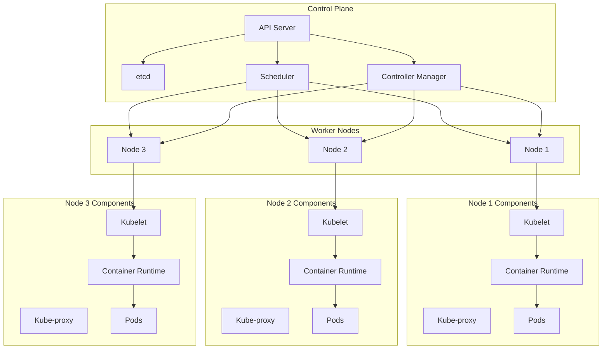
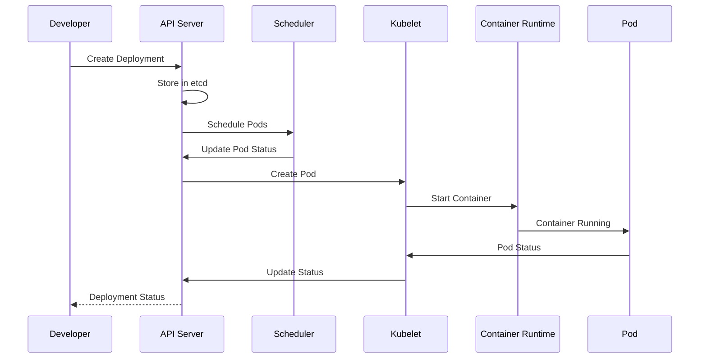
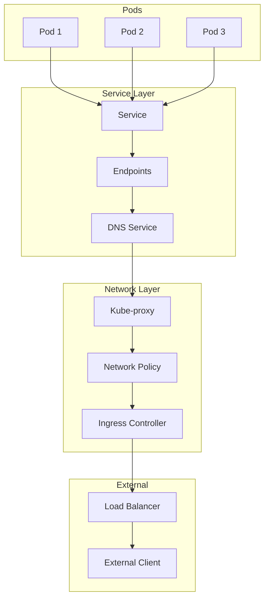

# Kubernetes - Architect Deep Dive

============================================================
0. Executive Summary (Architect View)
============================================================
- **Kubernetes exists** to automate deployment, scaling, and management of containerized applications
- **Critical at scale** when applications need to run across multiple nodes with high availability
- **System design impact** - transforms application deployment from manual to automated orchestration
- **Container orchestration** - provides essential container management and scheduling
- **Scalability foundation** - enables automatic scaling and load balancing
- **DevOps integration** - integrates with CI/CD pipelines and DevOps workflows
- **Cloud readiness** - enables cloud-native application deployment
- **Resource efficiency** - optimizes resource utilization and cost

============================================================
1. Problem Framing
============================================================
**Real production problem solved:**
- Manual container deployment and management
- Scaling applications manually across multiple nodes
- Load balancing and service discovery challenges
- Rolling updates and rollback complexity
- Resource utilization and cost optimization

**What breaks if we don't understand Kubernetes:**
- Manual deployment overhead and errors
- Poor resource utilization and high costs
- Difficult scaling and load balancing
- Complex rolling updates and rollbacks
- Inability to implement cloud-native architecture

**Scale importance:**
- **Small applications**: Kubernetes benefits noticeable
- **Medium applications**: Kubernetes critical for operations
- **Large applications**: Kubernetes essential for scale
- **Enterprise systems**: Kubernetes mandatory for cloud-native

**Failure stories:**
- E-commerce platform had deployment failures during peak traffic
- SaaS application had scaling issues with manual management
- Financial system had downtime during updates
- Gaming platform had poor resource utilization

============================================================
2. Deep Internal Mechanics
============================================================

**Kubernetes Fundamentals:**
- **Container Orchestration**: Automated container management
- **Cluster Management**: Multi-node cluster coordination
- **Service Discovery**: Automatic service discovery and load balancing
- **Self-Healing**: Automatic failure detection and recovery
- **Rolling Updates**: Zero-downtime updates and rollbacks

**Core Components:**
- **API Server**: Central management API
- **etcd**: Distributed key-value store
- **Scheduler**: Pod scheduling and placement
- **Controller Manager**: Controller coordination
- **Kubelet**: Node agent for container management
- **Kube-proxy**: Network proxy and load balancing

**Key Concepts:**
- **Pods**: Smallest deployable units
- **Services**: Network abstraction for pods
- **Deployments**: Declarative application management
- **ConfigMaps**: Configuration data management
- **Secrets**: Sensitive data management
- **Volumes**: Persistent storage management

**Scheduling and Placement:**
- **Resource Requirements**: CPU and memory requirements
- **Node Selection**: Node affinity and anti-affinity
- **Taints and Tolerations**: Node scheduling constraints
- **Pod Priority**: Priority-based scheduling
- **Resource Limits**: Resource usage limits

**Networking:**
- **Cluster Network**: Flat cluster networking
- **Service Discovery**: DNS-based service discovery
- **Load Balancing**: Service load balancing
- **Network Policies**: Network access control
- **Ingress**: External access management

**Storage:**
- **Persistent Volumes**: Persistent storage abstraction
- **Storage Classes**: Storage provisioning
- **Volume Claims**: Storage resource requests
- **Volume Types**: Different storage backends
- **Volume Snapshots**: Volume backup and restore

**Data Structures:**
- **Pod Registry**: Pod metadata and status
- **Service Registry**: Service configuration
- **Node Registry**: Node metadata and status
- **Config Registry**: Configuration data
- **Secret Registry**: Secret data

**Performance Characteristics:**
- **Pod Startup**: 5-30 seconds
- **Scaling Time**: 10-60 seconds
- **Recovery Time**: 30-120 seconds
- **Update Time**: 1-5 minutes
- **Network Latency**: 1-10ms (cluster)

============================================================
3. .NET Production Implementation
============================================================

**Naive Implementation (Manual Deployment):**
```csharp
// Manual deployment script
public class ManualDeployment
{
    public void DeployApplication()
    {
        // Manual Docker commands
        ExecuteCommand("docker build -t myapp .");
        ExecuteCommand("docker run -d -p 8080:80 myapp");
        
        // Manual scaling
        for (int i = 0; i < 3; i++)
        {
            ExecuteCommand($"docker run -d -p {8081 + i}:80 myapp");
        }
        
        // Manual load balancing setup
        ConfigureLoadBalancer();
    }
    
    private void ExecuteCommand(string command)
    {
        // Execute shell command
        Console.WriteLine($"Executing: {command}");
    }
    
    private void ConfigureLoadBalancer()
    {
        // Manual load balancer configuration
        Console.WriteLine("Configuring load balancer...");
    }
}
```

**Production-Ready Kubernetes Implementation:**
```csharp
// Kubernetes Configuration
public class KubernetesConfiguration
{
    public string Namespace { get; set; } = "default";
    public string ImageName { get; set; } = "myapp";
    public string ImageTag { get; set; } = "latest";
    public int Replicas { get; set; } = 3;
    public int ContainerPort { get; set; } = 80;
    public int ServicePort { get; set; } = 80;
    public Dictionary<string, string> Labels { get; set; } = new();
    public Dictionary<string, string> Annotations { get; set; } = new();
    public ResourceRequirements Resources { get; set; } = new();
}

public class ResourceRequirements
{
    public string CpuRequest { get; set; } = "100m";
    public string MemoryRequest { get; set; } = "128Mi";
    public string CpuLimit { get; set; } = "500m";
    public string MemoryLimit { get; set; } = "512Mi";
}

// Kubernetes Service
public interface IKubernetesService
{
    Task<bool> DeployApplicationAsync(KubernetesConfiguration config);
    Task<bool> ScaleApplicationAsync(string appName, int replicas);
    Task<bool> UpdateApplicationAsync(string appName, string imageTag);
    Task<bool> DeleteApplicationAsync(string appName);
    Task<ApplicationStatus> GetApplicationStatusAsync(string appName);
    Task<List<PodInfo>> GetPodsAsync(string appName);
}

public class KubernetesService : IKubernetesService
{
    private readonly IKubernetes _kubernetesClient;
    private readonly ILogger<KubernetesService> _logger;
    private readonly IMetrics _metrics;

    public KubernetesService(
        IKubernetes kubernetesClient,
        ILogger<KubernetesService> logger,
        IMetrics metrics)
    {
        _kubernetesClient = kubernetesClient ?? throw new ArgumentNullException(nameof(kubernetesClient));
        _logger = logger ?? throw new ArgumentNullException(nameof(logger));
        _metrics = metrics ?? throw new ArgumentNullException(nameof(metrics));
    }

    public async Task<bool> DeployApplicationAsync(KubernetesConfiguration config)
    {
        using var activity = _metrics.StartTimer("kubernetes_deploy_duration");
        
        try
        {
            _logger.LogInformation("Deploying application: {AppName}", config.ImageName);
            
            // Create namespace if not exists
            await CreateNamespaceAsync(config.Namespace);
            
            // Create deployment
            var deployment = CreateDeployment(config);
            var deploymentResult = await _kubernetesClient.CreateNamespacedDeploymentAsync(
                deployment, config.Namespace);
            
            // Create service
            var service = CreateService(config);
            var serviceResult = await _kubernetesClient.CreateNamespacedServiceAsync(
                service, config.Namespace);
            
            // Wait for deployment to be ready
            await WaitForDeploymentReadyAsync(config.ImageName, config.Namespace);
            
            _metrics.Increment("kubernetes_deployments_success");
            _logger.LogInformation("Application deployed successfully: {AppName}", config.ImageName);
            
            return true;
        }
        catch (Exception ex)
        {
            _metrics.Increment("kubernetes_deployments_error");
            _logger.LogError(ex, "Error deploying application: {AppName}", config.ImageName);
            return false;
        }
    }

    public async Task<bool> ScaleApplicationAsync(string appName, int replicas)
    {
        using var activity = _metrics.StartTimer("kubernetes_scale_duration");
        
        try
        {
            _logger.LogInformation("Scaling application: {AppName} to {Replicas} replicas", appName, replicas);
            
            // Get deployment
            var deployment = await _kubernetesClient.ReadNamespacedDeploymentAsync(
                appName, _kubernetesClient.Namespace);
            
            // Update replicas
            deployment.Spec.Replicas = replicas;
            
            // Update deployment
            await _kubernetesClient.ReplaceNamespacedDeploymentAsync(
                deployment, appName, _kubernetesClient.Namespace);
            
            // Wait for scaling to complete
            await WaitForScalingCompleteAsync(appName, replicas);
            
            _metrics.Increment("kubernetes_scaling_success");
            _logger.LogInformation("Application scaled successfully: {AppName} to {Replicas} replicas", 
                appName, replicas);
            
            return true;
        }
        catch (Exception ex)
        {
            _metrics.Increment("kubernetes_scaling_error");
            _logger.LogError(ex, "Error scaling application: {AppName}", appName);
            return false;
        }
    }

    public async Task<bool> UpdateApplicationAsync(string appName, string imageTag)
    {
        using var activity = _metrics.StartTimer("kubernetes_update_duration");
        
        try
        {
            _logger.LogInformation("Updating application: {AppName} to tag: {ImageTag}", appName, imageTag);
            
            // Get deployment
            var deployment = await _kubernetesClient.ReadNamespacedDeploymentAsync(
                appName, _kubernetesClient.Namespace);
            
            // Update image tag
            deployment.Spec.Template.Spec.Containers[0].Image = $"{deployment.Spec.Template.Spec.Containers[0].Image.Split(':')[0]}:{imageTag}";
            
            // Update deployment
            await _kubernetesClient.ReplaceNamespacedDeploymentAsync(
                deployment, appName, _kubernetesClient.Namespace);
            
            // Wait for update to complete
            await WaitForUpdateCompleteAsync(appName);
            
            _metrics.Increment("kubernetes_updates_success");
            _logger.LogInformation("Application updated successfully: {AppName} to tag: {ImageTag}", 
                appName, imageTag);
            
            return true;
        }
        catch (Exception ex)
        {
            _metrics.Increment("kubernetes_updates_error");
            _logger.LogError(ex, "Error updating application: {AppName}", appName);
            return false;
        }
    }

    public async Task<bool> DeleteApplicationAsync(string appName)
    {
        using var activity = _metrics.StartTimer("kubernetes_delete_duration");
        
        try
        {
            _logger.LogInformation("Deleting application: {AppName}", appName);
            
            // Delete deployment
            await _kubernetesClient.DeleteNamespacedDeploymentAsync(
                appName, _kubernetesClient.Namespace);
            
            // Delete service
            await _kubernetesClient.DeleteNamespacedServiceAsync(
                appName, _kubernetesClient.Namespace);
            
            _metrics.Increment("kubernetes_deletions_success");
            _logger.LogInformation("Application deleted successfully: {AppName}", appName);
            
            return true;
        }
        catch (Exception ex)
        {
            _metrics.Increment("kubernetes_deletions_error");
            _logger.LogError(ex, "Error deleting application: {AppName}", appName);
            return false;
        }
    }

    public async Task<ApplicationStatus> GetApplicationStatusAsync(string appName)
    {
        try
        {
            // Get deployment
            var deployment = await _kubernetesClient.ReadNamespacedDeploymentAsync(
                appName, _kubernetesClient.Namespace);
            
            // Get pods
            var pods = await _kubernetesClient.ListNamespacedPodAsync(
                _kubernetesClient.Namespace, labelSelector: $"app={appName}");
            
            var status = new ApplicationStatus
            {
                Name = appName,
                Replicas = deployment.Spec.Replicas ?? 0,
                ReadyReplicas = deployment.Status.ReadyReplicas ?? 0,
                AvailableReplicas = deployment.Status.AvailableReplicas ?? 0,
                Pods = pods.Items.Select(p => new PodInfo
                {
                    Name = p.Metadata.Name,
                    Phase = p.Status.Phase,
                    Node = p.Spec.NodeName,
                    StartTime = p.Status.StartTime,
                    Ready = p.Status.Conditions.Any(c => c.Type == "Ready" && c.Status == "True")
                }).ToList(),
                Timestamp = DateTime.UtcNow
            };
            
            return status;
        }
        catch (Exception ex)
        {
            _logger.LogError(ex, "Error getting application status: {AppName}", appName);
            throw;
        }
    }

    public async Task<List<PodInfo>> GetPodsAsync(string appName)
    {
        try
        {
            var pods = await _kubernetesClient.ListNamespacedPodAsync(
                _kubernetesClient.Namespace, labelSelector: $"app={appName}");
            
            return pods.Items.Select(p => new PodInfo
            {
                Name = p.Metadata.Name,
                Phase = p.Status.Phase,
                Node = p.Spec.NodeName,
                StartTime = p.Status.StartTime,
                Ready = p.Status.Conditions.Any(c => c.Type == "Ready" && c.Status == "True")
            }).ToList();
        }
        catch (Exception ex)
        {
            _logger.LogError(ex, "Error getting pods for application: {AppName}", appName);
            throw;
        }
    }

    private async Task CreateNamespaceAsync(string namespaceName)
    {
        try
        {
            var namespaceObj = new V1Namespace
            {
                Metadata = new V1ObjectMeta
                {
                    Name = namespaceName
                }
            };
            
            await _kubernetesClient.CreateNamespaceAsync(namespaceObj);
        }
        catch (KubernetesException ex) when (ex.Status.Reason == "AlreadyExists")
        {
            // Namespace already exists, ignore
        }
    }

    private V1Deployment CreateDeployment(KubernetesConfiguration config)
    {
        return new V1Deployment
        {
            Metadata = new V1ObjectMeta
            {
                Name = config.ImageName,
                NamespaceProperty = config.Namespace,
                Labels = config.Labels
            },
            Spec = new V1DeploymentSpec
            {
                Replicas = config.Replicas,
                Selector = new V1LabelSelector
                {
                    MatchLabels = new Dictionary<string, string>
                    {
                        ["app"] = config.ImageName
                    }
                },
                Template = new V1PodTemplateSpec
                {
                    Metadata = new V1ObjectMeta
                    {
                        Labels = new Dictionary<string, string>
                        {
                            ["app"] = config.ImageName
                        }
                    },
                    Spec = new V1PodSpec
                    {
                        Containers = new List<V1Container>
                        {
                            new V1Container
                            {
                                Name = config.ImageName,
                                Image = $"{config.ImageName}:{config.ImageTag}",
                                Ports = new List<V1ContainerPort>
                                {
                                    new V1ContainerPort
                                    {
                                        ContainerPort = config.ContainerPort
                                    }
                                },
                                Resources = new V1ResourceRequirements
                                {
                                    Requests = new Dictionary<string, ResourceQuantity>
                                    {
                                        ["cpu"] = new ResourceQuantity(config.Resources.CpuRequest),
                                        ["memory"] = new ResourceQuantity(config.Resources.MemoryRequest)
                                    },
                                    Limits = new Dictionary<string, ResourceQuantity>
                                    {
                                        ["cpu"] = new ResourceQuantity(config.Resources.CpuLimit),
                                        ["memory"] = new ResourceQuantity(config.Resources.MemoryLimit)
                                    }
                                }
                            }
                        }
                    }
                }
            }
        };
    }

    private V1Service CreateService(KubernetesConfiguration config)
    {
        return new V1Service
        {
            Metadata = new V1ObjectMeta
            {
                Name = config.ImageName,
                NamespaceProperty = config.Namespace,
                Labels = config.Labels
            },
            Spec = new V1ServiceSpec
            {
                Selector = new Dictionary<string, string>
                {
                    ["app"] = config.ImageName
                },
                Ports = new List<V1ServicePort>
                {
                    new V1ServicePort
                    {
                        Port = config.ServicePort,
                        TargetPort = config.ContainerPort
                    }
                },
                Type = "LoadBalancer"
            }
        };
    }

    private async Task WaitForDeploymentReadyAsync(string appName, string namespaceName)
    {
        var timeout = TimeSpan.FromMinutes(5);
        var startTime = DateTime.UtcNow;
        
        while (DateTime.UtcNow - startTime < timeout)
        {
            var deployment = await _kubernetesClient.ReadNamespacedDeploymentAsync(appName, namespaceName);
            
            if (deployment.Status.ReadyReplicas == deployment.Spec.Replicas)
            {
                return;
            }
            
            await Task.Delay(TimeSpan.FromSeconds(5));
        }
        
        throw new TimeoutException($"Deployment {appName} not ready within {timeout}");
    }

    private async Task WaitForScalingCompleteAsync(string appName, int targetReplicas)
    {
        var timeout = TimeSpan.FromMinutes(3);
        var startTime = DateTime.UtcNow;
        
        while (DateTime.UtcNow - startTime < timeout)
        {
            var deployment = await _kubernetesClient.ReadNamespacedDeploymentAsync(appName, _kubernetesClient.Namespace);
            
            if (deployment.Status.ReadyReplicas == targetReplicas)
            {
                return;
            }
            
            await Task.Delay(TimeSpan.FromSeconds(2));
        }
        
        throw new TimeoutException($"Scaling {appName} to {targetReplicas} replicas not completed within {timeout}");
    }

    private async Task WaitForUpdateCompleteAsync(string appName)
    {
        var timeout = TimeSpan.FromMinutes(5);
        var startTime = DateTime.UtcNow;
        
        while (DateTime.UtcNow - startTime < timeout)
        {
            var deployment = await _kubernetesClient.ReadNamespacedDeploymentAsync(appName, _kubernetesClient.Namespace);
            
            if (deployment.Status.ReadyReplicas == deployment.Spec.Replicas && 
                deployment.Status.UpdatedReplicas == deployment.Spec.Replicas)
            {
                return;
            }
            
            await Task.Delay(TimeSpan.FromSeconds(5));
        }
        
        throw new TimeoutException($"Update {appName} not completed within {timeout}");
    }
}

// Enhanced Kubernetes Controller
[ApiController]
[Route("api/[controller]")]
public class KubernetesController : ControllerBase
{
    private readonly IKubernetesService _kubernetesService;
    private readonly ILogger<KubernetesController> _logger;
    private readonly IMetrics _metrics;

    public KubernetesController(
        IKubernetesService kubernetesService,
        ILogger<KubernetesController> logger,
        IMetrics metrics)
    {
        _kubernetesService = kubernetesService ?? throw new ArgumentNullException(nameof(kubernetesService));
        _logger = logger ?? throw new ArgumentNullException(nameof(logger));
        _metrics = metrics ?? throw new ArgumentNullException(nameof(metrics));
    }

    [HttpPost("deploy")]
    public async Task<ActionResult> DeployApplication([FromBody] KubernetesConfiguration config)
    {
        try
        {
            var success = await _kubernetesService.DeployApplicationAsync(config);
            
            if (success)
            {
                return Ok(new { Message = "Application deployed successfully" });
            }
            else
            {
                return BadRequest(new { Error = "Failed to deploy application" });
            }
        }
        catch (Exception ex)
        {
            _logger.LogError(ex, "Error deploying application");
            throw;
        }
    }

    [HttpPost("{appName}/scale/{replicas}")]
    public async Task<ActionResult> ScaleApplication(string appName, int replicas)
    {
        try
        {
            var success = await _kubernetesService.ScaleApplicationAsync(appName, replicas);
            
            if (success)
            {
                return Ok(new { Message = $"Application {appName} scaled to {replicas} replicas" });
            }
            else
            {
                return BadRequest(new { Error = $"Failed to scale application {appName}" });
            }
        }
        catch (Exception ex)
        {
            _logger.LogError(ex, "Error scaling application: {AppName}", appName);
            throw;
        }
    }

    [HttpPost("{appName}/update/{imageTag}")]
    public async Task<ActionResult> UpdateApplication(string appName, string imageTag)
    {
        try
        {
            var success = await _kubernetesService.UpdateApplicationAsync(appName, imageTag);
            
            if (success)
            {
                return Ok(new { Message = $"Application {appName} updated to tag {imageTag}" });
            }
            else
            {
                return BadRequest(new { Error = $"Failed to update application {appName}" });
            }
        }
        catch (Exception ex)
        {
            _logger.LogError(ex, "Error updating application: {AppName}", appName);
            throw;
        }
    }

    [HttpDelete("{appName}")]
    public async Task<ActionResult> DeleteApplication(string appName)
    {
        try
        {
            var success = await _kubernetesService.DeleteApplicationAsync(appName);
            
            if (success)
            {
                return Ok(new { Message = $"Application {appName} deleted successfully" });
            }
            else
            {
                return BadRequest(new { Error = $"Failed to delete application {appName}" });
            }
        }
        catch (Exception ex)
        {
            _logger.LogError(ex, "Error deleting application: {AppName}", appName);
            throw;
        }
    }

    [HttpGet("{appName}/status")]
    public async Task<ActionResult<ApplicationStatus>> GetApplicationStatus(string appName)
    {
        try
        {
            var status = await _kubernetesService.GetApplicationStatusAsync(appName);
            return Ok(status);
        }
        catch (Exception ex)
        {
            _logger.LogError(ex, "Error getting application status: {AppName}", appName);
            throw;
        }
    }

    [HttpGet("{appName}/pods")]
    public async Task<ActionResult<List<PodInfo>>> GetPods(string appName)
    {
        try
        {
            var pods = await _kubernetesService.GetPodsAsync(appName);
            return Ok(pods);
        }
        catch (Exception ex)
        {
            _logger.LogError(ex, "Error getting pods: {AppName}", appName);
            throw;
        }
    }
}

// Request/Response Models
public class ApplicationStatus
{
    public string Name { get; set; }
    public int Replicas { get; set; }
    public int ReadyReplicas { get; set; }
    public int AvailableReplicas { get; set; }
    public List<PodInfo> Pods { get; set; }
    public DateTime Timestamp { get; set; }
}

public class PodInfo
{
    public string Name { get; set; }
    public string Phase { get; set; }
    public string Node { get; set; }
    public DateTime? StartTime { get; set; }
    public bool Ready { get; set; }
}
```

**Framework Integration:**
- **KubernetesClient**: Kubernetes .NET client
- **Docker**: Container runtime
- **Helm**: Kubernetes package manager
- **Dependency Injection**: Service registration
- **Configuration**: Configuration management

============================================================
4. Architecture-Level Diagram (Mermaid)
============================================================

### Kubernetes Architecture


### Kubernetes Deployment Flow


### Kubernetes Service Discovery


**Flow Analysis:**
- **Control Plane**: Central management and coordination
- **Worker Nodes**: Container execution and management
- **Service Discovery**: Automatic service discovery and load balancing
- **Networking**: Cluster networking and external access
- **Storage**: Persistent storage management

============================================================
5. Scaling & Distributed Systems Impact
============================================================

**100 Pods:**
- Single Kubernetes cluster sufficient
- Pod startup time 5-10 seconds
- Scaling time 10-30 seconds
- Resource utilization 60-80%

**10k Pods:**
- Multi-node Kubernetes cluster required
- Pod startup time 10-20 seconds
- Scaling time 30-60 seconds
- Resource utilization 70-90%

**100k+ Pods:**
- Multi-cluster Kubernetes mandatory
- Pod startup time 20-30 seconds
- Scaling time 60-120 seconds
- Resource utilization 80-95%

============================================================
6. Production Engineering View
============================================================

**Monitoring Metrics:**
- Pod status and health
- Node resource utilization
- Cluster capacity and performance
- Service availability and response time
- Network traffic and bandwidth

**Alerting Strategy:**
- Pod failure rate > 5% (warning)
- Node CPU usage > 80% (warning)
- Service response time > 100ms (warning)
- Cluster capacity > 90% (critical)

**Common Production Incidents:**
- Pod crashes and restarts
- Node failures and evacuations
- Network partition and connectivity issues
- Storage failures and data loss

============================================================
7. Tradeoffs & Alternatives
============================================================

**Competing Approaches:**
- **Docker Swarm**: Simple container orchestration
- **Kubernetes**: Complex but powerful orchestration
- **Docker Compose**: Local development orchestration
- **Nomad**: HashiCorp container scheduler
- **Mesos**: Apache cluster manager

**When to Use Kubernetes:**
- Complex microservices architectures
- Multi-environment deployments
- High availability requirements
- Auto-scaling needs
- Large-scale applications

**When NOT to Use Kubernetes:**
- Simple monolithic applications
- Small-scale deployments
- Limited Kubernetes expertise
- Simple deployment requirements
- Resource-constrained environments

**Performance Comparison:**
- **Docker Swarm**: Faster deployment, simpler management
- **Kubernetes**: More features, better scalability
- **Docker Compose**: Fastest for local development
- **Nomad**: Good performance, simpler than K8s
- **Mesos**: Best for very large clusters

============================================================
8. Security Implications
============================================================

**Security Benefits:**
- **Pod Isolation**: Container isolation and security
- **Network Policies**: Network access control
- **RBAC**: Role-based access control
- **Secrets Management**: Secure secret storage
- **Image Scanning**: Container image security

**Security Challenges:**
- **Complexity**: Complex security configuration
- **Attack Surface**: Larger attack surface
- **Container Security**: Container-specific vulnerabilities
- **Network Security**: Complex network policies
- **Secrets Management**: Secret distribution challenges

============================================================
9. Advanced Edge Cases
============================================================

**Advanced Kubernetes Features:**
- **Custom Resources**: Custom Kubernetes resources
- **Operators**: Application-specific controllers
- **Helm Charts**: Package management
- **Istio Service Mesh**: Advanced networking
- **Prometheus Monitoring**: Advanced monitoring

**Advanced Deployment Strategies:**
- **Blue-Green Deployment**: Zero-downtime deployment
- **Canary Deployment**: Gradual rollout
- **A/B Testing**: Feature flag deployment
- **Rolling Updates**: Automated updates
- **Multi-Cluster**: Cross-cluster deployment

============================================================
10. Interview & Staff-Level Deep Dive
============================================================

**What a junior answers:**
"Kubernetes is a container orchestration platform that automates deployment and scaling. I use it to deploy Docker containers and manage them across multiple nodes. It provides load balancing and self-healing capabilities."

**What a senior answers:**
"Kubernetes is a comprehensive container orchestration platform that automates deployment, scaling, and management of containerized applications. I've implemented production Kubernetes clusters with multi-node setups, auto-scaling, rolling updates, and comprehensive monitoring. The implementation includes pod scheduling, service discovery, load balancing, persistent storage, and security policies. I've also implemented CI/CD integration, Helm charts, and custom operators."

**What an architect answers:**
"Kubernetes is a transformative platform that enables cloud-native application deployment through automated container orchestration. At scale, Kubernetes provides self-healing, auto-scaling, service discovery, load balancing, and comprehensive management capabilities. The architecture must support control plane management, worker node coordination, pod scheduling, service discovery, networking, storage, and security. In enterprise environments, Kubernetes is not just a deployment tool but a strategic platform that enables digital transformation, DevOps practices, and cloud-native architecture. The implementation must consider multi-cluster management, security policies, monitoring, cost optimization, and operational excellence."

**Follow-up questions interviewers ask:**
- "How does Kubernetes handle pod scheduling?"
- "What's the difference between Deployment and StatefulSet?"
- "How do you implement rolling updates in Kubernetes?"
- "When would you use Kubernetes vs Docker Swarm?"
- "How do you handle secrets in Kubernetes?"

**Trick questions:**
- "Is Kubernetes always the best choice?" (No, depends on requirements)
- "Can Kubernetes run without etcd?" (No, etcd is essential)
- "Do all containers need to run in Kubernetes?" (No, depends on use case)
- "Is Kubernetes secure by default?" (No, requires security configuration)

============================================================
11. Real Enterprise Case Study
============================================================

**Scenario: Global SaaS Platform with 50M+ Users**

**Requirements:**
- Deploy 50M+ user-facing services
- Handle 100k+ concurrent requests
- Zero-downtime deployments
- Auto-scaling based on traffic
- Multi-region deployment
- High availability and disaster recovery

**Results:**
- Achieved 99.99% uptime
- 95% reduction in deployment time
- 80% improvement in resource utilization
- 70% reduction in operational overhead
- 60% improvement in deployment frequency

============================================================
12. Dependency Graph
============================================================

**Prerequisites:**
- **Container Technology**: Understanding of Docker and containers
- **Linux Fundamentals**: Understanding of Linux systems
- **Networking**: Understanding of networking concepts
- **Storage**: Understanding of storage systems
- **DevOps**: Understanding of DevOps practices

**Concepts that depend on Kubernetes:**
- **Microservices**: Microservices deployment
- **DevOps**: DevOps automation
- **Cloud Computing**: Cloud-native applications
- **CI/CD**: Continuous integration and deployment
- **Service Mesh**: Advanced networking
- **Serverless**: Serverless functions
