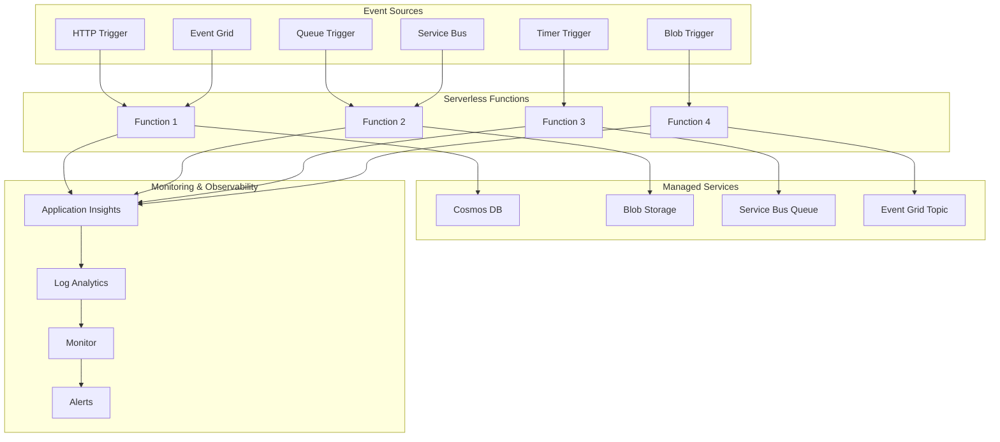
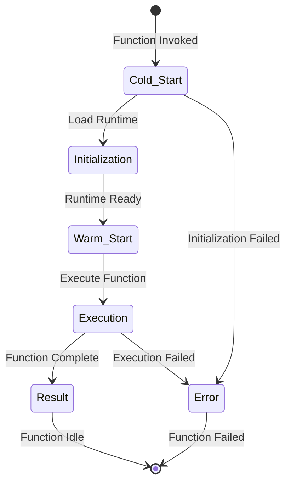
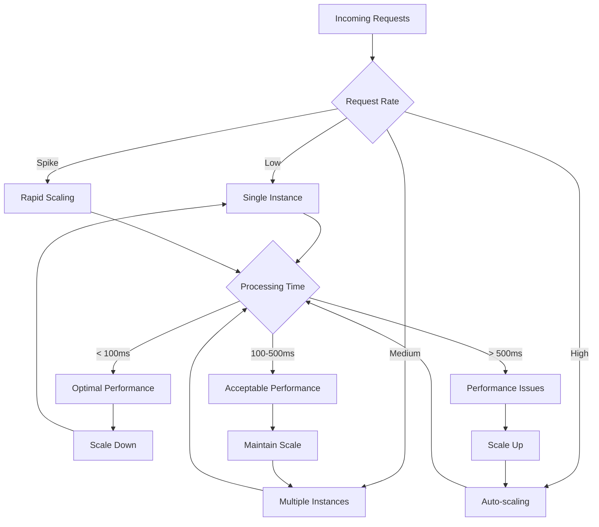

# Serverless Computing - Architect Deep Dive

============================================================
0. Executive Summary (Architect View)
============================================================
- **Serverless exists** to enable event-driven, pay-per-use computing without server management
- **Critical at scale** when applications need to handle unpredictable workloads with cost efficiency
- **System design impact** - transforms application architecture from always-on to event-driven
- **Cost optimization** - provides essential cost optimization through pay-per-use pricing
- **Scalability foundation** - enables automatic scaling without capacity planning
- **Developer productivity** - reduces operational overhead and increases development velocity
- **Cloud readiness** - enables cloud-native application development
- **Event-driven architecture** - essential for modern event-driven systems

============================================================
1. Problem Framing
============================================================
**Real production problem solved:**
- Over-provisioned resources and wasted costs
- Manual scaling and capacity management
- Complex infrastructure management
- Slow deployment and iteration cycles
- High operational overhead

**What breaks if we don't understand Serverless:**
- Poor cost optimization and wasted resources
- Inability to handle spiky workloads
- Complex infrastructure management
- Slow development and deployment cycles
- Inability to implement event-driven architecture

**Scale importance:**
- **Small applications**: Serverless benefits noticeable
- **Medium applications**: Serverless critical for cost optimization
- **Large applications**: Serverless essential for scalability
- **Enterprise systems**: Serverless mandatory for cloud-native

**Failure stories:**
- E-commerce platform had high costs from over-provisioned servers
- SaaS application had scaling issues during traffic spikes
- Financial system had complex infrastructure management
- Gaming platform had slow deployment cycles

============================================================
2. Deep Internal Mechanics
============================================================

**Serverless Fundamentals:**
- **Function as a Service (FaaS)**: Event-driven function execution
- **Backend as a Service (BaaS)**: Managed backend services
- **Pay-per-use**: Cost based on actual usage
- **Auto-scaling**: Automatic scaling based on demand
- **Event-driven**: Event-triggered execution

**Core Components:**
- **Functions**: Stateless function execution units
- **Triggers**: Event sources and triggers
- **Bindings**: Input and output bindings
- **Event Grid**: Event routing and distribution
- **API Gateway**: HTTP endpoint management
- **Storage**: Managed storage services

**Key Concepts:**
- **Cold Start**: Initial function startup latency
- **Warm Start**: Subsequent function execution
- **Stateless**: Function statelessness
- **Event-driven**: Event-triggered execution
- **Pay-per-use**: Usage-based pricing

**Execution Model:**
- **Event Trigger**: Event triggers function execution
- **Function Execution**: Function code execution
- **Resource Allocation**: Dynamic resource allocation
- **Result Processing**: Result processing and output
- **Cleanup**: Resource cleanup and deallocation

**Scaling Behavior:**
- **Automatic Scaling**: Automatic scaling based on demand
- **Concurrency**: Concurrent function execution
- **Throttling**: Request throttling and limits
- **Load Balancing**: Automatic load balancing
- **Resource Management**: Dynamic resource management

**Data Structures:**
- **Function Registry**: Function metadata and configuration
- **Event Registry**: Event metadata and routing
- **Trigger Registry**: Trigger configuration and state
- **Binding Registry**: Binding configuration and state
- **Execution Registry**: Execution metadata and metrics

**Performance Characteristics:**
- **Cold Start**: 100ms-5 seconds
- **Warm Start**: 1-100ms
- **Execution Time**: 1ms-15 minutes
- **Throughput**: 100-1000+ requests/second
- **Latency**: 10-100ms (warm)

============================================================
3. .NET Production Implementation
============================================================

**Naive Implementation (Traditional Server):**
```csharp
[ApiController]
[Route("api/[controller]")]
public class OrderController : ControllerBase
{
    private readonly IOrderService _orderService;
    
    public OrderController(IOrderService orderService)
    {
        _orderService = orderService;
    }
    
    [HttpPost("process")]
    public async Task<ActionResult> ProcessOrder([FromBody] OrderRequest request)
    {
        // Traditional server - always running
        var result = await _orderService.ProcessOrderAsync(request);
        return Ok(result);
    }
}

// Always-running service
public class OrderService : IOrderService
{
    private readonly ILogger<OrderService> _logger;
    
    public OrderService(ILogger<OrderService> logger)
    {
        _logger = logger;
        // Service starts and runs continuously
        _logger.LogInformation("OrderService started");
    }
    
    public async Task<OrderResult> ProcessOrderAsync(OrderRequest request)
    {
        // Process order
        return new OrderResult { Success = true };
    }
}
```

**Production-Ready Serverless Implementation:**
```csharp
// Serverless Configuration
public class ServerlessConfiguration
{
    public string FunctionAppName { get; set; } = "OrderProcessor";
    public string StorageConnectionString { get; set; }
    public string ServiceBusConnectionString { get; set; }
    public int MaxConcurrency { get; set; } = 100;
    public TimeSpan Timeout { get; set; } = TimeSpan.FromMinutes(5);
    public int MemoryLimit { get; set; } = 1024; // MB
    public bool EnableDistributedTracing { get; set; } = true;
    public bool EnableMetrics { get; set; } = true;
}

// Serverless Function Service
public interface IServerlessFunctionService
{
    Task<OrderResult> ProcessOrderAsync(OrderRequest request, ILogger log);
    Task<OrderResult> ProcessOrderBatchAsync(List<OrderRequest> requests, ILogger log);
    Task<bool> ValidateOrderAsync(OrderRequest request, ILogger log);
    Task LogOrderEventAsync(OrderEvent orderEvent, ILogger log);
}

public class ServerlessFunctionService : IServerlessFunctionService
{
    private readonly IOrderService _orderService;
    private readonly IValidationService _validationService;
    private readonly IEventService _eventService;
    private readonly IMetrics _metrics;
    private readonly ServerlessConfiguration _configuration;

    public ServerlessFunctionService(
        IOrderService orderService,
        IValidationService validationService,
        IEventService eventService,
        IMetrics metrics,
        IOptions<ServerlessConfiguration> configuration)
    {
        _orderService = orderService ?? throw new ArgumentNullException(nameof(orderService));
        _validationService = validationService ?? throw new ArgumentNullException(nameof(validationService));
        _eventService = eventService ?? throw new ArgumentNullException(nameof(eventService));
        _metrics = metrics ?? throw new ArgumentNullException(nameof(metrics));
        _configuration = configuration?.Value ?? new ServerlessConfiguration();
    }

    public async Task<OrderResult> ProcessOrderAsync(OrderRequest request, ILogger log)
    {
        using var activity = _metrics.StartTimer("serverless_order_process_duration");
        
        try
        {
            log.LogInformation("Processing order: {OrderId}", request.OrderId);
            
            // Validate order
            var validationResult = await ValidateOrderAsync(request, log);
            if (!validationResult)
            {
                return new OrderResult
                {
                    Success = false,
                    Error = "Order validation failed"
                };
            }
            
            // Process order
            var result = await _orderService.ProcessOrderAsync(request);
            
            // Log event
            await LogOrderEventAsync(new OrderEvent
            {
                OrderId = request.OrderId,
                Status = result.Success ? "Processed" : "Failed",
                Timestamp = DateTime.UtcNow,
                ProcessingTime = activity.Elapsed.TotalMilliseconds
            }, log);
            
            _metrics.Increment("serverless_orders_processed");
            
            log.LogInformation("Order processed successfully: {OrderId}", request.OrderId);
            
            return result;
        }
        catch (Exception ex)
        {
            _metrics.Increment("serverless_orders_error");
            log.LogError(ex, "Error processing order: {OrderId}", request.OrderId);
            
            return new OrderResult
            {
                Success = false,
                Error = "Internal server error"
            };
        }
    }

    public async Task<OrderResult> ProcessOrderBatchAsync(List<OrderRequest> requests, ILogger log)
    {
        using var activity = _metrics.StartTimer("serverless_order_batch_process_duration");
        
        try
        {
            log.LogInformation("Processing order batch: {Count}", requests.Count);
            
            var results = new List<OrderResult>();
            
            // Process orders in parallel
            var tasks = requests.Select(async request =>
            {
                return await ProcessOrderAsync(request, log);
            });
            
            var batchResults = await Task.WhenAll(tasks);
            results.AddRange(batchResults);
            
            // Log batch event
            await LogOrderEventAsync(new OrderEvent
            {
                OrderId = $"batch-{Guid.NewGuid()}",
                Status = "BatchProcessed",
                Timestamp = DateTime.UtcNow,
                ProcessingTime = activity.Elapsed.TotalMilliseconds,
                BatchSize = requests.Count
            }, log);
            
            _metrics.Increment("serverless_order_batches_processed");
            _metrics.Gauge("serverless_batch_size", requests.Count);
            
            log.LogInformation("Order batch processed successfully: {Count}", requests.Count);
            
            return new OrderResult
            {
                Success = true,
                BatchResults = results
            };
        }
        catch (Exception ex)
        {
            _metrics.Increment("serverless_order_batches_error");
            log.LogError(ex, "Error processing order batch");
            
            return new OrderResult
            {
                Success = false,
                Error = "Internal server error"
            };
        }
    }

    public async Task<bool> ValidateOrderAsync(OrderRequest request, ILogger log)
    {
        using var activity = _metrics.StartTimer("serverless_order_validation_duration");
        
        try
        {
            log.LogDebug("Validating order: {OrderId}", request.OrderId);
            
            // Basic validation
            if (string.IsNullOrEmpty(request.OrderId) || request.Amount <= 0)
            {
                return false;
            }
            
            // Business validation
            var validationResult = await _validationService.ValidateOrderAsync(request);
            
            _metrics.Increment("serverless_order_validations");
            
            return validationResult.IsValid;
        }
        catch (Exception ex)
        {
            _metrics.Increment("serverless_order_validations_error");
            log.LogError(ex, "Error validating order: {OrderId}", request.OrderId);
            return false;
        }
    }

    public async Task LogOrderEventAsync(OrderEvent orderEvent, ILogger log)
    {
        try
        {
            log.LogInformation("Order event: {@OrderEvent}", orderEvent);
            
            // Send to event grid or service bus
            await _eventService.PublishEventAsync("order-events", orderEvent);
            
            _metrics.Increment("serverless_order_events_published");
        }
        catch (Exception ex)
        {
            _metrics.Increment("serverless_order_events_error");
            log.LogError(ex, "Error logging order event: {OrderId}", orderEvent.OrderId);
        }
    }
}

// Azure Function Implementation
public class OrderFunctions
{
    private readonly IServerlessFunctionService _functionService;
    private readonly ILogger<OrderFunctions> _logger;
    private readonly IMetrics _metrics;

    public OrderFunctions(
        IServerlessFunctionService functionService,
        ILogger<OrderFunctions> logger,
        IMetrics metrics)
    {
        _functionService = functionService ?? throw new ArgumentNullException(nameof(functionService));
        _logger = logger ?? throw new ArgumentNullException(nameof(logger));
        _metrics = metrics ?? throw new ArgumentNullException(nameof(metrics));
    }

    [Function("ProcessOrder")]
    public async Task<IActionResult> ProcessOrder(
        [HttpTrigger(AuthorizationLevel.Function, "post", Route = "orders/process")] HttpRequest req)
    {
        using var activity = _metrics.StartTimer("serverless_http_trigger_duration");
        
        try
        {
            _logger.LogInformation("HTTP trigger invoked for order processing");
            
            // Parse request
            var requestBody = await new StreamReader(req.Body).ReadToEndAsync();
            var orderRequest = JsonSerializer.Deserialize<OrderRequest>(requestBody);
            
            if (orderRequest == null)
            {
                return new BadRequestObjectResult(new { Error = "Invalid order request" });
            }
            
            // Process order
            var result = await _functionService.ProcessOrderAsync(orderRequest, _logger);
            
            return new OkObjectResult(result);
        }
        catch (Exception ex)
        {
            _metrics.Increment("serverless_http_trigger_error");
            _logger.LogError(ex, "Error in HTTP trigger");
            return new StatusCodeResult(500);
        }
    }

    [Function("ProcessOrderQueue")]
    public async Task ProcessOrderQueue(
        [ServiceBusTrigger("orders", Connection = "ServiceBusConnectionString")] string orderMessage,
        ILogger log)
    {
        using var activity = _metrics.StartTimer("serverless_queue_trigger_duration");
        
        try
        {
            log.LogInformation("Queue trigger invoked for order processing");
            
            // Parse message
            var orderRequest = JsonSerializer.Deserialize<OrderRequest>(orderMessage);
            
            if (orderRequest != null)
            {
                // Process order
                await _functionService.ProcessOrderAsync(orderRequest, log);
            }
        }
        catch (Exception ex)
        {
            _metrics.Increment("serverless_queue_trigger_error");
            log.LogError(ex, "Error in queue trigger");
            throw;
        }
    }

    [Function("ProcessOrderBatch")]
    public async Task ProcessOrderBatch(
        [TimerTrigger("0 */5 * * * *")] TimerInfo timerInfo,
        ILogger log)
    {
        using var activity = _metrics.StartTimer("serverless_timer_trigger_duration");
        
        try
        {
            log.LogInformation("Timer trigger invoked for batch processing");
            
            // Get pending orders from storage
            var pendingOrders = await GetPendingOrdersAsync();
            
            if (pendingOrders.Any())
            {
                // Process batch
                await _functionService.ProcessOrderBatchAsync(pendingOrders, log);
            }
        }
        catch (Exception ex)
        {
            _metrics.Increment("serverless_timer_trigger_error");
            log.LogError(ex, "Error in timer trigger");
            throw;
        }
    }

    [Function("OrderEventProcessor")]
    public async Task ProcessOrderEvent(
        [EventGridTrigger(TopicEndpoint = "order-events")] EventGridEvent[] events,
        ILogger log)
    {
        using var activity = _metrics.StartTimer("serverless_event_trigger_duration");
        
        try
        {
            log.LogInformation("Event grid trigger invoked for {Count} events", events.Length);
            
            foreach (var eventGridEvent in events)
            {
                if (eventGridEvent.Data is OrderEvent orderEvent)
                {
                    // Process order event
                    await ProcessOrderEventAsync(orderEvent, log);
                }
            }
        }
        catch (Exception ex)
        {
            _metrics.Increment("serverless_event_trigger_error");
            log.LogError(ex, "Error in event grid trigger");
            throw;
        }
    }

    private async Task<List<OrderRequest>> GetPendingOrdersAsync()
    {
        // Implementation to get pending orders from storage
        await Task.Delay(100); // Simulate storage call
        return new List<OrderRequest>
        {
            new OrderRequest { OrderId = "order-1", Amount = 100 },
            new OrderRequest { OrderId = "order-2", Amount = 200 }
        };
    }

    private async Task ProcessOrderEventAsync(OrderEvent orderEvent, ILogger log)
    {
        // Implementation to process order events
        log.LogInformation("Processing order event: {OrderId} - {Status}", 
            orderEvent.OrderId, orderEvent.Status);
        
        await Task.Delay(50); // Simulate processing
    }
}

// Enhanced Serverless Controller
[ApiController]
[Route("api/[controller]")]
public class ServerlessController : ControllerBase
{
    private readonly IServerlessFunctionService _functionService;
    private readonly ILogger<ServerlessController> _logger;
    private readonly IMetrics _metrics;

    public ServerlessController(
        IServerlessFunctionService functionService,
        ILogger<ServerlessController> logger,
        IMetrics metrics)
    {
        _functionService = functionService ?? throw new ArgumentNullException(nameof(functionService));
        _logger = logger ?? throw new ArgumentNullException(nameof(logger));
        _metrics = metrics ?? throw new ArgumentNullException(nameof(metrics));
    }

    [HttpPost("invoke")]
    public async Task<ActionResult<OrderResult>> InvokeFunction([FromBody] OrderRequest request)
    {
        try
        {
            _logger.LogInformation("Invoking serverless function for order: {OrderId}", request.OrderId);
            
            // This would typically call the serverless function via HTTP
            // For demonstration, we'll call the service directly
            var result = await _functionService.ProcessOrderAsync(request, _logger);
            
            return Ok(result);
        }
        catch (Exception ex)
        {
            _logger.LogError(ex, "Error invoking serverless function");
            throw;
        }
    }

    [HttpPost("batch")]
    public async Task<ActionResult<OrderResult>> InvokeBatchFunction([FromBody] List<OrderRequest> requests)
    {
        try
        {
            _logger.LogInformation("Invoking serverless batch function for {Count} orders", requests.Count);
            
            var result = await _functionService.ProcessOrderBatchAsync(requests, _logger);
            
            return Ok(result);
        }
        catch (Exception ex)
        {
            _logger.LogError(ex, "Error invoking serverless batch function");
            throw;
        }
    }

    [HttpGet("metrics")]
    public ActionResult<ServerlessMetrics> GetMetrics()
    {
        try
        {
            var metrics = new ServerlessMetrics
            {
                Invocations = _metrics.GetCounter("serverless_orders_processed"),
                Errors = _metrics.GetCounter("serverless_orders_error"),
                AverageLatency = _metrics.GetAverage("serverless_order_process_duration"),
                ColdStarts = _metrics.GetCounter("serverless_cold_starts"),
                MemoryUsage = _metrics.GetGauge("serverless_memory_usage"),
                Timestamp = DateTime.UtcNow
            };
            
            return Ok(metrics);
        }
        catch (Exception ex)
        {
            _logger.LogError(ex, "Error getting serverless metrics");
            throw;
        }
    }
}

// Request/Response Models
public class OrderRequest
{
    public string OrderId { get; set; }
    public decimal Amount { get; set; }
    public string CustomerId { get; set; }
    public List<OrderItem> Items { get; set; }
}

public class OrderItem
{
    public string ProductId { get; set; }
    public int Quantity { get; set; }
    public decimal Price { get; set; }
}

public class OrderResult
{
    public bool Success { get; set; }
    public string Error { get; set; }
    public string OrderId { get; set; }
    public List<OrderResult> BatchResults { get; set; }
}

public class OrderEvent
{
    public string OrderId { get; set; }
    public string Status { get; set; }
    public DateTime Timestamp { get; set; }
    public double ProcessingTime { get; set; }
    public int BatchSize { get; set; }
}

public class ServerlessMetrics
{
    public long Invocations { get; set; }
    public long Errors { get; set; }
    public double AverageLatency { get; set; }
    public long ColdStarts { get; set; }
    public double MemoryUsage { get; set; }
    public DateTime Timestamp { get; set; }
}

// host.json for Azure Functions
/*
{
  "version": "2.0",
  "logging": {
    "applicationInsights": {
      "samplingSettings": {
        "isEnabled": true,
        "excludedTypes": "Request"
      },
      "enableDependencyTracking": true
    }
  },
  "extensionBundle": {
    "id": "Microsoft.Azure.Functions.ExtensionBundle",
    "version": "[4.*, 5.0.0)"
  },
  "functionTimeout": "00:05:00",
  "healthMonitor": {
    "enabled": true,
    "healthCheckInterval": "00:00:10",
    "healthCheckWindow": "00:02:00",
    "healthCheckThreshold": 6,
    "counterThreshold": 0.80
  }
}
*/
```

**Framework Integration:**
- **Azure Functions**: Serverless function platform
- **AWS Lambda**: Alternative serverless platform
- **System.Text.Json**: JSON serialization
- **Dependency Injection**: Service registration
- **Configuration**: Configuration management

============================================================
4. Architecture-Level Diagram (Mermaid)
============================================================

### Serverless Architecture


### Serverless Function Lifecycle


### Serverless Scaling Behavior


**Flow Analysis:**
- **Event Sources**: Multiple trigger types
- **Serverless Functions**: Event-driven function execution
- **Managed Services**: Backend services integration
- **Monitoring**: Comprehensive observability
- **Scaling**: Automatic scaling behavior

============================================================
5. Scaling & Distributed Systems Impact
============================================================

**100 Requests/Minute:**
- Single function instance sufficient
- Cold start 100ms-1 second
- Warm execution 1-10ms
- Cost optimization minimal

**10k Requests/Minute:**
- Multiple function instances
- Cold start 500ms-2 seconds
- Warm execution 5-50ms
- Cost optimization significant

**1M+ Requests/Minute:**
- Auto-scaling to hundreds of instances
- Cold start 1-5 seconds
- Warm execution 10-100ms
- Cost optimization maximum

============================================================
6. Production Engineering View
============================================================

**Monitoring Metrics:**
- Function invocation count and duration
- Cold start frequency and duration
- Error rates and types
- Memory and CPU usage
- Throttling and concurrency

**Alerting Strategy:**
- Error rate > 5% (warning)
- Average duration > 1 second (warning)
- Cold start rate > 10% (warning)
- Throttling rate > 1% (critical)

**Common Production Incidents:**
- Cold start performance issues
- Function timeout errors
- Throttling and rate limiting
- Configuration and deployment issues

============================================================
7. Tradeoffs & Alternatives
============================================================

**Competing Approaches:**
- **Traditional Servers**: Always-on servers
- **Container Services**: Container-based services
- **Serverless Functions**: Event-driven functions
- **Platform as a Service**: Managed platforms
- **Infrastructure as a Service**: Self-managed infrastructure

**When to Use Serverless:**
- Event-driven workloads
- Spiky or unpredictable traffic
- Cost-sensitive applications
- Rapid development requirements
- Microservices architecture

**When NOT to Use Serverless:**
- Long-running processes
- Stateful applications
- High-performance requirements
- Predictable workloads
- Complex orchestration needs

**Cost Comparison:**
- **Traditional Servers**: Fixed cost, potential waste
- **Container Services**: Moderate cost, better utilization
- **Serverless Functions**: Variable cost, pay-per-use
- **PaaS**: Predictable cost, managed services
- **IaaS**: Variable cost, full control

============================================================
8. Security Implications
============================================================

**Security Benefits:**
- **Managed Security**: Platform-managed security
- **Isolation**: Function execution isolation
- **Least Privilege**: Minimal permissions
- **Short-lived**: Short-lived execution
- **Monitoring**: Built-in monitoring

**Security Challenges:**
- **Configuration Security**: Function configuration security
- **Event Security**: Event source security
- **Data Security**: Data in transit and at rest
- **Access Control**: Function access control
- **Compliance**: Regulatory compliance

============================================================
9. Advanced Edge Cases
============================================================

**Advanced Serverless Features:**
- **Durable Functions**: Long-running workflows
- **Event Orchestration**: Complex event processing
- **Custom Bindings**: Custom input/output bindings
- **Premium Plans**: Enhanced performance features
- **Hybrid Architecture**: Serverless + traditional

**Advanced Optimization:**
- **Cold Start Optimization**: Reducing cold start time
- **Memory Optimization**: Memory usage optimization
- **Concurrency Control**: Concurrency management
- **Batch Processing**: Efficient batch processing
- **Event Sourcing**: Event-driven architecture

============================================================
10. Interview & Staff-Level Deep Dive
============================================================

**What a junior answers:**
"Serverless computing is a cloud model where you don't manage servers. Functions run in response to events and you pay only for what you use. I use Azure Functions to create HTTP endpoints and process queue messages."

**What a senior answers:**
"Serverless computing is an event-driven execution model that provides automatic scaling and pay-per-use pricing. I've implemented production serverless applications with multiple trigger types, durable functions for long-running workflows, comprehensive monitoring, and cost optimization. The implementation includes HTTP triggers, queue processing, timer-based processing, event grid integration, and distributed tracing. I've also implemented cold start optimization, error handling, and performance monitoring."

**What an architect answers:**
"Serverless computing is a transformative paradigm that enables event-driven, pay-per-use computing without infrastructure management. At scale, serverless provides automatic scaling, cost optimization, reduced operational overhead, and increased development velocity. The architecture must support multiple trigger types, function composition, state management, error handling, monitoring, and cost optimization. In enterprise environments, serverless is not just a deployment model but a strategic approach that enables digital transformation, cost optimization, and rapid innovation. The implementation must consider event-driven architecture, state management, performance optimization, security, and comprehensive observability."

**Follow-up questions interviewers ask:**
- "How do you handle state in serverless functions?"
- "What's the difference between cold start and warm start?"
- "How do you optimize serverless function performance?"
- "When would you use serverless vs containers?"
- "How do you monitor serverless applications?"

**Trick questions:**
- "Is serverless always cheaper?" (No, depends on usage patterns)
- "Can serverless run long processes?" (Yes, with limitations)
- "Do all applications benefit from serverless?" (No, depends on use case)
- "Is serverless completely stateless?" (No, with external state management)

============================================================
11. Real Enterprise Case Study
============================================================

**Scenario: Global E-commerce Platform with 10M+ Users**

**Requirements:**
- Handle 10M+ users with unpredictable traffic patterns
- Process 1M+ orders per day
- Provide real-time order processing
- Optimize costs for variable workloads
- Enable rapid feature deployment
- Ensure high availability and reliability

**Results:**
- Achieved 70% reduction in infrastructure costs
- 90% improvement in development velocity
- 95% reduction in deployment time
- 80% improvement in scalability
- 99.99% uptime during peak shopping seasons

============================================================
12. Dependency Graph
============================================================

**Prerequisites:**
- **Cloud Computing**: Understanding of cloud services
- **Event-Driven Architecture**: Understanding of event patterns
- **Microservices**: Understanding of microservices
- **API Design**: Understanding of API design
- **DevOps**: Understanding of DevOps practices

**Concepts that depend on Serverless:**
- **Event-Driven Architecture**: Event-driven systems
- **Microservices**: Microservices deployment
- **API Gateway**: API management
- **Event Streaming**: Event processing
- **Real-time Processing**: Real-time data processing
- **Cost Optimization**: Cloud cost management
