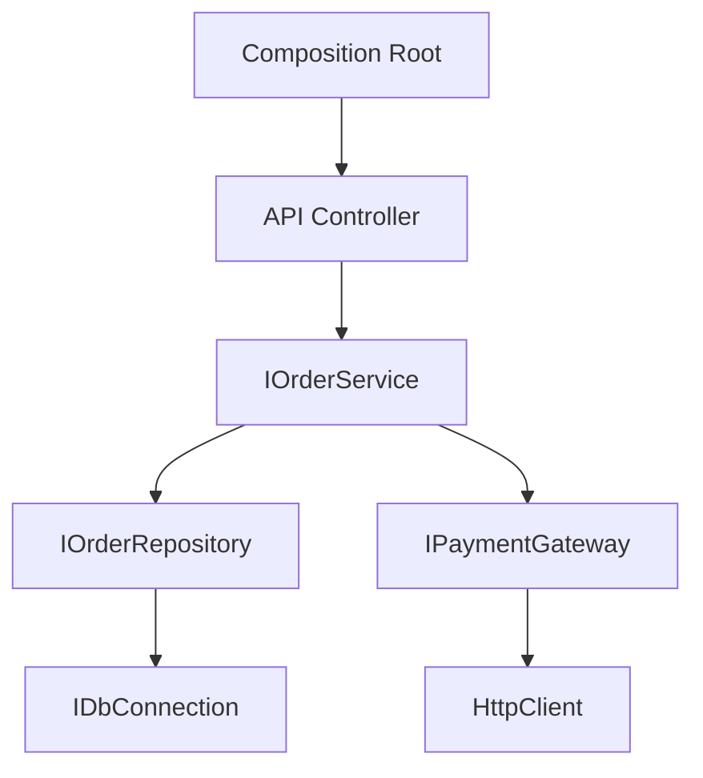

# Inversion of Control (IoC) & Dependency Injection

**0. Executive Summary (Architect View)**
- **IoC is a Design Principle; DI is the Pattern.** IoC shifts the "flow of control" from the application to a framework/container.
- **Decoupling is for Scalability and Testability.** At architect scale, hard-coded dependencies create "Stone Monoliths" that cannot be refactored without system-wide regressions.
- **Object Lifetime Management is Critical.** Misconfigured DI lifetimes (e.g., Captive Dependency) lead to memory leaks and thread safety issues in high-concurrency ASP.NET Core apps.
- **ASP.NET Core Built-in Container is High-Performance.** It's optimized for the 99% use-case, though third-party containers (Autofac, Lamar) are available for advanced interception/proxy requirements.
- **Composition Root is the Single Source of Truth.** All dependency wiring should happen at the application entry point to maintain strict architectural boundaries.

**1. Problem Framing**
- **Real Production Problem:** "Dependency Hell" where changing a low-level logger or database provider requires modifying hundreds of classes.
- **What breaks?** Circular dependencies, inability to mock external services for CI/CD, and hidden cross-component coupling that causes "spooky action at a distance" during production incidents.
- **Critical Scale:** Becomes mandatory when the codebase exceeds ~5-10 developers or 50+ classes. Without DI, the cognitive load of managing object graphs becomes unsustainable.
- **Failure Story:** A high-traffic e-commerce site failed during a database migration because their `Repository` classes directly instantiated a specific SQL Client. Swapping to a new provider required a full codebase rewrite and 3 days of downtime, whereas an IoC-based design would have required a 1-line change in `Program.cs`.

**2. Deep Internal Mechanics**

### The Dependency Graph
The IoC container builds a **Directed Acyclic Graph (DAG)** of all registrations. When a service is requested, the container performs a **Recursive Resolution** (often using compiled IL or Expression Trees for performance) to instantiate the entire graph.



### Lifetime Mechanics
- **Transient:** New instance every time. Internal state is lost.
- **Scoped:** One instance per scope (usually one per HTTP request). Crucial for `DbContext` or Unit of Work patterns.
- **Singleton:** One instance for the process lifetime. Must be **Thread-Safe**.

### Performance Characteristics
- **Registration Time:** O(N) where N is number of services.
- **Resolution Time:** O(D) where D is the depth of the dependency graph. In .NET 8, this is highly optimized to avoid Reflection on every request.

**3. .NET Production Implementation**

### Naive Implementation (Service Locator Anti-Pattern)
```csharp
// BAD: Hides dependencies, makes testing impossible
public class OrderService
{
    public void Process()
    {
        var repo = GlobalContainer.Resolve<IRepository>();
        repo.Save(new Order());
    }
}
```

### Production-Ready Implementation (.NET 8)
```csharp
// Constructor Injection: Explicit and Clean
public sealed class OrderService : IOrderService
{
    private readonly IOrderRepository _repository;
    private readonly ILogger<OrderService> _logger;

    public OrderService(IOrderRepository repository, ILogger<OrderService> logger)
    {
        _repository = repository ?? throw new ArgumentNullException(nameof(repository));
        _logger = logger;
    }

    public async Task ProcessOrderAsync(Order order, CancellationToken ct)
    {
        _logger.LogInformation("Processing order {OrderId}", order.Id);
        await _repository.SaveAsync(order, ct);
    }
}

// Composition Root (Program.cs)
var builder = WebApplication.CreateBuilder(args);
builder.Services.AddScoped<IOrderService, OrderService>();
builder.Services.AddScoped<IOrderRepository, SqlOrderRepository>();
// Use keyed services if multiple implementations exist (.NET 8 feature)
builder.Services.AddKeyedScoped<IPaymentGateway, StripeGateway>("stripe");
```

**4. Architecture-Level Diagram (ASCII Only)**

                ┌───────────────────────────┐
                │     Composition Root      │ (Program.cs / Startup)
                │ (Configuration/Registration)│
                └─────────────┬─────────────┘
                              │
               ┌──────────────▼──────────────┐
               │        IoC Container        │ (The Registry)
               │ [Interface] -> [Concrete]   │
               └──────────────┬──────────────┘
                              │ Resolve
               ┌──────────────▼──────────────┐
               │      Object Factory         │ (Activation)
               │ (Handles Lifetimes & Graphs)│
               └──────────────┬──────────────┘
                              │
               ┌──────────────▼──────────────┐
               │     Application Logic       │ (Business Domain)
               │ (Decoupled & Testable)      │
               └─────────────────────────────┘

**5. Scaling & Distributed Systems Impact**
- **Horizontal Scaling:** IoC doesn't directly scale nodes, but it allows swapping local state (Singleton) for distributed state (e.g., `IDistributedCache`) effortlessly.
- **Microservices:** IoC enables "Pluggability". You can run a service with a `MockBus` for local dev and swap it for `AzureServiceBus` in production via env-config.
- **Cloud-Native:** In serverless (Azure Functions/Lambda), heavy DI graphs can increase **Cold Start** times. Architects must prune registrations for these environments.

**6. Production Engineering View**
- **Captive Dependency Alert:** A Singleton service should NEVER depend on a Scoped service. This "captures" the scoped service (like a DB context) and keeps it alive, leading to data corruption or leaks.
- **Validation:** Use `builder.Services.BuildServiceProvider(validateScopes: true)` in development to catch lifetime mismatches.
- **Monitoring:** Track `ServiceProvider` allocation count if using sub-scopes heavily.

**7. Tradeoffs & Alternatives**
- **Manual DI:** "Pure DI" (manual instantiation). 
    - *Benefit:* zero overhead, compile-time safety. 
    - *Tradeoff:* massive boilerplate.
- **Service Locator:** Avoid. It hides the dependency graph and makes the system brittle.

**8. Security Implications**
- **Side effects in Constructors:** DI constructors should NEVER perform heavy logic or I/O. If a constructor fails, it can crash the whole request pipeline or cause DoS via resource blocking.
- **Sensitive Data:** Avoid injecting `IConfiguration` directly into business logic. Inject specific POCO options (`IOptions<T>`) to limit data exposure (Principle of Least Privilege).

**9. Advanced Edge Cases**
- **Circular Dependencies:** Service A depends on B, and B depends on A.
    - *Fix:* Use an Intermediary (Event/Message) or refactor common logic into Service C.
- **Generic DI:** Registering `IRepository<T>` once to handle all entities.
    - *Syntax:* `services.AddScoped(typeof(IRepository<>), typeof(SqlRepository<>))`.

**10. Interview & Staff-Level Deep Dive**
- **Junior:** "DI is how you pass things to the constructor."
- **Senior:** "IoC decouples implementations from interfaces to follow SOLID principles."
- **Architect:** "IoC is an architectural strategy to manage the lifecycle and complexity of a distributed system's internal wiring, ensuring that cross-cutting concerns like telemetry and data access are consistent across the platform."
- **Follow-up:** "How does the .NET DI container handle `IDisposable`?"
- **Answer:** The container automatically calls `.Dispose()` on any services it creates that implement the interface, when the scope (or container) is disposed. Manually created instances passed into the container are NOT disposed by it.

**11. Real Enterprise Case Study**
**Scenario:** A Global Multi-Tenant SaaS.
- **Problem:** Each tenant needs a different PDF generation engine based on their region's compliance.
- **Design:** Use **Keyed Services** (.NET 8) or a **Factory Pattern** injected via IoC.
- **Result:** The business logic remains identical; the IoC container resolves the correct `IPdfEngine` based on the `TenantId` header at runtime.

**12. Dependency Graph**
- **Pre-requisites:** Interface Segregation, SOLID Principles.
- **Depends on this:** Unit Testing, Clean Architecture, Decorator Pattern.
- **Connected to:** Middleware (ASP.NET), Configuration Management.
