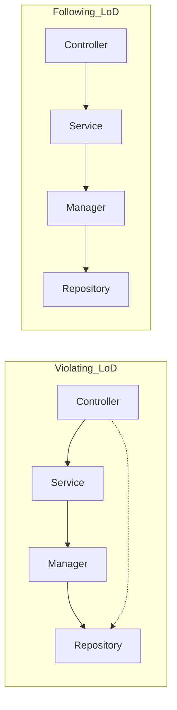

# Law of Demeter (Principle of Least Knowledge)

============================================================
0. Executive Summary (Architect View)
============================================================
- **Loose Coupling is the Core Objective.** Law of Demeter (LoD) states that a module should not know about the inner workings of the objects it manipulates.
- **"Don't Talk to Strangers."** At architect depth, LoD prevents "Structural Coupling" where a change in a deeply nested object (e.g., a DB column change) breaks the UI Layer.
- **Reduces Rippling Failures.** By limiting interaction to immediate neighbors, you contain the impact of refactoring and bugs.
- **Improved Testability.** Following LoD eliminates the need for "Deep Mocking" (mocking a chain of objects like `mock.User.Profile.Settings.Theme`), which is a major symptom of architectural decay.
- **Impacts API Design.** LoD encourages "Tell, Don't Ask" designs, where you ask an object to perform an action rather than asking for its state to perform the action yourself.

============================================================
1. Problem Framing
============================================================
- **Real Production Problem:** "Train Wrecks" in code. `customer.GetOrders()[0].GetPayment().GetStatus().ToString()`.
- **What breaks?** If the `Payment` object is renamed to `Transaction`, this single line (and potentially hundreds like it across the system) breaks. This leads to **Rigidity** (it's too hard to change anything).
- **Critical Scale:** Becomes painful as soon as you have multiple teams working on different modules. If Team A changes their internal data structure, and Team B's UI breaks because they reached "too deep" into Team A's objects, you have an organizational scaling crisis.
- **Failure Story:** A large banking system had to delay a critical security patch for 2 weeks because their Audit Service was reaching into the `Account` object, then into the `User` object, then into the `Permissions` object. A small change in `Permissions` broke the auditing logic in non-obvious ways, leading to data loss in production.

============================================================
2. Deep Internal Mechanics
============================================================

### The "Rules" of Interaction
A method `M` of an object `O` should only call methods on:
1. `O` itself.
2. The parameters passed into `M`.
3. Objects created or instantiated within `M`.
4. `O`'s direct component objects (fields/properties).

### Coupling Visualization
LoD enforces "Shallow Knowledge" to prevent the "Web of Dependencies".



### Performance Characteristics
- **Memory:** LoD often results in more "Wrapper Methods" or DTOs. This slightly increases the stack frame count but is negligible compared to the cost of maintenance.
- **GC Impact:** Temporary objects created to bridge knowledge gaps (e.g., specialized DTOs) are typically Gen 0 and cleaned up quickly.

============================================================
3. .NET Production Implementation
============================================================

### Naive Implementation (LoD Violation / Train Wreck)
```csharp
// The UI knows too much about the DB structure
public string GetUserZipCode(User user)
{
    return user.Account.Profile.Address.ZipCode; // 4 dots = Pain
}
```

### Production-Ready Implementation (.NET 8)
```csharp
// Better: The User object provides the information (Tell, Don't Ask)
public string GetUserZipCode(User user)
{
    return user.GetZipCode(); // Hides the Address/Profile hierarchy
}

// Or better yet, use DTOs project by the data layer
public async Task<UserLocationDto> GetUserLocationAsync(int userId)
{
    // EF Core ProjectTo (AutoMapper) or explicit Select
    // Logic is pushed down to the query layer
    return await _context.Users
        .Where(u => u.Id == userId)
        .Select(u => new UserLocationDto { ZipCode = u.Address.ZipCode })
        .FirstOrDefaultAsync();
}
```

**DI Lifetime:** Not directly applicable to the principle, but often interfaces are used to prevent LoD violations between layers.
**Logging:** Log at the boundary. If a method fails deep in the chain, LoD makes it harder to trace *unless* you have good correlation IDs.

============================================================
4. Architecture-Level Diagram (ASCII Only)
============================================================

          LAYERED ARCHITECTURE (LOO-COUPLED)
          
          ┌───────────────────────┐
          │     Presentation      │
          └──────────┬────────────┘
                     │ Query DTO / Command
          ┌──────────▼────────────┐
          │     Application       │ (Orchestrator - knows 'What')
          └──────────┬────────────┘
                     │ Single Action Call
          ┌──────────▼────────────┐
          │       Domain          │ (Knowledge Holder - knows 'How')
          └──────────┬────────────┘
                     │ Persistence Call
          ┌──────────▼────────────┐
          │    Infrastructure     │ (Implementation)
          └───────────────────────┘

**Constraint:** Each layer ONLY communicates with the one immediately below it.

============================================================
5. Scaling & Distributed Systems Impact
============================================================
- **Microservices:** LoD is critical here. Service A should never know Service B's database schema. If Service A needs data from Service B, it calls an API. If it reaches into Service B's DB (Violating LoD at the system level), you have a **Distributed Monolith**.
- **Latency:** Extra layers might add microseconds of latency, but they prevent the "Recreatable Complexity" which is the real killer of high-scale systems.

============================================================
6. Production Engineering View
============================================================
- **Static Analysis:** Use tools like **NDepend** or custom Roslyn analyzers to detect "Too many dots" or excessive class coupling.
- **Unit Testing:** If your unit test setup requires 10 lines of `Mock<T>` setups to test one method, you are likely violating LoD.
- **Debugging:** Simplifies stack traces because the logic is encapsulated rather than spread across a chain of getter calls.

============================================================
7. Tradeoffs & Alternatives
============================================================
- **Over-Abstraction:** Too many "Wrapper Methods" can make the code hard to navigate (The "Where is the actual logic?" problem).
- **Performance:** In extreme hot-paths (e.g., High-Frequency Trading), the overhead of delegate calls or extra object allocations might be skipped in favor of "Inlined Knowledge".

============================================================
8. Security Implications
============================================================
- **Data Leakage:** Reaching deep into objects often exposes sensitive fields (like `PasswordHash` or `InternalId`) that should have been filtered out at a lower boundary. LoD naturally encourages the use of DTOs, which is a security best practice.

============================================================
9. Advanced Edge Cases
============================================================
- **Fluent APIs / Builders:** LoD applies to *different* types. Fluent APIs (like `StringBuilder.Append().Append()`) do NOT violate LoD because they return the same object or a related "Builder" type intended for that chain.
- **LINQ:** Chaining `.Where().Select().ToList()` is a functional pattern, not an LoD violation, as long as you aren't reaching into sub-properties of the items in a way that breaks encapsulation.

============================================================
10. Interview & Staff-Level Deep Dive
============================================================
- **Junior:** "Don't use more than one dot in a method call."
- **Senior:** "Encapsulate data and move behavior closer to the data it uses."
- **Architect:** "Law of Demeter is a structural constraint designed to minimize the blast radius of changes. It's about defining clear ownership and interaction boundaries to ensure the system remains evolvable as it grows in complexity."
- **Follow-up:** "How does LoD relate to the Open/Closed Principle?"
- **Answer:** By following LoD, you make classes easier to extend (Open) without modifying their internal structure (Closed), because their dependencies are strictly limited to their immediate interfaces.

============================================================
11. Real Enterprise Case Study
============================================================
**Scenario:** A Logistics System managing thousands of Trucks and Drivers.
- **Problem:** The `TrackingController` was calling `truck.CurrentDriver.LastPhysical.BloodPressure`. When the `Physical` record format changed, the GPS Tracking UI crashed.
- **Design:** Implement `truck.IsDriverFitForDuty()`. The logic for checking blood pressure is moved into the `Driver` or `MedicalService` layer.
- **Result:** The UI only cares about a `bool`. The medical team can change their grading criteria without ever touching the UI code.

============================================================
12. Dependency Graph
============================================================
- **Pre-requisites:** Encapsulation, Cohesion vs Coupling.
- **Depends on this:** Domain Driven Design (DDD), Modular Monoliths.
- **Connected to:** Repository Pattern, DTO Pattern.
