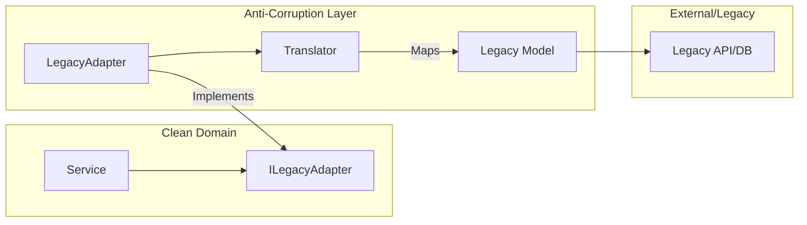

# Anti-Corruption Layer (ACL)

============================================================
0. Executive Summary (Architect View)
============================================================
- **Protection of the Domain.** The ACL is a layer that translates between two different domain models, preventing "pollution" from a legacy or external system from leaking into your clean architecture.
- **Critical for Strangler Fig Pattern.** When migrating from a monolith to microservices, the ACL allows new services to speak a "clean" language while communicating with the "messy" legacy backend.
- **Mapping is the Core Responsibility.** It involves semantic translation, not just data format conversion. 
- **Decouples Evolution.** You can change the legacy system (or swap it entirely) by only updating the ACL, leaving the core business logic untouched.
- **Architectural Boundary.** In .NET, this is often implemented as a separate project or a set of adapters/facades with specialized mapping logic (e.g., using AutoMapper or custom mappers).

============================================================
1. Problem Framing
============================================================
- **Real Production Problem:** "Model Bleeding". Your new .NET 8 Web API uses a `Legacy_User_v1_Final_REAL` table structure because it's easier to just pass the DB object around.
- **What breaks?** Your new, clean system becomes hard-linked to the legacy system's quirks (e.g., storing names as `VARCHAR(255)` with weird delimiters). When you finally want to delete the legacy system, you find you can't because your "new" system depends on its internal data structures.
- **Critical Scale:** Essential when integrating with 3rd-party vendors (like SAP, Salesforce) or during long-term enterprise migrations.
- **Failure Story:** A retail giant built a new mobile app that directly used the legacy mainframe's XML schema for inventory. When the mainframe was upgraded to a modern ERP, the mobile app (and 50 other services) broke because they were all "corrupted" by the original XML structure. Fixing it took 6 months of coordinated downtime.

============================================================
2. Deep Internal Mechanics
============================================================

### The Translation Pipeline
The ACL typically consists of three components:
1. **Adapter:** Implements the interface expected by the new system.
2. **Translator/Mapper:** Converts the legacy model to the new domain model.
3. **Facade:** (Optional) Simplifies the legacy system's complex API into something manageable.



### Performance Characteristics
- **Latency:** ACL adds a small overhead due to mapping and extra method calls. However, this is usually dwarfed by the I/O cost of calling the external system.
- **Memory:** Translating large object graphs between models can increase Gen 0 allocations. Use `Span<T>` or streaming transformations for high-throughput data to minimize heap impact.

============================================================
3. .NET Production Implementation
============================================================

### Naive Implementation (Corrupted Domain)
```csharp
// The new service is directly using the messy legacy class
public class DiscountService
{
    public void Apply(LegacyOrder_V2 legacyOrder) 
    {
        // New logic coupled to "legacyOrder.FLD_123_AMT"
        var total = legacyOrder.FLD_123_AMT; 
    }
}
```

### Production-Ready Implementation (.NET 8)
```csharp
// 1. Clean Domain Model
public record Order(Guid Id, decimal Amount);

// 2. ACL Interface
public interface ILegacyOrderSource
{
    Task<Order> GetOrderAsync(Guid id);
}

// 3. ACL Implementation (The Protector)
public sealed class LegacyOrderAdapter : ILegacyOrderSource
{
    private readonly ILegacyApiClient _client;
    private readonly ILogger<LegacyOrderAdapter> _logger;

    public LegacyOrderAdapter(ILegacyApiClient client, ILogger<LegacyOrderAdapter> logger)
    {
        _client = client;
        _logger = logger;
    }

    public async Task<Order> GetOrderAsync(Guid id)
    {
        // Call the messy system
        var raw = await _client.FetchRawOrderAsync(id.ToString());
        
        // Translate semantically (The Core of ACL)
        if (raw == null) throw new OrderNotFoundException(id);

        _logger.LogDebug("Translating legacy order {LegacyId}", raw.FLD_ID);

        return new Order(
            Id: Guid.Parse(raw.FLD_ID),
            Amount: raw.FLD_123_AMT // Semantic mapping
        );
    }
}
```

**DI Lifetime:** Often `Scoped` or `Transient` depending on whether the adapter holds state (like an authentication token).
**Logging:** Crucial to log "Translation Errors" separately from "Network Errors" to identify where the corruption is happening.

============================================================
4. Architecture-Level Diagram (ASCII Only)
============================================================

                ┌───────────────────────────┐
                │      Clean Services       │ (Your Domain)
                └─────────────┬─────────────┘
                              │ Uses Interface
               ┌──────────────▼──────────────┐
               │    Anti-Corruption Layer    │ (The Translation Proxy)
               │  [Adapter]──[Translator]    │
               └──────────────┬──────────────┘
                              │ Calls Messy API
               ┌──────────────▼──────────────┐
               │    External/Legacy System   │ (The Data Source)
               └─────────────────────────────┘

============================================================
5. Scaling & Distributed Systems Impact
============================================================
- **Microservices:** A dedicated "ACL Service" can be used as a gateway to legacy systems, ensuring no other service ever sees the legacy models.
- **Resiliency:** The ACL is the perfect place to implement **Circuit Breakers** and **Retries** specifically tuned for the legacy system's flakiness.
- **Consistency:** ACLs often handle the translation between different consistency models (e.g., converting a legacy synchronous call into a clean asynchronous event).

============================================================
6. Production Engineering View
============================================================
- **Metrics:** Track "Translation Failure Rate" (indicates legacy schema changes) and "Mapping Latency".
- **Monitoring:** Use Semantic Versioning on the legacy side. If the legacy system revs its version, update the ACL, not the domain.
- **Debugging:** If data looks "wrong" in the new system, the ACL is the first place to look. Unit test the `Translator` aggressively with edge-case legacy data.

============================================================
7. Tradeoffs & Alternatives
============================================================
- **Direct Integration:** Just use the legacy objects.
    - *Benefit:* Faster development initially.
    - *Tradeoff:* Massive technical debt and eventual "Monolith Lock-in".
- **Shared Kernel:** Both systems share a common DLL with models.
    - *Constraint:* Only works if both are in the same language/runtime and you have control over both.

============================================================
8. Security Implications
============================================================
- **Input Sanitization:** The ACL is a security boundary. Legacy systems may have SQLi vulnerabilities or insecure data; the ACL should sanitize data before it reaches the clean domain.
- **Credential Management:** The ACL handles the specialized authentication (e.g., legacy session tokens vs modern OAuth2) required to talk to the old system.

============================================================
9. Advanced Edge Cases
============================================================
- **N+1 Translation:** To create one clean object, the ACL might need to call 5 different legacy endpoints.
    - *Solution:* Implement caching or batching within the ACL to protect performance.
- **Semantic Mismatch:** Legacy says "Status 5", but new system only has "Pending" and "Active".
    - *Strategy:* The ACL must decide how to handle "Unknown" states—either fail, default, or log-and-notify.

============================================================
10. Interview & Staff-Level Deep Dive
============================================================
- **Junior:** "It's a wrapper for old code."
- **Senior:** "It helps you use clean models while talking to a messy database or API."
- **Architect:** "The ACL is a strategic decoupling mechanism that enforces a strict sub-domain boundary. It ensures that the ubiquitous language of our core domain remains pure and is not compromised by the semantic or technical debt of external systems."
- **Follow-up:** "Where do you put the ACL in a Clean Architecture folder structure?"
- **Answer:** The *Interface* goes in the **Domain/Application** layer. The *Implementation* (Adapter/Translator) goes in the **Infrastructure** layer.

============================================================
11. Real Enterprise Case Study
============================================================
**Scenario:** A Healthcare provider migrating to a new Patient Portal.
- **Problem:** All patient data is in a 20-year-old COBOL-based system.
- **Design:** Build a .NET 8 ACL that talks to the COBOL system via a message queue. It translates "Patient_Record_V3" into a modern `Patient` aggregate.
- **Result:** The web and mobile teams built the entire portal without ever knowing the COBOL system existed. When the COBOL system was replaced by a modern EMR, they just updated the ACL implementation.

============================================================
12. Dependency Graph
============================================================
- **Pre-requisites:** Adapter Pattern, Facade Pattern, Domain Modeling.
- **Depends on this:** Strangler Fig Pattern, Microservices Migration.
- **Connected to:** AutoMapper, Contract Testing.
