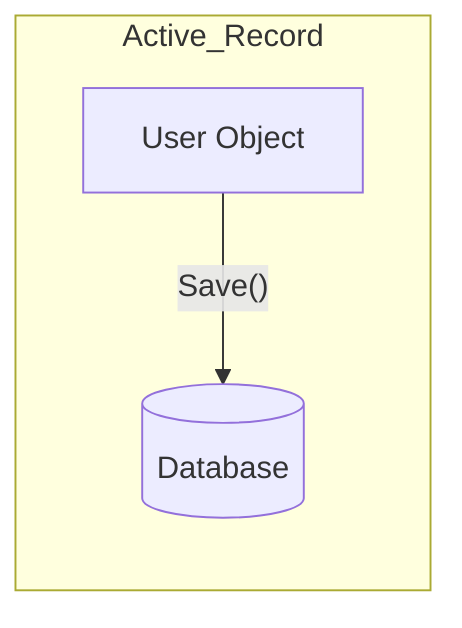
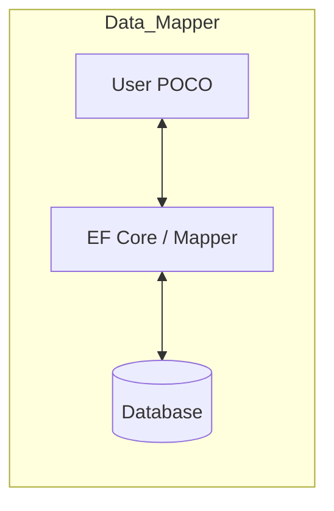

# Active-Record vs Data-Mapper

============================================================
0. Executive Summary (Architect View)
============================================================
- **Active-Record (AR) Couples Data and Behavior.** The object *is* the row. It knows how to save itself. (e.g., Laravel's Eloquent, earlier Entity Framework versions).
- **Data-Mapper (DM) Decouples Domain from Persistence.** The object is a plain POCO; a separate mapper handles the database sync. (e.g., EF Core, Hibernate).
- **Complexity vs Simplicity.** AR is excellent for CRUD-heavy, rapid development. DM is essential for complex business logic where the DB schema doesn't match the object model.
- **Architectural Purity.** Data-Mapper follows the **Persistence Ignorance** principle, which is the cornerstone of Clean Architecture and DDD.
- **Impact on Scaling.** AR can lead to "Fat Models" and database contention if not carefully managed. DM allows for fine-grained performance tuning of the persistence layer without touching the business logic.

============================================================
1. Problem Framing
============================================================
- **Real Production Problem:** "Impedance Mismatch". Your business logic requires a complex hierarchy of objects, but your database is a flat, normalized set of tables.
- **What breaks?** With Active-Record, your domain objects start carrying DB-specific attributes (like `[Column("FLD_123")]`), making them impossible to use in other contexts (e.g., a message queue consumer or a mobile client).
- **Critical Scale:** When you have a team of 10+ devs or a domain with complex invariants that must be protected from raw DB access.
- **Failure Story:** A startup used an Active-Record ORM for their core banking system. As the business logic grew, the `Account` object became 5,000 lines of code, mixing interest calculations with SQL query hints. Changing the interest logic once caused a massive SQL performance regression because the "Save" method was overloaded with side effects.

============================================================
2. Deep Internal Mechanics
============================================================

### Active-Record Flow
The object contains the state and the access logic.



### Data-Mapper Flow
An intermediary (the Mapper/Repository) bridges the gap.



### Performance Characteristics
- **Active-Record:** Slightly lower overhead for simple operations because there's no intermediate mapping step. However, it often suffers from "N+1" problems by default.
- **Data-Mapper:** Higher memory usage during mapping (Gen 0 allocations). However, it allows for **Batching** and **Identity Map** patterns (EF Core `ChangeTracker`) which significantly reduce DB round-trips at scale.

============================================================
3. .NET Production Implementation
============================================================

### Active-Record Style (Using Dapper/Manual)
```csharp
public class UserRecord 
{
    public int Id { get; set; }
    public string Name { get; set; }

    // Logic is inside the record
    public async Task SaveAsync(IDbConnection db)
    {
        await db.ExecuteAsync("UPDATE Users SET Name = @Name WHERE Id = @Id", this);
    }
}
```

### Data-Mapper Style (Modern EF Core)
```csharp
// 1. Pure POCO (Domain)
public sealed class User 
{
    public int Id { get; private set; }
    public string Name { get; private set; }
    
    public void Rename(string newName) => Name = newName; // Business behavior only
}

// 2. Data Mapper Configuration (Infrastructure)
public class UserConfiguration : IEntityTypeConfiguration<User>
{
    public void Configure(EntityTypeBuilder<User> builder)
    {
        builder.ToTable("Users");
        builder.Property(u => u.Name).HasColumnName("FULL_NAME");
    }
}

// 3. Usage
var user = await _context.Users.FindAsync(id);
user.Rename("New Name");
await _context.SaveChangesAsync(); // Mapper handles the tracking and SQL generation
```

**DI Lifetime:** `DbContext` (The Mapper) is almost always `Scoped` to ensure a single unit-of-work per request.
**Logging:** EF Core provides detailed SQL logging, which is critical for identifying N+1 issues in Data-Mapper implementations.

============================================================
4. Architecture-Level Diagram (ASCII Only)
============================================================

    ACTIVE RECORD (Flat)              DATA MAPPER (Layered)
    
    ┌───────────────┐                ┌───────────────┐
    │ Domain Model  │                │ Domain Model  │ (Plain C#)
    │     +         │                └───────┬───────┘
    │ Persistence   │                        │
    └───────┬───────┘                ┌───────▼───────┐
            │ SQL                    │  Data Mapper  │ (EF Core/Dapper)
    ┌───────▼───────┐                └───────┬───────┘
    │   Database    │                        │ SQL
    └───────────────┘                ┌───────▼───────┐
                                     │   Database    │
                                     └───────────────┘

============================================================
5. Scaling & Distributed Systems Impact
============================================================
- **Horizontal Scaling:** Data-Mapper implementations (like EF Core) support **Read/Write Splitting** more easily by configuring different DbContexts or Interceptors.
- **Microservices:** Data-Mapper is the standard for Microservices following DDD, as it allows the service to own its business logic while the DB schema evolves independently.
- **CAP Theorem:** Not directly related, but Data-Mapper's "Identity Map" ensures **Local Consistency** within a single process during complex transactions.

============================================================
6. Production Engineering View
============================================================
- **Tracking:** Monitor `ChangeTracker.Entries().Count()` in EF Core. Large graphs lead to slow `SaveChangesAsync()`.
- **Alerting:** Alert on high `Database Round-trips per Request`.
- **Debugging:** For Data-Mapper, use `ToQueryString()` in EF Core to verify the generated SQL before it hits production.

============================================================
7. Tradeoffs & Alternatives
============================================================
- **Dapper (Micro-ORM):** Sits in the middle. Often used as a Data-Mapper but without the complex state tracking of EF Core.
    - *Benefit:* Extreme performance.
    - *Tradeoff:* Manual SQL management.
- **When NOT to use Data-Mapper:** In very simple micro-services that only do basic CRUD. The overhead of mapping isn't worth it.

============================================================
8. Security Implications
============================================================
- **Shadow Properties:** Data-Mapper (EF Core) allows for "Shadow Properties"—fields in the DB (like `IsDeleted` or `LastUpdatedBy`) that are not in the C# class. This improves security by preventing business logic from accidentally modifying system metadata.
- **SQL Injection:** Both patterns mitigate SQLi if used correctly via parameterization (built-in for AR/DM frameworks).

============================================================
9. Advanced Edge Cases
============================================================
- **Ghost Updates:** In Data-Mapper, if you read a record and it's updated elsewhere before you save, the Change Tracker might not know. Use **Optimistic Concurrency** (`RowVersion`/`Timestamp`) to handle this.
- **Batching:** Data-Mappers can bundle 100 updates into a single round-trip. Active-Record typically does 100 individual SQL calls (N+1).

============================================================
10. Interview & Staff-Level Deep Dive
============================================================
- **Junior:** "EF Core is how we talk to the DB."
- **Senior:** "Data-Mapper decouples the database schema from the object model."
- **Architect:** "The choice between Active-Record and Data-Mapper is a strategic decision on coupling. Data-Mapper enables the 'Persistence Ignorance' necessary for long-lived, complex domain models, whereas Active-Record prioritizes velocity and simplicity in low-complexity scenarios."
- **Follow-up:** "How does EF Core implement the Identity Map pattern?"
- **Answer:** Through the `ChangeTracker`. It ensures that if you request the same entity twice within the same `DbContext` scope, you get the exact same object instance, preventing stale data issues within a single request.

============================================================
11. Real Enterprise Case Study
============================================================
**Scenario:** A High-Frequency Logistics Booking System.
- **Problem:** Orders have 50+ properties. Using an Active-Record style resulted in massive bandwidth usage because the whole row was sent for every tiny update.
- **Design:** Move to EF Core (Data-Mapper) using **Split Queries** and **Member-Level Tracking**. 
- **Result:** Only the changed columns are sent to SQL Server. DB IOPS were reduced by 40%.

============================================================
12. Dependency Graph
============================================================
- **Pre-requisites:** SQL Basics, Object Oriented Design.
- **Depends on this:** Unit of Work Pattern, Repository Pattern.
- **Connected to:** DDD, Dapper, EF Core.
