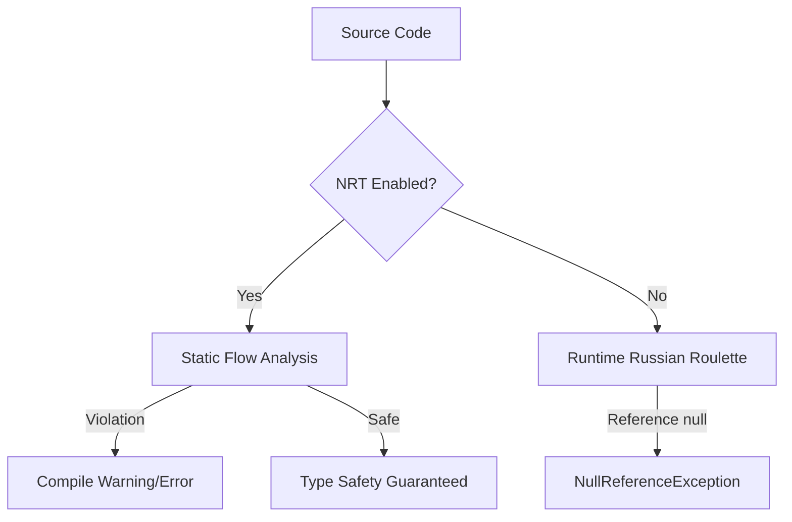

# The Billion-Dollar Mistake (Null Safety)

**0. Executive Summary (Architect View)**
- **Null Safety is about Type Soundness.** Tony Hoare's "Billion-Dollar Mistake" refers to the introduction of null references in ALGOL W back in 1965.
- **NullReferenceException (NRE) is the #1 Cause of Crashes.** In production, NREs are often the "Silent Killers" of availability.
- **.NET 8 Nullable Reference Types (NRT) is the Solution.** It moves NRE detection from runtime to compile-time via static flow analysis.
- **Architecture Level Constraint.** Treat "Null" not as a value, but as a "Lack of Value". Use patterns like the **Null Object Pattern**, **Optional/Maybe Monad**, or strict **Value Objects**.
- **Impact on API Contracts.** Explicitly defining what can and cannot be null in DTOs prevents cascading failures in distributed systems where a missing field in Service A causes a crash in Service B.

**1. Problem Framing**
- **Real Production Problem:** "Defensive Code Bloat". `if (user != null && user.Profile != null && user.Profile.Address != null)`.
- **What breaks?** In a 1M+ RPS system, if a single edge case returns `null` where an object was expected, the thread crashes. If this happens in a background worker, the process might restart, causing a **Message Storm** or **Inconsistent State**.
- **Critical Scale:** Mandatory for any system with more than 100k lines of code or complex data pipelines.
- **Failure Story:** A major logistics platform had a "Ghost Load" incident. A null `ShippingAddress` was allowed into the system due to a missing UI validation. 5 downstream Microservices crashed when they tried to calculate shipping costs, leading to a pile-up of 50,000 unfulfilled orders in the message queue.

**2. Deep Internal Mechanics**

### Memory Behavior of Null
In .NET, a `null` reference is simply a pointer with the value `0x0`. Attempting to "dereference" this (accessing a member) causes the CPU to trigger a hardware interrupt (Page Fault), which the .NET Runtime catches and throws as an exception.

### .NET 8 Static Analysis
NRTs do NOT change the runtime behavior (at runtime, a string is still a string). Instead, the compiler adds **Attributes** (like `[Nullable]`) to the metadata and emits warnings if you try to assign null to a non-nullable type.



### Performance Characteristics
- **Binary Size:** Minimal impact from metadata attributes.
- **Runtime:** ZERO overhead. Static analysis happens during compilation.
- **GC:** Reducing nulls often encourages the use of **Value Objects** (structs), which can reduce heap pressure and GC frequency.

**3. .NET Production Implementation**

### Naive Implementation (Unsafe)
```csharp
public class UserService
{
    public User GetUser(int id) 
    {
        return _db.Users.Find(id); // Might return null!
    }

    public void SendEmail(int id)
    {
        var user = GetUser(id);
        Console.WriteLine(user.Email); // BOOM if user is null
    }
}
```

### Production-Ready Implementation (.NET 8)
```csharp
public sealed class UserService
{
    // Explicitly return a nullable type or use a 'Result' pattern
    public async Task<OneOf<User, NotFound>> GetUserAsync(int id, CancellationToken ct)
    {
        var user = await _db.Users.FindAsync(new object[] { id }, ct);
        return user ?? (OneOf<User, NotFound>)new NotFound();
    }

    public async Task ProcessUserAsync(int id, CancellationToken ct)
    {
        var result = await GetUserAsync(id, ct);
        
        // Pattern matching ensures safety
        result.Switch(
            user => Console.WriteLine(user.Email),
            notFound => _logger.LogWarning("User {Id} not found", id)
        );
    }
}

// Global project setting: <Nullable>enable</Nullable>
```

**DI Lifetime:** Not directly related, but ensure Singleton services don't cache `null` results of lookups (Cache Stampede).
**Logging:** log the specific context of where a null was encountered using structured logging.

**4. Architecture-Level Diagram (ASCII Only)**

                ┌──────────────────────────┐
                │ External Data / API      │ (Unsafe Boundary)
                └────────────┬─────────────┘
                             │ Validate / Map
               ┌─────────────▼─────────────┐
               │    Anti-Corruption Layer  │ (Sanitize Nulls)
               │ [Null -> Default/Result]  │
               └─────────────┬─────────────┘
                             │ Safe Types
               ┌─────────────▼─────────────┐
               │      Core Domain logic    │ (Strict Null-Safety)
               │  (Non-Nullable By Default)│
               └───────────────────────────┘

**5. Scaling & Distributed Systems Impact**
- **Microservices:** A `null` in a JSON request can mean "Clear this field" or "The field is missing". Architects must decide on **JSON Null Semantics** (use `JsonIgnoreCondition.WhenWritingNull`).
- **Distributed Tracing:** If a null causes an exception, ensure the **Correlation ID** is passed to the error log to trace the source of the missing data across boundaries.

**6. Production Engineering View**
- **Code Reviews:** Enforce `<Nullable>enable</Nullable>` and `TreatWarningsAsErrors`.
- **Alerting:** Track the frequency of `NullReferenceException` in Application Insights. A spike indicates a data corruption issue in an upstream system or database.
- **Debugging:** Use **Conditional Breakpoints** in VS to see when a specific variable becomes null during a complex loop.

**7. Tradeoffs & Alternatives**
- **Null Object Pattern:** Return an empty object (e.g., `User.Guest`) instead of `null`.
    - *Benefit:* Removes the need for `if != null`.
    - *Limit:* Might hide logic errors that should have been handled.
- **F# Option Type:** If using F#, nulls are almost impossible.

**8. Security Implications**
- **Denial of Service (DoS):** An attacker can send requests designed to trigger edge-case NREs, causing the server to work harder on error handling and logging, or potentially crashing the process.
- **Information Leakage:** Detailed NRE stack traces leaked to the user can reveal internal directory structures or class names.

**9. Advanced Edge Cases**
- **The Bang Operator (`!`):** `user!.Email`. This tells the compiler "I know better than you". 
    - *Architect's Rule:* Use sparingly. 99% of the time, it's a smell. Use it only for Interop or known DB state that the compiler can't see.
- **Reference Types in Structs:** A struct can be non-nullable, but it can contain a reference type that IS null.

**10. Interview & Staff-Level Deep Dive**
- **Junior:** "Null means no value."
- **Senior:** "Use `?` to mark things that can be null and check them."
- **Architect:** "Null safety is a system-wide integrity constraint. It's about moving failure modes from runtime to compile-time and defining a clear strategy for 'missing data' that doesn't involve process-crashing exceptions."
- **Follow-up:** "How does C# 8+ implement NRTs under the hood?"
- **Answer:** It uses attributes like `NullableAttribute` and `NullableContextAttribute` in the generated IL. This allows existing libraries to remain compatible while providing hints to the compiler.

**11. Real Enterprise Case Study**
**Scenario:** A Medical Records System.
- **Problem:** A "Patient Record" could have 100+ optional fields. NREs were happening during report generation.
- **Design:** Enabled NRT globally. Introduced a `Result<T>` pattern for all internal services. Used **Required Members** (.NET 7) to ensure critical data is always present.
- **Result:** NREs in production dropped by 95% in the first month.

**12. Dependency Graph**
- **Pre-requisites:** Type Systems, Memory Management.
- **Depends on this:** Result Pattern, Railway Oriented Programming.
- **Connected to:** Pattern Matching, JSON Serialization.
