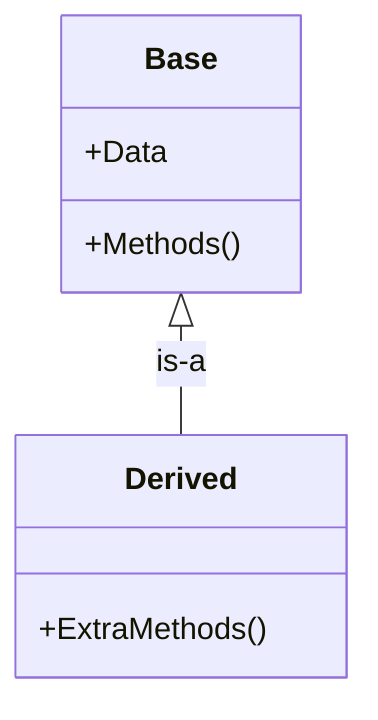
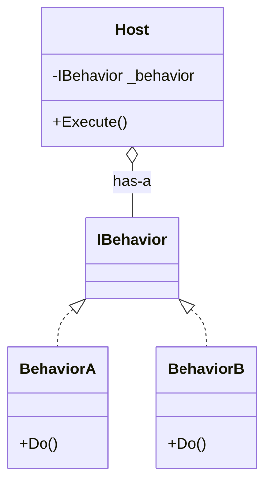

# Inheritance vs Composition

**0. Executive Summary (Architect View)**
- **"Composition Over Inheritance" is a design heuristic.** It suggests that complex functionality should be achieved by combining simple objects rather than extending classes.
- **Inheritance is "Is-A"; Composition is "Has-A".** Misusing inheritance for code reuse leads to tight coupling and the "Fragile Base Class" problem.
- **Polymorphism is the Bridge.** You can achieve polymorphic behavior through both patterns, but Composition does it via interfaces/delegation, which is more flexible at scale.
- **Deep Hierarchies are Technical Debt.** At architect depth, hierarchies deeper than 2-3 levels are viewed as high-risk areas for maintenance.
- **.NET 8 Default Interface Methods.** This feature blurs the lines, allowing interfaces to provide behavior without forcing a class into a specific inheritance tree.

**1. Problem Framing**
- **Real Production Problem:** "The Gorilla/Banana Problem". You wanted a banana, but what you got was a gorilla holding a banana and the entire jungle (Joe Armstrong).
- **What breaks?** When you inherit from a base class just to get one utility method, you inherit *all* its state and dependencies. This makes your class heavy, hard to test, and vulnerable to changes in the base class.
- **Critical Scale:** Becomes a major bottleneck in large frameworks or distributed platforms where a change in a "BaseService" could break 100 downstream services.
- **Failure Story:** A game engine used deep inheritance for its entities (`GameObject` -> `MovableObject` -> `Character` -> `Player`). To add a "Flying" ability, they had to modify `MovableObject`, which accidentally gave "Flying" to trees and rocks, leading to a hilarious but system-crashing physics bug.

**2. Deep Internal Mechanics**

### Inheritance (Tight Coupling)
The child class is physically bound to the memory layout and implementation of the parent.



### Composition (Loose Coupling)
The host class contains a reference to the behavior provider.



### Performance Characteristics
- **Inheritance:** Slightly faster method calls (virtual table lookups). 
- **Composition:** Involves an extra pointer dereference (Host -> Behavior). In high-performance .NET code, this is often mitigated by the JIT through **Devirtualization** and **Inlining**.
- **Memory:** Composition creates more objects; Inheritance creates larger objects. Composition is usually better for GC because small, short-lived objects are easier to collect than large, long-lived object graphs.

**3. .NET Production Implementation**

### Naive Implementation (Inheritance Overuse)
```csharp
public class BaseService {
    protected void Log(string msg) => Console.WriteLine(msg);
}

public class OrderService : BaseService {
    public void Process() => Log("Processing..."); // Coupled to BaseService
}
```

### Production-Ready Implementation (.NET 8)
```csharp
// 1. Define Behavior as an Interface
public interface ILoggerBehavior {
    void Log(string msg);
}

// 2. Compose behavior into the service
public sealed class OrderService {
    private readonly ILoggerBehavior _logger;

    public OrderService(ILoggerBehavior logger) {
        _logger = logger;
    }

    public void Process() => _logger.Log("Processing...");
}

// .NET 8 Advantage: Default Interface Methods for "Mix-ins"
public interface ITrackable {
    DateTime CreatedAt => DateTime.UtcNow; // Default behavior
}

public class MyEntity : ITrackable { } // Gets the property without inheritance
```

**DI Lifetime:** Composition works perfectly with DI; Inheritance does not (you can't inject something into a base class easily).
**Logging:** Composition allows you to swap `LocalLogger` for `CloudLogger` at runtime without changing the service.

**4. Architecture-Level Diagram (ASCII Only)**

      INHERITANCE (Rigid Stack)          COMPOSITION (Flexible Mesh)
      
          ┌─────────────┐                      ┌─────────────┐
          │ Base Class  │                      │   Component │
          └──────┬──────┘                      └──────┬──────┘
                 │                                    │
          ┌──────▼──────┐               ┌─────────────▼─────────────┐
          │ Child Class │               │        Main Object        │
          └──────┬──────┘               │ (Combines Multiple Comps) │
                 │                      └─────────────┬─────────────┘
          ┌──────▼──────┐                             │
          │ Grandchild  │                      ┌──────▼──────┐
          └─────────────┘                      │   Component │
                                               └─────────────┘

**5. Scaling & Distributed Systems Impact**
- **Microservices:** Composition at the architectural level means building a "Gateway" that composes responses from multiple "Sub-services" rather than having one "BaseService" everyone calls.
- **Maintainability:** Composition allows you to update the `PaymentComponent` for 50 services by only redeploying one library/service, whereas Inheritance might require recompiling the entire stack.

**6. Production Engineering View**
- **Detection:** Use **Liskov Substitution Principle (LSP)** tests to see if inheritance is breaking. If you find yourself throwing `NotImplementedException` in a child class, the inheritance is wrong.
- **Metrics:** Track "Depth of Inheritance Tree" (DIT). A DIT > 5 is an architectural red flag.
- **Debugging:** Composition leads to "Ping-Pong" debugging (jumping between many small classes), but each class is simpler and easier to reason about.

**7. Tradeoffs & Alternatives**
- **Abstract Classes:** A middle ground. Use when you have a clear "Is-A" relationship and want to share some internal non-public state.
- **Delegation:** The act of Composition where the host simply forwards calls to the component.

**8. Security Implications**
- **Fragile Base Class Attack:** If a base class is in an external library and it adds a new virtual method that happens to have the same name as your private method, it might accidentally expose internal data or change behavior.
- **Encapsulation:** Composition provides stronger encapsulation because the child doesn't have access to the parent's `protected` internals.

**9. Advanced Edge Cases**
- **Multiple Inheritance:** C# doesn't support it for classes to avoid the "Diamond Problem". Composition is the only way to "inherit" behavior from multiple sources.
- **The "Sealed" Keyword:** Architects should default to `sealed` classes to prevent accidental inheritance, forcing developers to use Composition instead.

**10. Interview & Staff-Level Deep Dive**
- **Junior:** "Inheritance is for code reuse."
- **Senior:** "Prefer composition to avoid tight coupling."
- **Architect:** "Inheritance should be reserved for strict structural taxonomies where the Liskov Substitution Principle is guaranteed. For functional reuse and system evolution, composition provides the necessary decoupling to manage the lifecycle of disparate components independently."
- **Trick Question:** "Can you mock a base class's private method in a unit test for the child?"
- **Answer:** Generally NO. This proves inheritance breaks unit testing boundaries. Composition solves this by allowing you to mock the injected interface.

**11. Real Enterprise Case Study**
**Scenario:** A Financial Reporting Tool.
- **Problem:** Every report inherited from `ReportBase`. When they added "Export to Excel" to `ReportBase`, 20 reports that didn't support Excel (due to data size) started crashing.
- **Design:** Swapped to Composition. Created an `IExportable` interface and separate `ExcelExporter` component. High-volume reports simply didn't include the `ExcelExporter`.
- **Result:** System stability increased, and adding a new export format (e.g., PDF) took hours instead of days of regression testing.

**12. Dependency Graph**
- **Pre-requisites:** SOLID Principles (LSP/OCP), Interfaces.
- **Depends on this:** Decorator Pattern, Strategy Pattern.
- **Connected to:** DI, Mocking, Component-Based Design.
