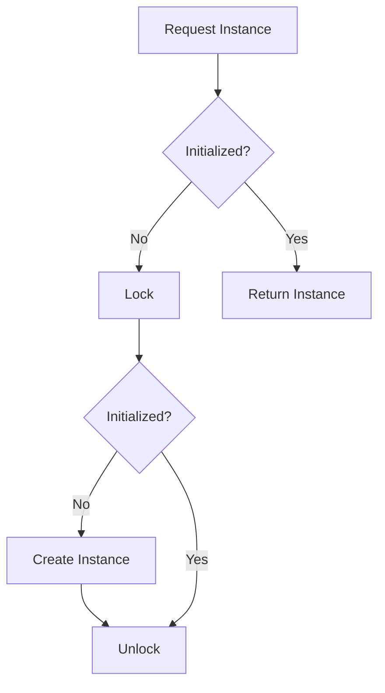

# Singleton & Global State

**0. Executive Summary (Architect View)**
- **Singleton is the most overused and misused pattern.** It ensures a class has only one instance and provides a global point of access.
- **Global State is an "Architectural Poison".** It makes the system non-deterministic and extremely hard to test.
- **The "DI Singleton" is the Modern Approach.** Don't use `static Instance { get; }`; register the service as a Singleton in the DI container.
- **Thread-Safety is Non-Negotiable.** Since every request in ASP.NET Core will hit the same instance, internal state must be protected (lock-free or fine-grained locking).
- **Lifecycle Management.** Singletons are never disposed until the process ends. They are the #1 source of leaks (holding onto scoped objects) and "Zombie" state.

**1. Problem Framing**
- **Real Production Problem:** "Shared Resource Contention". You have a single `CacheProvider` or `DatabaseConnection` shared by 10,000 threads.
- **What breaks?** If the Singleton isn't thread-safe, you get **Race Conditions** and data corruption. If it uses coarse-grained locking (`lock(this)`), your high-scale system turns into a single-threaded bottleneck.
- **Critical Scale:** Becomes dangerous at high RPS where thread contention on the singleton's locks can cause **Thread Starvation**.
- **Failure Story:** A flight booking system used a Singleton to track "Active Sessions" in memory. During a holiday peak, the `lock` around the session dictionary became so contested that P99 latency went from 50ms to 5,000ms. The CPU was at 10% because threads were just waiting for the Singleton lock, not doing work.

**2. Deep Internal Mechanics**

### Thread-Safe Initialization
In .NET, `Lazy<T>` is the preferred way to implement a Singleton to ensure "Double-Check Locking" is handled correctly by the runtime.



### Memory & GC Behavior
- **Rooting:** A Singleton is a "GC Root". It will *never* be collected. Any object it references becomes a GC Root as well.
- **Captive Dependency:** If a Singleton holds a reference to a `Scoped` object (like a `DbContext`), that scoped object lives forever, leading to massive memory leaks and DB connection exhaustion.

### Performance Characteristics
- **Access:** O(1) - essentially a pointer lookup.
- **Contention:** O(N) where N is the number of threads waiting for a lock inside the singleton.

**3. .NET Production Implementation**

### Naive Implementation (The "Classic" Anti-Pattern)
```csharp
public class ConfigurationManager {
    private static ConfigurationManager _instance;
    public static ConfigurationManager Instance => _instance ??= new ConfigurationManager();
    // NOT THREAD SAFE!
}
```

### Production-Ready Implementation (.NET 8)
```csharp
// 1. Thread-safe using Lazy<T>
public sealed class GlobalTelemetryProvider {
    private static readonly Lazy<GlobalTelemetryProvider> _instance = 
        new(() => new GlobalTelemetryProvider(), LazyThreadSafetyMode.ExecutionAndPublication);

    public static GlobalTelemetryProvider Instance => _instance.Value;

    private GlobalTelemetryProvider() { } // Private Ctor
}

// 2. THE ARCHITECT'S CHOICE: DI Singleton
public sealed class HighScaleCache : ICache {
    private readonly ConcurrentDictionary<string, object> _store = new();

    public void Set(string key, object val) => _store[key] = val; // Thread-safe
}

// In Program.cs
builder.Services.AddSingleton<ICache, HighScaleCache>();
```

**DI Lifetime:** `Singleton`.
**Logging:** Log initialization and any "Purge" or "Clear" operations on the internal state.

**4. Architecture-Level Diagram (ASCII Only)**

                ┌───────────────────────────┐
                │      ASP.NET Core         │
                │    (Multi-threaded)       │
                └─────┬──────┬──────┬───────┘
                      │      │      │
          ┌───────────▼──────▼──────▼───────────┐
          │         The Singleton Instance      │
          │  ┌───────────────────────────────┐  │
          │  │     Shared Variable / State   │  │ <── Bottleneck Point
          │  └──────────────┬────────────────┘  │
          └─────────────────┼───────────────────┘
                            │
               ┌────────────▼─────────────┐
               │    Internal Locking      │ (Monitor/Semaphore)
               └──────────────────────────┘

**5. Scaling & Distributed Systems Impact**
- **Horizontal Scaling:** Singletons are only singletons *per node*. If you scale to 10 nodes, you have 10 singletons. This is why you must use **Distributed Cache (Redis)** instead of a Singleton for global state in a cluster.
- **Microservices:** A "Singleton Service" at the architectural level is a single service instance that all other services depend on—this is a "Single Point of Failure" (SPOF) and should be avoided.

**6. Production Engineering View**
- **Monitoring:** Track `Lock Contention Count` and `Memory Usage` of the singleton.
- **Alerting:** Alert if the singleton's internal collection (e.g., a cache) exceeds a certain memory threshold (to prevent OOM).
- **Debugging:** Use `dotnet-dump` to see if a Singleton is holding onto thousands of objects that should have been collected.

**7. Tradeoffs & Alternatives**
- **Static Class:** Simpler, but doesn't support interfaces or polymorphism.
- **Scoped Service:** Safer, but involves more allocations and doesn't share state between requests.
- **Conclusion:** Use Singletons for **Stateless Services** (like a Calculator) or **Guarded Shared Resources** (like a Connection Pool). NEVER use for business state.

**8. Security Implications**
- **State Leakage:** One user's data might leak into another user's request if stored in a Singleton without proper isolation.
- **DoS:** A thread-safe Singleton with a slow lock can be an easy target for a Denial of Service attack.

**9. Advanced Edge Cases**
- **Static Constructors:** Can cause deadlocks if they involve complex logic or wait on other threads.
- **Reflection:** A determined developer can bypass the private constructor using reflection. (Mitigation: check for existing instance in ctor and throw).

**10. Interview & Staff-Level Deep Dive**
- **Junior:** "It's when you only have one object."
- **Senior:** "It's a way to coordinate shared state across the application."
- **Architect:** "Singleton is an infrastructure-level pattern used to manage access to a unique physical or logical resource. In modern systems, it's rarely used for business logic and instead managed via a DI container to avoid the testing and coupling pitfalls of static accessors."
- **Follow-up:** "How do you test a class that uses a static `Singleton.Instance`?"
- **Answer:** You can't easily. It's a "Hard Dependency". This is why we move to DI-based Singletons, which can be replaced with mocks.

**11. Real Enterprise Case Study**
**Scenario:** A Real-time Stock Ticker.
- **Problem:** Every user connection (100k+) needed access to the latest price feed.
- **Design:** Used a **Singleton PriceHub** that subscribes to the upstream data. It uses `ImmutableDictionary` for the prices so that reading threads never need to lock.
- **Result:** 100k concurrent reads with zero lock contention and P99 latency < 5ms.

**12. Dependency Graph**
- **Pre-requisites:** Threading Basics, Static Keyword.
- **Depends on this:** Caching, Configuration, Logging.
- **Connected to:** DI Containers, Flyweight Pattern.
