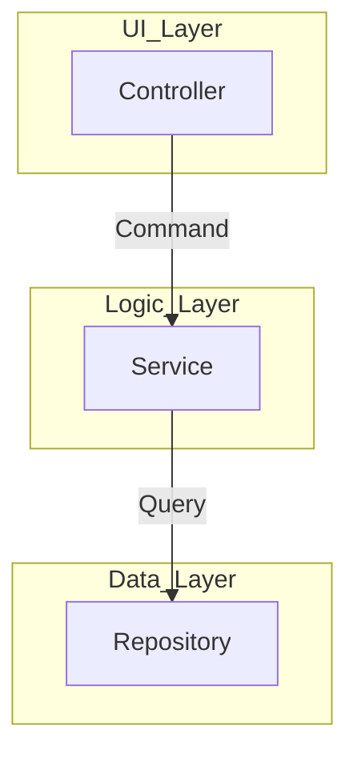

# Separation of Concerns (SoC) & DRY

============================================================
0. Executive Summary (Architect View)
============================================================
- **Separation of Concerns (SoC) is the foundational pillar of Architecture.** It's about breaking a system into distinct sections, where each section addresses a separate concern (e.g., UI, Business Logic, Data Access).
- **DRY (Don't Repeat Yourself) is about Knowledge Centralization.** Every piece of knowledge must have a single, unambiguous, authoritative representation within a system.
- **The DRY Trap.** Many seniors over-abstract too early. If two pieces of code look the same but change for different reasons, they are NOT the same. DRYing them creates a "Hidden Dependency".
- **SoC via Cross-Cutting Concerns.** Use Middleware, Filters, and Interceptors to handle logging, auth, and validation so they don't pollute the business logic.
- **Vertical Slices vs Layered Architecture.** Modern architects are moving toward "Vertical Slices" where SoC is applied per-feature rather than per-technical-layer.

============================================================
1. Problem Framing
============================================================
- **Real Production Problem:** "The Big Ball of Mud". A single class handles HTTP parsing, database queries, and sending emails.
- **What breaks?** A change in the email template requires re-testing the database logic. This leads to **Fragility** and a massive regression testing burden.
- **Critical Scale:** Essential for team scaling. Without SoC, multiple developers cannot work on the same feature without constant merge conflicts.
- **Failure Story:** A fintech company had a "Single Point of Logic" for interest calculation. They DRYed it so much that the same code was used for Savings Accounts and Credit Cards. When the government changed the regulations for Credit Cards, the company updated the DRYed code, accidentally changing the interest for Savings Accounts as well, resulting in millions of dollars in miscalculated payouts.

============================================================
2. Deep Internal Mechanics
============================================================

### Concerns and Boundaries
SoC is implemented using **Architectural Boundaries**.



### DRY vs AHA (Avoid Hasty Abstraction)
- **DRY:** Reduces the surface area for bugs. If you find a bug in a DRYed method, you fix it everywhere.
- **AHA:** Suggests that "A little duplication is better than a wrong abstraction." (Sandi Metz).

### Performance Characteristics
- **Binary Size:** DRYing code reduces binary size (less IL code).
- **Call Stack:** High SoC leads to deeper call stacks (passing data through multiple layers). In .NET, the JIT's **Inliner** often collapses these layers at runtime if the methods are small enough, resulting in zero performance penalty.

============================================================
3. .NET Production Implementation
============================================================

### Naive Implementation (Violation of SoC)
```csharp
public async Task<IActionResult> PostOrder(OrderRequest req)
{
    // Violation: Logic, Validation, and DB access in the Controller
    if (string.IsNullOrEmpty(req.Item)) return BadRequest();
    var price = await _db.Prices.GetAsync(req.Item);
    var order = new Order { Item = req.Item, Total = price * req.Qty };
    await _db.Orders.AddAsync(order);
    return Ok(order);
}
```

### Production-Ready Implementation (.NET 8)
```csharp
// 1. Separation using MediatR (Vertical Slices)
public record CreateOrderCommand(string Item, int Qty) : IRequest<OrderResponse>;

// 2. Focused Handler (Separation of Concerns)
public class CreateOrderHandler : IRequestHandler<CreateOrderCommand, OrderResponse>
{
    private readonly IOrderRepository _repo;
    private readonly IPriceService _prices;

    public async Task<OrderResponse> Handle(CreateOrderCommand req, CancellationToken ct)
    {
        var price = await _prices.GetPriceAsync(req.Item);
        var order = Order.Create(req.Item, req.Qty, price); // Domain logic in Domain
        await _repo.SaveAsync(order);
        return order.ToResponse();
    }
}

// 3. Cross-Cutting Concern (Logging) via Middleware/Behaviors
public class LoggingBehavior<TRequest, TResponse> : IPipelineBehavior<TRequest, TResponse>
{
    public async Task<TResponse> Handle(TRequest req, RequestHandlerDelegate<TResponse> next, CancellationToken ct)
    {
        _logger.LogInformation("Handling {Name}", typeof(TRequest).Name);
        return await next();
    }
}
```

**DI Lifetime:** Handlers are `Transient`, Repositories are `Scoped`.
**Logging:** Use **DiagnosticSource** or **OpenTelemetry** for truly decoupled system-wide observability.

============================================================
4. Architecture-Level Diagram (ASCII Only)
============================================================

    CONCERNS SEPARATION (Top-Down)          DRY (Horizontal)
    
       ┌──────────────────┐               ┌──────────────────┐
       │   Presentation   │               │ Common Utilities │
       └────────┬─────────┘               │ (Validation, Log)│
                │                         └────────┬─────────┘
       ┌────────▼─────────┐                        │
       │   Application    │ ◄──────────────────────┘ Shared by
       └────────┬─────────┘                          all layers
                │
       ┌────────▼─────────┐
       │     Domain       │
       └──────────────────┘

============================================================
5. Scaling & Distributed Systems Impact
============================================================
- **Microservices:** SoC at the service level means identifying "Bounded Contexts". If Service A is doing Service B's job, your concerns are not separated.
- **CI/CD:** Good SoC allows you to run "Partial Builds". If you only changed the UI, you don't need to re-run the heavy Integration Tests for the Data Layer.

============================================================
6. Production Engineering View
============================================================
- **Metrics:** Track "Cyclomatic Complexity" and "Class Coupling". High complexity in a "Controller" is an SoC violation.
- **Alerting:** If a single class change requires deployments to multiple independent services, you have a **DRY violation** leading to a distributed monolith.
- **Debugging:** SoC makes debugging easier because you know *where* to look. If it's a DB error, check the Data Layer. If it's a routing error, check the Presentation Layer.

============================================================
7. Tradeoffs & Alternatives
============================================================
- **Pragmatism vs Purity:** Strictly separating everything can lead to "Over-Engineering" and "Abstraction Hell" (where you have to open 10 files to understand one simple feature).
- **Inlining:** Sometimes, for performance or simplicity, you intentionally violate SoC (e.g., putting a small SQL query directly in a handler). This is acceptable if it's a conscious decision recorded in an ADR (Architecture Decision Record).

============================================================
8. Security Implications
============================================================
- **Principle of Least Privilege:** Separation of Concerns allows you to give the Data Layer a restricted DB user that can only `SELECT/INSERT`, while the Admin layer gets a more powerful user.
- **Vulnerability Surface:** DRYing security code (like Auth checks) is mandatory. If you have 50 places doing manual auth checks, you will eventually miss one.

============================================================
9. Advanced Edge Cases
============================================================
- **Wait-and-See DRY:** Rule of Three. Don't DRY until you see the code three times. The third time gives you enough context to find the *correct* abstraction.
- **Circular Concerns:** Logger depends on Config, Config depends on Logger.
    - *Fix:* Introduce a "Bootstrapper" or use Interfaces to break the cycle.

============================================================
10. Interview & Staff-Level Deep Dive
============================================================
- **Junior:** "DRY means don't copy-paste."
- **Senior:** "SoC is about layers and making code readable."
- **Architect:** "Separation of Concerns is the strategic division of a system into manageable, orthagonal responsibilities. DRY is not about code characters; it's about the single source of truth for business rules. The ultimate goal is to minimize the cognitive load and the blast radius of change."
- **Follow-up:** "What is the difference between Logical Separation and Physical Separation?"
- **Answer:** Logical separation is folders/classes within one DLL. Physical separation is separate DLLs or Microservices. One is for code organization; the other is for deployment and scaling autonomy.

============================================================
11. Real Enterprise Case Study
============================================================
**Scenario:** A Global News Aggregator.
- **Problem:** The system had one giant "ContentProcessor" class. Changes to the "RSS Reader" were breaking the "Twitter Scraper".
- **Design:** Applied SoC. Break into "Extractors" (one per source), "Processors" (shared logic), and "Sinks" (DB/Cache).
- **Result:** Adding a new source (e.g., TikTok) went from a 1-week risky deployment to a 4-hour isolated task.

============================================================
12. Dependency Graph
============================================================
- **Pre-requisites:** Single Responsibility Principle (SRP), Basic Layering.
- **Depends on this:** Clean Architecture, Hexagonal Architecture.
- **Connected to:** Aspect-Oriented Programming (AOP), Interceptors.
