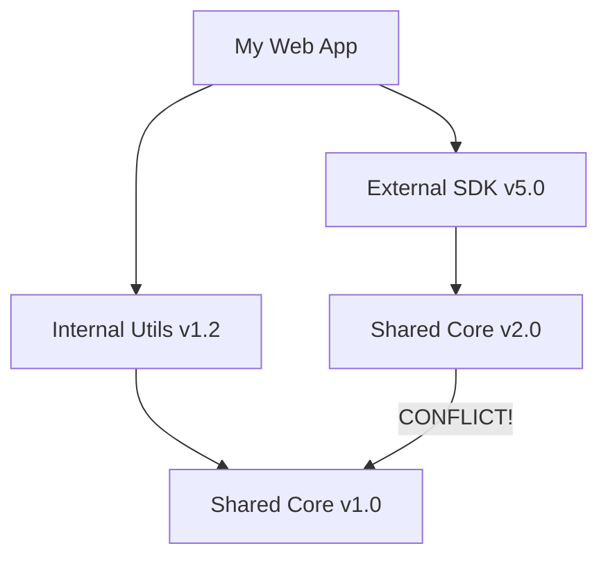

# Dependency Hell & Governance

**0. Executive Summary (Architect View)**
- **Dependency Hell is a lack of control.** It occurs when a system depends on multiple libraries that themselves depend on different (conflicting) versions of the same low-level library.
- **Transitive Dependencies are the Root Cause.** You think you only have 5 dependencies, but your "Dependency Graph" actually contains 200 items.
- **The Diamond Dependency Problem.** This is the classic architectural failure where Library A depends on B (v1) and C (v2), but B and C both depend on D (v1 and v2 respectively).
- **Security & Supply Chain Risk.** Every dependency is a potential entry point for malicious code (e.g., Log4Shell). Governance is mandatory.
- **Modern .NET 8 Solutions.** `Directory.Packages.props` (Central Package Management) and strict versioning policies are the architect's tools.

**1. Problem Framing**
- **Real Production Problem:** "Implicit Upgrades". You update a logging library, and suddenly your Authentication module stops working because they shared a hidden dependency on a specific JSON parser version.
- **What breaks?** Build failures, runtime `MethodNotFoundException`, and the inability to patch critical security vulnerabilities because the upgrade "breaks the world".
- **Critical Scale:** Becomes a major issue once you have more than 3-4 internal shared libraries (NuGet packages) and dozens of microservices.
- **Failure Story:** A global insurance firm couldn't deploy a critical fix for 3 months because their core "Rules Engine" was stuck on an old version of `Newtonsoft.Json` required by a legacy third-party SDK. Every other service had moved to `System.Text.Json`. The "Diamond Dependency" on JSON parsing locked the entire enterprise architecture.

**2. Deep Internal Mechanics**

### The Dependency Graph
Modern package managers (NuGet) build a recursive graph.



### DLL Hell vs package Hell
- **DLL Hell (Legacy):** Multiple versions of the same DLL in the GAC (Global Assembly Cache) or the same folder.
- **Package Hell (Modern):** Conflict resolution at compile-time or assembly redirect issues at runtime in .NET Framework (mostly solved in .NET Core via a "nearest wins" or "highest version wins" policy).

### Performance Characteristics
- **Startup Time:** Large dependency graphs increase the number of assemblies the runtime must load and JIT. This increases "Cold Start" in serverless environments.
- **Memory:** Each loaded assembly takes up space in the **Assembly Load Context**. Circular or redundant dependencies lead to wasted memory.

**3. .NET Production Implementation**

### Naive Implementation (Unmanaged Dependencies)
- Each `.csproj` file has its own versions.
- `libA` uses `AutoMapper 10.0`
- `libB` uses `AutoMapper 11.0`
- The App crashes at runtime when trying to resolve the mapper.

### Production-Ready Implementation (.NET 8)
Using **Central Package Management (CPM)**.

**1. Create `Directory.Packages.props` (Solution Root)**
```xml
<Project>
  <PropertyGroup>
    <ManagePackageVersionsCentrally>true</ManagePackageVersionsCentrally>
  </PropertyGroup>
  <ItemGroup>
    <PackageVersion Include="Newtonsoft.Json" Version="13.0.3" />
    <PackageVersion Include="AutoMapper" Version="12.0.1" />
  </ItemGroup>
</Project>
```

**2. Clean `.csproj` Files**
```xml
<ItemGroup>
  <!-- No Version specified here! It's governed centrally -->
  <PackageReference Include="Newtonsoft.Json" />
</ItemGroup>
```

**DI Lifetime:** Not directly applicable, but ensures that all services are using the same version of shared types (like `ILogger`).

**4. Architecture-Level Diagram (ASCII Only)**

    WITHOUT GOVERNANCE                  WITH CENTRAL GOVERNANCE
    
    ┌────────┐  ┌────────┐            ┌──────────────────────────┐
    │ Proj A │  │ Proj B │            │ Directory.Packages.props │
    └────┬───┘  └────┬───┘            └─────────────┬────────────┘
         │ v1.0      │ v2.0                         │ v2.0 (Forced)
    ┌────▼───────────▼───┐            ┌─────────────▼────────────┐
    │  Shared Library    │            │     Shared Library       │
    └────────────────────┘            └──────────────────────────┘

**5. Scaling & Distributed Systems Impact**
- **Internal NuGet Feed:** As you scale, you must host your own NuGet server (BaGet, ProGet, or Azure Artifacts) to manage the lifecycle of internal libraries.
- **Version Compatibility:** Use **Semantic Versioning (SemVer)**. If you make a breaking change in an internal "Core" library, you MUST bump the Major version.
- **Deployment:** "Roll-forward" vs "Roll-back" strategies are complicated by dependency updates.

**6. Production Engineering View**
- **Scanning:** Use `dotnet list package --vulnerable` and `dotnet restore --locked-mode`.
- **Governance:** Use **Dependabot** or **Renovate** to automatically create PRs for dependency updates.
- **Metrics:** Track "Direct Dependency Count" and "Vulnerability Count".

**7. Tradeoffs & Alternatives**
- **Monorepo:** Keeps all source code together, making it easier to refactor across dependencies but harder to manage build times.
- **Source-Linking:** Including the source code of a dependency directly (git submodules). 
    - *Benefit:* Total control. 
    - *Tradeoff:* Updating becomes a nightmare.

**8. Security Implications**
- **Supply Chain Attacks:** A compromised developer account for a popular NuGet package can push malicious code into your production system.
- **SBOM (Software Bill of Materials):** Modern contracts often require an SBOM—a list of every single dependency in your system.

**9. Advanced Edge Cases**
- **Private vs Public Dependencies:** Avoid exposing third-party types in your public API. If your `User` class has a property from `Newtonsoft.Json`, any consumer of your library is now *forced* to use that specific version.
- **Shadowing:** When two different assemblies have the same name but different content.

**10. Interview & Staff-Level Deep Dive**
- **Junior:** "It's when I can't build because of NuGet errors."
- **Senior:** "Management of transitive dependencies and version conflicts."
- **Architect:** "Dependency Governance is a risk management strategy. It involves striking a balance between velocity (using 3rd party code) and long-term stability/security. An architect must define the 'Guardrails'—which libraries are allowed, how they are versions, and how critical patches are propagated."
- **Follow-up:** "How do Assembly Binding Redirects work?"
- **Answer:** In .NET Framework, they are XML entries in `app.config` that tell the runtime "When someone asks for v1.0 of Lib X, give them v2.0 instead". In .NET Core/8, this is largely automated by the `.deps.json` file generated during build.

**11. Real Enterprise Case Study**
**Scenario:** A High-Volatility Trading Platform.
- **Problem:** Updating the `Logging` library to fix a bug caused the `MarketFeed` to slow down by 20ms because the new logger version had a heavy transitive dependency on a network telemetry library.
- **Design:** Implemented a "Dependency Zero-Trust" policy. All 3rd party libraries are wrapped in an **Internal Facade**. The actual NuGet is only used in one "Infrastructure" project.
- **Result:** They can swap or update libraries without ever touching the performance-critical trading logic.

**12. Dependency Graph**
- **Pre-requisites:** NuGet, Semantic Versioning, Assembly Loading.
- **Depends on this:** Clean Architecture, Infrastructure as Code.
- **Connected to:** CI/CD Pipelines, Dependabot, DevSecOps.
