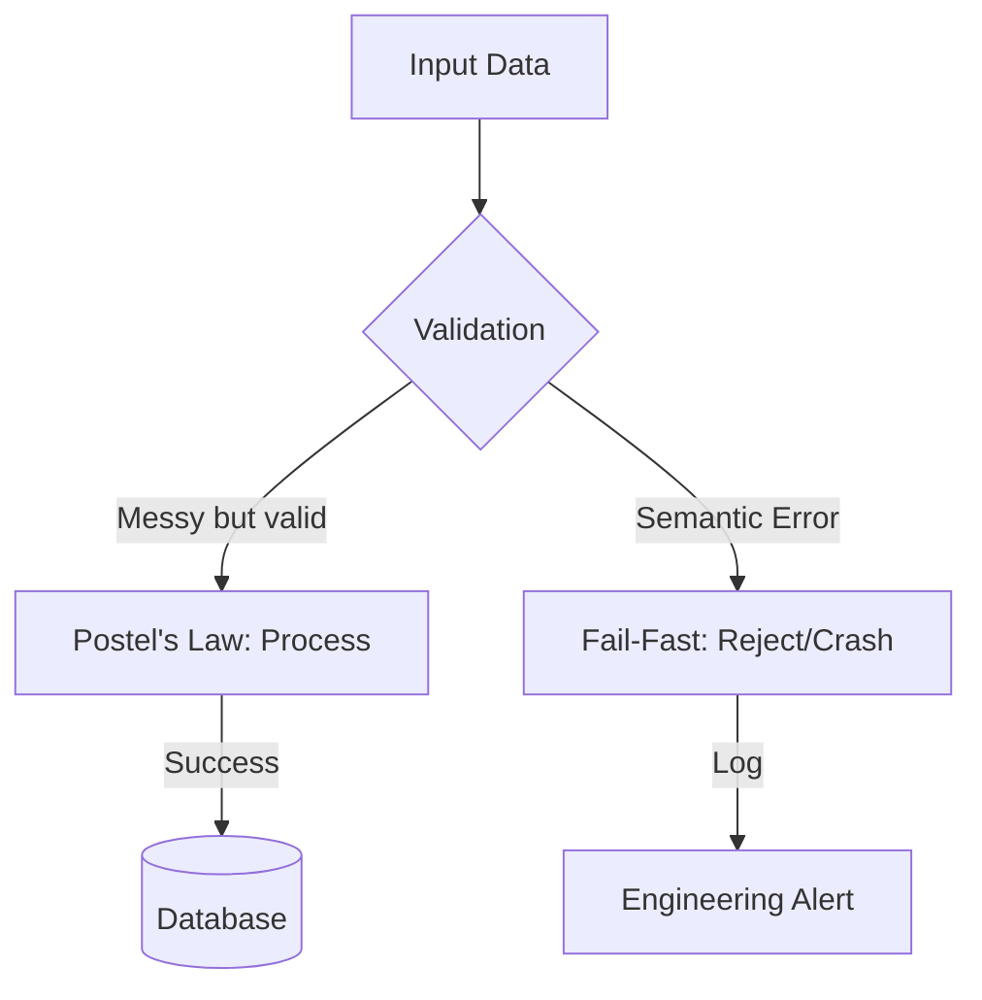

# Robustness Principle & Fail-Fast

============================================================
0. Executive Summary (Architect View)
============================================================
- **Postel's Law (Robustness Principle):** "Be conservative in what you do, be liberal in what you accept from others."
- **The Fail-Fast Philosophy:** "The most dangerous state for a system is one that is incorrect but running." Fail as early as possible to prevent data corruption.
- **The Modern Architect's Tension.** Postel's Law is great for interoperability (HTTP/HTML) but dangerous for security and consistency in Distributed Systems.
- **Fail-Fast at the Boundary.** Validate input strictly at the entry point (API/Queue consumer) but be resilient in internal processing.
- **Architectural Stability.** A system that fails fast is easier to debug and more predictable than a "Robust" system that slowly poisons its own database with malformed data.

============================================================
1. Problem Framing
============================================================
- **Real Production Problem:** "Data Corruption Cascades". A service accepts a negative price from a legacy system because it wants to be "liberal" in what it accepts. This negative price propagates through 5 other services, eventually causing a total financial loss.
- **What breaks?** Inconsistent state, "Impossible" bugs in downstream systems, and a massive increase in MTTD (Mean Time To Detect) because the error happened hours or days before the system finally crashed.
- **Critical Scale:** Essential for microservices where "Garbage In" in Service A can lead to "System Out" in Service Z.
- **Failure Story:** A major airline's booking system accepted a flight duration of "0" because their parser was "robust" to malformed numbers. This "0" value caused a DivideByZero error in the Fuel Estimation service, which didn't have a fail-fast check. The result was a grounded fleet while engineers traced the malformed input back through 4 layers of "robust" services.

============================================================
2. Deep Internal Mechanics
============================================================

### Defensive Validation vs Fail-Fast
- **Defensive:** Try to "Fix" the input (e.g., trimming strings, defaulting nulls).
- **Fail-Fast:** Reject with an error (e.g., `ArgumentException`, `400 BadRequest`).



### The Cost of Robustness
- **Complexity:** Every "liberal" check adds an `if` statement and more cyclomatic complexity.
- **Security:** "Being liberal" is the primary cause of injection attacks (SQLi, XSS, Buffer Overflows).

### Performance Characteristics
- **Latency:** Fail-fast validation (e.g., using `FluentValidation`) adds a few microseconds at the boundary but saves milliseconds (or seconds) of processing malformed data that will fail later anyway.
- **Resource Usage:** Failing fast prevents wasting CPU/Memory on requests that are doomed to fail.

============================================================
3. .NET Production Implementation
============================================================

### Naive Implementation (Too "Robust" / Dangerous)
```csharp
public void UpdateAccount(AccountDto dto)
{
    // Try to be "Robust" to missing data
    _account.Balance = dto.Balance ?? 0; // Dangerous! 0 is a valid balance
}
```

### Production-Ready Implementation (.NET 8)
Using **Fail-Fast with FluentValidation and Global Exception Handling**.

**1. Tight Validation Contract**
```csharp
public class AccountValidator : AbstractValidator<AccountDto>
{
    public AccountValidator()
    {
        RuleFor(x => x.AccountId).NotEmpty();
        RuleFor(x => x.Balance).GreaterThanOrEqualTo(0).WithMessage("Balance cannot be negative.");
    }
}
```

**2. Fail-Fast in the Handler**
```csharp
public async Task Handle(UpdateAccountCommand cmd)
{
    // Fail-fast at the start of the orchestration
    var validation = await _validator.ValidateAsync(cmd);
    if (!validation.IsValid) throw new ValidationException(validation.Errors); 

    // Internal Domain Invariants (Guards)
    _account.UpdateBalance(cmd.Balance); 
}
```

**DI Lifetime:** Validators are `Singleton` (stateless).
**Logging:** Fail-fast events must be logged as `Warning` or `Error` to identify aggressive client behavior or system-to-system mismatch.

============================================================
4. Architecture-Level Diagram (ASCII Only)
============================================================

                ┌───────────────────────────┐
                │      Unsafe Request       │
                └─────────────┬─────────────┘
                              │
               ┌──────────────▼──────────────┐
               │     Validation Boundary     │ (FAIL-FAST POINT)
               │ [Reject Malformed Input]    │
               └──────────────┬──────────────┘
                              │ Clean Data
               ┌──────────────▼──────────────┐
               │      External Systems       │ (ROBUSTNESS POINT)
               │ [Be Liberal to 3rd Party]   │
               └──────────────┬──────────────┘
                              │
               ┌──────────────▼──────────────┐
               │        Clean Domain         │ (The Result)
               └─────────────────────────────┘

============================================================
5. Scaling & Distributed Systems Impact
============================================================
- **Microservices:** Implement **Dead Letter Queues (DLQ)**. If a message can't be processed, fail-fast and move it to the DLQ rather than retrying indefinitely or processing part of it.
- **Resiliency Patterns:** **Circuit Breakers** are a form of Fail-Fast. If a downstream system is failing, fail-fast at the gateway to protect your own resources.

============================================================
6. Production Engineering View
============================================================
- **Metrics:** Track `400 BadRequest` rates. A spike means either a client bug or a too-strict robustness change.
- **Alerting:** Alert on **Unhandled Exceptions** in production. Every unhandled exception is a missed fail-fast opportunity.
- **Debugging:** Fail-fast makes stack traces clean. The error happens exactly where the bad data entered, not 50 steps later.

============================================================
7. Tradeoffs & Alternatives
============================================================
- **Graceful Degradation:** Instead of failing fast and showing an Error Page, show a "Maintenance" or "Limited View" page.
- **Safe-Fail vs Fail-Safe.** (Safe-Fail = system stays safe when failing; Fail-Safe = system fails but prevents damage).

============================================================
8. Security Implications
============================================================
- **Input Sanitization:** Fail-fast is the ultimate defense against XSS and SQLi. If a name field contains `<script>`, fail-fast and reject the request immediately.
- **Log Injection:** Ensure malformed input is sanitized before being logged in a fail-fast event.

============================================================
9. Advanced Edge Cases
============================================================
- **Thundering Herd of Failures:** If all 10,000 requests fail-fast simultaneously, does your logging system survive? 
    - *Fix:* Use **Log Sampling** or **Rate Limiting** on the error boundary.
- **Heiseinbugs:** In a "Robust" system, bugs appear and disappear depending on the data flow. Fail-fast turns them into "Deterministic Bugs".

============================================================
10. Interview & Staff-Level Deep Dive
============================================================
- **Junior:** "Validation is checking for nulls."
- **Senior:** "Being liberal in what you accept helps integrate with messy APIs."
- **Architect:** "Robustness is a balancing act. We apply Postel's Law at the edges to survive in a chaotic web, but we enforce strict Fail-Fast logic in our core domains to ensure state integrity. A mature architecture defines 'Tolerance Thresholds' where we gracefully handle minor messiness but hard-stop on semantic corruption."
- **Follow-up:** "How does the `Option` or `Result` pattern support Fail-Fast?"
- **Answer:** It forces the caller to handle the "Failure Case" immediately. You cannot access the "Success Value" without first acknowledging the possibility of failure, preventing a cascading "Unknown" state.

============================================================
11. Real Enterprise Case Study
============================================================
**Scenario:** A High-Scale Stock Exchange.
- **Problem:** Order prices were sometimes arriving as `0` or negative due to network jitter/corruption.
- **Design:** Implemented a **Binary Fail-Fast Gate** at the network protocol layer (L4/L7). Any malformed packet resulted in an instant disconnect.
- **Result:** The core exchange engine never had to deal with malformed data. System reliability went to 99.999% because the "Corruption Surface Area" was reduced to zero.

============================================================
12. Dependency Graph
============================================================
- **Pre-requisites:** Exception Handling, Data Validation.
- **Depends on this:** Circuit Breakers, Dead Letter Queues, Defensive Programming.
- **Connected to:** Domain Invariants, Contract-Based Design.
