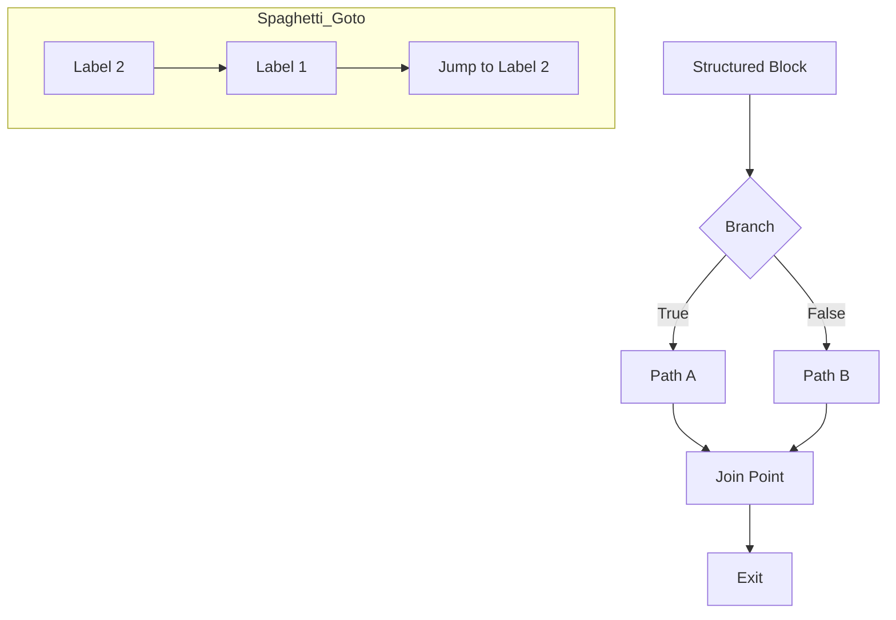

# Goto Is Evil (Structured Programming)

============================================================
0. Executive Summary (Architect View)
============================================================
- **The End of Spaghetti Code.** Edsger Dijkstra's 1968 letter "Goto Statement Considered Harmful" laid the foundation for Structured Programming.
- **Control Flow is a Business Constraint.** High-scale systems must have predictable execution paths. `goto` makes it hard for humans to reason about state and for compilers to optimize.
- **Modern "Gotos".** In C#, we rarely see `goto`, but we see its descendants: deep nesting, massive `switch` statements without pattern matching, and complex `try-catch-finally` blocks that abuse flow control.
- **Structure for Performance.** Predictable control flow (e.g., small methods, few branches) allows the JIT to perform better **Inlining** and **Branch Prediction**.
- **Exception Flow.** Using exceptions for normal control flow is the "Modern Goto". It's expensive and hides intent.

============================================================
1. Problem Framing
============================================================
- **Real Production Problem:** "The Logic Maze". You have a 2,000-line method with multiple exit points and labels that jump back and forth.
- **What breaks?** Maintaining this code becomes a nightmare. A fix on line 1,500 might accidentally be bypassed by a `goto` on line 100. This leads to **Inscrutable Bugs** and high **Cyclomatic Complexity**.
- **Critical Scale:** Essential for codebase longevity. A "spaghetti" system will eventually collapse under its own weight as the cost of change exceeds the value of the feature.
- **Failure Story:** A legacy payment gateway used `goto` for error handling. During a high-load event, an edge case triggered a jump that bypassed the "Transaction Logging" logic but still "Committed" the payment. The company lost $500,000 in untraceable transactions because the flow control was not structured.

============================================================
2. Deep Internal Mechanics
============================================================

### The Jump Instruction
At the IL (Intermediate Language) and Assembly level, *everything* is a jump (`br`, `brtrue`, `jmp`). `goto` is a direct abstraction of this. Structured programming (if/then, while, for) adds high-level semantics that the compiler can optimize into "Basic Blocks".

### Basic Block Optimization
The JIT compiler breaks code into "Basic Blocks" (sequences of instructions with one entry and one exit). `goto` creates non-contiguous blocks, which inhibit optimizations like **Dead Code Elimination** and **Register Allocation**.



### Performance Characteristics
- **JIT Inlining:** Large, unstructured methods with complex labels are rarely inlined.
- **Exception Performance:** Throwing an exception in .NET involves a heavy stack-trace capture (~10-100μs). Using this for control flow is 1000x slower than a simple `if` check.

============================================================
3. .NET Production Implementation
============================================================

### Naive Implementation (Abusing Flow Control)
```csharp
public void Process(Order o) {
    if (o == null) goto Error;
    // ... complex logic ...
    return;
Error:
    Log("Error");
}
```

### Production-Ready Implementation (.NET 8)
Using **Pattern Matching and Guard Clauses** to keep the "Happy Path" flat and structured.

```csharp
public async Task ProcessOrderAsync(Order? order, CancellationToken ct)
{
    // 1. Guard Clause (Fail-fast/Structured)
    if (order is not { IsValid: true })
    {
        _logger.LogWarning("Invalid order received");
        return;
    }

    // 2. Pattern Matching for Complex Logic Branches
    var status = order switch
    {
        { Amount: > 1000 } => await ProcessHighValueAsync(order, ct),
        { Type: OrderType.Digital } => await ProcessDigitalAsync(order, ct),
        _ => await ProcessStandardAsync(order, ct)
    };

    // 3. Clear, Linear Finish
    _logger.LogInformation("Order processed with status {Status}", status);
}
```

**DI Lifetime:** Not directly related, but structured flow makes lifecycle-aware objects (like `IDisposable`) easier to manage via `using` statements.
**Logging:** Structured flow ensures that log entries follow a logical sequence, making it easier to reconstruct the state during an investigation.

============================================================
4. Architecture-Level Diagram (ASCII Only)
============================================================

      UNSTRUCTURED FLOW (Spaghetti)         STRUCTURED FLOW (Linear/Slices)
      
          ┌─────────────┐                    ┌─────────────┐
          │   Entry     │                    │   Entry     │
          └─────┬───────┘                    └──────┬──────┘
                │                                   │
          ┌─────▼───────┐                    ┌──────▼──────┐
          │   Logic A   ├─────┐              │   Guard     │ (Early Exit)
          └─────┬───────┘     │              └──────┬──────┘
                │       ┌─────▼─────┐               │
          ┌─────▼───────┤   Logic B │        ┌──────▼──────┐
          │   Logic C   │           │        │ Main Logic  │ (Parallelizable)
          └─────┬───────┘     ┌─────┘        └──────┬──────┘
                │             │                     │
          ┌─────▼─────────────▼─────┐        ┌──────▼──────┐
          │         Exit            │        │    Exit     │
          └─────────────────────────┘        └─────────────┘

============================================================
5. Scaling & Distributed Systems Impact
============================================================
- **State Machines:** In high-scale systems (like SignalR or Akka.NET actors), complex flow control is often managed via an explicit **State Machine** pattern, which is structured and highly performant.
- **Azure Functions:** Serverless flow should be "Small and Single-Purpose". Deeply nested logic in a Lambda leads to high billing costs and hard-to-trace failures.

============================================================
6. Production Engineering View
============================================================
- **Metrics:** Track **Cyclomatic Complexity**. A value > 15 for a single method should trigger an architectural review.
- **Tools:** Use **SonarQube** or **NDepend** to find "Goto" violations or methods that are "too large to be readable".
- **Debugging:** Structured code allows you to step through linearly. Spaghetti code requires constant "Watch" variables to understand why the execution jumped to a specific line.

============================================================
7. Tradeoffs & Alternatives
============================================================
- **When is goto OK?** In .NET, `goto` is sometimes used in **extremely performance-critical state machines** (like the ones generated by the compiler for `async/await`) or very tight loops where you need to break out of multiple levels of nesting. This is an "Implementation Detail" and should almost never be in business logic.

============================================================
8. Security Implications
============================================================
- **Logic Flaws:** Simple, structured code is easier to audit for security vulnerabilities. Complex branching is where "Authorization Bypass" bugs hide.
- **Race conditions:** Linear, structured code is easier to make thread-safe than code that jumps back and forth.

============================================================
9. Advanced Edge Cases
============================================================
- **The "Finally" Trap:** Misusing `goto` or `return` inside `try-catch` blocks can lead to confusing behavior regarding whether the `finally` block executes (Hint: It usually does, which is why it's structured!).

============================================================
10. Interview & Staff-Level Deep Dive
============================================================
- **Junior:** "Goto is bad because it's messy."
- **Senior:** "Structured programming is about if/else and loops to make code readable."
- **Architect:** "Structured programming is about defining a single entry and a predicted exit point for every logical unit. It's a strategy to align human cognition with machine execution, enabling easier formal verification and systematic performance optimization by the runtime."
- **Follow-up:** "Does C# allow a `goto` into the middle of a `try` block?"
- **Answer:** NO. The C# compiler enforces strict scope rules that prevent jumped entries into protected blocks or blocks with local variables not yet initialized.

============================================================
11. Real Enterprise Case Study
============================================================
**Scenario:** A High-Speed Transaction Matcher for a Bank.
- **Problem:** The matching logic was a single 4,000-line method with dozens of labels. It was crashing once a month due to an "Impossible Jump" edge case.
- **Design:** Applied **Specification Pattern**. Broke the matcher into 20 small, stateless "Rules". Each rule is a simple class with one method.
- **Result:** The code became 100% unit-testable. Performance improved because the JIT could now inline each rule individually. The monthly crashes stopped.

============================================================
12. Dependency Graph
============================================================
- **Pre-requisites:** Flow Control Basics, Basic OS.
- **Depends on this:** Pattern Matching, State Machines, Functional Programming.
- **Connected to:** JIT Optimization, Branch Prediction, Cyclomatic Complexity.
