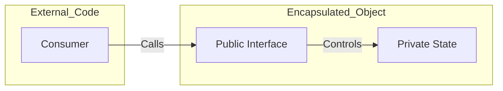

# Data Abstraction & Encapsulation

**0. Executive Summary (Architect View)**
- **Abstraction is about "What"; Encapsulation is about "How".** Abstraction hides complexity; Encapsulation hides data and enforces invariants.
- **The "Leaky Abstraction" Risk.** Every abstraction "leaks" at some point (e.g., an ORM abstracts SQL but you still need to worry about N+1 performance).
- **Protects the Domain.** At architect depth, Encapsulation is the primary tool for ensuring that business rules (Internal Invariants) are NEVER violated by external code.
- **Improved Evolvability.** By hiding the internal data representation (e.g., using a private `List<T>` but exposing an `IEnumerable<T>`), you can change the underlying storage without breaking public APIs.
- **Memory Representation.** In .NET 8, encapsulation also involves choosing between **Reference Types** (Classes) and **Value Types** (Structs/Records) to optimize memory locality and GC pressure while maintaining a clean abstraction.

**1. Problem Framing**
- **Real Production Problem:** "The Consistency Crisis". Any developer can reach into an `Order` object and change its `Status` without checking if it's already "Shipped".
- **What breaks?** Inconsistent state in the database, "Impossible" business scenarios (e.g., a paid order with zero items), and a massive increase in the "Surface Area for Bugs".
- **Critical Scale:** Essential as soon as you have more than one service or one team handling the data.
- **Failure Story:** A social media platform allowed direct access to the `Followers` list in their `User` object. A bug in the "Deactivate Account" feature cleared the list without updating the "Follower Count" counter. This led to a split-brain state where users saw they had 10k followers but an empty list, causing a massive support backlog. Proper encapsulation would have forced all changes through a single `RemoveFollower()` method that updated both fields atomically.

**2. Deep Internal Mechanics**

### Information Hiding
The class acts as a "Black Box".



### Invariants Enforcement
An invariant is a condition that must always remain true for the life of the object. Encapsulation is the *only* way to guarantee this in an OOD system.

### Performance Characteristics
- **Binary Size:** No impact.
- **Method Calls:** Property getters/setters in .NET are almost always **Inlined** by the JIT, meaning there is zero performance cost for using a property instead of a public field.
- **Memory:** Using **init-only** properties and **Records** in .NET 8 allows for "Immutable Abstraction", which simplifies concurrency and reduces the complexity of state-tracking.

**3. .NET Production Implementation**

### Naive Implementation (Poor Encapsulation)
```csharp
public class BankAccount {
    public decimal Balance; // Public field = TOTAL RECKLESSNESS
}
```

### Production-Ready Implementation (.NET 8)
Using **DDD-style Encapsulation and Records**.

```csharp
public sealed class BankAccount 
{
    private decimal _balance; // Hidden state

    // Read-only public view
    public decimal Balance => _balance;

    public BankAccount(decimal initialDeposit)
    {
        if (initialDeposit < 0) throw new ArgumentException("Initial deposit must be positive.");
        _balance = initialDeposit;
    }

    // Single point of modification with invariant checking
    public void Withdraw(decimal amount)
    {
        if (amount <= 0) throw new ArgumentException("Withdrawal must be positive.");
        if (_balance - amount < 0) throw new InvalidOperationException("Insufficient funds.");
        
        _balance -= amount;
        // Logic for triggering events, updating audit logs, etc. happens here
    }
}
```

**DI Lifetime:** Not directly related, but interfaces (`IBankAccount`) provide the ultimate abstraction from the implementation.
**Logging:** Log invariant violations as **Warning**—they indicate a bug in the calling code trying to perform an illegal action.

**4. Architecture-Level Diagram (ASCII Only)**

                ┌───────────────────────────┐
                │      Public Contract      │ (The "What")
                │ (Interface / DTO / Header)│
                └─────────────┬─────────────┘
                              │
               ┌──────────────▼──────────────┐
               │    Encapsulation Boundary   │ (The "How")
               │ [Guards] [Logic] [Mapping]  │
               └──────────────┬──────────────┘
                              │
               ┌──────────────▼─────────────┐
               │      Internal State        │ (Private Fields)
               └────────────────────────────┘

**5. Scaling & Distributed Systems Impact**
- **Microservices:** Abstraction at the service level means using **Contracts** (Swagger/gRPC). The internal DB schema is the encapsulated state of the service.
- **Versioning:** Strong encapsulation makes it easier to version your API. You can change your internal implementation (e.g., moving from a list to a dictionary) without changing the external JSON contract.

**6. Production Engineering View**
- **Detection:** Look for "Anemic Domain Models" (classes with only getters/setters). This is a sign of failed encapsulation.
- **Alerting:** If your unit tests are constantly breaking because of internal implementation changes, your abstraction is **Too Leaky**.
- **Debugging:** Encapsulation simplifies debugging by narrowing down where a variable could have been changed. If `_balance` is wrong, you only have 2-3 methods to check, not the whole codebase.

**7. Tradeoffs & Alternatives**
- **Value Objects:** (Structs/Records) Small, immutable objects that represent data but have no identity. Excellent for encapsulation as they cannot be partially modified.
- **When NOT to use:** In simple DTOs or "Data Transfer" scenarios where the object's ONLY purpose is to move data across a boundary. In this case, "Anemic" is fine.

**8. Security Implications**
- **Unauthorized State Modification:** Private fields prevent external attackers (or malicious libraries) from directly manipulating sensitive state like `IsAuthorized` or `UserRole`.
- **Data Exposure:** Only expose what is necessary. Encapsulation helps prevent "Mass Assignment" vulnerabilities (where an attacker sends extra JSON fields to update unintended properties).

**9. Advanced Edge Cases**
- **Reflection:** Can be used to bypass encapsulation. 
    - *Architect's Rule:* If you find yourself using reflection to set private fields in your own code, your architecture is broken.
- **Shadowing:** A derived class redefined a property, hiding the base class's encapsulation. (Use `sealed` to prevent this).

**10. Interview & Staff-Level Deep Dive**
- **Junior:** "Encapsulation is using getters and setters."
- **Senior:** "It's about hiding complexity and protecting data."
- **Architect:** "Data Abstraction and Encapsulation are the primary mechanisms for managing 'Entropy' in a large-scale system. They define the 'Contractual Boundaries' that allow independent modules to evolve without destabilizing the whole platform. It's about ensuring that the system's 'True State' is always valid and consistent."
- **Follow-up:** "How does the `internal` keyword in C# support architectural encapsulation?"
- **Answer:** It allows classes within the same assembly (layer) to see each other's details while hiding them from other assemblies (layers). This supports the **Internal Domain Pattern**.

**11. Real Enterprise Case Study**
**Scenario:** A Multi-Currency Trading Platform.
- **Problem:** Different currencies had different decimal places. Developers were doing rounding logic in the UI, leading to "Penny Loss" errors.
- **Design:** Introduced a **Money Value Object**. All rounding, conversion, and validation logic was encapsulated within the `Money` record.
- **Result:** The UI team stopped doing math. Total system accuracy reached 100%, and "Penny Loss" bugs were eliminated.

**12. Dependency Graph**
- **Pre-requisites:** Access Modifiers (Private/Public), OOP Basics.
- **Depends on this:** Aggregates (DDD), Value Objects, Domain Integrity.
- **Connected to:** Unit Testing, Interface Design, Data Integrity.
