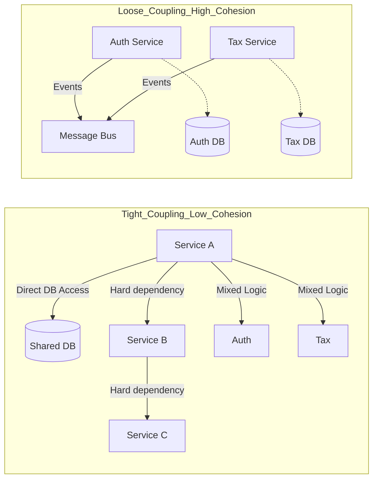

# High Cohesion & Loose Coupling: Foundations of Modularity

============================================================
0. Architectural Vision: The Goal of Modularity
============================================================
- **Cohesion is Internal Strength.** It measures how closely related the responsibilities within a single module (class, service, or assembly) are.
- **Coupling is External Dependency.** It measures the degree of interdependence between different modules.
- **The Golden Rule:** Aim for **High Cohesion** (do one thing and do it well) and **Loose Coupling** (depend on as little as possible).
- **Scale Impact.** In a system with 1M+ RPS, tightly coupled components cause "Cascading Failures". Low cohesion causes "Mega-Services" that are impossible to scale horizontally.
- **Maintenance Cost.** 80% of software cost is maintenance. Cohesion/Coupling are the primary drivers of this cost.
- **Architect's Perspective.** We view the system as a set of black boxes. The cleaner the boundaries (low coupling) and the denser the internals (high cohesion), the more resilient the system.

============================================================
1. Foundational Problem: The Cost of Spaghetti Architecture
============================================================
- **Real-World Impact:** Imagine a "User Management" service that also calculates tax and sends SMS. This is **Low Cohesion**. When the SMS provider changes, you risk breaking the tax logic.
- **What breaks?** Tight coupling leads to **Rigidity** (hard to change), **Fragility** (easy to break), and **Immobility** (hard to reuse).
- **Scale Boundary:** Irrelevant at 100 lines of code; catastrophic at 100,000 lines.
- **Failure Story:** A major logistics firm had a "Global Dispatcher" service. It was tightly coupled to the internal database schema of 4 other systems. When the "Warehouse" team changed a column name, the "Dispatch" service crashed, which then caused the "Customer Notification" service to fail because it was waiting for a synchronous response. This is the definition of a **Distributed Monolith**.

============================================================
2. Internal System Mechanics & Interaction Models
============================================================

### Cohesion Levels (Scale of 1-10)
1. **Coincidental:** (Worst) Random grouping of functions.
2. **Logical:** Grouping by "Category" (e.g., all I/O).
3. **Functional:** (Best) Everything in the module contributes to a single well-defined task.

### Coupling Types
- **Content Coupling:** (Worst) One module modifies the internal data of another.
- **Shared Coupling:** Multiple modules depend on the same global state/database.
- **Loose Coupling:** (Best) Communication via thin interfaces or messages.



### Performance & Memory Implications
- **High Cohesion** improves **L1/L2 Cache Locality**. Related data and instructions are physically closer in memory during execution.
- **Loose Coupling** might introduce minor latency (extra interface hop or network call) but enables **Independent Scaling**. You can throw 10x hardware at the bottleneck service without touching the rest of the system.

============================================================
3. Production Engineering in .NET 8
============================================================

### Anti-Pattern: The "God Object" (Low Cohesion)
```csharp
public class OrderManager {
    public void ProcessOrder() { /* ... */ }
    public void CalculateTax() { /* ... */ }
    public void SendSms() { /* ... */ }
    public void UpdateInventory() { /* ... */ }
}
```

### Production-Ready Implementation: Vertical Slices & DI
```csharp
// High Cohesion: Focused implementation
public sealed class TaxCalculator : ITaxCalculator {
    public decimal Calculate(Order order) => order.Amount * 0.15m;
}

// Loose Coupling: Communication via Interfaces and Events
public sealed class OrderService {
    private readonly ITaxCalculator _taxCalculator;
    private readonly IMessageBus _bus;

    public OrderService(ITaxCalculator taxCalculator, IMessageBus bus) {
        _taxCalculator = taxCalculator;
        _bus = bus;
    }

    public async Task CheckoutAsync(Order order) {
        var tax = _taxCalculator.Calculate(order);
        await _bus.PublishAsync(new OrderPlacedEvent(order.Id, tax));
    }
}
```

**System Integration:**
- **Dependency Injection:** Use `AddTransient` or `AddScoped` to inject abstractions, never concretes.
- **Messaging:** Use **MassTransit** or **Rebus** to decouple services across network boundaries.

============================================================
4. System Interaction & Flow (ASCII Architecture)
============================================================

                ┌──────────────────┐
                │   Consumer API   │
                └────────┬─────────┘
                         │ (Request/Reply)
         ┌───────────────▼───────────────┐
         │     Orchestrator Service      │ (Low Coupling to Details)
         └────────┬──────────────┬───────┘
                  │              │
      ┌───────────▼─────┐  ┌─────▼───────────┐
      │  Finance Domain │  │ Inventory Domain│ (High Internal Cohesion)
      │ [Tax] [Invoice] │  │ [Stock] [Pick]  │
      └───────────┬─────┘  └─────┬───────────┘
                  │              │
         ┌────────▼──────────────▼───────┐
         │     Shared Event Infrastructure│ (Loose Temporal Coupling)
         └───────────────────────────────┘

============================================================
5. Strategic Scaling & System Evolution
============================================================
- **100 RPS:** Monoliths are fine. Coupling isn't a performance killer yet.
- **10k RPS:** Thread contention and blocking I/O on coupled services start to show. High cohesion allows you to move hot-paths to optimized languages/runtimes (e.g., Rust) while keeping the rest in C#.
- **1M+ RPS:** **Temporal Decoupling** (messaging) becomes mandatory. If Service A must be up for Service B to work, your availability is `A * B`. To reach 99.999%, you need them to work independently.
- **Kubernetes:** Loose coupling allows for independent Pod scaling and "Canary Deployments".

============================================================
6. Reliability, Observability & Runtime Governance
============================================================
- **Key Metrics:**
    - `Modularity Index`: Visualized via structure maps.
    - `Change Frequency`: If many modules change for one feature, coupling is high.
- **Tracing:** Use **Jaeger** or **Honeycomb** to see the "Dependency Chain". 
- **Alerting:** Alert on "Dependency Latency Spikes". If the Tax service is slow, the Order service shouldn't crash; it should use a fallback or queue the request.

============================================================
7. Compromises, Tradeoffs & Alternatives
============================================================
- **Microservices vs Monolith:** Microservices enforce loose coupling but increase **Operational Complexity**.
- **The Latency Tax:** Extra layers of abstraction and network hops increase P99 latency. In high-frequency systems, you might accept "Tighter Coupling" for "Extreme Speed".

============================================================
8. Security Posture & Risk Mitigation
============================================================
- **Blast Radius:** Loose coupling ensures that if the "Public UI" is compromised, the "Payment Vault" is still protected by an internal, decoupled boundary (the ACL/Gateway).
- **Data Isolation:** High cohesion often means a service owns its data. This prevents "Unauthorized Cross-Service Data Access".

============================================================
9. Technical Edge Cases & System Failure Modes
============================================================
- **Circular Dependencies:** Service A calls B, B calls A. 
    - *Resolution:* Break out a shared Service C or move to an Event-driven model.
- **Distributed Lock Contention:** Two decoupled services trying to lock the same global resource (e.g., a Redis key). 
    - *Resolution:* Design for **Idempotency** instead of locking.

============================================================
10. Architectural Assessment & Career Progression
============================================================
- **Associate:** "Cohesion is about classes doing one thing."
- **Principal:** "Modularity is a strategic hedge against uncertainty. We maximize cohesion to reduce local complexity and minimize coupling to maximize global agility. It's about ensuring the system's survival as business requirements inevitably mutate."
- **Whiteboard Strategy:** Draw the system parts first. Show how changing one part *doesn't* require touching the others.
- **Trick Question:** "Is a Shared Database a form of coupling?"
- **Answer:** YES. It's **Data Coupling**. It's often the hardest type of coupling to break because multiple services depend on the same schema.

============================================================
11. Real-World Case Study: Global Fintech Pivot
============================================================
**Scenario:** A company processing $50B/year needed to switch from a flat-fee model to a dynamic, region-based tax model.
- **Constraint:** Zero downtime allowed.
- **The Design:** The system had high cohesion (Tax was its own module). They were able to swap the `FixedTaxProvider` with `DynamicTaxService` via a DI config change in `Program.cs`.
- **Result:** The deployment took 10 minutes. Because of low coupling, the "Core Transaction Engine" remained untouched, and not a single payment was dropped.

============================================================
12. Structural Dependencies & Learning Path
============================================================
- **Foundations:** SoC, DRY, SOLID.
- **Future Steps:** Microservices, Event Sourcing, Domain-Driven Design (DDD).
- **Integration Points:** API Gateways, Service Mesh (Istio), Message Brokers.
