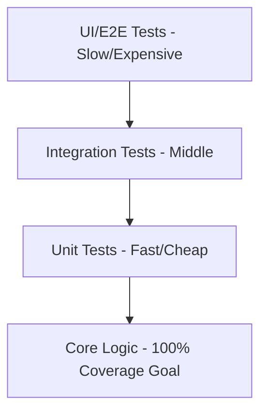

# TDD & Testable Architecture: Engineering for Quality

**0. Architectural Vision: Quality as a System Constraint**
- **TDD is a Design Tool first, a testing tool second.** It forces you to think about the *interface* (how to use the code) before the *implementation* (how it works).
- **Testability is a Metric of Architectural Health.** If a system is hard to test, it's typically because it's tightly coupled (Law of Demeter violation) or lacks clear boundaries (SoC violation).
- **The Red-Green-Refactor Cycle.** This isn't just a ritual; it's a feedback loop that prevents regression and ensures the lowest possible technical debt.
- **Mocking and Social Tests.** At architect depth, we differentiate between "Unit Tests" (logic isolation) and "Integration Tests" (system interaction).
- **Production Confidence.** A system with a robust test suite can be deployed multiple times a day with zero fear. Quality is built-in, not "inspected-in" at the end.

**1. Foundational Problem: The Fear of Change**
- **Real-World Impact:** "Manual Regression Testing". Every change requires 3 days of manual testing by a QA team. This kills agility.
- **What breaks?** "Spooky Action at a Distance". Changing the login logic accidentally breaks the checkout flow because they share a hidden global state.
- **Scale Boundary:** Becomes critical when more than one developer is working on a codebase. Without automated tests, the complexity of the "Conflict Resolution" grows exponentially.
- **Failure Story:** A major airline once had a bug in their pricing logic that sold international flights for $5. The bug was introduced during a "minor refactor" of a shared utility class. Because there were no unit tests, the bug reached production, costing millions of dollars and leading to a PR nightmare.

**2. Internal System Mechanics & Verification Loops**

### The Verification Pyramid
Architects design for a balanced distribution of tests to minimize execution time while maximizing coverage.



### Testable Design Patterns
- **Dependency Injection:** Mandatory for mocking external I/O.
- **Pure Functions:** Logic that depends only on its inputs and has no side effects is a "Test Architect's Dream".
- **Ports and Adapters:** Decouples the domain from external infrastructure, allowing the domain to be tested with "Mocks" or "Fakes".

### Performance & CI/CD Characteristics
- **Execution Speed:** 1,000 unit tests should run in < 10 seconds. Slow tests lead to developers skipping the test suite.
- **Flakiness:** Non-deterministic tests (e.g., those depending on system time or real databases) are worse than no tests. They erode trust in the build pipeline.

**3. Production Engineering in .NET 8**

### Anti-Pattern: The Untestable "Legacy" Style
```csharp
public class OrderService {
    public void ProcessOrder(Order order) {
        var db = new SqlConnection("..."); // Direct dependency = Untestable
        db.Execute("INSERT...");
    }
}
```

### Production-Ready Implementation: Testable Architecture
```csharp
// 1. Define Abstractions
public interface IOrderRepository {
    Task SaveAsync(Order order);
}

// 2. Implementation with DI
public sealed class OrderService {
    private readonly IOrderRepository _repo;

    public OrderService(IOrderRepository repo) => _repo = repo;

    public async Task ProcessAsync(Order order) {
        if (order.Amount <= 0) throw new InvalidOrderException();
        await _repo.SaveAsync(order);
    }
}

// 3. The Test (xUnit + Moq/NSubstitute)
[Fact]
public async Task Process_ShouldThrow_IfAmountIsZero() {
    var repo = Substitute.For<IOrderRepository>();
    var service = new OrderService(repo);
    var order = new Order { Amount = 0 };

    await Assert.ThrowsAsync<InvalidOrderException>(() => service.ProcessAsync(order));
}
```

**Testing Infrastructure:**
- **xUnit:** The modern standard for .NET testing.
- **AutoFixture:** For generating test data (minimizing "Setup Bloat").
- **FluentAssertions:** For human-readable assertions.

**4. System Interaction & Flow (ASCII Architecture)**

                ┌──────────────────┐
                │ CI/CD Pipeline   │ (The Verifier)
                └────────┬─────────┘
                         │ 1. Run Tests
         ┌───────────────▼───────────────┐
         │     The Test Runner           │
         │  ┌─────────┐   ┌─────────┐    │
         │  │ Unit    │   │ Integr  │    │
         │  └────┬────┘   └────┬────┘    │
         └───────┼─────────────┼─────────┘
                 │             │ 2. Use
         ┌───────▼─────────────▼─────────┐
         │     Mocks / Fakes             │ (Controlled Environment)
         └───────────────┬───────────────┘
                         │ 3. Validate
               ┌─────────▼─────────┐
               │    The System     │ (The Target)
               └───────────────────┘

**5. Strategic Scaling & System Evolution**
- **100 RPS:** Simple unit tests are enough.
- **10k RPS:** **Load Testing** and **Stress Testing** (e.g., using jMeter or K6) become part of the TDD cycle to ensure the system doesn't buckle under volume.
- **1M+ RPS:** **Chaos Engineering** (e.g., intentionally killing services to see if the system survives) is the ultimate "Test" of architecture.
- **Cloud-Native:** In Kubernetes, "Liveness" and "Readiness" probes are essentially runtime health tests that the platform uses to manage scaling and self-healing.

**6. Reliability, Observability & Runtime Governance**
- **Key Metrics:**
    - `Test Coverage`: Aim for 80%+, but focus on "Business Path" coverage.
    - `Cyclomatic Complexity`: High complexity usually correlates with poor testability.
    - `Build Time`: If the build takes > 10 mins, it's an architectural bottleneck.
- **Tools:** Use **Coverlet** for coverage and **SonarQube** for long-term health monitoring.

**7. Compromises, Tradeoffs & Alternatives**
- **TDD Overhead:** Initial development might take 20-30% longer. 
- **The Long-Term Gain:** Debugging time is reduced by 90%. Total Cost of Ownership (TCO) is much lower.
- **Alternative:** "Test-After" (writing tests after the code). Better than nothing, but often misses the "Design" benefits of TDD.

**8. Security Posture & Risk Mitigation**
- **Security Unit Tests:** Write tests for sensitive logic (e.g., "Non-admin cannot access admin data"). This locks in the security policy at the code level.
- **Fuzzing:** Automate the input of "Garbage Data" into your tests to see if the system fail-fasts correctly.

**9. Technical Edge Cases & System Failure Modes**
- **Global State in Tests:** If tests share a static variable, they will fail randomly when run in parallel.
    - *Resolution:* Never use static state in tests. Use **Isolation Levels**.
- **DateTime.Now:** One of the most common causes of flaky tests.
    - *Resolution:* Inject an `IDateTimeProvider`.

**10. Architectural Assessment & Career Progression**
- **Senior:** "TDD is about code coverage."
- **Staff/Principal:** "Testability is the primary architectural constraint that ensures the long-term maintainability of a system. A testable architecture is by definition modular, decoupled, and transparent. We don't just write tests for code; we design systems to be provably correct."
- **Interview Strategy:** Discuss how you would test a high-volume data pipeline without a real database.
- **Trick Question:** "Should you test private methods?"
- **Answer:** Generally NO. If a private method is complex enough to need testing, it should probably be moved to its own (publicly testable) class. Testing privates is a sign of poor encapsulation.

**11. Real-World Case Study: Trading Platform Migration**
**Scenario:** A company needed to migrate their core "Order Matcher" from legacy C++ to .NET 8.
- **The Challenge:** Absolute correctness was required. No room for manual testing.
- **The Design:** Used **Specification-Based TDD**. Thousands of "Match Scenarios" were defined in JSON and fed into the test suite. 
- **Result:** The system was migrated and launched with zero production bugs. The TDD suite became the "Living Documentation" for how the matcher should behave.

**12. Structural Dependencies & Learning Path**
- **Foundations:** Clean Code, SOLID, Mocking Basics.
- **Future Steps:** BDD (Behavior Driven Development), Property-Based Testing, Chaos Engineering.
- **Integration Points:** CI Pipelines (GitHub Actions/Azure DevOps), SonarCloud, Docker.
