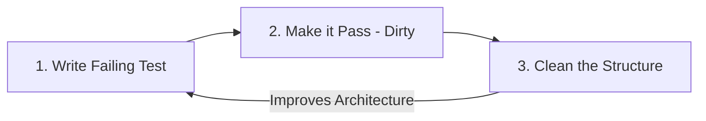

# Strategic Refactoring: Managing Technical Debt

============================================================
0. Architectural Vision: Evolution as a Constant
============================================================
- **Refactoring is not a "One-Time Project".** It's a continuous process of improving the internal structure of code without changing its external behavior.
- **Technical Debt is a Financial Instrument.** Just like financial debt, technical debt can be "borrowed" to hit a deadline, but it must be "repaid" with interest (increased maintenance cost).
- **The Boy Scout Rule.** Always leave the code a little cleaner than you found it. 
- **Safety First.** Never refactor without a comprehensive test suite. Refactoring without tests is just "Randomly Changing Stuff".
- **Patterns of Improvement.** Most refactoring involves applying design patterns (Extract Method, Replace Conditional with Polymorphism, etc.) to a messy codebase.
- **Architect's View.** We prioritize refactoring areas with high **Change Frequency** (hot-spots) and high **Complexity**.

============================================================
1. Foundational Problem: The "Big Ball of Mud" Stagnation
============================================================
- **Real-World Impact:** Feature velocity drops to zero. A simple change that used to take 1 day now takes 1 month because the code is too brittle to touch.
- **What breaks?** Developer morale (burnout), system stability (unexpected side effects), and business competitiveness.
- **Scale Boundary:** In a large-scale system, "Refactoring as you go" is the only way to prevent the system from becoming a "Legacy Monolith" that must be thrown away and rewritten.
- **Failure Story:** A major telecommunications provider once had to completely scrap a 2-year project because the core "Billing Engine" was so complex and unstructured that it became "Dead Code" (everyone was too afraid to modify it). The company lost $20M and 2 years of market lead because they didn't invest in continuous refactoring.

============================================================
2. Internal System Mechanics & Complexity Reduction
============================================================

### The Red-Green-Refactor Cycle (Applied to Architecture)
The "Refactor" step is where architecture is actually built.



### Complexity Metrics
Architects use tools to quantify code health:
- **Cyclomatic Complexity:** Number of independent paths through the code.
- **Cognitive Complexity:** How hard it is for a human to understand the flow.
- **Coupling/Cohesion:** (As discussed previously).

### Performance Characteristics
- **Short-Term:** Refactoring might introduce minor overhead (extra method calls).
- **Long-Term:** A cleaner codebase is easier to optimize. You can profile a clean method and swap it for a high-performance implementation (e.g., using `Span<T>`) without breaking the system.

============================================================
3. Production Engineering in .NET 8
============================================================

### Anti-Pattern: The Nested Conditional (The "Arrow")
```csharp
public void Process(Order o) {
    if (o != null) {
        if (o.Status == "Paid") {
            if (o.Items.Count > 0) {
                // Actual logic nested deep
            }
        }
    }
}
```

### Production-Ready Implementation: Guard Clauses & Pattern Matching
```csharp
public void Process(Order? order) {
    // 1. Guard Clause: Flatten the structure
    if (order is not { Status: "Paid", Items.Count: > 0 }) {
        _logger.LogWarning("Order not ready for processing");
        return;
    }

    // 2. Focused, flat logic
    ExecuteOrder(order);
}

private void ExecuteOrder(Order order) {
    // Extracted method for clarity and testability
}
```

**Refactoring Tools in VS 2022 / JetBrains Rider:**
- **Extract Method (Ctrl+R, M):** The most common tool for reducing method size.
- **Rename (Ctrl+R, R):** Names are for humans. Use them wisely.
- **Safe Refactoring:** Both IDEs use the Roslyn compiler engine to ensure that a rename or extract is semantically safe across the entire solution.

============================================================
4. System Interaction & Flow (ASCII Architecture)
============================================================

                ┌──────────────────┐
                │   Legacy Code    │ (High Debt Zone)
                └────────┬─────────┘
                         │ 1. Wrap (Adapter Pattern)
         ┌───────────────▼───────────────┐
         │     Safety Net (Tests)        │ (The Protector)
         └────────┬──────────────────────┘
                  │ 2. Extract & Refactor
         ┌────────▼──────────────┐
         │   Cleaned Service     │ (Low Debt Zone)
         └────────┬──────────────┘
                  │ 3. Replace Legacy
         ┌────────▼──────────────┐
         │     Modern System      │ (The Goal)
         └───────────────────────┘

============================================================
5. Strategic Scaling & System Evolution
============================================================
- **100 RPS:** Refactoring is about developer productivity.
- **10k RPS:** Refactoring is about system stability. "Hot-spots" must be refactored to be non-blocking.
- **1M+ RPS:** Refactoring is about cost efficiency. You refactor the "Allocation Heavy" paths to reduce GC pressure and Cloud compute costs.
- **Microservices Migration:** "Refactor the Monolith" into "Modular Monolith" before attempting to split into Microservices.

============================================================
6. Reliability, Observability & Runtime Governance
============================================================
- **Key Metrics:**
    - `Churn Rate`: Which files are changing most often?
    - `Technical Debt Ratio`: Estimated time to fix vs. time to build.
- **Tools:** Use **NDepend** or **SonarQube** to find "Hotpoints"—high complexity and high churn. These are the first candidates for refactoring.

============================================================
7. Compromises, Tradeoffs & Alternatives
============================================================
- **Rebuild vs Refactor.** Rebuilding is rarely the answer. It's the "Second System Syndrome". Refactoring is lower risk and provides value incrementally.
- **When NOT to refactor.** If a piece of code is stable, has low churn, and is "good enough", leave it alone. Don't fix what isn't broken for the sake of "aesthetic purity".

============================================================
8. Security Posture & Risk Mitigation
============================================================
- **Secure Refactoring.** Many security vulnerabilities (like SQLi or XSS) are found during refactoring.
- **Audit Logs.** Ensure that refactoring doesn't accidentally remove critical audit logs or security checks.

============================================================
9. Technical Edge Cases & System Failure Modes
============================================================
- **The "Refactoring Trap".** Starting a refactor and getting "stuck" in a sea of broken code.
    - *Resolution:* Break the refactor into tiny, 10-minute steps. If you can't commit every 15 minutes, your step is too big.
- **Breaking External APIs.** Refactoring internal code is fine; refactoring the public API requires a **Versioning Strategy**.

============================================================
10. Architectural Assessment & Career Progression
============================================================
- **Senior:** "Refactoring makes the code clean and pretty."
- **Principal:** "Refactoring is a risk management strategy to maintain 'Option Value' in our codebase. We continuously reinvest in the structure to ensure the system can adapt to future business pivots with minimal friction."
- **Interview Strategy:** Discuss a time you refactored a mission-critical system and how you ensured it didn't break (Hint: Tests, Incremental Release, Feature Toggles).

============================================================
11. Real-World Case Study: E-Commerce Migration
============================================================
**Scenario:** A company had a single "PriceEngine" that was a 10,000-line `switch` statement.
- **The Problem:** Adding a new discount type took 2 weeks of testing.
- **The Design:** Refactored using the **Strategy Pattern**. Broke the `switch` into 50 small, independent `IDiscountStrategy` classes.
- **Result:** Adding a discount now takes 1 hour. Unit test coverage of the pricing logic went from 5% to 98%.

============================================================
12. Structural Dependencies & Learning Path
============================================================
- **Foundations:** Unit Testing, Design Patterns.
- **Future Steps:** Clean Architecture, Domain-Driven Design (DDD).
- **Integration Points:** CI/CD Build Walls, Code Analysis Gateways.
