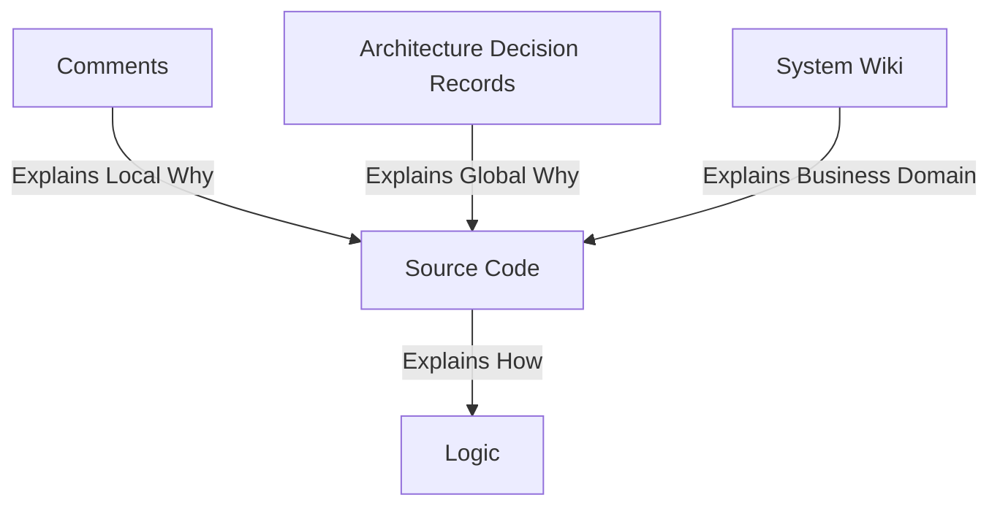

# Architectural Documentation: Beyond "Self-Documenting Code"

============================================================
0. Architectural Vision: Documentation for System Longevity
============================================================
- **Documentation is a Communication Channel.** It connects the "Past You" with the "Future You" and your team.
- **Why > How.** Code explains "How" (the implementation). Documentation explains "Why" (the intent, the constraints, and the tradeoffs).
- **The Self-Documenting Code Myth.** Code can be readable, but it cannot explain the *business context* or the *architectural decisions* that led to its existence.
- **Living Documentation.** Use modern tools (Swagger, Mermaid, ADRs) to keep documentation close to the code, reducing the "Documentation Rot".
- **Architect's View.** We prioritize documenting **Boundaries**, **Interfaces**, and **Complex Logic** that a human cannot easily infer from the code alone.

============================================================
1. Foundational Problem: The "Tribal Knowledge" Trap
============================================================
- **Real-World Impact:** An architect leaves the company. Suddenly, no one knows why the "Order Processor" uses a specific 200ms delay or why it's not thread-safe.
- **What breaks?** Onboarding time increases. Developers make the same mistakes that were fixed 2 years ago because the reason for the fix wasn't documented. This leads to **Architectural Drift**.
- **Scale Boundary:** In a team of 30+ engineers, lack of documentation leads to a complete breakdown in consensus on how the system should work.
- **Failure Story:** A fintech startup had an "Implicit Security Rule". Everyone "just knew" not to use a specific API without a token. A new hire, not seeing any documentation or comments, used the API to fix a bug. The system was exposed to an unauthorized data leak for 6 months because the "Intent" of that code was never documented.

============================================================
2. Internal System Mechanics & Knowledge Capture
============================================================

### Levels of Documentation
Architects manage multiple layers of knowledge:
1. **In-Code Comments:** Local "Why" for specific logic blocks.
2. **README / Project Docs:** System overview and setup.
3. **ADRs (Architecture Decision Records):** History of *why* we chose a specific technology or pattern.



### The Cost of Bad Documentation
- **Obsolete Docs:** Worse than no docs. They lead to incorrect assumptions and bugs.
- **Noise:** Comments like `// Setting i to 0` add cognitive load without adding value.

============================================================
3. Production Engineering in .NET 8
============================================================

### Anti-Pattern: The Redundant Comment
```csharp
// Get the user from the database
var user = await _userService.GetUserByIdAsync(id); 
// This comment is USELESS and NOISY
```

### Production-Ready Implementation: Intent-Focused Documentation
```csharp
/// <summary>
/// Processes the daily settlement.
/// </summary>
/// <remarks>
/// IMPORTANT: This logic is intentionally single-threaded because the upstream 
/// Core Banking System (CBS) cannot handle parallel settlement requests 
/// for the same merchant account.
/// </remarks>
public async Task ProcessSettlement(Guid merchantId) {
    // We use a 200ms debounce here to prevent thundering herd on the CBS
    // during peak hours (See ADR #42).
    await Task.Delay(200);
    // ...
}
```

**Modern .NET Documentation Tools:**
- **XML Documentation Tags (`///`):** For public APIs. These generate machine-readable docs (Swagger, IntelliSense).
- **Swagger / OpenAPI:** Automatically documents API endpoints from code attributes.
- **Mermaid.js in Markdown:** For keeping diagrams alongside code in the repo.

============================================================
4. System Interaction & Flow (ASCII Architecture)
============================================================

                ┌──────────────────┐
                │   The Developer  │ (The Producer/Consumer)
                └────────┬─────────┘
                         │ 1. Write Code + Intent
         ┌───────────────▼───────────────┐
         │     The Version Control       │ (The Immutable History)
         │  ┌─────────┐   ┌─────────┐    │
         │  │ Code    │   │ ADRs    │    │
         │  └────┬────┘   └────┬────┘    │
         └───────┼─────────────┼─────────┘
                 │             │ 2. Read
         ┌───────▼─────────────▼─────────┐
         │     IntelliSense / Swagger    │ (The Context)
         └───────────────┬───────────────┘
                         │ 3. Execute
               ┌─────────▼─────────┐
               │    The System     │ (The Result)
               └───────────────────┘

============================================================
5. Strategic Scaling & System Evolution
============================================================
- **100 RPS:** Documentation is for you and your future self.
- **10k RPS:** Documentation is for the team and the "On-Call" engineer.
- **1M+ RPS:** Documentation is for **System Integration**. When 50 other services call your API, your Swagger docs are your "Contract". Any ambiguity leads to production incidents.
- **ADR Strategy:** Every major architectural move (switching to Microservices, choosing a DB) must have an ADR. This prevents "Chesterton's Fence" (tearing down a fence without knowing why it was there).

============================================================
6. Reliability, Observability & Runtime Governance
============================================================
- **Key Metrics:**
    - `Swagger Health`: Is the API documentation accurate to the runtime behavior?
    - `Onboarding Time`: How long until a new hire makes their first PR?
- **Tools:** Use **Swashbuckle** for .NET or **DocFX** for generating static documentation sites from your source.

============================================================
7. Compromises, Tradeoffs & Alternatives
============================================================
- **Documentation Debt.** Writing docs takes time. Architects must decide *which* docs are worth the investment.
- **Automated vs Manual.** Automate everything you can (Swagger, diagrams-as-code). Reserve manual effort for high-level intent (ADRs).

============================================================
8. Security Posture & Risk Mitigation
============================================================
- **Sensitive Info:** Never put passwords, API keys, or PII (Personally Identifiable Information) in comments or READMEs.
- **Security Policy Documentation:** Document things like "Encryption at Rest" and "OAuth Scopes" so auditors can verify the system's security posture.

============================================================
9. Technical Edge Cases & System Failure Modes
============================================================
- **Lying Documentation.** A doc says "Returns 404 if not found", but the code returns an empty list.
    - *Resolution:* Use **Contract Testing** to ensure documentation and behavior stay in sync.
- **The "Missing Context".** A comment says "Don't delete this line", but doesn't say why. (Always include the "Why").

============================================================
10. Architectural Assessment & Career Progression
============================================================
- **Senior:** "I write clean code so I don't need comments."
- **Principal:** "Documentation is the bridge across time. It ensures that the system's architectural integrity is maintained long after the original authors have moved on. We prioritize capturing the 'Decision History' to prevent regression and enable faster system evolution."
- **Interview Strategy:** Discuss how you manage "Documentation Rot" in a fast-moving startup environment.

============================================================
11. Real-World Case Study: Global Integration Fail
============================================================
**Scenario:** A US-based payment processor integrated with a Japanese bank.
- **The Bug:** The Japanese bank's API returned dates in a non-standard format. The original developer wrote a fix but didn't document *why* the format was specific. 
- **The Crisis:** A year later, a refactor removed the "unnecessary" date parsing logic, causing all transactions to fail. 
- **The Resolution:** Re-implemented the fix and added an ADR and a clear source code comment explaining the specific legacy constraint of the Japanese bank.

============================================================
12. Structural Dependencies & Learning Path
============================================================
- **Foundations:** Clean Code, Markdown Basics.
- **Future Steps:** Domain Modeling, Specification writing.
- **Integration Points:** Git, Swagger UI, Wiki platforms (Confluence/Notion/GitHub Wiki).
