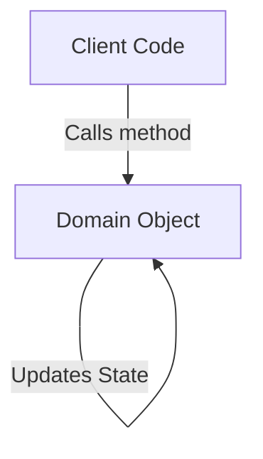
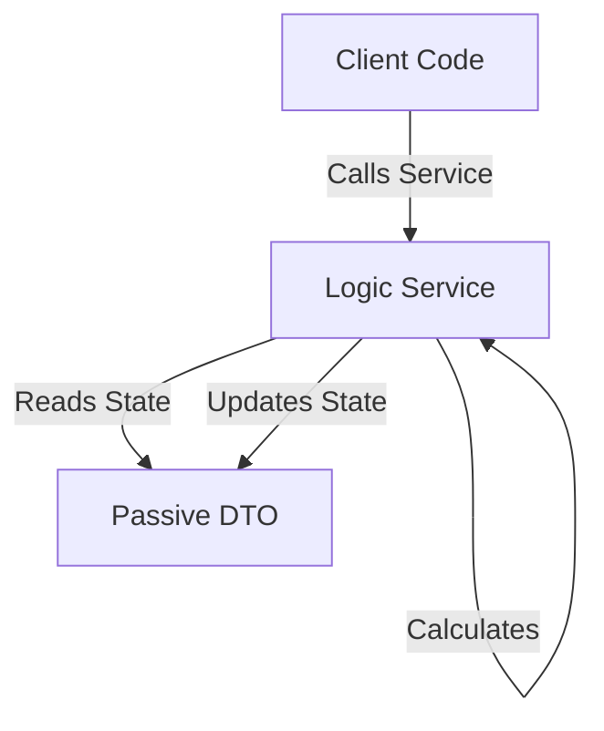

# OOP vs Procedural Logic: Where Does the Domain Logic Live?

**0. Architectural Vision: Paradigms and Logic Placement**
- **OOP (Object-Oriented Programming):** Encapsulates data and behavior together. Logic lives in objects (Domain Models).
- **Procedural / Data-Centric:** Separates data (Structs/DTOs) from behavior (Services/Stored Procedures).
- **The "Anemic Domain Model" Paradox.** Most modern .NET applications claim to be OOP but are actually Procedural (Services acting on DTOs).
- **Stored Procedures vs Application Logic.** Placing logic in the database (Procedural) offers high speed but poor evolvability. Placing logic in the app (OOP) offers high evolvability but potentially higher latency.
- **Architect's View.** We choose the paradigm that minimizes the **Total Cost of Change**. OOP is usually better for complex business rules; Procedural is often better for raw performance and data-heavy batch processing.

**1. Foundational Problem: The "Smart Data, Dumb Service" vs "Dumb Data, Smart Service"**
- **Real-World Impact:** Imagine a "Transaction" object that has no logic. To validate it, you must call a "TransactionValidatorService". If you forget, the system enters an invalid state.
- **What breaks?** "Logic Sprawl". The same business rule is duplicated in 5 different services because the "Data" itself doesn't know how to protect its own integrity.
- **Scale Boundary:** At high scale, Procedural logic in the database (Stored Procedures) can become a **Single Point of Failure** and an architectural bottleneck that cannot be horizontally scaled.
- **Failure Story:** A large retail bank had all its "Interest Calculation" logic in 50,000 lines of complex SQL Stored Procedures. When they wanted to move to the cloud, they were "Locked In" to a specific database vendor. The rewrite took 3 years and cost $50M because the business rules were "Trapped" in procedural database code rather than being modularized in an application layer.

**2. Internal System Mechanics & Logic Flow**

### OOP: Behavior-Rich Models
The object is responsible for its own state and invariants.



### Procedural: Service-Based Logic
Data is passive; services act as "Orchestrators".



### Performance & Memory Implications
- **OOP:** Can lead to "Hydration Overhead" where you load a large object from the DB just to call one small method.
- **Procedural (SQL):** Extremely fast for set-based operations (updating 1,000,000 rows at once).

**3. Production Engineering in .NET 8**

### Anti-Pattern: The Anemic Domain Model (Procedural hiding in OOP)
```csharp
public class Order { // Dummy Data Bag
    public decimal Total { get; set; }
}

public class OrderService { // Logic Service
    public void CalculateTotal(Order o) => o.Total = ...;
}
```

### Production-Ready Implementation: Rich Domain Model (Pure OOP)
```csharp
public sealed class Order 
{
    private readonly List<OrderItem> _items = new();
    public decimal Total { get; private set; }

    // Logic is encapsulated with the data
    public void AddItem(OrderItem item) 
    {
        if (item.Price < 0) throw new InvalidOperationException();
        _items.Add(item);
        Total += item.Price; // Atomic update of state
    }
}
```

**Architecture Strategy:** 
- Use **Domain-Driven Design (DDD)** for the core business logic.
- Use **Dapper / SQL** for performance-critical batch updates or complex reporting.
- **Hybrid Approach:** "Rich" for writes (Command side); "Anemic/Procedural" for reads (Query side) - This is **CQRS**.

**4. System Interaction & Flow (ASCII Architecture)**

      PROCEDURAL (DB Centric)              OOP (Domain Centric)
      
          ┌─────────────┐                    ┌─────────────┐
          │     App     │                    │     App     │
          └─────┬───────┘                    └──────┬──────┘
                │ SQL Call                          │ Method Call
          ┌─────▼───────┐                    ┌──────▼──────┐
          │  Database   │                    │ Domain Logic │ (Encapsulated)
          │ [Logic Inside]│                  └──────┬──────┘
          └─────────────┘                           │ State Update
                                             ┌──────▼──────┐
                                             │  Database   │ (Dumb Store)
                                             └─────────────┘

**5. Strategic Scaling & System Evolution**
- **100 RPS:** Any paradigm works.
- **10k RPS:** Start splitting logic into specialized Microservices. OOP helps keep these services small and cohesive.
- **1M+ RPS:** Move "Hot Paths" to raw Procedural/Set-based logic (stored procs or optimized cloud functions) while keeping "Complex Business Decisions" in OOP for safety.
- **Cloud Migration:** OOP logic is "Portable" (can run in a container anywhere). Stored Procedures are "Locked" to a specific DB engine.

**6. Reliability, Observability & Runtime Governance**
- **Key Metrics:**
    - `Class Length`: Overly large classes in OOP are a sign of "Logic Bloat".
    - `DB CPU usage`: High CPU usage by stored procedures is an architectural warning.
- **Logging:** In OOP, you log "Intent" (e.g., `OrderProcessed`). In Procedural, you often log "Action" (e.g., `UpdateTableX`).

**7. Compromises, Tradeoffs & Alternatives**
- **Functional Programming (FP):** An alternative to both. FP uses immutable data and pure functions. C# is increasingly adopting FP features (Records, Pattern Matching).
- **The "Data Mapper" Pattern:** Essential for OOP to maintain separation from the DB schema.

**8. Security Posture & Risk Mitigation**
- **Defensive Programming:** Rich Domain Models are inherently more secure because they prevent illegal states from ever being created.
- **SQL Injection:** Procedural logic in the DB is safe *if* using stored procs correctly, but riskier if concatenating strings in the app.

**9. Technical Edge Cases & System Failure Modes**
- **Circular References:** In OOP, objects can easily become a "Web" of dependencies.
    - *Fix:* Use **Aggregates** (DDD) to define hard boundaries.
- **Transaction Scope:** In Procedural, a stored proc is its own transaction. In OOP, you need a "Unit of Work" to manage commits across multiple objects.

**10. Architectural Assessment & Career Progression**
- **Senior:** "OOP is for writing clean code; Procedural is old."
- **Principal:** "The choice of paradigm is a strategic decision about where to place the 'Gravity' of the system. We use OOP to master business complexity and Procedural logic to master data throughput. A mature architect is 'Poly-Paradigm' and chooses the tool based on the specific bottleneck."
- **Interview Strategy:** Explain when you would choose a Stored Procedure over C# code (e.g., mass price updates during a sale).
- **Trick Question:** "Is C# a pure OOP language?"
- **Answer:** NO. It's a Multi-Paradigm language supporting OOP, Procedural, and Functional styles.

**11. Real-World Case Study: Global Shipping System**
**Scenario:** A shipping company had "Rate Calculation" in an OOP model.
- **The Performance Problem:** Calculating rates for 1,000,000 shipments in a batch job took 4 hours because of "Object Hydration" overhead.
- **The Solution:** Kept the OOP model for "Live Checkout" (1 order at a time). Wrote a Procedural Stored Procedure for the "Batch Reporting" job.
- **Result:** Batch job time dropped from 4 hours to 5 minutes.

**12. Structural Dependencies & Learning Path**
- **Foundations:** OOP Basics, SQL Basics.
- **Future Steps:** Domain-Driven Design (DDD), CQRS, Hexagonal Architecture.
- **Integration Points:** Entity Framework Core (The Bridge), Dapper, SQL Server/Postgres.
