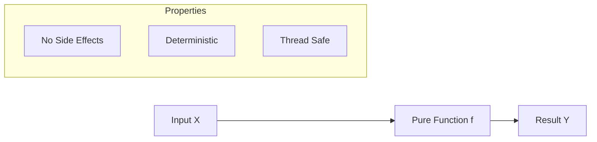

# Functional Programming & Referential Transparency: Engineering Predictable Systems

============================================================
0. Architectural Vision: The Power of Pure Functions
============================================================
- **Functional Programming (FP) is about Constraints.** It limits the ways state is managed to ensure system behavior is deterministic and predictable.
- **Referential Transparency** is the cornerstone of FP. It means a function call can be replaced by its result without changing the system's behavior.
- **Immutability by Default.** Data never changes once created. This eliminates a whole class of bugs related to "Shared Mutable State".
- **Side-Effect Management.** Pure functions have no side effects (no global state updates, no DB writes). Side effects are pushed to the "Edges" of the system.
- **Concurrency for Free.** Immutable data structures are thread-safe by design. In high-scale systems (1M+ RPS), this eliminates the need for expensive locks.
- **Architect's Perspective.** We use FP patterns to build "Logic Cores" that are 100% unit-testable and provably correct, reserving OOP for orchestration and infrastructure.

============================================================
1. Foundational Problem: The Complexity of Hidden State
============================================================
- **Real-World Impact:** You call a method `CalculateDiscount()`, and it accidentally updates a static `AuditLog` counter. Later, another thread tries to read that counter, leading to a race condition.
- **What breaks?** "Spooky Action at a Distance". A change in one part of the system causes a crash in a completely unrelated part due to shared state corruption.
- **Scale Boundary:** In distributed systems, relying on shared state across server boundaries is a recipe for disaster. FP forces you to pass state explicitly, making it easier to scale horizontally.
- **Failure Story:** A fintech company had a "Balance Calculator" that relied on a shared `Cache` object. Due to a side effect in the calculation logic, the cache was occasionally updated with partial results. During peak load, multiple threads corrupted the cache, leading to users seeing incorrect balances for 2 hours. A pure, referentially transparent function would have prevented this entirely.

============================================================
2. Internal System Mechanics & Math-Based Logic
============================================================

### Referential Transparency (The Substitution Test)
If `f(x) = y`, then anywhere `f(x)` appears, it can be replaced with `y` without side effects.



### Expression-Oriented Programming
In FP, everything is an **Expression** (it returns a value) rather than a **Statement** (it performs an action). This leads to highly composable code.

### Performance & Memory Characteristics
- **Allocation Overhead:** Immutability can lead to more allocations (creating a new object instead of modifying one).
- **GC Pressure:** In .NET 8, the GC is highly optimized for short-lived objects. The "Immutability Tax" is often smaller than the cost of managing thread-safe locks.
- **Pure Function Optimization:** Compilers and runtimes can cache the results of pure functions (**Memoization**) safely.

============================================================
3. Production Engineering in .NET 8 (C# 12)
============================================================

### Anti-Pattern: The Side-Effect Heavy Method
```csharp
public class DiscountService {
    private decimal _totalApplied; // Mutable State

    public decimal Apply(Order o) {
        var discount = o.Amount * 0.1m;
        _totalApplied += discount; // Side Effect!
        return discount;
    }
}
```

### Production-Ready Implementation: Pure & Immutable
```csharp
// 1. Immutable Data using Records
public record Order(Guid Id, decimal Amount);
public record DiscountResult(decimal Discount, decimal NewTotalApplied);

// 2. Pure function (Referentially Transparent)
public static class DiscountLogic 
{
    public static DiscountResult Calculate(Order order, decimal currentTotalApplied)
    {
        var discount = order.Amount * 0.1m;
        // Returns a NEW state instead of modifying the existing one
        return new DiscountResult(discount, currentTotalApplied + discount);
    }
}

// 3. Usage in a High-Scale Concurrent System
// No locks needed for DiscountLogic!
var results = orders.AsParallel().Select(o => DiscountLogic.Calculate(o, total));
```

**System Integration:**
- **LINQ:** The ultimate FP tool in .NET. It's built on the principles of delayed execution and pure transformations.
- **Records (C# 9+):** Make immutability the default "Happy Path".

============================================================
4. System Interaction & Flow (ASCII Architecture)
============================================================

                ┌──────────────────┐
                │   The World      │ (Impure Edge: API/DB/IO)
                └────────┬─────────┘
                         │ 1. Capture State
         ┌───────────────▼───────────────┐
         │     Functional Core           │ (Pure Logic / Deterministic)
         │  ┌─────────┐   ┌─────────┐    │
         │  │ Map     │ → │ Reduced │    │
         │  └────┬────┘   └────┬────┘    │
         └───────┼─────────────┼─────────┘
                 │             │ 2. Return Result
         ┌───────▼─────────────▼─────────┐
         │     Infrastructure Shell      │ (Side-Effect Zone: Save/Log)
         └───────────────┬───────────────┘
                         │ 3. Update World
               ┌─────────▼─────────┐
               │    Final State    │
               └───────────────────┘

============================================================
5. Strategic Scaling & System Evolution
============================================================
- **Horizontal Scaling:** Pure functions are the easiest to distribute. Since they don't depend on local state, they can be run in any container, anywhere, without synchronization.
- **Serverless:** FP is the ideal paradigm for AWS Lambda or Azure Functions. Each trigger is a pure input-to-output mapping.
- **Testing Scale:** You can run 10,000 unit tests for pure functions in parallel without any "Test Interdependence" or "Flaky Test" issues.

============================================================
6. Reliability, Observability & Runtime Governance
============================================================
- **Key Metrics:**
    - `Mutation Count`: How often is state actually changing?
    - `Pure Logic Ratio`: What percentage of the codebase is side-effect free?
- **Observability:** Pure functions are easier to trace because there are no "Hidden Interactions". Every piece of data used in the calculation is visible in the function arguments.

============================================================
7. Compromises, Tradeoffs & Alternatives
============================================================
- **The "Copy" Tax:** For massive collections, copying every time can be slow. 
    - *Architect's Fix:* Use **Persistent Data Structures** or **Mutable Builder Pattern** (like `StringBuilder`) for the construction phase, then freeze the result.
- **Paradigm Shift:** Developers trained in classic OOP can find FP-style logic (recursion, monads, currying) difficult to read initially.

============================================================
8. Security Posture & Risk Mitigation
============================================================
- **Input Sanitization:** Because FP treats functions as data transformations, it's easier to build validatory "Pipes" that ensure data is clean before it hits the logic core.
- **State Integrity:** Immutability prevents "State Tampering" attacks where an adversary tries to modify an object in memory during a processing window.

============================================================
9. Technical Edge Cases & System Failure Modes
============================================================
- **Stack Overflow:** Deep recursion (common in FP) can crash the system. 
    - *Resolution:* Use **Tail-Call Optimization** (though limited in C#) or convert to a loop if the depth is unpredictable.
- **Lazy Evaluation Traps:** If an expression is lazy (like a LINQ query), errors might only appear deep in the infrastructure layer rather than at the source.

============================================================
10. Architectural Assessment & Career Progression
============================================================
- **Senior:** "FP is about using LINQ and avoiding global variables."
- **Principal:** "Functional Programming is an architectural strategy to decouple business rules from machine state. By leveraging Referential Transparency, we build systems that are 'Correct by Construction' and naturally resilient to the complexities of distributed concurrency."
- **Interview Strategy:** Explain how Immutability simplifies debugging in a distributed microservices environment.
- **Trick Question:** "Can you have a purely functional system that communicates with a database?"
- **Answer:** Conceptually yes, via the **IO Monad** or **Functional Core/Imperative Shell** pattern. You keep the logic pure and push all I/O to the very end of the execution flow.

============================================================
11. Real-World Case Study: Real-Time Bidding System
============================================================
**Scenario:** An ad-tech platform processing 500k requests per second.
- **Problem:** Frequent "Inconsistent Bid" states caused by race conditions in the mutable bid calculation logic.
- **The Fix:** Rewrote the calculation core using **C# Records** and **Pure Functions**. 
- **Result:** Race conditions dropped to zero. Throughput increased by 15% because the team removed all `lock` statements from the hot path.

============================================================
12. Structural Dependencies & Learning Path
============================================================
- **Foundations:** Expression-bodied members, LINQ, Immutability.
- **Future Steps:** Monads in C# (LanguageExt), Reactive Extensions (Rx), Akka.NET.
- **Integration Points:** State management in Front-ends (Redux pattern), Data Pipelines (Apache Spark).
