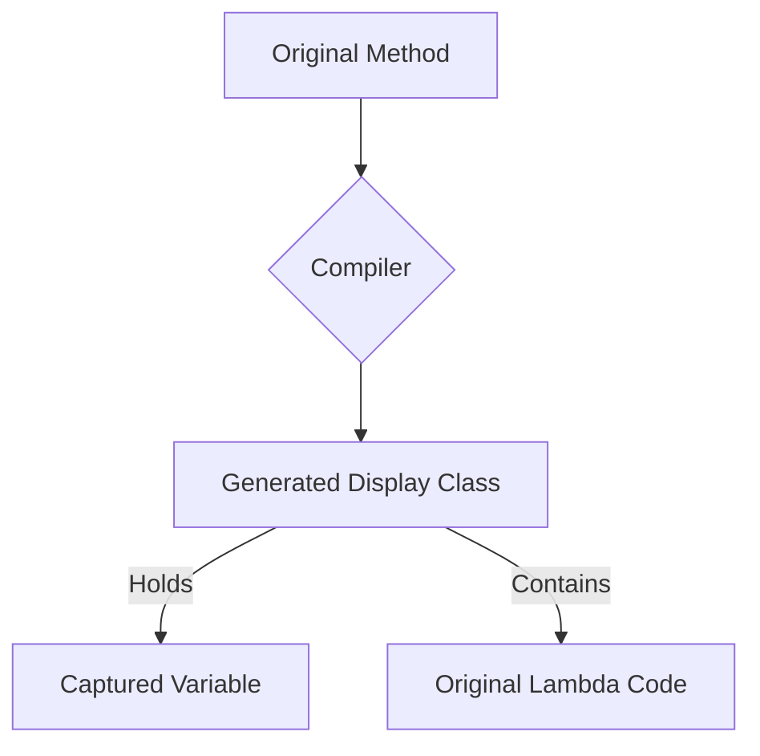

# Closures & Variable Scoping: Mastering State Capture

============================================================
0. Architectural Vision: The Mechanics of State Persistence
============================================================
- **Closures are Functions with Memory.** They allow a function to "remember" and access the variables from its outer scope even after that scope has finished executing.
- **State Capture is an Architectural Choice.** It determines how data flows through your system—via explicit arguments or implicit lexical capture.
- **Hidden Allocations.** At architect depth, closures are recognized as "Hidden Objects". Every captured variable potentially turns a stack-based value into a heap-based allocation.
- **Lifetime Management.** Closures extend the life of variables. Understanding this is critical for preventing "Memory Leaks" in long-running .NET processes.
- **Architect's View.** We use closures for building factory patterns, middleware, and event handlers, but we carefully monitor their impact on the **Garbage Collector (GC)**.

============================================================
1. Foundational Problem: The Ghost of Scopes Past
============================================================
- **Real-World Impact:** A developer uses a closure inside a loop to register event handlers. Each handler captures the *entire* state of the loop, leading to massive memory consumption.
- **What breaks?** "Late Bound" bugs. If you capture a loop variable incorrectly, all your closures might point to the *final* value of the variable rather than its value during the specific iteration.
- **Scale Boundary:** In high-throughput systems processing millions of events, every closure allocation adds pressure to Gen 0 of the GC, potentially causing "Stop-the-World" pauses.
- **Failure Story:** A high-frequency trading platform experienced 500ms latency spikes every 10 minutes. The root cause was a closure in a metrics-logging lambda that was capturing a large `HttpContext` object, keeping it alive long after the request was finished. Moving to explicit parameter passing resolved the memory bloat instantly.

============================================================
2. Internal System Mechanics & The "Display Class"
============================================================

### The Compiler's Magic: The Display Class
C# doesn't have native closures at the IL level. The compiler generates a "hidden" class (often called a `DisplayClass` or `ClosureClass`) to hold the captured variables.



### Performance & Memory Characteristics
- **Allocation:** Every time a closure is created, an instance of the `DisplayClass` is allocated on the Heap.
- **Variable Hoisting:** Captured variables are "hoisted" from the stack to the hidden class fields.
- **The "Whole Scope" Trap:** If you capture one variable from a large method, the *entire* `DisplayClass` is created, potentially keeping *all* captured variables from that scope alive, even those not used in that specific lambda.

============================================================
3. Production Engineering in .NET 8
============================================================

### Anti-Pattern: The Accidental Allocation
```csharp
public void ProcessData(List<int> items) {
    int threshold = 100;
    // Closure captures 'threshold'. A DisplayClass is allocated!
    var highValueItems = items.Where(x => x > threshold);
}
```

### Production-Ready Implementation: Zero-Allocation Capturing
In performance-critical paths, use **Static Lambdas** (C# 9+) to prevent accidental closures.

```csharp
public void ProcessData(List<int> items) {
    int threshold = 100;

    // Use a static lambda. It CANNOT capture 'threshold' implicitly.
    // This forces you to be explicit and avoid hidden heap allocations.
    var highValueItems = items.Where(static (x) => x > 100); 

    // Better yet, pass state explicitly to methods that accept it
    // (e.g., in high-performance libraries like TPL Dataflow or Channels)
}
```

**State Tracking:**
- **Captured variables are passed by reference.** If you change the variable outside the closure, the closure sees the change. This is a common source of bugs in multi-threaded code.

============================================================
4. System Interaction & Flow (ASCII Architecture)
============================================================

                ┌──────────────────┐
                │   Outer Scope    │ (Local Variables on Stack)
                └────────┬─────────┘
                         │ 1. Capture Variable
         ┌───────────────▼───────────────┐
         │     Display Class (Heap)      │ (The Persistence Store)
         │  ┌─────────┐   ┌─────────┐    │
         │  │ Var A   │   │ Var B   │    │
         │  └────┬────┘   └────┬────┘    │
         └───────┼─────────────┼─────────┘
                 │             │ 2. Use
         ┌───────▼─────────────▼─────────┐
         │      Lambda / Closure         │ (The Logic)
         └───────────────┬───────────────┘
                         │ 3. Execute
               ┌─────────▼─────────┐
               │    Final Result   │
               └───────────────────┘

============================================================
5. Strategic Scaling & System Evolution
============================================================
- **Micro-Optimizations:** For low-latency systems (e.g., gaming or finance), architects often ban closures in the "Hot Path".
- **Code Evolution:** Closures make code "prettier" but harder to refactor. Moving a lambda to a named method often reveals the hidden dependencies that were implicitly captured.

============================================================
6. Reliability, Observability & Runtime Governance
============================================================
- **Key Metrics:**
    - `GC Gen 0 Allocation Rate`: High rates often point to excessive closures.
    - `Heap Dump Analysis`: Look for `<>c__DisplayClass` objects.
- **Diagnostic Tools:** Use **dotMemory** or **BenchmarkDotNet** to measure the exact allocation cost of your lambdas.

============================================================
7. Compromises, Tradeoffs & Alternatives
============================================================
- **Functional Cleanliness vs Performance.** Closures are necessary for higher-order functions (Map, Filter, Reduce).
- **Alternative:** Use a named class with fields to pass state. It's more verbose but provides total transparency over what is being allocated and for how long.

============================================================
8. Security Posture & Risk Mitigation
============================================================
- **Information Leakage.** A closure might accidentally capture a sensitive variable (like a password or secret key) and keep it in memory longer than intended, making it vulnerable to "Heap Inspection".
- **Thread Safety.** Closures capturing mutable variables in a multi-threaded environment are a primary source of race conditions.

============================================================
9. Technical Edge Cases & System Failure Modes
============================================================
- **Capturing 'this'.** If you use an instance property in a lambda, you capture the *entire* object instance. This can prevent large objects from being garbage collected.
- **The "Loop Variable" Problem (Pre-C# 5).** Older .NET versions shared the same variable across iterations. Modern .NET creates a new scope for each iteration, but understanding the history is vital for legacy codebases.

============================================================
10. Architectural Assessment & Career Progression
============================================================
- **Senior:** "Closures let me access variables from the outer function."
- **Principal:** "A closure is a compiler-generated bridge between stack-based local lifetimes and heap-based persistence. As architects, we manage this bridge to balance the expressiveness of the language with the physical constraints of the computer's memory and GC infrastructure."
- **Interview Strategy:** Explain how you would investigate a memory leak caused by event handlers that use closures.
- **Trick Question:** "Does a static method have a `this` pointer in its closure?"
- **Answer:** No. Static methods don't have a `this` context, but they can still capture other static or local variables.

============================================================
11. Real-World Case Study: Real-Time Telemetry Parser
============================================================
**Scenario:** A cloud provider parsing 1 billion telemetry events per day.
- **The Problem:** CPU usage was consistently at 90% due to GC spending 40% of its time in Gen 0.
- **The Investigation:** Thousands of small closures were being created per second to pass "Filter Criteria" to a processing engine.
- **The Fix:** Replaced closures with a custom `FilterContext` struct passed by ref.
- **Result:** GC time dropped from 40% to 2%. CPU usage fell to 50%, saving the company $100k/month in cloud compute costs.

============================================================
12. Structural Dependencies & Learning Path
============================================================
- **Foundations:** Lambdas, Anonymous Methods, Stack vs Heap.
- **Future Steps:** High-Order Functions, Expression Trees.
- **Integration Points:** LINQ Providers, Event-Driven Architecture, Middleware.
