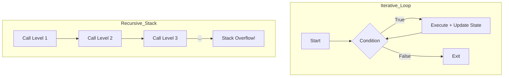

# Loops vs Recursion: Strategic Iteration Patterns

**0. Architectural Vision: The Flow of Data Processing**
- **Iteration is the Heartbeat of Computing.** Every data-intensive system relies on repeating logic over collections.
- **Loops (Imperial/Iterative):** Focus on *how* to iterate. High performance, manual state management (counters), but can lead to "Off-by-One" errors.
- **Recursion (Declarative/Functional):** Focus on *what* the structure is. Expresses math-like definitions naturally, but carries "Stack Overflow" risk.
- **Stack Safety.** At architect depth, the primary concern is preventing system crashes due to stack exhaustion in deep recursive calls.
- **The .NET Reality.** C# JIT compiler is historically better at optimizing loops. Recursion is powerful for tree/graph traversal but needs "Tail-Call" awareness.
- **Architect's View.** We use Loops for hot-path performance (e.g., L1 cache optimization) and Recursion for complex nested structures (e.g., hierarchical permissions or folder trees).

**1. Foundational Problem: The Complexity of Circular Logic**
- **Real-World Impact:** You need to calculate the "Total Price" of a Nested BOM (Bill of Materials). A part can contain other parts, which contain more parts.
- **What breaks?** "The Infinite Loop" or "The Stack Crash". If the nesting is 10,000 levels deep, a simple recursive call will crash the entire thread.
- **Scale Boundary:** In high-scale systems, thread stacks are limited (usually 1MB). Deep recursion is a "Time Bomb" that only explodes when the data hits a specific complexity.
- **Failure Story:** A major social network used a recursive function to find "Mutual Friends". On most users, it worked fine. However, for "Power Users" with deep connection chains, the function crashed the server, leading to a localized outage every time that user logged in. Moving to an iterative **Queue-Based Traversal** fixed the reliability issue.

**2. Internal System Mechanics: Stack vs Heap Iteration**

### The Call Stack
Every recursive call pushes a new "Stack Frame" (locals, return address). Loops reuse the same frame.



### Performance Characteristics
- **JIT Loop Unrolling:** The compiler can "unroll" loops to reduce branch overhead.
- **Tail-Call Optimization (TCO):** If the recursive call is the *very last* action, the compiler *could* replace it with a jump, avoiding a new stack frame. .NET's JIT only does this in specific 64-bit scenarios and mostly for IL generated by F#.
- **Memory Locality:** Loops over `Span<T>` allow for incredible L1 cache hits.

**3. Production Engineering in .NET 8**

### Anti-Pattern: Unbounded Recursion
```csharp
public decimal GetTotal(Category cat) {
    // Dangerous: No depth limit, likely to crash on large trees
    return cat.Price + cat.SubCategories.Sum(x => GetTotal(x));
}
```

### Production-Ready Implementation: Stack-to-Queue Transformation
Convert recursion to a loop using a `Stack<T>` or `Queue<T>` on the **Heap** to prevent **Stack Overflow**.

```csharp
public decimal GetTotalIterative(Category root)
{
    var total = 0m;
    var stack = new Stack<Category>(); 
    stack.Push(root);

    while (stack.Count > 0)
    {
        var current = stack.Pop();
        total += current.Price;

        foreach (var sub in current.SubCategories)
        {
            stack.Push(sub); // State is stored on the Heap, not the Stack
        }
    }
    return total;
}
```

**System Integration:**
- **LINQ:** Many LINQ methods use optimized iterative loops under the hood.
- **Yield Return:** Use `IEnumerable` with `yield` to create "Lazy Iterators" that handle massive data sets without loading everything into memory.

**4. System Interaction & Flow (ASCII Architecture)**

                ┌──────────────────┐
                │   The Iterator   │ (Control Flow)
                └────────┬─────────┘
                         │ 1. Fetch Next
         ┌───────────────▼───────────────┐
         │     The Data Pipeline         │ (The Logic)
         │  ┌─────────┐   ┌─────────┐    │
         │  │ Filter  │ → │ Process │    │
         │  └────┬────┘   └────┬────┘    │
         └───────┼─────────────┼─────────┘
                 │             │ 2. Return / Yield
         ┌───────▼─────────────▼─────────┐
         │     Consumer Handler          │ (The Aggregator)
         └───────────────┬───────────────┘
                         │ 3. Log / Accumulate
               ┌─────────▼─────────┐
               │    Final Output   │
               └───────────────────┘

**5. Strategic Scaling & System Evolution**
- **Throughput:** Loops are the "Fuel" for high throughput. If your system spends 10% of its time on method-call overhead (recursion), you're wasting millions of CPU cycles.
- **Maintainability:** For complex data structures (like XML/JSON trees), recursion is much easier to read. The architect must decide: "Is this a Hot Path?" If yes, Loop. If no, Recursion.
- **Distributed Iteration:** In Big Data (Spark/Hadoop), iteration is "Pushed" to the workers (Map/Reduce style).

**6. Reliability, Observability & Runtime Governance**
- **Key Metrics:**
    - `Iteration Depth`: Monitor the depth of tree-traversal.
    - `GC Pressure (Gen 0)`: Heap-based iteration (using `Stack<T>`) allocations should be pooled (using `ArrayPool`) at high RPS.
- **Observability:** Profile with **Visual Studio Profiler** or **PerfView**. Look for "Exclusive Time" in recursive calls.

**7. Compromises, Tradeoffs & Alternatives**
- **Tail Recursion:** In C#, you can use the `while(true)` pattern to manually implement tail recursion for performance.
- **Trampolining:** A technique where a recursive function returns a "thunk" (another function) to be called by a loop, keeping the stack flat.

**8. Security Posture & Risk Mitigation**
- **Stack Overflow DOS:** An attacker might provide a specially crafted, deeply nested JSON to crash your server via recursion. 
    - *Architect's Rule:* ALWAYS enforce a `MaxDepth` on recursive parsers.

**9. Technical Edge Cases & System Failure Modes**
- **Closure in Loops:** As discussed before, capturing loop variables.
- **Async Recursion:** Every `await` in a recursive call adds a heavy **State Machine** allocation. Avoid async recursion in high-frequency loops.

**10. Architectural Assessment & Career Progression**
- **Senior:** "Loops are fast; Recursion is for trees."
- **Principal:** "The choice between iteration and recursion is a trade-off between the 'Cognitive Load' of the developer and the 'Physical Constraints' of the runtime stack. We favor recursion for structural elegance in non-critical paths and transition to heap-allocated iteration or flat loops for systems where P99 performance and stack safety are non-negotiable."
- **Interview Strategy:** Explain how you would refactor a recursive algorithm to be iterative to solve a production stack-overflow issue.

**11. Real-World Case Study: Global Folder Sync**
**Scenario:** A cloud storage provider indexing 100M+ folders.
- **The Problem:** Recursive folder walking crashed on deep directory structures.
- **The Design:** Implemented a **BFS (Breadth-First Search)** using a `Queue<Path>` stored in a database (distributed queue) rather than in memory.
- **Result:** The system can now index folders of infinite depth without ever straining a single server's stack.

**12. Structural Dependencies & Learning Path**
- **Foundations:** Call Stack, Heap vs Stack, Big O Notation.
- **Future Steps:** Graph Algorithms, Distributed Iteration (MapReduce).
- **Integration Points:** JSON/XML Parsers, File System Crawlers, AST Parsers.
