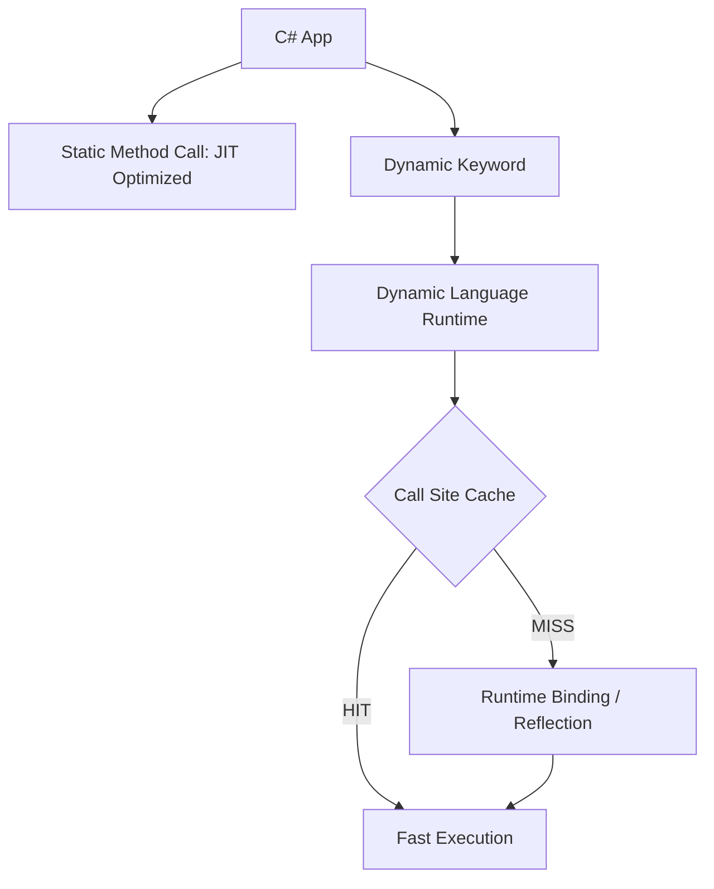

# Static vs Dynamic Typing: Compile-Time Safety vs Runtime Agility

**0. Architectural Vision: The Philosophy of Type Systems**
- **Static Typing is a Guarantee.** Types are checked at compile-time. If it compiles, it's (mostly) type-safe.
- **Dynamic Typing is a Promise.** Types are resolved at runtime. Offers flexibility for scripts and interoperability but shifts error detection to production.
- **The .NET Hybrid.** C# is a statically-typed language with powerful dynamic capabilities (the `dynamic` keyword and the **DLR - Dynamic Language Runtime**).
- **Strongly Typed vs Loosely Typed.** C# is strongly typed (no implicit casting of incompatible types like `string` to `int` without conversion).
- **Architect's View.** We treat Static Typing as our "Shield" against regression and Dynamic Typing as our "Surgery Tool" for complex integration or meta-programming.

**1. Foundational Problem: The Rigidity of Contracts**
- **Real-World Impact:** You need to integrate with a legacy COM object or a JSON response where the schema is unknown until runtime. In a pure static model, you'd spend hours writing "Mapping Classes" for data that might change tomorrow.
- **What breaks?** "The Cast Hell". Constantly casting objects and checking types at runtime makes the code unreadable and fragile.
- **Scale Boundary:** At high scale, dynamic typing (like in Python or JS) can lead to "Runtime Type Errors" that are hard to catch in an environment with millions of requests.
- **Failure Story:** A major energy provider used a dynamic configuration system to manage its sensors. A small typo in a config key (treating a `string` as an `int`) caused the monitoring system to crash during a power surge, because the dynamic check only failed when that specific high-load path was executed. A statically-typed config would have caught the error during deployment.

**2. Internal System Mechanics: The DLR & Call Sites**

### The DLR (Dynamic Language Runtime)
The DLR provides a set of services for dynamic languages (and the C# `dynamic` keyword) to interoperate with the CLR. It uses "Call Site Caching" to optimize runtime method lookups.



### Performance Characteristics
- **Static:** The fastest. JIT knows exactly which method to call and can inline it.
- **Dynamic:** Slower. Requires runtime lookup and binding. However, the DLR's **Call Site Caching** means subsequent calls are almost as fast as reflection-based calls.
- **Inference (`var`):** In C#, `var` is NOT dynamic. It is statically typed by the compiler. There is ZERO performance difference between `int i = 5` and `var i = 5`.

**3. Production Engineering in .NET 8**

### Anti-Pattern: Excessive 'dynamic' for Lazy Coding
```csharp
public void Process(dynamic data) {
    // Dangerous: No IntelliSense, no compile-time checks, high runtime cost
    Console.WriteLine(data.Name); 
}
```

### Production-Ready Implementation: Targeted Agility
Use `dynamic` or `Reflection` only for specific integration boundaries, and bridge back to static types as early as possible.

```csharp
public void HandleExternalInput(object input)
{
    // 1. Dynamic for the "Bridge"
    dynamic dInput = input;
    try {
        // High-level access to dynamic members without boilerplate
        var name = dInput.Metadata.User.Name; 
        
        // 2. Map back to a static "Contract" (SoC)
        var strongUser = new UserProfile(name); 
        ProcessUser(strongUser);
    }
    catch (RuntimeBinderException ex) {
        _logger.LogError("Malformed dynamic input: {Msg}", ex.Message);
    }
}
```

**System Integration:**
- **JSON.NET / System.Text.Json:** Often return `JObject` or `JsonElement` which act as dynamic-ish wrappers.
- **Dapper:** Uses `dynamic` for multi-mapping queries where the resulting shape isn't a fixed class.

**4. System Interaction & Flow (ASCII Architecture)**

      STATIC PATH (Defensive)               DYNAMIC PATH (Adaptive)
      
          ┌─────────────┐                    ┌─────────────┐
          │   Compiler  │                    │   The Code  │
          │ [Type Check]│                    │ [Any Call]  │
          └─────┬───────┘                    └──────┬──────┘
                │ Binary Result                     │ Unresolved
          ┌─────▼───────┐                    ┌──────▼──────┐
          │     CLR     │                    │     DLR     │ (Runtime Resolver)
          │ [Direct JMP]│                    │ [Late Bnd]  │
          └─────────────┘                    └──────┬──────┘
                                                    │ Typed Result
                                             ┌──────▼──────┐
                                             │     CLR     │
                                             └─────────────┘

**5. Strategic Scaling & System Evolution**
- **Evolvability:** Dynamic typing allows you to update "Service A" without re-deploying "Service B" if they communicate via a loose dynamic contract.
- **Testing:** Static typing makes Mocking easier (via Interfaces). Dynamic typing requires "Duck Typing" verification (if it walks like a duck and quacks like a duck...).
- **Startup Time:** Static systems have faster startup; dynamic systems spend more time JIT-ing and resolving call sites during the first few seconds.

**6. Reliability, Observability & Runtime Governance**
- **Key Metrics:**
    - `Reflection Count`: High reflection / dynamic usage in a hot path is a bottleneck.
- **Observability:** Errors in dynamic code appear as `RuntimeBinderException`. In a production-ready system, these should be rare and heavily logged as "Boundary Failures".

**7. Compromises, Tradeoffs & Alternatives**
- **Duck Typing:** Focus on behavior over identity. (If the object has a `Save()` method, call it).
- **Meta-Programming:** Using **Source Generators** (static) vs **Reflection.Emit** (dynamic). Modern .NET prefers Source Generators because they provide static safety with the flexibility of dynamic code generation.

**8. Security Posture & Risk Mitigation**
- **Type Confusion Attacks:** Dynamic code is vulnerable if an attacker can control the *type* of object being passed to a dynamic call site.
- **Safe Typing:** Static typing enforces a strict "Memory Layout," preventing many buffer-overflow and corruption attacks.

**9. Technical Edge Cases & System Failure Modes**
- **The 'ExpandoObject':** A .NET class that allows adding properties at runtime. Useful for building "Property Bags" for UI or API consumption.
- **Interoperability with JS/TS:** When calling .NET from JS (Blazor/Wasm), for example, everything is bridged via a dynamic-like interface.

**10. Architectural Assessment & Career Progression**
- **Senior:** "Static typing catches bugs; Dynamic typing is for when you don't know the type."
- **Principal:** "The choice of type system is a decision about where the 'Burden of Truth' lies. We use Static Typing to build a provable, regression-proof core. We use Dynamic Typing to build 'Adaptive Interfaces' that can survive in the chaos of third-party integrations. An architect uses both to balance 'System Rigidity' with 'Market Agility'."
- **Interview Strategy:** Discuss the internal mechanics of the DLR (ExpandoObject, DynamicObject, Call Site Caches).

**11. Real-World Case Study: Global E-Commerce Schema**
**Scenario:** A marketplace with 1,000,000 different products, each with unique attributes.
- **The Problem:** Creating a C# class for every product type was impossible.
- **The Design:** Used a hybrid model. The "Core Order" is statically typed. The "Product Specific Attributes" are stored as JSON and accessed via `dynamic` in the checkout pipeline.
- **Result:** They could add new product types (e.g., from "Books" to "Cars") without ever changing the core order processing engine's code.

**12. Structural Dependencies & Learning Path**
- **Foundations:** Classes, Structs, Inheritance.
- **Future Steps:** Source Generators, IL Emit, Roslyn API.
- **Integration Points:** COM Interop, IronPython/IronRuby (historical), Dynamic JSON Parsers.
