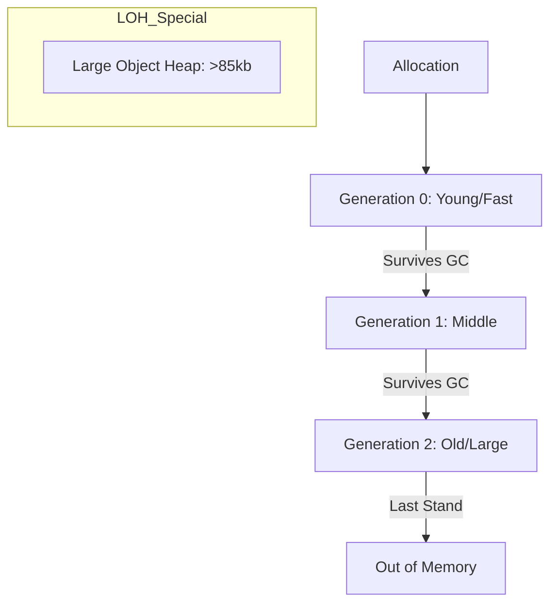

# Stack vs Heap & Memory Management: Systems Engineering for High Scale

============================================================
0. Architectural Vision: The Physical Reality of Data
============================================================
- **Memory is a Finite Resource.** Every byte allocated must be tracked, managed, and eventually reclaimed.
- **The Stack (Fast and Local):** Used for local variables and execution flow. Automatic reclamation, ultra-fast access, but very small (1MB per thread).
- **The Heap (Scalable and Global):** Used for objects and large data sets. Managed by the Garbage Collector (GC), allows for long lifetimes, but carries "GC Pause" risks.
- **The Value vs Reference Divide.** At architect depth, the choice between `struct` (Stack) and `class` (Heap) is a decision about memory pressure and GC frequency.
- **Modern .NET 8 Optimizations.** Features like `Span<T>`, `Memory<T>`, and `ref struct` allow for "Zero-Allocation" code, bringing C#-like productivity with C++-like memory speed.
- **Architect's View.** We design systems to minimize Gen-0 allocations in the "Hot Path" to ensure low-latency and high-throughput reliability.

============================================================
1. Foundational Problem: The Tax of the Garbage Collector
============================================================
- **Real-World Impact:** A high-frequency trading app experiences a "GC Stutter". The system freezes for 100ms to clean the heap, causing millions of dollars in missed trades.
- **What breaks?** "Memory Leaks" (objects staying alive on the heap forever) and "Fragmentation" (heap becoming a 'Swiss Cheese' of unusable small holes).
- **Scale Boundary:** At 1,000 RPS, GC pauses go unnoticed. At 1,000,000 RPS, every Gen 0 allocation is a direct threat to the system's P99 latency.
- **Failure Story:** A major cloud provider's API gateway was crashing once a day. The root cause was a "Heap Leak" in a logging module that was capturing long-lived references to small strings. Over 24 hours, the Heap grew until the process hit the 8GB RAM limit. Understanding **Generation 2 (LOH)** promotion was the only way to solve this.

============================================================
2. Internal System Mechanics: Generations and Allocations
============================================================

### The Managed Heap (three Generations)
.NET uses a generational GC to optimize for the "Infant Mortality" hypothesis: most objects die young.



### Performance Characteristics
- **Stack Access:** Single CPU instruction to move the stack pointer. Essentially zero cost.
- **Heap Allocation:** Involves searching for space and potential GC triggering.
- **GC Pauses:** Gen 0 is fast (< 1ms); Gen 2 is slow (> 100ms) and can be "Stop the World".

============================================================
3. Production Engineering in .NET 8
============================================================

### Anti-Pattern: Primitive Over-Allocation (The "String" Trap)
```csharp
public void Log(string msg) {
    // String concat in a loop = Heap death by a thousand cuts
    var final = "";
    for(int i=0; i<100; i++) final += msg[i]; 
}
```

### Production-Ready Implementation: Zero-Allocation and Pooling
```csharp
// 1. Use Structs for small, short-lived data (Stack)
public readonly record struct Point(int X, int Y);

// 2. Use Span<T> for memory-safe slice access (Stack)
public void Process(ReadOnlySpan<byte> data) {
    // No new heap allocations for slicing!
    var header = data.Slice(0, 10); 
}

// 3. Use ArrayPool for Large, Temporary Buffers (Reusing Heap)
public void LargeProcess() {
    byte[] buffer = ArrayPool<byte>.Shared.Rent(MAX_SIZE);
    try {
        // ... work ...
    } finally {
        ArrayPool<byte>.Shared.Return(buffer); // Save the GC from Gen 2 work
    }
}
```

**System Integration:**
- **Pinning:** Using `fixed` to prevent the GC from moving an object while native code is reading it.
- **GC Modes:** Workstation (Low memory) vs Server (High throughput, multi-threaded GC).

============================================================
4. System Interaction & Flow (ASCII Architecture)
============================================================

                ┌──────────────────┐
                │   The Thread     │ (The Executor)
                └────────┬─────────┘
          ┌──────────────▼──────────────┐
          │     The Stack (LIFO)        │ (Local/Temporary)
          │ [Vars] [Pointers] [Flow]    │
          └──────────────┬──────────────┘
                         │ 1. Allocate Object
          ┌──────────────▼─────────────┐
          │      The Heap (Managed)     │ (Global/Long-lived)
          │  ┌─────────┐   ┌─────────┐  │
          │  │ Gen 0   │ → │ Gen 2   │  │
          │  └────┬────┘   └────┬────┘  │
          └───────┼─────────────┼───────┘
                  │             │ 2. GC Cleanup
          ┌───────▼─────────────▼───────┐
          │     System Memory RAM       │
          └─────────────────────────────┘

============================================================
5. Strategic Scaling & System Evolution
============================================================
- **Memory Footprint:** Lower memory footprint per request = higher density (more requests per server) = lower cloud costs.
- **Stability:** Predictable memory usage is the key to a stable production environment. "Spiky" memory leads to unpredictable crashes.
- **Containerization:** In Docker/K8s, you MUST tune the `.NET GC` to respect the container's memory limits, or the kernel will OOM-Kill the process.

============================================================
6. Reliability, Observability & Runtime Governance
============================================================
- **Key Metrics:**
    - `% Time in GC`: Should be < 5% for a healthy high-throughput system.
    - `Allocation Rate (Bytes/sec)`: Gen 0 health.
- **Tools:** Use **dotMemory**, **Visual Studio Memory Profiler**, or **dotnet-counters** to monitor heap health in real-time.

============================================================
7. Compromises, Tradeoffs & Alternatives
============================================================
- **Allocation-Free vs Readability.** Writing allocation-free code (using `Span`, `ref struct`, etc.) is harder and more complex. Only do it for "Hot Paths."
- **Small Object Heap (SOH) vs Large Object Heap (LOH).** Understanding the 85,000-byte boundary is critical for preventing LOH fragmentation.

============================================================
8. Security Posture & Risk Mitigation
============================================================
- **Memory Scraping.** Sensitive data in memory (unencrypted strings) can be read if an attacker gains access to a memory dump.
- **SecureString:** A (now largely deprecated) concept for protecting secrets. Modern advice is to use `Span<byte>` and clear it immediately after use.

============================================================
9. Technical Edge Cases & System Failure Modes
============================================================
- **Finalizers:** Objects with Finalizers stay alive for TWO GC cycles, causing them to be promoted to Gen 1 or 2 prematurely. Use `IDisposable` instead.
- **Static Collections:** A static list that grows forever is the #1 cause of "Slow Memory Leaks".

============================================================
10. Architectural Assessment & Career Progression
============================================================
- **Senior:** "Primitive types stay on the stack; classes go to the heap." (Partially true).
- **Principal:** "Memory management is a game of probability and pressure. We design our 'Hot Path' to be Stack-Heavy and Allocation-Lite to minimize GC interference. We treat the Managed Heap as a strategic asset for long-lived system state, but we apply 'Rigid Governance' to ensure that Generation 2 never becomes a graveyard of leaked objects."
- **Interview Strategy:** Explain how you used `ArrayPool` or `Span` to solve a performance bottleneck.

============================================================
11. Real-World Case Study: High-Scale Image Transformer
============================================================
**Scenario:** A CDN transforming 10,000 images per minute.
- **The Problem:** The system was crashing with OOM every 2 hours.
- **The Investigation:** Every image was being loaded as a `byte[]` onto the LOH (Large Object Heap). This caused massive fragmentation.
- **The Fix:** Switched to a **Streaming Architecture** using `ArrayPool` and `Span<byte>` to process images in chunks.
- **Result:** Memory usage stabilized at 200MB (down from 8GB), and the system ran indefinitely without a single crash.

============================================================
12. Structural Dependencies & Learning Path
============================================================
- **Foundations:** Pointers, References, Garbage Collection.
- **Future Steps:** Low-Level performance tuning, Native AOT.
- **Integration Points:** ASP.NET Core `PipeReader/PipeWriter`, `Span` and `Memory` APIs in System.Memory.
