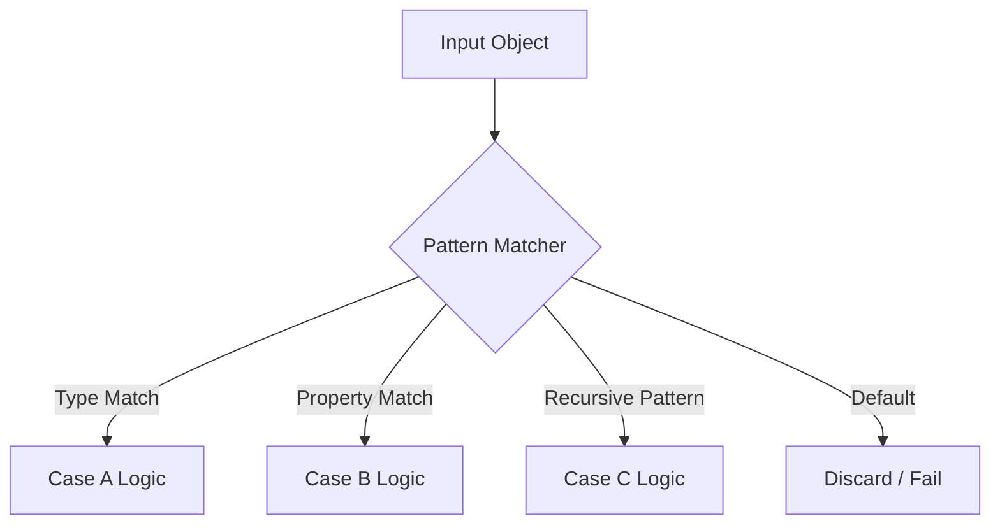

# Pattern Matching & Exceptions: Mastering Control Flow and Resilience

============================================================
0. Architectural Vision: The Flow of Intention and Failure
============================================================
- **Pattern Matching is Declarative Branching.** It allows the code to clarify "What is this?" rather than "How do I check this?".
- **Exception Handling is the System's Immune System.** It manages unexpected failures while keeping the main "Happy Path" clean and readable.
- **Fail-Fast vs Recoverable Failures.** At architect depth, we use pattern matching to handle expected variations and exceptions to handle truly "Exceptional" (unexpected) states.
- **Switch Expressions (C# 8+).** Transform complex `if/else` logic into concise, functional-style mappings.
- **Advanced Exception Architecture.** Moving away from generic `catch(Exception)` towards specific, domain-aware error handling.
- **Architect's View.** We use pattern matching to master **Domain Complexity** and exception handling to master **Operational Uncertainty**.

============================================================
1. Foundational Problem: The "Spaghetti Branching" Trap
============================================================
- **Real-World Impact:** You have a "Payment Processor" that handles 50 different payment methods. Using nested `if/else` blocks leads to a 2,000-line method that no one dares to touch.
- **What breaks?** "Logic Leakage" and "Swallowed Errors". An `if` statement misses a condition, and the system fails silently. A generic `catch` block swallows a critical database error, making debugging impossible.
- **Scale Boundary:** In high-scale systems, the performance cost of throwing an exception (unwinding the stack) is massive. Exceptions should NEVER be used for normal control flow.
- **Failure Story:** A major airlines reservation system crashed during a holiday peak. The root cause was an exception being thrown for a "Seat Taken" scenario—a perfectly normal occurrence. At 10,000 requests per second, the overhead of creating 10,000 stack traces per second caused the CPU to hit 100%, taking the whole system down. Pattern matching could have handled this as a simple data check.

============================================================
2. Internal System Mechanics: Patterns and The Exception Stack
============================================================

### Pattern Matching Performance
The C# compiler optimizes switch expressions into high-performance "Jump Tables" or "Binary Search" trees, making them much faster than a long chain of `if/else`.



### The Cost of an Exception
Throwing an exception involves:
1. Capturing the current **Stack Trace**.
2. Unwinding the stack (cleaning up local variables).
3. Searching for a matching `catch` block (up the call stack).
4. Running `finally` blocks.
**Result:** Throwing one exception can be 1,000x slower than a simple `return`.

============================================================
3. Production Engineering in .NET 8
============================================================

### Anti-Pattern: Exceptions for Control Flow
```csharp
public void Process(int id) {
    try {
        var user = GetUser(id); // Throws UserNotFoundException
    } catch (UserNotFoundException) {
        // This is TERRIBLE performance-wise
    }
}
```

### Production-Ready Implementation: Pattern Matching + Result Pattern
```csharp
// 1. Functional Pattern Matching
public decimal GetDiscount(Customer customer) => customer switch
{
    { IsGold: true } => 0.20m,
    { YearsActive: > 5 } => 0.15m,
    { Name: "PremiumUser" } => 0.25m,
    _ => 0m // Always include a default
};

// 2. The "Result" Pattern (Avoids Exceptions for expected errors)
public record Result<T>(T? Value, string? Error, bool Success);

public Result<User> GetUser(int id) {
    if (id < 0) return new Result<User>(null, "Invalid ID", false);
    // ...
}
```

**System Integration:**
- **App Filters:** Use ASP.NET Core `ExceptionFilters` to handle global errors for logging and consistent API responses (e.g., returning RFC 7807 "Problem Details").
- **Recursive Patterns:** Match on the shape of nested objects (e.g., `o is { ShippingAddress: { Country: "UK" } }`).

============================================================
4. System Interaction & Flow (ASCII Architecture)
============================================================

                ┌──────────────────┐
                │   The Request    │ (Input Data)
                └────────┬─────────┘
                         │ 1. Direct Pattern Match
         ┌───────────────▼───────────────┐
         │     The Logic Layer           │ (The Stable Core)
         │  ┌─────────┐   ┌─────────┐    │
         │  │ Match 1 │ → │ Result  │    │
         │  │ (Safe)  │   │ Object  │    │
         │  └────┬────┘   └────┬────┘    │
         └───────┼─────────────┼─────────┘
                 │             │ 2. Catch (Exceptional Fallback)
         ┌───────▼─────────────▼─────────┐
         │     Global Error Handler      │ (Final Safety Net)
         └───────────────┬───────────────┘
                         │ 3. Log / Map to HTTP
               ┌─────────▼─────────┐
               │  Consensus Response│ (e.g. 400 or 500)
               └───────────────────┘

============================================================
5. Strategic Scaling & System Evolution
============================================================
- **Throughput:** By replacing "Flow-Control Exceptions" with pattern matching and Result objects, you can increase system RPS by 5-10% in complex logic scenarios.
- **Maintainability:** Pattern matching makes the "Decision Tree" of the business logic visible and easier to audit for missing cases.
- **Distributed Failure:** In microservices, exceptions should stay local. Cross-service errors should be handled via status codes or "Error Events" in a message bus.

============================================================
6. Reliability, Observability & Runtime Governance
============================================================
- **Key Metrics:**
    - `Exception Frequency`: Use a dashboard to monitor the rate of different exception types. A spike in "ValidationException" is a bug in the client; a spike in "SqlException" is a infrastructure failure.
- **Observability:** Use **Structured Logging** to capture the original exception details (message, stack, InnerException) without losing context.

============================================================
7. Compromises, Tradeoffs & Alternatives
============================================================
- **Readability vs Performance.** For extremely simple checks, a classic `if` might be more readable for juniors than a complex recursive pattern.
- **Tuple Matching.** Matching on multiple variables at once (`(status, role) switch ...`).

============================================================
8. Security Posture & Risk Mitigation
============================================================
- **Information Leakage.** Never return a raw Exception message to the client. It might contain table names, server paths, or internal logic details (e.g., "Field 'Password' cannot be null").
- **Exhaustive Matching.** Ensure your pattern matching covers all possible states so you don't fall into a default "No-op" state that bypasses security checks.

============================================================
9. Technical Edge Cases & System Failure Modes
============================================================
- **The 'Finally' Guarantee.** Remember that `finally` blocks execute even if a `return` or `throw` happens, making them essential for resource cleanup (DB connections, File handles).
- **Matching on 'Type' vs 'Value'.** Be careful not to match on a high-level base type and miss a more specific child-type logic.

============================================================
10. Architectural Assessment & Career Progression
============================================================
- **Senior:** "Patterns are better than if/else; don't use catch(Exception)."
- **Principal:** "Pattern matching is a tool for mastering algebraic data types and domain variety with formal rigor. Exception handling is a strategic discipline for managing the 'Radius of Impact' of a failure. We use patterns to define the known world and exceptions to guard against the unknown, ensuring the system remains both expressive and resilient under stress."
- **Interview Strategy:** Explain how to implement a "Retry Policy" or "Circuit Breaker" using exception catching patterns.

============================================================
11. Real-World Case Study: High-Performance Routing Engine
============================================================
**Scenario:** A cloud router handling 10M packets per second.
- **The Problem:** The "Rule Engine" used a series of `if` statements. Adding new rules caused a linear drop in performance.
- **The Design:** Refactored the rules into a **Static Switch Expression**. 
- **Result:** Performance became O(1) (consistent regardless of rule count) because the compiler converted the pattern match into a direct memory jump table.

============================================================
12. Structural Dependencies & Learning Path
============================================================
- **Foundations:** If/Else, Try/Catch, Null checks.
- **Future Steps:** Functional error handling (Maybe/Either monads), Resilience Patterns (Polly).
- **Integration Points:** API Middleware, Database Drivers, Validation Frameworks (FluentValidation).
