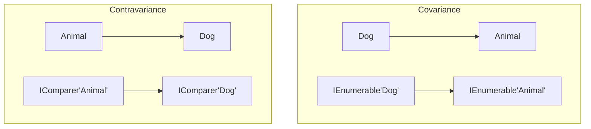

# Covariance & Contravariance: Mastering Generic Type Relationships

============================================================
0. Architectural Vision: The Geometry of Subtyping
============================================================
- **Variance is about Type Substitutability.** It defines whether you can use a more derived type (Covariance) or a more base type (Contravariance) than originally specified.
- **Covariance (`out`):** Preserves assignment compatibility. (e.g., `IEnumerable<Dog>` is an `IEnumerable<Animal>`).
- **Contravariance (`in`):** Reverses assignment compatibility. (e.g., `IComparer<Animal>` is an `IComparer<Dog>`).
- **Invariance:** No substitution allowed. (e.g., `List<Dog>` is NOT a `List<Animal>`).
- **Safety first.** Variance is only allowed for interface and delegate parameters where it can be proven safe (i.e., data only flows "out" or only flows "in").
- **Architect's View.** We use variance to build flexible, polymorphic APIs that can handle hierarchies of data without manual casting or duplication.

============================================================
1. Foundational Problem: The Rigidity of Generics
============================================================
- **Real-World Impact:** You have a method that processes a `List<Animal>`. You try to pass a `List<Dog>`. Even though a Dog is an Animal, the compiler rejects it. Why? Because the method might try to add a `Cat` to that list, corrupting the `Dog` array.
- **What breaks?** "The Cast Bridge". Developers write manual loops to copy `List<Dog>` to `List<Animal>`, wasting CPU and memory, or they use `dynamic` and lose all safety.
- **Scale Boundary:** In massive plug-in architectures, strictly invariant generics force every plug-in to use the exact same base type, making it impossible to evolve the system's inheritance model independently.
- **Failure Story:** A large logistics system had an `IPipeline<T>` interface. Both `Truck` and `Plane` inherited from `Vehicle`. Because `IPipeline` was invariant, they had to write a separate `TruckPipeline` and `PlanePipeline`. When they added `Ship`, they had to duplicate 90% of the code. Using **Contravariance** on the pipeline input would have allowed a single `IPipeline<Vehicle>` to handle all types safely.

============================================================
2. Internal System Mechanics: In vs Out logic
============================================================

### The "In" and "Out" Rules
- **`out T` (Covariant):** `T` can only be used as a **return value**. It "flows out".
- **`in T` (Contravariant):** `T` can only be used as a **parameter**. It "flows in".



### Performance Characteristics
- **Zero Runtime Cost:** Variance is a compile-time and metadata concept. There is no performance penalty for using `out` or `in` at runtime.
- **Type Safety Checks:** The CLR enforces these rules strictly during JIT compilation to ensure memory safety.

============================================================
3. Production Engineering in .NET 8
============================================================

### Anti-Pattern: The Invariant Collection Trap
```csharp
public void Process(List<Animal> animals) { /* ... */ }
// Calling with List<Dog> will FAIL to compile.
```

### Production-Ready Implementation: Using Variance for Flexibility
```csharp
// 1. Covariant Interface (out) - Producing results
public interface IProducer<out T> 
{
    T Create(); // T flows OUT
}

// 2. Contravariant Interface (in) - Consuming results
public interface IConsumer<in T>
{
    void Process(T item); // T flows IN
}

// 3. Usage in a polymorphic system
IProducer<Dog> dogProducer = ...;
IProducer<Animal> animalProducer = dogProducer; // Safe! Coworkers don't care if it's a Dog or Animal.

IConsumer<Animal> animalConsumer = ...;
IConsumer<Dog> dogConsumer = animalConsumer; // Safe! An animal consumer can handle a dog.
```

**System Integration:**
- **LINQ:** Many native interfaces like `IEnumerable<out T>` and `IQueryable<out T>` are covariant.
- **Delegates:** `Func<out T>` is covariant; `Action<in T>` is contravariant.

============================================================
4. System Interaction & Flow (ASCII Architecture)
============================================================

                ┌──────────────────┐
                │   The Client     │ (Caller)
                └────────┬─────────┘
                         │ 1. Pass Subtype
         ┌───────────────▼───────────────┐
         │     Variance Validator        │ (The Compiler)
         │  ┌─────────┐   ┌─────────┐    │
         │  │ Is 'in'?│ → │ Consumed│    │
         │  │ Is 'out'?│ → │ Produced│    │
         │  └────┬────┘   └────┬────┘    │
         └───────┼─────────────┼─────────┘
                 │             │ 2. Safe Execution
         ┌───────▼─────────────▼─────────┐
         │      Generic Processor        │ (The polymorphic engine)
         └───────────────┬───────────────┘
                         │ 3. Return Result
               ┌─────────▼─────────┐
               │    Expected Base  │
               └───────────────────┘

============================================================
5. Strategic Scaling & System Evolution
============================================================
- **API Stability:** By using variant interfaces, you can return a more specific type in a future version of your API without breaking existing clients who expect the base type.
- **Middleware:** Variant delegates allow a single "Error Handler" (e.g., `Action<Exception>`) to handle specific exceptions (e.g., `Action<SqlException>`).

============================================================
6. Reliability, Observability & Runtime Governance
============================================================
- **Key Metrics:**
    - `Cast Complexity`: Use tools like **NDepend** to find high counts of manual `(Type)` casting which could be resolved by proper variance design.
- **Observability:** Compile-time errors are our primary "governance" tool here. If it doesn't compile, it's unsafe.

============================================================
7. Compromises, Tradeoffs & Alternatives
============================================================
- **Array Variance (The Legacy Trap).** C# arrays are covariant (`Animal[] a = new Dog[10]`), but this is **Runtime Unsafe**. Assigning `a[0] = new Cat()` will throw an exception at runtime. Avoid this!
- **Value Types.** Variance is NOT supported for value types (int, struct) due to different memory sizes. `IEnumerable<int>` is NOT `IEnumerable<object>`.

============================================================
8. Security Posture & Risk Mitigation
============================================================
- **Type Bypass.** Variance ensures that an object cannot "lie" about its origin in a way that breaks memory safety, preventing heap corruption attacks that rely on type mismatches.

============================================================
9. Technical Edge Cases & System Failure Modes
============================================================
- **Unsafe Variance in Classes.** Classes cannot be variant. Only interfaces and delegates can.
- **Multiple Variance.** An interface can have both `in` and `out` parameters: `interface ITransformer<in TIn, out TOut>`.

============================================================
10. Architectural Assessment & Career Progression
============================================================
- **Senior:** "Variance is about using out and in in generics."
- **Principal:** "Variance is the formal logic of type hierarchy relationships across generic boundaries. It allows us to build 'Future-Proof' APIs that respect the laws of set theory while maximizing polymorphic reuse. We use Covariance to safely produce facts and Contravariance to safely consume behaviors, ensuring our system remains vertically flexible and horizontally stable."
- **Interview Strategy:** Explain why `List<T>` is invariant but `IEnumerable<T>` is covariant.

============================================================
11. Real-World Case Study: Global Event Bus
============================================================
**Scenario:** A financial system with millions of events (`TradeEvent`, `AuditEvent`, each inheriting from `BaseEvent`).
- **The Problem:** The "Event Handler Registry" couldn't handle specific handlers. You couldn't register an `IHandler<TradeEvent>` in the legacy list of `IHandler<BaseEvent>`.
- **The Design:** Made `IHandler<in T>` contravariant. 
- **Result:** A single generic `Registry` could now store both specific and general handlers, allowing the system to route events to the most specific matching handler with zero manual casting or `if/else` logic.

============================================================
12. Structural Dependencies & Learning Path
============================================================
- **Foundations:** Inheritance, Generics, C# Syntax.
- **Future Steps:** Advanced Type Theory, Functional Composition.
- **Integration Points:** MediatR (notification handlers), Dependency Injection (contravariant registration).
