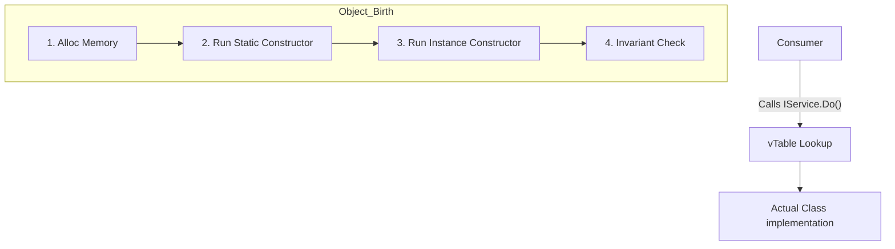

# Constructors & Interfaces: Object Lifecycle and Architectural Contracts

============================================================
0. Architectural Vision: The Birth and The Promise
============================================================
- **Constructors are Gatekeepers.** They ensure that an object is born in a valid, "Invariant-Safe" state.
- **Interfaces are Treaties.** They define the "Behavioral Contract" between two modules without exposing internal state.
- **The "No Partial Initialization" Rule.** An object should be fully ready to use once the constructor returns.
- **Primary Constructors (C# 12).** Modern .NET simplifies boilerplate, making it easier to declare dependencies and immutability in one line.
- **Default Interface Members (C# 8+).** Allow interfaces to evolve without breaking all implementers, mimicking a "Trait" system.
- **Architect's View.** We use Constructors to master **Integrity** and Interfaces to master **Decoupling**.

============================================================
1. Foundational Problem: The "Limping Object" Syndrome
============================================================
- **Real-World Impact:** An object is created with a default constructor, and then its properties are set one by one. If a thread accesses the object before all properties are set, it sees a corrupted state.
- **What breaks?** "The Null Reference Bomb". You forget to set a required dependency, and the system crashes 10 minutes later deep in the business logic.
- **Scale Boundary:** In massive DI (Dependency Injection) containers, "Constructor Bloat" (passing 20 arguments) makes the system hard to test and maintain.
- **Failure Story:** A large ERP system used "Properties for Injection". During a high-load event, the DI container failed to set one property due to a circular dependency. The system didn't catch the error during object creation. It failed 4 hours later during a "Year-End Closing" job, corrupting thousands of ledger entries because the object "limped" along with a missing database connection. Using **Constructor Injection** would have caught the error at startup.

============================================================
2. Internal System Mechanics: vTables and Lifecycle
============================================================

### The vTable (Virtual Method Table)
When a class implements an interface, the runtime creates a vTable—a lookup table that maps the interface method to the class's specific implementation.



### Performance Characteristics
- **Allocation:** Constructors allocate memory on the heap. Primary constructors don't change this, but they simplify the code paths.
- **Interface Dispatch:** Calling a method through an interface is a "Double Indirection" (lookup the object's type, then lookup the vTable), which is slightly slower than a direct method call. (Optimized by modern JIT).

============================================================
3. Production Engineering in .NET 8
============================================================

### Anti-Pattern: The Empty/Leaky Constructor
```csharp
public class Order {
    public Order() { } // Empty: allows invalid state
    public decimal Total { get; set; }
}
```

### Production-Ready Implementation: Primary Constructors & Strict Contracts
```csharp
// 1. Primary Constructor (C# 12) - Enforcing dependencies immediately
public class OrderProcessor(IRepository repository, ILogger logger) : IProcessor
{
    // 2. Invariant Check
    private readonly IRepository _repository = repository ?? throw new ArgumentNullException(nameof(repository));

    // 3. Interface with Default Member (Trait)
    public interface IProcessor {
        void Process();
        void LogSuccess() => Console.WriteLine("Finished!"); // Default implementation
    }

    public void Process() {
        _repository.Get();
    }
}
```

**System Integration:**
- **DI Containers:** .NET Core's built-in DI favors constructor injection.
- **Abstract Factories:** Used when you need to pass "Runtime Arguments" to a constructor that also has "Service Dependencies".

============================================================
4. System Interaction & Flow (ASCII Architecture)
============================================================

                ┌──────────────────┐
                │   DI Container   │ (The Registry)
                └────────┬─────────┘
                         │ 1. Resolve Dependencies
         ┌───────────────▼───────────────┐
         │     THE CONSTRUCTOR           │ (The Validator)
         │  ┌─────────┐   ┌─────────┐    │
         │  │ Assign  │ → │ Verify  │    │
         │  │ Props   │   │ Invar.  │    │
         │  └────┬────┘   └────┬────┘    │
         └───────┼─────────────┼─────────┘
                 │             │ 2. Ready for Work
         ┌───────▼─────────────▼─────────┐
         │      CLEAN INTERFACE          │ (The Contract)
         └───────────────┬───────────────┘
                         │ 3. Execute Method
               ┌─────────▼─────────┐
               │    System State   │
               └───────────────────┘

============================================================
5. Strategic Scaling & System Evolution
============================================================
- **Evolvability:** Default Interface members allow you to add "Optional Features" to a service interface without forcing a rewrite of all 50 existing microservices.
- **Testing:** Interfaces are the primary tool for **Mocking**. You cannot mock a class effectively without an interface (unless using virtual methods).
- **Versioning:** Constructors should stay stable. If you need to add a dependency, consider a **Builder Pattern** or **Settings Object** rather than breaking the constructor signature.

============================================================
6. Reliability, Observability & Runtime Governance
============================================================
- **Key Metrics:**
    - `DI Resolution Time`: How long does it take to build the object graph at startup?
- **Observability:** Log the successful initialization of core architectural services. If a constructor fails, it should throw a "Fatal" exception that stops the service.

============================================================
7. Compromises, Tradeoffs & Alternatives
============================================================
- **Constructors vs Init-Only properties.** Use `init` for DTOs; use Constructors for Business Logic objects.
- **Interface vs Abstract Class.** Interfaces = "Can do" (Behavior); Abstract Classes = "Is a" (Generic essence).

============================================================
8. Security Posture & Risk Mitigation
============================================================
- **Injection Safety.** Constructors prevent "Partial State" objects from reaching sensitive business logic (e.g., an `Order` without a `User`).
- **Internal Constructors.** Use `internal` to prevent external assemblies from creating an object that should only be generated by a specific "Factory".

============================================================
9. Technical Edge Cases & System Failure Modes
============================================================
- **Static Constructors.** These are guaranteed to run exactly once before the first use of the type, but if they fail, the type becomes "Dead" and unusable for the life of the process.
- **Recursive DI.** When `A` needs `B`, and `B` needs `A`. (Constructor injection will fail here, alerting you to a bad design).

============================================================
10. Architectural Assessment & Career Progression
============================================================
- **Senior:** "Constructors are for initializing variables."
- **Principal:** "The constructor is the fundamental 'Invariant Guard' of the system's memory. The interface is the 'Logical Perimeter'. By combining strict constructor injection with lean interfaces, we build systems that are 'Secure by Design' and 'Flexible by Archetype', ensuring that every object in the system is always in a known, valid, and traceable state."
- **Interview Strategy:** Discuss the trade-offs of using Primary Constructors in domain models vs infrastructure services.

============================================================
11. Real-World Case Study: Global Inventory Update
============================================================
**Scenario:** A warehouse system where `StockUpdate` objects were created via properties.
- **The Problem:** Developers forgot to set the `WarehouseId` in 10% of the cases, leading to inventory being "lost" in a global null-bucket.
- **The Design:** Enforced a **Primary Constructor** that REQUIRED `WarehouseId`, `Sku`, and `Quantity`.
- **Result:** Invalid stock updates dropped to zero. Any developer trying to create a "Broken" update was blocked by the compiler immediately.

============================================================
12. Structural Dependencies & Learning Path
============================================================
- **Foundations:** Classes, Interfaces, Inheritance.
- **Future Steps:** Dependency Injection mastery, Clean Architecture, Design Patterns (Factory/Builder).
- **Integration Points:** Microsoft.Extensions.DependencyInjection, AutoFac, Moq/NSubstitute.
