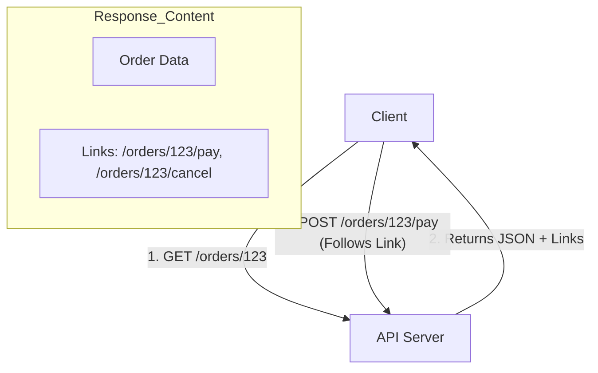

# RESTful API Design: Principles of Resource-Oriented Architecture

**0. Architectural Vision: The Web as a Distributed Machine**
- **REST is not a Protocol; it's an Architectural Style.** It leverages the existing semantics of HTTP to build decoupled, scalable, and cacheable systems.
- **Resource-Oriented Modeling.** Every "Thing" in your system is a resource with a unique URI.
- **Uniform Interface.** Using standard HTTP verbs (GET, POST, PUT, DELETE) and status codes (2xx, 4xx, 5xx) to provide a predictable API surface.
- **Statelessness.** Each request contains all information necessary to process it. This is the "Silver Bullet" for horizontal scaling (1M+ RPS).
- **HATEOAS (Hypermedia as the Engine of Application State).** Providing links to discover what a client can do next, decoupling the client from the server's URI structure.
- **Architect's View.** We don't just "build endpoints"; we design **Resource Life-Cycles** and **State Transitions** that align with business goals and infrastructure constraints.

**1. Foundational Problem: The "Endpoint Spaghetti" Mess**
- **Real-World Impact:** You have an API where `POST /UpdateUser` performs an update, but `GET /GetUserById?id=123` returns data. The API is a messy collection of RPC (Remote Procedure Call) endpoints.
- **What breaks?** "Client Fragility". If the server changes a URI, every client breaks. Performance is low because standard HTTP caches (CDNs/Varnish) don't understand custom RPC semantics.
- **Scale Boundary:** In a massive microservices ecosystem, if every service has a different "Custom" API style, integration costs skyrocket, and global observability becomes an nightmare.
- **Failure Story:** A major e-commerce platform's "Inventory Check" API used `POST` for reads because they wanted to send complex filter objects in the body. Because it was a `POST`, it couldn't be cached at the CDN edge. During a flash sale, their database was crushed by 100,000 requests per second that *should* have been cached at the edge. Moving to a RESTful `GET` with query parameters allowed the CDN to absorb 99% of the traffic.

**2. Internal System Mechanics: Constraints and Semantics**

### The Richardson Maturity Model
Architects measure "RESTfulness" 0 to 3.
- **Level 1 (Resources):** Moving from RPC to specific resource URIs.
- **Level 2 (HTTP Verbs):** Correct use of GET/POST/PUT/DELETE.
- **Level 3 (HATEOAS):** Discoverability via hypermedia links.



### Performance & Caching Characteristics
- **Idempotency:** `PUT` and `DELETE` are idempotent (can be called multiple times with the same result). `GET` is safe (read-only).
- **Conditional Requests:** Using `ETag` and `If-None-Match` to avoid re-sending data that hasn't changed, saving massive bandwidth.

**3. Production Engineering in .NET 8 (ASP.NET Core)**

### Anti-Pattern: Primitive RPC-style in C#
```csharp
[HttpPost("UpdateCustomerName")] // Bad: RPC style, not resource-oriented
public IActionResult Update(int id, string name) { ... }
```

### Production-Ready Implementation: Resource-Oriented Design
```csharp
[ApiController]
[Route("api/[controller]")]
public class CustomersController : ControllerBase
{
    // 1. Uniform Interface (GET)
    [HttpGet("{id}")]
    [ResponseCache(Duration = 60)] // Cacheable at the Edge
    public async Task<ActionResult<CustomerDto>> Get(int id) { ... }

    // 2. Idempotent Update (PUT)
    [HttpPut("{id}")]
    public async Task<IActionResult> Put(int id, [FromBody] UpdateCustomerRequest request) { ... }

    // 3. Status Code Precision
    [HttpPost]
    public async Task<CreatedAtActionResult> Post([FromBody] CreateCustomerRequest request)
    {
        var customer = await _service.Create(request);
        // Returns 201 Created with Location header
        return CreatedAtAction(nameof(Get), new { id = customer.Id }, customer);
    }
}
```

**Architecture Strategy:** 
- Use **RFC 7807 (Problem Details)** for consistent error reporting.
- Implement **Global Content Negotiation** (JSON, XML, Protobuf).

**4. System Interaction & Flow (ASCII Architecture)**

                ┌──────────────────┐
                │   The Client     │ (Browser/Mobile/Service)
                └────────┬─────────┘
                         │ 1. HTTP Verb + URI (Resource)
         ┌───────────────▼───────────────┐
         │     The API Gateway / CDN     │ (Caching & Security Boundary)
         │  ┌─────────┐   ┌─────────┐    │
         │  │ Cache ? │ → │ Reject? │    │
         │  └────┬────┘   └────┬────┘    │
         └───────┼─────────────┼─────────┘
                 │             │ 2. Process (Stateless)
         ┌───────▼─────────────▼─────────┐
         │     ASP.NET Core Controller   │ (Resource Handler)
         └───────────────┬───────────────┘
                         │ 3. Return Representation (JSON + Links)
               ┌─────────▼─────────┐
               │   Status + Body   │
               └───────────────────┘

**5. Strategic Scaling & System Evolution**
- **Evolvability.** By using HATEOAS and careful resource modeling, you can change your internal storage and server URIs without breaking well-behaved clients.
- **Horizontal Scaling.** Because REST is stateless, requests from the same user can be handled by 5,000 different servers in a cluster without any "Session Sync" overhead.
- **Microservice Grain.** Proper REST modeling helps define the "Boundaries" of a microservice (e.g., the `Order` service shouldn't be updating `User` details).

**6. Reliability, Observability & Runtime Governance**
- **Key Metrics:**
    - `HTTP 5xx Rate`: Server errors.
    - `HTTP 429 Rate`: Clients hitting rate limits.
    - `Cache Hit Ratio`: How many GETs are stopped at the CDN?
- **Observability:** Use **OpenTelemetry** to trace requests across the API. Use **Swagger (OpenAPI)** as the source of truth for the API contract.

**7. Compromises, Tradeoffs & Alternatives**
- **REST vs GraphQL.** REST is better for caching and standardized tooling; GraphQL is better for complex, flexible UI queries.
- **REST vs gRPC.** REST is for the public web and heterogeneous clients; gRPC is for high-performance internal service-to-service communication.

**8. Security Posture & Risk Mitigation**
- **Authentication/Authorization.** Use **OAuth2/OpenID Connect** (Bearer Tokens) to keep the API stateless.
- **Input Validation.** Every resource creation/update must be strictly validated against a schema to prevent "Mass Assignment" attacks.

**9. Technical Edge Cases & System Failure Modes**
- **Breaking Changes.** Versioning is the hardest problem in REST.
    - *Architect's Rule:* Use **Header Versioning** (`Accept: application/vnd.myapi.v1+json`) or **URI Versioning** (`/v1/`). Never break the contract without a deprecation window.
- **Large Resources.** Use **Partial Response** (`?fields=id,name`) and **Pagination** (`?offset=20&limit=10`) to prevent memory/bandwidth exhaustion.

**10. Architectural Assessment & Career Progression**
- **Senior:** "REST is about using JSON and GET/POST."
- **Principal:** "REST is a set of constraints that harmonize a distributed system with the foundational architecture of the Internet. We design resource-oriented systems not just for connectivity, but for **Longevity**, **Observability**, and **Extreme Scale**. We treat the Uniform Interface as a sacred contract that enables independent evolution of the client and server."
- **Interview Strategy:** Discuss the difference between "Hypermedia" and just "Returning JSON." Explain how HATEOAS helps in a mature API ecosystem.

**11. Real-World Case Study: Global Flight Booking**
**Scenario:** A flight search engine with 5,000 agencies.
- **The Problem:** Each agency had a custom RPC API. Integrating a new agency took 3 months.
- **The Design:** Created a **Standardized RESTful Resource Model** (AirSearch, FlightOffer, Booking).
- **Result:** Integration time dropped to 2 weeks. The "FlightOffer" resource was made cacheable, reducing the load on agencies' systems by 70%.

**12. Structural Dependencies & Learning Path**
- **Foundations:** HTTP Protocol, JSON, Uri Modeling.
- **Future Steps:** GraphQL, gRPC, Event-Driven APIs (Webhooks).
- **Integration Points:** ASP.NET Core, Swashbuckle/Swagger, API Gateways (Envoy, YARP, Azure API Management).
