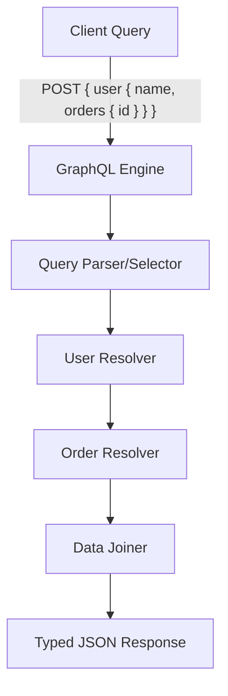

# GraphQL vs REST: Choosing the Right Interface Paradigm

============================================================
0. Architectural Vision: The Evolution of Data Procurement
============================================================
- **REST is Resource-Centric.** It exposes nouns (resources) and uses standard HTTP verbs. Great for caching and simple, predictable consumers.
- **GraphQL is Query-Centric.** It exposes a graph of data and lets the client dictate the response shape. Great for complex, heterogeneous front-ends.
- **The "Over-Fetching" and "Under-Fetching" Problems.** REST often sends too much data (over-fetching) or requires multiple calls (under-fetching). GraphQL solves this by allowing field selection and nested queries in one request.
- **Caching Tension.** REST has built-in HTTP caching support at the infrastructure level. GraphQL usually needs sophisticated application-level caching (like Apollo or Relay) because it uses `POST` for almost everything.
- **Architect's View.** We don't see them as enemies. We use REST for public, external, and cache-heavy APIs (e.g., a Flight Search API) and GraphQL for internal, high-speed, data-rich dashboards and mobile apps.

============================================================
1. Foundational Problem: The "N+1" and "Payload Bloat"
============================================================
- **Real-World Impact:** You are building a mobile dashboard. To show a user's name and their 10 recent orders, a REST API forces you to call `/users/1` then `/orders?userId=1`. This is "Under-fetching" and increases latency.
- **What breaks?** "The Mobile Latency Wall". On a 3G/4G network, every round-trip costs 100-200ms. 5 REST calls = 1 second of loading time before the user sees anything.
- **Scale Boundary:** As the number of fields in your database grows (e.g., from 10 to 100 columns), REST responses become huge ("Payload Bloat"), wasting bandwidth and CPU time in serialization/deserialization.
- **Failure Story:** A social media startup's feed took 5 seconds to load because the "Feed API" returned every single field of the "Post" object, including the full text of the 50 most recent comments, even though the mobile app only displayed the first 2. Moving to GraphQL allowed them to query *only* the `title`, `authorName`, and `commentCount`, reducing the response size by 90% and load time to 1 second.

============================================================
2. Internal System Mechanics: Resolvers and Schemas
============================================================

### GraphQL Execution Flow
In GraphQL, the server doesn't have "endpoints." It has a **Schema** (Type system) and **Resolvers** (Functions that fetch the data for specific fields).



### Performance & Caching Characteristics
- **The N+1 Resolver Problem.** If not handled, a GraphQL query for 10 users and their 10 orders can trigger 1 + 10 = 11 database queries.
    - *Architect's Fix:* Use **DataLoader** (Batching/Caching) to combine these 11 queries into 2.
- **Lack of CDN Caching.** Because GraphQL uses `POST` with a dynamic body, a standard CDN cannot cache the result by URI. You must use **Persisted Queries** or dedicated GraphQL CDNs.

============================================================
3. Production Engineering in .NET 8 (HotChocolate)
============================================================

### Anti-Pattern: Manual String-based JSON Parsing inside REST
```csharp
[HttpGet] // Trying to mimic GraphQL in REST (Complex and fragile)
public IActionResult Get(string fields) { ... }
```

### Production-Ready Implementation: HotChocolate GraphQL in .NET 8
```csharp
// 1. Define the Schema (Code-First)
public class Query
{
    [UseProjection] // Only fetches fields the client asked for
    [UseFiltering]  
    [UseSorting]
    public IQueryable<User> GetUsers([Service] MyDbContext context) 
        => context.Users;
}

// 2. Program.cs setup
builder.Services
    .AddGraphQLServer()
    .AddQueryType<Query>()
    .AddProjections()
    .AddFiltering()
    .AddSorting();
```

**Architecture Strategy:** 
- Use **Projections** to automatically map GraphQL field selections directly to Entity Framework `Select` statements, ensuring the DB only returns what is needed.
- Implement **Global Error Mapping** to capture resolver failures without crashing the whole query.

============================================================
4. System Interaction & Flow (ASCII Architecture)
============================================================

      REST (Resource Centric)               GRAPHQL (Query Centric)
      
          ┌─────────────┐                    ┌─────────────┐
          │   Client    │                    │   Client    │
          └─────┬───────┘                    └──────┬──────┘
                │ GET /orders/1                     │ POST { order { id } }
          ┌─────▼───────┐                    ┌──────▼──────┐
          │   CDN / L7  │ (Cached)           │  GQL Engine │ (Resolver Logic)
          └─────┬───────┘                    └──────┬──────┘
                │                                   │
          ┌─────▼───────┐                    ┌──────▼──────┐
          │ API Instance│                    │ API Instance│
          └─────────────┘                    └─────────────┘

============================================================
5. Strategic Scaling & System Evolution
============================================================
- **Backward Compatibility.** GraphQL makes versioning easier. You simply add a field. Old clients continue to fetch only the fields they know. No `/v2/` URI required.
- **Federation.** Allow multiple microservices to contribute to a single "Supergraph" (Apollo Federation style).
- **Public vs Private.** REST is often easier to expose to third parties because of the smaller security "Surface Area" and familiarity.

============================================================
6. Reliability, Observability & Runtime Governance
============================================================
- **Key Metrics:**
    - `Query Complexity`: Prevent denial-of-service by limiting how deep/large a query can be.
    - `Resolver Performance`: Monitor which specific field resolvers are slow.
- **Observability:** GraphQL provides **Field-Level Tracing**, giving you insights into exactly which data fetching paths are your bottleneck.

============================================================
7. Compromises, Tradeoffs & Alternatives
============================================================
- **Learning Curve.** GraphQL requires a different mental model and superior server-side engineering (DataLoaders, Schema Design).
- **Security.** In GraphQL, its easier for an attacker to craft a "Circular Query" (User -> Orders -> User -> Orders...) to crash your server if recursion limits aren't set.

============================================================
8. Security Posture & Risk Mitigation
============================================================
- **Introspection.** Disable Introspection (the ability to query the schema itself) in production so hackers can't easily discover your entire database structure.
- **Authorization.** Apply auth at the **Field Level** or **Type Level**, not just the endpoint level.

============================================================
9. Technical Edge Cases & System Failure Modes
============================================================
- **Batch Failure.** In a GraphQL query for 5 resources, one might fail.
    - *Architect's Rule:* GraphQL returns a partial result (the 4 successes) and an `errors` array for the 1 failure. Clients must be designed to handle "Partial Success".
- **Caching in Blazor/React.** Use `Urql`, `Relay`, or `Apollo` clients to manage local cache normalization.

============================================================
10. Architectural Assessment & Career Progression
============================================================
- **Senior:** "GraphQL is better because it prevents over-fetching."
- **Principal:** "Choosing between REST and GraphQL is a decision about where the 'Data Stewardship' resides. We use REST when we want strict server-side control and high cacheability. We use GraphQL when we want to empower the client to rapidly iterate on complex UI views without backend changes. A modern architect designs 'Poly-API' systems where the paradigm matches the consumer's needs."
- **Interview Strategy:** Compare and contrast the different approaches to API Caching and Versioning between the two.

============================================================
11. Real-World Case Study: Global News Platform
============================================================
**Scenario:** A news site with millions of articles and complex related-content (Authors, Photos, Tags).
- **The Problem:** Mobile app was sluggish because it had to make 10 REST calls to build the "Home Page" feed.
- **The Design:** Implemented a **GraphQL Gateway (BFF - Backend for Frontend)** on top of the existing REST microservices.
- **Result:** Mobile app load time went from 2.5s to 400ms. The backend teams could update microservices, and only the GraphQL Gateway resolvers needed slight updates.

============================================================
12. Structural Dependencies & Learning Path
============================================================
- **Foundations:** JSON, HTTP, SQL.
- **Future Steps:** HotChocolate (C#), Apollo Federation, DataLoader patterns.
- **Integration Points:** React/Vue/Angular, Mobile Apps, Entity Framework Core.
