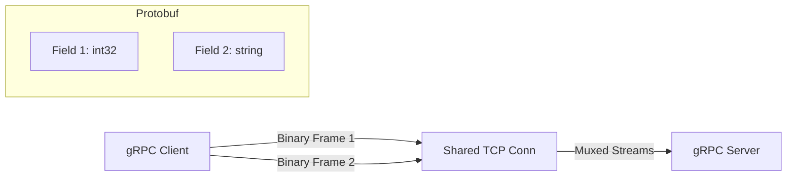

# gRPC & Protobuf: Engineering High-Performance Service-to-Service Communication

============================================================
0. Architectural Vision: The Speed of Binary
============================================================
- **gRPC is the Modern RPC.** It is contract-first, high-performance, and designed for microservices at scale.
- **Protobuf (Protocol Buffers)** is the binary serialization format. It is significantly smaller and faster than JSON/XML.
- **HTTP/2 by Default.** gRPC leverages HTTP/2 features like Multiplexing, Header Compression, and Bi-directional Streaming.
- **Strict Typing and Contract-First.** You define your service in a `.proto` file, and gRPC generates the C# code for you, ensuring the client and server are always in sync.
- **Efficiency.** At high scale, reducing the CPU time spent on serialization and the bandwidth spent on text-based data becomes a massive cost-saving measure.
- **Architect's View.** We use gRPC for internal "Back-end to Back-end" communication where speed and reliability are paramount, reserving REST/GraphQL for the public "Edges".

============================================================
1. Foundational Problem: The Text-Based Bottleneck
============================================================
- **Real-World Impact:** In a microservices mesh with 100+ services, every "Jump" between services using REST/JSON adds 10-20ms of serialization and parsing latency.
- **What breaks?** "The Distributed Latency Cascade". A single user request triggers 10 internal API calls. If each call adds 20ms of overhead, the user sees a 200ms delay just from "Talking".
- **Scale Boundary:** At 100k RPS, the CPU cost of parsing millions of JSON strings can exceed the cost of the actual business logic.
- **Failure Story:** A high-speed order matching engine was failing to meet its 50ms latency SLA. Investigation showed that 60% of the total request time was spent in `System.Text.Json` deserializing complex order objects across 3 internal services. Swapping the internal communication to gRPC reduced the internal latency by 80%, allowing the system to hit its SLA and double its throughput on the same hardware.

============================================================
2. Internal System Mechanics: HTTP/2 and Framing
============================================================

### Binary Framing & Multiplexing
Unlike HTTP/1.1 (one request per connection), HTTP/2 allows multiple concurrent requests ("Streams") over a single TCP connection, eliminating "Head-of-Line Blocking".



### Performance & Serialization Characteristics
- **Small Payload.** Protobuf doesn't send "Field Names" in every message (unlike JSON). It uses tags (numbers), making the data ultra-compact.
- **Fast Parsing.** Binary parsing is a direct memory-to-object operation, whereas JSON requires complex string scanning and character escaping.

============================================================
3. Production Engineering in .NET 8 (gRPC-DotNet)
============================================================

### Anti-Pattern: Using gRPC for Public Web Browsers
```text
// Browsers don't have native gRPC support (Protobuf/HTTP2 framing). 
// Using it directly for a public React app is complex and requires gRPC-Web proxying.
```

### Production-Ready Implementation: Contract-First in .NET 8
```protobuf
// greet.proto
syntax = "proto3";
service Greeter {
  rpc SayHello (HelloRequest) returns (HelloReply);
}
message HelloRequest { string name = 1; }
message HelloReply { string message = 1; }
```

```csharp
// 1. C# Implementation (Generated from Proto)
public class GreeterService : Greeter.GreeterBase
{
    public override Task<HelloReply> SayHello(HelloRequest request, ServerCallContext context)
    {
        return Task.FromResult(new HelloReply { Message = "Hello " + request.Name });
    }
}

// 2. Program.cs
builder.Services.AddGrpc();
app.MapGrpcService<GreeterService>();
```

**Architecture Strategy:** 
- Use **gRPC Retries** and **Deadlines** (Timeouts) to ensure system resilience.
- Implement **Intercepted Observability** (Middleware) to log every internal call consistently.

============================================================
4. System Interaction & Flow (ASCII Architecture)
============================================================

                ┌──────────────────┐
                │   The Caller     │ (Generated Client)
                └────────┬─────────┘
                         │ 1. Method Call (C# native)
         ┌───────────────▼───────────────┐
         │     The gRPC Stack            │ (The Serializer)
         │  ┌─────────┐   ┌─────────┐    │
         │  │ Proto   │ → │ HTTP/2  │    │
         │  │ Binary  │   │ Framing │    │
         │  └────┬────┘   └────┬────┘    │
         └───────┼─────────────┼─────────┘
                 │             │ 2. Compressed Stream
         ┌───────▼─────────────▼─────────┐
         │     Target Service DLL        │ (Highly efficient listener)
         └───────────────┬───────────────┘
                         │ 3. Execute Async
               ┌─────────▼─────────┐
               │    Binary Result  │
               └───────────────────┘

============================================================
5. Strategic Scaling & System Evolution
============================================================
- **Evolvability.** Protobuf is designed for backward and forward compatibility. You can add fields to a message, and older clients will simply ignore them. (DO NOT reuse tag numbers!).
- **Load Balancing.** HTTP/2 connections are long-lived. Standard "L4" load balancers (layer 4) will fail because all traffic goes to one server. You MUST use an **L7 Load Balancer** (like Envoy or YARP) that understands gRPC streams.
- **Streaming.** gRPC supports **Server Streaming**, **Client Streaming**, and **Full-Duplex**, perfect for real-time data feeds or heavy file uploads.

============================================================
6. Reliability, Observability & Runtime Governance
============================================================
- **Key Metrics:**
    - `Active Streams`: Connection density.
    - `Deadline Exceeded Rate`: Timeouts.
- **Observability:** Use **Grpc.AspNetCore.Server** logging. gRPC has built-in support for Correlation IDs across services.

============================================================
7. Compromises, Tradeoffs & Alternatives
============================================================
- **No Browsers.** You need a proxy (gRPC-Web) or a gateway (YARP/REST-Bridge) to talk to gRPC from a standard web browser.
- **Human Readability.** You cannot "Inspect" a gRPC call using Chrome DevTools or a network sniffer easily because it's binary. You need specialized tools (gRPCurl, Postman gRPC support).

============================================================
8. Security Posture & Risk Mitigation
============================================================
- **TLS is Required.** Most gRPC implementations (and HTTP/2) effectively require TLS for security and performance.
- **Authentication.** Use **mTLS (Mutual TLS)** for service-to-service authentication, or standard JWT headers in the HTTP/2 metadata.

============================================================
9. Technical Edge Cases & System Failure Modes
============================================================
- **Missing Proto.** If you lose the `.proto` file, the binary data is almost impossible to decode. Keep your protos in a **Central Registry** (like a git repo or a Schema Registry).
- **Infinite Streams.** A long-lived stream that never closes can cause memory leaks in the server if the client connection stays open but idle.

============================================================
10. Architectural Assessment & Career Progression
============================================================
- **Senior:** "gRPC is fast binary communication for internal services."
- **Principal:** "gRPC is a high-fidelity communication framework that optimizes the 'Sub-Millisecond Economy' of microservices. By leveraging binary serialization and HTTP/2 multiplexing, we eliminate the structural overhead of text-based protocols. We use gRPC to build a tightly-coupled 'Internal Fabric' with loosely-coupled interfaces, ensuring maximum throughput and minimal operational jitter."
- **Interview Strategy:** Explain how and why gRPC performs better than REST in a high-density microservice environment.

============================================================
11. Real-World Case Study: Global Stock Exchange
============================================================
**Scenario:** A platform delivering stock prices to 1,000,000 active subscribers.
- **The Problem:** Delivering JSON via WebSockets was consuming 4GB of bandwidth per second during market open.
- **The Design:** Switched to **gRPC Server Side Streaming** with Protobuf.
- **Result:** Bandwidth reduced by 75% (to 1GB/s) because of binary compression and no repeated field names. Server CPU usage dropped by 50% because binary serialization is cheaper than JSON.

============================================================
12. Structural Dependencies & Learning Path
============================================================
- **Foundations:** HTTP/2, Binary Formats.
- **Future Steps:** Envoy Proxy, Service Mesh (Istio), YARP.
- **Integration Points:** ASP.NET Core, gRPC-Web, Protobuf.net.
