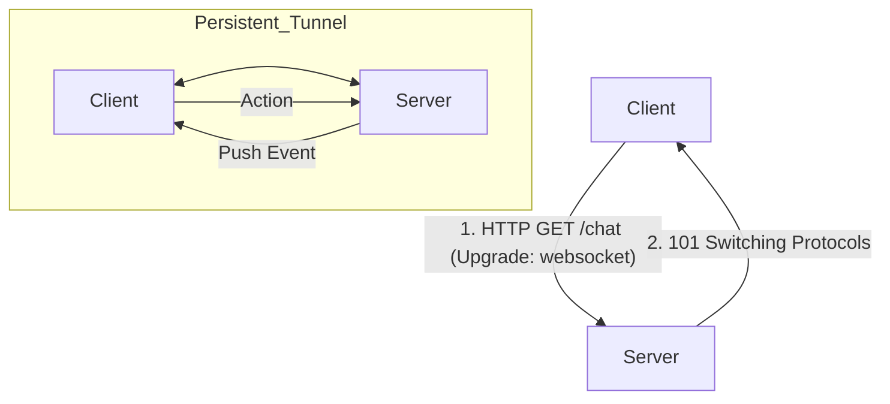

# WebSockets & SignalR: Engineering Real-Time Persistent Connectivity

============================================================
0. Architectural Vision: Beyond Request-Response
============================================================
- **WebSockets are Full-Duplex.** They allow simultaneous, two-way communication over a single, persistent TCP connection.
- **SignalR is the Orchestrator.** It provides an abstraction over WebSockets, Server-Sent Events (SSE), and Long Polling, ensuring connectivity across all browsers and proxies.
- **Hub-Based Communication.** Logic is organized into "Hubs" that broadcast messages to specific users, groups, or all connected clients.
- **Push vs Pull.** Instead of the client asking "Is there new data?" (Pull), the server tells the client "Here is new data" (Push).
- **Scale-Out Challenge.** Because connections are stateful, scaling requires a "Backplane" (Redis or Azure SignalR Service) to sync messages across multiple server nodes.
- **Architect's View.** We use real-time persistent connections to build "Live" systems—trading desks, chat apps, and collaborative tools—where latency is measured in milliseconds and data freshness is critical.

============================================================
1. Foundational Problem: The Polling Inefficiency
============================================================
- **Real-World Impact:** You are building a "Live Auction" site. To get the current bid, the mobile app polls the server every 2 seconds. 
- **What breaks?** "The Battery Drain" and "The Latency Gap". Polling creates massive overhead (HTTP headers for every request) and the user might see the winning bid 1.9 seconds late.
- **Scale Boundary:** At 1,000,000 users, 1 request every 2 seconds = 500,000 RPS just for "Checking". This will crush any standard web server infrastructure.
- **Failure Story:** A popular sports app used polling for live scores. During the World Cup final, their traffic spiked 100x. The polling traffic acted like a Self-Inflicted DDOS attack, crashing the entire platform just when users needed it most. Switching to SignalR reduced the server load by 90% because connections were kept open and idle until a score actually changed.

============================================================
2. Internal System Mechanics: Handshakes and Transports
============================================================

### The WebSocket Handshake
It begins as a regular HTTP request with an `Upgrade` header. Once accepted, the protocol switches from HTTP to binary WebSocket framing.



### Performance & Connectivity Characteristics
- **Transport Fallback.** SignalR automatically drops down to SSE or Long Polling if WebSockets are blocked by a corporate firewall or old proxy.
- **Binary vs Text.** WebSockets support both. SignalR uses **MessagePack** (binary) for high-performance, compact messaging in .NET.

============================================================
3. Production Engineering in .NET 8 (SignalR Core)
============================================================

### Anti-Pattern: Using Hubs for REST-like CRUD
```csharp
// Hubs are for BROADCASTS, not for simple DB updates.
// Don't turn your Hub into a giant Controller.
public async Task SaveOrder(Order o) { ... } 
```

### Production-Ready Implementation: Targeted Pushes and Scale-Out
```csharp
// 1. Define the Hub
public class NotificationHub : Hub
{
    // Targeted: Only the specific user receives the message
    public async Task SendToUser(string userId, string message)
    {
        await Clients.User(userId).SendAsync("ReceiveNotification", message);
    }
}

// 2. Program.cs (Scaling with Redis)
builder.Services.AddSignalR().AddStackExchangeRedis("localhost:6379");
app.MapHub<NotificationHub>("/notifications");

// 3. Triggering from outside the Hub (e.g., from a Controller or Worker)
public class OrderService(IHubContext<NotificationHub> hubContext) {
    public async Task CompleteOrder(Guid id) {
        // ...
        await hubContext.Clients.All.SendAsync("OrderCompleted", id);
    }
}
```

**Architecture Strategy:** 
- Use **Groups** to organize users by "Room" or "Tenant" for efficient broadcasting.
- Implement **Azure SignalR Service** for massive scale (100k+ concurrent connections) to offload connection management from your app nodes.

============================================================
4. System Interaction & Flow (ASCII Architecture)
============================================================

                ┌──────────────────┐
                │   The Client     │ (Browser/JS/Mobile)
                └────────┬─────────┘
                         │ 1. Upgrade Request (HTTP)
         ┌───────────────▼───────────────┐
         │     The Hub Provider          │ (Stateful Memory)
         │  ┌─────────┐   ┌─────────┐    │
         │  │ Conn ID │ → │ User ID │    │
         │  └────┬────┘   └────┬────┘    │
         └───────┼─────────────┼─────────┘
                 │             │ 2. Real-time Message
         ┌───────▼─────────────▼─────────┐
         │     Scaling Backplane         │ (Redis / Managed Service)
         └───────────────┬───────────────┘
                         │ 3. Forward to Peer
               ┌─────────▼─────────┐
               │    Target Client  │
               └───────────────────┘

============================================================
5. Strategic Scaling & System Evolution
============================================================
- **Stickiness.** Because connections are stateful, you must use "Sticky Sessions" (Affinity) on your load balancer if you aren't using a managed backplane.
- **Memory Consumption.** Every open connection consumes a few KB of RAM on the server. Monitoring RAM is your primary scaling metric.
- **Reconnection Logic.** Clients MUST implement exponential backoff for reconnections. If 100k clients all reconnect at once after a server restart, it will trigger a "Thundering Herd" crash.

============================================================
6. Reliability, Observability & Runtime Governance
============================================================
- **Key Metrics:**
    - `Active Connections`: Current load.
    - `Message Throughput`: Bytes per second.
    - `Backplane Latency`: Lag between servers.
- **Observability:** Use **Visual Studio SignalR Profiler** or **dotnet-counters** to monitor connection counts and message sizes.

============================================================
7. Compromises, Tradeoffs & Alternatives
============================================================
- **SignalR vs WebSockets.** Pure WebSockets are lightweight; SignalR adds overhead but brings groups, fallback, and automatic serialization.
- **Stateful vs Stateless.** SignalR makes your server stateful. This complicates blue-green deployments (you have to "drain" connections).

============================================================
8. Security Posture & Risk Mitigation
============================================================
- **Authentication.** SignalR sends the JWT in the query string initially because WebSockets don't support custom headers in the browser. You must configure the server to read the token from the query string.
- **Rate Limiting.** Prevent a single client from flooding the hub with messages that would then be broadcast to everyone (amplification attack).

============================================================
9. Technical Edge Cases & System Failure Modes
============================================================
- **Proxy/Firewall Blocking.** Some old proxies kill long-lived connections. Set a high "Keep-Alive" interval and "Client Timeout".
- **Serialization Mismatch.** If the client and server use different versions of a message contract, broadcasts will fail silently or crash the JSON parser.

============================================================
10. Architectural Assessment & Career Progression
============================================================
- **Senior:** "SignalR is for making chat apps."
- **Principal:** "Persistent connectivity is an architectural paradigm shift from 'Request-Response' to 'Event-Stream'. We use SignalR to synchronize state across a distributed system in real-time. By managing the tension between stateful connections and stateless scaling, we build responsive, immersive user experiences that feel 'Connected' without compromising system availability or operational safety."
- **Interview Strategy:** Discuss the difference between "In-Processor" SignalR and using the "Azure SignalR Service" for global scale.

============================================================
11. Real-World Case Study: Global Collaborative Whiteboard
============================================================
**Scenario:** A drawing app like Miro with 1,000,000 users.
- **The Problem:** 50 users in a room. Every mouse move needed to be reflected to 49 others.
- **The Design:** Used **SignalR Groups** for each room. Mouse data was sent as small **MessagePack** binary packets.
- **Result:** Lag was reduced to < 50ms. Using Azure SignalR Service meant the app servers could be scaled up/down without dropping any active whiteboard sessions.

============================================================
12. Structural Dependencies & Learning Path
============================================================
- **Foundations:** TCP/IP, HTTP, JavaScript Events.
- **Future Steps:** WebRTC (Peer-to-Peer), Change Data Capture (CDC).
- **Integration Points:** Angular/React/Vue, Redis, Azure SignalR, Worker Services.
