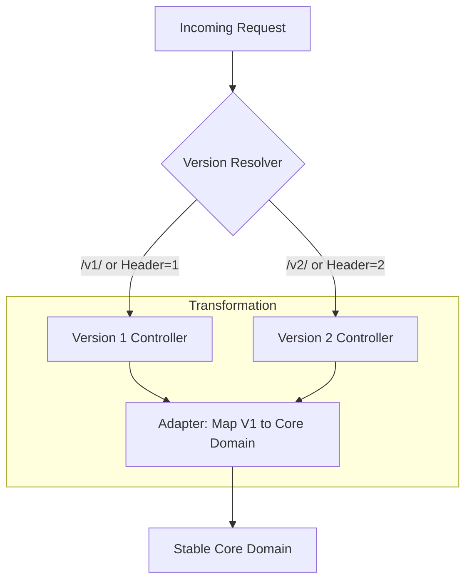

# API Versioning & Breaking Changes: Engineering Evolvable Contracts

============================================================
0. Architectural Vision: The Art of Change without Chaos
============================================================
- **APIs are Promises.** Once published, you must keep that promise until the contract is explicitly terminated.
- **Breaking Changes are Expensive.** They force your consumers to re-build, re-test, and re-deploy.
- **Versioning Strategy.** Choosing between URI Versioning (`/v1/`), Header Versioning (`X-API-Version`), or Media Type Versioning (`Accept: application/vnd.app.v1+json`).
- **Backward Compatibility.** Designing APIs to be "Extensible" by default (e.g., ignoring unknown fields, using default values).
- **Sunset Policies.** Defining a clear path for deprecating and eventually removing old versions (e.g., giving 6-month notice).
- **Architect's View.** We don't just "add features"; we manage the **Lifecycle of the API Surface**. We aim for "Add-Only" evolution and use versioning only when semantic logic changes are unavoidable.

============================================================
1. Foundational Problem: The "Legacy Client" Lock-in
============================================================
- **Real-World Impact:** You update your "Order" object to remove a `ShippingCode` field. Suddenly, 5,000 Android apps around the world start crashing because they expected that field to be present.
- **What breaks?** "The Big Bang Update". You can't update your server until all 5,000 clients have updated their app. Since you don't control the clients, you are **Locked In** to a broken schema forever.
- **Scale Boundary:** In a massive microservices mesh, if Service A breaks its contract, it can trigger a "Cascading Failure" across hundreds of other services that depend on it.
- **Failure Story:** A major social network removed a "deprecated" API field without providing a versioned alternative. A third-party "Login with Social" plugin used that field. Within 5 minutes, 10,000 websites across the internet had their "Login" button broken. The social network lost $1M in ad revenue and had to revert the change within 15 minutes. Proper **Versioning** and a **Sunset Header** would have allowed the plugin developers to migrate safely.

============================================================
2. Internal System Mechanics: Routing and Disambiguation
============================================================

### Version Dispatching
The server must determine WHICH code path to execute based on the incoming version signal.



### Performance & Routing Characteristics
- **URI Routing:** The fastest. Resolved at the edge by CDNs and Gateway routers.
- **Header/Media Type Routing:** More complex. Requires the server to parse headers before selecting a controller. Harder for CDNs to cache.

============================================================
3. Production Engineering in .NET 8 (ASP.NET API Versioning)
============================================================

### Anti-Pattern: Manual "If-Version" logic inside a Controller
```csharp
public IActionResult Get(int version) {
    if (version == 1) return GetOld(); // Terrible SoC and hard to maintain
    return GetNew();
}
```

### Production-Ready Implementation: Library-Based Versioning
```csharp
// 1. Controller Decoration
[ApiVersion("1.0", Deprecated = true)]
[ApiVersion("2.0")]
[Route("api/v{version:apiVersion}/[controller]")] // URI Versioning
public class OrdersController : ControllerBase { ... }

// 2. Program.cs Configuration
builder.Services.AddApiVersioning(options => {
    options.DefaultApiVersion = new ApiVersion(1, 0);
    options.AssumeDefaultVersionWhenUnspecified = true;
    options.ReportApiVersions = true; // Adds 'api-supported-versions' to headers
});
```

**Architecture Strategy:** 
- Use **Sunset Headers** to communicate the retirement date of an API version.
- Implement **Expansion/Contraction (The Parallel Change Pattern)**: Add the new field, wait for clients to adopt it, then remove the old field.

============================================================
4. System Interaction & Flow (ASCII Architecture)
============================================================

                ┌──────────────────┐
                │   The Client     │ (Specific Ver: 1.0)
                └────────┬─────────┘
                         │ 1. Request with Version Signal
         ┌───────────────▼───────────────┐
         │     The API Gateway           │ (Routing & Translation)
         │  ┌─────────┐   ┌─────────┐    │
         │  │ Route v1│ → │ Trace   │    │
         │  └────┬────┘   └────┬────┘    │
         └───────┼─────────────┼─────────┘
                 │             │ 2. Execute V1 Controller
         ┌───────▼─────────────▼─────────┐
         │     API Instance (v1 Code)    │ (Legacy support)
         └───────────────┬───────────────┘
                         │ 3. Log Deprecation Warning
               ┌─────────▼─────────┐
               │    Result JSON    │
               └───────────────────┘

============================================================
5. Strategic Scaling & System Evolution
============================================================
- **The "N-2" Rule.** Always support the current version (N) and at least the two previous versions (N-1, N-2) to give consumers time to move.
- **Breaking Change Detection.** Use **Contract Testing** (Pact/JSON Schema) in your CI/CD pipeline to automatically fail if a PR removes a field or changes a type.
- **Microservice Autonomy.** Services should be able to version their APIs independently without waiting for a "Global Release".

============================================================
6. Reliability, Observability & Runtime Governance
============================================================
- **Key Metrics:**
    - `Version Usage Ratio`: How many clients are still on the "Deprecated" version?
    - `Breaking Change count`: Quality of the API design.
- **Observability:** Log the `API-Version` used in every request. Use this data to justify when it is safe to finally "Turn Off" v1.

============================================================
7. Compromises, Tradeoffs & Alternatives
============================================================
- **URI vs Header.** URI is easier for users and proxies; Header is "Cleaner" but more complex to implement and test.
- **Evergreen APIs.** (Like Stripe). The client specifies their "Join Date", and the server automatically applies the transformations required for that client's era. Very complex to build but incredible for UX.

============================================================
8. Security Posture & Risk Mitigation
============================================================
- **Legacy Vulnerabilities.** Old API versions often have old security bugs. Ensure you apply security patches to ALL active versions, or force-upgrade clients during a security crisis.
- **API Surface.** Every version increases your attack surface. Sunset old versions aggressively once usage drops.

============================================================
9. Technical Edge Cases & System Failure Modes
============================================================
- **Inadvertent Breaking Change.** Changing a `List<T>` to `IEnumerable<T>` might not break compiled code, but changing the JSON field name `orders` to `orderList` will break EVERY client.
- **Side Effects.** Version 2 fix a bug in Version 1. If some clients depend on the "Buggy" behavior of V1, Fixing it in V1 is a breaking change! 
    - *Architect's Rule:* Fix the bug in V2, Leave V1 "Buggy" but stable.

============================================================
10. Architectural Assessment & Career Progression
============================================================
- **Senior:** "We put /v1/ in the URL to version our APIs."
- **Principal:** "Versioning is a strategy for managing 'System Entropic Drift'. We design our contracts to be as stable as possible, using the 'Parallel Change' pattern to navigate unavoidable breakages. We treat the API Contract as a shared social and technical asset that requires disciplined governance, transparent sunsetting, and multi-generational support to ensure the system can evolve without alienating its ecosystem."
- **Interview Strategy:** Discuss how to manage a "Zero Downtime" migration from V1 (Monolith) to V2 (Microservices) while maintaining API compatibility.

============================================================
11. Real-World Case Study: Public Government Portal
============================================================
**Scenario:** A national tax system with 1 million integration partners.
- **The Problem:** They needed to change the "Tax Calculation" logic for the new year. 
- **The Design:** Used **Date-Based Versioning** in the header. If no date was provided, it defaulted to the current logic.
- **Result:** Existing software continued to work for the previous tax year's filings, while new software used the 2024 logic by sending a different version date. No downtime, and zero broken partners.

============================================================
12. Structural Dependencies & Learning Path
============================================================
- **Foundations:** HTTP REST, JSON Schema.
- **Future Steps:** Consumer-Driven Contract Testing (Pact), API Management (APIM).
- **Integration Points:** ASP.NET Core API Versioning, Swagger UI, Azure API Management.
