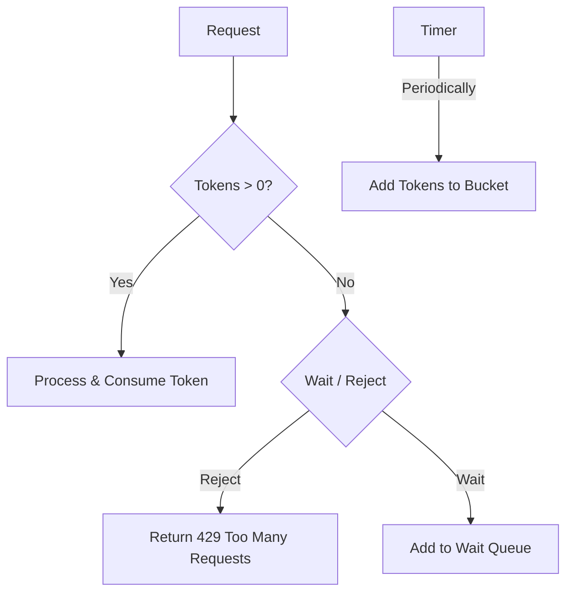

# Rate Limiting & Quotas: Engineering API Governance and Resilience

============================================================
0. Architectural Vision: The Law of Resource Fairness
============================================================
- **Rate Limiting is the System's Breaker.** It prevents asingle user or service from hogging all the system's resources (CPU, Memory, DB Connections).
- **Quotas are long-term constraints.** They define how much a user can consume over a month or a year (e.g., "1,000,000 requests per month").
- **Fixed vs Sliding Window.** Different strategies for counting requests over time, balancing accuracy with performance overhead.
- **Token Bucket algorithm.** Allows for "Bursts" of traffic while maintaining a strict long-term average.
- **Fairness and Prioritization.** Ensuring that "Premium" users get their capacity while "Free" users are capped during a surge.
- **Architect's View.** We don't rate limit to be "mean"; we do it to ensure **System Availability** for everyone. It is a critical defense against both accidental abuse and malicious DDOS attacks.

============================================================
1. Foundational Problem: The "Noisy Neighbor" and "DDoS"
============================================================
- **Real-World Impact:** An automated bot from a single IP address starts hitting your "Login" endpoint 5,000 times per second to brute-force passwords. 
- **What breaks?** "The Resource Exhaustion". Your database connection pool fills up, and your legitimate users see a "503 Service Unavailable" or "Connection Timeout". Your system is essentially offline for your paying customers.
- **Scale Boundary:** In a distributed cluster of 1,000 servers, you need a **Global Rate Limiter** (using Redis) to ensure the user's limit is respected regardless of which server node they hit.
- **Failure Story:** A popular travel booking site launched a new API for partners. A partner had a bug in their code that triggered an infinite retry loop on failure. The site had no rate limiting. Within 10 minutes, the partner's $1,000 per month test app had sent 1 billion requests, crashing the site's entire database cluster and causing $500k in lost revenue for the company. Proper **Rate Limiting** would have blocked the partner after the first 10,000 requests.

============================================================
2. Internal System Mechanics: Algorithms and Counters
============================================================

### Rate Limiting Algorithms
- **Fixed Window:** Simplest. Resets every X seconds. (Risk: Spike at the window boundary).
- **Sliding Window:** More precise. Uses a moving time frame. (Higher memory/CPU overhead).
- **Token Bucket:** Add 1 token every X ms. Consumer must take a token to proceed. Supports Bursts.



### Performance & Storage Characteristics
- **Memory vs Persistence.** Local rate limiting is fast (in-memory); Global rate limiting requires a network hop to Redis (adding 1-2ms latency).
- **Atomic Operations.** Incrementing a counter must be done atomically (e.g., using `INCR` in Redis) to prevent "Race Conditions" where a user bypasses their limit.

============================================================
3. Production Engineering in .NET 8 (Microsoft.AspNetCore.RateLimiting)
============================================================

### Anti-Pattern: Manual Counter Logic inside Controller
```csharp
// Unscalable and prone to race conditions
if(RequestCount > 100) return StatusCode(429);
```

### Production-Ready Implementation: ASP.NET Core Middleware
```csharp
// 1. Configure the Limiter in Program.cs
builder.Services.AddRateLimiter(options =>
{
    // Fixed Window Policy
    options.AddFixedWindowLimiter("GetPolicy", opt =>
    {
        opt.PermitLimit = 100;
        opt.Window = TimeSpan.FromMinutes(1);
        opt.QueueLimit = 0; // Don't queue, fail fast
    });

    // Token Bucket for Bursts
    options.AddTokenBucketLimiter("BurstPolicy", opt =>
    {
        opt.TokenLimit = 50; // Max bucket size
        opt.ReplenishmentPeriod = TimeSpan.FromSeconds(10);
        opt.TokensPerPeriod = 5; // Refill rate
    });
});

// 2. Apply it at the Controller/Endpoint Level
[EnableRateLimiting("GetPolicy")]
[HttpGet]
public IActionResult Get() { ... }
```

**Architecture Strategy:** 
- Implement **Tiered Limiting** (e.g., Guest: 10/min, Pro: 1000/min).
- Return the **Retry-After** header in the 429 response to tell the client when they can try again.

============================================================
4. System Interaction & Flow (ASCII Architecture)
============================================================

                ┌──────────────────┐
                │   The Client     │ (The User)
                └────────┬─────────┘
                         │ 1. Request + Identity (API Key)
         ┌───────────────▼───────────────┐
         │     The Rate Limiter Middleware│ (The Gatekeeper)
         │  ┌─────────┐   ┌─────────┐    │
         │  │ Redis   │ ← │ Policy  │    │
         │  │ Counter │   │ Logic   │    │
         │  └────┬────┘   └────┬────┘    │
         └───────┼─────────────┼─────────┘
                 │             │ 2. Allowed?
         ┌───────▼─────────────▼─────────┐
         │     Business Logic Layer      │ (The Protected Asset)
         └───────────────┬───────────────┘
                         │ 3. Execute Async
               ┌─────────▼─────────┐
               │    Success Response│
               └───────────────────┘

============================================================
5. Strategic Scaling & System Evolution
============================================================
- **Cluster Sensitivity.** In a cluster, if you use in-memory limiting, a user can get `Limit * ServerCount` requests. You MUST use a **Distributed Cache (Redis)** for true global limits.
- **Dynamic Limits.** High-end systems adjust limits in real-time based on the overall "System Health". If DB latency goes up, the Rate Limiter automatically lowers everyone's limit to protect the database.
- **Graceful Degradation.** When a limit is hit, consider returning "Cached Data" instead of a 429 if applicable (e.g., showing a 1-minute old stock price instead of an error).

============================================================
6. Reliability, Observability & Runtime Governance
============================================================
- **Key Metrics:**
    - `Rate Limit Rejection Rate (429s)`: Who is being blocked?
    - `Redis Health`: Latency of the counter store.
- **Observability:** Emit a custom event/log every time a rate limit is triggered, including the User ID and IP. This is critical for identifying potential attackers.

============================================================
7. Compromises, Tradeoffs & Alternatives
============================================================
- **Accuracy vs Latency.** Tight, perfectly accurate sliding windows are better for security but much more "Chatty" with the database/cache.
- **Wait Queues.** Allowing a few requests to "Queue" instead of failing can improve UX for occasional spikes, but can lead to "Request Timeout" if the queue grows too long.

============================================================
8. Security Posture & Risk Mitigation
============================================================
- **IP Scraping.** Attackers use thousands of proxy IPs to bypass IP-based rate limiting. You MUST also rate-limit by **Account/API Key**.
- **Payload Size Limiting.** Rate limiting isn't just about count; it's about size. Use `MaxRequestBodySize` to prevent users from sending 1GB of data in a single POST.

============================================================
9. Technical Edge Cases & System Failure Modes
============================================================
- **Redis Down.** If your distributed rate limiter's cache (Redis) dies, should you block everyone (Fail-Closed) or allow everyone (Fail-Open)?
    - *Architect's Rule:* **Fail-Open** with a fallback to a local in-memory limit to maintain availability.
- **Clock Drift.** If your server clocks aren't synchronized, window boundaries might behave inconsistently across nodes.

============================================================
10. Architectural Assessment & Career Progression
============================================================
- **Senior:** "We use the rate limiting middleware to return 429 if the user hits the API too much."
- **Principal:** "Rate limiting is the 'Economic Governance' of our infrastructure. We design our policies to balance **Resource Protection** with **User Experience**, using adaptive token buckets to allow legitimate bursts while strictly preventing total system exhaustion. We treat the rate limiter as a first-class security and operational component, integrating it with our global observability to ensure that 'Noisy Neighbors' can't degrade the P99 performance of our most critical workloads."
- **Interview Strategy:** Explain how to implement a "Rate Limiting Bypass" for essential internal administrative services or "Emergency Overrides".

============================================================
11. Real-World Case Study: Global Financial API
============================================================
**Scenario:** A bank with 10,000 fintech partners.
- **The Problem:** One partner wrote a bad script that saturated the bank's core "Balance Check" service.
- **The Design:** Implemented **Tiered Global Rate Limiting** using Redis. "Gold" partners got 5,000 req/sec, "Free" partners got 10 req/sec.
- **Result:** When the bad script ran again, it was blocked within 1ms. The bank's core system stayed perfectly smooth, and other partners weren't even aware there was an issue.

============================================================
12. Structural Dependencies & Learning Path
============================================================
- **Foundations:** HTTP Status Codes, Caching, Middleware.
- **Future Steps:** Redis Lua Scripting for complex limits, Adaptive Throttling.
- **Integration Points:** ASP.NET Core Rate Limiting, Redis, Envoy Local/Global Rate Limiters.
