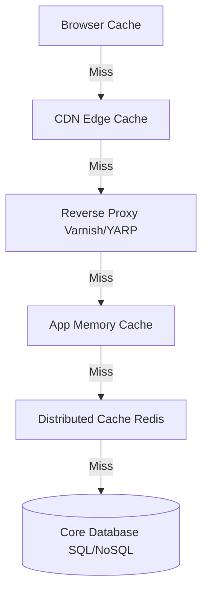

# Caching Strategies: Mastering the Multi-Layer Data Lifecycle

============================================================
0. Architectural Vision: The Speed of Light and Local Memory
============================================================
- **Caching is the "Cheat Code" for High Scale.** It avoids redundant computations and database round-trips by storing the result of a previous operation.
- **The Multi-Layer Cache.** Caching happens at every level: Browser (L1), CDN (L2), API Gateway/Reverse Proxy (L3), Application Memory (L4), and Distributed Store like Redis (L5).
- **TTL (Time to Live).** The most critical decision in caching: how long is this data "Fresh" enough to be reused?
- **Validation-Based Caching.** Using `ETag` and `Last-Modified` headers to let the client check if their cached copy is still valid without downloading the whole blob again.
- **Cache Invalidation is the Hardest Problem.** "There are only two hard things in Computer Science: cache invalidation and naming things."
- **Architect's View.** We don't just "add Redis"; we design a **Cache Hierarchy** that balances freshness and performance to ensure the system remains responsive even under 1,000,000 RPS.

============================================================
1. Foundational Problem: The "Database Meltdown"
============================================================
- **Real-World Impact:** You have a "Product Detail" page that 1,000 users are hitting every second. Every hit triggers a SQL query: `SELECT * FROM Products WHERE Id = 1`. 
- **What breaks?** "The Database Bottleneck". Even a powerful DB has a limit on concurrent connections and IOPS. When you hit that limit, the whole site starts to hang, then crash.
- **Scale Boundary:** At high scale, you can't solve performance by "Scaling up the Database". The disk and network latency of the DB will always be higher than reading from RAM.
- **Failure Story:** A major news site published a "Breaking News" alert. 500,000 people clicked the link simultaneously. The site had no edge caching on the "Article" page. The sudden surge in DB queries caused the Primary Database to hit 100% CPU, which then triggered a "Failover" to the secondary, which also reached 100% and crashed. Total downtime: 2 hours. Proper **HTTP/CDN Caching** would have handled 99.9% of that traffic at the edge, never touching the DB.

============================================================
2. Internal System Mechanics: The Cache Chain
============================================================

### The Response Header Symphony
The browser and CDN decide how to cache based on HTTP headers:
- `Cache-Control: public, max-age=3600`: Cache it anywhere for 1 hour.
- `Vary: Accept-Encoding`: Don't serve a GZipped cache to a client that doesn't support GZip.



### Performance Characteristics
- **Memory Cache (L4):** < 1 microsecond.
- **Redis (L5):** 1-2 milliseconds.
- **Database (Disk):** 10-100+ milliseconds.

============================================================
3. Production Engineering in .NET 8 (Caching Abstractions)
============================================================

### Anti-Pattern: Ad-hoc Redis calls in Business Logic
```csharp
// Tight coupling to Redis. Hard to test, hard to change.
var data = await _redis.StringGetAsync(key); 
```

### Production-Ready Implementation: Hybrid & Multi-Level Caching
```csharp
// 1. HTTP Response Caching (CDN/Gateway level)
[HttpGet("{id}")]
[ResponseCache(Duration = 60, Location = ResponseCacheLocation.Any)]
public IActionResult Get(int id) { ... }

// 2. Application-Level Caching (FusionCache / IDistributedCache)
public async Task<Product> GetProductAsync(int id)
{
    // Use an abstraction that handles "Cache-Aside" logic automatically
    return await _cache.GetOrSetAsync<Product>(
        $"product_{id}",
        async () => await _db.GetProduct(id),
        TimeSpan.FromMinutes(10)
    );
}

// 3. Output Caching (Server-Side caching of the actual response body)
app.UseOutputCache();
app.MapGet("/trending", () => ...).CacheOutput(p => p.Expire(TimeSpan.FromSeconds(10)));
```

**Architecture Strategy:** 
- Use **Stale-While-Revalidate (SWR)**: Serve the old data instantly, then update it in the background.
- Implement **Cache Tagging**: Group related items (e.g., all products in Category 5) so you can invalidate them all at once when that category changes.

============================================================
4. System Interaction & Flow (ASCII Architecture)
============================================================

                ┌──────────────────┐
                │   The Client     │ (The Requester)
                └────────┬─────────┘
                         │ 1. Request with ETag
         ┌───────────────▼───────────────┐
         │     THE CACHE CONTROLLER      │ (The Gatekeeper)
         │  ┌─────────┐   ┌─────────┐    │
         │  │ Is it   │ → │ Return  │    │
         │  │ Fresh?  │   │ 304/200 │    │
         │  └────┬────┘   └────┬────┘    │
         └───────┼─────────────┼─────────┘
                 │             │ 2. Fetch & Populate (Miss)
         ┌───────▼─────────────▼─────────┐
         │     The Backend Service       │ (The Generator)
         └───────────────┬───────────────┘
                         │ 3. Store in Distributed Store
               ┌─────────▼─────────┐
               │    Redis / DB     │
               └───────────────────┘

============================================================
5. Strategic Scaling & System Evolution
============================================================
- **Cache Cowherd (Thundering Herd).** If 10,000 requests miss a cache simultaneously (because it just expired), they ALL hit the database.
    - *Architect's Fix:* Use **Probabilistic Early Revalidation** or **Locking/Coalescing** to ensure only ONE request hits the database while others wait.
- **Cache Poisoning.** Ensuring that malicious requests can't "pollute" the cache with bad data (e.g., caching a 404 response for a page that actually exists).
- **Consistency Models.** Choosing between "Write-Through" (update cache during DB write) or "Cache-Aside" (load on miss).

============================================================
6. Reliability, Observability & Runtime Governance
============================================================
- **Key Metrics:**
    - `Cache Hit Ratio`: High is good (> 80%).
    - `Eviction Rate`: Are items being kicked out before they expire? (Indicates cache is too small).
- **Observability:** Use **Redis INSIGHT** or **dotnet-counters** to monitor memory usage and eviction counts.

============================================================
7. Compromises, Tradeoffs & Alternatives
============================================================
- **Memory vs CPU.** Caching saves DB CPU but uses Server RAM. If you cache 1GB of strings on a 2GB RAM server, you risk an OOM crash.
- **Short-lived vs No-cache.** Even a 1-second cache on a 1,000 RPS endpoint reduces the load on the DB by 1000x.

============================================================
8. Security Posture & Risk Mitigation
============================================================
- **Sensitive Data Caching.** NEVER cache personalized data (like user bank balances) in a "Public" cache (CDN/Gateway). Use `Cache-Control: private`.
- **Cache Integrity.** Ensure that cache keys include all relevant data (e.g., UserID, Language, Currency) to avoid serving the wrong content to the wrong person.

============================================================
9. Technical Edge Cases & System Failure Modes
============================================================
- **The "Cache Avalanche".** When your whole Redis cluster dies and 1 million RPS suddenly hits your database at once. 
    - *Architect's Rule:* Have a "Circuit Breaker" to throttle traffic until the cache is back online and "Warmed up".
- **Key Collisions.** Using the same cache key for two different types of data. (Always use structured prefixes like `user:1:profile`).

============================================================
10. Architectural Assessment & Career Progression
============================================================
- **Senior:** "We use Redis to cache results from our SQL service."
- **Principal:** "Caching is a tiered engineering discipline that requires precise management of the 'Consistency-Latency' trade-off. We design multi-layer cache strategies—from the Browser to the Distributed Store—using invalidation signals and surge protection to ensure that our database is only touched for 'Critical Truth'. We treat the cache not just as a performance booster, but as the fundamental structural component that enables 1M+ RPS scalability."
- **Interview Strategy:** Discuss how to design a cache invalidation strategy for a complex e-commerce order workflow.

============================================================
11. Real-World Case Study: International Ticket Vendor
============================================================
**Scenario:** A site selling tickets for a massive stadium tour.
- **The Problem:** 100,000 people hit the site at 10:00 AM. Database crashed every time.
- **The Design:** Implemented **Varnish Reverse Proxy** with a 2-second "Microcache" for the home page and **Redis** for seat availability. Used **Stale-While-Revalidate** for the artist bio.
- **Result:** Site stayed responsive. The database only processed actual "Buy" transactions, while Varnish handled 99% of the landing page views.

============================================================
12. Structural Dependencies & Learning Path
============================================================
- **Foundations:** HTTP Caching Headers, RAM/Disk speeds.
- **Future Steps:** CDN Optimization (Edge Computing), Distributed Locking.
- **Integration Points:** ASP.NET Core `IMemoryCache`, `IDistributedCache`, Output Caching, Redis, Varnish, Cloudflare.
