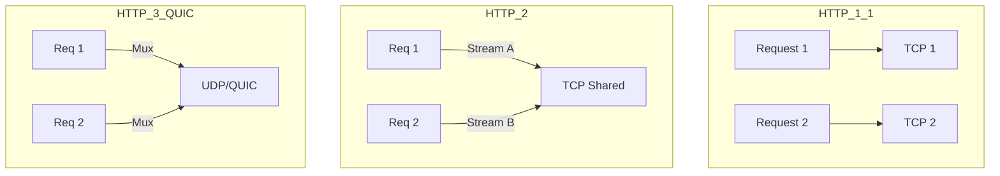

# Web Performance: Optimizing Compression and Protocol Evolution

**0. Architectural Vision: The War on Latency**
- **Performance is a Feature, not an Afterthought.** Users perceive latency as a lack of quality.
- **Compression (Brotli/Gzip).** Reducing the size of the payload to save bandwidth and speed up transmission over slow networks.
- **Protocol Evolution (HTTP/1 -> HTTP/2 -> HTTP/3).** Moving from text-based, sequential requests to binary, multiplexed, and UDP-based connections.
- **Multiplexing.** Sending multiple requests over a single connection to eliminate "Head-of-Line Blocking".
- **QUIC and HTTP/3.** Eliminating the "TCP Handshake" penalty and solving connection migration (e.g., smoothly moving from Wi-Fi to 4G).
- **Architect's View.** We don't just "enable compression"; we engineer the **Transport Layer** to ensure that our application's data reaches the user with the absolute minimum number of round-trips and bytes.

**1. Foundational Problem: The "Waterfall" and "Congestion"**
- **Real-World Impact:** You have a web page that loads 50 small images and 10 CSS/JS files. Under HTTP/1.1, the browser can only open 6 connections at a time. 
- **What breaks?** "The Loading Waterfall". The 7th file must wait for one of the first 6 to finish. This adds massive sequential latency. On a mobile network with "Packet Loss", one dropped packet can stall all 50 requests (Head-of-Line blocking).
- **Scale Boundary:** In high-concurrency environments, managing thousands of simultaneous TCP connections consumes huge amounts of memory and CPU on the server.
- **Failure Story:** A major retail site's mobile app was taking 8 seconds to load on 3G. They were sending uncompressed JSON and using HTTP/1.1. Half of the users abandoned the site before it loaded. Switching to **Brotli Compression** (20% smaller than GZip) and **HTTP/2** (reducing 50 calls to 1 multiplexed stream) dropped the load time to 2 seconds, increasing conversion by 30%.

**2. Internal System Mechanics: Compression and Streams**

### Protcol Comparison
- **HTTP/1.1:** Text-based, one request per connection. Slow handshakes.
- **HTTP/2:** Binary framing, multiplexing (multiple streams over 1 TCP connection), Header compression (HPACK).
- **HTTP/3:** Based on **QUIC** (UDP). Faster handshakes (0-RTT), better handling of packet loss, and seamless connection migration.



### Compression Algorithms
- **GZip:** Industry standard. Fast, good compression.
- **Brotli:** Modern standard. Slower to compress (for the server) but results in 15-20% smaller files than GZip. Best for static assets.

**3. Production Engineering in .NET 8 (Kestrel & Middleware)**

### Anti-Pattern: Compressing small responses
```csharp
// Compressing a 100-byte JSON response costs more CPU than the bandwidth it saves.
// Only compress payloads over 1KB.
```

### Production-Ready Implementation: Protocol and Compression Optimization
```csharp
// 1. Configure Kestrel for HTTP/2 and HTTP/3
builder.WebHost.ConfigureKestrel(options =>
{
    options.ListenAnyIP(5001, listenOptions =>
    {
        listenOptions.Protocols = HttpProtocols.Http1AndHttp2AndHttp3;
        listenOptions.UseHttps(); // HTTP/2 & 3 REQUIRE HTTPS
    });
});

// 2. Enable Brotli Compression Middleware
builder.Services.AddResponseCompression(options =>
{
    options.EnableForHttps = true;
    options.Providers.Add<BrotliCompressionProvider>();
});

// 3. Static File Optimization
app.UseStaticFiles(new StaticFileOptions
{
    OnPrepareResponse = ctx =>
    {
        // Cache static assets for a long time
        ctx.Context.Response.Headers.Append("Cache-Control", "public,max-age=31536000");
    }
});
```

**Architecture Strategy:** 
- Use **Pre-compressed Assets**: Compress your `.js` and `.css` files into `.br` files at build time, and serve them directly to save server CPU.
- Implement **Early Hints (103)** to tell the browser to start downloading CSS while the server is still calculating the HTML.

**4. System Interaction & Flow (ASCII Architecture)**

                ┌──────────────────┐
                │   The Client     │ (Browser/App)
                └────────┬─────────┘
                         │ 1. QUIC Handshake (Fast)
         ┌───────────────▼───────────────┐
         │     The Binary Framer         │ (Stream Manager)
         │  ┌─────────┐   ┌─────────┐    │
         │  │ Stream 1│ + │ Stream 2│    │
         │  └────┬────┘   └────┬────┘    │
         └───────┼─────────────┼─────────┘
                 │             │ 2. Brotli Compression
         ┌───────▼─────────────▼─────────┐
         │     Kestrel Web Server        │ (High Efficiency)
         └───────────────┬───────────────┘
                         │ 3. Return Slices (Frames)
               ┌─────────▼─────────┐
               │    Encoded Bits   │
               └───────────────────┘

**5. Strategic Scaling & System Evolution**
- **Server Load.** Brotli compression at high "Compression Levels" is CPU intensive. In a high-scale system, offload compression to your **CDN (Cloudflare/Akamai)** or a **Load Balancer (F5)** to save app server CPU.
- **Connection Migration.** Using HTTP/3 allows users to move from "Train Wi-Fi" to "Cellular data" without their active downloads or API calls failing.
- **Header Compression.** HTTP/2 and HTTP/3 compress the headers themselves, which is vital for requests with large Cookies or JWT tokens.

**6. Reliability, Observability & Runtime Governance**
- **Key Metrics:**
    - `Time to First Byte (TTFB)`: Server processing speed.
    - `First Contentful Paint (FCP)`: When the user sees something.
    - `Compression Ratio`: How much bandwidth are we saving?
- **Observability:** Use **Google Lighthouse** and **Pulse** (RUM - Real User Monitoring) to see the actual performance of your site in the wild.

**7. Compromises, Tradeoffs & Alternatives**
- **CPU vs Bandwidth.** If your bandwidth is cheap but your CPU is expensive (e.g., on a t3.micro), stick with GZip or even no compression for internal traffic.
- **HTTP/3 Support.** Not all corporate proxies or firewalls support UDP (QUIC). Always ensure a **Protocol Fallback** to HTTP/2 is in place.

**8. Security Posture & Risk Mitigation**
- **BREACH/CRIME attacks.** Compression can sometimes leak information about encrypted data. Be careful when compressing pages that contain both secret data and user-controlled data.
- **Resource Exhaustion.** Limit the number of concurrent streams per HTTP/2 connection to prevent a single client from opening 1,000,000 streams and crashing the server.

**9. Technical Edge Cases & System Failure Modes**
- **Old Proxies.** Some CDNs don't support Brotli yet and will strip the `Content-Encoding: br` header, sending uncompressed data.
- **Vary Headers.** If you cache compressed data, you MUST include `Vary: Accept-Encoding` so you don't serve Brotli to a legacy client.

**10. Architectural Assessment & Career Progression**
- **Senior:** "HTTP/2 is faster because it uses one connection."
- **Principal:** "Web performance is an multi-dimensional optimization problem across the **Transport**, **Application**, and **Presentation** layers. We use Brotli and binary protocols to minimize the 'Information Entropy' transmitted over the wire. By implementing HTTP/3 and QUIC, we build a resilient, low-latency foundation that handles the physical realities of modern mobile networks, ensuring that our system is highly responsive, regardless of the user's connection quality."
- **Interview Strategy:** Compare and contrast the "Head-of-Line Blocking" problem in HTTP/1.1 vs HTTP/2 and how HTTP/3 finally solves it at the transport level.

**11. Real-World Case Study: Global News Video Platform**
**Scenario:** A video site with 50M daily active users across diverse geographies (Africa, India, USA).
- **The Problem:** Users in low-bandwidth regions were seeing 10-second spinners.
- **The Design:** Implemented **Brotli Pre-compression** for all CSS/JS and forced **HTTP/3 (QUIC)** for the API gateway.
- **Result:** Latency dropped by 40% in high-packet-loss regions. The server CPU usage for compression dropped by 20% because most assets were pre-compressed at build time.

**12. Structural Dependencies & Learning Path**
- **Foundations:** TCP/UDP, HTTP basics, Algorithms.
- **Future Steps:** Early Hints, HTTP/3 Advanced Tuning, Edge Computing.
- **Integration Points:** Kestrel, Cloudflare, NGINX, Brotli.net.
